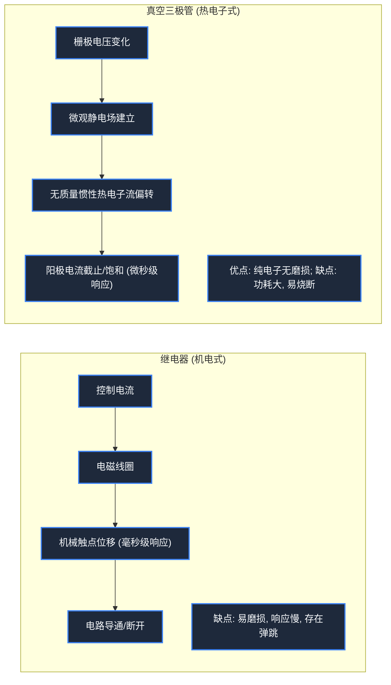

> **课程体系**：【计算机科学速成课】Crash Course Computer Science (PBS / 全40集精校)  
> **所属模块**：Module 1: 硬件基石与体系架构 (Hardware & Architecture)  
> **主讲嘉宾**：Carrie Anne Philbin  
> **视频时长**：10:44 ｜ **高清画面截图**：4 张核心知识点板书/图解  
> **视频直达**：[📺 在 B 站观看本讲原视频 (P2)](https://www.bilibili.com/video/BV1EW411u7th/?p=2)  
> **全书导航**：[← 上一讲 (P01)](/notes/cccs/lecture-01) ｜ [📚 返回全书目录](/notes/topics/CCCS) ｜ [下一讲 (P03) →](/notes/cccs/lecture-03)

---

## 核心导读与概念全景

剖析计算机从机电继电器、热电子真空管，到革命性固态半导体晶体管的物理进化脉络，详解哈佛 Mark I、巨像计算机、ENIAC 的工程突破与硅谷崛起的深远影响。

---

## 1. 机电时代：继电器（Relay）与物理触点的机械瓶颈

*(参考时间：00:01:10 · [视频跳转 (P2 00:01:10)](https://www.bilibili.com/video/BV1EW411u7th/?p=2&t=70))*

进入 20 世纪，随着电力的普及，工程师开始将电磁学引入计算机构建中。早期电子计算机并非纯电子设备，而是**机电一体化计算机（Electromechanical Computers）**。

这类设备的核心元件是**继电器（Relay）**：
- **工作机制**：继电器本质是一个用电控制的机械开关。内部有一个控制线圈和一个带有弹簧的铁质活动触点（电枢）。当控制线圈通电时，产生的电磁力克服弹簧张力将金属触点下拉吸合，电路导通；当控制线圈断电时，弹簧将触点拉回，电路断开。
- **物理极限与瓶颈**：由于触点具有机械质量和弹簧惯性，普通继电器每秒最多只能开关约 50 次（50 Hz）。此外，金属触点在频繁通断过程中会产生电火花，导致触点积碳磨损；灰尘、油污甚至昆虫掉入触点间隙都会导致开关无法闭合。
- **著名的“Bug”轶事**：1947 年，计算机先驱格蕾丝·霍珀（Grace Hopper）在调试哈佛 Mark II 机电计算机时，机器发生严重故障。团队排查后发现，一只飞蛾被卡在第 70 号继电器的触点中间导致短路。霍珀将这只飞蛾小心取下并贴在工程日志本上，打趣地写道：“这是第一个被发现的真正的计算机 Bug（臭虫）”。自此，“Debug（除虫/调试）”一词传遍全球。

*⏱ 时间戳：00:01:45 · 📷 课堂截图 · [在 B 站观看对应片段 (P2 00:01:45)](https://www.bilibili.com/video/BV1EW411u7th/?p=2&t=105)*

## 2. 热电子真空管（Vacuum Tube）：迈向光速开关

*(参考时间：00:03:30 · [视频跳转 (P2 00:03:30)](https://www.bilibili.com/video/BV1EW411u7th/?p=2&t=210))*

为了彻底摆脱机械运动的速度枷锁，物理学家将目光投向了真空中的电子运动。

1904 年约翰·弗莱明发明热电子二极管，1906 年李·德富雷斯特（Lee de Forest）发明了**三极真空管（Audion / Triode）**：
- **工作原理**：在一个抽成高真空的玻璃泡内封装三个电极——阴极（Cathode）、阳极/屏极（Anode/Plate）以及夹在二者之间的金属丝网**栅极（Grid）**。阴极通电加热后释放大量自由电子（热电子发射），向带正高压的阳极漂移形成电流。
- **电子开关控制**：如果在栅极施加微弱的负电压，负电荷会排斥电子流，瞬间切断阴极到阳极的电流；如果撤去负电压，电子流再次畅通无阻。
- **压倒性优势**：真空管内部**没有任何机械活动部件**，控制电流完全依靠空间电场对微观电子的库仑力操控，开关频率可轻松飙升至数千甚至数万赫兹（kHz），比机械继电器快了整整几个数量级！

*⏱ 时间戳：00:04:00 · 📷 课堂截图 · [在 B 站观看对应片段 (P2 00:04:00)](https://www.bilibili.com/video/BV1EW411u7th/?p=2&t=240)*

## 3. 战火中的计算巨兽：哈佛 Mark I、巨像计算机与 ENIAC

*(参考时间：00:05:30 · [视频跳转 (P2 00:05:30)](https://www.bilibili.com/video/BV1EW411u7th/?p=2&t=330))*

第二次世界大战成为了催生第一代电子计算巨兽的超级催化剂。

#### 1. 哈佛 Mark I（IBM ASCC, 1944）
由霍华德·艾肯（Howard Aiken）设计、IBM 出资建造。长达 15 米，重达 5 吨，内部由 76.5 万个机电零件、数百英里长的导线组成。它虽然每秒只能完成 3 次加法，但在战争期间为曼哈顿工程执行了原子弹裂变模拟的关键数值运算。

#### 2. 英国巨像计算机（Colossus Mark 1/2, 1943）
由英国工程师汤米·弗劳尔斯（Tommy Flowers）在布莱切利园秘密建造，用于破解纳粹德国高级统帅部的 Lorenz 密电。巨像机使用了 1600 至 2400 只真空管，通过纯电子电路比对打孔纸带上的密文流，被誉为**世界上第一台可编程的全电子数字计算机**。

#### 3. ENIAC（电子数值积分计算机, 1946）
由约翰·莫奇利（John Mauchly）与 J. 普雷斯珀·埃克特（J. Presper Eckert）在宾夕法尼亚大学设计建造，旨在为美国陆军军械部计算火炮与炸弹的精确弹道射表。
- **恐怖的物理体量**：使用了 17,468 根真空管、7,200 个晶体二极管、1,500 个继电器以及 500 万个手工焊接接点；占地面积 167 平方米，耗电量高达 150 千瓦（传说每次开机，费城半个街区的路灯都会瞬间变暗）。
- **震撼的计算能力**：ENIAC 每秒可执行 **5,000 次十位数加法**，或者 357 次乘法！过去人类计算员需要耗费 20 个小时手工运算的一张火炮弹道轨迹表，ENIAC 只需 30 秒即可精准吐出。
- **可靠性瓶颈**：由于数万根真空管的发热量与灯丝老化，平均每两到三天就会烧掉一根管子，工程师大部分时间都在穿梭于机柜间排查损坏的真空管。

*⏱ 时间戳：00:06:40 · 📷 课堂截图 · [在 B 站观看对应片段 (P2 00:06:40)](https://www.bilibili.com/video/BV1EW411u7th/?p=2&t=400)*

## 4. 固态物理革命：晶体管（Transistor）与硅谷崛起

*(参考时间：00:07:35 · [视频跳转 (P2 00:07:35)](https://www.bilibili.com/video/BV1EW411u7th/?p=2&t=455))*

真空管昂贵、易碎、高热、功耗巨大，无法支撑拥有数百万个开关的复杂计算系统。计算机必须寻找全新的物理载体。

1947 年 12 月，美国贝尔实验室的约翰·巴丁（John Bardeen）、沃尔特·布拉顿（Walter Brattain）与威廉·肖克利（William Shockley）取得了 20 世纪最伟大的物理突破——发明了**双极型晶体管（Transistor）**。

#### 晶体管的物理奇迹
晶体管属于**全固态（Solid-State）器件**。它利用半导体材料（如锗 Ge 和硅 Si）通过掺杂微量杂质元素（如磷、硼），形成 P 型半导体与 N 型半导体。
- 在晶体管中，基极（Base）注入微量控制电流，就能剧烈改变集电极（Collector）与发射极（Emitter）之间耗尽层的导电性能，从而实现完美的固态电流开关。
- **革命性升级**：晶体管不需要加热阴极灯丝，几乎不产生多余热量；体积只有真空管的千分之一甚至更小；极其耐用且响应时间进入纳秒（ns）级别！三人因此荣获 1956 年诺贝尔物理学奖。

#### 硅谷（Silicon Valley）的诞生
威廉·肖克利离开贝尔实验室后，选择在加州圣塔克拉拉山谷（帕洛阿尔托附近）创办肖克利半导体实验室。由于硅材料在地壳中储量极其丰富（沙子的主要成分二氧化硅）且在高温下性能远比锗稳定，硅迅速成为制造晶体管的首选基材。

伴随著名的“八叛徒（Traitorous Eight）”出走创立仙童半导体（Fairchild Semiconductor），并孕育出英特尔（Intel）、AMD 等科技巨头，圣塔克拉拉山谷被世人赋予了一个闪耀至今的名字——**硅谷（Silicon Valley）**。计算机硬件从这一刻起，彻底踏上了指数级微型化与平民化普及的高速轨道。

*⏱ 时间戳：00:07:45 · 📷 课堂截图 · [在 B 站观看对应片段 (P2 00:07:45)](https://www.bilibili.com/video/BV1EW411u7th/?p=2&t=465)*

---

## 附：本讲知识脑图与回顾思考

本讲作为 **Module 1: 硬件基石与体系架构 (Hardware & Architecture)** 的核心组成部分，系统串联了从底层硬件物理开关、中间层抽象协议到上层应用的思维跃迁。建议结合 B 站原版视频与本讲图文指南反复印证，理解技术演进背后的工程权衡与必然逻辑。

[← 上一讲 (P01)](/notes/cccs/lecture-01) ｜ [📚 返回全书目录](/notes/topics/CCCS) ｜ [下一讲 (P03) →](/notes/cccs/lecture-03)
