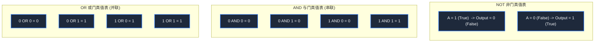

> **课程体系**：【计算机科学速成课】Crash Course Computer Science (PBS / 全40集精校)  
> **所属模块**：Module 1: 硬件基石与体系架构 (Hardware & Architecture)  
> **主讲嘉宾**：Carrie Anne Philbin  
> **视频时长**：10:07 ｜ **高清画面截图**：4 张核心知识点板书/图解  
> **视频直达**：[📺 在 B 站观看本讲原视频 (P3)](https://www.bilibili.com/video/BV1EW411u7th/?p=3)  
> **全书导航**：[← 上一讲 (P02)](/notes/cccs/lecture-02) ｜ [📚 返回全书目录](/notes/topics/CCCS) ｜ [下一讲 (P04) →](/notes/cccs/lecture-04)

---

## 核心导读与概念全景

从乔治·布尔创立的布尔代数出发，详解高低电平与 True/False 的电信号映射，深度推导 NOT、AND、OR、XOR 门的晶体管实现机制与真值表，揭示数字逻辑抽象的基石。

---

## 1. 乔治·布尔与逻辑的数学公理化

*(参考时间：00:01:20 · [视频跳转 (P3 00:01:20)](https://www.bilibili.com/video/BV1EW411u7th/?p=3&t=80))*

现代计算机在最深层的物理本质上，全部由亿万个微型电子开关（晶体管）组成。但如何用物理开关去表达人类的逻辑推理、数学计算乃至复杂思想？

这一理论基石早在计算机问世前一个世纪，就由英国自学成才的数学家**乔治·布尔（George Boole）**在 1847 年奠定。布尔创立了**布尔代数（Boolean Algebra）**，将传统亚里士多德三段论式的哲学逻辑完全形式化为严密的数学运算：
- 在布尔代数中，所有变量的值只能是两极分化的两个真值之一：**真（True）** 或 **假（False）**；
- 命题之间的组合与推演被规约为三种最基本的布尔操作：**与（AND）**、**或（OR）**、**非（NOT）**。

1937 年，信息论之父克劳德·香农（Claude Shannon）在著名的麻省理工学院硕士论文中惊人地指出：**布尔代数的真与假，能够与继电器/电子管开关的“通”与“断”（开关闭合为 True，开关断开为 False）产生完美的同构映射！** 这篇论文被称为 20 世纪最具划时代意义的硕士论文，直接架起了抽象数理逻辑通往物理工程实现的桥梁。

*⏱ 时间戳：00:03:00 · 📷 课堂截图 · [在 B 站观看对应片段 (P3 00:03:00)](https://www.bilibili.com/video/BV1EW411u7th/?p=3&t=180)*

## 2. 基础逻辑门与晶体管电路构建

*(参考时间：00:02:50 · [视频跳转 (P3 00:02:50)](https://www.bilibili.com/video/BV1EW411u7th/?p=3&t=170))*

在现代电路中，我们通常用高电压（如 +5V 或 +3.3V）表示 **True（二进制 1）**，用接地低电压（0V）表示 **False（二进制 0）**。能够执行布尔运算的微小电路单元被称为**逻辑门（Logic Gates）**。

#### 1. NOT 门（非门 / 反相器）
- **逻辑语义**：输入为 True 则输出 False；输入为 False 则输出 True。
- **晶体管硬件实现**：将输出端通过一个限流电阻连接到高电平电源（VCC），同时输出端向下连接一个 N 沟道晶体管的漏极，晶体管源极接地。
  - 当输入为 0V（False）时：晶体管截止，输出端无法接地，被上拉电阻牢牢拉至 VCC 高电平，输出为 1（True）；
  - 当输入为 +5V（True）时：晶体管饱和导通，输出端电流直接经由晶体管流向地线，输出端被钳位至 0V，输出为 0（False）。

#### 2. AND 门（与门）
- **逻辑语义**：只有当所有输入端全部为 True 时，输出才为 True；只要有一个输入为 False，输出立即为 False。
- **晶体管硬件实现**：采用两个晶体管**串联**。电流要想从电源流向输出端，必须依次穿过晶体管 A 和晶体管 B。只有当 A 端和 B 端同时施加高电平使两个晶体管全部导通时，完整通路才成立。

#### 3. OR 门（或门）
- **逻辑语义**：只要输入端中至少有一个为 True，输出就为 True；只有当全部输入均为 False 时，输出才为 False。
- **晶体管硬件实现**：采用两个晶体管**并联**。两条并联分支分别受输入 A 和输入 B 控制。只要任何一个分支导通，电流就能顺利涌向输出端。

*⏱ 时间戳：00:04:30 · 📷 课堂截图 · [在 B 站观看对应片段 (P3 00:04:30)](https://www.bilibili.com/video/BV1EW411u7th/?p=3&t=270)*

## 3. 异或门（XOR）与功能完备性（Functional Completeness）

*(参考时间：00:07:05 · [视频跳转 (P3 00:07:05)](https://www.bilibili.com/video/BV1EW411u7th/?p=3&t=425))*

在基础门之外，计算机算术运算中最关键的门电路是**异或门（XOR, Exclusive OR）**。

#### XOR 异或门：算术加法的核心灵魂
- **逻辑语义**：当两个输入端**电平状态不相同**时，输出为 True；若两个输入端相同（同为 1 或同为 0），输出为 False。
- **布尔代数表达式**：
  $$A \oplus B = (A \cdot \overline{B}) + (\overline{A} \cdot B)$$
- **电路级搭建**：可以用 2 个 NOT 门、2 个 AND 门和 1 个 OR 门复合而成。
  XOR 之所以无比重要，是因为它精确再现了**二进制加法中“不考虑进位时的本位求和”**：$0+0=0, 0+1=1, 1+0=1, 1+1=0$（产生进位，本位为 0）。

#### 功能完备性：NAND 与 NOR 的“宇宙积木”
在计算机工程中，工程师极度青睐一种被称为**与非门（NAND Gate）**和**或非门（NOR Gate）**的逻辑门。
- **功能完备性（Functional Completeness）**：由 NAND 门（或 NOR 门）这单一一种逻辑门，通过不同的拓扑互联，就能构造出 NOT、AND、OR、XOR 等所有其他任意逻辑门！
- **工程价值**：在制造集成电路芯片时，晶圆厂只需在硅片上疯狂复制同一种最精简、最容易蚀刻的 NAND 晶体管结构，即可搭建出从微型芯片到顶级 CPU 的一切算力系统！这就是数字抽象层次（Abstraction Layer）的终极威力。

*⏱ 时间戳：00:06:10 · 📷 课堂截图 · [在 B 站观看对应片段 (P3 00:06:10)](https://www.bilibili.com/video/BV1EW411u7th/?p=3&t=370)*

*⏱ 时间戳：00:07:30 · 📷 课堂截图 · [在 B 站观看对应片段 (P3 00:07:30)](https://www.bilibili.com/video/BV1EW411u7th/?p=3&t=450)*

---

## 附：本讲知识脑图与回顾思考

本讲作为 **Module 1: 硬件基石与体系架构 (Hardware & Architecture)** 的核心组成部分，系统串联了从底层硬件物理开关、中间层抽象协议到上层应用的思维跃迁。建议结合 B 站原版视频与本讲图文指南反复印证，理解技术演进背后的工程权衡与必然逻辑。

[← 上一讲 (P02)](/notes/cccs/lecture-02) ｜ [📚 返回全书目录](/notes/topics/CCCS) ｜ [下一讲 (P04) →](/notes/cccs/lecture-04)
