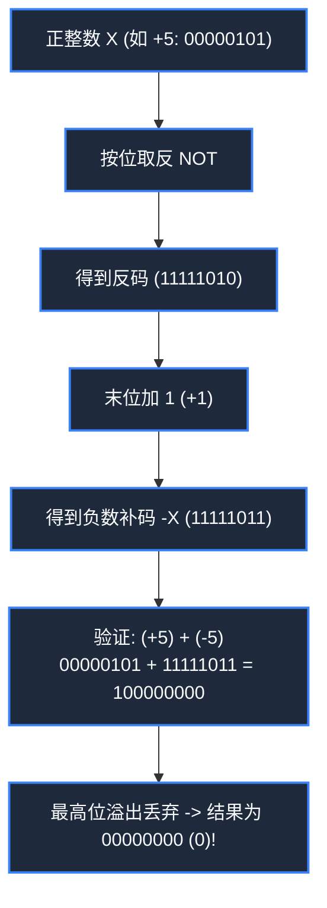

> **课程体系**：【计算机科学速成课】Crash Course Computer Science (PBS / 全40集精校)  
> **所属模块**：Module 1: 硬件基石与体系架构 (Hardware & Architecture)  
> **主讲嘉宾**：Carrie Anne Philbin  
> **视频时长**：10:45 ｜ **高清画面截图**：4 张核心知识点板书/图解  
> **视频直达**：[📺 在 B 站观看本讲原视频 (P4)](https://www.bilibili.com/video/BV1EW411u7th/?p=4)  
> **全书导航**：[← 上一讲 (P03)](/notes/cccs/lecture-03) ｜ [📚 返回全书目录](/notes/topics/CCCS) ｜ [下一讲 (P05) →](/notes/cccs/lecture-05)

---

## 核心导读与概念全景

深入剖析位权进位制、原码/反码/补码的数学闭环、浮点数 IEEE 754 规格化规范，以及字符编码从 7 位 ASCII 到 Unicode/UTF-8 的全景演进。

---

## 1. 进制与位权：为什么计算机必然选择二进制？

*(参考时间：00:01:10 · [视频跳转 (P4 00:01:10)](https://www.bilibili.com/video/BV1EW411u7th/?p=4&t=70))*

人类之所以普遍使用十进制（Base-10），纯粹是因为我们拥有十根手指；而在物理硬件层面，制造能够极其稳定区分 10 种离散电压状态（如 0V, 0.5V, 1.0V... 4.5V）的电子器件不仅极其复杂，而且极易受到供电波动与电磁噪声干扰导致读数错误。

相反，**二进制（Base-2）**只需要区分两个状态：**有电 vs 没电，高电平 vs 低电平**。这种巨大的抗干扰容限，赋予了数字计算机无与伦比的计算稳定性。

在二进制数中，每一个二进制数位被称为一个 **Bit（比特/位）**：
- 1 个 Bit 只能表示 2 个状态（0 或 1）；
- $n$ 个 Bit 能够组合出 $2^n$ 个互不相同的状态；
- 计算机将 8 个 Bit 打包捆绑为一组，定义为 **1 Byte（字节）**。8 位无符号二进制数的位权从右向左为 $2^0, 2^1, 2^2, \dots, 2^7$（1, 2, 4, 8, 16, 32, 64, 128），其能够表示的整数范围为：
  $$00000000_2 \sim 11111111_2 \implies 0 \sim 255$$

*⏱ 时间戳：00:02:30 · 📷 课堂截图 · [在 B 站观看对应片段 (P4 00:02:30)](https://www.bilibili.com/video/BV1EW411u7th/?p=4&t=150)*

## 2. 负数表示的工程进化：原码、反码与补码（Two's Complement）

*(参考时间：00:04:20 · [视频跳转 (P4 00:04:20)](https://www.bilibili.com/video/BV1EW411u7th/?p=4&t=260))*

无符号数只能表示正整数，但现实世界充满负数。计算机硬件如何表示负数？这一探索经历了三次重大的工程迭代：

#### 1. 原码（Sign-Magnitude）
最直观的想法是用最高位作为符号位：`0` 代表正数，`1` 代表负数，其余低位表示数值绝对值。
- **致命缺陷**：
  1. 出现了两个零：`00000000` 是 $+0$，而 `10000000` 是 $-0$，在逻辑判断与比较上产生巨大歧义；
  2. 硬件无法直接用加法器做运算：计算 $5 + (-5)$，即 `00000101 + 10000101 = 10001010`（$-10$），结果彻底荒谬！计算机必须额外设计复杂的减法判定电路。

#### 2. 反码（Ones' Complement）
为了让加法器通用，提出反码：正数反码不变，负数反码除符号位保持 1 外，其余数值位全部按位取反（0 变 1，1 变 0）。
- **依然存在的问题**：仍未消灭双重零（`00000000` 与 `11111111` 均为 0），且加法产生端面进位时需要回卷循环进位。

#### 3. 终极解法：二进制补码（Two's Complement）
现代计算机所有整数运算统一采用**补码**：
- **定义规则**：正数补码与其本身相同；负数的补码为**反码再加 1**（即：按位取反，末位加一）。
- **代数本质**：补码利用模算术原理，将减法完美等价于加上一个带模溢出的正数！在 8 位运算中，模为 $2^8 = 256$。
- **无与伦比的硬件优势**：
  1. 彻底消灭了“负零”：`00000000` 唯一表示 0，原码中的负零 `10000000` 被顺理成章地用来表示 $-128$，使得 8 位有符号整数范围扩展至 $[-128, +127]$；
  2. **加减法硬件完全统一**：计算 $A - B$，硬件只需直接计算 $A + (\sim B + 1)$，同一块加法器芯片无需任何减法改造即可兼顾正负算术！

*⏱ 时间戳：00:05:15 · 📷 课堂截图 · [在 B 站观看对应片段 (P4 00:05:15)](https://www.bilibili.com/video/BV1EW411u7th/?p=4&t=315)*

## 3. 浮点数与 IEEE 754 标准：在有限位中容纳无限微观与宏观

*(参考时间：00:07:15 · [视频跳转 (P4 00:07:15)](https://www.bilibili.com/video/BV1EW411u7th/?p=4&t=435))*

整数只能表示离散数字，但科学计算中经常出现极其庞大（如光速 $3 \times 10^8$ m/s）或极其微小（如质子质量 $1.67 \times 10^{-27}$ kg）的小数。

如果固定小数点位置（定点数），有限的 32 位将被严重浪费，精度与动态范围不可兼得。计算机采用了类似科学记数法的**浮点数表示法（Floating-Point）**。

1985 年，电气电子工程师学会确立了全球通用的 **IEEE 754 标准**。以最常见的 32 位单精度浮点数（float）为例：
$$\text{Value} = (-1)^S \times (1 + \text{Fraction}) \times 2^{(\text{Exponent} - \text{Bias})}$$
- **1 位符号位（Sign, S）**：`0` 表示正数，`1` 表示负数；
- **8 位阶码（Exponent, E）**：表示 $2$ 的指数次幂。采用加偏置值（Bias = 127）的移码表示，避免负指数的补码符号判断；
- **23 位尾数（Fraction / Mantissa）**：由于规格化二进制数的小数点前第一位永远隐式默认为 `1`（如 $1.011_2$），因此最高位的 `1` 无需物理存储，白白节省了 1 个 Bit 的有效精度！

浮点数虽然极大拓展了数值表示范围，但也带来了由于精度截断引发的经典舍入误差（如著名的 $0.1 + 0.2 \neq 0.3$），在金融与安全系统中必须格外谨慎防范。

*⏱ 时间戳：00:07:45 · 📷 课堂截图 · [在 B 站观看对应片段 (P4 00:07:45)](https://www.bilibili.com/video/BV1EW411u7th/?p=4&t=465)*

## 4. 文本与字符编码：从 ASCII 码表到全球通用 Unicode

*(参考时间：00:09:10 · [视频跳转 (P4 00:09:10)](https://www.bilibili.com/video/BV1EW411u7th/?p=4&t=550))*

计算机不仅要算数，还要处理人类语言文字。由于硬件只能读懂 0 和 1，必须建立一套字符到二进制数字的映射字典。

#### 1. ASCII 码（美国信息交换标准代码, 1963）
ASCII 使用 **7 个二进制位**定义了 128 个字符：包含英文字母（大小写 A-Z, a-z）、数字（0-9）、常用标点符号以及 32 个不可见的电传通信控制符（如回车 CR、换行 LF、响铃 BEL 等）。例如大写字母 `'A'` 对应十进制 65，二进制 `01000001`。

#### 2. 乱码丛生的大混乱时代
当计算机走向全球时，7 位的 ASCII 甚至塞不满 1 个 Byte（还空余 1 位最高位）。欧洲各国利用第 8 位扩展出各国的扩展 ASCII 码表（ISO-8859 系列）；而在中国、日本等东方国家，数万个汉字显然无法塞入 256 个编码中。中日韩先后制定了各自的双字节编码体系（如中国的 GB2312、GBK，台湾的 Big5，日本的 Shift-JIS）。由于编码标准互不兼容，同一个字节序列在不同的操作系统中被解释成完全不同的字形，引发了灾难性的“乱码”现象。

#### 3. 终极统一：Unicode 与 UTF-8
为了从根本上消灭巴别塔困境，国际标准化组织联合科技巨头建立了 **Unicode（统一码/万国码）**联盟，其宏伟目标是：**为世界上每一种人类语言中的每一个字符、象形文字甚至 Emoji 表情符号，分配一个全球独一无二的十六进制码点（Code Point）**！

而在存储与网络传输中，肯·汤普逊（Ken Thompson）与罗布·派克（Rob Pike）发明了天才的 **UTF-8 变长编码**：
- 对于英文字符，依然使用 1 字节并完全向后兼容 ASCII；
- 对于汉字等复杂文字，平滑自适应扩展为 3 到 4 字节；
UTF-8 彻底终结了文本混乱时代，成为今天万维网与现代操作系统的统一基石。

*⏱ 时间戳：00:09:40 · 📷 课堂截图 · [在 B 站观看对应片段 (P4 00:09:40)](https://www.bilibili.com/video/BV1EW411u7th/?p=4&t=580)*

---

## 附：本讲知识脑图与回顾思考

本讲作为 **Module 1: 硬件基石与体系架构 (Hardware & Architecture)** 的核心组成部分，系统串联了从底层硬件物理开关、中间层抽象协议到上层应用的思维跃迁。建议结合 B 站原版视频与本讲图文指南反复印证，理解技术演进背后的工程权衡与必然逻辑。

[← 上一讲 (P03)](/notes/cccs/lecture-03) ｜ [📚 返回全书目录](/notes/topics/CCCS) ｜ [下一讲 (P05) →](/notes/cccs/lecture-05)
