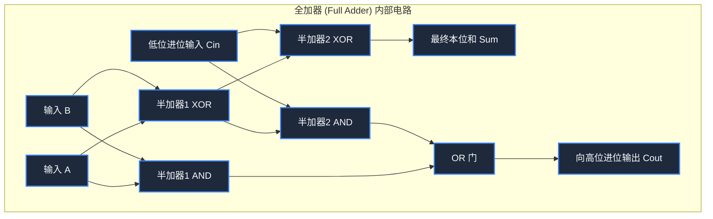

> **课程体系**：【计算机科学速成课】Crash Course Computer Science (PBS / 全40集精校)  
> **所属模块**：Module 1: 硬件基石与体系架构 (Hardware & Architecture)  
> **主讲嘉宾**：Carrie Anne Philbin  
> **视频时长**：11:09 ｜ **高清画面截图**：4 张核心知识点板书/图解  
> **视频直达**：[📺 在 B 站观看本讲原视频 (P5)](https://www.bilibili.com/video/BV1EW411u7th/?p=5)  
> **全书导航**：[← 上一讲 (P04)](/notes/cccs/lecture-04) ｜ [📚 返回全书目录](/notes/topics/CCCS) ｜ [下一讲 (P06) →](/notes/cccs/lecture-06)

---

## 核心导读与概念全景

从半加器、全加器电路搭建出发，步步推演 8 位行波进位加法器的级联原理，并深入探讨算术单元与逻辑单元的集成架构及状态标志位的控制机制。

---

## 1. 算术逻辑单元（ALU）：计算机的大脑心脏

*(参考时间：00:01:05 · [视频跳转 (P5 00:01:05)](https://www.bilibili.com/video/BV1EW411u7th/?p=5&t=65))*

如果在 CPU 内部寻找那个真正动手干脏活累活、执行一切实质性数学运算和逻辑判定的物理实体，那毫无疑问就是**算术逻辑单元（Arithmetic and Logic Unit, ALU）**。

从结构上看，ALU 划分为两大功能阵营：
1. **算术单元（Arithmetic Unit）**：负责所有的加法、减法、自增自减，以及由加法迭代构成的乘除运算；
2. **逻辑单元（Logic Unit）**：负责位级别的布尔逻辑操作（如 AND, OR, NOT, XOR）以及数值的左移（Shift Left）和右移（Shift Right）。

理解了 ALU 是如何用一堆由晶体管焊成的死逻辑门精准算出数学结果的，你就理解了现代数字计算机最核心的物理奥秘。

*⏱ 时间戳：00:02:15 · 📷 课堂截图 · [在 B 站观看对应片段 (P5 00:02:15)](https://www.bilibili.com/video/BV1EW411u7th/?p=5&t=135)*

## 2. 从半加器（Half Adder）到全加器（Full Adder）

*(参考时间：00:02:00 · [视频跳转 (P5 00:02:00)](https://www.bilibili.com/video/BV1EW411u7th/?p=5&t=120))*

我们在小学学习两位二进制数相加：
- $0 + 0 = 0$
- $0 + 1 = 1$
- $1 + 0 = 1$
- $1 + 1 = 10_2$（本位为 0，向高位进位 1）

#### 1. 半加器（Half Adder）
仔细观察这个真值表，你会发现惊人的对称性：
- **本位和（Sum, S）**：只有两个输入不同时才为 1，完全契合 **XOR 门**的逻辑（$S = A \oplus B$）；
- **向高位的进位（Carry, C）**：只有两个输入同为 1 时才产生进位，完全契合 **AND 门**的逻辑（$C = A \cdot B$）。
一个 XOR 门加上一个 AND 门，就构成了**半加器**。
但半加器有一个致命缺陷：它只能处理当前位的输入 $A$ 和 $B$，**根本无法接收来自低位的进位输入（Carry-in, $C_{in}$）**！因此它只能作为多位数运算中的最低位（个位）。

#### 2. 全加器（Full Adder）
为了处理带有低位进位的通用计算，必须拥有三个输入端：$A, B, C_{in}$，以及两个输出端：和 $S$、进位输出 $C_{out}$。
- **电路级搭建**：全加器巧妙地级联了**两个半加器**与**一个 OR 门**：
  1. 第一个半加器先将输入 $A$ 与 $B$ 相加，得到中间和 $S_1$ 与中间进位 $C_1$；
  2. 第二个半加器将中间和 $S_1$ 与来自低位的进位输入 $C_{in}$ 相加，得出最终的本位和 $S = A \oplus B \oplus C_{in}$，并产生第二个进位 $C_2$；
  3. 将 $C_1$ 与 $C_2$ 送入一个 OR 门：只要第一步产生了进位（$1+1$），或者加上 $C_{in}$ 后产生了进位，高位进位就必须被触发！得出 $C_{out} = (A \cdot B) + (C_{in} \cdot (A \oplus B))$。

*⏱ 时间戳：00:03:50 · 📷 课堂截图 · [在 B 站观看对应片段 (P5 00:03:50)](https://www.bilibili.com/video/BV1EW411u7th/?p=5&t=230)*

## 3. 8 位行波进位加法器与级联延迟瓶颈

*(参考时间：00:05:10 · [视频跳转 (P5 00:05:10)](https://www.bilibili.com/video/BV1EW411u7th/?p=5&t=310))*

有了全加器，多位数加法就变得如同搭积木一样优雅自然。

对于一个 8 位加法器，我们只需将 8 个全加器并排排列：
- 第 0 位的 $C_{in}$ 接地（输入 0）；
- 第 0 位的进位输出 $C_{out}$ 接入第 1 位的进位输入 $C_{in}$；
- 第 1 位的 $C_{out}$ 接入第 2 位的 $C_{in}$，一路级联传递，直到第 7 位的全加器。

这种加法器被称为**行波进位加法器（Ripple Carry Adder）**，因为高位的进位信号像水波一样，必须一层一层地从最低位“泛起涟漪”推到最高位。
- **工程瓶颈**：逻辑门内部的电子流动与电容充放电存在微小的物理传播延迟（Gate Delay, 约零点几个纳秒）。在 64 位行波加法器中，第 63 位必须苦苦等待前面 62 个全加器的进位信号逐一稳定后才能算出正确结果，这严重拖慢了 CPU 主频！
- **现代工业解法**：现代高性能处理器普遍采用了**超前进位加法器（Carry-Lookahead Adder, CLA）**。它利用更复杂的布尔代数先行展开公式，直接跨层级并行计算出所有位上的进位状态，将加法时延从 $O(N)$ 降维至 $O(\log N)$。

*⏱ 时间戳：00:05:30 · 📷 课堂截图 · [在 B 站观看对应片段 (P5 00:05:30)](https://www.bilibili.com/video/BV1EW411u7th/?p=5&t=330)*

## 4. 逻辑单元与状态标志位（Flags）的体系集成

*(参考时间：00:08:20 · [视频跳转 (P5 00:08:20)](https://www.bilibili.com/video/BV1EW411u7th/?p=5&t=500))*

算术单元算出了结果，但程序往往需要对数据做出条件判断。这需要 ALU 逻辑单元与**状态标志寄存器（Flags Register）**的协同：

1. **逻辑运算**：逻辑单元并联在数据输入总线上，内部包含独立的 8 位 AND 门阵列、OR 门阵列与 NOT 门阵列。通过一组**操作选择控制线（Opcode Selector）**，多路选择器（Multiplexer）决定将加法器的输出还是逻辑门的结果送出到数据总线上；
2. **状态标志位（Flags）**：
   - **Zero Flag（零标志位, Z）**：ALU 内部将 8 个输出位全部接入一个多输入 NOR 门。只要输出的所有位全部为 0，零标志位瞬间被置为 1！这在程序中用于实现 `if (a == b)` 的相等判断（判断 $a - b == 0$）；
   - **Negative Flag（负标志位, N）**：直接连接输出结果的最高符号位。如果为 1，说明补码结果为负数，用于判断 `if (a < b)`；
   - **Overflow Flag（溢出标志位, V/O）**：当两个同符号大正数相加结果变成了负数，或者低位进位异常冲垮了符号位时触发，通知操作系统发生算术溢出异常；
   - **Carry Flag（进位标志位, C）**：记录最高位全加器是否有进位溢出，支持将多个 8 位运算级联为 16 位、32 位的大数连续运算。

这组小小的标志位，成为了连接底层硬件电路物理输出与上层高级程序分支跳转的灵魂枢纽。

*⏱ 时间戳：00:08:45 · 📷 课堂截图 · [在 B 站观看对应片段 (P5 00:08:45)](https://www.bilibili.com/video/BV1EW411u7th/?p=5&t=525)*

---

## 附：本讲知识脑图与回顾思考

本讲作为 **Module 1: 硬件基石与体系架构 (Hardware & Architecture)** 的核心组成部分，系统串联了从底层硬件物理开关、中间层抽象协议到上层应用的思维跃迁。建议结合 B 站原版视频与本讲图文指南反复印证，理解技术演进背后的工程权衡与必然逻辑。

[← 上一讲 (P04)](/notes/cccs/lecture-04) ｜ [📚 返回全书目录](/notes/topics/CCCS) ｜ [下一讲 (P06) →](/notes/cccs/lecture-06)
