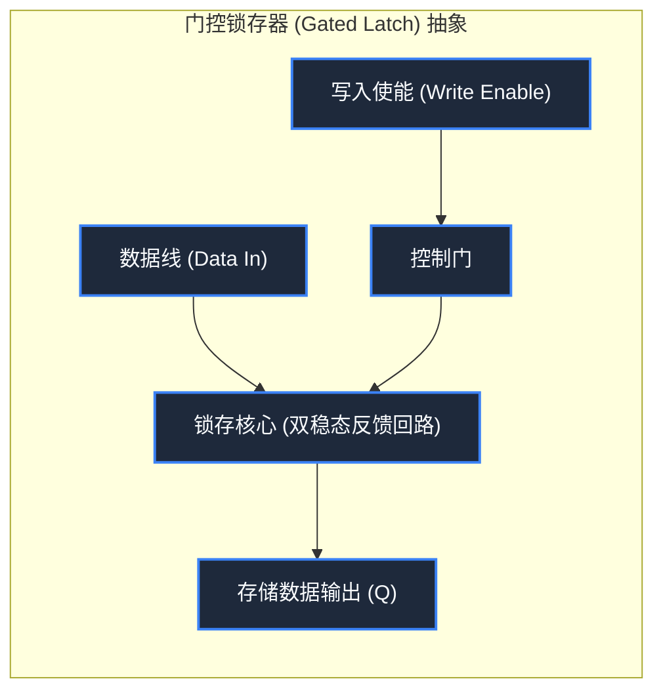

> **课程体系**：【计算机科学速成课】Crash Course Computer Science (PBS / 全40集精校)  
> **所属模块**：Module 1: 硬件基石与体系架构 (Hardware & Architecture)  
> **主讲嘉宾**：Carrie Anne Philbin  
> **视频时长**：12:17 ｜ **高清画面截图**：4 张核心知识点板书/图解  
> **视频直达**：[📺 在 B 站观看本讲原视频 (P6)](https://www.bilibili.com/video/BV1EW411u7th/?p=6)  
> **全书导航**：[← 上一讲 (P05)](/notes/cccs/lecture-05) ｜ [📚 返回全书目录](/notes/topics/CCCS) ｜ [下一讲 (P07) →](/notes/cccs/lecture-07)

---

## 核心导读与概念全景

揭示组合逻辑迈向时序逻辑的本质跃迁，详解 AND-OR 锁存器、门控锁存器、多位寄存器的构造，并深入剖析二维矩阵寻址与 SRAM 随机存取内存的宏大体系。

---

## 1. 组合逻辑与时序逻辑的分水岭：状态记忆

*(参考时间：00:01:00 · [视频跳转 (P6 00:01:00)](https://www.bilibili.com/video/BV1EW411u7th/?p=6&t=60))*

在前几讲中，我们探讨的逻辑门、全加器与 ALU 全部属于**组合逻辑电路（Combinational Logic）**。
- **组合逻辑的特性**：输出完全由当前的输入瞬时决定。输入一旦改变，输出随之改变；输入一旦断开，所有中间状态烟消云散。它没有记忆，无法保存计算结果。
- **时序逻辑（Sequential Logic）的诞生**：如果计算机算出的 $1+1=2$ 无法持久存留以供下一步运算使用，整个计算体系将无法维系。计算机必须拥有能够“记住”过去状态的时序电路。

实现记忆的核心技巧令人拍案叫绝：**将输出端接回输入端，构成正反馈闭环（Feedback Loop）！**

*⏱ 时间戳：00:02:20 · 📷 课堂截图 · [在 B 站观看对应片段 (P6 00:02:20)](https://www.bilibili.com/video/BV1EW411u7th/?p=6&t=140)*

## 2. AND-OR 锁存器（Latch）与门控时序控制

*(参考时间：00:02:10 · [视频跳转 (P6 00:02:10)](https://www.bilibili.com/video/BV1EW411u7th/?p=6&t=130))*

#### 1. AND-OR 锁存器的工作原理
我们用一个 OR 门和一个 AND 门搭建最原始的锁存器：
- 将 OR 门的一个输入端设为“设定端（Set）”，其输出连入 AND 门的一个输入端；
- AND 门的另一个输入端设为“复位端（Reset，正常置为 1）”，而 AND 门的输出端则**回绕反接回 OR 门的另一个输入端**！
- **自锁保持机制**：
  1. 初始状态输出为 0。当我们在 Set 端给一个短暂的 1 脉冲时，OR 门输出变为 1，进入 AND 门（Reset 为 1），AND 门输出变为 1；
  2. 哪怕随后立刻撤去 Set 端的脉冲（Set 变回 0），AND 门输出的 1 已经通过反馈回路送回了 OR 门，OR 门持续输出 1！电路自己“咬住了”这个状态，实现了 1 位信息的永久记忆；
  3. 要清除这个记忆，只需给 Reset 端一个短暂的 0 脉冲，AND 门被强制输出 0，反馈链被打断，电路回到初始 0 状态。

#### 2. 门控锁存器（Gated Latch）
AND-OR 锁存器需要两根控制线（Set 和 Reset），使用繁琐。工程师通过添加额外的逻辑门，将其改进为**门控 D 锁存器（Gated D Latch）**：
- **数据端（Data, D）**：输入我们想要保存的目标值（0 或 1）；
- **写入使能端（Write Enable, WE）**：控制门阀。当 WE 为 0 时，锁存器彻底封锁外部输入，任何 D 端的数据跳变都不会影响内部保存的值；只有当 WE 变为 1 时，内部记忆才瞬时更新为 D 端的电平状态。

*⏱ 时间戳：00:04:10 · 📷 课堂截图 · [在 B 站观看对应片段 (P6 00:04:10)](https://www.bilibili.com/video/BV1EW411u7th/?p=6&t=250)*

## 3. 寄存器（Register）：CPU 内部的极速工作台

*(参考时间：00:04:45 · [视频跳转 (P6 00:04:45)](https://www.bilibili.com/video/BV1EW411u7th/?p=6&t=285))*

单个锁存器只能存 1 个 Bit。为了在 CPU 内部存储完整的数值，我们将多个锁存器并联成排：
- 将 8 个门控锁存器的 Write Enable 端口全部连在同一根总线上；
- 当该公共使能线亮起时，8 位数据线（Data Bus）上的电平瞬间被 8 个锁存器同时吞入并锁定。

这组并联工作的锁存器被称为**寄存器（Register）**。
- **位宽（Width）**：寄存器能够同时容纳的 Bit 数量被称为计算机的“字长”或“位宽”。早期微处理器拥有 8 位寄存器，随后演进至 16 位、32 位，今天的主流 CPU 普遍拥有 64 位通用寄存器。
- **物理地位**：寄存器就焊在 CPU 运算核心旁边，与 ALU 之间以极短的物理总线相连，读写时延通常在 **零点几纳秒（Sub-nanosecond）** 级别，是整个计算机体系中速度最快、但造价也最为昂贵的数据存储单元。

*⏱ 时间戳：00:06:00 · 📷 课堂截图 · [在 B 站观看对应片段 (P6 00:06:00)](https://www.bilibili.com/video/BV1EW411u7th/?p=6&t=360)*

## 4. 二维矩阵寻址与随机存取内存（RAM）

*(参考时间：00:06:30 · [视频跳转 (P6 00:06:30)](https://www.bilibili.com/video/BV1EW411u7th/?p=6&t=390))*

CPU 内部的寄存器数量极其有限（通常只有几十个），因为每个锁存器都需要专用的导线连接。如果我们要存储上百万乃至上亿个数据（如一张图片、一个程序），导线数量将发生无法收拾的“组合爆炸”。

如何用极少的控制引脚，管理海量的存储锁存器？计算机工程史上的伟大创新——**网格矩阵交叉寻址（Matrix Addressing）**登场了！

#### 1. 256 位 SRAM 矩阵寻址模型
我们将 256 个锁存器排布成一个 $16 \times 16$ 的方阵：
- 每一个锁存器需要满足两个条件同时为高电平时才被选中：**行使能线（Row Line）** 与 **列使能线（Column Line）** 必须同时接通（利用一个微小的两输入 AND 门做选通）；
- 寻址 256 个单元只需一个 8 位的地址码（Address）：高 4 位送入**行地址译码器（Row Decoder）**，低 4 位送入**列地址译码器（Column Decoder）**。译码器将 4 位二进制输入从 $0000 \sim 1111$ 译码为 16 根线中唯一被激活的一根高电平线！
- 走线优势：原本需要 256 根独立寻址线，现在仅需 $16 + 16 = 32$ 根矩阵线，导线开销暴降近 90%！

#### 2. 为什么叫“随机存取（Random Access）”？
这种内存被称为 **RAM（Random Access Memory, 随机存取存储器）**。
- “随机”并非指“不可预测”，而是指**寻址访问时间与物理空间位置完全无关（Uniform Latency）**！
- 传统的磁带或打孔纸带是“顺序存取（Sequential Access）”，要读取第 1000 个数据必须从头卷动磁带快进过去，耗费数分钟；而在 RAM 中，只要给出数字地址码，行/列译码器电信号以光速建立，无论读取第 0 个单元还是第 255 个单元，所消耗的纳秒级时间完全相同！

*⏱ 时间戳：00:08:30 · 📷 课堂截图 · [在 B 站观看对应片段 (P6 00:08:30)](https://www.bilibili.com/video/BV1EW411u7th/?p=6&t=510)*

---

## 附：本讲知识脑图与回顾思考

本讲作为 **Module 1: 硬件基石与体系架构 (Hardware & Architecture)** 的核心组成部分，系统串联了从底层硬件物理开关、中间层抽象协议到上层应用的思维跃迁。建议结合 B 站原版视频与本讲图文指南反复印证，理解技术演进背后的工程权衡与必然逻辑。

[← 上一讲 (P05)](/notes/cccs/lecture-05) ｜ [📚 返回全书目录](/notes/topics/CCCS) ｜ [下一讲 (P07) →](/notes/cccs/lecture-07)
