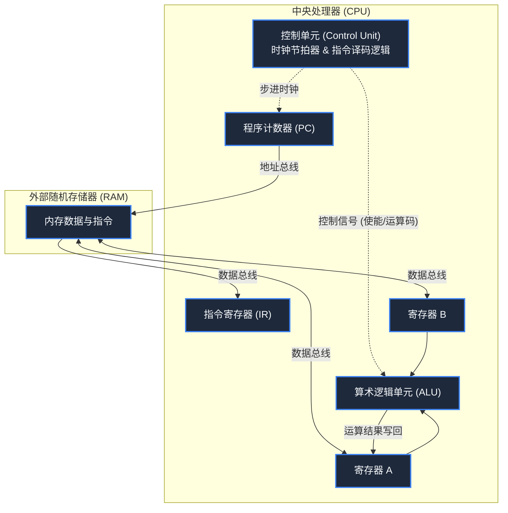

> **课程体系**：【计算机科学速成课】Crash Course Computer Science (PBS / 全40集精校)  
> **所属模块**：Module 1: 硬件基石与体系架构 (Hardware & Architecture)  
> **主讲嘉宾**：Carrie Anne Philbin  
> **视频时长**：11:38 ｜ **高清画面截图**：4 张核心知识点板书/图解  
> **视频直达**：[📺 在 B 站观看本讲原视频 (P7)](https://www.bilibili.com/video/BV1EW411u7th/?p=7)  
> **全书导航**：[← 上一讲 (P06)](/notes/cccs/lecture-06) ｜ [📚 返回全书目录](/notes/topics/CCCS) ｜ [下一讲 (P08) →](/notes/cccs/lecture-08)

---

## 核心导读与概念全景

将 ALU、寄存器堆、RAM 与控制单元组装为完整的中央处理器（CPU），深度拆解经典三阶段时钟节拍循环——取指（Fetch）、译码（Decode）、执行（Execute）的微观运作机理。

---

## 1. 组装 CPU：微架构三大支柱与总线互联

*(参考时间：00:01:15 · [视频跳转 (P7 00:01:15)](https://www.bilibili.com/video/BV1EW411u7th/?p=7&t=75))*

现在，我们手中已经握有了构建一台完整计算机的所有积木：
- **ALU**：负责加减运算和逻辑运算；
- **寄存器堆**：提供高速临时变量存储（如寄存器 A、寄存器 B）；
- **RAM**：存储大规模数据和运行中的程序指令。

如何让这些被动的电路组件如同生命体一般自动运转起来？这需要引入控制中枢——**控制单元（Control Unit, CU）**。
我们将 CU、ALU 与寄存器整合在一块芯片内，便诞生了**中央处理器（Central Processing Unit, CPU）**。

组件之间通过三组公共物理信道——**总线（Buses）**实现数据交互：
1. **地址总线（Address Bus）**：CPU 单向输出，指明当前希望读写的内存物理地址；
2. **数据总线（Data Bus）**：双向传输，在 CPU 内部各寄存器与外部 RAM 之间传递数值或指令字节；
3. **控制总线（Control Bus）**：传输读/写使能、时钟脉冲与中断信号，指挥各部件的协调动作。

*⏱ 时间戳：00:02:45 · 📷 课堂截图 · [在 B 站观看对应片段 (P7 00:02:45)](https://www.bilibili.com/video/BV1EW411u7th/?p=7&t=165)*

## 2. 取指阶段（Fetch）：从内存捕获指令

*(参考时间：00:03:50 · [视频跳转 (P7 00:03:50)](https://www.bilibili.com/video/BV1EW411u7th/?p=7&t=230))*

CPU 内部有两个专门管理指令流转的关键寄存器：
- **程序计数器（Program Counter, PC）**：记录 CPU 即将读取的下一条指令在 RAM 中的内存地址。计算机开机时，PC 通常被硬件重置为 `00000000`；
- **指令寄存器（Instruction Register, IR）**：负责存放当前正在执行的指令字节。

#### 取指微操作步骤：
1. **送出地址**：控制单元发出使能信号，将 PC 寄存器中保存的地址（如地址 0）推送到地址总线上；
2. **激活内存读**：控制总线拉高 RAM 的“读使能（Read Enable）”，RAM 内部的行/列译码器在纳秒间锁定该单元；
3. **加载到 IR**：该单元中的二进制指令（如 `00101110`）被倾倒到数据总线上，流向 CPU 并被锁存进指令寄存器 IR；
4. **PC 自增步进**：控制单元发出脉冲，将 PC 的数值加 1，为下一个周期的取指做好准备。

*⏱ 时间戳：00:04:30 · 📷 课堂截图 · [在 B 站观看对应片段 (P7 00:04:30)](https://www.bilibili.com/video/BV1EW411u7th/?p=7&t=270)*

## 3. 译码阶段（Decode）：解析操作码与操作数

*(参考时间：00:05:40 · [视频跳转 (P7 00:05:40)](https://www.bilibili.com/video/BV1EW411u7th/?p=7&t=340))*

指令被锁存进 IR 后，控制单元必须读懂这串冰冷的二进制 0/1 究竟要它做什么。

假设我们采用一种经典的 8 位微指令格式：
- **高 4 位为操作码（Opcode）**：定义操作类型。例如 `0010` 代表 `LOAD_A`（从内存加载数据到寄存器 A），`0001` 代表 `ADD`（执行加法）；
- **低 4 位为操作数地址（Address / Operand）**：例如 `1110` 代表十进制地址 14。

#### 译码逻辑矩阵：
控制单元内部拥有一组专用的译码逻辑门：
- 将 IR 的高 4 位操作码送入一个 4-16 译码器，只有对应于 `LOAD_A` 的控制线被激发拉高；
- 此时，控制单元明确知道该指令的意图：**需要去访问 RAM 的第 14 号地址，把里面的数据取出来，放进寄存器 A**！

*⏱ 时间戳：00:06:15 · 📷 课堂截图 · [在 B 站观看对应片段 (P7 00:06:15)](https://www.bilibili.com/video/BV1EW411u7th/?p=7&t=375)*

## 4. 执行阶段（Execute）与系统时钟发生器

*(参考时间：00:07:30 · [视频跳转 (P7 00:07:30)](https://www.bilibili.com/video/BV1EW411u7th/?p=7&t=450))*

#### 执行微操作步骤：
1. 控制单元将 IR 的低 4 位地址（14）推上地址总线；
2. 开启 RAM 的读使能，第 14 号地址存储的值（例如数字 3）涌上数据总线；
3. 控制单元精确打开寄存器 A 的**写入使能（Write Enable）**，数据总线上的数字 3 被瞬间装载进寄存器 A！
至此，一个完整的指令周期顺利结束。

#### 系统时钟发生器（System Clock）：CPU 的澎湃心跳
是什么在指挥整个微架构严格按序跳动，避免数据在总线上发生相位冲突？答案是**时钟发生器**。
- 时钟电路由石英晶体振荡器（Crystal Oscillator）制成，产生极度规整的高低交替方波脉冲；
- **时钟频率（Clock Speed）**：每秒钟脉冲振荡的次数。
  - 1 赫兹（1 Hz）代表每秒 1 次时钟节拍；
  - 1 兆赫（1 MHz）代表每秒 100 万次节拍；
  - 现代个人计算机 CPU 普遍达到 **3 GHz ~ 5 GHz**，意味着处理器每秒跳动 **30 亿到 50 亿次**！在这微秒级的弹指一挥间，数以亿计的取指-译码-执行循环以近乎神迹的精度呼啸而过。

*⏱ 时间戳：00:08:30 · 📷 课堂截图 · [在 B 站观看对应片段 (P7 00:08:30)](https://www.bilibili.com/video/BV1EW411u7th/?p=7&t=510)*

---

## 附：本讲知识脑图与回顾思考

本讲作为 **Module 1: 硬件基石与体系架构 (Hardware & Architecture)** 的核心组成部分，系统串联了从底层硬件物理开关、中间层抽象协议到上层应用的思维跃迁。建议结合 B 站原版视频与本讲图文指南反复印证，理解技术演进背后的工程权衡与必然逻辑。

[← 上一讲 (P06)](/notes/cccs/lecture-06) ｜ [📚 返回全书目录](/notes/topics/CCCS) ｜ [下一讲 (P08) →](/notes/cccs/lecture-08)
