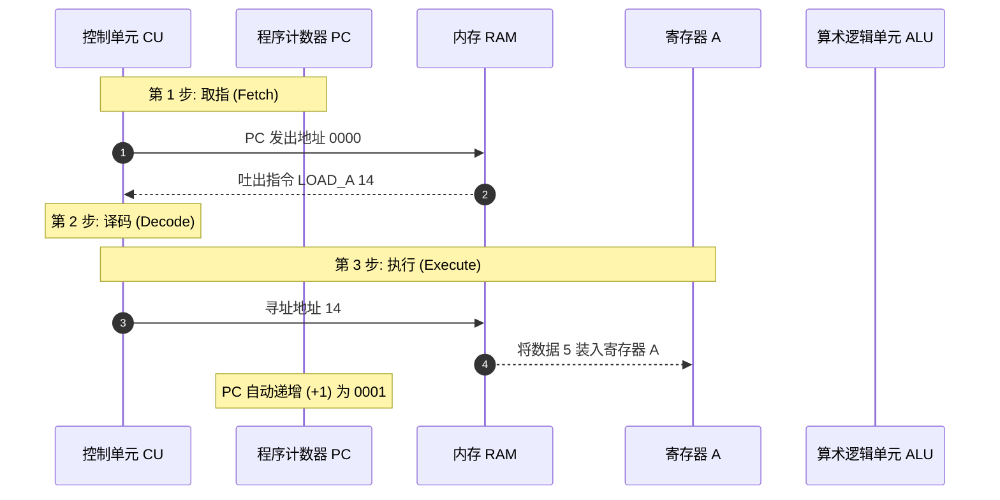

> **课程体系**：【计算机科学速成课】Crash Course Computer Science (PBS / 全40集精校)  
> **所属模块**：Module 1: 硬件基石与体系架构 (Hardware & Architecture)  
> **主讲嘉宾**：Carrie Anne Philbin  
> **视频时长**：10:36 ｜ **高清画面截图**：4 张核心知识点板书/图解  
> **视频直达**：[📺 在 B 站观看本讲原视频 (P8)](https://www.bilibili.com/video/BV1EW411u7th/?p=8)  
> **全书导航**：[← 上一讲 (P07)](/notes/cccs/lecture-07) ｜ [📚 返回全书目录](/notes/topics/CCCS) ｜ [下一讲 (P09) →](/notes/cccs/lecture-09)

---

## 核心导读与概念全景

深入探讨指令集架构（ISA）的规范设计，详析数据搬运、算术运算与条件跳转 JUMP 的执行全流程，阐述存储程序概念如何孕育出纯粹而强大的现代软件生态。

---

## 1. 指令集架构（ISA）：软硬件交汇的契约

*(参考时间：00:01:20 · [视频跳转 (P8 00:01:20)](https://www.bilibili.com/video/BV1EW411u7th/?p=8&t=80))*

CPU 虽然拥有极强的电信号执行能力，但如果外部没有清晰规范告诉它到底支持哪些操作，它依然只是一堆冰冷的硅晶体。

由硬件设计者制定、CPU 能够直接理解并执行的全部指令集合，被称为**指令集架构（Instruction Set Architecture, ISA）**。ISA 是计算机系统中最重要的一层软件与硬件分界契约：
- 上层编译器与程序员按照 ISA 的规范撰写指令代码；
- 底层芯片微架构负责用晶体管逻辑门将这些指令精准物化落地。

在典型的小型教学机架构中，一条指令由两部分拼接而成：
`[ 4位 操作码 Opcode ] [ 4位 操作数/地址 Operand ]`
- `LOAD_A (0010)`：将内存指定地址的数据装载到寄存器 A；
- `LOAD_B (0011)`：将内存指定地址的数据装载到寄存器 B；
- `ADD (0100)`：命令 ALU 将寄存器 A 与寄存器 B 相加，结果存回寄存器 A；
- `STORE_A (0101)`：将寄存器 A 中的计算结果存入内存指定地址。

*⏱ 时间戳：00:02:30 · 📷 课堂截图 · [在 B 站观看对应片段 (P8 00:02:30)](https://www.bilibili.com/video/BV1EW411u7th/?p=8&t=150)*

## 2. 追踪一段程序的连续执行

*(参考时间：00:03:40 · [视频跳转 (P8 00:03:40)](https://www.bilibili.com/video/BV1EW411u7th/?p=8&t=220))*

让我们在虚拟内存中完整单步调试一段最基础的加法程序（计算两个数值相加并保存）：

| 内存地址 | 二进制代码 | 汇编助记符 | 语义解释 |
|:---|:---|:---|:---|
| 0000 | 0010 1110 | `LOAD_A 14` | 将地址 14 的数值读入寄存器 A |
| 0001 | 0011 1111 | `LOAD_B 15` | 将地址 15 的数值读入寄存器 B |
| 0010 | 0100 0000 | `ADD` | ALU 计算 A + B，结果存入寄存器 A |
| 0011 | 0101 1101 | `STORE_A 13` | 将寄存器 A 的和写回地址 13 |
| 0100 | 1111 0000 | `HALT` | 停机终止程序 |
| ... | ... | ... | ... |
| 1110 (14) | 0000 0101 | 数据: 5 | 待运算的操作数 1 |
| 1111 (15) | 0000 0011 | 数据: 3 | 待运算的操作数 2 |

#### 执行追踪轨迹：
1. **T=0 时钟**：PC=0，抓取 `LOAD_A 14`。执行后，地址 14 的数字 5 稳稳坐入寄存器 A；
2. **T=1 时钟**：PC=1，抓取 `LOAD_B 15`。执行后，地址 15 的数字 3 进入寄存器 B；
3. **T=2 时钟**：PC=2，抓取 `ADD`。控制单元激活 ALU 的加法通路与寄存器 A 的写入端，寄存器 A 的内容瞬时从 5 跃变为 8；
4. **T=3 时钟**：PC=3，抓取 `STORE_A 13`。数据总线将寄存器 A 中的 8 输送到内存地址 13 保存下来；
5. **T=4 时钟**：PC=4，抓取 `HALT`，时钟发生器停振，程序圆满执行完毕。

*⏱ 时间戳：00:04:45 · 📷 课堂截图 · [在 B 站观看对应片段 (P8 00:04:45)](https://www.bilibili.com/video/BV1EW411u7th/?p=8&t=285)*

## 3. 条件跳转（JUMP）与图灵完备的分支逻辑

*(参考时间：00:06:10 · [视频跳转 (P8 00:06:10)](https://www.bilibili.com/video/BV1EW411u7th/?p=8&t=370))*

如果程序只能一条接一条地自上而下顺序流淌，那它只不过是一个按部就班的机械自动八音盒。真正的智能诞生于**条件判断与分支跳转**！

计算机引入了 **JUMP 指令**：
- **无条件跳转（JUMP）**：指令操作数直接指定目标内存地址。执行时，控制单元不是让 PC 加 1，而是**直接强行将操作数地址覆写入程序计数器 PC**！当下一个时钟到来时，CPU 将从这个全新的地址开始取指，实现了程序跳转；
- **条件跳转（Conditional JUMP, 如 JUMP_IF_NEGATIVE / JUMP_IF_ZERO）**：
  - 这条指令直接监听前一讲提到的 ALU 状态标志位！
  - 例如 `JUMP_IF_NEGATIVE 4`：如果前一次运算结果为负数（负标志位 N = 1），则修改 PC 为 4；若不为负（N = 0），则忽略该指令，PC 正常自增步进。

#### 循环与无限可能：
利用条件跳转，我们只需三条指令就能在硬件上实现高级语言中的 `while` 循环、`for` 迭代以及 `if-else` 条件分支！计算机正是借助这种自我检验结果、动态决定下一步走向的能力，跨越了图灵完备（Turing Completeness）的门槛。

*⏱ 时间戳：00:06:30 · 📷 课堂截图 · [在 B 站观看对应片段 (P8 00:06:30)](https://www.bilibili.com/video/BV1EW411u7th/?p=8&t=390)*

## 4. 存储程序型计算机：软件（Software）概念的觉醒

*(参考时间：00:08:45 · [视频跳转 (P8 00:08:45)](https://www.bilibili.com/video/BV1EW411u7th/?p=8&t=525))*

在 ENIAC 时代，要让计算机改算另一个任务，几名女数学家必须拿着接线图在几百块插线板前手动拔插成千上万根跳线电缆，耗费数天甚至数周时间，这种笨重的方式被称为**硬线逻辑（Hardwired Programming）**。

1945 年，数学家约翰·冯·诺依曼（John von Neumann）在著名的《EDVAC 报告书的第一份草案》中系统阐述了**存储程序型计算机（Stored-Program Computer）**的核心理念：
- **代码即数据**：指令和数据在物理形式上没有任何区别，都是一串由 0 和 1 组成的二进制位，能够毫无障碍地共同存放在同一个可读写的 RAM 内存中；
- **软件（Software）的诞生**：改变计算机的功能，不再需要工人拆装机器重新布线，只需向内存写入一段新的二进制数据！

硬件（Hardware）成为了通用的物理基石，而流动在内存中的指令数据流——软件（Software），成为了赋予机器千变万化灵魂的无尽力量。

*⏱ 时间戳：00:09:00 · 📷 课堂截图 · [在 B 站观看对应片段 (P8 00:09:00)](https://www.bilibili.com/video/BV1EW411u7th/?p=8&t=540)*

---

## 附：本讲知识脑图与回顾思考

本讲作为 **Module 1: 硬件基石与体系架构 (Hardware & Architecture)** 的核心组成部分，系统串联了从底层硬件物理开关、中间层抽象协议到上层应用的思维跃迁。建议结合 B 站原版视频与本讲图文指南反复印证，理解技术演进背后的工程权衡与必然逻辑。

[← 上一讲 (P07)](/notes/cccs/lecture-07) ｜ [📚 返回全书目录](/notes/topics/CCCS) ｜ [下一讲 (P09) →](/notes/cccs/lecture-09)
