> **课程体系**：【计算机科学速成课】Crash Course Computer Science (PBS / 全40集精校)  
> **所属模块**：Module 1: 硬件基石与体系架构 (Hardware & Architecture)  
> **主讲嘉宾**：Carrie Anne Philbin  
> **视频时长**：12:23 ｜ **高清画面截图**：4 张核心知识点板书/图解  
> **视频直达**：[📺 在 B 站观看本讲原视频 (P9)](https://www.bilibili.com/video/BV1EW411u7th/?p=9)  
> **全书导航**：[← 上一讲 (P08)](/notes/cccs/lecture-08) ｜ [📚 返回全书目录](/notes/topics/CCCS) ｜ [下一讲 (P10) →](/notes/cccs/lecture-10)

---

## 核心导读与概念全景

突破早期单周期微架构的时钟瓶颈，深入剖析指令级流水线并行（Pipelining）、流水线冒险处理、动态分支预测、超标量乱序执行以及多级缓存体系架构。

---

## 1. 单周期处理器的时钟瓶颈与阿姆达尔定律

*(参考时间：00:01:10 · [视频跳转 (P9 00:01:10)](https://www.bilibili.com/video/BV1EW411u7th/?p=9&t=70))*

在上一讲构建的基础 CPU 中，一条指令必须完整经历 Fetch、Decode、Execute 三个阶段后，下一个时钟周期才能开启下一条指令。

- **关键路径延迟（Critical Path Delay）**：每条指令耗费的时间取决于流水线上物理耗时最长的那个部件（例如访问慢速外部 RAM）。时钟脉冲的间隔必须足够宽，以等待最漫长路径的电平彻底稳定；
- **资源闲置浪费**：当 ALU 正在执行加法时，控制单元的译码器与 RAM 的寻址逻辑全部在干坐着等待。
为了在不无限拔高硅芯片物理开关极限的前提下数倍提升运算吞吐，计算机体系结构学家展开了一场惊心动魄的微架构性能革命。

*⏱ 时间戳：00:02:40 · 📷 课堂截图 · [在 B 站观看对应片段 (P9 00:02:40)](https://www.bilibili.com/video/BV1EW411u7th/?p=9&t=160)*

## 2. 指令流水线（Pipelining）：洗衣服与工厂装配线隐喻

*(参考时间：00:03:30 · [视频跳转 (P9 00:03:30)](https://www.bilibili.com/video/BV1EW411u7th/?p=9&t=210))*

提高吞吐率最经典的思想是**流水线（Pipeline）**。

- **洗衣服隐喻**：清洗一桶衣服需要四个步骤：洗涤（30分钟）、烘干（40分钟）、熨烫（20分钟）、折叠（10分钟）。
  - **非流水线模式**：等第一桶衣服洗烘熨折全部做完（100分钟），才放入第二桶。洗四桶衣服需要耗费 400 分钟！
  - **流水线模式**：第一桶衣服洗完移入烘干机后，洗衣机立即放入第二桶衣服！当流水线被填满时，每隔最长的那个单步时间（40分钟），就会有一桶洗好的衣服折叠出炉！
- **经典 RISC 五级流水线**：
  1. **IF（Instruction Fetch, 取指）**
  2. **ID（Instruction Decode / Register Read, 译码/读寄存器）**
  3. **EX（Execute / Address Calculation, 执行/有效地址计算）**
  4. **MEM（Memory Access, 内存访问）**
  5. **WB（Write Back, 写回结果到寄存器）**

在理想状态下，流水线让处理器在每一个时钟周期都能吐出一条执行完毕的指令，使得每个指令周期指令数（CPI, Cycles Per Instruction）逼近理想值 1！

```mermaid
gantt
    title 五级指令流水线并行时序 (Instruction Pipelining)
    dateFormat X
    axisFormat 时钟 %s
    section 指令 1
    取指 IF       :0, 1
    译码 ID       :1, 2
    执行 EX       :2, 3
    访存 MEM      :3, 4
    写回 WB       :4, 5
    section 指令 2
    取指 IF       :1, 2
    译码 ID       :2, 3
    执行 EX       :3, 4
    访存 MEM      :4, 5
    写回 WB       :5, 6
    section 指令 3
    取指 IF       :2, 3
    译码 ID       :3, 4
    执行 EX       :4, 5
    访存 MEM      :5, 6
    写回 WB       :6, 7
```

*⏱ 时间戳：00:05:00 · 📷 课堂截图 · [在 B 站观看对应片段 (P9 00:05:00)](https://www.bilibili.com/video/BV1EW411u7th/?p=9&t=300)*

## 3. 流水线冒险（Hazards）与动态分支预测

*(参考时间：00:06:00 · [视频跳转 (P9 00:06:00)](https://www.bilibili.com/video/BV1EW411u7th/?p=9&t=360))*

流水线并非免费的午餐，在实际运转中会遭遇三大类严峻的**流水线冒险（Pipeline Hazards）**：

1. **结构冒险（Structural Hazard）**：硬件资源冲突。例如取指部件和访存部件同时想要访问同一块内存总线；
2. **数据冒险（Data Hazard, RAW 写后读）**：指令 2 需要用到指令 1 的运算结果，但指令 1 还没走到 WB 写回阶段，指令 2 就已经在 EX 阶段试图读取旧数据！
   - *解法*：插入空操作等待气泡（Stall），或采用**旁路转发技术（Forwarding / Bypassing）**，直接将 ALU 的输出端引线短路到下一个时钟的输入端；
3. **控制冒险（Control Hazard）**：遇到了条件跳转指令！当跳转指令还在执行时，流水线后面已经提前预取了 3 条后续指令。如果条件成立发生跳转，预取的 3 条指令全错了，必须彻底清空流水线（Pipeline Flush），产生巨大的性能惩罚。

#### 分支预测器（Branch Predictor）与推测执行（Speculative Execution）
为了解决控制冒险，现代 CPU 配备了极其聪明的**分支预测器**：
- 记录循环跳转的历史统计（例如一个循环执行了 99 次，预测器有 99% 的把握预测它下次依然会跳转）；
- CPU 在条件结果彻底算出来之前，不管三七二十一，顺着预测的方向**提前推测执行（Speculatively Execute）**后续代码！如果猜对了，流水线无缝狂飙；如果猜错了，硬件撤销临时寄存器修改，回滚流水线。现代分支预测器的准确率已普遍突破 98%！

*⏱ 时间戳：00:07:15 · 📷 课堂截图 · [在 B 站观看对应片段 (P9 00:07:15)](https://www.bilibili.com/video/BV1EW411u7th/?p=9&t=435)*

## 4. 超标量、乱序执行与多级缓存体系（Cache）

*(参考时间：00:08:40 · [视频跳转 (P9 00:08:40)](https://www.bilibili.com/video/BV1EW411u7th/?p=9&t=520))*

为了追求极致算力，现代处理器进一步突破物理限制：

#### 1. 超标量（Superscalar）多发射
一条流水线不够，芯片就塞入 4 条甚至 8 条并行流水线！每个时钟周期同时取指 4 条指令，同时译码分配给不同的专用 ALU 执行（如整数 ALU、浮点 FPU、向量 SIMD 单元）。

#### 2. 乱序执行（Out-of-Order Execution, OoO）
如果指令 2 正在等待慢速数据，而后面的指令 3 和指令 4 与它完全无关，CPU 的调度引擎会自动跨过指令 2，先把指令 3 和 4 执行完毕，最后在**重排序缓冲区（Reorder Buffer, ROB）**中按原始程序顺序提交结果。

#### 3. 存储器墙与多级缓存（Cache Hierarchy）
随着 CPU 时钟频率冲上千兆赫兹（GHz），外部内存 RAM 的电容充放电速度无法跟上步伐，形成了著名的“存储器墙”。
CPU 设计者在芯片核心内部集成了极速的 SRAM 缓存：
- **L1 Cache（一级缓存）**：分置为 L1 数据缓存与 L1 指令缓存，就在算力核心眼皮底下，时钟周期 1~4 节拍；
- **L2 Cache（二级缓存）**：容量稍大，速度稍慢（约 10 节拍）；
- **L3 Cache（三级共享缓存）**：所有 CPU 物理核心共享，通常达数兆至几十兆字节。
利用**时间局部性**（刚访问过的数据马上还会被访问）与**空间局部性**（刚访问过的数据其相邻数据马上也会被访问），缓存命中率通常高达 95% 以上，使得高速处理器免于被龟速内存活活拖死。

*⏱ 时间戳：00:09:30 · 📷 课堂截图 · [在 B 站观看对应片段 (P9 00:09:30)](https://www.bilibili.com/video/BV1EW411u7th/?p=9&t=570)*

---

## 附：本讲知识脑图与回顾思考

本讲作为 **Module 1: 硬件基石与体系架构 (Hardware & Architecture)** 的核心组成部分，系统串联了从底层硬件物理开关、中间层抽象协议到上层应用的思维跃迁。建议结合 B 站原版视频与本讲图文指南反复印证，理解技术演进背后的工程权衡与必然逻辑。

[← 上一讲 (P08)](/notes/cccs/lecture-08) ｜ [📚 返回全书目录](/notes/topics/CCCS) ｜ [下一讲 (P10) →](/notes/cccs/lecture-10)
