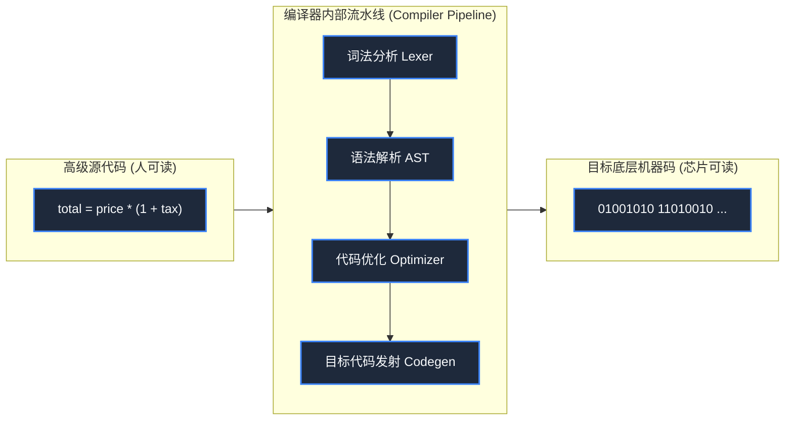

> **课程体系**：【计算机科学速成课】Crash Course Computer Science (PBS / 全40集精校)  
> **所属模块**：Module 2: 编程语言与软件核心 (Software & Programming)  
> **主讲嘉宾**：Carrie Anne Philbin  
> **视频时长**：11:52 ｜ **高清画面截图**：4 张核心知识点板书/图解  
> **视频直达**：[📺 在 B 站观看本讲原视频 (P11)](https://www.bilibili.com/video/BV1EW411u7th/?p=11)  
> **全书导航**：[← 上一讲 (P10)](/notes/cccs/lecture-10) ｜ [📚 返回全书目录](/notes/topics/CCCS) ｜ [下一讲 (P12) →](/notes/cccs/lecture-12)

---

## 核心导读与概念全景

梳理计算机语言从反人类二进制机器码到汇编语言助记符的进化，详解格蕾丝·霍珀发明世界上第一个编译器的伟大突破，探讨 FORTRAN、COBOL 等早期高级语言如何奠定现代软件工程基石。

---

## 1. 机器语言的认知深渊与汇编助记符的破晓

*(参考时间：00:01:10 · [视频跳转 (P11 00:01:10)](https://www.bilibili.com/video/BV1EW411u7th/?p=11&t=70))*

在计算机诞生初期，程序员只能直接书写**机器语言（Machine Language）**：
`0010 1110 0011 1111 0100 0000 0101 1101 ...`
- 程序员必须在脑中死记硬背每个芯片型号繁杂的操作码表；
- 一旦程序需要插入一条新指令，后面成百上千个内存地址必须全部人肉重新计算、逐个修改，一个数字抄错就会引发全局雪崩。

#### 汇编语言（Assembly Language）：助记符的诞生
为了拯救人类程序员的理智，20 世纪 40 年代末，**汇编语言**应运而生。
- **助记符（Mnemonics）**：用简短的人类单词缩写替代冷冰冰的数字代码。例如用 `LOAD` 代表装载，`ADD` 代表加法，`JMP` 代表跳转；
- **符号标签（Labels）**：可以用 `LOOP:` 或 `SUM` 代替硬编码的物理内存绝对地址；
- **汇编器（Assembler）**：也是一个程序，它的唯一任务是自动扫描汇编文本，将助记符和符号标签一比一机械翻译为机器能识别的纯二进制 0/1。程序员的开发效率瞬间提升了数十倍！

*⏱ 时间戳：00:02:30 · 📷 课堂截图 · [在 B 站观看对应片段 (P11 00:02:30)](https://www.bilibili.com/video/BV1EW411u7th/?p=11&t=150)*

## 2. 格蕾丝·霍珀与编译器的横空出世

*(参考时间：00:04:40 · [视频跳转 (P11 00:04:40)](https://www.bilibili.com/video/BV1EW411u7th/?p=11&t=280))*

汇编语言虽然解决了易读性，但它依然与特定的硬件架构**深度绑定（Hardware Dependent）**。为哈佛 Mark 系列写的汇编代码，在 UNIVAC 上完全是一堆废纸；并且汇编语言依然停留在底层的寄存器与内存数据搬运，无法直接表达复杂的数学公式。

这时，计算机史上一位传奇女性登场了——美国海军准将、数学家**格蕾丝·霍珀（Grace Hopper）**。

霍珀提出了一个在当时被绝大多数计算机科学家斥为“天方夜谭”的狂想：**为什么我们不能用接近人类日常英语的词汇来写程序，然后让计算机自己把这些高级词汇编译成机器指令？**

当时的学界保守派嘲讽她：“计算机是算数的，它怎么可能理解英语单词？它没有思考能力！”
霍珀顶住所有质疑，于 1952 年在 UNIVAC I 上研制出了**世界上第一个编译器——A-0 系统（Arithmetic Compiler）**！
- 编译器（Compiler）突破了汇编语言“一行助记符对应一行机器码”的死板映射，能够将一句高阶的人类描述（如“计算复利公式”）自动展开为数十条底层的微指令流水线！
- 霍珀后来说：“我有一个能用的编译器，但在头三年里根本没人愿意用它，他们觉得编译出来的代码远不如手写汇编高效。他们不知道，人类的时间远比计算机的时间宝贵得多！”

*⏱ 时间戳：00:05:30 · 📷 课堂截图 · [在 B 站观看对应片段 (P11 00:05:30)](https://www.bilibili.com/video/BV1EW411u7th/?p=11&t=330)*

## 3. 高级语言的黄金年代：FORTRAN、ALGOL 与 COBOL

*(参考时间：00:06:50 · [视频跳转 (P11 00:06:50)](https://www.bilibili.com/video/BV1EW411u7th/?p=11&t=410))*

编译器的成功激发了高级编程语言的全面爆发：

#### 1. FORTRAN（公式翻译器, 1957）
由 IBM 传奇工程师约翰·巴克斯（John Backus）团队开发，全称 **FORmula TRANslating System**。
- 专门面向科学家与数学家，首次允许直接用代数公式书写程序（如 `X = (Y + Z) * 2`）；
- 配备了极其强悍的优化编译器，使得生成的机器码运行速度逼近手写汇编，在航空航天、气象模拟与核聚变研究中统治了数十年。

#### 2. COBOL（通用商业语言, 1959）
由格蕾丝·霍珀作为核心顾问联合各界制定的语言，全称 **COmmon Business-Oriented Language**。
- 面向银行、保险与商业企业记账，语法极其接近自然英语句子（例如 `MULTIPLY HOURS BY HOURLY-RATE GIVING GROSS-PAY`）；
- 具备强劲的定点数精度支持与可移植性（Write Once, Run Anywhere 的雏形）。时至今日，全球仍有数万亿美元的传统金融与银行清算系统在深层默默运行着当年的 COBOL 核心！

#### 3. 语言之树的开枝散叶
随后，强调算法描述逻辑严密的 **ALGOL（1958）** 奠定了代码块（`begin...end`）与结构化编程范式；约翰·麦卡锡发明了象征人工智能与函数式编程起源的 **LISP（1958）**。计算机科学终于彻底摆脱了硬件脚手架的束缚，跃升为一门关于抽象思维与问题求解的独立宏伟学科。

*⏱ 时间戳：00:07:05 · 📷 课堂截图 · [在 B 站观看对应片段 (P11 00:07:05)](https://www.bilibili.com/video/BV1EW411u7th/?p=11&t=425)*

*⏱ 时间戳：00:08:10 · 📷 课堂截图 · [在 B 站观看对应片段 (P11 00:08:10)](https://www.bilibili.com/video/BV1EW411u7th/?p=11&t=490)*

---

## 附：本讲知识脑图与回顾思考

本讲作为 **Module 2: 编程语言与软件核心 (Software & Programming)** 的核心组成部分，系统串联了从底层硬件物理开关、中间层抽象协议到上层应用的思维跃迁。建议结合 B 站原版视频与本讲图文指南反复印证，理解技术演进背后的工程权衡与必然逻辑。

[← 上一讲 (P10)](/notes/cccs/lecture-10) ｜ [📚 返回全书目录](/notes/topics/CCCS) ｜ [下一讲 (P12) →](/notes/cccs/lecture-12)
