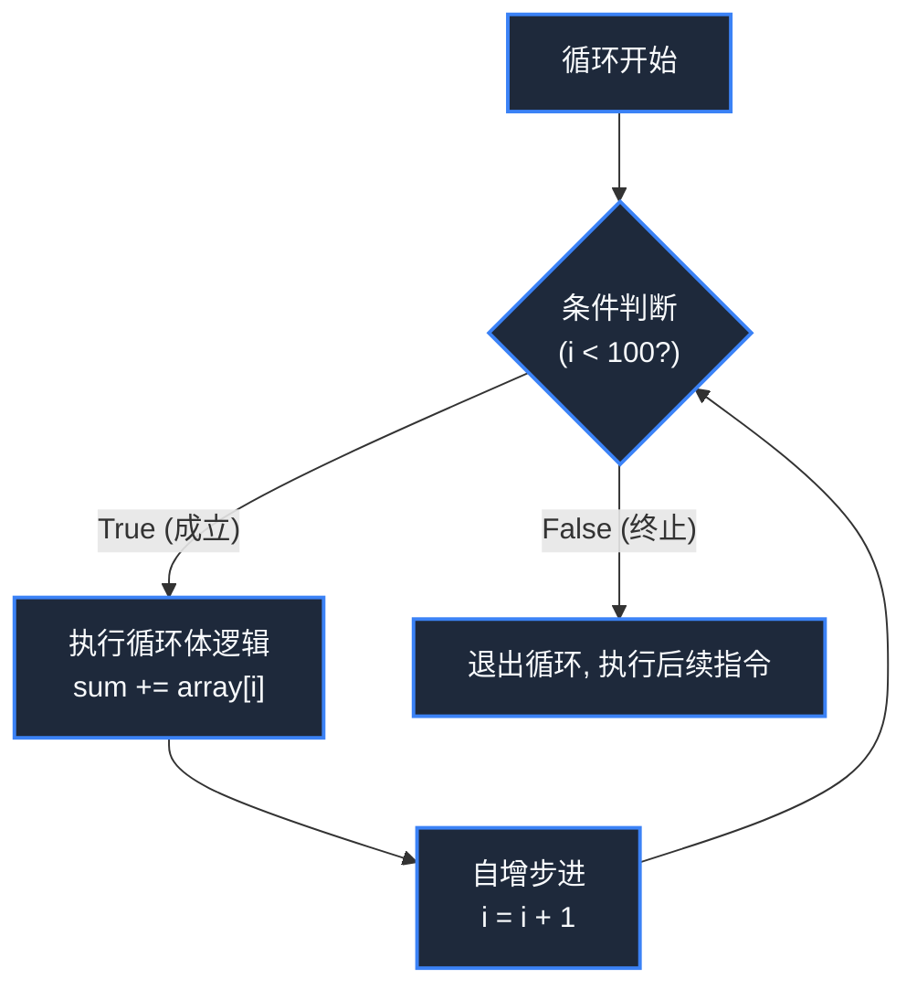

> **课程体系**：【计算机科学速成课】Crash Course Computer Science (PBS / 全40集精校)  
> **所属模块**：Module 2: 编程语言与软件核心 (Software & Programming)  
> **主讲嘉宾**：Carrie Anne Philbin  
> **视频时长**：11:57 ｜ **高清画面截图**：4 张核心知识点板书/图解  
> **视频直达**：[📺 在 B 站观看本讲原视频 (P12)](https://www.bilibili.com/video/BV1EW411u7th/?p=12)  
> **全书导航**：[← 上一讲 (P11)](/notes/cccs/lecture-11) ｜ [📚 返回全书目录](/notes/topics/CCCS) ｜ [下一讲 (P13) →](/notes/cccs/lecture-13)

---

## 核心导读与概念全景

系统拆解现代程序语言的四大原子基石：变量符号绑定、IF 条件控制分支、WHILE/FOR 迭代循环，以及函数参数调用栈帧的微观执行机制。

---

## 1. 变量（Variables）：给内存安上人类的标签

*(参考时间：00:01:10 · [视频跳转 (P12 00:01:10)](https://www.bilibili.com/video/BV1EW411u7th/?p=12&t=70))*

在底层机器中，数据只能寄宿在诸如 `0x7ffee4b2a1c0` 这样毫无语义的十六进制物理内存地址中。

高级语言引入了**变量（Variable）**概念：
- 变量是给一段特定内存区域起的名字（符号绑定）。声明一个变量 `int health = 100;`，编译器就会在内存中圈出 4 个字节，将初值 100 的二进制写进去，并记住变量名 `health` 与该地址的对应映射；
- **类型系统（Type Systems）**：指示编译器用多大的内存来存它，以及如何解释这串 0/1（是按补码整数解释，还是按 IEEE 754 浮点数解释，亦或是字符）。


*⏱ 时间戳：00:01:30 · 📷 课堂截图 · [在 B 站观看对应片段 (P12 00:01:30)](https://www.bilibili.com/video/BV1EW411u7th/?p=12&t=90)*

## 2. 控制流分支：IF-ELSE 与逻辑分岔

*(参考时间：00:02:40 · [视频跳转 (P12 00:02:40)](https://www.bilibili.com/video/BV1EW411u7th/?p=12&t=160))*

程序默认从第一行顺流而下执行，但现实业务充满不确定性。**条件语句（Conditional Statements）**赋予了程序思考与决策的能力：

```python
if player_health <= 0:
    print("Game Over")
    trigger_respawn()
else:
    continue_game()
```

- **底层硬件映射**：编译器会将 `if` 条件翻译为第 5 讲学到的**比较操作（CMP，执行减法更新标志位）**，随后紧跟一条第 8 讲学到的**条件跳转指令（JUMP_IF_FALSE）**。如果玩家血量大于 0，CPU 硬件直接跳过 `Game Over` 代码块，转去执行 `else` 分支。


*⏱ 时间戳：00:02:55 · 📷 课堂截图 · [在 B 站观看对应片段 (P12 00:02:55)](https://www.bilibili.com/video/BV1EW411u7th/?p=12&t=175)*

## 3. 循环迭代：用有限的代码驱使机器做亿万次计算

*(参考时间：00:04:10 · [视频跳转 (P12 00:04:10)](https://www.bilibili.com/video/BV1EW411u7th/?p=12&t=250))*

计算机最令人敬畏的特质是：它在执行枯燥重复的运算时永不疲倦、永不犯错。

实现重复操作的结构是**循环（Loops）**：
- **WHILE 循环**：只要给定的布尔条件保持为 True，就周而复始地执行循环体内的代码块；
- **死循环（Infinite Loop）防范**：循环体内必须包含改变判断条件状态的代码（例如计数器自增 `i = i + 1`），否则程序将永远陷入死循环，耗尽 CPU 资源导致界面无响应假死；
- **FOR 循环**：专门针对预定义次数或集合遍历的语法糖，将初始化、边界判断与自增步进高度凝练为一行优雅的表达。




*⏱ 时间戳：00:04:20 · 📷 课堂截图 · [在 B 站观看对应片段 (P12 00:04:20)](https://www.bilibili.com/video/BV1EW411u7th/?p=12&t=260)*

## 4. 函数（Functions）：模块化与调用栈的微观执行

*(参考时间：00:06:40 · [视频跳转 (P12 00:06:40)](https://www.bilibili.com/video/BV1EW411u7th/?p=12&t=400))*

随着程序规模膨胀至数万行，若所有逻辑写在一个文件里，代码将变成无法维护的“意大利面条式乱麻”。**函数（Functions / Subroutines）**应运而生。

- **高阶抽象**：将一段完成特定功能的代码封装起来，赋予其一个清晰的名字，接收输入**参数（Parameters）**，经过计算后吐出**返回值（Return Value）**；
- **调用栈机制（The Call Stack）**：
  当一个函数被调用时，操作系统在内存的“栈区（Stack）”为该函数开辟一块独立的**栈帧（Stack Frame）**，存放传入的实参、局部变量以及函数执行完毕后**应该跳回哪里的返回地址（Return Address）**；
  函数执行完毕遇到 `return` 时，该栈帧被瞬间弹出销毁，内存归还系统，CPU 精确跳回调用者的断点继续执行。函数封装彻底消灭了冗余重复代码，成为现代一切软件工程模块化复用的根基。


*⏱ 时间戳：00:07:00 · 📷 课堂截图 · [在 B 站观看对应片段 (P12 00:07:00)](https://www.bilibili.com/video/BV1EW411u7th/?p=12&t=420)*

---

## 附：本讲知识脑图与回顾思考

本讲作为 **Module 2: 编程语言与软件核心 (Software & Programming)** 的核心组成部分，系统串联了从底层硬件物理开关、中间层抽象协议到上层应用的思维跃迁。建议结合 B 站原版视频与本讲图文指南反复印证，理解技术演进背后的工程权衡与必然逻辑。

[← 上一讲 (P11)](/notes/cccs/lecture-11) ｜ [📚 返回全书目录](/notes/topics/CCCS) ｜ [下一讲 (P13) →](/notes/cccs/lecture-13)
