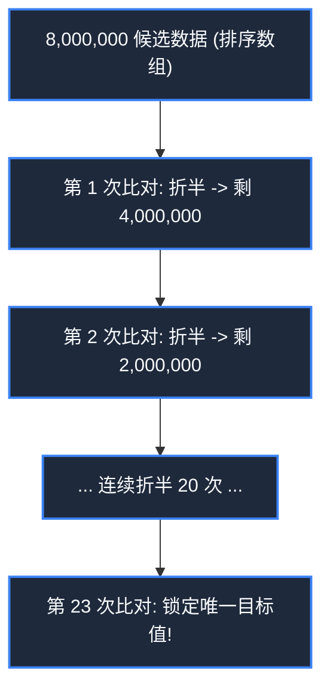

> **课程体系**：【计算机科学速成课】Crash Course Computer Science (PBS / 全40集精校)  
> **所属模块**：Module 2: 编程语言与软件核心 (Software & Programming)  
> **主讲嘉宾**：Carrie Anne Philbin  
> **视频时长**：11:44 ｜ **高清画面截图**：4 张核心知识点板书/图解  
> **视频直达**：[📺 在 B 站观看本讲原视频 (P13)](https://www.bilibili.com/video/BV1EW411u7th/?p=13)  
> **全书导航**：[← 上一讲 (P12)](/notes/cccs/lecture-12) ｜ [📚 返回全书目录](/notes/topics/CCCS) ｜ [下一讲 (P14) →](/notes/cccs/lecture-14)

---

## 核心导读与概念全景

深入剖析算法的本质定义，以查找（线性 vs 二分）与排序（选择 vs 归并）经典案例为切入点，系统推导大 O 渐进时间复杂度体系，揭示优雅算法相比暴力蛮力计算的降维打击。

---

## 1. 什么是算法？从解决问题的菜谱说起

*(参考时间：00:01:00 · [视频跳转 (P13 00:01:00)](https://www.bilibili.com/video/BV1EW411u7th/?p=13&t=60))*

**算法（Algorithm）**这个词源于 9 世纪波斯数学家阿尔·花拉子米（Al-Khwarizmi）。

算法的本质是：**为了解决某一类特定问题、由一系列精确且有限的严密操作步骤构成的计算流程**。
就像烘焙蛋糕的菜谱：输入是面粉、糖和鸡蛋，经过搅拌、烘烤等明确无歧义的步骤，最终确定性地输出一块美味的蛋糕。

在计算机领域，同一个问题往往有成百上千种不同的算法。即便它们的输出完全正确一致，但在消耗的时间（CPU 时钟）和空间（RAM 内存）上却存在着天壤之别！

*⏱ 时间戳：00:01:30 · 📷 课堂截图 · [在 B 站观看对应片段 (P13 00:01:30)](https://www.bilibili.com/video/BV1EW411u7th/?p=13&t=90)*

## 2. 查找算法大PK：线性查找 vs 二分查找

*(参考时间：00:02:15 · [视频跳转 (P13 00:02:15)](https://www.bilibili.com/video/BV1EW411u7th/?p=13&t=135))*

假设在一部包含 800 万人口的电话簿中寻找一个叫“John Smith”的电话号码：

#### 1. 线性查找（Linear Search）
- **操作方式**：从电话簿第 1 页第一行开始，挨个往下比对，直到找到为止。
- **代价**：如果目标在最后一行，或者根本不存在，你必须硬生生翻阅 800 万次！如果数据量扩大到 80 亿，翻阅时间将呈等比例线性膨胀。

#### 2. 二分查找（Binary Search）
- **先决条件**：电话簿必须是**已按字母排序**的！
- **操作方式**：直接翻到正中间第 400 万页。如果中间的人名是“Miller”，在字母表中“Smith”必然在它后面，前 400 万页被**一瞬间直接永久排除**！接着在后半段继续折半……
- **奇迹般的数学威力**：每一次比对，搜索空间腰斩一半！
  $$\log_2(8,000,000) \approx 23$$
  **只需最多 23 次翻页比对**，就能在 800 万个名字中锁定目标！这就是对数级效率对线性蛮力的降维打击。

*⏱ 时间戳：00:03:05 · 📷 课堂截图 · [在 B 站观看对应片段 (P13 00:03:05)](https://www.bilibili.com/video/BV1EW411u7th/?p=13&t=185)*

## 3. 排序算法大PK：选择排序 vs 归并排序

*(参考时间：00:04:10 · [视频跳转 (P13 00:04:10)](https://www.bilibili.com/video/BV1EW411u7th/?p=13&t=250))*

二分查找要求数据必须先排好序。如何给一个杂乱无章的数组排序？

#### 1. 选择排序（Selection Sort）
- **策略**：扫描整个数组，找出最小的数，把它和第 0 位交换；接着扫描剩下的数，找出次小的数放到第 1 位……
- **性能评估**：对于 $N$ 个元素，总比对次数为：
  $$(N-1) + (N-2) + \dots + 1 = \frac{N(N-1)}{2} \approx \frac{N^2}{2}$$
  当数据规模扩大 10 倍时，运算耗时暴增 **100 倍**！处理 100 万个数字需要 5000 亿次比对，现代 CPU 也会被活活卡死。

#### 2. 归并排序（Merge Sort）与分治法
由数学大师冯·诺依曼在 1945 年提出，采用**分而治之（Divide and Conquer）**哲学：
- 将数组一分为二，二分为四，递归拆分直到每个子数组只有 1 个元素（1 个元素天然有序！）；
- 接着自底向上**双路归并（Merge）**：比对两个有序小数组的头部，谁小谁先落入新数组。
- **性能飞跃**：拆分深度为 $\log N$，每层合并耗时 $N$，总时间复杂度仅为 **$O(N \log N)$**！处理 100 万个数字只需约 2000 万次运算，耗时从几小时缩短至零点几秒。

*⏱ 时间戳：00:05:20 · 📷 课堂截图 · [在 B 站观看对应片段 (P13 00:05:20)](https://www.bilibili.com/video/BV1EW411u7th/?p=13&t=320)*

## 4. 渐进复杂度与大 O 表示法（Big-O Notation）

*(参考时间：00:06:50 · [视频跳转 (P13 00:06:50)](https://www.bilibili.com/video/BV1EW411u7th/?p=13&t=410))*

为了横向客观评价算法的优劣，计算机科学家脱离具体的电脑硬件和运行秒数，发明了**大 O 表示法（Big-O Notation）**：
它描述的是**随着输入规模 $N$ 趋向于无穷大时，算法耗费时间或空间的增长趋势上限**。

| 复杂度阶数 | 常见名称 | 典型算法 | 规模 $N=100万$ 时的估算步数 |
|:---|:---|:---|:---|
| **$O(1)$** | 常数阶 | 数组下标寻址、哈希表查找 | 1 次（瞬时完成） |
| **$O(\log N)$** | 对数阶 | 二分查找、二叉平衡树检索 | 约 20 次 |
| **$O(N)$** | 线性阶 | 线性查找、简单遍历 | 100 万次 |
| **$O(N \log N)$** | 线性对数阶 | 归并排序、快速排序（平均） | 约 2000 万次（极佳） |
| **$O(N^2)$** | 平方阶 | 选择排序、冒泡排序 | 1 万亿次（极慢） |
| **$O(2^N)$** | 指数阶 | 暴力破解全密码、旅行商问题穷举 | 宇宙毁灭也算不完 |

理解大 O 复杂度，是程序员从初级“代码搬运工”蜕变为高级“架构工程师”的分水岭。

*⏱ 时间戳：00:07:00 · 📷 课堂截图 · [在 B 站观看对应片段 (P13 00:07:00)](https://www.bilibili.com/video/BV1EW411u7th/?p=13&t=420)*

---

## 附：本讲知识脑图与回顾思考

本讲作为 **Module 2: 编程语言与软件核心 (Software & Programming)** 的核心组成部分，系统串联了从底层硬件物理开关、中间层抽象协议到上层应用的思维跃迁。建议结合 B 站原版视频与本讲图文指南反复印证，理解技术演进背后的工程权衡与必然逻辑。

[← 上一讲 (P12)](/notes/cccs/lecture-12) ｜ [📚 返回全书目录](/notes/topics/CCCS) ｜ [下一讲 (P14) →](/notes/cccs/lecture-14)
