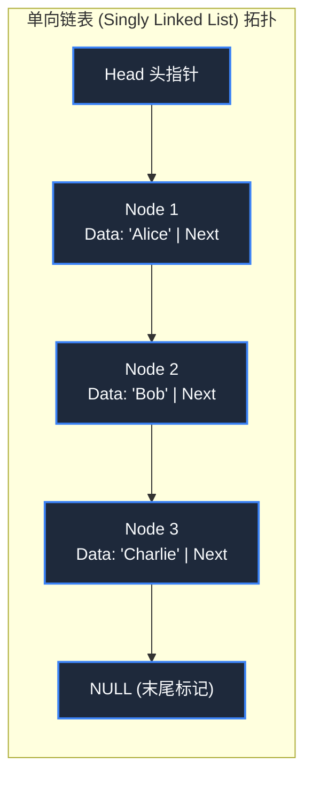

> **课程体系**：【计算机科学速成课】Crash Course Computer Science (PBS / 全40集精校)  
> **所属模块**：Module 2: 编程语言与软件核心 (Software & Programming)  
> **主讲嘉宾**：Carrie Anne Philbin  
> **视频时长**：10:06 ｜ **高清画面截图**：4 张核心知识点板书/图解  
> **视频直达**：[📺 在 B 站观看本讲原视频 (P14)](https://www.bilibili.com/video/BV1EW411u7th/?p=14)  
> **全书导航**：[← 上一讲 (P13)](/notes/cccs/lecture-13) ｜ [📚 返回全书目录](/notes/topics/CCCS) ｜ [下一讲 (P15) →](/notes/cccs/lecture-15)

---

## 核心导读与概念全景

深入剖析程序世界的组织骨架——数据结构，从连续内存数组、指针链表，到受限线性表栈与队列，再到分层二叉树与复杂拓扑图模型，揭示数据拓扑与算法效能的内在共生关系。

---

## 1. 数组（Array）：物理连续内存的极速随机访问

*(参考时间：00:00:45 · [视频跳转 (P14 00:00:45)](https://www.bilibili.com/video/BV1EW411u7th/?p=14&t=45))*

**数据结构（Data Structure）**是计算机中组织和存储数据的方式。它决定了算法访问、插入和删除数据时的阻力大小。

最基础也最常用的数据结构是**数组（Array）**：
- **物理排布**：在内存中开辟一段**绝对严格连续**的物理空间；
- **$O(1)$ 寻址公式**：每个元素占据固定字节数（如 4 字节）。要访问第 $i$ 个元素，硬件无需遍历，只需一条算术指令：
  $$\text{Address}(A[i]) = \text{BaseAddress} + (i \times \text{ElementSize})$$
- **致命软肋**：
  1. 容量固定，扩容困难（必须整体搬迁到一块更大的空闲内存中）；
  2. 中间插入或删除极其昂贵（为了给新元素腾出坑位，后面所有元素必须整体往后平移一格，时间复杂度高达 $O(N)$）。

*⏱ 时间戳：00:00:50 · 📷 课堂截图 · [在 B 站观看对应片段 (P14 00:00:50)](https://www.bilibili.com/video/BV1EW411u7th/?p=14&t=50)*

## 2. 链表（Linked List）：用指针编织的动态自由网络

*(参考时间：00:04:40 · [视频跳转 (P14 00:04:40)](https://www.bilibili.com/video/BV1EW411u7th/?p=14&t=280))*

为了解决数组扩容搬迁的痛苦，工程师设计了**链表（Linked List）**：
- **节点（Node）构造**：链表不要求内存连续。每个节点分散在内存的任意角落，内部包含两个核心字段：
  1. **数据域（Data）**：存放真实有用的业务数据；
  2. **指针域（Next Pointer）**：存放下一个节点在内存中的物理地址。
- **灵活插入与删除**：要向链表中插入一个新节点，无需平移任何现有数据，只需将前驱节点的 Next 指针指向新节点，新节点的 Next 指向后继节点，时间复杂度为令人愉悦的 **$O(1)$**！
- **交换代价**：失去了 $O(1)$ 随机访问能力。要想读取第 100 个节点，必须从头指针（Head）开始顺藤摸瓜逐个遍历，查询时间退化为 $O(N)$。

*⏱ 时间戳：00:05:00 · 📷 课堂截图 · [在 B 站观看对应片段 (P14 00:05:00)](https://www.bilibili.com/video/BV1EW411u7th/?p=14&t=300)*

## 3. 栈（Stack）与队列（Queue）：有纪律的受限线性表

*(参考时间：00:06:15 · [视频跳转 (P14 00:06:15)](https://www.bilibili.com/video/BV1EW411u7th/?p=14&t=375))*

在许多现实业务场景中，我们并不允许任意在中间插入或随机读取，而是需要严格规范数据的出入纪律：

#### 1. 栈（Stack）：后进先出（LIFO, Last In First Out）
- 像一筒羽毛球或一叠盘子，最后放进去的盘子最先被拿出来；
- **核心操作**：`push`（压入栈顶）与 `pop`（弹出栈顶）；
- **应用基石**：第 12 讲提到的**函数调用栈**、浏览器的**后退历史按钮**，以及文本编辑器的**撤销操作（Undo/Ctrl+Z）**！

#### 2. 队列（Queue）：先进先出（FIFO, First In First Out）
- 像在超市收银台排队，先来的顾客先结账离开；
- **核心操作**：`enqueue`（队尾入队）与 `dequeue`（队头出队）；
- **应用基石**：打印机等待打印的任务队列、网络路由器转发的数据包缓冲池，以及操作系统的多进程就绪调度队列。

*⏱ 时间戳：00:06:20 · 📷 课堂截图 · [在 B 站观看对应片段 (P14 00:06:20)](https://www.bilibili.com/video/BV1EW411u7th/?p=14&t=380)*

## 4. 树（Tree）与图（Graph）：非线性高维拓扑建模

*(参考时间：00:07:30 · [视频跳转 (P14 00:07:30)](https://www.bilibili.com/video/BV1EW411u7th/?p=14&t=450))*

当数据关系不再是一维的先后顺序，而是具备分层所属或网状互联时，我们踏入了非线性数据结构殿堂：

#### 1. 树（Tree）与二叉搜索树（BST）
- **拓扑结构**：有一个唯一的根节点（Root），每个节点可以拥有零个或多个子节点（Children），节点之间不存在回路；
- **二叉搜索树（Binary Search Tree）**：规定左子树所有节点的值严格小于根节点，右子树所有节点严格大于根节点。它将二分查找的精髓固化在拓扑结构中，检索效率达到理想的 $O(\log N)$！
- **现实应用**：操作系统的目录树文件结构、HTML 网页文档对象模型（DOM Tree）。

#### 2. 图（Graph）：连接万物的网络
- 由**顶点（Vertices / Nodes）**与连接顶点的**边（Edges）**构成。边可以是有方向的（有向图），也可以赋予权重（加权图）；
- **现实应用**：高德地图/谷歌地图的城市道路导航（寻找最短路径 Dijkstra 算法）、社交网络中的好友关系图谱（六度分割理论），以及互联网路由器之间的 BGP 拓扑路由。

**“程序 = 算法 + 数据结构”**——图灵奖得主尼古拉斯·沃斯（Niklaus Wirth）的这句名言，精辟道尽了软件构建的全部奥义。

*⏱ 时间戳：00:07:40 · 📷 课堂截图 · [在 B 站观看对应片段 (P14 00:07:40)](https://www.bilibili.com/video/BV1EW411u7th/?p=14&t=460)*

---

## 附：本讲知识脑图与回顾思考

本讲作为 **Module 2: 编程语言与软件核心 (Software & Programming)** 的核心组成部分，系统串联了从底层硬件物理开关、中间层抽象协议到上层应用的思维跃迁。建议结合 B 站原版视频与本讲图文指南反复印证，理解技术演进背后的工程权衡与必然逻辑。

[← 上一讲 (P13)](/notes/cccs/lecture-13) ｜ [📚 返回全书目录](/notes/topics/CCCS) ｜ [下一讲 (P15) →](/notes/cccs/lecture-15)
