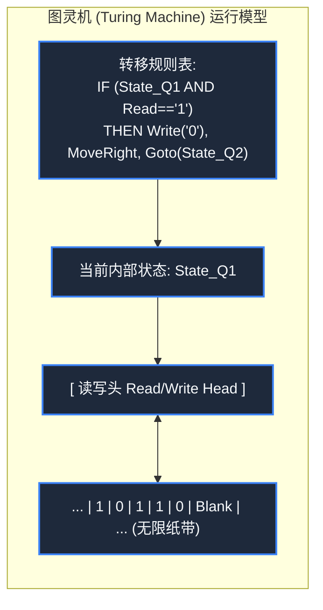

> **课程体系**：【计算机科学速成课】Crash Course Computer Science (PBS / 全40集精校)  
> **所属模块**：Module 2: 编程语言与软件核心 (Software & Programming)  
> **主讲嘉宾**：Carrie Anne Philbin  
> **视频时长**：13:05 ｜ **高清画面截图**：4 张核心知识点板书/图解  
> **视频直达**：[📺 在 B 站观看本讲原视频 (P15)](https://www.bilibili.com/video/BV1EW411u7th/?p=15)  
> **全书导航**：[← 上一讲 (P14)](/notes/cccs/lecture-14) ｜ [📚 返回全书目录](/notes/topics/CCCS) ｜ [下一讲 (P16) →](/notes/cccs/lecture-16)

---

## 核心导读与概念全景

缅怀计算机科学与人工智能之父阿兰·图灵的传奇一生，深度解析图灵机数学模型、停机问题的不可判定性证明、二战破译 Enigma 的历史功绩，以及图灵测试的哲学深意。

---

## 1. 理论计算机科学之父：阿兰·图灵的世纪之思

*(参考时间：00:01:00 · [视频跳转 (P15 00:01:00)](https://www.bilibili.com/video/BV1EW411u7th/?p=15&t=60))*

阿兰·麦席森·图灵（Alan Mathison Turing, 1912-1954），是 20 世纪人类历史上最耀眼的天才数学家、逻辑学家与密码破译大师。

在任何现代电子计算机尚未诞生的 1936 年，年仅 24 岁的图灵在论文《论可计算数及其在判定性问题上的应用》中，提出了一个纯粹在思维中运行的思想实验模型——**图灵机（Turing Machine）**。这个极其简约的数学模型，一举为整个计算机科学奠定了不可动摇的理论大厦。


*⏱ 时间戳：00:01:50 · 📷 课堂截图 · [在 B 站观看对应片段 (P15 00:01:50)](https://www.bilibili.com/video/BV1EW411u7th/?p=15&t=110)*

## 2. 图灵机数学模型：什么是可计算？

*(参考时间：00:02:10 · [视频跳转 (P15 00:02:10)](https://www.bilibili.com/video/BV1EW411u7th/?p=15&t=130))*

图灵机由四个极其简单的组件构成：
1. **一条无限延展的纸带（Tape）**：划分为连续的小方格，每个方格可以印有符号（如 0, 1）或保持空白，相当于无限容量的内存；
2. **一个读写头（Read/Write Head）**：可以在纸带上左右单步移动，读取当前格子的符号，或者抹去改写新符号；
3. **一个状态寄存器（State Register）**：保存图灵机当前所处的内部状态（例如状态 A, 状态 B, 停机状态）；
4. **一套固定的动作转移表（Transition Table）**：相当于程序规则。规定“在当前状态下，若读到符号 X，则做三件事：改写符号为 Y、向左/向右移动一格、将内部状态转变为新状态 Z”。

#### 邱奇-图灵论题（Church-Turing Thesis）
图灵证明了：任何复杂的现代超级计算机（无论拥有多少万个 CPU 核心与多大内存），它在数学本质上所能解决的所有计算问题，**一台简陋的通用图灵机（Universal Turing Machine）都可以分毫不差地完全算出来**！
一台机器只要能够模拟图灵机的全部行为，就被称为**图灵完备（Turing Complete）**。这成为了衡量一种编程语言或硬件架构是否具备通用计算能力的最高准则。




*⏱ 时间戳：00:06:10 · 📷 课堂截图 · [在 B 站观看对应片段 (P15 00:06:10)](https://www.bilibili.com/video/BV1EW411u7th/?p=15&t=370)*

## 3. 停机问题（The Halting Problem）：计算机算力的绝对边界

*(参考时间：00:05:40 · [视频跳转 (P15 00:05:40)](https://www.bilibili.com/video/BV1EW411u7th/?p=15&t=340))*

计算机是否能够解决世界上的一切数学问题？图灵给出了震撼世界的否定回答。

他提出了著名的**停机问题（Halting Problem）**：
**是否存在这样一个万能的分析程序 $H(P, I)$，它能够审查任何一段程序 $P$ 及其输入 $I$，并在有限时间内确定性地给出答案：程序 $P$ 最终会正常执行完毕停机（返回 True），还是会陷入死循环永远不停机（返回 False）？**

#### 优美绝伦的反证法（对角线法）：
假设这个万能分析器 $H$ 真的存在。我们用它作为核心构建一个邪恶的悖论程序 `Bizarro(P)`：
```python
def Bizarro(P):
    if H(P, P) == True: # 如果 H 断言程序 P 自审时会停机
        while True: pass # 那 Bizarro 偏偏故意进入死循环！
    else:               # 如果 H 断言程序 P 自审时会死循环
        return True     # 那 Bizarro 偏偏立刻停机退出！
```
现在，终极问题降临：**如果我们把 `Bizarro` 程序本身作为输入，喂给它自己执行 `Bizarro(Bizarro)`，会发生什么？**
1. 如果 $H$ 断言 `Bizarro` 会停机，那么根据代码逻辑，`Bizarro` 立即进入死循环永远不停机——**$H$ 预测错了**！
2. 如果 $H$ 断言 `Bizarro` 不会停机，根据代码逻辑，`Bizarro` 瞬间执行完毕停机退出——**$H$ 再次预测错了**！

无论 $H$ 给出什么预测，都会立刻引发逻辑自相矛盾！因此：**万能的停机判断程序在数学上根本不可能存在！**
图灵以此向全人类宣告：人类的理性与机器的计算存在着永恒无法跨越的不可判定（Undecidable）边界。


*⏱ 时间戳：00:09:00 · 📷 课堂截图 · [在 B 站观看对应片段 (P15 00:09:00)](https://www.bilibili.com/video/BV1EW411u7th/?p=15&t=540)*

## 4. 布莱切利园传奇与人工智能之父

*(参考时间：00:08:20 · [视频跳转 (P15 00:08:20)](https://www.bilibili.com/video/BV1EW411u7th/?p=15&t=500))*

#### 1. 拯救世界的密码战（二战与 Enigma）
二战爆发后，图灵应征加入英国布莱切利园（Bletchley Park）绝密情报机构。
面对纳粹德国拥有 1.5 亿亿种可能密钥组合、每天零点准时更换密码本的“恩尼格玛（Enigma）”密码机，图灵带领团队设计研制了机电式密码分析机——**Bombe（炸弹机）**。
Bombe 机通过上百个高速旋转的模拟转子同时排查矛盾冲突，成功破译了德军潜艇部队最高密级通信。历史学家公认：图灵团队的破译工作使二战至少提前两年结束，挽救了欧洲战场上数千万无辜平民的宝贵生命！

#### 2. 图灵测试（The Turing Test, 1950）
战后，图灵将目光投向了思考的本质，发表了开创性论文《计算机器与智能》，提出了著名的**图灵测试（模仿游戏）**：
让一名人类裁判通过文字终端同时与幕后的一台机器和另一个人隔空对话。如果裁判无法准确分辨哪个是机器、哪个是真人，那么这台机器就应当被认定为具有“智能”。

#### 悲剧与永恒的荣耀
令人痛心的是，这样一位拯救了文明的超级英雄，在 1952 年却因当时的恐同法律被英国法庭判定为“严重猥亵罪”，并被迫接受惨无人道、摧毁神经系统的化学阉割治疗。1954 年 6 月 7 日，图灵被发现死于家中，身旁放着一个咬了一口的浸有剧毒氰化物的苹果，年仅 41 岁。

为了纪念这位无可争议的巨人，计算机科学界的最高荣誉被命名为**图灵奖（A.M. Turing Award）**，被誉为“计算机界的诺贝尔奖”。图灵的思想火种，至今依然燃烧在人类每一次微架构创新与大语言模型的神经元跃迁中。


*⏱ 时间戳：00:10:30 · 📷 课堂截图 · [在 B 站观看对应片段 (P15 00:10:30)](https://www.bilibili.com/video/BV1EW411u7th/?p=15&t=630)*

---

## 附：本讲知识脑图与回顾思考

本讲作为 **Module 2: 编程语言与软件核心 (Software & Programming)** 的核心组成部分，系统串联了从底层硬件物理开关、中间层抽象协议到上层应用的思维跃迁。建议结合 B 站原版视频与本讲图文指南反复印证，理解技术演进背后的工程权衡与必然逻辑。

[← 上一讲 (P14)](/notes/cccs/lecture-14) ｜ [📚 返回全书目录](/notes/topics/CCCS) ｜ [下一讲 (P16) →](/notes/cccs/lecture-16)
