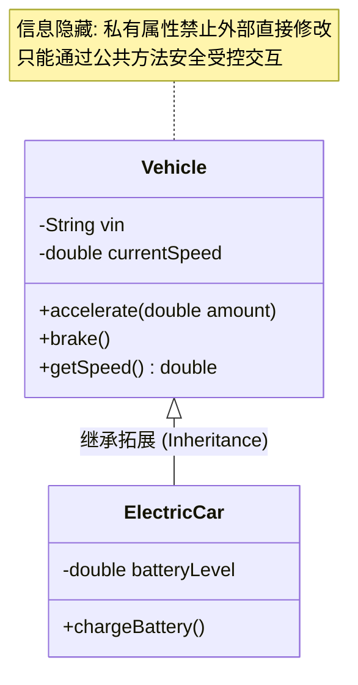

> **课程体系**：【计算机科学速成课】Crash Course Computer Science (PBS / 全40集精校)  
> **所属模块**：Module 2: 编程语言与软件核心 (Software & Programming)  
> **主讲嘉宾**：Carrie Anne Philbin  
> **视频时长**：10:35 ｜ **高清画面截图**：4 张核心知识点板书/图解  
> **视频直达**：[📺 在 B 站观看本讲原视频 (P16)](https://www.bilibili.com/video/BV1EW411u7th/?p=16)  
> **全书导航**：[← 上一讲 (P15)](/notes/cccs/lecture-15) ｜ [📚 返回全书目录](/notes/topics/CCCS) ｜ [下一讲 (P17) →](/notes/cccs/lecture-17)

---

## 核心导读与概念全景

直面软件工程从个人脚本迈向工业级大型复杂系统的演进挑战，深入剖析面向对象封装、API 契约解耦、版本控制（Git）、单元测试及敏捷研发体系的核心法则。

---

## 1. 软件危机与工业化工程维度的诞生

*(参考时间：00:01:05 · [视频跳转 (P16 00:01:05)](https://www.bilibili.com/video/BV1EW411u7th/?p=16&t=65))*

一个人写几百行小工具，代码可以随心所欲；但当软件规模攀升至数十万行、数百万行（例如现代操作系统的 5000 万行代码），成百上千名工程师在同一个项目中协作时，灾难降临了：
- 一个程序员改动了全局变量的一个数值，导致千里之外另一个团队负责的模块意外崩溃；
- 没人敢修改老旧代码，因为没人知道哪行代码背后潜藏着致命依赖；
这就是 20 世纪 60 年代爆发的著名的**“软件危机（Software Crisis）”**。

为了避免大型软件项目沦为深不见底的吞金泥潭与故障深渊，**软件工程（Software Engineering）**应运而生。它不是教你如何写出单行聪明的奇技淫巧，而是**研究如何组织规范、团队分工与架构解耦，使得极其庞大复杂的系统能够持续稳定迭代交付**的工业科学。

*⏱ 时间戳：00:01:20 · 📷 课堂截图 · [在 B 站观看对应片段 (P16 00:01:20)](https://www.bilibili.com/video/BV1EW411u7th/?p=16&t=80)*

## 2. 面向对象编程（OOP）：现实世界的映射与信息隐藏

*(参考时间：00:02:30 · [视频跳转 (P16 00:02:30)](https://www.bilibili.com/video/BV1EW411u7th/?p=16&t=150))*

为了驯服复杂性，计算机科学家提出了**面向对象编程（Object-Oriented Programming, OOP）**范式：
- **对象（Object）**：将相关联的**数据（属性/状态）**与能够对该数据执行的**操作（方法/函数）**强行捆绑打包在一个盒子里；
- **类（Class）**：对象的蓝图或模版。例如定义一个 `Car` 类，包含属性 `speed`, `fuel`，以及方法 `accelerate()`, `brake()`；
- **封装（Encapsulation）与信息隐藏**：对象内部的微观数据细节（如引擎具体几转）对外部彻底隐藏（Private），外部只能通过暴露出的公共方法（Public Methods）来交互。这杜绝了外部代码随意篡改内部状态的灾难，实现了各模块的“各人自扫门前雪”。

*⏱ 时间戳：00:02:40 · 📷 课堂截图 · [在 B 站观看对应片段 (P16 00:02:40)](https://www.bilibili.com/video/BV1EW411u7th/?p=16&t=160)*

## 3. 应用程序编程接口（API）：系统间的坚固护城河

*(参考时间：00:03:50 · [视频跳转 (P16 00:03:50)](https://www.bilibili.com/video/BV1EW411u7th/?p=16&t=230))*

在大型汽车巡航控制系统开发中，负责雷达感应的团队与负责油门喷射的团队如何协作？
答案是通过 **API（Application Programming Interface, 应用程序编程接口）**。

- **接口契约（Interface Contract）**：雷达团队只需向外声明：“只要你调用我的 `get_distance_to_front_car()` 函数，我保证在 10 毫秒内给你返回一个浮点数距离”；
- **内部黑盒化**：雷达团队底层究竟是用超声波算法、激光雷达还是红外双目测距，油门团队完全无需知晓，也根本不在乎！
只要 API 规范没有改变，雷达团队在内部随便怎么重构优化算法，都不会导致汽车其他模块发生破坏性故障。API 构筑起了各软件层级之间优雅解耦的坚固护城河。

*⏱ 时间戳：00:04:00 · 📷 课堂截图 · [在 B 站观看对应片段 (P16 00:04:00)](https://www.bilibili.com/video/BV1EW411u7th/?p=16&t=240)*

## 4. 现代软件工程工具流：版本控制、测试与持续集成

*(参考时间：00:05:20 · [视频跳转 (P16 00:05:20)](https://www.bilibili.com/video/BV1EW411u7th/?p=16&t=320))*

现代专业软件工程师的武器库早已超越了纯文本编辑器：

1. **集成开发环境（IDE）**：如 VS Code、IntelliJ，整合了代码语法高亮、实时静态类型检查、智能补全以及底层断点单步调试器；
2. **版本控制系统（Version Control System, Git）**：记录每一行代码每一次变更的历史快照。数百人可以在各自独立的分支（Branches）上并行开发功能，随后通过审查合并（Merge/Pull Request），哪怕出了故障也能一秒精准回滚到任意历史稳定版本；
3. **自动化测试（Automated Testing）**：
   - **单元测试（Unit Tests）**：为每一个独立函数编写极值验证代码；
   - **回归测试（Regression Testing）**：每次提交新功能前，自动化测试套件在后台疯狂执行上万个测试用例，确保新添加的代码没有在阴暗角落偷偷搞崩现有的老功能；
4. **持续集成与部署（CI/CD）**：自动化流水线自动拉取代码、编译、打包、测试并在云端服务器无缝上线。

正是这些精密的软件工程方法论与工具链，让人类能够自信地构建起现代航天飞控、自动驾驶与全球云基础设施这样包含上千万行代码的不可思议的数字奇迹。

*⏱ 时间戳：00:05:30 · 📷 课堂截图 · [在 B 站观看对应片段 (P16 00:05:30)](https://www.bilibili.com/video/BV1EW411u7th/?p=16&t=330)*

---

## 附：本讲知识脑图与回顾思考

本讲作为 **Module 2: 编程语言与软件核心 (Software & Programming)** 的核心组成部分，系统串联了从底层硬件物理开关、中间层抽象协议到上层应用的思维跃迁。建议结合 B 站原版视频与本讲图文指南反复印证，理解技术演进背后的工程权衡与必然逻辑。

[← 上一讲 (P15)](/notes/cccs/lecture-15) ｜ [📚 返回全书目录](/notes/topics/CCCS) ｜ [下一讲 (P17) →](/notes/cccs/lecture-17)
