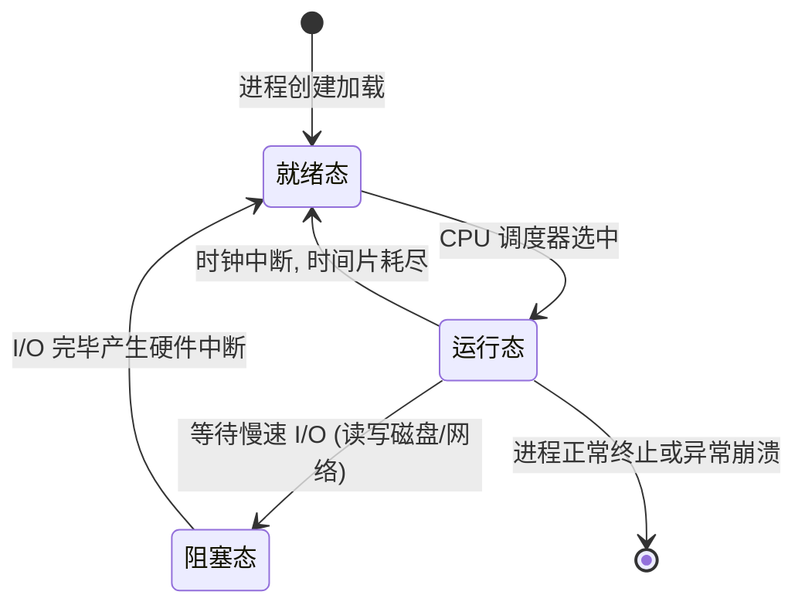

> **课程体系**：【计算机科学速成课】Crash Course Computer Science (PBS / 全40集精校)  
> **所属模块**：Module 3: 系统架构与存储介质 (Systems & Storage)  
> **主讲嘉宾**：Carrie Anne Philbin  
> **视频时长**：13:35 ｜ **高清画面截图**：4 张核心知识点板书/图解  
> **视频直达**：[📺 在 B 站观看本讲原视频 (P18)](https://www.bilibili.com/video/BV1EW411u7th/?p=18)  
> **全书导航**：[← 上一讲 (P17)](/notes/cccs/lecture-17) ｜ [📚 返回全书目录](/notes/topics/CCCS) ｜ [下一讲 (P19) →](/notes/cccs/lecture-19)

---

## 核心导读与概念全景

探索操作系统作为硬件与应用软件中枢的演进史，详解硬件抽象层（HAL）、设备驱动、多道程序分时轮转、虚拟内存保护机制，以及 Unix 奠定的现代系统架构哲学。

---

## 1. 混沌年代的程序运行痛点与操作系统的诞生

*(参考时间：00:01:05 · [视频跳转 (P18 00:01:05)](https://www.bilibili.com/video/BV1EW411u7th/?p=18&t=65))*

在早期计算机时代，并没有“操作系统”这个管家软件存在。
每个程序员写的程序必须直接对裸机硬件编程：
- 代码中必须硬编码如何通过电信号让某一特定型号的磁带卷动、如何控制特定打印机的针头走纸；
- 换了一台新打印机，整个程序所有的打印函数全部作废重写；
- 计算机一次只能运行一个程序，程序执行完毕停机后，计算机完全闲置，等待人工换打孔纸带。

为了消灭这种原始的混乱，**操作系统（Operating System, OS）**应运而生。操作系统是计算机开机时第一个加载、并且常驻内存掌控系统最高特权的核心软件，充当应用软件与底层硬件之间无所不能的宏伟中间人。

*⏱ 时间戳：00:02:00 · 📷 课堂截图 · [在 B 站观看对应片段 (P18 00:02:00)](https://www.bilibili.com/video/BV1EW411u7th/?p=18&t=120)*

## 2. 硬件抽象层（HAL）与设备驱动程序（Device Drivers）

*(参考时间：00:02:15 · [视频跳转 (P18 00:02:15)](https://www.bilibili.com/video/BV1EW411u7th/?p=18&t=135))*

操作系统为上层应用构筑的最重要一层护城河是**硬件抽象层（Hardware Abstraction Layer, HAL）**：
- **设备驱动程序（Device Drivers）**：硬件厂商（如惠普、英伟达）按照操作系统制定的标准接口撰写专用驱动。驱动程序负责搞定具体的电信号通信细节；
- **统一系统调用（System Calls）**：上层软件（如 Word 或游戏）只需调用操作系统暴露的标准 API：`print(document)`。无论是激光打印机、喷墨打印机还是虚拟 PDF 打印机，操作系统负责将调用转发给对应驱动。应用程序彻底从繁杂琐碎的异构硬件泥潭中解脱出来。

*⏱ 时间戳：00:04:10 · 📷 课堂截图 · [在 B 站观看对应片段 (P18 00:04:10)](https://www.bilibili.com/video/BV1EW411u7th/?p=18&t=250)*

## 3. 多道程序（Multiprogramming）与 CPU 分时调度

*(参考时间：00:04:00 · [视频跳转 (P18 00:04:00)](https://www.bilibili.com/video/BV1EW411u7th/?p=18&t=240))*

早期计算机极度昂贵，而 CPU 的运转速度比机械外设（如读卡机、磁带）快百万倍。当一个程序等待读取磁带时，几百万个 CPU 时钟节拍在毫无意义地空转。

操作系统引入了**多道程序与分时系统（Time-Sharing Systems）**：
- **进程状态切换**：当进程 A 发起慢速 I/O 读写时，操作系统的**调度器（Scheduler）**立即介入，将进程 A 挂起置于阻塞队列，同时将处于就绪队列的进程 B 调度上 CPU 飞速执行；
- **时间片轮转（Round-Robin）**：操作系统利用硬件定时器中断，将 CPU 的时间切割为微秒级的“时间片（Time Slice）”。每过十几毫秒，强行打断当前程序，换下一个程序执行。由于切换极其迅速，在人类用户看来，就像音乐播放器、网页浏览器和代码编辑器在同时流畅并发运行一样！

*⏱ 时间戳：00:06:20 · 📷 课堂截图 · [在 B 站观看对应片段 (P18 00:06:20)](https://www.bilibili.com/video/BV1EW411u7th/?p=18&t=380)*

## 4. 虚拟内存（Virtual Memory）与内存保护隔离

*(参考时间：00:06:10 · [视频跳转 (P18 00:06:10)](https://www.bilibili.com/video/BV1EW411u7th/?p=18&t=370))*

当多个程序共同挤在同一个物理 RAM 内存中时，爆发了极度危险的安全隐患：
如果游戏程序出现死循环指针越界，不小心覆盖了银行软件的内存，或者恶意病毒直接读取其他程序的密码怎么办？

现代操作系统借助 CPU 内部的**内存管理单元（MMU）**，实现了**虚拟内存与内存保护（Virtual Memory & Paging）**：
1. **地址空间沙箱**：每个运行的进程都被欺骗性地赋予了一个连续且巨大的“虚拟地址空间”（例如 4GB 或更高）。进程以为自己独占了整台计算机的全部内存；
2. **页表映射（Page Tables）**：MMU 负责将虚拟页面（Page）动态动态翻译映射到物理内存的离散帧（Frame）中；
3. **特权级保护（Ring 0 vs Ring 3）**：进程绝对禁止跨越沙箱访问物理内存。如果一个程序试图非法窥探其他进程或操作系统的核心内核区，CPU 硬件在纳秒级直接触发**页错误（Page Fault / 段错误 Segmentation Fault）**，操作系统毫不留情地立即将该程序强行杀死！其他程序完全不受任何干扰。

*⏱ 时间戳：00:09:30 · 📷 课堂截图 · [在 B 站观看对应片段 (P18 00:09:30)](https://www.bilibili.com/video/BV1EW411u7th/?p=18&t=570)*

## 5. 贝尔实验室 Unix 传奇与现代操作系统哲学

*(参考时间：00:09:20 · [视频跳转 (P18 00:09:20)](https://www.bilibili.com/video/BV1EW411u7th/?p=18&t=560))*

1969 年，在贝尔实验室的一台闲置 PDP-7 小型机上，**肯·汤普逊（Ken Thompson）**与**丹尼斯·里奇（Dennis Ritchie）**联手创造了现代操作系统的无上丰碑——**Unix**。

Unix 确立了极其深刻而优雅的系统哲学：
1. **一切皆文件（Everything is a File）**：不仅普通数据是文件，目录、硬件设备（如键盘、显存）、甚至网络套接字在系统看来全部是可以通过 `open`, `read`, `write`, `close` 操作的纯粹文件流；
2. **单一职责与管道协作**：每个小工具只专注把一件事做到极致（如 `cat`, `grep`, `sort`），通过**管道（Pipe `|`）**将前一个程序的输出无缝接入下一个程序的输入；
3. **C 语言重写系统**：里奇为了让 Unix 能够轻松移植到其他硬件架构上，发明了兼顾高层抽象与底层硬件操控的 **C 语言**。Unix 成为第一个用高级语言重构的通用操作系统。

今天，无论苹果的 macOS/iOS、谷歌的 Android、服务器统治者 Linux，全部源自或深深浸润着 Unix 的核心血脉。

---

## 附：本讲知识脑图与回顾思考

本讲作为 **Module 3: 系统架构与存储介质 (Systems & Storage)** 的核心组成部分，系统串联了从底层硬件物理开关、中间层抽象协议到上层应用的思维跃迁。建议结合 B 站原版视频与本讲图文指南反复印证，理解技术演进背后的工程权衡与必然逻辑。

[← 上一讲 (P17)](/notes/cccs/lecture-17) ｜ [📚 返回全书目录](/notes/topics/CCCS) ｜ [下一讲 (P19) →](/notes/cccs/lecture-19)
