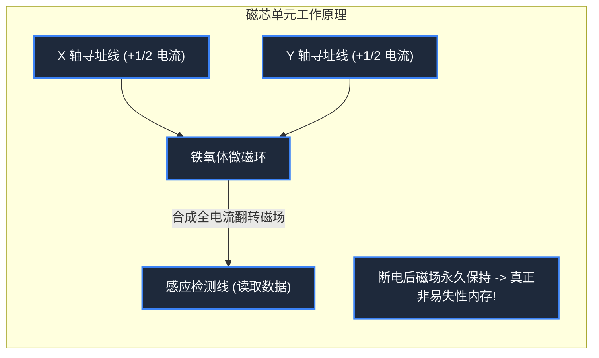

> **课程体系**：【计算机科学速成课】Crash Course Computer Science (PBS / 全40集精校)  
> **所属模块**：Module 3: 系统架构与存储介质 (Systems & Storage)  
> **主讲嘉宾**：Carrie Anne Philbin  
> **视频时长**：12:17 ｜ **高清画面截图**：4 张核心知识点板书/图解  
> **视频直达**：[📺 在 B 站观看本讲原视频 (P19)](https://www.bilibili.com/video/BV1EW411u7th/?p=19)  
> **全书导航**：[← 上一讲 (P18)](/notes/cccs/lecture-18) ｜ [📚 返回全书目录](/notes/topics/CCCS) ｜ [下一讲 (P20) →](/notes/cccs/lecture-20)

---

## 核心导读与概念全景

回溯计算机外存与内存介质的物理演进波澜，从水银延迟线、磁芯手织网，到机械硬盘 HDD 的磁记录与现代 NAND Flash 固态电子存储，透析存储金字塔的工程权衡。

---

## 1. 挥发性内存 vs 非易失性存储的根本分界

*(参考时间：00:01:00 · [视频跳转 (P19 00:01:00)](https://www.bilibili.com/video/BV1EW411u7th/?p=19&t=60))*

计算机对信息保存的需求存在着一个天然的物理撕裂：
- **内存（Primary Memory, 如 RAM）**：速度必须极快，能跟上 CPU 纳秒级的运算节奏，但它是**易失性（Volatile）**的——电脑一拔电源关机，里面的所有数据瞬间烟消云散；
- **存储介质（Secondary Storage, 如硬盘、固态）**：速度相对较慢，但必须是**非易失性（Non-Volatile）**的——断电后即使放上十年，珍贵的照片和程序依然完好无损。

为了寻找兼具速度、容量、持久性与经济成本的最佳介质，物理学家与工程师上演了一场长达七十年的材料工程史诗。

*⏱ 时间戳：00:02:20 · 📷 课堂截图 · [在 B 站观看对应片段 (P19 00:02:20)](https://www.bilibili.com/video/BV1EW411u7th/?p=19&t=140)*

## 2. 早期的蛮荒黑科技：延迟线与磁芯内存

*(参考时间：00:02:10 · [视频跳转 (P19 00:02:10)](https://www.bilibili.com/video/BV1EW411u7th/?p=19&t=130))*

#### 1. 水银延迟线内存（Mercury Delay Line, 1940s）
早期没有半导体 RAM 时，工程师利用了**声波比光电慢得多的物理特性**：
在一个盛满液态水银的长金属管一端放置石英压电晶体，把二进制电信号转换为高频声波脉冲在水银中以 1450 m/s 慢慢穿行；另一端麦克风接收声波转回电信号，放大后再送回入口重新发射！数据就像在水管里不断回旋的声波回音一样被动态“暂存”。缺点是极其沉重、剧毒、对温度极其敏感。

#### 2. 磁芯内存（Magnetic Core Memory, 1950s-1970s）
由美籍华裔物理学家王安（An Wang）与杰·福里斯特（Jay Forrester）完善：
- 采用极其细小的环形铁氧体磁环，穿过细铜线编织成巨大的网格；
- 通过正向或反向通过脉冲电流，磁环被磁化为顺时针或逆时针磁场，分别锁定代表 1 和 0；
- **坚不可摧的功勋**：磁芯不怕辐射、不惧断电，曾伴随阿波罗 11 号登月计算机（Apollo Guidance Computer）成功降落月球。当时所有的磁芯织网全部由纺织女工在显微镜下手工穿针引线编织而成！

*⏱ 时间戳：00:05:30 · 📷 课堂截图 · [在 B 站观看对应片段 (P19 00:05:30)](https://www.bilibili.com/video/BV1EW411u7th/?p=19&t=330)*

## 3. 旋转磁力奇迹：机械硬盘（Hard Disk Drive）

*(参考时间：00:07:30 · [视频跳转 (P19 00:07:30)](https://www.bilibili.com/video/BV1EW411u7th/?p=19&t=450))*

1956 年，IBM 研发出了人类第一台商用硬盘系统——**IBM 305 RAMAC**：
- 它包含了 50 张直径长达 61 厘米的巨大镀磁铝合金圆盘，重达 1 吨，必须用叉车搬运；
- 总存储容量在当时极其震撼：**5 兆字节（5 MB）**！

#### 机械硬盘的现代精密工程：
现代 HDD 的盘片以每分钟 5400 或 7200 转高速飞旋。一个微型的电磁读写磁头悬浮在距离盘片表面仅 **几纳米** 的微气流气垫之上（相当于一架波音 747 贴着地面半厘米在超音速飞行）：
- **写入**：磁头电磁线圈瞬间产生微观极性磁场，将盘片表面微小的磁畴排列为向左或向右；
- **读取**：利用巨磁阻效应（GMR），磁头掠过磁畴表面感应电阻变化读取数据；
HDD 将存储成本拉到了极其低廉的水准，长期统治着个人电脑与数据中心的第二存储王座。

*⏱ 时间戳：00:08:15 · 📷 课堂截图 · [在 B 站观看对应片段 (P19 00:08:15)](https://www.bilibili.com/video/BV1EW411u7th/?p=19&t=495)*

## 4. 固态电子时代：NAND Flash 闪存与存储金字塔

*(参考时间：00:10:10 · [视频跳转 (P19 00:10:10)](https://www.bilibili.com/video/BV1EW411u7th/?p=19&t=610))*

机械硬盘由于必须依赖磁头臂机械摆动寻道（Seek Time），随机读写延迟高达 5 到 10 毫秒（ms），在纳秒级的 CPU 面前慢如蜗牛，且跌落震动极易划伤盘片。

#### 固态闪存（NAND Flash / SSD）的崛起
发明于 20 世纪 80 年代（东芝工程师舛冈富士雄）：
- **全固态无任何机械部件**：内部由微型**浮栅晶体管（Floating-Gate Transistor）**构成。通过高压量子力学隧道效应将电子强行打入被二氧化硅绝缘层完全封锁的“浮栅”陷阱中；
- 哪怕彻底断电，被困在浮栅中的电子可以安然被囚禁数十年！通过检测晶体管导通阈值电压的高低即可读出数据；
- 固态硬盘（SSD）将数据寻道时延压到了微秒（$\mu s$）级别，彻底消除了电脑开机加载的机械转动等待。

#### 现代计算机存储层次金字塔（Memory Hierarchy）
从上至下：
1. **CPU 寄存器**：纳秒级，容量几十字节；
2. **CPU 缓存（L1-L3 Cache）**：几纳秒，容量数兆字节；
3. **主内存（DRAM）**：几十纳秒，容量数十吉字节；
4. **固态硬盘（SSD）**：几十微秒，容量数太字节（TB）；
5. **云端与冷存储磁带**：毫秒至秒级，海量存储。
计算机体系结构正是利用各层级速度与容量的精妙互补，在有限预算内达成了无与伦比的综合计算性能。

*⏱ 时间戳：00:10:30 · 📷 课堂截图 · [在 B 站观看对应片段 (P19 00:10:30)](https://www.bilibili.com/video/BV1EW411u7th/?p=19&t=630)*

---

## 附：本讲知识脑图与回顾思考

本讲作为 **Module 3: 系统架构与存储介质 (Systems & Storage)** 的核心组成部分，系统串联了从底层硬件物理开关、中间层抽象协议到上层应用的思维跃迁。建议结合 B 站原版视频与本讲图文指南反复印证，理解技术演进背后的工程权衡与必然逻辑。

[← 上一讲 (P18)](/notes/cccs/lecture-18) ｜ [📚 返回全书目录](/notes/topics/CCCS) ｜ [下一讲 (P20) →](/notes/cccs/lecture-20)
