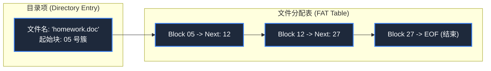

> **课程体系**：【计算机科学速成课】Crash Course Computer Science (PBS / 全40集精校)  
> **所属模块**：Module 3: 系统架构与存储介质 (Systems & Storage)  
> **主讲嘉宾**：Carrie Anne Philbin  
> **视频时长**：12:03 ｜ **高清画面截图**：4 张核心知识点板书/图解  
> **视频直达**：[📺 在 B 站观看本讲原视频 (P20)](https://www.bilibili.com/video/BV1EW411u7th/?p=20)  
> **全书导航**：[← 上一讲 (P19)](/notes/cccs/lecture-19) ｜ [📚 返回全书目录](/notes/topics/CCCS) ｜ [下一讲 (P21) →](/notes/cccs/lecture-21)

---

## 核心导读与概念全景

解密文件系统如何把杂乱的底层存储扇区组织为清晰的目录树，深度探讨文件格式抽象、文件分配表（FAT）、磁盘碎片成因与碎片整理，以及 Inode 元数据架构。

---

## 1. 文件的本质：从连续字节流到语义格式

*(参考时间：00:01:15 · [视频跳转 (P20 00:01:15)](https://www.bilibili.com/video/BV1EW411u7th/?p=20&t=75))*

在底层的存储硬件（如硬盘或 SSD）看来，宇宙中只有一行行编了号的、空洞无物的 0 和 1 扇区。硬件根本不知道什么是“论文”、什么是“MP3 音乐”、什么是“自拍照”。

将这片冰冷二进制比特赋予人类意义的抽象，叫做**文件（File）**：
- **文件格式（File Formats）**：双方达成的一种结构约定。
  - **纯文本文件（.txt）**：将每个字节按 ASCII 或 UTF-8 编码查表解释为人类可读的文字字符；
  - **音频文件（.wav）**：文件头先记录采样率（如 44100Hz）与位深，随后每个整数依次表示声波振幅的气压高低；
  - **位图图像（.bmp）**：文件头记录分辨率长宽，随后每 3 个字节依次代表该像素点的红色（R）、绿色（G）、蓝色（B）亮度。
文件扩展名（.txt, .png）只是给操作系统桌面图标提供一个默认打开方式的提示；真正决定文件内容的，是其内部严密的组织规范。

*⏱ 时间戳：00:02:40 · 📷 课堂截图 · [在 B 站观看对应片段 (P20 00:02:40)](https://www.bilibili.com/video/BV1EW411u7th/?p=20&t=160)*

## 2. 文件分配表（FAT）与链式存储机制

*(参考时间：00:05:40 · [视频跳转 (P20 00:05:40)](https://www.bilibili.com/video/BV1EW411u7th/?p=20&t=340))*

当一个文件大小超过单个存储扇区（如 4KB）时，它该如何分布在磁盘上？

早期的解法是**文件分配表（File Allocation Table, FAT）**：
- 操作系统在磁盘头部开辟一张表格（FAT 表），记录每个簇（Cluster/Block）的状态；
- **目录项记录元数据**：文件夹本身也是一个特殊文件，里面包含文件列表。每个文件记录其**文件名、大小、修改时间，以及它在磁盘上的“起始块号（Start Block）”**；
- **链表跳转追踪**：如果文件很大，起始块占满后，FAT 表中该块的条目会记下“下一个块在第 15 号块”；读取到第 15 号块，表中记录“继续去第 42 号块”；直到表中遇到特殊的 `EOF（End of File）` 标记，文件才算完整读取完毕。

*⏱ 时间戳：00:06:10 · 📷 课堂截图 · [在 B 站观看对应片段 (P20 00:06:10)](https://www.bilibili.com/video/BV1EW411u7th/?p=20&t=370)*

## 3. 外部碎片与磁盘碎片整理（Defragmentation）

*(参考时间：00:08:10 · [视频跳转 (P20 00:08:10)](https://www.bilibili.com/video/BV1EW411u7th/?p=20&t=490))*

随着用户不断在电脑中创建新文件、修改老文件、删除不用的下载内容，磁盘空间变得千疮百孔：
- 一个 100MB 的大文件很难再找到一段连续的空白扇区一次性塞下，文件系统只能把它大卸八块，分散塞进上千个东拼西凑的零碎空洞里；
- **磁头寻道灾难**：在机械硬盘上，读取一个文件意味着磁头必须像疯了一样在盘片内圈和外圈之间频繁机械跳动上百次，电脑变卡、读盘声轰鸣！
- **碎片整理（Defragmentation）**：这促成了 Windows 早期经典的“磁盘碎片整理”功能。系统如同玩华容道一样，将数据块搬移到临时内存中，把所有零散文件重新紧凑重组为连续排列，让磁头能够一口气顺畅读取。

*⏱ 时间戳：00:08:50 · 📷 课堂截图 · [在 B 站观看对应片段 (P20 00:08:50)](https://www.bilibili.com/video/BV1EW411u7th/?p=20&t=530)*

## 4. 分层文件系统目录树与 Inode 索引节点

*(参考时间：00:09:50 · [视频跳转 (P20 00:09:50)](https://www.bilibili.com/video/BV1EW411u7th/?p=20&t=590))*

早期系统所有文件全平铺堆放在一个平面根目录下，找个文件如大海捞针。

现代操作系统引入了**分层目录树（Hierarchical Directory Tree）**：
- 以唯一的**根目录（Root `/` 或 `C:\`）**为源头，向下分叉出子目录和文件，形成了清晰的绝对路径（Absolute Path）与相对路径（Relative Path）；
- **Unix 的 Inode 架构（索引节点）**：
  现代 Linux 文件系统（如 ext4）不再采用低效的 FAT 链表，而是为每个文件分配一个独立的 **Inode 数据块**：
  Inode 中直接保存文件所有的权限、拥有者、时间戳，以及一组**直接块指针、间接块指针与三级间接块指针**！通过多级索引树，系统能够以 $O(1)$ 的时间复杂度快速寻址哪怕数百 GB 大小的单个超大型文件的任意偏移位置，为数据库与现代操作系统奠定了稳固的地基。

*⏱ 时间戳：00:10:10 · 📷 课堂截图 · [在 B 站观看对应片段 (P20 00:10:10)](https://www.bilibili.com/video/BV1EW411u7th/?p=20&t=610)*

---

## 附：本讲知识脑图与回顾思考

本讲作为 **Module 3: 系统架构与存储介质 (Systems & Storage)** 的核心组成部分，系统串联了从底层硬件物理开关、中间层抽象协议到上层应用的思维跃迁。建议结合 B 站原版视频与本讲图文指南反复印证，理解技术演进背后的工程权衡与必然逻辑。

[← 上一讲 (P19)](/notes/cccs/lecture-19) ｜ [📚 返回全书目录](/notes/topics/CCCS) ｜ [下一讲 (P21) →](/notes/cccs/lecture-21)
