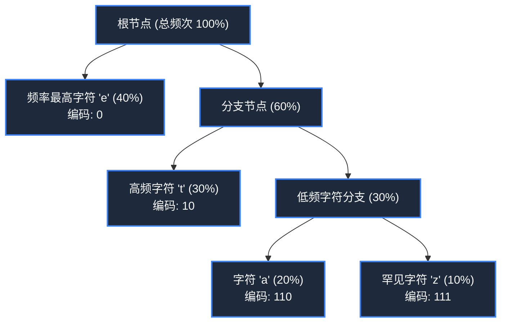

> **课程体系**：【计算机科学速成课】Crash Course Computer Science (PBS / 全40集精校)  
> **所属模块**：Module 3: 系统架构与存储介质 (Systems & Storage)  
> **主讲嘉宾**：Carrie Anne Philbin  
> **视频时长**：12:47 ｜ **高清画面截图**：4 张核心知识点板书/图解  
> **视频直达**：[📺 在 B 站观看本讲原视频 (P21)](https://www.bilibili.com/video/BV1EW411u7th/?p=21)  
> **全书导航**：[← 上一讲 (P20)](/notes/cccs/lecture-20) ｜ [📚 返回全书目录](/notes/topics/CCCS) ｜ [下一讲 (P22) →](/notes/cccs/lecture-22)

---

## 核心导读与概念全景

剖析数据压缩的数学与感知理论，从消除统计冗余的无损压缩（游程编码、霍夫曼树），到欺骗人类感官的有损感知压缩（JPEG/MP3 心理学模型），再到视频流媒体时间冗余运动预测。

---

## 1. 为什么要压缩？香农信息论与带宽瓶颈

*(参考时间：00:01:10 · [视频跳转 (P21 00:01:10)](https://www.bilibili.com/video/BV1EW411u7th/?p=21&t=70))*

一张未压缩的 4K 超高清壁纸，拥有 $3840 \times 2160$ 个像素，每个像素需要 3 个字节（RGB 各 1 字节）来记录颜色，单张图片体积高达 **24.8 兆字节（MB）**；如果是一部 2 小时的 4K 60帧电影，未压缩原始数据量将达到极其惊人的 **10.7 太字节（TB）**！没有任何家庭宽带或手机流量能够承载这种狂暴的数据洪流。

**数据压缩（Data Compression）**是计算机科学中最神奇的炼金术：
- 它的数学基础是克劳德·香农在 1948 年创立的**信息论（Information Theory）**；
- 现实数据中充斥着大量的**统计冗余（Redundancy）**与无用信息。压缩的本质是**在不损失核心信息（或在人类可接受的损失范围内），寻找更紧凑的数学表达**。

数据压缩界分为两大泾渭分明的哲学流派：**无损压缩（Lossless）** 与 **有损压缩（Lossy）**。

*⏱ 时间戳：00:02:40 · 📷 课堂截图 · [在 B 站观看对应片段 (P21 00:02:40)](https://www.bilibili.com/video/BV1EW411u7th/?p=21&t=160)*

## 2. 无损压缩：游程编码与霍夫曼前缀树

*(参考时间：00:02:30 · [视频跳转 (P21 00:02:30)](https://www.bilibili.com/video/BV1EW411u7th/?p=21&t=150))*

**无损压缩（Lossless Compression）**保证：解压后的数据与原始数据**在二进制比特级别完全一模一样，分毫不差**。通常用于程序安装包（.zip）、文本代码和数据库。

#### 1. 游程编码（Run-Length Encoding, RLE）
最简单的无损压缩思想：统计连续重复出现的字符序列。
- 原始数据：`WWWWWWWWWWWWBWWWWWWWWWWWWBBBWWWWWWWW` (36 字节)
- RLE 压缩后：`12W1B12W3B8W` (11 字节，体积暴降近 70%！)
在简单的二值化传真电报或单色剪贴画中，RLE 效果拔群；但如果遇到随机杂乱文本，RLE 甚至会让体积反而膨胀。

#### 2. 霍夫曼编码（Huffman Coding）与最优前缀树
1952 年麻省理工学院研究生大卫·霍夫曼（David Huffman）发明了划时代的编码算法：
- **核心洞见**：为什么所有字母都要死板地占用 8 个 Bit？在一篇英文小说中，字母 `'e'` 的出现频率高达 12.7%，而字母 `'z'` 只有 0.07%！
- **变长前缀码**：出现频率越高的字符，赋予它越短的二进制编码（如 `'e'` 只用 2 个 Bit：`01`）；出现频率极低的字符赋予更长的编码（如 `'z'` 用 8 个 Bit：`11010011`）；
- **霍夫曼树构建**：统计每个字符的出现频次作为权重，自底向上贪心合并最小的两个节点构造二叉树。从根节点出发，向左走为 0，向右走为 1。由于任何字符的编码绝不可能是另一个字符的前缀，解码时无需分隔符，在文本与通用的 ZIP/GZIP 压缩算法中立下赫赫战功。

*⏱ 时间戳：00:05:20 · 📷 课堂截图 · [在 B 站观看对应片段 (P21 00:05:20)](https://www.bilibili.com/video/BV1EW411u7th/?p=21&t=320)*

## 3. 有损压缩：欺骗人类大脑的感知工程学

*(参考时间：00:06:30 · [视频跳转 (P21 00:06:30)](https://www.bilibili.com/video/BV1EW411u7th/?p=21&t=390))*

如果要压缩一张风景照片或一首歌曲，苛求每个比特毫厘不差不仅成本高昂，而且毫无必要！因为人类的眼睛和耳朵本身就是极其粗糙、存在大量生理盲区的感知器官。

**有损压缩（Lossy Compression）**果断丢弃那些人类器官**根本察觉不到的冗余信息**：

#### 1. 心理声学与 MP3 音频压缩
- 人耳能听到的频率极限是 20Hz ~ 20,000Hz，MP3 直接暴力切除 20kHz 以上的高频超声波；
- **听觉掩蔽效应（Auditory Masking）**：在摇滚乐一声沉重的重金属军鼓巨响（高能量大声）响起的瞬间，其相邻频段极其细微的吉他杂音人类大脑根本听不到！MP3 算法敏锐识别出这些被掩蔽的声音，直接全部删掉清零！
MP3 将原始无损音频体积缩小了整整 **10 倍**，而普通人戴耳机几乎听不出丝毫差异。

#### 2. 人眼色彩空间与 JPEG 图像压缩
- 人类视网膜上的视杆细胞（对明暗敏感）远多于视锥细胞（对色彩敏感）——人类对亮度的变化极其敏锐，但对色彩的微小过渡极其迟钝！
- JPEG 首先将 RGB 色彩空间转换为 **YCbCr**（亮度 Y，色度 Cb/Cr），随后对色度进行 $4:2:0$ 降采样（分辨率直接减半丢弃）；接着利用离散余弦变换（DCT）将图像从空间域转换到频域，量化截断代表微观噪点的高频系数。最终一张 20MB 的照片被压缩为 2MB，推动了全球数码摄影与社交网络的全面爆炸。

*⏱ 时间戳：00:07:35 · 📷 课堂截图 · [在 B 站观看对应片段 (P21 00:07:35)](https://www.bilibili.com/video/BV1EW411u7th/?p=21&t=455)*

## 4. 视频流媒体中的时间冗余与运动补偿

*(参考时间：00:09:10 · [视频跳转 (P21 00:09:10)](https://www.bilibili.com/video/BV1EW411u7th/?p=21&t=550))*

视频本质上是一秒钟连续闪过的数十张静态图片。但电影中相邻的帧与帧之间，背景往往几乎没有任何变化（例如一位新闻主播在说话，只有嘴唇在动，后面的演播室背景在几十秒内完全静止）。

现代视频编码标准（如 H.264, HEVC/H.265, AV1）引入了**时间冗余压缩（Inter-frame Compression）**：
- **I 帧（Intra-frame / 关键帧）**：完整的独立静态 JPEG 图像，包含全部细节；
- **P 帧（Predicted-frame / 前向预测帧）**：不存完整画面，只记录相对于前一帧**发生了位移的运动矢量（Motion Vectors）与微小像素残差**；
- **B 帧（Bi-directional / 双向预测帧）**：既参考前一帧，又参考后一帧进行前后插值估算。

通过这种“只传输变化量”的极致压缩，原本数百 GB 的未压缩蓝光电影，被压缩至只需几兆宽带就能在 B 站或流媒体平台上以 4K 画质丝滑播放，彻底重塑了人类现代文化娱乐的传播形态。

*⏱ 时间戳：00:09:45 · 📷 课堂截图 · [在 B 站观看对应片段 (P21 00:09:45)](https://www.bilibili.com/video/BV1EW411u7th/?p=21&t=585)*

---

## 附：本讲知识脑图与回顾思考

本讲作为 **Module 3: 系统架构与存储介质 (Systems & Storage)** 的核心组成部分，系统串联了从底层硬件物理开关、中间层抽象协议到上层应用的思维跃迁。建议结合 B 站原版视频与本讲图文指南反复印证，理解技术演进背后的工程权衡与必然逻辑。

[← 上一讲 (P20)](/notes/cccs/lecture-20) ｜ [📚 返回全书目录](/notes/topics/CCCS) ｜ [下一讲 (P22) →](/notes/cccs/lecture-22)
