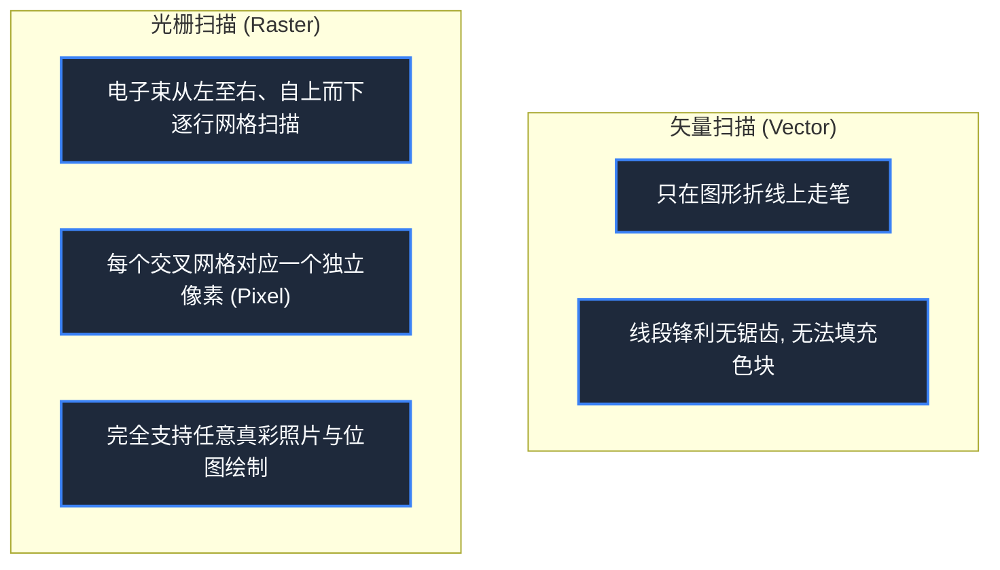

> **课程体系**：【计算机科学速成课】Crash Course Computer Science (PBS / 全40集精校)  
> **所属模块**：Module 4: 人机交互与图形渲染 (User Interface & Graphics)  
> **主讲嘉宾**：Carrie Anne Philbin  
> **视频时长**：11:31 ｜ **高清画面截图**：4 张核心知识点板书/图解  
> **视频直达**：[📺 在 B 站观看本讲原视频 (P23)](https://www.bilibili.com/video/BV1EW411u7th/?p=23)  
> **全书导航**：[← 上一讲 (P22)](/notes/cccs/lecture-22) ｜ [📚 返回全书目录](/notes/topics/CCCS) ｜ [下一讲 (P24) →](/notes/cccs/lecture-24)

---

## 核心导读与概念全景

揭秘从纯文本到图形图像的硬件技术演进，详解 CRT 阴极射线管物理构造、字符生成 ROM、矢量绘图显示器，以及帧缓冲区（Framebuffer）如何缔造现代 2D 位图图形基石。

---

## 1. 阴极射线管（CRT）：从物理光子到屏幕显示

*(参考时间：00:01:10 · [视频跳转 (P23 00:01:10)](https://www.bilibili.com/video/BV1EW411u7th/?p=23&t=70))*

在液晶（LCD）与 OLED 统治世界的今天，老一辈人对电脑屏幕的第一印象都是那个像巨大玻璃箱一样的**阴极射线管显示器（Cathode Ray Tube, CRT）**。

#### CRT 的微观物理工作机制：
1. **电子枪（Electron Gun）**：位于真空管尾部，通电加热阴极灯丝释放大量高能电子；
2. **聚焦与偏转线圈（Deflection Coils）**：高压电场将电子聚集为细如发丝的高速电子束，两组正交的电磁铁（偏转线圈）通过改变磁场强弱，极其精确地控制电子束在水平（X）和垂直（Y）方向上的偏转角度；
3. **荧光涂层（Phosphor Screen）**：高速电子轰击屏幕内壁涂覆的荧光粉，荧光物质受激发光，向外辐射出可见光光子。如果电子束移走，荧光在几毫秒内慢慢熄灭，因此电子束必须以每秒 60 次（60 Hz）以上的频率反复刷新扫描整个屏幕，利用人眼视觉暂留效应维持画面的稳定。

*⏱ 时间戳：00:01:15 · 📷 课堂截图 · [在 B 站观看对应片段 (P23 00:01:15)](https://www.bilibili.com/video/BV1EW411u7th/?p=23&t=75)*

## 2. 字符生成 ROM：显存昂贵时代的精打细算

*(参考时间：00:03:20 · [视频跳转 (P23 00:03:20)](https://www.bilibili.com/video/BV1EW411u7th/?p=23&t=200))*

在 20 世纪 70 年代早期，RAM 内存价格极其高昂。如果想要在屏幕上控制每一个微小像素点的明暗（位图显示），一个 $640 \times 480$ 像素的黑白屏幕需要足足 38.4 KB 的 RAM——这在当时比整台电脑的系统内存还要大！

工程师设计了一种精打细算的折中硬件——**字符生成 ROM（Character Generator ROM）**：
- 显卡内存中不存任何像素，**只存 ASCII 字符编码**！一个 $80 \times 24$ 的终端屏幕，只需区区 **1.9 KB** 的显存！
- 显卡内部烧录了一块固化的只读内存（ROM），里面存储了所有字符的标准点阵图案（例如字母 `'A'` 是一个 $8 \times 8$ 的黑白网格）；
- 当电子束扫描屏幕时，显卡硬件直接读取 ASCII 码作为地址查询 ROM，吐出点阵位，在屏幕上瞬间打出清晰规整的英文字母。

*⏱ 时间戳：00:03:30 · 📷 课堂截图 · [在 B 站观看对应片段 (P23 00:03:30)](https://www.bilibili.com/video/BV1EW411u7th/?p=23&t=210)*

## 3. 矢量显示（Vector Displays）：电子束即画笔

*(参考时间：00:05:30 · [视频跳转 (P23 00:05:30)](https://www.bilibili.com/video/BV1EW411u7th/?p=23&t=330))*

在字符之外，科学家与游戏开发者渴望画出任意的几何图形（圆、折线、多边形）。

早期的解决方案是**矢量图形显示器（Vector Display）**：
- **不扫描无用区域**：电子束不逐行扫描整个背景，而是像艺术家的画笔一样，直接从空间点 $(x_1, y_1)$ 点亮发射，笔直划线移动到目标点 $(x_2, y_2)$！
- **经典历史应用**：
  - 1962 年 MIT 早期极客在 PDP-1 大型机上利用示波器屏幕编写的人类第一款真正意义上的电脑电子游戏——**《太空大战》（Spacewar!）**；
  - 70 年代末雅达利风靡全球的经典街机游戏《爆破彗星》（Asteroids）。
矢量图形线条极其锋利顺滑、没有任何锯齿噪点；但致命缺点是无法填充实体色彩，且如果同屏线条太多，电子束来不及在荧光粉熄灭前画完，整个画面就会疯狂剧烈闪烁。

*⏱ 时间戳：00:05:40 · 📷 课堂截图 · [在 B 站观看对应片段 (P23 00:05:40)](https://www.bilibili.com/video/BV1EW411u7th/?p=23&t=340)*

## 4. 帧缓冲区（Framebuffer）与 2D 光栅位图革命

*(参考时间：00:07:50 · [视频跳转 (P23 00:07:50)](https://www.bilibili.com/video/BV1EW411u7th/?p=23&t=470))*

随着半导体内存成本以每年翻番的速度雪崩式下跌，计算机终于迎来了真正的视觉革命——**帧缓冲区（Framebuffer / 光栅扫描显示）**。

- **显存与屏幕的一一映射**：显卡内部开辟一块专用 RAM 内存，称为“帧缓冲区”。显存中的每一个字节（或多个比特）与屏幕上的每一个物理**像素点（Pixel）**建立严格的坐标映射！
- **光栅扫描流水线**：电子束从屏幕左上角开始，自左向右快速扫过一行，接着飞速回扫（水平消隐），再扫描下一行……从上扫到底部（垂直消隐 V-Sync），循环往复；
- **画线算法与 2D 绘图 API**：
  CPU 不再直接指挥硬件偏转线圈，而是通过数学算法（如著名的 Bresenham 画线算法）在帧缓冲内存中改写像素数值。
从这一刻起，计算机彻底从只会算数字和吐字母的死板仪器，进化为能够绘制华丽图表、播放流畅动画、渲染高清数码照片的通用多媒体视觉视窗。

*⏱ 时间戳：00:08:00 · 📷 课堂截图 · [在 B 站观看对应片段 (P23 00:08:00)](https://www.bilibili.com/video/BV1EW411u7th/?p=23&t=480)*

---

## 附：本讲知识脑图与回顾思考

本讲作为 **Module 4: 人机交互与图形渲染 (User Interface & Graphics)** 的核心组成部分，系统串联了从底层硬件物理开关、中间层抽象协议到上层应用的思维跃迁。建议结合 B 站原版视频与本讲图文指南反复印证，理解技术演进背后的工程权衡与必然逻辑。

[← 上一讲 (P22)](/notes/cccs/lecture-22) ｜ [📚 返回全书目录](/notes/topics/CCCS) ｜ [下一讲 (P24) →](/notes/cccs/lecture-24)
