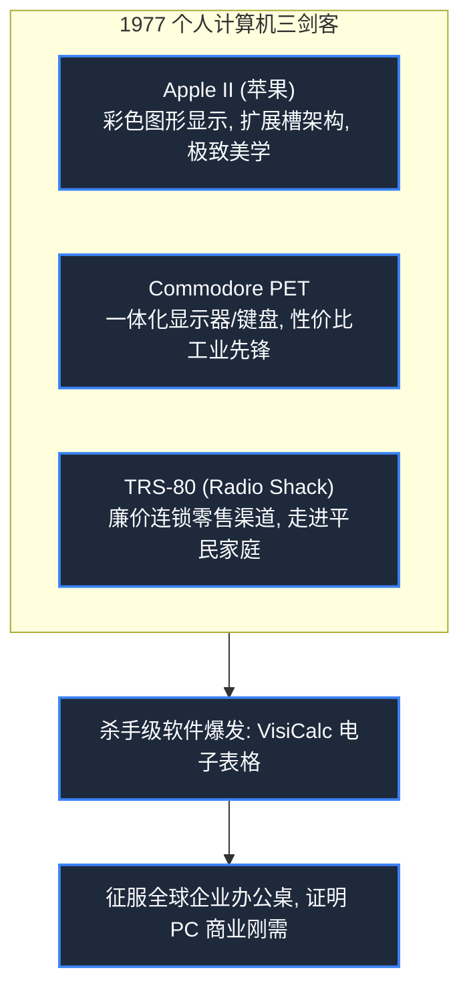

> **课程体系**：【计算机科学速成课】Crash Course Computer Science (PBS / 全40集精校)  
> **所属模块**：Module 4: 人机交互与图形渲染 (User Interface & Graphics)  
> **主讲嘉宾**：Carrie Anne Philbin  
> **视频时长**：10:15 ｜ **高清画面截图**：4 张核心知识点板书/图解  
> **视频直达**：[📺 在 B 站观看本讲原视频 (P25)](https://www.bilibili.com/video/BV1EW411u7th/?p=25)  
> **全书导航**：[← 上一讲 (P24)](/notes/cccs/lecture-24) ｜ [📚 返回全书目录](/notes/topics/CCCS) ｜ [下一讲 (P26) →](/notes/cccs/lecture-26)

---

## 核心导读与概念全景

重温 20 世纪 70 年代末轰轰烈烈的个人计算机（PC）革命史诗，从硅谷家酿俱乐部车库极客，到 Apple II 开箱即用风暴、杀手级应用 VisiCalc，以及 IBM PC 开放标准确立的全景历程。

---

## 1. 车库里的火种：家酿计算机俱乐部（Homebrew）

*(参考时间：00:01:10 · [视频跳转 (P25 00:01:10)](https://www.bilibili.com/video/BV1EW411u7th/?p=25&t=70))*

在 20 世纪 70 年代中期以前，计算机依然是只有五角大楼、跨国银行和顶尖大学才配拥有的高塔圣物。普通人想要接触算力，只能在分时系统终端上申请极其微薄的机时。

但一群深受反主流文化影响的年轻极客相信：**算力属于所有人，每个人都应当在自己的书桌上拥有一台完全属于自己的计算机！**

1975 年，加州门洛帕克的一个车库里召开了第一次**家酿计算机俱乐部（Homebrew Computer Club）**聚会：
- 极客们在这里狂热地交换电路板图纸、分享刚买到的微处理器芯片；
- 成员中有一对名叫史蒂夫的年轻搭档：硬件天才**史蒂夫·沃兹尼亚克（Steve Wozniak）**与极具商业远见和审美直觉的**史蒂夫·乔布斯（Steve Jobs）**。
沃兹尼亚克凭借不可思议的天才直觉，用极少的芯片手工焊制出了一块能直接连接电视机和打字机键盘的单板计算机——这便是 **Apple I**。乔布斯敏锐地看到了商机，在车库里创立了苹果电脑公司。

*⏱ 时间戳：00:02:20 · 📷 课堂截图 · [在 B 站观看对应片段 (P25 00:02:20)](https://www.bilibili.com/video/BV1EW411u7th/?p=25&t=140)*

## 2. 1977 年三剑客：从极客玩具到开箱即用家用电器

*(参考时间：00:04:30 · [视频跳转 (P25 00:04:30)](https://www.bilibili.com/video/BV1EW411u7th/?p=25&t=270))*

1977 年被称为个人计算机元年，三家公司在这一年推出了彻底摆脱硬核烙铁焊接、普通大众插上电源就能使用的商业微机，被称为**“1977 年三剑客”**：

1. **Apple II**：乔布斯坚持为它设计了极其优雅的塑料米白色机壳，隐藏了一切裸露的电路板与风扇噪声；沃兹尼亚克为其设计了支持 6 色彩色高分辨率显示的图形架构和内置扬声器，配备了扩展槽和软盘驱动器，成为史上最长寿、最畅销的个人电脑传奇；
2. **Commodore PET**：由特拉梅尔（Jack Tramiel）创办，将主机、键盘、单色显示器和磁带机整合在一个极其厚实的一体化机身中；
3. **TRS-80（Radio Shack）**：依托全美成千上万家电子零件连锁店的销售网络，以极低廉的售价走进了无数美国家庭的客厅和中学教室。

*⏱ 时间戳：00:04:40 · 📷 课堂截图 · [在 B 站观看对应片段 (P25 00:04:40)](https://www.bilibili.com/video/BV1EW411u7th/?p=25&t=280)*

## 3. 杀手级应用 VisiCalc：电子表格让 PC 成为企业刚需

*(参考时间：00:05:50 · [视频跳转 (P25 00:05:50)](https://www.bilibili.com/video/BV1EW411u7th/?p=25&t=350))*

早期的 PC 常常被严肃的大企业主管嘲讽为“小孩子打游戏的昂贵玩具”。直到 1979 年，哈佛商学院学生丹·布里克林（Dan Bricklin）与鲍勃·弗兰克斯顿（Bob Frankston）为 Apple II 编写了一个名为 **VisiCalc** 的软件。

- **VisiCalc 是世界上第一款电子表格软件（Spreadsheet）**：它将屏幕划分为由行号和列标构成的网格矩阵，允许在单元格中定义动态关联公式（如 `=A1+B1`）；
- **商业核裂变效应**：过去跨国公司的财务总监要做一份 5 年财务预算模型，需要 20 名会计手摇机械计算器手工算上整整一星期；若要测试“如果原材料上涨 5% 会发生什么”，全员必须擦掉铅笔从头再重算一周！而在 VisiCalc 中，只需在键盘上改一个数字，**成千上万个单元格在半秒内全部自动重新级联重算完毕**！
成千上万的华尔街金融分析师与公司老板冲进电脑店，不问 Apple II 电脑多少钱，只问一句话：“买下这台电脑能跑 VisiCalc 吗？能跑我就立刻买 10 台！”软件第一次反客为主，成为了驱动昂贵硬件销售的绝对决定性力量。

*⏱ 时间戳：00:06:00 · 📷 课堂截图 · [在 B 站观看对应片段 (P25 00:06:00)](https://www.bilibili.com/video/BV1EW411u7th/?p=25&t=360)*

## 4. 蓝色巨人下场：IBM PC 开放标准与兼容机帝国

*(参考时间：00:08:10 · [视频跳转 (P25 00:08:10)](https://www.bilibili.com/video/BV1EW411u7th/?p=25&t=490))*

眼见个人电脑市场规模呈几何级数爆炸，统治大型机世界的“蓝色巨人”**IBM** 终于坐不住了。

1981 年 8 月，IBM 组建了独立的快速行动小组，打破公司内部一切自研闭门造车的传统，以惊人的速度推出了 **IBM PC（Model 5150）**：
- **全面采用货架商业元件（COTS）**：CPU 采购英特尔的 16 位 8088 芯片，操作系统外包给当时还是西雅图一家名不见经传的小公司——由比尔·盖茨领导的**微软（Microsoft，提供 MS-DOS）**；
- **公开全部硬件电路图与 BIOS 接口**：任何人都可以为 IBM PC 生产兼容外设与扩展插卡；
- **PC 兼容机狂潮（PC Clones）**：康柏（Compaq）通过洁净室逆向工程破解了 IBM 的 BIOS，引发全球数以千计的厂商蜂拥生产便宜实惠的“IBM PC 兼容机”。开放架构标准击败了所有封闭竞争对手，MS-DOS 与随后的 Windows 迅速登上了全球 90% 以上书桌的个人电脑王座。

*⏱ 时间戳：00:08:20 · 📷 课堂截图 · [在 B 站观看对应片段 (P25 00:08:20)](https://www.bilibili.com/video/BV1EW411u7th/?p=25&t=500)*

---

## 附：本讲知识脑图与回顾思考

本讲作为 **Module 4: 人机交互与图形渲染 (User Interface & Graphics)** 的核心组成部分，系统串联了从底层硬件物理开关、中间层抽象协议到上层应用的思维跃迁。建议结合 B 站原版视频与本讲图文指南反复印证，理解技术演进背后的工程权衡与必然逻辑。

[← 上一讲 (P24)](/notes/cccs/lecture-24) ｜ [📚 返回全书目录](/notes/topics/CCCS) ｜ [下一讲 (P26) →](/notes/cccs/lecture-26)
