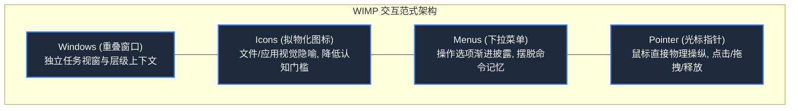

> **课程体系**：【计算机科学速成课】Crash Course Computer Science (PBS / 全40集精校)  
> **所属模块**：Module 4: 人机交互与图形渲染 (User Interface & Graphics)  
> **主讲嘉宾**：Carrie Anne Philbin  
> **视频时长**：12:59 ｜ **高清画面截图**：4 张核心知识点板书/图解  
> **视频直达**：[📺 在 B 站观看本讲原视频 (P26)](https://www.bilibili.com/video/BV1EW411u7th/?p=26)  
> **全书导航**：[← 上一讲 (P25)](/notes/cccs/lecture-25) ｜ [📚 返回全书目录](/notes/topics/CCCS) ｜ [下一讲 (P27) →](/notes/cccs/lecture-27)

---

## 核心导读与概念全景

重访人机交互史上最辉煌的飞跃——图形用户界面（GUI），从恩格尔巴特发明鼠标与所有演示之母，到施乐 PARC 奠定 WIMP 桌面隐喻，再到 Apple Macintosh 与 Windows 的普及风暴。

---

## 1. 恩格尔巴特与“所有演示之母”（The Mother of All Demos）

*(参考时间：00:01:15 · [视频跳转 (P26 00:01:15)](https://www.bilibili.com/video/BV1EW411u7th/?p=26&t=75))*

在 20 世纪 60 年代，计算机界的主流思想依然认为命令行和打孔卡是与机器沟通的唯一途径。而斯坦福国际研究所（SRI）的计算机先驱**道格拉斯·恩格尔巴特（Douglas Engelbart）**，拥有远超那个时代的超前视野。

1968 年 12 月 9 日，恩格尔巴特在旧金山秋季联合计算机会议上发表了一场震惊世界的公开演示，被后世尊称为**“所有演示之母（The Mother of All Demos）”**：
- 他坐在控制台前，手里握着一个手工雕刻的木质盒子，底下装有两个垂直相交的金属轮子——**这是人类历史上第一个计算机鼠标（Mouse）**！
- 屏幕上出现了一个跨越维度的视觉界面：他在屏幕上流畅移动光标，实时点击链接跳转查看文档（超文本网络），在屏幕上开辟重叠的分屏窗口，甚至利用微波链路与几十公里外的同事进行异地双向视频会议和共同协作编辑文本！
这场 90 分钟的演示，提前整整 20 年预演了 90 年代互联网与现代操作系统的几乎全部核心形态。

*⏱ 时间戳：00:02:20 · 📷 课堂截图 · [在 B 站观看对应片段 (P26 00:02:20)](https://www.bilibili.com/video/BV1EW411u7th/?p=26&t=140)*

## 2. 施乐 PARC 的奇迹之泉：Alto 与桌面隐喻

*(参考时间：00:04:30 · [视频跳转 (P26 00:04:30)](https://www.bilibili.com/video/BV1EW411u7th/?p=26&t=270))*

施乐公司（Xerox）作为复印机霸主，担心未来的无纸化办公颠覆自己的主业，于 1970 年在硅谷建立了极其传奇的**帕洛阿尔托研究中心（Xerox PARC）**，聚集了全世界最顶级的天才极客。

1973 年，施乐 PARC 打造出了超越时代十年的**施乐 Alto（Xerox Alto）**计算机：
- **物理桌面隐喻（Desktop Metaphor）**：为了让从没碰过电脑的普通办公室秘书也能一秒上手，PARC 团队把现实办公室的一切完美映射在屏幕上——屏幕背景就是一张“办公桌面（Desktop）”，数据集合被画成一个“文件柜文件夹（Folder）”，无用的废纸扔进“垃圾桶（Trash Can）”；
- **所见即所得（WYSIWYG）**：在屏幕上排版文档时，字体大小、粗斜体以及页边距与激光打印机打印出的纸张分毫不差！
然而，施乐纽约总部的管理层思维保守，认为 Alto 成本太高且看不懂个人电脑的未来，这台划时代的神作被束之高阁。

*⏱ 时间戳：00:04:40 · 📷 课堂截图 · [在 B 站观看对应片段 (P26 00:04:40)](https://www.bilibili.com/video/BV1EW411u7th/?p=26&t=280)*

## 3. WIMP 交互范式：人类与数字世界的终极桥梁

*(参考时间：00:06:20 · [视频跳转 (P26 00:06:20)](https://www.bilibili.com/video/BV1EW411u7th/?p=26&t=380))*

施乐 PARC 确立的人机交互规范被统称为 **WIMP 范式**：
1. **Windows（窗口）**：屏幕被划分为多个矩形视窗，每个视窗运行一个独立的应用程序。窗口可以自由缩放、拖拽移动、上下重叠叠放（借助 Z-order 深度排序）；
2. **Icons（图标）**：用直观的图形符号代表抽象的二进制可执行程序或数据文档，消除了用户在命令行死记硬背复杂文件路径的心智负担；
3. **Menus（菜单）**：下拉菜单与上下文右键菜单将程序能够执行的全部功能（剪切、复制、粘贴）条理清晰地列出，使得交互从“记忆回忆（Recall）”转变为轻松的“视觉识别（Recognition）”；
4. **Pointer（指针）**：鼠标光标成为人类手指在虚拟数字空间的化身，带来了点击（Click）、双击（Double Click）、右键菜单与拖拽（Drag & Drop）的直觉操作。

*⏱ 时间戳：00:06:30 · 📷 课堂截图 · [在 B 站观看对应片段 (P26 00:06:30)](https://www.bilibili.com/video/BV1EW411u7th/?p=26&t=390)*

## 4. 乔布斯的朝圣与 Macintosh 的平民革命

*(参考时间：00:08:30 · [视频跳转 (P26 00:08:30)](https://www.bilibili.com/video/BV1EW411u7th/?p=26&t=510))*

1979 年底，年轻的史蒂夫·乔布斯以允许施乐购买苹果 10 万股认股权证为交换，带领苹果核心工程团队造访施乐 PARC。

当施乐工程师向乔布斯演示 Alto 的图形界面、重叠窗口与鼠标操作时，乔布斯在房间里激动地上蹿下跳，大声喊道：
“你们为什么不把它推向全世界？这是人类历史上最不可思议的东西！这太明显了！它终将统治世界！”

回到苹果后，乔布斯立刻全力投入新项目的研发。1984 年 1 月，伴随著名的“1984”超级碗电视广告，**Apple Macintosh（麦金塔）**以 2495 美元的平民售价震撼问世！
Macintosh 拥有内置声音芯片、精致的黑白位图高刷屏幕、原装单键鼠标以及流畅的 Mac OS 图形系统。随后微软在 1995 年推出里程碑式的 **Windows 95**，彻底将图形界面普及到了全球每一台个人电脑中，人类彻底挥别了冷酷沉闷的代码黑屏时代。

*⏱ 时间戳：00:08:40 · 📷 课堂截图 · [在 B 站观看对应片段 (P26 00:08:40)](https://www.bilibili.com/video/BV1EW411u7th/?p=26&t=520)*

---

## 附：本讲知识脑图与回顾思考

本讲作为 **Module 4: 人机交互与图形渲染 (User Interface & Graphics)** 的核心组成部分，系统串联了从底层硬件物理开关、中间层抽象协议到上层应用的思维跃迁。建议结合 B 站原版视频与本讲图文指南反复印证，理解技术演进背后的工程权衡与必然逻辑。

[← 上一讲 (P25)](/notes/cccs/lecture-25) ｜ [📚 返回全书目录](/notes/topics/CCCS) ｜ [下一讲 (P27) →](/notes/cccs/lecture-27)
