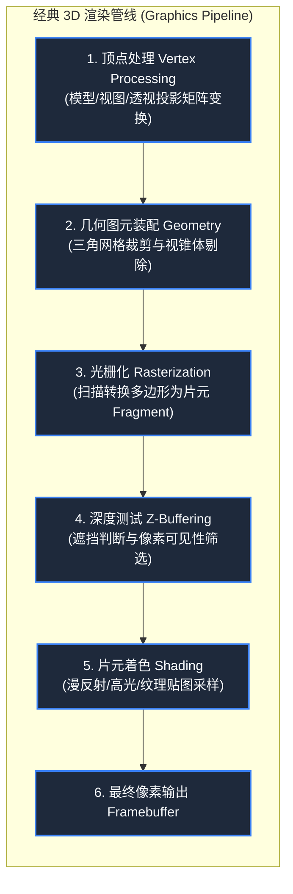

> **课程体系**：【计算机科学速成课】Crash Course Computer Science (PBS / 全40集精校)  
> **所属模块**：Module 4: 人机交互与图形渲染 (User Interface & Graphics)  
> **主讲嘉宾**：Carrie Anne Philbin  
> **视频时长**：12:41 ｜ **高清画面截图**：4 张核心知识点板书/图解  
> **视频直达**：[📺 在 B 站观看本讲原视频 (P27)](https://www.bilibili.com/video/BV1EW411u7th/?p=27)  
> **全书导航**：[← 上一讲 (P26)](/notes/cccs/lecture-26) ｜ [📚 返回全书目录](/notes/topics/CCCS) ｜ [下一讲 (P28) →](/notes/cccs/lecture-28)

---

## 核心导读与概念全景

全面拆解 3D 计算机图形管线（Graphics Pipeline）的数学与工程架构，从三维顶点空间变换、三角网格细分，到光栅化、深度缓冲 Z-Buffering 遮挡剔除，再到逼真光影着色与专有 GPU 的硬件加速。

---

## 1. 降维的艺术：在二维平面屏幕上呈现三维立体世界

*(参考时间：00:01:20 · [视频跳转 (P27 00:01:20)](https://www.bilibili.com/video/BV1EW411u7th/?p=27&t=80))*

无论是手机屏幕、电脑显示器还是电影幕布，物理上都是毫无厚度的**二维平面像素阵列**。
计算机如何在平面的屏幕上，呈现出拥有景深、光影、遮挡与透视关系的宏大 3D 虚拟世界（如《玩具总动员》、3A 游戏大作或元宇宙）？

这依赖于**3D 图形渲染管线（The 3D Graphics Pipeline）**。
渲染管线本质上是一套高度并行的线性代数矩阵运算流水线，负责将定义在三维虚拟空间中的数学几何体，步步精准投影转换为屏幕上具体的 RGB 像素点。

*⏱ 时间戳：00:02:40 · 📷 课堂截图 · [在 B 站观看对应片段 (P27 00:02:40)](https://www.bilibili.com/video/BV1EW411u7th/?p=27&t=160)*

## 2. 几何建模与三角多边形网格（Polygon Mesh）

*(参考时间：00:02:30 · [视频跳转 (P27 00:02:30)](https://www.bilibili.com/video/BV1EW411u7th/?p=27&t=150))*

3D 世界中的物体是如何用数字描述的？

- **空间顶点（Vertices）**：每个点在三维空间中拥有坐标 $(X, Y, Z)$；
- **为什么图形学对“三角形”情有独钟？**
  1. **空间确定性**：空间中任意不共线的三个点，**必然且只能唯一确定一个绝对平整的平面**（如果是四边形，第四个点可能不在同一个平面上，导致多边形发生扭曲）；
  2. **数学极其简便**：三角形在光栅化插值（重心坐标系）计算时极其稳定高效。
- **三角多边形网格（Triangular Mesh）**：将成千上万个微小的三角形首尾相连拼凑在一起，就能逼真拟合出极其复杂的曲面物体（如跑车的流线型车身、游戏角色的面部皮肤）。三角面数越多，模型越精致，但需要计算的矩阵算力也呈指数级暴增。

*⏱ 时间戳：00:05:10 · 📷 课堂截图 · [在 B 站观看对应片段 (P27 00:05:10)](https://www.bilibili.com/video/BV1EW411u7th/?p=27&t=310)*

## 3. 透视投影、光栅化与深度缓冲（Z-Buffering）

*(参考时间：00:05:00 · [视频跳转 (P27 00:05:00)](https://www.bilibili.com/video/BV1EW411u7th/?p=27&t=300))*

#### 1. 矩阵变换与透视投影（Perspective Projection）
通过 $4 \times 4$ 齐次坐标变换矩阵，将 3D 物体经过平移、旋转、缩放后，映射到虚拟摄像机的**视锥体（View Frustum）**内。透视投影模拟人类视网膜“近大远小”的自然光学规律，将空间中的 $Z$ 坐标除以距离，将三维点压平到二维投影平面上。

#### 2. 光栅化（Rasterization）
投影后的二维连续三角形边界，必须落实在离散的屏幕像素网格上。光栅化扫描转换负责判定屏幕上的每一个像素点究竟是在三角形内部还是外部，生成待着色的**片元（Fragments）**。

#### 3. 深度缓冲（Z-Buffering）：消灭鬼影穿模
当两个物体在视线方向上重叠时，离镜头近的物体必须完美挡住后面的物体。
早期的“画家算法（Painter's Algorithm）”从后往前画，但在多边形相互穿插时彻底失效。
现代显卡普遍采用**深度缓冲区（Z-Buffer）**：
- 显存中开辟一块与屏幕分辨率完全相同的独立内存，每个单元记录该像素当前最靠近镜头的前景深度 $Z$ 值；
- 每次光栅化一个新像素时，比较其深度：如果新像素比 Z-Buffer 记录的更靠近镜头，则将该像素的颜色覆盖写入显存，并刷新 Z-Buffer；如果新像素在后面，则毫不留情地将其直接丢弃！这完美解决了 3D 物体的遮挡判定。

*⏱ 时间戳：00:06:30 · 📷 课堂截图 · [在 B 站观看对应片段 (P27 00:06:30)](https://www.bilibili.com/video/BV1EW411u7th/?p=27&t=390)*

## 4. 真实感光照着色与专用图形处理器（GPU）的诞生

*(参考时间：00:08:20 · [视频跳转 (P27 00:08:20)](https://www.bilibili.com/video/BV1EW411u7th/?p=27&t=500))*

有了几何形状，物体看起来依然像粗糙的塑料积木，必须计算光线物理反射：

1. **平面着色（Flat Shading）**：每个三角形算一个法向量计算光照，整个三角形涂同一种颜色。边缘棱角分明，极其粗糙；
2. **Gouraud 着色**：在三角形的顶点处计算光照，内部像素进行线性双线性插值，消除了明显的棱角；
3. **Phong 光照模型**：在像素级别对法向量进行精细插值，精确模拟**环境光（Ambient）+ 漫反射（Diffuse）+ 镜面高光（Specular）**，渲染出金属、玻璃与水面的耀眼反光。

#### 图形处理器（GPU）的独立登基
3D 渲染需要对同屏数百万个像素与顶点并发执行完全相同的矩阵乘加与矢量点积运算。CPU 这种专门为复杂单线程串行逻辑优化的架构不堪重负。

1999 年，英伟达（NVIDIA）推出了世界上第一款被称为 **GPU（Graphics Processing Unit）**的芯片——**GeForce 256**：
- GPU 内部集成了成百上千个精简的算术单元，专为大规模超并行吞吐（SIMD/SIMT）而生；
- GPU 不仅统治了 3D 视频游戏与电影工业特效，其恐怖的超大规模浮点并行算力，在二十年后更意外成为了现代深度学习神经网络与人工智能大模型狂飙的终极动力引擎！

*⏱ 时间戳：00:08:40 · 📷 课堂截图 · [在 B 站观看对应片段 (P27 00:08:40)](https://www.bilibili.com/video/BV1EW411u7th/?p=27&t=520)*

---

## 附：本讲知识脑图与回顾思考

本讲作为 **Module 4: 人机交互与图形渲染 (User Interface & Graphics)** 的核心组成部分，系统串联了从底层硬件物理开关、中间层抽象协议到上层应用的思维跃迁。建议结合 B 站原版视频与本讲图文指南反复印证，理解技术演进背后的工程权衡与必然逻辑。

[← 上一讲 (P26)](/notes/cccs/lecture-26) ｜ [📚 返回全书目录](/notes/topics/CCCS) ｜ [下一讲 (P28) →](/notes/cccs/lecture-28)
