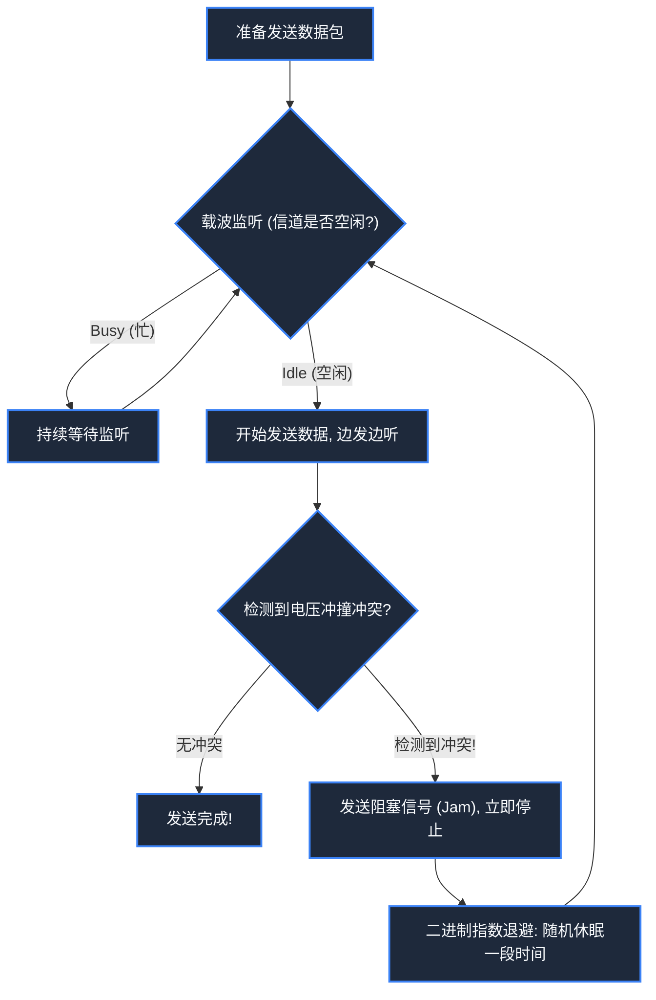

> **课程体系**：【计算机科学速成课】Crash Course Computer Science (PBS / 全40集精校)  
> **所属模块**：Module 5: 计算机网络与安全防御 (Networks & Security)  
> **主讲嘉宾**：Carrie Anne Philbin  
> **视频时长**：12:20 ｜ **高清画面截图**：4 张核心知识点板书/图解  
> **视频直达**：[📺 在 B 站观看本讲原视频 (P28)](https://www.bilibili.com/video/BV1EW411u7th/?p=28)  
> **全书导航**：[← 上一讲 (P27)](/notes/cccs/lecture-27) ｜ [📚 返回全书目录](/notes/topics/CCCS) ｜ [下一讲 (P29) →](/notes/cccs/lecture-29)

---

## 核心导读与概念全景

解构单机计算迈向互联网络的关键跨越，详析局域网拓扑结构、以太网 CSMA/CD 冲突避免算法、传统电路交换的资源瓶颈，以及现代分组交换（Packet Switching）的革命性破局。

---

## 1. 孤岛终结：从单机孤立走向局域网（LAN）

*(参考时间：00:01:10 · [视频跳转 (P28 00:01:10)](https://www.bilibili.com/video/BV1EW411u7th/?p=28&t=70))*

在 20 世纪 60 年代以前，每台计算机都是一座孤立的数字孤岛。如果要将数据从这台电脑传给另一台电脑，只能靠人类把打孔卡或磁带盘物理搬运过去，这种方式被戏称为“飞人网络（Sneakernet）”。

随着办公室内计算机数量增加，工程师开始尝试用电缆将电脑直接连接起来，形成了**局域网（Local Area Network, LAN）**：
- **总线型拓扑（Bus Topology）**：所有电脑挂在同一根贯穿房间的主同轴电缆上；
- **星型拓扑（Star Topology）**：所有电脑连接到一个中心集线器（Hub）或交换机；
- **环型拓扑（Ring Topology）**：电脑连接成一个闭环，数据如接力棒一样沿环单向传递。

*⏱ 时间戳：00:02:20 · 📷 课堂截图 · [在 B 站观看对应片段 (P28 00:02:20)](https://www.bilibili.com/video/BV1EW411u7th/?p=28&t=140)*

## 2. 以太网与 CSMA/CD：鸡尾酒会上的礼貌法则

*(参考时间：00:03:10 · [视频跳转 (P28 00:03:10)](https://www.bilibili.com/video/BV1EW411u7th/?p=28&t=190))*

1973 年，施乐 PARC 的罗伯特·梅特卡夫（Robert Metcalfe）发明了统治局域网至今的**以太网（Ethernet）**。

在共享总线型网络中，存在一个致命问题：所有电脑共享同一根铜缆作为广播信道。如果电脑 A 和电脑 B 同时开始发射电信号，电波在铜缆中迎头相撞，电压瞬间叠加畸变，形成**数据冲突（Collision）**，整个网络报文全毁！

以太网设计了天才的 **CSMA/CD（载波监听多路访问/冲突检测）** 算法，就像在一个喧闹的鸡尾酒会上的绅士法则：
1. **载波监听（Carrier Sense）**：先听后说。在发话前，网卡先探测铜缆上有没有电压信号。如果有人正在说话，自己闭嘴等待；
2. **多路访问（Multiple Access）**：所有设备地位平等，都可以随时监听并争用信道；
3. **冲突检测（Collision Detection）**：边说边听。在自己发射信号的同时，网卡持续检测信道电压。如果发现电压异常飙高，说明撞车了！
4. **指数退避重传（Exponential Backoff）**：一旦检测到冲突，双方立刻停止发送，并各自在内部抛一枚随机骰子，**随机休眠几微秒**后再尝试重发！这种随机性极大降低了下次再次撞车的概率。

*⏱ 时间戳：00:03:30 · 📷 课堂截图 · [在 B 站观看对应片段 (P28 00:03:30)](https://www.bilibili.com/video/BV1EW411u7th/?p=28&t=210)*

## 3. 电路交换（Circuit Switching）：脆弱而昂贵的旧帝国

*(参考时间：00:06:20 · [视频跳转 (P28 00:06:20)](https://www.bilibili.com/video/BV1EW411u7th/?p=28&t=380))*

当网络跨越城市与国家时，早期的长途通信完全依赖传统**电话网络（AT&T 电话网）**。

电话网采用**电路交换（Circuit Switching）**模型：
- 当你从纽约拨打旧金山的电话时，沿途成百上千个机电交换机咔哒作响，为你和对方在两座城市之间**建立一条物理上专属的端到端铜缆导线**；
- **致命缺点**：
  1. 在通话期间，哪怕双方一言不发沉默十分钟，这条珍贵的越洋物理铜缆也被你们彻底死死独占，其他数千人只能排队占线等待；
  2. 极度脆弱：冷战时期美军意识到，一旦苏联一颗核弹摧毁了中间某一个关键城市的电话交换枢纽，整个美军指挥网络将被瞬间切断瘫痪！

*⏱ 时间戳：00:06:40 · 📷 课堂截图 · [在 B 站观看对应片段 (P28 00:06:40)](https://www.bilibili.com/video/BV1EW411u7th/?p=28&t=400)*

## 4. 分组交换（Packet Switching）：互联网的诞生之魂

*(参考时间：00:08:30 · [视频跳转 (P28 00:08:30)](https://www.bilibili.com/video/BV1EW411u7th/?p=28&t=510))*

为了构建在核打击下依然能自我愈合的分布式通信网，保罗·巴兰（Paul Baran）与唐纳德·戴维斯（Donald Davies）提出了颠覆人类认知的**分组交换（Packet Switching）**：

- **大块数据切碎**：无论传送一张照片还是一封邮件，软件不试图建立独占物理通道，而是**将其切碎为成千上万个独立的小数据包（Packets）**；
- **报头封装（Headers）**：每个数据包打上寄件人地址（源 IP）、收件人地址（目的 IP）和序号；
- **动态寻路与存储转发（Store and Forward）**：沿途的**路由器（Routers）**收到数据包后，根据当前各条线路的拥堵情况动态决定下一跳走向。数据包 1 可能走芝加哥线路，数据包 2 可能走达拉斯线路；即便其中某个节点遭遇核打击爆炸，路由器在毫秒级自动改道绕行！
1969 年，美国国防部高级研究计划局基于分组交换搭建了 **ARPANET（阿帕网）**，连接了四所大学——现代互联网的宏伟帷幕由此正式拉开。

*⏱ 时间戳：00:08:50 · 📷 课堂截图 · [在 B 站观看对应片段 (P28 00:08:50)](https://www.bilibili.com/video/BV1EW411u7th/?p=28&t=530)*

---

## 附：本讲知识脑图与回顾思考

本讲作为 **Module 5: 计算机网络与安全防御 (Networks & Security)** 的核心组成部分，系统串联了从底层硬件物理开关、中间层抽象协议到上层应用的思维跃迁。建议结合 B 站原版视频与本讲图文指南反复印证，理解技术演进背后的工程权衡与必然逻辑。

[← 上一讲 (P27)](/notes/cccs/lecture-27) ｜ [📚 返回全书目录](/notes/topics/CCCS) ｜ [下一讲 (P29) →](/notes/cccs/lecture-29)
