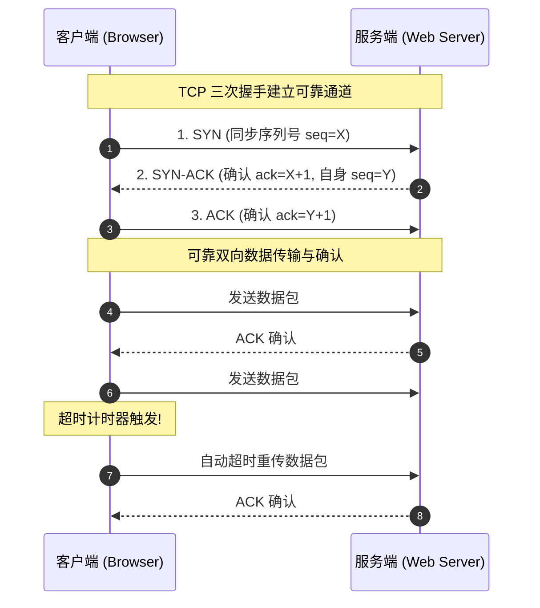

> **课程体系**：【计算机科学速成课】Crash Course Computer Science (PBS / 全40集精校)  
> **所属模块**：Module 5: 计算机网络与安全防御 (Networks & Security)  
> **主讲嘉宾**：Carrie Anne Philbin  
> **视频时长**：11:59 ｜ **高清画面截图**：4 张核心知识点板书/图解  
> **视频直达**：[📺 在 B 站观看本讲原视频 (P29)](https://www.bilibili.com/video/BV1EW411u7th/?p=29)  
> **全书导航**：[← 上一讲 (P28)](/notes/cccs/lecture-28) ｜ [📚 返回全书目录](/notes/topics/CCCS) ｜ [下一讲 (P30) →](/notes/cccs/lecture-30)

---

## 核心导读与概念全景

深入拆解支撑全球互联的核心通信协议族，详解 IP 寻址路由、TCP 可靠传输控制（握手、滑动窗口、丢包重传）、UDP 低时延数据报，以及 DNS 树状解析机制。

---

## 1. 网络的网络：IP 协议与全球寻址

*(参考时间：00:01:15 · [视频跳转 (P29 00:01:15)](https://www.bilibili.com/video/BV1EW411u7th/?p=29&t=75))*

互联网（Internet）并非单一物理实体，而是由全球数万个独立的商业运营商、大学与政府局域网相互连接而成的**“网络的网络（Network of Networks）”**。

能让全球数十亿台不同制造商、不同操作系统的设备听懂彼此，依赖于温顿·瑟夫（Vint Cerf）与罗伯特·卡恩（Bob Kahn）设计的 **TCP/IP 协议族**：

- **网际协议（Internet Protocol, IP）**：负责将数据包从源主机送抵全球任意角落的目的主机；
- **IP 地址（IP Address）**：每台连入互联网的设备必须拥有全球独一无二的逻辑门牌号。
  - **IPv4**：由 32 位二进制组成，通常写成 4 个十进制数字（如 `192.168.1.1`），能提供约 43 亿个地址（目前已全面耗尽）；
  - **IPv6**：扩展至 128 位，能够为地球上的每一粒沙子都分配一个独立的 IP 地址；
- **跃点路由（Hop-by-Hop Routing）**：数据包通过 `traceroute` 命令可以看到它在穿越大洋时光纤交换机之间的每一次跨越跃点。

*⏱ 时间戳：00:02:20 · 📷 课堂截图 · [在 B 站观看对应片段 (P29 00:02:20)](https://www.bilibili.com/video/BV1EW411u7th/?p=29&t=140)*

## 2. 传输控制协议（TCP）：在不可靠网络上构建绝对可靠

*(参考时间：00:04:20 · [视频跳转 (P29 00:04:20)](https://www.bilibili.com/video/BV1EW411u7th/?p=29&t=260))*

底层的 IP 协议是**不可靠的尽力而为服务（Best-Effort）**：它不保证数据包一定能送达，数据包在网络拥堵时可能被路由器无情丢弃，或者后发先至发生乱序。

如何在充满丢包与乱序的险恶网络上，安全传输一份严肃的金融账单或可执行程序？这需要骑在 IP 协议之上的**传输控制协议（Transmission Control Protocol, TCP）**！

#### 1. 三次握手（Three-Way Handshake）
在正式传输数据前，双方必须确认彼此的收发能力完好：
- 客户端发送 `SYN`（申请建立连接）；
- 服务端回应 `SYN-ACK`（同意连接并确认自身通信良好）；
- 客户端再次回复 `ACK`（确认收到，连接正式建立！）。

#### 2. 序号重组与丢包重传
- 发送方为切碎的每一个数据包打上严格递增的序号（Sequence Number）；
- 接收方收到后，必须给发送方回发确认报文（ACK）。如果接收方发现收到了数据包 15 和 17，唯独漏掉了 16，它会反复要求重发；
- 发送方的超时定时器一旦触发，**自动重传丢失的数据包 16**；接收方收集齐所有数据包后，按照序号原样拼装还原出完整的文件。

*⏱ 时间戳：00:04:40 · 📷 课堂截图 · [在 B 站观看对应片段 (P29 00:04:40)](https://www.bilibili.com/video/BV1EW411u7th/?p=29&t=280)*

## 3. 用户数据报协议（UDP）：追求极致速度的轻骑兵

*(参考时间：00:06:40 · [视频跳转 (P29 00:06:40)](https://www.bilibili.com/video/BV1EW411u7th/?p=29&t=400))*

TCP 虽然保证了 100% 可靠，但其复杂的握手、确认重传与拥塞控制带来了无法避免的**网络时延（Latency）**。

在某些实时应用场景中，速度远比完美更重要！
例如网络多人联机射击游戏、腾讯会议实时语音、视频直播流媒体：
- 如果游戏中丢了一个玩家向左移动 5 厘米的数据包，根本不需要停下来花 200 毫秒重传，因为 200 毫秒后这个位置早已过时了！
- 这时采用 **UDP（User Datagram Protocol）**：
  - **无连接、无握手、无确认、不重传**；
  - 像机关枪一样把数据包直接朝目的 IP 狂射。丢了几个包画面可能偶尔马赛克闪烁一下，但整体延迟被压制到了极限的十几毫秒，保障了游戏的丝滑跟手感。

*⏱ 时间戳：00:06:50 · 📷 课堂截图 · [在 B 站观看对应片段 (P29 00:06:50)](https://www.bilibili.com/video/BV1EW411u7th/?p=29&t=410)*

## 4. 域名系统（DNS）：互联网的全球分布式电话簿

*(参考时间：00:08:15 · [视频跳转 (P29 00:08:15)](https://www.bilibili.com/video/BV1EW411u7th/?p=29&t=495))*

计算机硬件只认形如 `142.250.190.46` 的数字 IP 地址，但人类大脑极其不擅长记忆枯燥的长串数字。人类更喜欢阅读诸如 `bilibili.com`、`google.com` 这样富有语义的名字。

**域名系统（Domain Name System, DNS）**是全球最大的分布式层次化键值数据库：
1. **根域名服务器（Root DNS Servers）**：全球核心仅有 13 个逻辑根域名体系，管理顶级域名分类；
2. **顶级域名服务器（TLD DNS）**：管理 `.com`、`.org`、`.cn`、`.edu` 等；
3. **权威域名服务器（Authoritative DNS）**：存放具体公司所拥有的精确主机解析记录。

当你浏览器敲入 `bilibili.com` 时：
操作系统先查本地缓存，若没有则向运营商递归解析器求助；解析器一路向根服务器、TLD 服务器逐级追问，在几毫秒内将域名成功翻译为真实物理 IP 地址，随即正式发起 TCP 握手。

*⏱ 时间戳：00:08:00 · 📷 课堂截图 · [在 B 站观看对应片段 (P29 00:08:00)](https://www.bilibili.com/video/BV1EW411u7th/?p=29&t=480)*

---

## 附：本讲知识脑图与回顾思考

本讲作为 **Module 5: 计算机网络与安全防御 (Networks & Security)** 的核心组成部分，系统串联了从底层硬件物理开关、中间层抽象协议到上层应用的思维跃迁。建议结合 B 站原版视频与本讲图文指南反复印证，理解技术演进背后的工程权衡与必然逻辑。

[← 上一讲 (P28)](/notes/cccs/lecture-28) ｜ [📚 返回全书目录](/notes/topics/CCCS) ｜ [下一讲 (P30) →](/notes/cccs/lecture-30)
