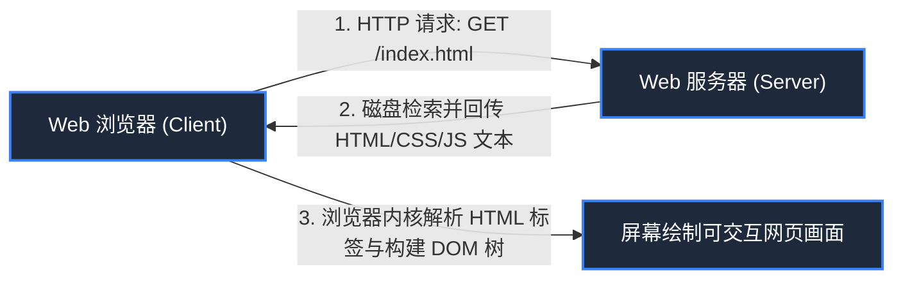

> **课程体系**：【计算机科学速成课】Crash Course Computer Science (PBS / 全40集精校)  
> **所属模块**：Module 5: 计算机网络与安全防御 (Networks & Security)  
> **主讲嘉宾**：Carrie Anne Philbin  
> **视频时长**：11:36 ｜ **高清画面截图**：4 张核心知识点板书/图解  
> **视频直达**：[📺 在 B 站观看本讲原视频 (P30)](https://www.bilibili.com/video/BV1EW411u7th/?p=30)  
> **全书导航**：[← 上一讲 (P29)](/notes/cccs/lecture-29) ｜ [📚 返回全书目录](/notes/topics/CCCS) ｜ [下一讲 (P31) →](/notes/cccs/lecture-31)

---

## 核心导读与概念全景

厘清互联网（底层基础设施）与万维网（上层超媒体应用）的本质区别，深度探讨蒂姆·伯纳斯-李的超文本思想、HTML 结构、HTTP 协议运作范式，以及搜索引擎与网络中立性法则。

---

## 1. 厘清根本概念：互联网（Internet）vs 万维网（Web）

*(参考时间：00:01:10 · [视频跳转 (P30 00:01:10)](https://www.bilibili.com/video/BV1EW411u7th/?p=30&t=70))*

很多人在日常生活中会混淆两个词，但它们属于完全不同的维度：
- **互联网（The Internet）**：是**底层的物理基础设施**（如同铁轨、公路网、跨海光缆和路由器），负责在计算机之间可靠传输纯粹的数据包；
- **万维网（The World Wide Web, WWW / Web）**：是**跑在互联网这条铁轨上的一种具体的超文本应用服务**（就像跑在铁路上的一列载客列车）。除了万维网，互联网上还同时跑着电子邮件（SMTP/POP3）、文件传输（FTP）、在线联机游戏等数以万计的其他网络服务。

*⏱ 时间戳：00:02:30 · 📷 课堂截图 · [在 B 站观看对应片段 (P30 00:02:30)](https://www.bilibili.com/video/BV1EW411u7th/?p=30&t=150)*

## 2. 蒂姆·伯纳斯-李在 CERN 的世纪发明

*(参考时间：00:02:20 · [视频跳转 (P30 00:02:20)](https://www.bilibili.com/video/BV1EW411u7th/?p=30&t=140))*

1989 年，在瑞士日内瓦的欧洲核子研究中心（CERN），英国物理学家兼计算机科学家**蒂姆·伯纳斯-李（Tim Berners-Lee）**面临着一个痛点：来自几十个国家的上万名高能物理学家聚集于此，他们各自使用不同的电脑系统撰写论文，学术资料散落在不同的服务器角落，检索协作极其痛苦。

伯纳斯-李构想了一套由三个基石支撑的全球信息网络：
1. **URL（统一资源定位符, Uniform Resource Locator）**：全球独一无二的超媒体地址（如 `https://www.bilibili.com/video/BV1...`），不管资源放在哪个国家哪台服务器上，都能用一行地址精准锁定；
2. **HTTP（超文本传输协议, HyperText Transfer Protocol）**：浏览器与 Web 服务器之间沟通的轻量应用层协议；
3. **HTML（超文本标记语言, HyperText Markup Language）**：用文本标签格式化超媒体页面的文档规范。

#### 超文本（Hypertext）的核心魔法：超链接
最具有革命性的是**超链接（Hyperlink）**！在传统书籍中，阅读只能按部就班从前向后翻页；而在万维网中，**文字上的一抹蓝色下划线，让读者只需轻轻一点，瞬间跨越数万公里跳转到大洋彼岸另一台服务器上的相关文献中**！全人类的知识由此被交织成一张无边无际的有机超链接互联巨网。

*⏱ 时间戳：00:04:30 · 📷 课堂截图 · [在 B 站观看对应片段 (P30 00:04:30)](https://www.bilibili.com/video/BV1EW411u7th/?p=30&t=270)*

## 3. HTTP 协议交互模型与状态码解析

*(参考时间：00:06:30 · [视频跳转 (P30 00:06:30)](https://www.bilibili.com/video/BV1EW411u7th/?p=30&t=390))*

Web 采用经典的**客户端-服务端（Client-Server）**无状态请求/响应模型：

- **请求方法（Request Methods）**：
  - `GET`：向服务器索取特定网页或图片（安全且幂等）；
  - `POST`：向服务器提交表单数据（如用户登录输入账号密码、提交评论）；
- **响应状态码（HTTP Status Codes）**：服务器用三位数字明确告知请求的生死结局：
  - `200 OK`：请求成功，页面内容如数附在报文体内；
  - `301/302 Redirect`：资源搬迁重定向；
  - `403 Forbidden`：权限不足，拒绝访问；
  - `404 Not Found`：全球最知名的错误码，访问的资源在服务器上根本不存在；
  - `500/502 Internal Server Error`：服务端自身代码崩溃或网关超载。

*⏱ 时间戳：00:06:40 · 📷 课堂截图 · [在 B 站观看对应片段 (P30 00:06:40)](https://www.bilibili.com/video/BV1EW411u7th/?p=30&t=400)*

## 4. 搜索引擎的兴起与网络中立性（Net Neutrality）

*(参考时间：00:08:20 · [视频跳转 (P30 00:08:20)](https://www.bilibili.com/video/BV1EW411u7th/?p=30&t=500))*

#### 1. 搜索引擎的登顶
随着万维网网页数量暴涨至数十亿页，早期的雅虎人工分类目录宣告破产。以谷歌（Google）为代表的搜索引擎崛起：
- 依靠**网络爬虫蜘蛛（Web Crawlers）**沿着超链接夜以继日地爬遍全球所有网页；
- 拉里·佩奇发明的 **PageRank 算法**利用超链接网络拓扑为网页投票打分，实现了搜索结果的精准命中。

#### 2. 网络中立性原则（Net Neutrality）
万维网之所以能在短短几十年间激发出整个人类文明史无前例的技术创新与繁荣，关键在于蒂姆·伯纳斯-李当年**宣布放弃万维网的任何专利，将其作为完全开放自由的礼物永久免费献给全人类**！

**网络中立性**主张：互联网服务提供商（ISP）必须平等对待流经网络的所有数据包，**绝对禁止因为商业利益对某些竞争对手的网站故意限速卡顿，或者对交了过路费的大公司开放特权快车道**。捍卫网络中立，就是捍卫互联网作为普惠公平人类公共数字基础设施的最高信仰。

*⏱ 时间戳：00:08:30 · 📷 课堂截图 · [在 B 站观看对应片段 (P30 00:08:30)](https://www.bilibili.com/video/BV1EW411u7th/?p=30&t=510)*

---

## 附：本讲知识脑图与回顾思考

本讲作为 **Module 5: 计算机网络与安全防御 (Networks & Security)** 的核心组成部分，系统串联了从底层硬件物理开关、中间层抽象协议到上层应用的思维跃迁。建议结合 B 站原版视频与本讲图文指南反复印证，理解技术演进背后的工程权衡与必然逻辑。

[← 上一讲 (P29)](/notes/cccs/lecture-29) ｜ [📚 返回全书目录](/notes/topics/CCCS) ｜ [下一讲 (P31) →](/notes/cccs/lecture-31)
