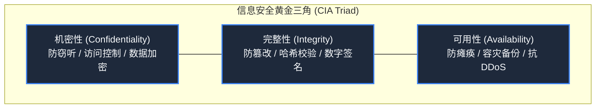

> **课程体系**：【计算机科学速成课】Crash Course Computer Science (PBS / 全40集精校)  
> **所属模块**：Module 5: 计算机网络与安全防御 (Networks & Security)  
> **主讲嘉宾**：Carrie Anne Philbin  
> **视频时长**：12:30 ｜ **高清画面截图**：4 张核心知识点板书/图解  
> **视频直达**：[📺 在 B 站观看本讲原视频 (P31)](https://www.bilibili.com/video/BV1EW411u7th/?p=31)  
> **全书导航**：[← 上一讲 (P30)](/notes/cccs/lecture-30) ｜ [📚 返回全书目录](/notes/topics/CCCS) ｜ [下一讲 (P32) →](/notes/cccs/lecture-32)

---

## 核心导读与概念全景

全面透视现代网络空间与系统防御体系，深入剖析信息安全 CIA 三要素（机密性、完整性、可用性）、多因素身份鉴权机制、强制访问控制模型以及可信计算沙箱隔离架构。

---

## 1. 计算机安全的终极准绳：CIA 三要素

*(参考时间：00:01:05 · [视频跳转 (P31 00:01:05)](https://www.bilibili.com/video/BV1EW411u7th/?p=31&t=65))*

随着全球经济命脉、医疗电网与国防控制全面接入计算机系统，信息安全不再仅仅是防止黑客炫技，而是直接关乎国家安全与公民人身财产的生死线。

在信息安全学术界，衡量一个系统是否安全的最高指导纲领被称为 **CIA 三要素（The CIA Triad）**：
1. **机密性（Confidentiality / Secrecy）**：信息只能被获得授权的合法人员读取，严防窃听与数据泄露（例如银行账户密码或医疗隐私）；
2. **完整性（Integrity）**：保证数据在存储与传输过程中没有被未授权的黑客篡改、伪造或损坏（例如黑客不能偷偷将转账金额后面的 0 多加两个）；
3. **可用性（Availability）**：确保合法用户在需要使用系统时能够随时稳定访问，防范服务瘫痪（例如急救调度系统不能被流量洪水打崩）。

*⏱ 时间戳：00:01:10 · 📷 课堂截图 · [在 B 站观看对应片段 (P31 00:01:10)](https://www.bilibili.com/video/BV1EW411u7th/?p=31&t=70)*

## 2. 身份鉴权机制：多因素认证（MFA）的数学逻辑

*(参考时间：00:03:15 · [视频跳转 (P31 00:03:15)](https://www.bilibili.com/video/BV1EW411u7th/?p=31&t=195))*

系统如何确定在屏幕前敲击键盘的人，真的是其声称的那个合法用户？这需要**身份认证（Authentication）**。

人类计算机认证通常划分为三大证据维度：
1. **你所知道的（Something You Know）**：静态密码、PIN 码、密保问题。最脆弱，极易被撞库、钓鱼或暴力破解；
2. **你所持有的（Something You Have）**：物理 U 盾、手机短信验证码、谷歌身份验证器动态 TOTP 令牌；
3. **你所具备的（Something You Are）**：生物特征识别，如指纹、Face ID 人脸识别、虹膜扫描。

**多因素认证（Multi-Factor Authentication, MFA）**要求必须同时满足至少两个不同维度的证据：黑客哪怕隔空盗取了你的明文密码，没有你口袋里的物理手机依然无法登录，将账户沦陷概率削减了 99.9% 以上。

*⏱ 时间戳：00:03:20 · 📷 课堂截图 · [在 B 站观看对应片段 (P31 00:03:20)](https://www.bilibili.com/video/BV1EW411u7th/?p=31&t=200)*

## 3. 访问控制与 Bell-LaPadula 模型

*(参考时间：00:07:20 · [视频跳转 (P31 00:07:20)](https://www.bilibili.com/video/BV1EW411u7th/?p=31&t=440))*

用户登录成功后，系统还必须明确判定他拥有哪些具体特权——**授权（Authorization）**。

在高级保密系统（如军方系统）中，普遍遵循著名的 **Bell-LaPadula 安全模型**：
- **下读禁止（No Read Up）**：绝密级（Top Secret）的人可以读秘密级（Secret）的文件，但无密级的普通员工绝对无法上探读取绝密级文件；
- **上写禁止（No Write Down）**：拥有绝密权限的人，绝对禁止把绝密情报写入公开或低密级的文档中（防止特权人员无意中将机密泄露给低权限群体）。
而在日常操作系统中，广泛采用**基于角色的访问控制（RBAC）**与**最小权限原则（Principle of Least Privilege）**——任何程序或用户只被赋予完成当前任务所必需的绝对最小权限。

*⏱ 时间戳：00:07:30 · 📷 课堂截图 · [在 B 站观看对应片段 (P31 00:07:30)](https://www.bilibili.com/video/BV1EW411u7th/?p=31&t=450)*

## 4. 可信计算基（TCB）与沙箱隔离防御（Sandbox）

*(参考时间：00:09:50 · [视频跳转 (P31 00:09:50)](https://www.bilibili.com/video/BV1EW411u7th/?p=31&t=590))*

任何大型软件都会有 Bug。面对潜在的恶意代码注入，防御的核心思路是**假设所有不可信组件已经被攻破**，并实施纵深防御：

1. **可信计算基（Trusted Computing Base, TCB）**：
   操作系统将系统划分为绝对值得信任的最小内核代码集合，其余驱动与应用全部踢出核心圈；
2. **沙箱隔离（Sandboxing）**：
   现代网页浏览器（如 Chrome）与移动操作系统（iOS/Android）将每一个网页标签和 App 关进独立的沙箱容器中：
   沙箱内的恶意脚本即便利用漏洞获得了该进程的控制权，它无法直接调用物理摄像头、无法扫描用户的本地磁盘相册、无法监听全局键盘按键，只能在受限的牢笼中无害空转。

*⏱ 时间戳：00:10:00 · 📷 课堂截图 · [在 B 站观看对应片段 (P31 00:10:00)](https://www.bilibili.com/video/BV1EW411u7th/?p=31&t=600)*

---

## 附：本讲知识脑图与回顾思考

本讲作为 **Module 5: 计算机网络与安全防御 (Networks & Security)** 的核心组成部分，系统串联了从底层硬件物理开关、中间层抽象协议到上层应用的思维跃迁。建议结合 B 站原版视频与本讲图文指南反复印证，理解技术演进背后的工程权衡与必然逻辑。

[← 上一讲 (P30)](/notes/cccs/lecture-30) ｜ [📚 返回全书目录](/notes/topics/CCCS) ｜ [下一讲 (P32) →](/notes/cccs/lecture-32)
