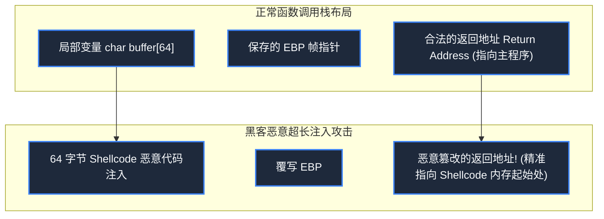

> **课程体系**：【计算机科学速成课】Crash Course Computer Science (PBS / 全40集精校)  
> **所属模块**：Module 5: 计算机网络与安全防御 (Networks & Security)  
> **主讲嘉宾**：Carrie Anne Philbin  
> **视频时长**：11:52 ｜ **高清画面截图**：4 张核心知识点板书/图解  
> **视频直达**：[📺 在 B 站观看本讲原视频 (P32)](https://www.bilibili.com/video/BV1EW411u7th/?p=32)  
> **全书导航**：[← 上一讲 (P31)](/notes/cccs/lecture-31) ｜ [📚 返回全书目录](/notes/topics/CCCS) ｜ [下一讲 (P33) →](/notes/cccs/lecture-33)

---

## 核心导读与概念全景

深度剖析现代网络攻击的致命战术与底层漏洞成因，详析社会工程学钓鱼、栈缓冲区溢出（内存越界劫持指令流）、SQL 注入动态提权，以及全球僵尸网络 DDoS 流量海啸的毁灭性威力。

---

## 1. 最脆弱的系统漏洞是人类：社会工程学与网络钓鱼

*(参考时间：00:01:10 · [视频跳转 (P32 00:01:10)](https://www.bilibili.com/video/BV1EW411u7th/?p=32&t=70))*

顶级黑客往往不需要使用昂贵的零日漏洞（Zero-Day），因为最容易攻破的安全薄弱环节是**人性的弱点**——这就是**社会工程学（Social Engineering）**。

- **网络钓鱼（Phishing）**：黑客伪造一封极其逼真的“公司 IT 部门通知修改密码”邮件，或者伪造银行账单；附带的链接导向一个与真实官网完全像素级一致的假冒钓鱼网站，诱骗受害者自己将账号密码双手机密奉上；
- **水坑攻击与鱼叉式钓鱼**：黑客针对特定企业的关键高管进行长期社交媒体画像分析，定制充满信任诱惑的恶意附件（如伪装成“年度薪酬调整方案.pdf”的木马程序）。安全不仅是技术对抗，更是对人类心理认知的防范。


*⏱ 时间戳：00:02:20 · 📷 课堂截图 · [在 B 站观看对应片段 (P32 00:02:20)](https://www.bilibili.com/video/BV1EW411u7th/?p=32&t=140)*

## 2. 栈缓冲区溢出（Buffer Overflow）：内存越界与执行流劫持

*(参考时间：00:04:30 · [视频跳转 (P32 00:04:30)](https://www.bilibili.com/video/BV1EW411u7th/?p=32&t=270))*

在底层系统软件中，最经典的系统级毁灭性漏洞当属**栈缓冲区溢出（Stack Buffer Overflow）**。

在第 12 讲中我们知道，当一个 C 语言函数被调用时，调用栈帧中依次存放着：
`[ 局部变量缓冲区 (如 char buffer[64]) ] [ 帧指针 EBP ] [ 函数返回地址 (Return Address) ]`

如果程序员使用了没有边界安全检查的危险函数（如 `gets(buffer)` 或 `strcpy`）：
1. 黑客故意向该输入框喂入一段长达 128 字节的超长恶意字符串；
2. 超出的字符像洪水一样冲破了 64 字节的缓冲区边界，一路野蛮覆写相邻的内存，**精准将原本合法的函数返回地址篡改掉**！
3. 当该函数执行完毕执行 `RET` 汇编指令时，CPU 的程序计数器（PC）不会跳回正常代码，而是**直接跳进了黑客事先藏在内存中的恶意机器指令（Shellcode）中**！黑客瞬间夺取了整台电脑的最高最高控制权。
现代编译器引入了栈金丝雀金币（Stack Canaries）、地址空间布局随机化（ASLR）与数据执行保护（DEP/NX 位）等强力防御工事，全面绞杀缓冲区溢出。




*⏱ 时间戳：00:04:40 · 📷 课堂截图 · [在 B 站观看对应片段 (P32 00:04:40)](https://www.bilibili.com/video/BV1EW411u7th/?p=32&t=280)*

## 3. 代码注入与 SQL 注入攻击（SQL Injection）

*(参考时间：00:06:40 · [视频跳转 (P32 00:06:40)](https://www.bilibili.com/video/BV1EW411u7th/?p=32&t=400))*

如果在后端代码中，程序员粗暴地将用户输入的字符串直接拼接进数据库查询语句中，就会爆发**SQL 注入漏洞**：

```sql
SELECT * FROM users WHERE username = 'USER_INPUT' AND password = 'PASSWORD_INPUT';
```

若黑客在用户名输入框中输入这串精心构造的代码：
`admin' OR '1'='1`

后端的拼接 SQL 语句瞬间变成了：
```sql
SELECT * FROM users WHERE username = 'admin' OR '1'='1' AND password = '...';
```
- 由于 `'1'='1'` 永远在逻辑上为 True，后半段所有的密码判定被彻底逻辑短路绕过！
- 数据库乖乖将管理员的全部账户权限吐出给黑客！
防御核心法则：**永远不要信任任何客户端输入！** 必须使用参数化查询预编译（Prepared Statements），将数据与代码指令做物理级绝缘。


*⏱ 时间戳：00:06:50 · 📷 课堂截图 · [在 B 站观看对应片段 (P32 00:06:50)](https://www.bilibili.com/video/BV1EW411u7th/?p=32&t=410)*

## 4. 僵尸网络（Botnet）与分布式拒绝服务攻击（DDoS）

*(参考时间：00:09:40 · [视频跳转 (P32 00:09:40)](https://www.bilibili.com/video/BV1EW411u7th/?p=32&t=580))*

有些攻击不以窃取数据为目的，而是旨在彻底摧毁系统的可用性（CIA 中的 A）。

**分布式拒绝服务攻击（Distributed Denial of Service, DDoS）**：
- 黑客通过蠕虫病毒黑掉全球成百上千万台防护脆弱的智能家用路由器、联网摄像头或个人电脑，将其组装为受黑客中控服务器隐秘控制的**僵尸网络（Botnet）**；
- 当黑客一声令下，数百万台“肉鸡”设备同时向目标网站服务器发起狂风暴雨般的流量洪水（如 SYN 洪水、DNS 放大攻击）；
- 目标服务器的带宽瞬间被每秒上百吉比特（Gbps）的垃圾流量填死，CPU 和内存连接表彻底爆满崩溃，导致正常的合法用户完全无法登录访问。现代云安全厂商利用全球分布的 Anycast 洗劫中心，在边缘网络过滤并吸收此类流量海啸。


*⏱ 时间戳：00:10:00 · 📷 课堂截图 · [在 B 站观看对应片段 (P32 00:10:00)](https://www.bilibili.com/video/BV1EW411u7th/?p=32&t=600)*

---

## 附：本讲知识脑图与回顾思考

本讲作为 **Module 5: 计算机网络与安全防御 (Networks & Security)** 的核心组成部分，系统串联了从底层硬件物理开关、中间层抽象协议到上层应用的思维跃迁。建议结合 B 站原版视频与本讲图文指南反复印证，理解技术演进背后的工程权衡与必然逻辑。

[← 上一讲 (P31)](/notes/cccs/lecture-31) ｜ [📚 返回全书目录](/notes/topics/CCCS) ｜ [下一讲 (P33) →](/notes/cccs/lecture-33)
