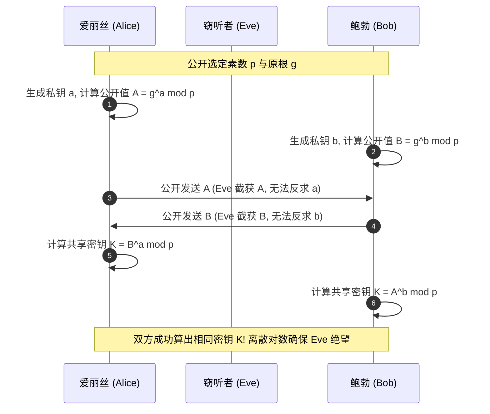

> **课程体系**：【计算机科学速成课】Crash Course Computer Science (PBS / 全40集精校)  
> **所属模块**：Module 5: 计算机网络与安全防御 (Networks & Security)  
> **主讲嘉宾**：Carrie Anne Philbin  
> **视频时长**：12:33 ｜ **高清画面截图**：4 张核心知识点板书/图解  
> **视频直达**：[📺 在 B 站观看本讲原视频 (P33)](https://www.bilibili.com/video/BV1EW411u7th/?p=33)  
> **全书导航**：[← 上一讲 (P32)](/notes/cccs/lecture-32) ｜ [📚 返回全书目录](/notes/topics/CCCS) ｜ [下一讲 (P34) →](/notes/cccs/lecture-34)

---

## 核心导读与概念全景

全面揭秘信息世界保护机密性的数学护盾——密码学演进史，从凯撒古典代换与 Enigma 机械密码，到解决密钥分发死锁的 Diffie-Hellman 协议，再到统治现代数字世界的 RSA 非对称公钥体系。

---

## 1. 古典密码学与字母频率分析的破译利刃

*(参考时间：00:01:10 · [视频跳转 (P33 00:01:10)](https://www.bilibili.com/video/BV1EW411u7th/?p=33&t=70))*

**密码学（Cryptography）**是一门关于在敌对环境下进行安全保密通信的古老艺术与深奥科学。

- **凯撒密码（Caesar Cipher）**：古罗马凯撒大帝在行军时使用的一种单表替换密码。将字母表中的每一个字母向前或向后固定平移指定位数（例如平移 3 位：`A` 变 `D`，`B` 变 `E`）；
- **频率分析法的致命打击**：到了 9 世纪，阿拉伯数学家肯迪（Al-Kindi）发明了**频率分析法**。在任何人类语言中，不同字母出现的概率有着极其稳定的统计指纹（例如英文中字母 `E` 占比最高，约 13%）。破解者只需统计密文中出现最多的密文字母，就能瞬间破译平移偏移量！单表置换密码在数学统计面前脆弱不堪。

*⏱ 时间戳：00:01:20 · 📷 课堂截图 · [在 B 站观看对应片段 (P33 00:01:20)](https://www.bilibili.com/video/BV1EW411u7th/?p=33&t=80)*

## 2. 对称加密的致命死穴：密钥分发困境

*(参考时间：00:05:40 · [视频跳转 (P33 00:05:40)](https://www.bilibili.com/video/BV1EW411u7th/?p=33&t=340))*

进入电子计算机时代，对称加密算法（如 DES, AES-256）诞生了：
- **对称加密（Symmetric Encryption）**：加密和解密使用**同一把秘密密钥（Secret Key）**；
- 现代对称加密极其强悍：AES 算法将数据切块后在多个轮次中反复进行复杂的字节代换、行移位、列混淆与轮密钥加。即便使用全球所有的超级计算机暴力穷举几亿年，也无法破解一个 256 位的 AES 密文。

#### 致命的死锁困境（Key Distribution Problem）：
爱丽丝（Alice）想在网上给鲍勃（Bob）发送加密文件，必须先有一把钥匙：
- 但爱丽丝怎么把这把钥匙安全地交给鲍勃？
- 如果她通过微信或电子邮件把钥匙发给鲍勃，万一信道已经被窃听者截获，窃听者拿到了钥匙，加密变得毫无意义；
- 如果信道本来就是安全的，那爱丽丝为什么不直接发未加密的文件？
在几千年的人类密码学史上，**在公开互不信任的不安全信道中，如何安全交换第一把绝密密钥**，一直是一个看似无法解开的死结。

*⏱ 时间戳：00:03:30 · 📷 课堂截图 · [在 B 站观看对应片段 (P33 00:03:30)](https://www.bilibili.com/video/BV1EW411u7th/?p=33&t=210)*

## 3. 破局之道：Diffie-Hellman 密钥协商协议

*(参考时间：00:07:30 · [视频跳转 (P33 00:07:30)](https://www.bilibili.com/video/BV1EW411u7th/?p=33&t=450))*

1976 年，惠特菲尔德·迪菲（Whitfield Diffie）与马丁·赫尔曼（Martin Hellman）提出了震撼数学界的**密钥交换协议**。

#### 油漆颜色混合隐喻：
1. **公开基础色**：爱丽丝和鲍勃在全世界的注视下公开挑选一种初始颜色（例如黄色）；
2. **私密独特色**：爱丽丝私下挑选秘密颜色（红色，谁也不告诉）；鲍勃私下挑选秘密颜色（蓝色，谁也不告诉）；
3. **混合与公开交换**：
   - 爱丽丝将黄色与自己的红色混合得到“橙色”，公开丢给鲍勃；
   - 鲍勃将黄色与自己的蓝色混合得到“绿色”，公开丢给爱丽丝；
   - 旁观的黑客只能看到黄色、橙色和绿色；在物理化学上，把混合颜色反向分离出原始色素极其困难！
4. **殊途同归的最终密钥**：
   - 爱丽丝拿到鲍勃的绿色，加上自己私藏的红色；
   - 鲍勃拿到爱丽丝的橙色，加上自己私藏的蓝色；
   - **双方最终得到的都是“黄+红+蓝”的棕色最终密钥！**
在数学上，他们利用了模幂运算与离散对数难题，实现了在满是间谍的公开信道上，凭空合成了只有彼此知晓的同一把绝密对称密钥！

*⏱ 时间戳：00:07:00 · 📷 课堂截图 · [在 B 站观看对应片段 (P33 00:07:00)](https://www.bilibili.com/video/BV1EW411u7th/?p=33&t=420)*

## 4. 非对称密码体系与 RSA：现代数字文明的终极拱顶

*(参考时间：00:10:10 · [视频跳转 (P33 00:10:10)](https://www.bilibili.com/video/BV1EW411u7th/?p=33&t=610))*

1977 年，麻省理工学院的三位学者罗恩·里维斯特（Ron Rivest）、阿迪·萨莫尔（Adi Shamir）与伦纳德·阿德曼（Leonard Adleman）发明了名垂青史的 **RSA 算法**。

#### 非对称公钥密码学（Asymmetric Cryptography）
每个用户拥有一对在数学上严格配对的钥匙：
- **公钥（Public Key）**：完全公开挂在网上，任何人都能看到，任何人都能拿它来给消息加密；
- **私钥（Private Key）**：绝对私密保存在自己的硬件中，**只有对应的私钥才能解开公钥加密的内容**！

#### 数学核心：大素数分解的单向陷门函数
- 将两个 1024 位的巨大素数 $P$ 和 $Q$ 相乘得到一个 2048 位的巨大合数 $N = P \times Q$，计算机用零点几微秒就能算完；
- 但如果只给你 $N$，反向寻找它的质因数 $P$ 和 $Q$，全世界算力联手也需要数百年！

#### 数字签名（Digital Signature）：防伪与抗抵赖
非对称密码学反向使用，便诞生了**数字签名**：
- 发送方用自己的**私钥**对文件的哈希值进行加密生成“签名”；
- 全世界任何人拿发送方的**公钥**一验，只要能解开，便铁证如山地证明：**这份文件绝对由发送方亲自签发，且在传输途中没有任何人篡改过哪怕一个标点符号！**

今天浏览器地址栏上的小绿锁（HTTPS / SSL / TLS）、区块链比特币转账、数字身份认证，全部建立在 RSA 与椭圆曲线非对称密码学的宏大数学护盾之上。

*⏱ 时间戳：00:10:20 · 📷 课堂截图 · [在 B 站观看对应片段 (P33 00:10:20)](https://www.bilibili.com/video/BV1EW411u7th/?p=33&t=620)*

---

## 附：本讲知识脑图与回顾思考

本讲作为 **Module 5: 计算机网络与安全防御 (Networks & Security)** 的核心组成部分，系统串联了从底层硬件物理开关、中间层抽象协议到上层应用的思维跃迁。建议结合 B 站原版视频与本讲图文指南反复印证，理解技术演进背后的工程权衡与必然逻辑。

[← 上一讲 (P32)](/notes/cccs/lecture-32) ｜ [📚 返回全书目录](/notes/topics/CCCS) ｜ [下一讲 (P34) →](/notes/cccs/lecture-34)
