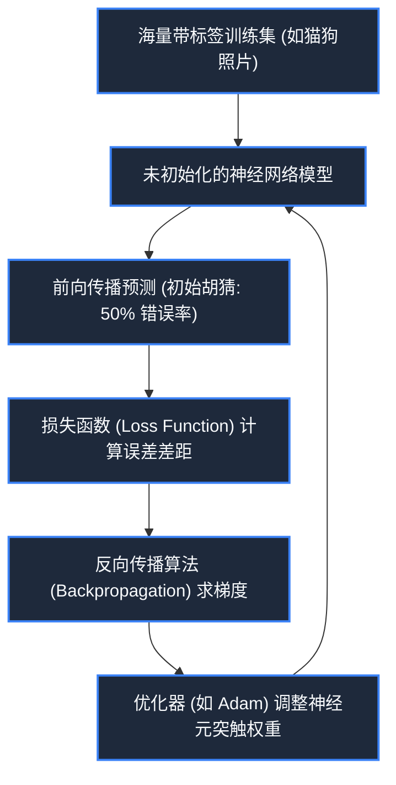

> **课程体系**：【计算机科学速成课】Crash Course Computer Science (PBS / 全40集精校)  
> **所属模块**：Module 6: 人工智能与前沿未来 (AI & Future Computing)  
> **主讲嘉宾**：Carrie Anne Philbin  
> **视频时长**：11:51 ｜ **高清画面截图**：4 张核心知识点板书/图解  
> **视频直达**：[📺 在 B 站观看本讲原视频 (P34)](https://www.bilibili.com/video/BV1EW411u7th/?p=34)  
> **全书导航**：[← 上一讲 (P33)](/notes/cccs/lecture-33) ｜ [📚 返回全书目录](/notes/topics/CCCS) ｜ [下一讲 (P35) →](/notes/cccs/lecture-35)

---

## 核心导读与概念全景

全面透视人工智能从经典符号主义规则推理到现代统计机器学习的范式转移，详析特征分类器、感知机、多层神经网络反向传播训练算法，以及弱人工智能迈向通用强人工智能的前景。

---

## 1. 范式转移：从显式编程规则到统计机器学习

*(参考时间：00:01:10 · [视频跳转 (P34 00:01:10)](https://www.bilibili.com/video/BV1EW411u7th/?p=34&t=70))*

在计算机诞生后的前五十年，编写程序遵循经典的**符号主义/专家系统范式**：
人类必须自己先完全搞清楚解决问题的每一处逻辑细节，然后手写成一行行 `if-else` 条件规则喂给计算机。

但面对许多复杂的现实感知任务，显式规则彻底失效了：
例如让人类手写一套规则来识别一张照片里是不是猫。猫有各种毛色、姿势可能站着、趴着、蜷缩着，光线明暗各异……人类用成千上万行 `if` 永远无法穷尽所有特例！

**机器学习（Machine Learning, ML）**带来了革命性的逆向思维：
- **不再由程序员编写规则，而是由机器从海量训练数据中自己去“学习”出规则！**
- 程序员只需设计通用的学习算法框架，喂入数百万张标注好的图片，让模型自动调整内部参数，直到分类准确率逼近人类。

*⏱ 时间戳：00:01:20 · 📷 课堂截图 · [在 B 站观看对应片段 (P34 00:01:20)](https://www.bilibili.com/video/BV1EW411u7th/?p=34&t=80)*

## 2. 特征空间与分类器决策边界

*(参考时间：00:03:20 · [视频跳转 (P34 00:03:20)](https://www.bilibili.com/video/BV1EW411u7th/?p=34&t=200))*

以一个简单的水果分类器为例：如何区分苹果与香蕉？

1. **特征提取（Feature Extraction）**：
   从每个样本中提取关键数字特征，例如特征 1：重量（克），特征 2：颜色饱和度或曲率；
2. **特征空间几何映射**：
   在二维坐标系上，每个水果变成了一个数据点 $(x_1, x_2)$。苹果通常聚集在左上方（重量大、曲率小），香蕉聚集在右下方（较轻、弯曲度大）；
3. **寻找决策边界（Decision Boundary）**：
   机器学习算法（如支持向量机 SVM、逻辑回归）在空间中寻找一条能够将两类数据最大程度区分开的分割线（或高维超平面）。当输入一个未知的新水果时，只需看它落在分割线的哪一侧，便能以高概率给出分类预测。

*⏱ 时间戳：00:03:30 · 📷 课堂截图 · [在 B 站观看对应片段 (P34 00:03:30)](https://www.bilibili.com/video/BV1EW411u7th/?p=34&t=210)*

## 3. 人工神经网络（ANN）与反向传播魔法

*(参考时间：00:06:40 · [视频跳转 (P34 00:06:40)](https://www.bilibili.com/video/BV1EW411u7th/?p=34&t=400))*

受生物大脑神经元突触电信号传递的启发，科学家设计了**人工神经网络（Artificial Neural Networks, ANN）**：

- **神经元（Neuron）数学模型**：
  接收多个输入 $x_i$，每个输入乘以一个**突触权重（Weight, $w_i$）**，求和后加上偏置项（Bias），最后穿过一个非线性**激活函数（Activation Function，如 Sigmoid 或 ReLU）**向下一层神经元输出信号：
  $$y = f\left( \sum_{i} w_i x_i + b \right)$$
- **多层拓扑架构**：
  - **输入层（Input Layer）**：接收图像原始像素或文字向量；
  - **隐藏层（Hidden Layers）**：负责逐层抽象特征（第一层提取边缘线条，第二层提取五官轮廓，第三层识别人脸整体）；
  - **输出层（Output Layer）**：输出不同类别的置信度概率分布。

#### 核心训练引擎：反向传播算法（Backpropagation）
网络初始权重是随机的。每次预测出错后，算法根据损失函数的梯度，从输出层向输入层**反向逐层传递误差信号**，利用微积分链式法则精细微调每一个神经元的权重，使网络预测误差逐步逼近全局最低点。

*⏱ 时间戳：00:06:50 · 📷 课堂截图 · [在 B 站观看对应片段 (P34 00:06:50)](https://www.bilibili.com/video/BV1EW411u7th/?p=34&t=410)*

## 4. 深度学习（Deep Learning）与通用人工智能（AGI）展望

*(参考时间：00:09:00 · [视频跳转 (P34 00:09:00)](https://www.bilibili.com/video/BV1EW411u7th/?p=34&t=540))*

2012 年，基于 GPU 并行加速的深度卷积神经网络 AlexNet 夺得 ImageNet 冠军，拉开了现代**深度学习（Deep Learning）**时代的序幕：

- **专用张量计算芯片（TPU / NPU）**：硬件从通用标量 CPU 演进为专为矩阵乘法吞吐设计的超高密度脉动阵列芯片；
- **弱人工智能（Narrow AI）的统治**：在下围棋（AlphaGo）、语音转文字、自动驾驶、医疗影像病灶筛查等特定封闭任务中，AI 已全面超越人类专家极限；
- **通用人工智能（Artificial General Intelligence, AGI）的终极探索**：人类正致力于构建拥有常识推理、跨领域迁移学习与自我认知进化的强人工智能系统，这既是人类科学皇冠上的终极明珠，也对人类伦理与社会结构带来了最深刻的哲学挑战。

*⏱ 时间戳：00:09:10 · 📷 课堂截图 · [在 B 站观看对应片段 (P34 00:09:10)](https://www.bilibili.com/video/BV1EW411u7th/?p=34&t=550)*

---

## 附：本讲知识脑图与回顾思考

本讲作为 **Module 6: 人工智能与前沿未来 (AI & Future Computing)** 的核心组成部分，系统串联了从底层硬件物理开关、中间层抽象协议到上层应用的思维跃迁。建议结合 B 站原版视频与本讲图文指南反复印证，理解技术演进背后的工程权衡与必然逻辑。

[← 上一讲 (P33)](/notes/cccs/lecture-33) ｜ [📚 返回全书目录](/notes/topics/CCCS) ｜ [下一讲 (P35) →](/notes/cccs/lecture-35)
