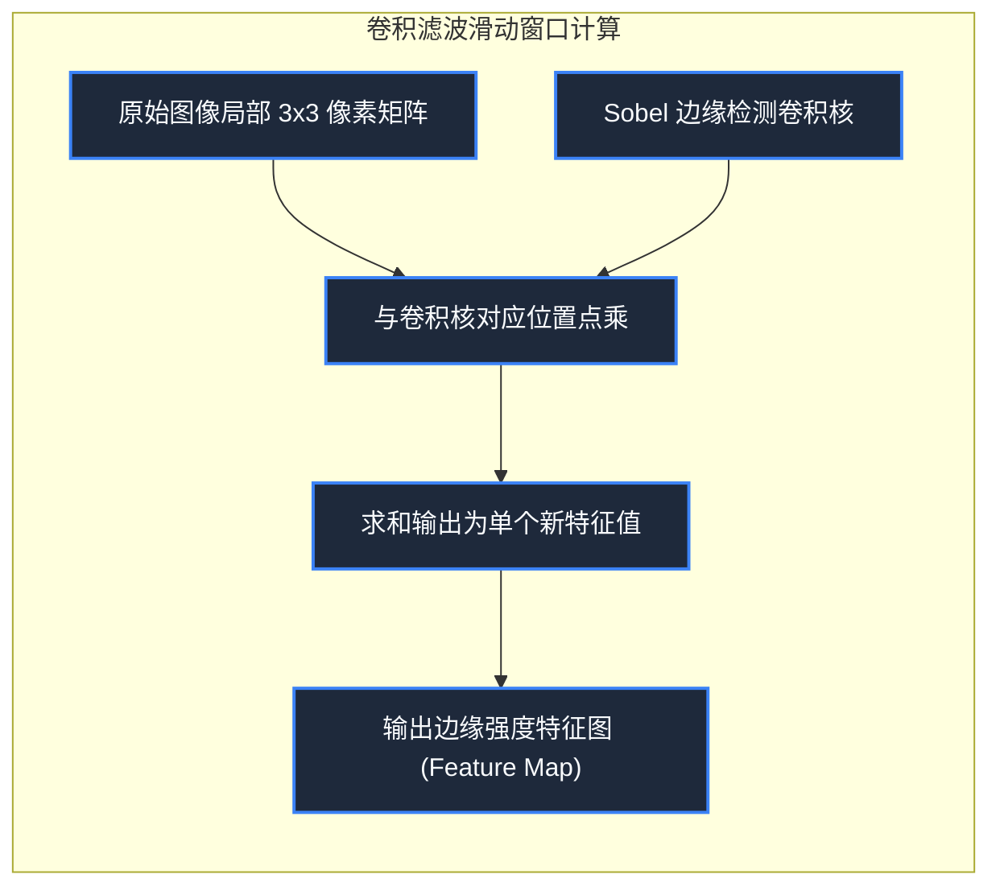

> **课程体系**：【计算机科学速成课】Crash Course Computer Science (PBS / 全40集精校)  
> **所属模块**：Module 6: 人工智能与前沿未来 (AI & Future Computing)  
> **主讲嘉宾**：Carrie Anne Philbin  
> **视频时长**：11:09 ｜ **高清画面截图**：4 张核心知识点板书/图解  
> **视频直达**：[📺 在 B 站观看本讲原视频 (P35)](https://www.bilibili.com/video/BV1EW411u7th/?p=35)  
> **全书导航**：[← 上一讲 (P34)](/notes/cccs/lecture-34) ｜ [📚 返回全书目录](/notes/topics/CCCS) ｜ [下一讲 (P36) →](/notes/cccs/lecture-36)

---

## 核心导读与概念全景

揭秘计算机如何“看懂”视觉世界，从像素矩阵与颜色跟踪，到经典 Sobel 边缘检测卷积核，再到现代卷积神经网络（CNN）空间特征提取与面部关键点追踪。

---

## 1. 图像在计算机眼中的本质：冷酷的数字矩阵

*(参考时间：00:01:10 · [视频跳转 (P35 00:01:10)](https://www.bilibili.com/video/BV1EW411u7th/?p=35&t=70))*

在人类眼中，一张自拍照包含着生动的人脸、灿烂的微笑和温暖的阳光；但在计算机眼中，**图像不过是一个巨大的、由冰冷数字构成的三维矩阵**：
- 一个 $1920 \times 1080$ 的全彩画面，由 207 万个像素点组成；
- 每个像素点由三个介于 0 到 255 之间的整数（红 R、绿 G、蓝 B 强度通道）组成。例如 `(255, 0, 0)` 代表纯正红色，`(255, 255, 255)` 代表纯白。

**计算机视觉（Computer Vision）**的终极使命是：**教会计算机如何跨越底层无意义的离散数字矩阵，直接理解图像中包含的高层语义物体与空间几何世界**。

*⏱ 时间戳：00:01:20 · 📷 课堂截图 · [在 B 站观看对应片段 (P35 00:01:20)](https://www.bilibili.com/video/BV1EW411u7th/?p=35&t=80)*

## 2. 经典视觉算子：Sobel 边缘检测与卷积核

*(参考时间：00:03:20 · [视频跳转 (P35 00:03:20)](https://www.bilibili.com/video/BV1EW411u7th/?p=35&t=200))*

在深度学习普及前，图像分析依赖巧妙的数学**卷积算子（Convolutional Kernels）**：

- **物体的边缘是什么？**
  在数学上，物体的轮廓和边缘就是**像素灰度值发生剧烈跳变的导数极值点**（例如深色头发与浅色皮肤的分界线）；
- **Sobel 边缘检测算子**：
  设计一个微小的 $3 \times 3$ 权重矩阵（卷积核），在原始图像的每一个像素周围挨个滑窗点乘相加：
  $$\begin{bmatrix} -1 & 0 & +1 \\ -2 & 0 & +2 \\ -1 & 0 & +1 \end{bmatrix}$$
  当卷积核滑过平坦均匀的区域时，正负相抵结果为 0（黑）；而当滑过明暗剧烈变化的垂直边界时，乘积激增被高亮勾勒出来！通过水平与垂直卷积核结合，一幅线稿般的物体轮廓图瞬间浮出水面。

*⏱ 时间戳：00:03:30 · 📷 课堂截图 · [在 B 站观看对应片段 (P35 00:03:30)](https://www.bilibili.com/video/BV1EW411u7th/?p=35&t=210)*

## 3. 卷积神经网络（CNN）：视觉特征的层级自愈

*(参考时间：00:05:30 · [视频跳转 (P35 00:05:30)](https://www.bilibili.com/video/BV1EW411u7th/?p=35&t=330))*

手动设计卷积核在遇到光照阴影、遮挡和角度倾斜时容易失效。现代计算机视觉的绝对霸主是**卷积神经网络（Convolutional Neural Network, CNN）**：

1. **局部感受野（Local Receptive Fields）**：模仿哺乳动物初级视皮层机制，神经元只关注图像局部的微小区域；
2. **权重共享（Weight Sharing）**：同一个卷积核扫过全图，使网络具备**平移不变性**（不管猫在画面左上角还是右下角，都能被同一个卷积核精准捕获）；
3. **池化层（Pooling / Subsampling）**：在保留最显著特征的前提下，对特征图进行空间尺寸减半压缩，降低计算量并增强尺度不变性；
4. **特征层次金字塔**：浅层网络自动学习检测线条和色块，中层网络自动拼装出纹理、眼睛、轮廓，高层全连接层综合研判出具体的物体标签。

*⏱ 时间戳：00:05:40 · 📷 课堂截图 · [在 B 站观看对应片段 (P35 00:05:40)](https://www.bilibili.com/video/BV1EW411u7th/?p=35&t=340)*

## 4. 现实世界的视觉奇迹：人脸识别与情感计算

*(参考时间：00:07:40 · [视频跳转 (P35 00:07:40)](https://www.bilibili.com/video/BV1EW411u7th/?p=35&t=460))*

依靠 CNN 与深度视觉架构，计算机视觉实现了全面落地突破：
- **面部关键点检测（Facial Landmarks）**：在人脸五官精确定位 68 个甚至上百个空间特征锚点，支持毫无违和感的美颜滤镜与手机 3D 人脸解锁；
- **情感计算（Affective Computing）**：根据眉毛的挑动、嘴角弧度微表情，算法能够实时推测人类是处于专注、喜悦还是愤怒厌烦状态；
- **自动驾驶实时三维感知**：车载摄像头以 60 帧每秒的速度同步完成语义分割（识别车道线、行人、障碍物）与三维边界框测距，将人类视觉赋予了钢铁汽车。

*⏱ 时间戳：00:07:50 · 📷 课堂截图 · [在 B 站观看对应片段 (P35 00:07:50)](https://www.bilibili.com/video/BV1EW411u7th/?p=35&t=470)*

---

## 附：本讲知识脑图与回顾思考

本讲作为 **Module 6: 人工智能与前沿未来 (AI & Future Computing)** 的核心组成部分，系统串联了从底层硬件物理开关、中间层抽象协议到上层应用的思维跃迁。建议结合 B 站原版视频与本讲图文指南反复印证，理解技术演进背后的工程权衡与必然逻辑。

[← 上一讲 (P34)](/notes/cccs/lecture-34) ｜ [📚 返回全书目录](/notes/topics/CCCS) ｜ [下一讲 (P36) →](/notes/cccs/lecture-36)
