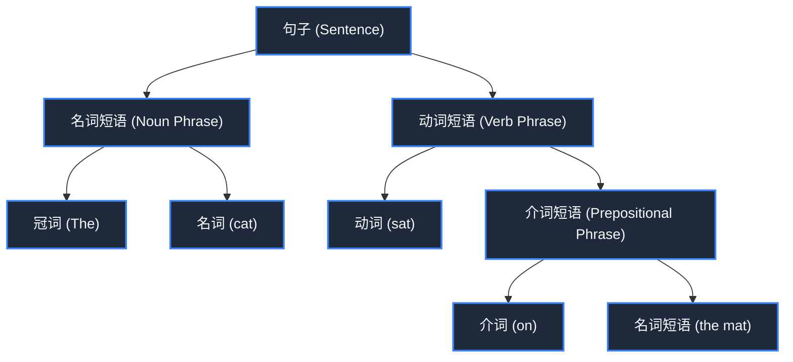

> **课程体系**：【计算机科学速成课】Crash Course Computer Science (PBS / 全40集精校)  
> **所属模块**：Module 6: 人工智能与前沿未来 (AI & Future Computing)  
> **主讲嘉宾**：Carrie Anne Philbin  
> **视频时长**：11:49 ｜ **高清画面截图**：4 张核心知识点板书/图解  
> **视频直达**：[📺 在 B 站观看本讲原视频 (P36)](https://www.bilibili.com/video/BV1EW411u7th/?p=36)  
> **全书导航**：[← 上一讲 (P35)](/notes/cccs/lecture-35) ｜ [📚 返回全书目录](/notes/topics/CCCS) ｜ [下一讲 (P37) →](/notes/cccs/lecture-37)

---

## 核心导读与概念全景

探索计算机如何跨越冷酷的二进制，理解人类复杂而充满歧义的自然语言。从句法解析树与音素识别声学模型，到词嵌入高维向量空间与现代大语言模型的语义飞跃。

---

## 1. 计算机科学与语言学的联姻

*(参考时间：00:01:10 · [视频跳转 (P36 00:01:10)](https://www.bilibili.com/video/BV1EW411u7th/?p=36&t=70))*

人类语言是极其奇妙的发明：我们通过嘴唇振动空气发出的微弱声波，或者在纸上涂画的抽象符号，就能够将复杂的思维、情感、记忆和智慧分毫不差地传递给另一个人。

然而，对于擅长严谨数学逻辑的计算机来说，人类语言是一场噩梦——语法极其不规则、充满借代、隐喻、省略，同一个词在不同语境下含义天差地别。

**自然语言处理（Natural Language Processing, NLP）**致力于架起人类自然语言与机器算力之间的理解桥梁。

*⏱ 时间戳：00:01:20 · 📷 课堂截图 · [在 B 站观看对应片段 (P36 00:01:20)](https://www.bilibili.com/video/BV1EW411u7th/?p=36&t=80)*

## 2. 语法规则的困境与句法解析树（Parse Trees）

*(参考时间：00:02:15 · [视频跳转 (P36 00:02:15)](https://www.bilibili.com/video/BV1EW411u7th/?p=36&t=135))*

早期 NLP 尝试使用诺姆·乔姆斯基（Noam Chomsky）的**形式文法理论**来解析句子：
- **词性标注（Part-of-Speech Tagging）**：将每个词分类为名词（N）、动词（V）、冠词（Art）、形容词（Adj）；
- **句法树递归解析**：一个名词短语加上一个动词短语组成一个合法的句子（$S \to NP + VP$）。

#### 致命的人类语言歧义性：
看一句经典名句：“*Time flies like an arrow; fruit flies like a banana.*”
- 前半句中，“Time”是主语名词，“flies”是动词（光阴似箭）；
- 后半句完全相同的词汇结构中，“fruit flies”却变成了名词短语（果蝇），而“like”变成了动词（喜欢香蕉）！
纯粹基于静态符号规则的解析器面对这种人类日常幽默与多义词，会瞬间死机陷入歧义爆炸。现代 NLP 必须借助统计学与上下文概率模型。

*⏱ 时间戳：00:03:30 · 📷 课堂截图 · [在 B 站观看对应片段 (P36 00:03:30)](https://www.bilibili.com/video/BV1EW411u7th/?p=36&t=210)*

## 3. 语音识别：从声学物理波形到文本符号

*(参考时间：00:06:40 · [视频跳转 (P36 00:06:40)](https://www.bilibili.com/video/BV1EW411u7th/?p=36&t=400))*

要让 Siri 或智能助手听懂人话，必须先跨越**语音识别（Speech Recognition）**的关卡：

1. **时域到频域的数学跃迁**：麦克风采集到的一维声波气压振动曲线，通过**快速傅里叶变换（FFT）**，转换为展示随时间变化的能量频率分布图——**声谱图（Spectrogram）**；
2. **音素（Phonemes）识别**：人类所有语言可以分解为几十个最基本的发音音素单元（如汉语拼音的声母韵母、英语的 `/k/`, `/æ/`, `/t/`）；
3. **隐马尔可夫模型与声学模型**：匹配声谱图特征与音素的转移概率；
4. **语言模型上下文修正**：如果系统听到“there”和“their”同音词，它通过前后的单词概率分布，断定是“在他们家里（in their house）”还是“在那个地方（over there）”。

*⏱ 时间戳：00:06:50 · 📷 课堂截图 · [在 B 站观看对应片段 (P36 00:06:50)](https://www.bilibili.com/video/BV1EW411u7th/?p=36&t=410)*

## 4. 词嵌入与大语言模型：高维空间中的语义几何

*(参考时间：00:09:50 · [视频跳转 (P36 00:09:50)](https://www.bilibili.com/video/BV1EW411u7th/?p=36&t=590))*

现代 NLP 最惊艳的飞跃在于将文字转化为几何空间向量——**词嵌入（Word Embeddings，如 Word2Vec）**：

- 每个单词不再是一个孤立的符号，而是被映射到一个拥有几百个甚至数千个维度的高维几何空间中的一个点（稠密向量）；
- **词义的几何运算奇迹**：语义相近的词在高维空间中距离极近，甚至具备线性的语义矢量加减法关系：
  $$\vec{v}(\text{国王 King}) - \vec{v}(\text{男人 Man}) + \vec{v}(\text{女人 Woman}) \approx \vec{v}(\text{女王 Queen})$$
随后以 Transformer 架构为代表的自注意力机制（Self-Attention）与海量参数大语言模型（LLMs）诞生，计算机终于能够以媲美人类专家的流畅度进行多轮对话、编写复杂代码与撰写深度论文，掀起了新一轮波澜壮阔的科技革命。

*⏱ 时间戳：00:10:00 · 📷 课堂截图 · [在 B 站观看对应片段 (P36 00:10:00)](https://www.bilibili.com/video/BV1EW411u7th/?p=36&t=600)*

---

## 附：本讲知识脑图与回顾思考

本讲作为 **Module 6: 人工智能与前沿未来 (AI & Future Computing)** 的核心组成部分，系统串联了从底层硬件物理开关、中间层抽象协议到上层应用的思维跃迁。建议结合 B 站原版视频与本讲图文指南反复印证，理解技术演进背后的工程权衡与必然逻辑。

[← 上一讲 (P35)](/notes/cccs/lecture-35) ｜ [📚 返回全书目录](/notes/topics/CCCS) ｜ [下一讲 (P37) →](/notes/cccs/lecture-37)
