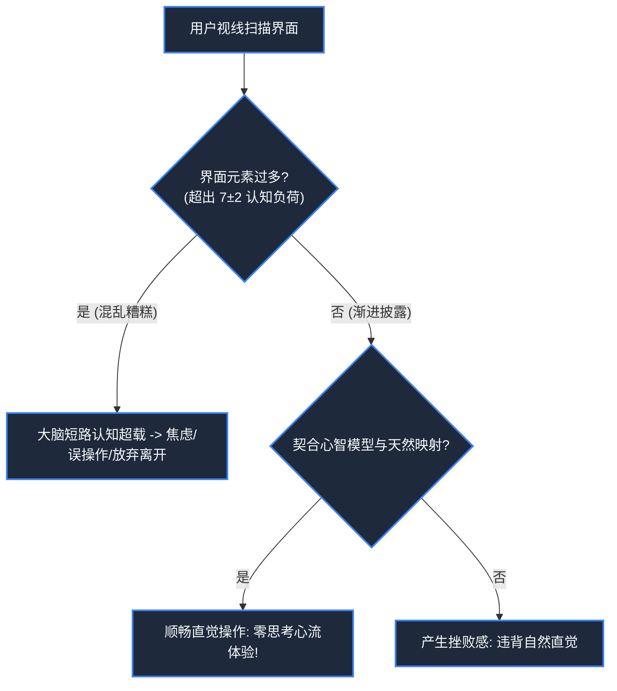

> **课程体系**：【计算机科学速成课】Crash Course Computer Science (PBS / 全40集精校)  
> **所属模块**：Module 6: 人工智能与前沿未来 (AI & Future Computing)  
> **主讲嘉宾**：Carrie Anne Philbin  
> **视频时长**：12:38 ｜ **高清画面截图**：4 张核心知识点板书/图解  
> **视频直达**：[📺 在 B 站观看本讲原视频 (P38)](https://www.bilibili.com/video/BV1EW411u7th/?p=38)  
> **全书导航**：[← 上一讲 (P37)](/notes/cccs/lecture-37) ｜ [📚 返回全书目录](/notes/topics/CCCS) ｜ [下一讲 (P39) →](/notes/cccs/lecture-39)

---

## 核心导读与概念全景

跨界探讨计算机科学与认知心理学的深度交汇，详解认知负荷理论、用户心智模型与天然映射、防呆容错设计法则，以及人类对数字实体的拟人化心理机制。

---

## 1. 为什么“糟糕的软件界面”会让人发疯？

*(参考时间：00:01:10 · [视频跳转 (P38 00:01:10)](https://www.bilibili.com/video/BV1EW411u7th/?p=38&t=70))*

你是否经历过这样的绝望时刻：
走进一个高档写字楼，面对一扇透明玻璃门，你用力向前猛推，结果门纹丝不动——因为门上赫然写着一个极小的“拉”字；
或者在某款软件中，你无论如何也找不到保存按钮，直到你不小心关掉窗口，辛辛苦苦写了一下午的成果彻底灰飞烟灭。

程序员往往容易陷入工程师思维的傲慢：“这代码逻辑完全严密没毛病，用户觉得难用肯定是用户太笨没有仔细读 500 页的说明书。”

**计算机心理学与人机工程学（HCI / Usability Engineering）**彻底推翻了这一荒谬观点：
**如果用户在使用软件时感到困惑、沮丧或犯下错误，错绝不在用户身上，错在设计者违背了人类大脑的认知心理规律！**

*⏱ 时间戳：00:01:20 · 📷 课堂截图 · [在 B 站观看对应片段 (P38 00:01:20)](https://www.bilibili.com/video/BV1EW411u7th/?p=38&t=80)*

## 2. 认知负荷理论与米勒定律（7±2 效应）

*(参考时间：00:02:50 · [视频跳转 (P38 00:02:50)](https://www.bilibili.com/video/BV1EW411u7th/?p=38&t=170))*

人类大脑是一台极其复杂但也存在着极严苛瓶颈的生物计算机：
- 我们的**长期记忆（Long-term Memory）**容量几乎无限；
- 但用于正在思考决策的**短期工作记忆（Working Memory）**极其狭窄！心理学家乔治·米勒（George Miller）提出了著名的**米勒定律**：人类工作记忆能够同时保持的离散信息块（Chunks）平均只有 **$7 \pm 2$ 个**！

#### 降低认知负荷（Cognitive Load）的黄金设计法则：
1. **块划分（Chunking）**：长串数字必须分段（例如将 11 位手机号显示为 `138-xxxx-xxxx`，银行卡号每 4 位留一个空格），将认知负担瞬间压缩进工作记忆极限内；
2. **渐进披露（Progressive Disclosure）**：普通用户界面只展示核心常用的 20% 高频功能，将高级冷门参数折叠在“高级设置”中，避免界面充斥上百个令人窒息的按钮。

*⏱ 时间戳：00:03:10 · 📷 课堂截图 · [在 B 站观看对应片段 (P38 00:03:10)](https://www.bilibili.com/video/BV1EW411u7th/?p=38&t=190)*

## 3. 心智模型（Mental Models）与天然映射原则

*(参考时间：00:06:10 · [视频跳转 (P38 00:06:10)](https://www.bilibili.com/video/BV1EW411u7th/?p=38&t=370))*

著名认知科学家唐·诺曼（Don Norman）在《设计心理学》中确立了经典概念：
- **概念心智模型（Mental Model）**：用户在过去的现实生活经验中，对某个事物是如何运转的在脑海中建立的预期模型；
- **天然映射（Natural Mapping）**：
  例如燃气灶上有 4 个呈两排两列排布的灶眼，如果控制旋钮却并排排成一条直线，用户每次开火都要猜哪个旋钮对应哪个锅；如果旋钮同样按照两排两列排布，物理空间直接一一映射，无需任何学习即可盲操！

在数字界面中：
- 调节音量使用向上推的推杆（物理空间的“高”对应抽象概念的“大”）；
- 垃圾桶图标意味着彻底粉碎，齿轮图标意味着系统设置；
善用人类既有的心智模型，软件就能达成“不着一字，自明其意”的浑然天成。

*⏱ 时间戳：00:06:30 · 📷 课堂截图 · [在 B 站观看对应片段 (P38 00:06:30)](https://www.bilibili.com/video/BV1EW411u7th/?p=38&t=390)*

## 4. 拟人化心理（Anthropomorphism）与情感计算

*(参考时间：00:09:20 · [视频跳转 (P38 00:09:20)](https://www.bilibili.com/video/BV1EW411u7th/?p=38&t=560))*

人类大脑拥有极其强烈且不可抑制的**拟人化天性（Anthropomorphism）**——只要一个无生命的物体拥有两个对称的圆点（眼睛）或者能用人类语言与我们对话，人类就会在潜意识中立刻把它当作拥有生命、感情与性格的同类来对待！

- **大眼夹的惨痛教训（Microsoft Clippy, 1997）**：
  微软在 Office 中加入了一只名为 Clippy 的拟人化回形针助手，它在屏幕上频繁敲击玻璃打断用户：“看来你在写一封信，需要帮助吗？”由于它缺乏社交情商且破坏心流，沦为科技史上最令人讨厌的失败案例；
- **现代社交机器人与数字陪伴**：
  现代 AI 语音助手（Siri, 小爱同学）精通人类心理学：适度展现谦逊、幽默与同理心倾听。计算机不再只是冰冷的算术机器，它正在深入人类的精神情感腹地，成为陪伴文明前行的数字共生伙伴。

*⏱ 时间戳：00:09:40 · 📷 课堂截图 · [在 B 站观看对应片段 (P38 00:09:40)](https://www.bilibili.com/video/BV1EW411u7th/?p=38&t=580)*

---

## 附：本讲知识脑图与回顾思考

本讲作为 **Module 6: 人工智能与前沿未来 (AI & Future Computing)** 的核心组成部分，系统串联了从底层硬件物理开关、中间层抽象协议到上层应用的思维跃迁。建议结合 B 站原版视频与本讲图文指南反复印证，理解技术演进背后的工程权衡与必然逻辑。

[← 上一讲 (P37)](/notes/cccs/lecture-37) ｜ [📚 返回全书目录](/notes/topics/CCCS) ｜ [下一讲 (P39) →](/notes/cccs/lecture-39)
