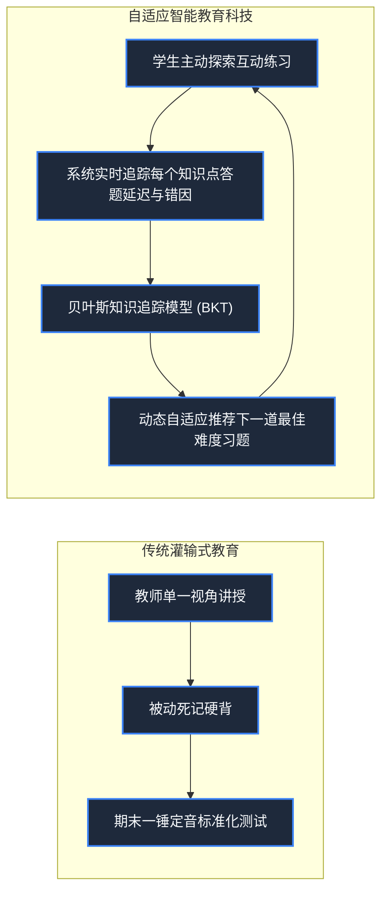

> **课程体系**：【计算机科学速成课】Crash Course Computer Science (PBS / 全40集精校)  
> **所属模块**：Module 6: 人工智能与前沿未来 (AI & Future Computing)  
> **主讲嘉宾**：Carrie Anne Philbin  
> **视频时长**：11:52 ｜ **高清画面截图**：4 张核心知识点板书/图解  
> **视频直达**：[📺 在 B 站观看本讲原视频 (P39)](https://www.bilibili.com/video/BV1EW411u7th/?p=39)  
> **全书导航**：[← 上一讲 (P38)](/notes/cccs/lecture-38) ｜ [📚 返回全书目录](/notes/topics/CCCS) ｜ [下一讲 (P40) →](/notes/cccs/lecture-40)

---

## 核心导读与概念全景

解构计算机技术如何颠覆传统教育范式，从斯金纳行为主义教学机、帕珀特 Logo 语言建构主义革命，到贝叶斯智能辅导系统（ITS）、可汗学院与 MOOC 大规模普惠课堂的演进全貌。

---

## 1. 机械化教学的破晓：斯金纳与行为主义教学机

*(参考时间：00:01:10 · [视频跳转 (P39 00:01:10)](https://www.bilibili.com/video/BV1EW411u7th/?p=39&t=70))*

两千年来，人类教育的基本形态几乎没有变过：一位老师站在讲台上向底下三四十名学生填鸭式讲授同样的知识，课后布置同样的作业。这种模式的致命缺陷在于**忽视了每个学生的个体认知差异**——听懂的学生觉得无聊昏昏欲睡，没听懂的学生跟不上进度彻底掉队。

20 世纪 50 年代，心理学家 B.F. 斯金纳（B.F. Skinner）制造了世界上第一台**机械教学机（Teaching Machine）**：
- 依靠齿轮和纸卷，向学生展示一个极小的知识切片并附带一道选择题；
- 学生拨动杠杆选择答案：如果答对了，机器立刻发出机械奖赏反馈并切到下一题；答错了，机器锁住杠杆要求重新思考；
这是**即时反馈（Immediate Feedback）**教育理念的最初物理体现。

*⏱ 时间戳：00:01:20 · 📷 课堂截图 · [在 B 站观看对应片段 (P39 00:01:20)](https://www.bilibili.com/video/BV1EW411u7th/?p=39&t=80)*

## 2. 建构主义革命：西摩尔·帕珀特与 Logo 语言小海龟

*(参考时间：00:03:15 · [视频跳转 (P39 00:03:15)](https://www.bilibili.com/video/BV1EW411u7th/?p=39&t=195))*

20 世纪 60 年代末，麻省理工学院人工智能先驱**西摩尔·帕珀特（Seymour Papert）**提出了彻底颠覆斯金纳的教育哲学：
**不要让计算机来操纵和测试学生，而是让孩子自己通过编程去指挥和操纵计算机！**

帕珀特为儿童开发了世界上第一门专属编程语言——**Logo 语言**：
- 屏幕上有一只名为“小海龟（Turtle）”的光标，肚子里藏着一根画笔；
- 孩子们只需输入极其直观的英文指令：`FORWARD 100`（向前走 100 步）、`RIGHT 90`（向右转 90 度）；
- 通过让小海龟画正方形、画五角星、画复杂分形几何，抽象晦涩的平面几何与代数公式在孩子们欢快的编程实验中具象化为现实创造！
帕珀特的**建构主义学习理论（Constructionism）**启发了后来的乐高 Mindstorms 机器人体系与全球少儿编程 Scratch 的诞生。

*⏱ 时间戳：00:03:30 · 📷 课堂截图 · [在 B 站观看对应片段 (P39 00:03:30)](https://www.bilibili.com/video/BV1EW411u7th/?p=39&t=210)*

## 3. 自适应智能辅导系统（ITS）：千人千面的 AI 专属导师

*(参考时间：00:06:40 · [视频跳转 (P39 00:06:40)](https://www.bilibili.com/video/BV1EW411u7th/?p=39&t=400))*

现代教育科技的核心引擎是**智能导师系统（Intelligent Tutoring Systems, ITS）**：

- **贝叶斯知识追踪模型（Bayesian Knowledge Tracing, BKT）**：
  系统在后台为每个学生构建精密的动态能力图谱。系统并不单纯看一道题是否做对，而是实时监测用户的每次尝试耗时、撤销次数与草稿路径，推断其对“分数通分”或“负数加法”的**真实掌握概率（Mastery Probability）**；
- **最近发展区（Zone of Proximal Development）匹配**：
  算法自动计算出既不会让学生因太难而沮丧放弃、也不会因太简单而感到无趣的“最佳挑战阶梯题”，实现孔子两千年前就梦寐以求的最高教育理想——**“有教无类，因材施教”**。

*⏱ 时间戳：00:06:50 · 📷 课堂截图 · [在 B 站观看对应片段 (P39 00:06:50)](https://www.bilibili.com/video/BV1EW411u7th/?p=39&t=410)*

## 4. 翻转课堂与 MOOC 浪潮：砸碎名校的高墙

*(参考时间：00:09:15 · [视频跳转 (P39 00:09:15)](https://www.bilibili.com/video/BV1EW411u7th/?p=39&t=555))*

2006 年萨尔曼·可汗创立**可汗学院（Khan Academy）**，掀起了**翻转课堂（Flipped Classroom）**风暴：
- 学生在家看名师视频短片学习理论知识，可以随时暂停、回放、以 1.5 倍速播放；
- 白天来到教室，老师不再重复讲课，而是引导学生共同进行小组讨论、实验探索与深度解惑。

随后在 2012 年，Coursera、edX、B 站等**大规模开放在线课堂（MOOC / 知识区）**席卷全球：
斯坦福、麻省理工、哈佛与伯克利顶级教授的毕生心血课程，被无偿向全球全人类无差别开放！一个身处偏远山区乡村的求知青年，只要有一根网线和一台廉价设备，就能跨越阶层与地理鸿沟，与世界顶尖学府的天才同步汲取最前沿的科学营养，这正是教育科技对人类文明最深沉的崇高馈赠。

*⏱ 时间戳：00:09:20 · 📷 课堂截图 · [在 B 站观看对应片段 (P39 00:09:20)](https://www.bilibili.com/video/BV1EW411u7th/?p=39&t=560)*

---

## 附：本讲知识脑图与回顾思考

本讲作为 **Module 6: 人工智能与前沿未来 (AI & Future Computing)** 的核心组成部分，系统串联了从底层硬件物理开关、中间层抽象协议到上层应用的思维跃迁。建议结合 B 站原版视频与本讲图文指南反复印证，理解技术演进背后的工程权衡与必然逻辑。

[← 上一讲 (P38)](/notes/cccs/lecture-38) ｜ [📚 返回全书目录](/notes/topics/CCCS) ｜ [下一讲 (P40) →](/notes/cccs/lecture-40)
