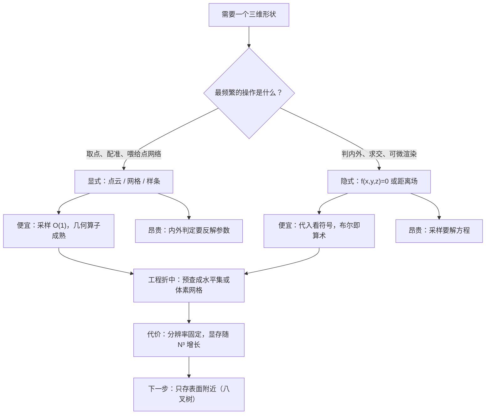
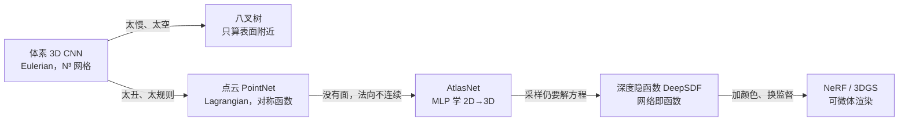
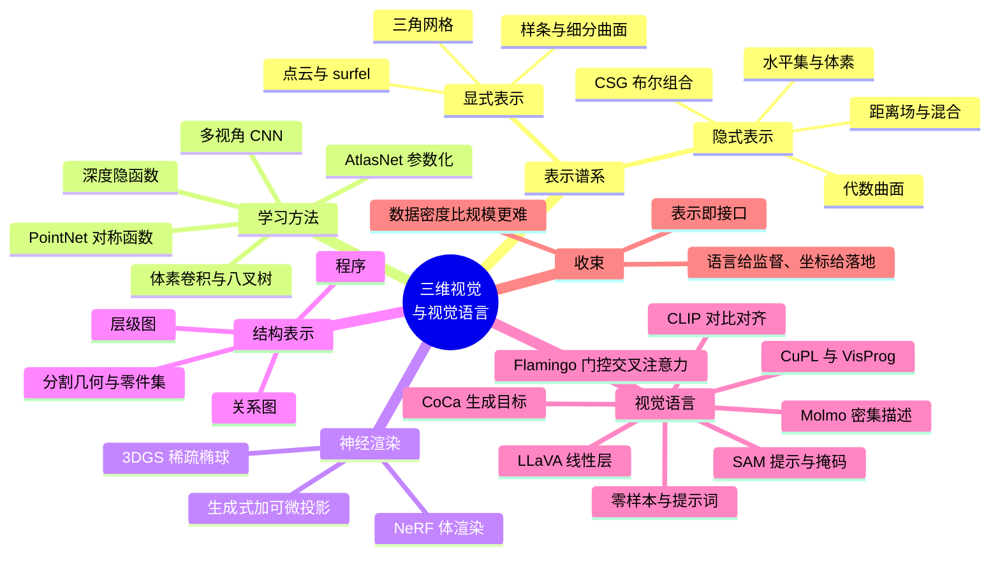

> **课程信息**
>
> - **课程名称**：Stanford CS231n: Deep Learning for Computer Vision（Spring 2025）
> - **本模块覆盖**：Lecture 15. 3D Vision；Lecture 16. Vision and Language（共 253 页幻灯片）
> - **主讲教师（各讲）**：Jiajun Wu（L15）；Ranjay Krishna（L16）
> - **授课日期范围**：2025-05-22 – 2025-05-27
> - **课程主页**：[cs231n.stanford.edu/2025](https://cs231n.stanford.edu/2025/schedule.html)
> - **官方课件**：[lecture_15.pdf](</attachments/cs231n-15848a12f2962dbe6aa3c0ad.pdf>)（105 页）、[lecture_16.pdf](</attachments/cs231n-447fe87ad8a0f5389d4f0492.pdf>)（148 页），正文按页链接本地课件
> - **字幕来源**：[cs231n_sp25_kor_sub · eng](https://github.com/lpaiu-cs/cs231n_sp25_kor_sub/tree/main/eng)（公开英文转写，中文由本书重写）
> - **版权说明**：幻灯片与课程材料版权归 Stanford University 及授课教师所有；本书为非官方学习笔记，仅用于学习与研究。

> **课件索引**：点击下方链接打开本地 PDF 的对应页；全部课件见 [课件索引](/notes/cs231n/slides)。页码按 PDF 文件页序定位，第 1 讲分为 Part 1 / Part 2。

[📄 L15 · 第 1 页｜Lecture 15 标题页：3D Vision，主讲 Jiajun Wu，2025 年 5 月 22 日](</attachments/cs231n-15848a12f2962dbe6aa3c0ad.pdf#page=1>)

这两讲放在一起是刻意的。第 15 讲处理一个二维视觉里根本不存在的问题：三维没有默认接口。二维的一切建立在一个约定上——$H\times W\times 3$ 的张量，行列就是地址，"相邻"不需要定义；而同一个杯子可以被写成几百万个坐标点、几十万个三角面，或者一行方程 $x^2+y^2+z^2=r^2$，三种写法描述同一件东西，却让完全不同的操作变便宜。第 16 讲换了战场：图像还在，但任务不再是一个标签，而是一句自然语言；模型交付的也不再是类别，而是一个把图和句放进同一个空间、能被任意下游任务复用的接口。

表面是两个话题，底层是同一件事的两次发作。三维那边，"换表示"换的是**你能对它提什么查询**——点云能采样但不能判内外，隐函数能判内外但要解方程；语言那边，"接语言"换的是**你能对它提什么任务**——分类器只能答 1000 个类之一，图文对齐模型能答任何一句描述。两讲都在把视觉从"一个标签"推向"一个可查询、可组合的结构"，只不过前者的查询键是坐标，后者的查询键是词。本模块按这条同构关系重排：先走完三维表示谱系（第 1–3 章），再算数据账与方法账（第 4–8 章），然后在一个交界章里把"结构"交给语言（第 9 章），接着是视觉语言的四次换（第 10–16 章），最后收在"语言究竟给视觉提供了什么"。

## 1. 3D 没有像素：先把物体写成一份清单

*(参考时间: 00:00:05 – 00:11:12｜Lecture 15)*

[📄 L15 · 第 2 页｜一排玻璃器皿：细颈、薄壁与半透明材质，几何的极端细节](</attachments/cs231n-15848a12f2962dbe6aa3c0ad.pdf#page=2>)

Jiajun Wu 的开场没有给定义，先给了三张照片，把"三维物体"这个词的外延撑开。第一张是一排高脚杯与玻璃杯：杯口细到几毫米，材质半透明，彼此遮挡的轮廓互相穿透。这类几何的难处不在整体形状，而在细节与材质——任何"按格子采样"的表示，分辨率差一点，杯口就塌成一团糊。

[📄 L15 · 第 3 页｜曼哈顿中央公园航拍：城市级几何，树冠、草坪与楼群同框](</attachments/cs231n-15848a12f2962dbe6aa3c0ad.pdf#page=3>)

[📄 L15 · 第 4 页｜河流三角洲的俯拍：主河道分叉成支流，结构在不同尺度上重复](</attachments/cs231n-15848a12f2962dbe6aa3c0ad.pdf#page=4>)

第二张反过来：中央公园的航拍，尺度从树冠的几米跨到街区的几公里，同一套表示要同时装下树和楼。第三张是河流三角洲（国家地理读者投稿，Adriana Franco），主河道分叉成支流、支流再分叉，形态与树、与血管同构——三维形状常常自带多尺度自相似。三张图合起来给出本章第一个判断：**选表示，本质上是选"在哪个尺度上不丢信息"**，而这个选择没有全局最优解。

[📄 L15 · 第 5 页｜几何表示的两大家族：显式（点云、多边形网格、细分、NURBS）与隐式（水平集、代数曲面、距离函数）](</attachments/cs231n-15848a12f2962dbe6aa3c0ad.pdf#page=5>)

幻灯片把选项摊成两族。**显式**（explicit）是"把点直接写出来"：点云、多边形网格、细分曲面、NURBS。**隐式**（implicit）是"用一个关系式把点筛出来"：水平集、代数曲面、距离函数——你拿不到点表，只能提问"这个点在不在里面"。最后一行写得克制：每种选择适合不同的任务与几何类型，没有通吃的那一个。

[📄 L15 · 第 6 页｜选型要回答的六件事：存储、创建、输入接口、操作、渲染、动画](</attachments/cs231n-15848a12f2962dbe6aa3c0ad.pdf#page=6>)

真做工程时选型要回答六件事：怎么存进计算机（像素是矩阵，点云是不规则表，隐函数连"存什么"都要先想清楚）；怎么创造新形状，输入是图像、扫描还是语言；支持哪些操作——编辑、简化、平滑、滤波、修补；怎么渲染，光栅化、光线追踪还是神经渲染；怎么动画，尤其是人体与动物这类带关节的对象。这张清单后面会被反复拿来给每种表示打分，本模块也用它当评分表。

### 1.1 点云：$3\times N$ 的清单，缺一张连接表

[📄 L15 · 第 7 页｜点云：只有坐标没有连接；带方向的点叫 surfel](</attachments/cs231n-15848a12f2962dbe6aa3c0ad.pdf#page=7>)

点云是最省的写法：一个 $3\times N$ 的矩阵，三行是 $x,y,z$，$N$ 列是点数。图像是"每个位置存一个值"，点云是"每个点存一个位置"——存储对象从值变成了坐标，连接关系被整个丢掉。要渲染还得再加一列：法向。光照从某个方向打来，表面每一点朝向哪边决定了它有多亮，缺了法向，点云只能画成一团没有明暗的雾。带方向的点在图形学里有专名——**surfel**（面元）。

[📄 L15 · 第 8 页｜三维扫描仪的原始输出：一堆彼此独立、各自只覆盖一个视角的部分扫描](</attachments/cs231n-15848a12f2962dbe6aa3c0ad.pdf#page=8>)

[📄 L15 · 第 9 页｜多张部分扫描要先配准到同一坐标系，再融合成一张完整点云](</attachments/cs231n-15848a12f2962dbe6aa3c0ad.pdf#page=9>)

点云之所以绕不开，是因为它常常是传感器的**原始输出**：深度相机、结构光扫描仪、iPhone 上的 ARKit，吐出来的第一手数据都是点。但原始输出不能直接用：单次扫描只覆盖一个视角，有噪声，还有大片缺失，必须把多帧**配准**（registration）到同一坐标系再融合。算一笔账：一帧 $640\times480$ 的深度图约 30.7 万个点，绕物体拍 100 帧就是 3000 万点，每个点三个 float32 存下来约 368 MB——这还只是一次扫描的中间产物。

[📄 L15 · 第 10 页｜点云的边界情况：同一堆点既可能是一个环面，也可能是两个套在一起的环](</attachments/cs231n-15848a12f2962dbe6aa3c0ad.pdf#page=10>)

点云的优点是"什么几何都能塞进去"，把点挪一挪就能表示任何形状，不受拓扑约束，天然适合大数据集。缺点同样清楚：欠采样区域画不出来（兔子头上密密麻麻、尾巴上稀疏，渲染出来就是破洞），没有简化与细分这类成熟算子，没有方向性的平滑渲染，最要命的是**没有拓扑信息**。幻灯片右下角那个问号就来自最后一条：同样一堆点，既可能是一个环面，也可能是两个套在一起的环——点集不告诉你它们怎么连。

### 1.2 三角网格：把连接补上，代价是不规则

[📄 L15 · 第 11 页｜多边形网格：物体的边界表示，点与点之间的连接一起存下来](</attachments/cs231n-15848a12f2962dbe6aa3c0ad.pdf#page=11>)

网格（polygonal mesh）把连接补上：不只存点，还存面。它是图形引擎、游戏、影视管线里最通用的表示，实时渲染吃的几乎全是三角形。代价是不规则：一个面可以有 3、4、5 个顶点，这种变长结构与早期卷积网络"固定分辨率输入"的假设直接冲突——讲师把它说成本讲的一条暗线，**三维深度学习起步晚，很大程度上是因为表示不统一**。

[📄 L15 · 第 12 页｜Digital Michelangelo 的大卫像：2818 万个顶点、5623 万个三角面](</attachments/cs231n-15848a12f2962dbe6aa3c0ad.pdf#page=12>)

复杂网格能到很夸张的规模。这尊大卫像有 28,184,526 个顶点、56,230,343 个三角面。按 float32 存坐标是 $2.82\times10^{7}\times3\times4$ 字节，约 338 MB；三角面按三个 4 字节索引存是 $5.62\times10^{7}\times3\times4$，约 675 MB。合计约 1 GB，还没算法向、UV 与贴图。这就是为什么网格处理的第一步常常是简化而不是渲染。

[📄 L15 · 第 13 页｜Google Earth 的全球网格：由卫星与航拍重建，三角形数量到万亿级](</attachments/cs231n-15848a12f2962dbe6aa3c0ad.pdf#page=13>)

再往上是 Google Earth：用卫星与航拍影像重建的全球网格，三角形数量以万亿计。按每个三角形 12 字节的索引估算就是十几 TB，单机根本装不下，只能按视点流式取细节。**能否"简化而不塌"因此成了网格表示的核心竞争力**，而点云连这个操作都没有。

[📄 L15 · 第 14 页｜网格上采样（细分）：用插值把面片切细，分辨率上去而形状不变](</attachments/cs231n-15848a12f2962dbe6aa3c0ad.pdf#page=14>)

[📄 L15 · 第 15 页｜网格下采样（简化）：减少面数，同时尽量保住形状与外观](</attachments/cs231n-15848a12f2962dbe6aa3c0ad.pdf#page=15>)

[📄 L15 · 第 16 页｜网格正则化：重排采样分布，让三角面的大小与形状趋于均匀](</attachments/cs231n-15848a12f2962dbe6aa3c0ad.pdf#page=16>)

三个基本操作构成网格的工具箱。**细分**（subdivision）在边上插新点、按邻域加权决定新点位置，把一个面一分为四，分辨率上去而形状不动；**简化**（simplification）反过来，在保住形状与外观的前提下去掉顶点，用来换帧率；**正则化**（regularization）不改形状只改采样分布，让每个面都是三角形、三个顶点、大小相近。最后这个最容易被忽略：扫描出来的网格常常一边密一边疏、长条三角形满地，数值算法在这种网格上不稳定；把采样改均匀，形状误差几乎不变，但后续每一步都变便宜。这是图形学里"表示的质量等于后续算法的质量"的典型例子。

## 2. 把形状写成函数：参数化省自由度，隐式好判定

*(参考时间: 00:11:14 – 00:21:30｜Lecture 15)*

如果形状是被"设计"出来的——桌子有直边、椅子有对称面、车身是流水线曲面——用几百万个点去逼近它是浪费：一张圆桌只需要半径和高度。参数化表示（parametric representation）就是把这个先验写进表示里：**形状的自由度远小于 3**。一张曲面本质上是二维的，一条曲线是一维的，把它们"贴"进三维空间只需要一个映射。

[📄 L15 · 第 17 页｜表示法分类图的第一帧：先只摆出非参数的两种（点、网格）](</attachments/cs231n-15848a12f2962dbe6aa3c0ad.pdf#page=17>)

幻灯片先用一张 $2\times2$ 的分类图把坐标系搭起来：横轴是显式与隐式，纵轴是非参数与参数。这一帧只填了左上角两格，后面每讲一类就补一格——整讲会把它填满一次，再拿它当路标反复引用。这个做法值得学：一张会自我补全的图，比一张一次性画完的目录更能让人记住位置。

[📄 L15 · 第 18 页｜参数化表示：曲面是函数的像，$f$ 把低维参数域映到三维空间](</attachments/cs231n-15848a12f2962dbe6aa3c0ad.pdf#page=18>)

参数化表示把曲面定义成函数的**像**（range）：$S=\{f(u,v)\mid (u,v)\in D\}$，其中 $f:D\subset\mathbb{R}^2\to\mathbb{R}^3$。自由度是 2 而不是 3——曲面本身是二维的，三维只是它被嵌入的空间。参数从哪来不重要，重要的是"用两个数就能定位曲面上的一个点"。

[📄 L15 · 第 19 页｜参数化曲线：一个自由度 $t$ 扫出整条圆](</attachments/cs231n-15848a12f2962dbe6aa3c0ad.pdf#page=19>)

[📄 L15 · 第 20 页｜参数化曲面：两个自由度 $(u,v)$ 扫出整个球面](</attachments/cs231n-15848a12f2962dbe6aa3c0ad.pdf#page=20>)

最朴素的例子是圆与球。圆写成 $f(t)=(\cos t,\ \sin t)$，$t\in[0,2\pi)$，一个自由度扫一圈；球写成 $f(u,v)=(\sin u\cos v,\ \sin u\sin v,\ \cos u)$，$u\in[0,\pi]$、$v\in[0,2\pi)$，两个自由度铺满整张球面。不需要存点，存这个函数就够了——参数量从"与分辨率成正比"变成"与复杂度成正比"。

[📄 L15 · 第 21 页｜Bézier 曲线与分段 Bézier：少数控制点决定一条光滑曲线](</attachments/cs231n-15848a12f2962dbe6aa3c0ad.pdf#page=21>)

工程上更常用的是 **Bézier 曲线**：给若干控制点 $P_i$ 和基函数 $b_i(t)$，曲线是 $B(t)=\sum_i b_i(t)P_i$。控制点只给出"拉力方向"，曲线本身永远落在控制点凸包内，所以调形状非常直观——工业设计软件里那根可以拖的曲线就是它。一条 Bézier 表达力有限，实际做法是**分段 Bézier**：多段拼起来，段间共享端点保证连续。

[📄 L15 · 第 22 页｜Bézier 曲面：两条 Bézier 曲线的张量积得到一张 patch](</attachments/cs231n-15848a12f2962dbe6aa3c0ad.pdf#page=22>)

曲面是曲线的张量积：$S(u,v)=\sum_i\sum_j b_i(u)b_j(v)P_{ij}$，得到一张 **patch**（面片）；多张 patch 缝起来就是完整曲面。这解释了为什么汽车与飞机的数字模型都是"曲面片拼图"——每张片只有几十个控制点，却能拼出任意光滑的壳体。

[📄 L15 · 第 23 页｜细分曲线与细分曲面：反复切角，收敛到一张光滑的极限曲面](</attachments/cs231n-15848a12f2962dbe6aa3c0ad.pdf#page=23>)

与 Bézier 并列的另一条路是**细分**（subdivision，幻灯片注明材料借自 Keenan Crane，而 Crane 又借自 Don Fussell）：不写公式，从一张粗糙的控制网格出发，反复执行"在边中点插点、按邻域加权移动旧点"的规则，迭代若干次后收敛到光滑的极限曲面。它比 NURBS 那类张量积曲面更容易处理任意拓扑，这也是它成为动画管线主力的原因。

[📄 L15 · 第 24 页｜分类图第二帧：参数化一列被填上，样条与细分曲面各就各位](</attachments/cs231n-15848a12f2962dbe6aa3c0ad.pdf#page=24>)

到这一帧，下半部分的两格被填上了：样条（splines）与细分曲面（subdivision surfaces）同属"参数化"——共同点是不存点表，存一组控制量加一套生成规则。到这里四种表示（点、网格、样条、细分）全部站在**显式**一侧：无论怎么生成，最终都能给出曲面上的具体点。

### 2.1 显式与隐式：一组干净的对称

[📄 L15 · 第 25 页｜显式表示的定义：所有点被直接给出，$f:\mathbb{R}^2\to\mathbb{R}^3$](</attachments/cs231n-15848a12f2962dbe6aa3c0ad.pdf#page=25>)

显式表示的统一描述是"**所有点都被直接给出**"，一般形式写成 $f:\mathbb{R}^2\to\mathbb{R}^3$——给它两个参数，它还你一个三维点。这个接口决定了它的强项与软肋。

[📄 L15 · 第 26 页｜显式表示的强项：随机采 $(u,v)$ 就能得到曲面上的点](</attachments/cs231n-15848a12f2962dbe6aa3c0ad.pdf#page=26>)

强项是采样。幻灯片给的环面是 $f(u,v)=((2+\cos u)\cos v,\ (2+\cos u)\sin v,\ \sin u)$。要在这张曲面上取点，随机抽若干个 $(u,v)$ 代进去就行，得到的点**保证在曲面上**，这一步是 $O(1)$，不需要解任何方程。后面 PointNet 那类方法要求把形状转成点云时，靠的就是这个性质。

[📄 L15 · 第 27 页｜显式表示的软肋：判断 $(3/4,1/2,1/4)$ 在不在内部，要先反解 $(u,v)$](</attachments/cs231n-15848a12f2962dbe6aa3c0ad.pdf#page=27>)

软肋是内外判定。给定查询点 $(3/4,1/2,1/4)$，问它在不在物体内部——对显式表示来说，你得先找到一对 $(u,v)$ 使 $f(u,v)$ 等于这个点，也就是解一个**反问题**。环面上这类方程可能多解、可能无解，形状一复杂就没有解析解。讲师在这里停了一下说"我自己也不确定"——这个犹豫恰好说明问题：对人都不直观，对渲染管线更不友好。

[📄 L15 · 第 28 页｜隐式表示：点的集合由 $f(x,y,z)=0$ 这类关系定义，符号给出内外](</attachments/cs231n-15848a12f2962dbe6aa3c0ad.pdf#page=28>)

隐式表示换了个方向：不列点，给**分类规则**。球面就是所有满足 $x^2+y^2+z^2=1$ 的点；更一般地，曲面是 $f(x,y,z)=0$ 的零水平集（zero level set）。$f$ 的符号给出内外：负在里，正在外。幻灯片用一条 $-1$ 到 $+1$ 的色带画出这件事——曲面是那条零线，两侧是两个域。

[📄 L15 · 第 29 页｜隐式表示的软肋：求 $f=0$ 上的点等于解方程](</attachments/cs231n-15848a12f2962dbe6aa3c0ad.pdf#page=29>)

代价立刻出现：**采样变难了**。幻灯片给的环面隐函数是 $f(x,y,z)=(2-\sqrt{x^2+y^2})^2+z^2-1$。要在这张曲面上取点，就得解 $f=0$——这个例子用高中数学还能凑，换成任意形状就没有闭式解，只能数值求根。隐式丢掉的正好是显式最擅长的东西。

[📄 L15 · 第 30 页｜隐式表示的强项：代入求符号，$-1/8<0$ 就是内部](</attachments/cs231n-15848a12f2962dbe6aa3c0ad.pdf#page=30>)

但内外判定变成了代入。同一个查询点 $(3/4,1/2,1/4)$ 代进单位球：$9/16+1/4+1/16=7/8$，减去 1 得 $-1/8<0$，**在内部**，一次乘法加一次减法就完了。幻灯片特意让这个数字落在 $-1/8$ 上：精确、可验算，不用信任何近似。同一个点代进上一页那个环面函数则得正数被判为外部——符号本身没有意义，符号相对于"当前这个 $f$ 描述的形状"才有意义。

于是显式与隐式构成一组干净的对称，后面所有技术路线都可以在这张表上定位：

| 任务 | 显式（点、网格、样条） | 隐式（$f=0$、距离场） |
| --- | --- | --- |
| 在曲面上取点 | 容易，代参数即可，$O(1)$、保证在面上 | 难，要解方程，可能多解或无解 |
| 判断点在不在内部 | 难，要反解参数 | 容易，代入看符号 |
| 布尔运算（并/交/差） | 需要重新求交、重建拓扑 | 逐点算术即可 |
| 表示复杂拓扑 | 需要显式维护连接 | 天然支持合并与分裂 |
| 与神经网络对接 | 需先离散成网格或图 | 输入是坐标，天然适配 MLP |

这张表解释了后面所有路线的动机：**渲染要的是"沿一条光线查询每点的密度"，也就是大量内外判定**，所以神经渲染最终站在隐式这一侧；而**配准、检测、分割要的是"给出面上的点"**，所以点云路线站在显式这一侧。

### 2.2 代数曲面：闭式表达力撞上一堵墙

[📄 L15 · 第 31 页｜代数曲面：多项式零集，形状一复杂就写不出那个多项式](</attachments/cs231n-15848a12f2962dbe6aa3c0ad.pdf#page=31>)

隐式的第一层能力是**代数曲面**：曲面是多元多项式的零集。二次曲面（球、椭球、双曲面）都能写成闭式，参数可控、求交有解析解。问题也很直接：想要一头牛的形状，你写不出那个多项式。讲师把这个问题问得很具体——"如果我要表示一头牛，那个函数长什么样？"闭式表达力与形状复杂度之间有一道过不去的墙。

## 3. 隐式怎么算：布尔、距离场、水平集与体素

*(参考时间: 00:21:34 – 00:28:40｜Lecture 15)*

绕过这堵墙的第一招，是不去写一个复杂函数，而是用简单函数**组合**出复杂形状。隐式表示在这里格外顺手，因为组合运算就是逐点算术。

[📄 L15 · 第 32 页｜构造实体几何（CSG）：并、交、差三种布尔运算拼出复杂零件](</attachments/cs231n-15848a12f2962dbe6aa3c0ad.pdf#page=32>)

**构造实体几何**（constructive solid geometry, CSG）：每个形体给一个函数值，并、交、差就是对值做逐点算术——并取 min，交取 max，差取 $\max(f_1,-f_2)$ 这类组合。不需要重新求交，不需要重建拓扑。这也是 CAD（计算机辅助设计）几十年来的标准做法：工业零件的模型本质上是一棵布尔表达式树，讲师的原话是"制造业里那些复杂零件，很多就是这么设计出来的"。

[📄 L15 · 第 33 页｜距离函数：每点存到表面的最短距离，可带符号](</attachments/cs231n-15848a12f2962dbe6aa3c0ad.pdf#page=33>)

第二招是把"符号"升级成"数值"：**距离函数**（distance function）在每个点存的是到物体表面的最短距离，带符号的距离场（signed distance field）同时编码了内外与远近。信息量比二值内外大得多，代价是函数值不再只是 0/1。

[📄 L15 · 第 34 页｜距离函数的线性混合：两个函数相加，边界平滑地移动过去](</attachments/cs231n-15848a12f2962dbe6aa3c0ad.pdf#page=34>)

有了数值就可以做算术。幻灯片用一维举例：一条竖线是 $f_1(x)=0$，左边为负右边为正；另一条竖线是 $f_2(x)=0$；把两个函数加起来，零集就落在两条线之间，形成一条**平滑移动的边界**。这就是"混合"（blending）：不是布尔那种硬切，而是让两个形状像两块橡皮泥一样过渡。三维里同样的加法能把两个球粘成花生形，过渡宽度由距离场的尺度控制。

[📄 L15 · 第 35 页｜纯距离函数搭出来的场景：做得出来，但很不容易](</attachments/cs231n-15848a12f2962dbe6aa3c0ad.pdf#page=35>)

这条路能走多远？幻灯片给了一张完全由距离函数拼出来的场景图——建筑、台阶、装饰都在，全部是若干距离函数的组合。讲师的说法是这"并不容易"，但"如果很擅长，表达力非常强"。它说明隐式的上限很高，也暗示了下限：**手工调这些函数是门手艺**，这正是后来想用神经网络替代它的原因。

[📄 L15 · 第 36 页｜分类图第三帧：隐式一列只补了名字（代数曲面、CSG），图还没填](</attachments/cs231n-15848a12f2962dbe6aa3c0ad.pdf#page=36>)

这一帧的分类图只补了名字：代数曲面与 CSG 属于参数化隐式，但对应的格子还是空的——它们的图要到第 40 页、讲完水平集与体素之后才补上。幻灯片用这种"逐帧填空"的节奏强调：这张图不是目录，是这一讲的知识地图，每填一格都对应一次能力扩张。

### 3.1 从函数到场：预查、二值化

[📄 L15 · 第 37 页｜水平集方法：把隐函数预查成网格值，表面在插值过零处](</attachments/cs231n-15848a12f2962dbe6aa3c0ad.pdf#page=37>)

隐式的好处是合并、分裂都容易，坏处是对复杂形状没有闭式、每次查询都要算一遍函数。工程上的折中是**水平集方法**（level set）：不再保留解析函数，而是在一个三维网格上**预查**每个格点的函数值，把结果存成一个矩阵。曲面在哪里？在相邻两格一正一负的地方，插值找过零点。这一步换来的是"显式控制"：一张三维标量场就像一张三维纹理，可以直接可视化、直接编辑，也可以直接跑 marching cubes 之类的等值面提取。

[📄 L15 · 第 38 页｜医学数据（CT/MRI）的水平集：等密度面就是器官与组织的边界](</attachments/cs231n-15848a12f2962dbe6aa3c0ad.pdf#page=38>)

水平集最成熟的战场是医学影像。CT 与 MRI 给出的本来就是体数据，每个体素是一个密度值；取某个等值面（比如某个恒定组织密度）就得到器官边界。这里不需要解析函数，也不需要拓扑先验，网格上的等值面提取直接可用。

[📄 L15 · 第 39 页｜体素：对体网格做二值化，只保留"在里/在外"](</attachments/cs231n-15848a12f2962dbe6aa3c0ad.pdf#page=39>)

再退一步就是**体素**（voxels）：水平集只留符号，正的一律记 1、负的一律记 0，三维标量场就变成了三维二值矩阵。这个表示几乎和像素一一对应——像素是二维矩阵，体素是三维矩阵，只多了一个深度轴。讲师说他是故意绕这么远来讲体素的：从隐函数一路推下来，才能看清体素其实是"隐函数 + 预查 + 二值化"三步的产物，而不是凭空冒出来的一个表示。

[📄 L15 · 第 40 页｜分类图第四帧：体素与水平集补上，六个格子齐了](</attachments/cs231n-15848a12f2962dbe6aa3c0ad.pdf#page=40>)

到这一帧，$2\times2$ 的图终于填满：非参数显式（点、网格）、参数显式（样条、细分曲面）、非参数隐式（体素、水平集）、参数隐式（代数曲面、CSG）。这张图会在后面反复出现，每换一种深度学习路线，讲师就把箭头从一格指向另一格——它其实是这一讲的"程序计数器"。

预查的账要算清楚：$100^3$ 的网格是 **100 万次函数求值**；$256^3$ 是 1680 万次，$512^3$ 是 1.34 亿次。存下来按每格 1 字节算是 1 MB、16.8 MB、134 MB；如果只要内外、每格压成 1 bit，则是 0.125 MB、2.1 MB、16.8 MB。这几个数量级的差别决定了后面"体素为什么走不远、八叉树为什么出现"。

## 4. 数据比方法更稀缺：3D 的 ImageNet 缺口

*(参考时间: 00:29:20 – 00:35:45｜Lecture 15)*

AlexNet 之所以能在 2012 年跑出来，一半功劳在 ImageNet。三维这边同理：表示法决定"能做什么"，数据决定"能不能学会"。讲师在这一段里没有讲任何网络结构，只算账——把三维数据集的历史从 2014 年前翻到 Objaverse，用每类模型数说明为什么三维深度学习长期只能做椅子。

[📄 L15 · 第 41 页｜数据集章节的扉页：AI + Geometry 的前一半是数据](</attachments/cs231n-15848a12f2962dbe6aa3c0ad.pdf#page=41>)

幻灯片标题只有一行 "AI + Geometry: Datasets"。这个并列写法是这一章的全部论点：几何提供表示，AI 提供学习，两者之间还欠着一份数据清单。

[📄 L15 · 第 42 页｜Princeton Shape Benchmark：1814 个模型、182 个类别](</attachments/cs231n-15848a12f2962dbe6aa3c0ad.pdf#page=42>)

深度学习之前最常用的基准是 **Princeton Shape Benchmark**（PSB）：1814 个模型、182 个类别，平均每类 10 个。今天看起来少得可怜，但当时这已经是"能凑出一篇论文"的规模——因为那时几乎没有机器学习方法真能用上这些数据，需求自然不高。

[📄 L15 · 第 43 页｜2014 年前的数据集账本：每类平均 9 到 53 个模型](</attachments/cs231n-15848a12f2962dbe6aa3c0ad.pdf#page=43>)

这一页把"少"量化了。表里是 SHREC 2014 汇总的来源数据集：

| 基准 | 类型 | 模型数 | 类别数 | 每类平均 |
| --- | --- | --- | --- | --- |
| SHREC14LSGTB | 通用 | 8,987 | 171 | 53 |
| PSB | 通用 | 907+907（训练+测试） | 90+92 | 10+10 |
| SHREC12GTB | 通用 | 1,200 | 60 | 20 |
| TSB | 通用 | 10,000 | 352 | 28 |
| CCCC | 通用 | 473 | 55 | 9 |
| WMB | 水密（可动） | 400 | 20 | 20 |
| MSB | 可动 | 457 | 19 | 24 |
| BAB | 建筑 | 2,257 | 183+180 | 12+13 |
| ESB | CAD | 867 | 45 | 19 |

注意最大的一行：TSB 有一万个模型，摊到 352 个类别只剩 28 个；CCCC 更极端，55 类只有 473 个模型。讲师的说法是"每类十个模型，你什么都做不了"。这就是三维深度学习的起点——不是网络不行，是**没有足够多的样本让网络学到不变性**。

[📄 L15 · 第 44 页｜ShapeNet：全量 300 万模型；常用的 ShapeNetCore 是 5.13 万模型、55 类](</attachments/cs231n-15848a12f2962dbe6aa3c0ad.pdf#page=44>)

转折点是 **ShapeNet**（Chang et al., arXiv 2015），一项由 Stanford 主导的工作（Leo Guibas 与 Silvio Savarese 参与）。全量 300 万模型，但日常用的是子集 **ShapeNetCore**：5.13 万个模型、55 个类别，平均每类 933 个——从 PSB 的 10 个涨了近百倍，这才是"能训练"的量级。代价是不均衡：椅子、汽车这两类特别大，于是有好几年论文都只在椅子和车上报告结果。

[📄 L15 · 第 45 页｜Objaverse 约 80 万、Objaverse-XL 约 1000 万](</attachments/cs231n-15848a12f2962dbe6aa3c0ad.pdf#page=45>)

再往上是大规模合成资产：AI2（Allen Institute for AI，西雅图）收集的 **Objaverse** 约 80 万、**Objaverse-XL** 约 1000 万。这类数据的特点是类别更杂、平均质量更高、普遍带贴图，而且全部是合成的——没有扫描噪声，但也就没有真实世界的统计特性。

[📄 L15 · 第 46 页｜真实物体扫描：10,933 次 RGBD 扫描只覆盖 441 个模型](</attachments/cs231n-15848a12f2962dbe6aa3c0ad.pdf#page=46>)

合成数据好造，真实数据难造。2016 年前后的物体扫描数据集有 10,933 次 RGBD 扫描，却只覆盖 **441 个模型**——平均每个物体扫二十多次，用来做重建够，用来训练分类远远不够。

[📄 L15 · 第 47 页｜CO3D：1.9 万段环绕视频、50 个类别，靠众包拍摄](</attachments/cs231n-15848a12f2962dbe6aa3c0ad.pdf#page=47>)

**CO3D** 换了个思路：不雇人扫，众包。Meta 与 Oxford 合作，让普通人用手机绕物体拍一段 360 度视频上传，给一点报酬。第一版 1.9 万段视频、50 个类别，后续版本扩到约 9 万段。它的双重价值在于真实物体的外观统计，以及"视频 ↔ 三维几何"的配对监督——有了配对，重建算法才有监督信号。

即便这样，缺口仍然巨大。讲师给的两个数量级是：**真实三维物体大约 $10^5$ 量级，二维图像数据是十亿级**。差四个数量级，而且不是靠再采一批能补上的——它解释了后面整整十年的技术路线：**想办法从 2D 图像里学 3D，而不是等 3D 数据变多**。

[📄 L15 · 第 48 页｜从物体到零件：WordNet 分类、对称面、零件层级与跨类对应](</attachments/cs231n-15848a12f2962dbe6aa3c0ad.pdf#page=48>)

物体级标注还不够，很多任务要零件级。ShapeNet 那张著名的图把标注拆成四层：链接到 **WordNet** 分类（swivel chair 的上位词是 chair、seat、furniture）、对称面与对齐、零件层级（backrest / seat / base / leg / wheel）、以及不同物体之间同一功能零件的对应。连零件的尺寸、材质、质量、功能都标了：$50\times45\times5$ cm、foam 与 fabric、5 kg、function: support。

[📄 L15 · 第 49 页｜PartNet：零件级、实例级、带层级的标注，还标了可动性](</attachments/cs231n-15848a12f2962dbe6aa3c0ad.pdf#page=49>)

**PartNet** 把这件事做成体系：细粒度、实例级、层级化，还额外标注**可动性**（mobility）——比如笔记本能开合。可动性这个维度很关键，它把"静态几何"变成了"带关节的结构"，后面的机器人操作与仿真都要用它。

[📄 L15 · 第 50 页｜ScanNet：1500 次 RGBD 扫描、250 万视角，带相机位姿与实例分割](</attachments/cs231n-15848a12f2962dbe6aa3c0ad.pdf#page=50>)

场景比物体更难。**ScanNet** 的做法是扛着扫描仪进别人家里和办公室：1500 次 RGBD 扫描、250 万个视角，附相机位姿、表面重建与实例级语义分割。近年的 ARKitScenes 与 ScanNet++（后者加了单反图像）量级相近。讲师点出了天花板：**只要还得靠人去扫，数据量就被工时锁死**——这正是"从 2D 监督学 3D"这条路线真正的动机。

把这四代数据集并排看，比规模更值得看的是**获取方式**：PSB 时代靠手工建模与捐赠，ShapeNet 靠众包合成与在线资产，ScanNet 靠扛设备上门扫，CO3D 靠众包手机拍摄——成本一直往"不需要专家"的方向挪。但挪到 Objaverse（80 万到 1000 万的合成资产）就到头了：合成资产再多，也补不上真实世界的统计特性；而真实扫描的产能被工时锁死。这个僵局只有一条出路：**别再从三维数据里学三维，改从二维图像里学**。

## 5. 先把 3D 压成 2D：多视角、体素卷积与八叉树

*(参考时间: 00:35:52 – 00:45:34｜Lecture 15)*

有数据之后才是方法。2015 年前后的第一反应非常务实：既然二维网络已经很强，而三维数据小好几个数量级，那就**把三维问题改写成二维问题**。这一章的三次尝试，一次比一次更接近原生三维，但都还没走到底。

[📄 L15 · 第 51 页｜任务清单：生成式（学 $p(x)$ 与 $p(x\mid z)$）与判别式（学 $p(z\mid x)$）](</attachments/cs231n-15848a12f2962dbe6aa3c0ad.pdf#page=51>)

[📄 L15 · 第 52 页｜选哪个表示：同一张分类图，这次隐式一列被标成 Eulerian](</attachments/cs231n-15848a12f2962dbe6aa3c0ad.pdf#page=52>)

先把任务摊开。**生成式**学形状先验 $p(x)$ 与条件生成 $p(x\mid z)$（条件是语言、图像或类别），用于形状生成、补全、几何数据处理；**判别式**学形状描述子 $p(z\mid x)$，用于分类、分割、视角估计；第三块是**联合建模 2D 与 3D**——2D 有海量数据和强预训练模型，3D 有几何，中间靠可微投影与神经渲染连接。第二页的分类图给隐式加了个括号：**Eulerian**（欧拉式）。这两个词借自流体力学——欧拉描述关心"空间里每个固定点的场值"，拉格朗日描述关心"每个粒子走到哪"；体素与水平集是欧拉式的（固定网格上存值），点云是拉格朗日式的（跟着粒子走）。这张图会在第 69 页以"Eulerian → Lagrangian"的箭头再出现一次，那正是路线切换的时刻。

### 5.1 多视角 CNN：把三维识别外包给二维

[📄 L15 · 第 53 页｜多视角 CNN 的第一帧：只有一把待识别的转椅](</attachments/cs231n-15848a12f2962dbe6aa3c0ad.pdf#page=53>)

[📄 L15 · 第 54 页｜把相机绕一圈：View 1 到 View N](</attachments/cs231n-15848a12f2962dbe6aa3c0ad.pdf#page=54>)

最早的方案简单到近乎偷懒：不碰三维表示，把物体**渲染成一组二维图像**，然后当图像分类做（Su et al., ICCV 2015）。第一帧只有一把椅子，它就是待识别的输入；第二帧布相机，绕物体一圈取 $N$ 个视角。这一步把"三维形状"换成了"一组二维观测"，代价是必须有一次投影——遮挡、背面、内部结构全都看不见了。

[📄 L15 · 第 55 页｜每个视角各过一个 CNN，得到 N 组图像特征](</attachments/cs231n-15848a12f2962dbe6aa3c0ad.pdf#page=55>)

[📄 L15 · 第 56 页｜View pooling：在 N 个视角之间做逐元素最大池化](</attachments/cs231n-15848a12f2962dbe6aa3c0ad.pdf#page=56>)

[📄 L15 · 第 57 页｜第二个 CNN 接在池化特征后面，输出分类分数](</attachments/cs231n-15848a12f2962dbe6aa3c0ad.pdf#page=57>)

接下来三步。每个视角各过一个卷积网络（CNN$_1$）提特征，这一层直接复用 ImageNet 预训练权重，是整条路线最大的红利：**三维数据不够，但二维特征管够**。融合用 **view pooling**：把 $N$ 个视角的特征图逐元素取最大，得到"最显著响应"的融合特征——取最大而不是平均，是因为某个视角看到的判别性部件（比如椅背的弧度）不该被其他视角的平庸响应稀释。最后再过一个卷积网络（CNN$_2$）把融合特征变成形状描述子，接 softmax。整条链路端到端可训练，但只有 CNN$_2$ 是真正"为三维学的"。

[📄 L15 · 第 58 页｜ModelNet40 上的分类与检索：MVCNN 12 视角 89.9% / 70.1%](</attachments/cs231n-15848a12f2962dbe6aa3c0ad.pdf#page=58>)

结果说明这条路走得通（ModelNet40）：

| 方法 | 视角数 | 分类准确率 | 检索 mAP |
| --- | --- | --- | --- |
| SPH | — | 68.2% | 33.3% |
| LFD | — | 75.5% | 40.9% |
| 3D ShapeNets | — | 77.3% | 49.2% |
| FV | 12 | 84.8% | 43.9% |
| CNN | 12 | 88.6% | 62.8% |
| MVCNN | 12 | 89.9% | 70.1% |
| MVCNN+metric | 12 | 89.5% | 80.2% |
| MVCNN | 80 | 90.1% | 70.4% |
| MVCNN+metric | 80 | 90.1% | 79.5% |

两个数字值得盯住。第一，**分类**从 3D ShapeNets 的 77.3% 跳到 88.6%，靠的只是把体素换成渲染图加 ImageNet 预训练——十一个点几乎全部来自 2D 预训练。第二，**检索**对融合方式敏感得多：同样 12 视角，普通 CNN 62.8%，加 view pooling 到 70.1%，再加度量学习到 80.2%。分类只问"对不对"，检索要问"特征空间排得好不好"，后者更难糊弄。视角数从 12 加到 80 只涨 0.2 个点，说明 12 个已经基本覆盖判别信息。

[📄 L15 · 第 59 页｜多视角路线的账：能吃 2D 预训练红利，但必须先有投影](</attachments/cs231n-15848a12f2962dbe6aa3c0ad.pdf#page=59>)

讲师对这一页的总结很平：它确实好用，能 leverage 整个图像分类的文献与预训练特征；但它必须有投影，而且**如果输入本身就是噪声大、不完整的点云，"渲染出来"这一步就已经毁了**。这句话埋下了 PointNet 的动机。

### 5.2 体素路线：3D 卷积、3D-GAN 与可微投影

[📄 L15 · 第 60 页｜像素到体素：3D 卷积深度信念网络直接生成体素](</attachments/cs231n-15848a12f2962dbe6aa3c0ad.pdf#page=60>)

另一条路是"原生三维"的，但起点仍在照抄二维：把 $H\times W$ 的卷积核换成 $D\times H\times W$，二维卷积变三维卷积，网络结构一行不用改。2015 年 Princeton 的 **3D 卷积深度信念网络**（3D Conv DBN）就是这么干的，能生成低分辨率体素形状——放今天很粗糙，放当时相当惊艳。

[📄 L15 · 第 61 页｜体素生成模型（Wu et al. CVPR 2015）：按类逐行采样，并给出分类与检索对照](</attachments/cs231n-15848a12f2962dbe6aa3c0ad.pdf#page=61>)

[📄 L15 · 第 62 页｜3D-GAN：把 GAN 的生成器与判别器整体搬到体素上](</attachments/cs231n-15848a12f2962dbe6aa3c0ad.pdf#page=62>)

这一页同时展示两件事。左边是按类别采样的生成结果：沙发、浴缸、马桶、椅子、床、桌子、床头柜各七个样本，形状合理但边缘全是台阶。右边的表说明生成模型也能判别：十类任务分类 83.54%（SPH 79.79%、LFD 79.87%）、检索 MAP 68.26%；四十类任务 77.32% 对 68.23% 与 75.47%。涨得不算多，但它证明"体素 + 深度网络"这条路本身成立。顺着这个思路把 GAN 搬过来就是 **3D-GAN**：生成器从形状编码生成体素，判别器判断真假。讲师的说法是"这非常简单，我们只是做了而已"——确实简单，但它把对抗训练这套成熟工具直接接到了三维上。

[📄 L15 · 第 63 页｜Visual Object Networks：形状网络 + 纹理网络 + 可微投影](</attachments/cs231n-15848a12f2962dbe6aa3c0ad.pdf#page=63>)

[📄 L15 · 第 64 页｜潜空间编辑：改视角、改形状、改纹理，还能跨物体迁移](</attachments/cs231n-15848a12f2962dbe6aa3c0ad.pdf#page=64>)

真正有意思的一步是 **Visual Object Networks**（VON）：把形状与外观拆成两个网络。形状网络从形状编码生成三维形状，接一个**可微投影**得到深度图与剪影；纹理网络从纹理编码与视角编码生成二维图像。于是对抗损失可以同时加在两处：三维形状要像真实形状，二维渲染图要像真实照片。这一步的意义在于**把 2D 图像当作 3D 的监督信号**，而不只是输入。拆开编码之后可控性自然就有了：改视角编码转相机，改形状编码换款式，改纹理编码换颜色；把 A 车的纹理编码接到 B 车的形状编码上，就得到"B 的造型 + A 的涂装"。

### 5.3 八叉树：把空空间的采样省掉

[📄 L15 · 第 65 页｜八叉树：只存表面附近的稀疏信号](</attachments/cs231n-15848a12f2962dbe6aa3c0ad.pdf#page=65>)

[📄 L15 · 第 66 页｜八叉树递归划分空间：靠近表面细，空腔粗](</attachments/cs231n-15848a12f2962dbe6aa3c0ad.pdf#page=66>)

体素被批评得最狠的一点是慢：必须预采样整个空间，而**绝大部分格点不是空的就是在物体内部**，算它们没有信息量。八叉树的思路是只在表面附近花算力：把一个立方体切成八个，判断哪个子块与表面相交，只对相交的子块继续切。于是表面附近是细格子，空腔里是粗格子，存储量从"体积"降到"面积"。幻灯片标注了同期两条工作：OctNet（CVPR 2017）与 O-CNN（SIGGRAPH 2017）。

[📄 L15 · 第 67 页｜显存账：体素 CNN 到 64³ 就吃满，八叉树能到 256³](</attachments/cs231n-15848a12f2962dbe6aa3c0ad.pdf#page=67>)

这一页的曲线是这条路线最硬的证据：横轴分辨率 $16^3$ 到 $256^3$，纵轴 GPU 显存。体素 CNN 在 $64^3$ 附近就吃满，O-CNN 一路做到 $256^3$——分辨率提高四倍，体积提高六十四倍，省下来的正是空腔。用数字复核：$256^3$ 是 1680 万格点，而曲面只占 $O(N^2)$ 量级，一个封闭曲面的表面格点也就十万量级，不到总量的 1%。**99% 以上的格子算的是空或实心**，这就是八叉树能省下两个数量级的原因。

[📄 L15 · 第 68 页｜Octree Generating Networks：逐层生成八叉树，避开 $O(N^3)$ 的重建](</attachments/cs231n-15848a12f2962dbe6aa3c0ad.pdf#page=68>)

生成任务上也有对应改造：**Octree Generating Networks** 不再一次性输出 $N^3$ 体素，而是**逐层生成八叉树**——先生成粗糙层判断哪里需要细化，再在需要的子块里生成下一层。计算量从 $O(N^3)$ 降到与表面同阶，这也是后面所有稀疏三维生成方法的共同骨架。

## 6. 从点集到函数：对称函数、AtlasNet 与深度隐函数

*(参考时间: 00:45:38 – 00:58:43｜Lecture 15)*

八叉树把体素路线优化到了极限，图形学界仍然不满意：为什么要用一种"看起来就很丑"的表示？点云与网格明明更贴近几何本身。障碍只有一个：**点是无序的**，卷积要求邻域有固定顺序，点云没有。这一章是四次突破：用一个对称函数解决无序、用两个集合距离解决损失、用 MLP 学参数化、最后干脆让网络自己当函数。

[📄 L15 · 第 69 页｜分类图上的箭头：从体素（Eulerian）指向点（Lagrangian）](</attachments/cs231n-15848a12f2962dbe6aa3c0ad.pdf#page=69>)

第 69 页把分类图又摆出来，加了一个从 Voxels 指向 Points 的粗箭头，标题是 **Eulerian → Lagrangian**：从"在固定网格上存场值"转向"跟着点走"。这就是 2017 年之后的路线切换。

[📄 L15 · 第 70 页｜PointNet：一个网络同时做分类、部件分割与场景语义分割](</attachments/cs231n-15848a12f2962dbe6aa3c0ad.pdf#page=70>)

**PointNet**（Qi、Su、Mo、Guibas，CVPR 2017）是这条路的开端，卖点是两个"统一"：对不规则点数据做端到端学习，用同一套框架做多种任务——物体分类（这团点是杯子、桌子还是车）、部件分割（哪些点属于椅背）、场景语义分割（哪些点属于墙、地板、椅子）。讲师强调它出自 Leo Guibas 的组，也就是做 ShapeNet 的那一批人——**数据与方法是同一拨人推的**。

[📄 L15 · 第 71 页｜点云对网络提的两条不变性：置换不变与采样不变](</attachments/cs231n-15848a12f2962dbe6aa3c0ad.pdf#page=71>)

点云对网络提了两个硬要求。**置换不变**（permutation invariance）：点云是一个集合，没有"第一个点"，重新编号输出必须一模一样。**采样不变**（sampling invariance）：输出应只依赖底层几何，不依赖你恰好采了哪些点——兔子头上采十个、尾巴上采五个，与反过来采，应给出同样答案。

[📄 L15 · 第 72 页｜对称函数：把 N 个输入压成一个与顺序无关的输出](</attachments/cs231n-15848a12f2962dbe6aa3c0ad.pdf#page=72>)

[📄 L15 · 第 73 页｜最简做法：直接对每点特征做 max 或 sum 聚合](</attachments/cs231n-15848a12f2962dbe6aa3c0ad.pdf#page=73>)

数学上的抓手是**对称函数**（symmetric function）：输入顺序任意打乱，输出不变，max、sum、average 都是。幻灯片中间那个问题才是关键——**怎么用神经网络构造出"全体对称函数"**，而不只是挑几个现成算子？最直接的做法是每点先过同样的逐点变换再聚合，但这样表达力有限：它只能发现几何的极端与总量性质（最靠前的点、最高的点、所有点之和），学不到点与点之间的关系。

[📄 L15 · 第 74 页｜把逐点变换换成可学习的 MLP，聚合保持对称，就得到 PointNet](</attachments/cs231n-15848a12f2962dbe6aa3c0ad.pdf#page=74>)

PointNet 的关键一步是把逐点变换换成可学习的 MLP $h$，聚合保持对称的 $g$：$f(\{x_1,\dots,x_N\})=g\big(h(x_1),\dots,h(x_N)\big)$。只要 $g$ 对称，$f$ 就对称；而 $h$ 是共享权重的 MLP，可以对每个点独立计算。既保住置换不变，又把表达力交给 $h$。算一笔参数账：$N=1024$ 个点、逐点 MLP 走 $3\to64\to128\to1024$，参数约 $(3\cdot64+64)+(64\cdot128+128)+(128\cdot1024+1024)\approx1.4\times10^{5}$，**与点数 $N$ 无关**；若偷懒把 $3N=3072$ 维直接接一个 1024 维全连接层，参数量是 $3.1\times10^6$，涨二十倍，而且根本不置换不变。

[📄 L15 · 第 75 页｜图神经网络视角：点当节点、近邻当边](</attachments/cs231n-15848a12f2962dbe6aa3c0ad.pdf#page=75>)

[📄 L15 · 第 76 页｜点云之间的距离：Chamfer 距离与 Earth Mover 距离](</attachments/cs231n-15848a12f2962dbe6aa3c0ad.pdf#page=76>)

PointNet 之后的自然延伸是把点云看成图：点是节点，近邻是边，用图神经网络在边上传递消息，局部结构就能被显式建模——PointNet++ 走的正是这条路。另一件必须解决的事是损失。分类用交叉熵就够了，但生成要比较"输出点云"与"真值点云"，而点云是无序集合，逐元素相减没有意义。**Chamfer 距离**对每个红点找蓝点里最近的一个、对每个蓝点找红点里最近的一个，两边求和，不要求一一对应，计算是 $O(NM)$——$1024\times1024$ 约一百万次距离计算。**Earth Mover 距离**（EMD）求一一对应的最优匹配，更符合"把一堆土搬成另一堆土"的直觉，但要求两边点数相同，求解是二分图匹配，朴素实现 $O(N^3)$ 量级——一千个点就是十亿次操作，通常要加近似。两个度量都可微，所以能直接反传：**没有可微的集合距离，就没有点云生成**。

[📄 L15 · 第 77 页｜分类图上的箭头：非参数（点）指向参数（样条）](</attachments/cs231n-15848a12f2962dbe6aa3c0ad.pdf#page=77>)

[📄 L15 · 第 78 页｜AtlasNet：用 MLP 学 $(u,v)\mapsto(x,y,z)$ 这张"纸"](</attachments/cs231n-15848a12f2962dbe6aa3c0ad.pdf#page=78>)

第 77 页的箭头换了个方向：从 Points 指向 Parametric 一行的 Splines。意思是点云虽灵活，生成出来的表面却永远毛毛糙糙，因为它没有"面"的概念；要光滑曲面得回到参数化。问题是参数化的解析式写不出来——球面能写成正弦余弦，椅子写不出来。**AtlasNet** 的想法很干脆：既然没有闭式，就用一个 MLP 表示这个映射，输入二维参数 $(u,v)$，输出三维点，网络自己学会"怎么把一张平面弯成这个形状"。一张网络弯不出整只椅子，所以用多张：讲师比作**折纸**——手里有几张纸，各自折成不同形状，拼起来就是完整物体。

[📄 L15 · 第 79 页｜同一张输入图的重建对比：体素、点云、AtlasNet](</attachments/cs231n-15848a12f2962dbe6aa3c0ad.pdf#page=79>)

三列对比把这条演进讲清楚了。**体素**重建被分辨率锁死，边缘全是台阶；**点云**不再受分辨率限制、细节更多，但没有面，渲染出来是一层散点；**AtlasNet** 给出真正的曲面，边缘光滑、法向连续，可以直接进渲染管线。同一张输入图，三种表示，三种"能用来干什么"。

[📄 L15 · 第 80 页｜分类图上的箭头：显式指向隐式](</attachments/cs231n-15848a12f2962dbe6aa3c0ad.pdf#page=80>)

[📄 L15 · 第 81 页｜深度隐函数：网络直接回答"这个点在不在里面"](</attachments/cs231n-15848a12f2962dbe6aa3c0ad.pdf#page=81>)

第 80 页的箭头从显式指向隐式，动机讲师讲得最透：**深度网络本身就是一个函数**。做 ImageNet 分类时，网络学的是从 25 万维像素到 1000 维类别的映射——输入空间巨大、输出空间极小，这个映射复杂到写不出闭式，所以才需要网络。反过来看三维：如果我要的是"每个三维点是不是在物体里"，那是从 3 维到 1 维的映射，输出空间比分类还小。**那为什么不用网络直接当那个隐函数？** 于是有了 2019 年那批工作：网络输入 $(x,y,z)$，输出一个标量——在内部还是外部，或者到表面的有符号距离。训练需要三维监督（已知形状里哪些点在内部），推理只是一次前向。幻灯片列了三篇：Liu 等人的 *Learning to Infer Implicit Surfaces without 3D Supervision*（NeurIPS 2019）、*Deep Level Sets*（2019）、**DeepSDF**（CVPR 2019）。

[📄 L15 · 第 82 页｜2019 年的同类工作：Occupancy Networks、Implicit Fields 等](</attachments/cs231n-15848a12f2962dbe6aa3c0ad.pdf#page=82>)

[📄 L15 · 第 83 页｜一组隐函数：每个零件一个小网络，拼成整体](</attachments/cs231n-15848a12f2962dbe6aa3c0ad.pdf#page=83>)

讲师特别指出这一年的巧合：**四篇论文几乎同时做了同一件事**。除上面三篇还有 **Occupancy Networks**（CVPR 2019）与 *Implicit Fields*（CVPR 2019）。它们切入角度不同（有的输出占据概率、有的输出 SDF、有的不需要三维监督），但共同判断一致：体素、点云、网格各有短板，**正确的接口是把查询点送进网络**。单一大网络难以表达复杂形状，于是又把 AtlasNet 的"多张纸"搬到隐式上：**一组隐函数**，每个零件一个小网络，各自负责一块区域，拼起来构成整体。

到这里，三维深度学习的表示路线图走完了一圈：体素（Eulerian）→ 点云（Lagrangian）→ 参数曲面（AtlasNet）→ 隐函数（DeepSDF）。用一张图把这条链收起来：

## 7. 神经场与渲染：NeRF 把三维学成可微的场

*(参考时间: 00:59:06 – 01:07:05｜Lecture 15)*

深度隐函数解决了"这个点在不在物体里"，但渲染要回答另一个问题："沿着这条光线，我看到什么颜色"。这需要两样东西：每一点的**密度**（挡住多少光）与每一点的**颜色**（发出多少光），外加一个把沿光线的积分变可微的渲染方程。NeRF 相对 DeepSDF 只改了两处，但两处都改在关键位置。

[📄 L15 · 第 84 页｜NeRF 的结构：坐标加视角方向进 MLP，出来颜色与密度](</attachments/cs231n-15848a12f2962dbe6aa3c0ad.pdf#page=84>)

网络的输入从三个数变成五个数：空间坐标 $(x,y,z)$ 加**视角方向** $(\theta,\phi)$；输出从"内/外"或"距离"变成四元组 $(\mathrm{RGB},\sigma)$。为什么多给两个角度？因为同一个点从不同方向看颜色不同（镜面反射、透明材质），而密度与方向无关。幻灯片上半部分是映射 $F_\Theta$，下半部分是从相机打光线、沿光线采样、再与真值像素比对的整条链路。

[📄 L15 · 第 85 页｜体渲染的离散求和：透射率、权重与颜色](</attachments/cs231n-15848a12f2962dbe6aa3c0ad.pdf#page=85>)

渲染模型是体渲染（volume rendering）。一条光线 $r(t)=o+td$ 上，像素颜色是

$$
C(r)=\int_{t_n}^{t_f} T(t)\,\sigma(t)\,c(t)\,\mathrm{d}t,\qquad T(t)=\exp\left(-\int_{t_n}^{t}\sigma(s)\,\mathrm{d}s\right)
$$

$T(t)$ 是**透射率**：从相机到 $t$ 这一段，光被挡住了多少。离散化之后变成求和：把光线切成 $N$ 段，第 $i$ 段的权重 $\alpha_i=1-\exp(-\sigma_i\delta_i)$，最终 $C=\sum_i T_i\alpha_i c_i$，其中 $T_i=\prod_{j<i}(1-\alpha_j)$。讲师强调这是图形学的标准件，**它天然可微**：密度与颜色都是网络输出，梯度可以直接穿过求和回传到 MLP。这就是"渲染方程不用改，只把它接到网络上"的意思。

[📄 L15 · 第 86 页｜NeRF 的重建与新视角合成结果：马赛克水池与兰花](</attachments/cs231n-15848a12f2962dbe6aa3c0ad.pdf#page=86>)

结果是两张大图：马赛克水池的局部与兰花的花瓣。两者都难在**高频细节**——每块瓷砖、花瓣的半透明边缘。NeRF 能重建出来，靠的是每条光线上的密集采样，而不是更大的网络。算一笔账：一张 $800\times800$ 的图有 64 万条光线，每条采样几十到上百个点，按 128 点估算约 8000 万次 MLP 前向；第 93 页给的 MipNeRF360 渲染速度是 0.07 FPS，**渲染一帧约 14 秒**。这就是 NeRF 的代价：质量极高，但每个像素都要把整条光线查一遍。

[📄 L15 · 第 87 页｜生成式 + 可微投影：形状与纹理分开采样，再投影成二维](</attachments/cs231n-15848a12f2962dbe6aa3c0ad.pdf#page=87>)

[📄 L15 · 第 88 页｜把体素换成辐射场：形状网络直接输出密度与颜色](</attachments/cs231n-15848a12f2962dbe6aa3c0ad.pdf#page=88>)

回到第 5 章那套 VON 框架。当时形状网络输出体素，再可微投影成深度图与剪影，纹理网络补颜色。现在把体素换掉：形状网络输出隐式场，可微投影换成体渲染，其余结构不动。**同一个对抗框架，换一种几何表示，输出质量就上一个台阶。** 更重要的收益在数据侧：因为可以直接从二维图像学，**不必再被"有三维数据的类别"限制**——椅子、汽车之所以统治了前几年，就是因为只有它们有足够的三维模型；能直接从图像学之后，任何有照片的物体都能进来。

[📄 L15 · 第 89 页｜分类图上的双向箭头：显式与隐式可以互相转换](</attachments/cs231n-15848a12f2962dbe6aa3c0ad.pdf#page=89>)

[📄 L15 · 第 90 页｜NeRF 的采样方式：整片空间都被参数化，空处也照采](</attachments/cs231n-15848a12f2962dbe6aa3c0ad.pdf#page=90>)

第 89 页把箭头改成双向：显式与隐式不是对立的两条路，而是可以互相转换的两种写法——点云可以拟合成 SDF，水平集也可以提取成网格。但 NeRF 的毛病和体素一模一样，只是换了位置：它把场景**稠密地**参数化在整个空间里，光线穿过空无一物的区域时照样在每个采样点查询网络，得到密度 0，白算。讲师用的词是"浪费"——和当年批评体素时是同一个词。

[📄 L15 · 第 91 页｜3D 高斯泼溅：只在不透明处放椭球，$\sigma=0$ 的地方不采](</attachments/cs231n-15848a12f2962dbe6aa3c0ad.pdf#page=91>)

**3D Gaussian Splatting**（3DGS）的答案是"稀疏"。不再用网络表示整个空间，而是放一堆三维高斯椭球（可以理解成**有体积的点**）：每个高斯有自己的中心、协方差（决定它有多扁、朝哪个方向）、不透明度与颜色。光线经过时只在椭球覆盖的区间里采样——图里 $\sigma=0$ 的星号是空处，根本不参与计算；$\sigma=0.5$ 与 $\sigma=1$ 的椭球才贡献颜色。

[📄 L15 · 第 92 页｜3DGS 的重建结果：细节、反光与薄结构都不输 NeRF](</attachments/cs231n-15848a12f2962dbe6aa3c0ad.pdf#page=92>)

[📄 L15 · 第 93 页｜质量与效率：PSNR 与 SSIM 接近，帧率差三个数量级](</attachments/cs231n-15848a12f2962dbe6aa3c0ad.pdf#page=93>)

重建质量上 3DGS 与 NeRF 属于同一档，它不是"更差的近似"，而是换了一种参数化——参数不再是"整片空间的密度场"，而是"只在有东西的地方放一组椭球"。数字在这张柱状图上（Kerbl et al., ACM TOG / SIGGRAPH 2023）：

| 指标 | Instant-NGP | MipNeRF360 | 3DGS（30K 迭代） | 3DGS（7K 迭代） |
| --- | --- | --- | --- | --- |
| SSIM ↑ | 0.72 | 0.80 | 0.83 | 0.78 |
| PSNR ↑ | 24.92 | 27.11 | 26.91 | 25.2 |
| 渲染帧率（FPS）↑ | 9.0 | 0.07 | 137.3 | 167.9 |
| 训练时间 ↓ | 7.5 分钟 | 48 小时 | 38.3 分钟 | 6.1 分钟 |

讲师提醒了一句"y 轴不是从 0 开始的，这张图有点误导"——SSIM 从 0.80 到 0.83 看着差别很大，实际只是很小的提升。真正拉开的是效率：**渲染从 0.07 FPS 到 167.9 FPS，两千多倍**；训练从 48 小时到 6 分钟。质量打平、速度快三个数量级，这就是 3DGS 的卖点。

## 8. 结构比几何更难：零件、关系图、层级与程序

*(参考时间: 01:07:22 – 01:11:26｜Lecture 15)*

讲完渲染，讲师用最后五分钟讲了一件前面所有表示都没管的事：**结构**。点云、网格、隐函数描述的都是"元素几何"——表面在哪、法向朝哪；但椅子之所以是椅子，还因为它有四条腿、一条对称轴、腿必须着地。这些约束不在几何里，在**元素之间的关系**里。

[📄 L15 · 第 94 页｜分类图的完整版：六大类表示各就各位](</attachments/cs231n-15848a12f2962dbe6aa3c0ad.pdf#page=94>)

第 94 页把这张图最后一次补全：六个格子全部有图。它的作用是提醒——这一讲讲的所有内容，都是在这六个格子里来回搬家。

[📄 L15 · 第 95 页｜结构感知表示的第一帧：椅子 = 元素结构 + 元素几何](</attachments/cs231n-15848a12f2962dbe6aa3c0ad.pdf#page=95>)

[📄 L15 · 第 96 页｜第二帧：高亮框移到「元素结构」一侧](</attachments/cs231n-15848a12f2962dbe6aa3c0ad.pdf#page=96>)

这一页给了一个等式：一把椅子 = **元素结构**（element structure）+ **元素几何**（element geometry）。左边是渲染图，中间是把椅子拆成彩色块的结构图（蓝色座面、橙色横档、灰色立柱、黄色椅腿），右边是带木纹与倒角的几何细节。第一帧高亮在几何一侧，第二帧挪到结构一侧——意思很清楚：这一节的主角不是"怎么把表面画对"，而是"怎么把零件与零件的关系摆对"。同一堆彩色块可以拼出椅子，也可以拼出四条腿长短不一的怪物，区别在于结构约束有没有被表示出来。

幻灯片用六页逐条累加，每加一层补一句"代价是什么"。这种排法本身就是论证：**结构表示的能力与可获取性是一对反向指标**。

[📄 L15 · 第 97 页｜结构表示之一：分割好的几何](</attachments/cs231n-15848a12f2962dbe6aa3c0ad.pdf#page=97>)

[📄 L15 · 第 98 页｜结构表示之二：零件集合](</attachments/cs231n-15848a12f2962dbe6aa3c0ad.pdf#page=98>)

**第一层：分割好的几何**（segmented geometry）。把形状切成零件，每个零件还是普通几何。优点是简单，可以直接复用所有处理无结构几何的模型；缺点是**原子零件的完整性没有保证**——生成模型完全可能输出"半个座面"，因为它没被强制要求输出连贯的段。**第二层：零件集合**（part sets）。每个零件单独生成，完整性天然有保证（一个零件就是一个整体），但零件之间**没有任何关系**：没有任何东西阻止一条椅腿浮在半空，也没有东西保证两条腿等高。

[📄 L15 · 第 99 页｜体素基元集合：用若干带颜色与姿态的长方体拼出鹿、椅子与猫](</attachments/cs231n-15848a12f2962dbe6aa3c0ad.pdf#page=99>)

[📄 L15 · 第 100 页｜隐函数集合：一组带朝向的椭球加潜向量，表示台灯与人体](</attachments/cs231n-15848a12f2962dbe6aa3c0ad.pdf#page=100>)

这个层次有两个代表作。**体素基元集合**（Tulsiani et al., CVPR 2017）：把形状表示成若干带姿态的长方体，编码器把体素压成潜向量，解码器输出一组基元参数，损失按"基元并集 ≈ 真值形状"来算——鹿的四条腿、椅子的座面与靠背都由矩形块拼出来，抽象但可控。表达力更强的版本是**局部深度隐函数**（Local Deep Implicit Functions, Genova et al., CVPR 2020）：把输入形状分解成一组带朝向的椭球，每个椭球的贡献由一个潜向量经网络解码成隐式面，拼起来得到整张表面；灯、人体这类曲面更复杂的对象，用椭球当积木比用长方体自然得多。

[📄 L15 · 第 101 页｜结构表示之三：关系图](</attachments/cs231n-15848a12f2962dbe6aa3c0ad.pdf#page=101>)

**第三层：关系图**（relationship graphs）。零件是节点，关系是边——腿与座面之间连一条"支撑"边，就能约束它不许悬空。代价是**图的生成本身仍是开放问题**：节点数可变、边数可变、还要满足合法性，比生成固定长度的向量难得多。

[📄 L15 · 第 102 页｜结构表示之四：层级树](</attachments/cs231n-15848a12f2962dbe6aa3c0ad.pdf#page=102>)

**第四层：层级树**（hierarchies）。椅子 → 底座 / 座面 / 靠背 → 腿 / 轮子。树的好处是生成模型成熟得多（自回归、递归网络都能做），坏处是**不是所有结构都能自然地写成树**——左右两条腿是兄弟关系，它们之间的对称约束不是父子关系能表达的。

[📄 L15 · 第 103 页｜结构表示之五：层级图](</attachments/cs231n-15848a12f2962dbe6aa3c0ad.pdf#page=103>)

[📄 L15 · 第 104 页｜StructureNet：图卷积编码与解码变度节点](</attachments/cs231n-15848a12f2962dbe6aa3c0ad.pdf#page=104>)

**第五层：层级图**（hierarchical graphs）。每层内部是图（表达横向关系：对称、对齐、共面），层与层之间是树（表达纵向组合）。两种关系统统装得下，而且每层的图都很小，生成比一张大图容易。代价转移到数据侧：**这种格式的标注极其昂贵**。**StructureNet**（Mo et al., 2019）是这一层的代表作：用图卷积网络编码/解码**变度节点**（variable-degree nodes）——每个节点的邻居数不固定，正是零件图的常态；解码器逐层展开，输出的零件之间有连接约束，不会散架。

[📄 L15 · 第 105 页｜结构表示之六：程序](</attachments/cs231n-15848a12f2962dbe6aa3c0ad.pdf#page=105>)

**第六层：程序**（programs）。用一个程序（循环、变量、参数）描述形状：四条腿是一个 `for` 循环，腿长是一个自由参数。表达力最强——**程序可以生成上面所有表示**，而且自由参数天然对应物体的自由度（腿长、靠背角度）。代价也最重：**这种数据最难获得**，几乎无法人工标注，只能靠反推或合成。

讲师在收尾处指了一个正在发生的方向：既然大语言模型对"椅子应该长什么样、有哪些约束"理解得不错，那能不能让模型直接输出程序，再用隐函数去补每个零件的几何细节？他的措辞很谨慎——"这是最近一两年正在冒出来的研究趋势"，没有给结论。但这句话放在整讲结尾很合适：**表示法的演进还没有停，下一步可能不是新的几何表示，而是把"结构"交给语言模型**。这句预测，正好是下一讲要展开的东西。

## 9. 交接：为什么「3D 表示」与「视觉语言」是相邻的两讲

*(参考时间: 01:11:30 – 01:11:43｜Lecture 15；00:00:05 – 00:02:14｜Lecture 16)*

如果只看讲名，第 15 讲讲几何、第 16 讲讲文本，中间没有必然联系。但把两讲的**失败处**并排放，接缝就露出来了：第 15 讲卡在"结构"，第 16 讲卡在"监督"——而这两个坑是同一个坑的两侧。

第 15 讲最后那张表（零件、关系、层级、程序）里，能力最强的表示是程序，最难拿到的数据也是程序。讲师给出的出路是"让语言模型写程序"——这句话已经越过了几何的边界：它承认**关于形状的知识有一部分不在几何里，而在语言里**。"椅子有四条腿、腿要着地、靠背和座面成某个角度"这些约束，用人写标注要请专家，用语言模型问一句就能得到一段候选描述。第 16 讲整讲都在把这条思路工程化：CLIP 证明语言可以给图像提供一个**开放词表的坐标系**，LLaVA 证明语言模型可以**读**视觉 token，VisProg 直接把模型当函数写进程序——那正是第 15 讲第 105 页想要的东西的另一半。

反过来，第 16 讲的困境也需要第 15 讲的词汇来描述。CLIP 的组成性失败（分不清"草丛里的杯子"与"杯子里的草"）本质上是**表示里没有结构**：它学的是一个加性的词袋，物体与关系被压进同一个向量；而第 15 讲第 101–104 页讨论的关系图、层级图，恰恰是在为"物体与关系分开表示"提供形式语言。两讲合起来看，一条主线才完整：**视觉的终点不是给每个像素一个标签，而是给出一个可以被查询、被组合、被语言调用的结构化世界模型**。

| 对照维度 | Lecture 15（三维视觉） | Lecture 16（视觉语言） |
| --- | --- | --- |
| 被换掉的东西 | 几何表示：点云 / 网格 / 体素 / 隐式场 | 任务接口：标签 → 自然语言 |
| 换来的能力 | 可微渲染、任意拓扑、稀疏存储 | 零样本、开放词表、可串联 |
| 查询键 | 空间坐标 $(x,y,z)$ 或参数 $(u,v)$ | 一段文本、一句指令 |
| 监督信号 | 三维形状、多视角图像、可微投影 | 网页图文对、人工密集描述、掩码 |
| 规模瓶颈 | 真实三维物体约 $10^5$，且被扫描工时锁死 | 图文对十亿级，但质量与覆盖不可控 |
| 典型失败模式 | 结构约束缺失：椅子能散架、腿能悬空 | 组成性缺失：语序与关系被词袋抹平 |
| 本讲的"下一步" | 让语言模型输出形状程序 | 让模型把推理钉在像素上、把模型串成程序 |
| 共同的赌注 | 表示决定可查询性 | 语言提供免费的、开放的监督 |

最后一行是这两讲真正的共同点。第 15 讲反复说"换表示不是换网络，是换接口"；第 16 讲反复说"基础模型的产品不是能力，是把新任务降级成接口问题"。两句是同一句话在两个尺度上的说法：**当你把表示选对，剩下的工作就只是查询**。下一讲从这里开始——它先证明"一任务一模型"这套账已经算不下去。

## 10. 「一任务一模型」的账，已经算不下去了

*(参考时间: 00:00:05 – 00:04:16｜Lecture 16)*

[📄 L16 · 第 1 页｜Lecture 16 标题页：Multi-Modal Foundation Models，主讲 Ranjay Krishna，2025 年 5 月 27 日](</attachments/cs231n-447fe87ad8a0f5389d4f0492.pdf#page=1>)

Ranjay Krishna 的开场没有给定义，先把这门课一直在做的事画出来，再把这件事的成本摊开。

[📄 L16 · 第 2 页｜旧范式：每个领域一套数据、一个任务、一个专用模型，四格互不相通](</attachments/cs231n-447fe87ad8a0f5389d4f0492.pdf#page=2>)

[📄 L16 · 第 3 页｜新范式：大而杂的数据集预训练一个基础模型，再分头适配到四个任务](</attachments/cs231n-447fe87ad8a0f5389d4f0492.pdf#page=3>)

四个格子写得一模一样：Data、Task、Model、Domain 各带编号，模型 1 到 4 各管一摊。这是前十五讲反复出现的形态——收集训练集与测试集，训练一个高度专用的模型（分类器或描述器，正是作业里写过的那两个），再在测试集上评估。它在每个格子里都做得很好，但格子之间没有任何共享：domain 1 学到的边缘、纹理、部件，对 domain 4 一点用都没有。换成基础模型（foundation model）之后，图的左半边塌缩成一个方块：Large Scale、Diverse Dataset 喂给一个 Foundation Model，右边再分叉出 Task 1 到 4。底部那行字是全讲的关键——**预训练与微调/零样本/少样本是两个阶段**：左边成本一次性付掉且极大，右边被压到极小。

[📄 L16 · 第 4 页｜GPT：Common Crawl 预训练之后，同一套权重分别用于数学、符号推理、常识与翻译](</attachments/cs231n-447fe87ad8a0f5389d4f0492.pdf#page=4>)

[📄 L16 · 第 5 页｜基础模型的五个家族：语言、分类、语言加视觉、更多模态、串联](</attachments/cs231n-447fe87ad8a0f5389d4f0492.pdf#page=5>)

第一个例子是大家都用过的 GPT：左边 Common Crawl 加一个巨大的预训练阶段，右边四个箭头指向数学题、符号推理、常识问答、翻译。这四个任务没有各自的数据集与模型——它们是同一个模型被不同提示词"问"出来的；适配新任务所需的数据可以非常少，**常常一个样本都不用**。这句话要放在上一讲的语境里读：第十五讲换一种表示就要换一整套下游算子（点云没有简化与细分，隐函数不能直接光栅化），而这里"下游任务"被降级成了输入格式的差异。右边那张表是全讲的目录，五列分别是 Language（ELMo、BERT、GPT、T5）、Classification（CLIP、CoCa）、LM + Vision（LLaVA、Flamingo、GPT-4V、Gemini、Molmo）、And More!（Segment Anything、Whisper、Dalle、Stable Diffusion、Imagen）与 Chaining（LMs + CLIP、Visual Programming）；后面每一章开头都会回到这张表，把当章那一列点亮一次。

[📄 L16 · 第 6 页｜判定一个模型是不是基础模型：必备「通用、对多种任务稳健」，常见大参数量、大数据、自监督预训练目标](</attachments/cs231n-447fe87ad8a0f5389d4f0492.pdf#page=6>)

讲师很坦率：这个定义在社区里有争议。但他给出的分层很有用——**必备**（always see）只有一条：general、robust to many different tasks，同一个模型能用在完全不同的场景里；**常见**（often see）是三条伴随特征：参数量大、数据量大、用自监督预训练目标。区分两者的意义在于，后者是前者的手段而不是定义：一个参数不大、数据不多的模型，只要真能跨任务迁移，仍算基础模型；反过来，参数很大但只能做一件事的不算。

[📄 L16 · 第 7 页｜本讲不讲语言模型：Language 一列被划掉](</attachments/cs231n-447fe87ad8a0f5389d4f0492.pdf#page=7>)

[📄 L16 · 第 8 页｜本讲聚焦多模态（视觉）基础模型：分类、语言加视觉、更多输出模态、串联四列](</attachments/cs231n-447fe87ad8a0f5389d4f0492.pdf#page=8>)

于是第一列被排除：ELMo、BERT、GPT、T5 是这场革命的起点，但属于自然语言处理课。这一刀切得干净，也解释了后面为什么所有模型都带一个图像编码器——**本讲讨论的是"视觉如何被接进语言"，而不是语言本身**。剩下四列就是全讲范围，"多模态"在这里是宽口径：既有 CLIP 这种只对齐不生成的，也有 DALL·E、Stable Diffusion、Imagen 这种生成像素的，还有 Whisper 这种反方向（语音到文本）的。它们的共同点不是架构，而是都把一个非文本模态压进了可以被语言检索、调用的表示里。

[📄 L16 · 第 9 页｜从分类开始：Classification 一列被点亮，CLIP 与 CoCa 是这一章的主角](</attachments/cs231n-447fe87ad8a0f5389d4f0492.pdf#page=9>)

顺序上讲师从最干净的列切入：分类只需要一个"这张图和这句话是不是一对"的判断，不需要生成任何东西。**先把对齐做对，再谈生成与推理**，这是整讲的方法论顺序——后面几章都在同一个对齐目标上加东西（加模板、加解码器、加 LLM、加数据），最后才把输出空间换掉。

## 11. 一条对比目标，从「同一张图的两个视图」搬到「图与句」

*(参考时间: 00:04:26 – 00:14:42｜Lecture 16)*

CLIP 不是新发明，它是第 12 讲自监督学习里那个目标的直接推广。讲师先花五分钟把 SimCLR 重新讲一遍，再只改一处。

[📄 L16 · 第 10 页｜SimCLR 的两段式：先用自监督学图像特征，再在特征上训练一个小分类器](</attachments/cs231n-447fe87ad8a0f5389d4f0492.pdf#page=10>)

[📄 L16 · 第 11 页｜SimCLR 的核心动作：同一张图的两个增强视图拉近，不同图的表示推远](</attachments/cs231n-447fe87ad8a0f5389d4f0492.pdf#page=11>)

[📄 L16 · 第 12 页｜希望：学到的表示能泛化到没见过的实例，例如一张猫或狗的素描](</attachments/cs231n-447fe87ad8a0f5389d4f0492.pdf#page=12>)

幻灯片把 SimCLR 拆成两句：用自监督学习学到好的图像特征；在这些特征之上用监督学习训练小分类器——第二句里的标签只出现在最后那个小分类器上，这正是它能被推广的原因：只要你能定义"什么和什么应该相似"，就不需要人工类别。绿箭头是"拉近"，红箭头是"推远"：猫的不同增强版本应该彼此相似，狗、猴子这些别的类别应该被推到远处，过程中没有任何语义标签参与。第三页把赌注写在标题里——希望表示足够通用，以致于看到一张**素描**的猫时，它仍落在合理位置。这个"希望"后面会被反复检验：CLIP 之所以被认为有意义，正因为它在素描、卡通、对抗扰动这些分布外输入上仍然站得住。

[📄 L16 · 第 13 页｜把表示空间扩到语言：图 A 对句子「A cute fluffy cat」，图 B 对句子「My favorite dog is a golden retriever」](</attachments/cs231n-447fe87ad8a0f5389d4f0492.pdf#page=13>)

[📄 L16 · 第 14 页｜同一个表示空间里既能放图也能放句子，于是可以用文本去检索图像](</attachments/cs231n-447fe87ad8a0f5389d4f0492.pdf#page=14>)

问题的提法变了：既然图像能被嵌入，**句子能不能被嵌进同一个空间**？幻灯片给了两个配对，A 配"一只可爱蓬松的猫"，B 配"我最喜欢的狗是金毛"；如果空间成立，A 的向量应该靠近第一句、远离第二句。第二页只是把两句单独拎出来放在空间里，信息量在标题的假设句上：**如果**表示空间也能嵌入句子和短语，那么"查询"就不再局限于图像——检索、分类、描述这三个任务在这个空间里变成同一个内积运算。

[📄 L16 · 第 15 页｜SimCLR 的原始结构：两个图像编码器分支，分别处理同一张图的两个视图](</attachments/cs231n-447fe87ad8a0f5389d4f0492.pdf#page=15>)

[📄 L16 · 第 16 页｜CLIP 的结构：左边仍是图像编码器，右边换成文本编码器，三句互不相干的话各自编码](</attachments/cs231n-447fe87ad8a0f5389d4f0492.pdf#page=16>)

为了看清改了什么，幻灯片先还原 SimCLR 的接线：Image Encoder 出现两次，代表同一个网络的两份前向（两个视图共用一套权重），两个分支之间唯一的联系是最后的对比损失，这是典型的孪生（siamese）结构。第二帧把右边的图像编码器整个换掉，变成 Text Encoder，输入是三句互不相干的话。**结构上只动了一个方块，目标函数一个字都没改**——这就是 CLIP 的全部秘密：不是新损失，而是新配对，把"同一张图的两个视图"换成"同一张图与描述它的那句话"。

[📄 L16 · 第 17 页｜CLIP 用同一个对比目标训练：一个 batch 内的图文对互为正样本，其余全是负样本](</attachments/cs231n-447fe87ad8a0f5389d4f0492.pdf#page=17>)

[📄 L16 · 第 18 页｜CLIP 训练目标：图像与文本各自编码后做内积，在一个 batch 的相似度矩阵上做双向交叉熵](</attachments/cs231n-447fe87ad8a0f5389d4f0492.pdf#page=18>)

一张图和它对应的文本是正样本对，batch 里所有其他的图与文本都是负样本，而且这是**双向**的：图要最靠近自己那句文本，文本也要最靠近自己那张图，两个方向各算一次损失再加起来。这个对称性是后面"用文本编码器造分类器"能成立的直接原因——若只有图找文一个方向，就没法反过来用类别名检索图像。形式化一下：设一个 batch 有 $N$ 对 $(x_i,t_i)$，两个编码器给出归一化的 $z_i^{I}$、$z_i^{T}$，相似度取内积，温度 $\tau$ 可学习，

$$
\ell_{i}^{\text{image}\to\text{text}}=-\log\frac{\exp(\langle z_i^{I},z_i^{T}\rangle/\tau)}{\sum_{j=1}^{N}\exp(\langle z_i^{I},z_j^{T}\rangle/\tau)}
$$

反向那一项把分子分母的 $I$ 与 $T$ 对调，总损失取两者平均。把 $N$ 个图向量堆成 $N\times d$、$N$ 个文本向量堆成 $d\times N$，一次矩阵乘法得到 $N\times N$ 相似度矩阵，对角线是正样本——**训练就是在让这条对角线变亮、其余位置变暗**。算一笔账：$N=32768$ 时矩阵有 $1.07\times10^{9}$ 个元素，按 fp16 存约 2.1 GB，还只是 logits，不含反传中间量。这解释了 CLIP 为什么必须做分布式训练与梯度检查点，也预告了那条缺点：**batch 越大负样本越多、概念越细，但显存是被平方项吃掉的**。

[📄 L16 · 第 19 页｜数据来源：从互联网成对抓取图片与它的 alt 文本，例如维基百科条目里的插图与说明](</attachments/cs231n-447fe87ad8a0f5389d4f0492.pdf#page=19>)

[📄 L16 · 第 20 页｜训练结束后的产物：一个能对任意图像-文本对打相似度分数的模型](</attachments/cs231n-447fe87ad8a0f5389d4f0492.pdf#page=20>)

训练数据不需要人工标注，只需要"图与它旁边的文字"这种弱关联。幻灯片用维基百科的 Mount Rainier 条目做例子：插图下面有说明文字，这就构成一对；这类数据在互联网上海量，所以模型能被推到非常大的规模。训练完之后你拿到的不是分类器也不是生成器，而是一个**打分函数**：给一张图和一句话，输出相似度。这个接口比分类器更窄也更通用——窄是因为它只会打分，通用是因为任何任务只要能化成"图与句是否匹配"，就能用它。

### 11.1 第二步：接一个线性层，先证明特征有用

[📄 L16 · 第 21 页｜两段式流水线：第一步在无监督的 pretext 任务上预训练，第二步把编码器迁到分类、检测、分割等下游任务](</attachments/cs231n-447fe87ad8a0f5389d4f0492.pdf#page=21>)

[📄 L16 · 第 22 页｜CLIP 特征的线性探针：横轴是每张图前向所需的 GFLOPs，纵轴是 27 个数据集的平均分，红点（CLIP-ViT）在最上方](</attachments/cs231n-447fe87ad8a0f5389d4f0492.pdf#page=22>)

这张流水线是自监督那一讲原封不动搬过来的：预训练用对比目标，下游接线性分类器、检测头或分割解码器。CLIP 出来时最让人兴奋的第一件事，就是**只加一层线性探针**（linear probe）就能带来很大提升。第二张图的读法值得说清：横轴不是参数量而是计算量（GFLOPs/image，对数刻度），纵轴是 27 个图像分类数据集的平均分；红色星号是 CLIP-ViT 系列，同一列里还能看到 CLIP-ResNet（空心星）、EfficientNet、SimCLRv2、BYOL、MoCo、BiT、ResNet。两个结论同时成立：**同等计算量下 CLIP 更高**，**同一族里计算量越大分越高**——对比预训练这条路的 scaling 曲线比监督预训练更陡。

### 11.2 语言模型能零样本，CLIP 为什么不能

[📄 L16 · 第 23 页｜语言模型的零样本：预训练就是补全，「I love ___」补 cake，「影评说我讨厌这部电影」补 negative](</attachments/cs231n-447fe87ad8a0f5389d4f0492.pdf#page=23>)

[📄 L16 · 第 24 页｜但 CLIP 没有补全过程：对比目标训练出的模型，要适配新任务仍需要一个线性层与新数据](</attachments/cs231n-447fe87ad8a0f5389d4f0492.pdf#page=24>)

语言模型对下游任务从不重训，因为**所有任务都能被写成补全**：情感分析补一个词，翻译补一句话，问答补答案。预训练目标（下一词预测）与下游任务（任意文本任务）在形式上完全同构，这是零样本能力的来源。CLIP 的问题在这里暴露：它的预训练目标是"判断配对"，下游分类是"从 K 个类别里选一个"，两者不同构；你手上只有一个打分函数，没有"接着往下写"的接口。所以第一版 CLIP 的用法仍是线性探针——**它省掉了标签，但没有省掉适配**。

### 11.3 一个聪明的绕法：把文本编码器当分类器用

[📄 L16 · 第 25 页｜用文本编码器造分类器：图像向量与「word」的文本向量做匹配，得到 0.27 这样的分数](</attachments/cs231n-447fe87ad8a0f5389d4f0492.pdf#page=25>)

[📄 L16 · 第 26 页｜给新数据集的每个类别都算一个文本向量：plane、dog、bird 各得一个](</attachments/cs231n-447fe87ad8a0f5389d4f0492.pdf#page=26>)

[📄 L16 · 第 27 页｜匹配新图像：与 plane 相似度 0.13、与 dog 0.27、与 bird 0.09，取最大者判为 dog](</attachments/cs231n-447fe87ad8a0f5389d4f0492.pdf#page=27>)

[📄 L16 · 第 28 页｜等价于 1-NN：K 个文本向量就是「训练集」，每个类别只有一个样本](</attachments/cs231n-447fe87ad8a0f5389d4f0492.pdf#page=28>)

绕法只有一句话：**类别名本身就是一个可以被编码的字符串**。既然图像和文本被对齐在同一个空间里，"这张图是不是一只狗"就改写成"这张图的向量离 'dog' 的向量有多近"。于是流程变成三步：把新数据集的类别名过一遍文本编码器得到 K 个向量；把待分类图像过一遍图像编码器得到一个向量；在这 K 个向量里找最近的那个。幻灯片给了具体数值 0.13、0.27、0.09，三选一取最大是 0.27，判为 dog——**K 个类别名就是 K 个"类别中心"，不需要一张训练图**，也没有任何参数需要学习。讲师给了一个很准确的类比：这本质上是 **1 近邻（1-NN）**，只不过"训练集"里每个样本不是一张图而是一个词向量，且每类只有一个。这个视角立刻指出了弱点：1-NN 对中心点的位置极其敏感，中心点偏一点，分类边界就跟着偏。

[📄 L16 · 第 29 页｜模板化：「A photo of a plane」比单个词「plane」在 ImageNet 上高 1.3%](</attachments/cs231n-447fe87ad8a0f5389d4f0492.pdf#page=29>)

[📄 L16 · 第 30 页｜单一模板仍有偏置，于是为每个类别准备多个模板：A photo of a …、A drawing of a … 等等](</attachments/cs231n-447fe87ad8a0f5389d4f0492.pdf#page=30>)

[📄 L16 · 第 31 页｜把同一类别的多个模板向量取平均，作为该类别的最终表示，ImageNet 上再涨约 5%](</attachments/cs231n-447fe87ad8a0f5389d4f0492.pdf#page=31>)

第一个改进是把类别名包进一句话。原因不神秘：CLIP 的文本编码器在网页文本上训练，而网页上几乎没有孤立出现的单词，词总在句子里——**用一个与训练分布同构的输入格式，得到的向量才在分布内**，就这一个改动 ImageNet 上约 +1.3%。单一模板会引入偏置（"a photo of a" 偏向照片，遇到素描就吃亏），解法是每类写多个模板、得到多组向量，再取均值——这一步约 +5%，比模板化那 1.3% 大得多。两笔加起来说明一个反直觉的事实：**在零样本设定下，提示词的写法是模型的一部分**，它决定了类别中心落在空间的哪里。

[📄 L16 · 第 32 页｜完成：CLIP 可以直接当任意数据集的图像分类基础模型，无需训练](</attachments/cs231n-447fe87ad8a0f5389d4f0492.pdf#page=32>)

到这里零样本分类闭环完成，全程没有一次梯度更新。讲师补了一个实现细节：最终取哪个向量取决于编码器架构——ResNet 取最后一层的池化向量，ViT 或 Transformer 取 CLS token 的输出。这个细节在下一章会变成一个大问题：**当你要把 CLIP 接到 LLM 上时，取 CLS 就不是最优选择了**。

## 12. 泛化来自规模，也来自语言的冗余——以及它断在哪

*(参考时间: 00:14:53 – 00:25:41｜Lecture 16)*

零样本在 ImageNet 上追平监督训练并不惊人：ImageNet 是 CLIP 训练分布里最常见的那类图。真正让社区转向的是接下来一组实验——**在 CLIP 从没见过的数据集上，它依然站得住**。

[📄 L16 · 第 33 页｜训练于 4 亿图文对的 CLIP：零样本精度追平在 ImageNet 上监督训练的 ResNet-101，却没有用过一个人工标签](</attachments/cs231n-447fe87ad8a0f5389d4f0492.pdf#page=33>)

[📄 L16 · 第 34 页｜更激动的部分：换到 CLIP 没参与训练的数据集上再比一次](</attachments/cs231n-447fe87ad8a0f5389d4f0492.pdf#page=34>)

左侧是 CLIP 论文里那张著名的对比图，右侧一句话点题：它追平了 ResNet-101 的 ImageNet 精度，而训练中**一个人类标签都没有出现**。注意措辞是"追平"而不是"超越"——在分布内，无标签并没有赢，它的价值要在分布外兑现。所以讲师在这里故意停了一下：下一页的数据集不是随机划分的测试集，而是**另一个团队用另一种方式采集的新数据集**。

[📄 L16 · 第 35 页｜ObjectNet：类别与 ImageNet 相同，但物体出现在反常的位置、视角与状态下，ImageNet 训练的模型精度大跌](</attachments/cs231n-447fe87ad8a0f5389d4f0492.pdf#page=35>)

[📄 L16 · 第 36 页｜CLIP 零样本在 ObjectNet 上表现很好，讲师现场提问：为什么](</attachments/cs231n-447fe87ad8a0f5389d4f0492.pdf#page=36>)

ObjectNet 的构造方式很刻意：类别不变，只把拍摄条件改掉——香蕉放在地上拍、拿一根烂掉的香蕉拍。对在 ImageNet 上训练的模型，这些输入落在分布之外，精度掉得很厉害；原因不神秘：ImageNet 里每个类别基本只以"最典型的样子"出现，模型学到的是"典型性"而不是"类别"。同一批图片，CLIP 的零样本精度几乎不掉。讲师把原因归到两点，并强调第一点才是关键：**从网页抓下来的文本包含的远不止类别名**——一句 alt 文本里有形状、颜色、材质、场景、动作，这些词把"香蕉"这个概念周围的区域也约束住了，于是模型学到的是一个更宽的邻域而不是一个点；第二点才是规模。两点合起来解释了一个反直觉现象：监督信号的"质量"不高（网页文本噪声极大），但"覆盖面"极宽——分类标签是 1000 维 one-hot，只说"这是第 207 类"；一句描述是几百维的语义约束。前者精确但窄，后者模糊但宽，泛化能力来自后者。

[📄 L16 · 第 37 页｜CLIP 在图形、素描、对抗数据集上同样稳健](</attachments/cs231n-447fe87ad8a0f5389d4f0492.pdf#page=37>)

[📄 L16 · 第 38 页｜零样本与线性探针的逐数据集差异：多数数据集上接线性层还能再涨（绿色），但并非全部](</attachments/cs231n-447fe87ad8a0f5389d4f0492.pdf#page=38>)

泛化实验铺到三类分布外数据上：graphic（图形/剪贴画）、sketch（素描）、adversarial（对抗扰动）。三类指向同一结论：CLIP 的特征不是绑在像素统计上的，而是绑在语义上的——素描只有轮廓没有纹理，卡通把颜色压成色块，对抗样本加的是人眼不可见的高频噪声，三者破坏的恰好是"纹理"这一路线索，而 CLIP 还有语义那一路可用。第二张图的读法要注意：它比较的不是"CLIP vs 监督"，而是"CLIP 零样本 vs CLIP 加线性探针"；绿色表示线性探针更好、还有可榨取的余量，但也有若干数据集零样本直接赢，说明**适配本身会带来过拟合风险**——只有几千张下游图时，训一个线性层可能还不如不训。

[📄 L16 · 第 39 页｜为什么没有标签也能赢过有标签：规模](</attachments/cs231n-447fe87ad8a0f5389d4f0492.pdf#page=39>)

[📄 L16 · 第 40 页｜模型规模：CLIP 用 Transformer 把参数量推到 3.07 亿，ImageNet 时代的 ResNet 是 4450 万](</attachments/cs231n-447fe87ad8a0f5389d4f0492.pdf#page=40>)

[📄 L16 · 第 41 页｜数据规模：CLIP 用 4 亿图文对，ImageNet 只有 128 万张图](</attachments/cs231n-447fe87ad8a0f5389d4f0492.pdf#page=41>)

讲师自己提出的反问是：没有标签的模型凭什么打败有标签的？他给了两个数字。第一是架构换代：从 ResNet 换到 ViT，参数量 3.07 亿对 4450 万，约 6.9 倍；这里换的不只是大小，还有归纳偏置——卷积把局部性与平移等变写死在结构里，ViT 交给数据去学，对图文对齐这种需要全局语义的任务后者更合适。第二是数据：4 亿对 128 万，约 312 倍。两个倍数乘起来，训练侧的总计算量差两个数量级以上。结论很直接：这不是"无标签比有标签更聪明"，而是**用 300 倍的数据把"标签"这件事的边际价值压过去了**。两者的适配方式也因此分道扬镳：ImageNet 那一侧靠微调，CLIP 这一侧靠线性探针，或者干脆一个梯度都不算。

### 12.1 CoCa：多加一个 decoder，多 10%

[📄 L16 · 第 42 页｜CoCa 在 CLIP 的基础上加了一个生成目标](</attachments/cs231n-447fe87ad8a0f5389d4f0492.pdf#page=42>)

[📄 L16 · 第 43 页｜CoCa 的加法：把图像特征通过交叉注意力送进一个 decoder，让它把这张图描述出来](</attachments/cs231n-447fe87ad8a0f5389d4f0492.pdf#page=43>)

[📄 L16 · 第 44 页｜CoCa：Contrastive Captioners are Image-Text Foundation Models，对比与描述两个目标共用编码器](</attachments/cs231n-447fe87ad8a0f5389d4f0492.pdf#page=44>)

CLIP 之后出现大量变体，讲师只挑了一个：CoCa（2022）。改动很小——保留原来的对比损失，再加一路生成损失：给图像编码器的输出接一个文本 decoder，用交叉注意力读图像特征，训练目标是标准的描述生成。于是同一个图像编码器被两个目标约束：对比目标要求它把图和句对到一处，生成目标要求它保留足够细节把图讲清楚。讲师的解释值得抄下来：**"这是一只猫而不是狗"所需的信息量，远小于"把这张图描述出来"**——判别任务允许模型偷懒，只要找到能区分 1000 个类的线索就够了；生成任务不允许，它必须把物体、属性、数量、空间关系都编码进去。所以描述是一个更强的学习目标。

[📄 L16 · 第 45 页｜ImageNet 榜单：CoCa 微调版 91.0% 排第一，冻结版 90.6%，此前最强的监督模型在 88.6%–90.9% 区间](</attachments/cs231n-447fe87ad8a0f5389d4f0492.pdf#page=45>)

这张表是整讲的转折点。列表里 ALIGN 88.6、Florence 90.1、MetaPseudoLabels 90.2、CoAtNet 90.9、ViT-G 90.5（加 Model Soups 90.9），最后两行是 CoCa：**冻结 90.6、微调 91.0**；右边折线图从 2016 年的 GoogLeNet 一路爬到 2024 年，红框圈住的正是 CoCa。讲师说这是人们**放弃为图像编码器设计监督目标**的时点：既然自监督预训练能同时赢下冻结与微调两种用法，继续调监督目标就没有意义了。

[📄 L16 · 第 46 页｜CLIP 类模型的优点：点积极其高效、开放词表、可与其他模型串联](</attachments/cs231n-447fe87ad8a0f5389d4f0492.pdf#page=46>)

三条优点，每条都值得再追问一句它贵在哪里：**点积极其高效**——训练因此可以 scale，推理也因此可以快，例如对 50 亿张图做检索，图像向量可以离线算好存成索引，查询时只算一次内积；**开放词表**——任何文本描述都能当查询，不需要预先定义的类别集合；**可与其他模型串联**——讲师在这里埋了伏笔，说后面会专门讲（CuPL 与 Visual Programming）。三条其实共享同一个来源：CLIP 的输出是一个**对齐好的向量空间**，而不是一个分类决策；决策可以被下游任意改写，空间不能。

### 12.2 组成性：CLIP 的硬伤

[📄 L16 · 第 47 页｜Winoground（Thrush 等，2022）：CLIP 分不清「草丛里有个杯子」与「杯子里有些草」](</attachments/cs231n-447fe87ad8a0f5389d4f0492.pdf#page=47>)

[📄 L16 · 第 48 页｜batch size 决定概念的粒度：batch 为 4 时只学到「动物」，100 时学到「狗」，32000 时才能分辨两种柯基](</attachments/cs231n-447fe87ad8a0f5389d4f0492.pdf#page=48>)

[📄 L16 · 第 49 页｜但 batch 再大也有上限：即使 3.2 万，也很难同时出现「杯中有草」与「草中有杯」这样只差语序的两句](</attachments/cs231n-447fe87ad8a0f5389d4f0492.pdf#page=49>)

反例来得很干脆：同一组词、只换语序，CLIP 给出的相似度几乎一样——一张是草地上放着马克杯，一张是杯子里装着草，但词袋完全相同。讲师把原因追到训练目标的结构上：对比损失能区分的只有**同一个 batch 里同时出现的负样本**。batch 为 4 时，猫的负样本可能是卡车，模型只能学到"有毛的四条腿"；batch 到 32000 时，batch 里大概率有另一只柯基，模型才被迫去分辨具体品种。所以对比学习学到的概念粒度，是被 batch 的构成直接决定的。问题在于，能区分语序的负样本在自然数据里**极其稀疏**：你要的不是"另一只狗"，而是"同一组词、不同结构"的另一句话，这种样本在 3.2 万个 batch 元素里出现的概率近乎为零；而且 3.2 万的 batch 对大多数实验室根本跑不起。

[📄 L16 · 第 50 页｜组成性（compositionality）benchmark：Winoground、CREPE、ARO 反复测出同一类失败](</attachments/cs231n-447fe87ad8a0f5389d4f0492.pdf#page=50>)

[📄 L16 · 第 51 页｜解法一：难负例微调（hard negative fine-tuning），用「马吃草」对「草吃马」这类句子对继续训练](</attachments/cs231n-447fe87ad8a0f5389d4f0492.pdf#page=51>)

这三个基准（不少出自讲师自己的实验室）测的都是同一件事：模型能不能把"物体"与"关系"分开处理再组合，结论一致——不能。CLIP 的表示更像一个**加性的词袋**：把"杯子"的向量与"草"的向量加起来，语序信息在相加时就消失了。社区的第一反应是手工构造 batch：既然随机采样碰不到难负例，就人为把"马在吃草"与"草在吃马"放进同一个 batch，这类方法统称难负例微调（NegCLIP 是代表），流行了大约一年。

[📄 L16 · 第 52 页｜但难负例有自己的问题：它会连带把「hard positive」也推远——「黑猫与棕狗」和「棕狗与黑猫」是同一场景的不同说法，却被判为不匹配](</attachments/cs231n-447fe87ad8a0f5389d4f0492.pdf#page=52>)

反噬来得很快。幻灯片给了三句：`A black cat and a brown dog`（正样本）、`A brown cat and a black dog`（错配，应该推远）、`A brown dog and a black cat`（**也是错配，但它描述的其实是同一个场景**）。第三句是所谓的 hard positive：语义等价、词序不同，用难负例训练会把它一起推远，于是模型学到"语序一变就是错的"，在真实场景里反而更差。讲师说这件事至今没有理论解释——为什么加了难负例之后，模型在跨环境、跨数据集的泛化会明显变差。他把它当作开放问题留给听众，这也是"构造训练信号"这件事还没被解决的证据。

[📄 L16 · 第 53 页｜图像级描述不足以为监督：「living room」对，但「house plants」「couch」被判为错](</attachments/cs231n-447fe87ad8a0f5389d4f0492.pdf#page=53>)

[📄 L16 · 第 54 页｜补救办法：除了整图描述，再加带边界框坐标的区域描述](</attachments/cs231n-447fe87ad8a0f5389d4f0492.pdf#page=54>)

[📄 L16 · 第 55 页｜最后一个缺点：再大的数据集也装不下你关心的所有事，数据收集与过滤必须是有意图的](</attachments/cs231n-447fe87ad8a0f5389d4f0492.pdf#page=55>)

第三个缺点与数据粒度有关。一张客厅的图配一句"一间客厅"，这句话对整张图成立，但对图里每件家具都不成立——幻灯片用对钩与叉标出 `living room` ✓、`house plants` ✗、`couch` ✗，模型从这句话里学不到"沙发在左下角"这种**定位信息**。解法是加区域级监督：给每个框配一句描述，让对齐发生在区域而不是整图上，这也是后来"grounding"这一路的起点——模型不只回答"有没有"，还要回答"在哪里"。最后一条最根本：哪怕抓了 50 亿张图，它仍然覆盖不了你真正在意的东西。讲师说这正是他自己研究的出发点——**数据过滤已经成为这个领域的前沿问题**，如何从互联网里筛出真正有用的训练数据，比模型结构更难。这句话为下一章的 Molmo 做了铺垫。

## 13. 给 LLM 接一只眼：LLaVA 的线性层与 Flamingo 的门控交叉注意力

*(参考时间: 00:25:51 – 00:41:31｜Lecture 16)*

前面几章的模型都只能"判断"，不能"回答"。视觉语言模型（VLM）要的是第三种能力：吃进图和文，吐出文本。这一章讲两种接法，它们的差别只在**视觉特征在哪里进入语言模型**。

[📄 L16 · 第 56 页｜回到总表：LM + Vision 一列被点亮，LLaVA、Flamingo、GPT-4V、Gemini、Molmo 都在这一列](</attachments/cs231n-447fe87ad8a0f5389d4f0492.pdf#page=56>)

这一列的共同点是"输入两种模态、输出一种模态"。但同样是"图文进、文本出"，视觉信息在哪一层进入语言模型，会决定训练成本、上下文长度与支持的任务形态——这正是 LLaVA 与 Flamingo 的分歧点。

[📄 L16 · 第 57 页｜LLaVA 的动机：会做下一词预测的语言模型，在推理时可以应付数学、情感分析、符号推理——能不能也吃图像](</attachments/cs231n-447fe87ad8a0f5389d4f0492.pdf#page=57>)

[📄 L16 · 第 58 页｜历史背景：视觉语言模型不是从 LLaVA 开始的，最早可以追到 2019 年的 ViLBERT](</attachments/cs231n-447fe87ad8a0f5389d4f0492.pdf#page=58>)

[📄 L16 · 第 59 页｜但 ViLBERT 那一代要为每个任务单独微调，还要配非平凡的任务专用模块（例如 RefCOCO 上要用 Mask-RCNN 做框重排）](</attachments/cs231n-447fe87ad8a0f5389d4f0492.pdf#page=59>)

动机写得非常直接：语言模型之所以通用，是因为**所有任务都能被写成"接着往下写"**；那么如果把图像也变成"上下文的一部分"，图像任务是不是也能被写成"接着往下写"？答案就是 VLM。讲师特意做了历史校正：2019 年的 ViLBERT 已经把图像模型与语言模型拼在一起做跨任务泛化了；问题在于它没摆脱本讲开头那个旧范式——每个任务一套微调、一套任务专用技巧，幻灯片举的例子是 RefCOCO 上的指代消解，要用 Mask-RCNN 先出候选框、再按语言分数重排。**模型能跨模态了，但工程上仍是一任务一模型**。LLaVA 的意义在于把"一任务一模型"换成"一个模型 + 不同指令"。

[📄 L16 · 第 60 页｜把注意力拆开看：q、k、v 三个矩阵，softmax 归一化，乘加得到每个位置对历史位置的权重](</attachments/cs231n-447fe87ad8a0f5389d4f0492.pdf#page=60>)

[📄 L16 · 第 61 页｜自回归解码的直观版：输入「Cats are so」，三个 Transformer block 之后接出下一个词「Cute」](</attachments/cs231n-447fe87ad8a0f5389d4f0492.pdf#page=61>)

这一页是注意力机制的矩阵形式，讲师用它说明"自回归"到底约束了什么：第 $i$ 个位置的输出只能由 $0..i$ 位置的键值决定，未来的位置被掩掉；图中 $a_{i,j}$ 是注意力权重，$k_j$、$v_j$ 是历史位置的键与值，softmax 在每一行上归一化。换成时间轴就很好懂：输入是已经写下的三个词，模型输出下一个词的概率分布，取最大者得到 `Cute`，再把它接回输入继续——**整段对话就是这一个动作重复若干次**。

### 13.1 图像 token 从哪里来

[📄 L16 · 第 62 页｜关键想法：把图像切成 token（V1…VN）插在文本 token 前面，让同一套注意力同时读图和读文](</attachments/cs231n-447fe87ad8a0f5389d4f0492.pdf#page=62>)

[📄 L16 · 第 63 页｜CLIP 编码器是个好选择：它已经把图像和文本对齐到同一个空间](</attachments/cs231n-447fe87ad8a0f5389d4f0492.pdf#page=63>)

LLaVA 的做法朴素到近乎粗暴：在文本 token 前面插入 $N$ 个图像 token，然后让 Transformer 一视同仁地处理整条序列。幻灯片右侧写着讲师当时的问题——**哪些图像 token 最好用**，接下来三页都在回答它。视觉编码器选 CLIP 的理由不是它最强，而是它**已经和语言对齐过**：LLM 要理解的是"这些向量在语言空间里意味着什么"，一个纯自监督编码器（比如 SimCLR）虽然特征很好，但它的空间与词向量没有对应关系，线性层要学的东西就多得多。

[📄 L16 · 第 64 页｜第一直觉：用 CLS token——ViT 把图像切 patch、线性投影加位置编码，最后一层输出 CLS 与各 patch 的 token](</attachments/cs231n-447fe87ad8a0f5389d4f0492.pdf#page=64>)

[📄 L16 · 第 65 页｜但 patch token 从未被监督：CLS 被对比目标约束，其余 token 可以任意变化而 loss 不变](</attachments/cs231n-447fe87ad8a0f5389d4f0492.pdf#page=65>)

[📄 L16 · 第 66 页｜改用倒数第二层：L−1 层的 patch token 保留了空间与语言信息，实践中丢掉 CLS 还能小幅提升](</attachments/cs231n-447fe87ad8a0f5389d4f0492.pdf#page=66>)

顺着 CLIP 分类的用法，第一直觉是取 CLS token——它是整个编码器里唯一被对比损失直接监督过的向量。问题立刻出现：对比损失只作用在 CLS 上，patch token 没收到任何梯度信号，**它们可以是随机的，损失一点都不会变**；讲师说得很直白，经验上这些 token 的特征并不好用。解法是往上退一层：倒数第二层（$L-1$）的 patch token 还没被最后的池化压掉，既保留了"哪块 patch 在哪"的空间信息，又因为要生成 CLS 而间接承载了语义。幻灯片底部那句是实践结论：**这些 token 对 LLM 最好用，而且把 CLS 丢掉还能略有提升**。

[📄 L16 · 第 67 页｜LLaVA 全图与训练配方：CLIP 编码器 + 线性层 + LLaMA 解码器，三步训练，十万级样本即可](</attachments/cs231n-447fe87ad8a0f5389d4f0492.pdf#page=67>)

整张图只有三个可动部件，配方也只有三步：用预训练语言模型（如 LLaMA）当解码器、预训练 CLIP 当图像编码器，权重都初始化好；新加一个线性层把 CLIP 特征映射到 LLM 输入空间，**这个线性层是唯一从零开始训练的部分**；再把 LLM 与线性层放在一起微调。底部给了数据量的量级：**十万级（>100,000）** 的"输入图像 + 输入指令 + 输出文本"三元组就能得到可用效果——对比 CLIP 的 4 亿对，差三个数量级，因为这里要学的不是"图像是什么"，而是"怎么回答关于图像的问题"。再算一笔维度账：CLIP ViT-L/14 在 336 像素输入下切出 $24\times24=576$ 个 patch、每个 1024 维，而一句 "Cats are so" 只有 3 个 token，序列里图像占 576 个位置、文本占 3 个，比例约 192:1。**上下文几乎被图像占满**：显存随分辨率平方增长，LLM 原本擅长的长文本推理被挤掉。Flamingo 的两个设计正是冲这两个后果去的。

### 13.2 Flamingo：不在输入处拼，而在每一层里插

[📄 L16 · 第 68 页｜Flamingo 换了融合方式：视觉编码器与 LLM 之间不再是「拼进输入」，而是另有通路](</attachments/cs231n-447fe87ad8a0f5389d4f0492.pdf#page=68>)

[📄 L16 · 第 69 页｜Flamingo 里预训练并冻结的部分：视觉编码器与语言模型都不训练（图中雪花标记）](</attachments/cs231n-447fe87ad8a0f5389d4f0492.pdf#page=69>)

[📄 L16 · 第 70 页｜Flamingo 里只有两个部分是从头训练的：Perceiver Resampler 与门控交叉注意力层](</attachments/cs231n-447fe87ad8a0f5389d4f0492.pdf#page=70>)

LLaVA 把图像 token 当成输入序列的一部分；Flamingo 认为这样太粗暴——图像信息只在最底层进入一次，越往后的层越容易被文本淹没，所以它要让视觉特征**在每一层都能被读到**。第一帧先标"不动的东西"：带雪花符号的方块是预训练且冻结的视觉编码器（两个，分别处理两张图）与 LLM 的每一层；冻结的动机是省钱也是保能力——语言模型的推理能力是花大代价训出来的，微调它会遗忘。第二帧标出可训练部分，只有两处：Perceiver Resampler 与 GATED XATTN-DENSE，整篇论文的创新就落在这两个方块上。

[📄 L16 · 第 71 页｜Perceiver Resampler 把变长的图像 token 压成定长的一小撮](</attachments/cs231n-447fe87ad8a0f5389d4f0492.pdf#page=71>)

[📄 L16 · 第 72 页｜Flamingo 完整架构第一帧：图文交错的输入序列 + 每一层前插入的门控交叉注意力](</attachments/cs231n-447fe87ad8a0f5389d4f0492.pdf#page=72>)

[📄 L16 · 第 73 页｜这一帧标注了 Perceiver Resampler 的作用：它就是一种学出来的降采样，把图像/视频表示压到固定长度](</attachments/cs231n-447fe87ad8a0f5389d4f0492.pdf#page=73>)

[📄 L16 · 第 74 页｜Flamingo 完整架构：视觉侧全部冻结，只有 Resampler 与门控交叉注意力参与训练](</attachments/cs231n-447fe87ad8a0f5389d4f0492.pdf#page=74>)

第一个方块解决长度问题：不同分辨率的图、不同数量的视频帧，切出来的 patch 数不一样，而交叉注意力的查询端需要固定长度；Perceiver Resampler 用一组可学习的查询向量去"读"任意长的视觉 token，输出定长表示——**这是把"变长"变成"定长"的学习式池化**，比平均池化保留更多信息。第二帧把两个方块接回去：左边两条视觉通路各自经过编码器与 Resampler，右边是 LLM，每一层前面都插一个 GATED XATTN-DENSE。第三帧多了一行说明，说 Resampler 本质是**可学习的降采样**——这个措辞把"压缩"从工程技巧提升成模型的一部分，压缩率由数据决定而不是人设定。第四帧没有再添加标注，只把完整接线摆清楚：文本从底部进 LLM，视觉从左侧进每一层的交叉注意力，输出在最上方；参数量分布一目了然——绝大部分冻结，可训练部分很少。

### 13.3 门控交叉注意力：两行代码，一个开关

[📄 L16 · 第 75 页｜门控交叉注意力的内部：交叉注意力 → tanh 门控 → 前馈层 → 再一个 tanh 门控，两个残差](</attachments/cs231n-447fe87ad8a0f5389d4f0492.pdf#page=75>)

[📄 L16 · 第 76 页｜同一模块的另一帧：改动在代码上只有两三行——一个交叉注意力层加一个 tanh 非线性](</attachments/cs231n-447fe87ad8a0f5389d4f0492.pdf#page=76>)

把方块放大，结构是标准件的组合：先做一次交叉注意力（查询来自文本、键值来自图像），接一个 $\tanh$ 非线性当门；再过一层全连接，再接一个 $\tanh$ 门；两段都带残差。讲师对门控的解释很到位——**它决定"这一层要不要看图像、看多少"**：$\tanh$ 输出在 $[-1,1]$，初始化为 0 时整个模块等同于恒等映射，于是训练初期模型的行为与原始 LLM 完全一致，视觉信息是逐渐"打开"的。第二帧强调这种不对称：**代码上只多了两三行，模型能力上却是巨变**，因为现在每一层都能自己决定"什么时候看、看哪一块"，而不是只在输入处被动接收一次。

[📄 L16 · 第 77 页｜训练数据的组织方式像语言模型：用 `<image>` 与 `<eos>` 标记图片出现与文本结束，构成图文交错的长序列](</attachments/cs231n-447fe87ad8a0f5389d4f0492.pdf#page=77>)

[📄 L16 · 第 78 页｜掩码注意力：为每张图手写一个掩码，生成某张图的描述时只能看这张图的视觉 token](</attachments/cs231n-447fe87ad8a0f5389d4f0492.pdf#page=78>)

[📄 L16 · 第 79 页｜掩码的另一视角：文本之间仍然可以互看，被限制的只有「文本到图像」的那部分连接](</attachments/cs231n-447fe87ad8a0f5389d4f0492.pdf#page=79>)

[📄 L16 · 第 80 页｜完整架构汇总：冻结的视觉与语言模型，加上两个可训练模块与这份掩码](</attachments/cs231n-447fe87ad8a0f5389d4f0492.pdf#page=80>)

数据不是一个图配一句话，而是**多图多段交错的长序列**：一段总述、第一张图、对它的描述、第二张图、对它的描述……训练目标就是补全最后那段描述，这样模型见到的序列长度、图像数量、轮次都远超单图单句的设定，才能支持多轮对话。关键细节在第二帧：序列里有多张图，但生成第一张图的描述时**不能看第二张图**，否则模型会抄后面的答案；于是作者手工构造了一个注意力掩码，每个描述只能 attend 到自己那张图的视觉 token。换成矩阵视角看得更清楚：文本 token 之间的因果掩码照旧（只能看左边），额外的限制只加在"文本查询 → 图像键"这一块——这是一份**用工程手段伪造出的监督信号**，代价是数据格式必须严格可控。把四帧叠起来，代价结构就清楚了：可训练参数只占很小一部分，但**每个 LLM 层多了一次"查询图像"的计算**，推理时的显存与延迟都比 LLaVA 高；换来的是对多图、多轮、图文交错的原生支持。

[📄 L16 · 第 81 页｜Flamingo 结果：一批此前必须专门适配 CLIP 才能做的任务，现在零样本或少量样本就能做](</attachments/cs231n-447fe87ad8a0f5389d4f0492.pdf#page=81>)

[📄 L16 · 第 82 页｜Flamingo 的上下文学习：四行示例分别教它识别物种、回答画作信息、读路牌文字、做算术](</attachments/cs231n-447fe87ad8a0f5389d4f0492.pdf#page=82>)

[📄 L16 · 第 83 页｜Flamingo 结果续：少样本设置下多数基准的提升幅度](</attachments/cs231n-447fe87ad8a0f5389d4f0492.pdf#page=83>)

讲师说这一页的意义不在分数，而在**评测方式的改变**：以前报几个分类基准，现在报任意可以写成问答的任务——只要能表述成"给图 + 提问 → 给答案"，就可以构造基准。第二页是全讲最漂亮的一页，四行示例每行都是"两张图 + 答案，第三张图 + 问题"：龙猫与柴犬之后补出火烈鸟；两幅画的标题与收藏地之后答出城市 `Arles`；伦敦地铁标志与路牌之后读出 `Soulomes`；手写 `2+1=3`、`5+6=11` 之后算出 `3x6=18`。四行覆盖四种完全不同的能力：细粒度识别、世界知识、OCR、算术——**你没有训练它做这些任务，只是给了几个行为示例**；把示例全部拿掉，同一套权重就变成零样本。

[📄 L16 · 第 84 页｜零样本与少样本的对照表：横轴是指令示例数（0/4/8/16/32），纵轴是 16 个视觉语言基准](</attachments/cs231n-447fe87ad8a0f5389d4f0492.pdf#page=84>)

[📄 L16 · 第 85 页｜同一组结果的另一种排布：按任务类型分栏，对比不同示例数下的表现](</attachments/cs231n-447fe87ad8a0f5389d4f0492.pdf#page=85>)

这张表的读法值得学：左边三组是 Flamingo-3B、9B 与 80B，每组内部按示例数 0、4、8、16、32 展开，VQAv2、OKVQA、COCO 这些列随着示例数增加一路往上，**到 32 个示例还没停下来**，而 32 已是表里测过的最大值。最下面两行是对照组：`Zero/Few shot SOTA`（括号里是它用的示例数）与 `Pretrained FT SOTA`（括号里是微调样本量，从 6K 到 50 万）。两条结论因此成立：Flamingo 的零样本已在若干列上超过专门微调的 SOTA；它用 32 个示例就逼近了那些用几万到几十万样本微调的模型。这也修正了"few-shot 等于样本效率高"的直觉——**它省掉的不是示例，是微调**：示例仍要按任务格式给，但权重一个都不更新。

## 14. 数据比架构更稀缺：70 万对与 60 亿对

*(参考时间: 00:41:41 – 00:54:07｜Lecture 16)*

上一章结束时，Flamingo 已经把"通用视觉助手"做成了，但权重不公开。这一章讲这条路上最现实的一道坎：**能力被少数几家公司的 API 锁住了**。讲师把自己的工作（Molmo）放进来，用来证明这道坎可以被绕过，而绕过的办法不是更大的模型，是更好的数据。

[📄 L16 · 第 86 页｜今天的主流做法：把 11 个视觉理解基准的平均分画成条形图，按 API Only、Open Weights、Distilled 分组](</attachments/cs231n-447fe87ad8a0f5389d4f0492.pdf#page=86>)

[📄 L16 · 第 87 页｜同一张图加一行断言：开放权重的模型很多，但它们都是从 GPT 蒸馏出来的](</attachments/cs231n-447fe87ad8a0f5389d4f0492.pdf#page=87>)

图表的组织方式本身就是论点：条形按来源分三组（API Only、Open Weights、Distilled），最上面一整组用红框圈住，那是七家闭源模型；最下面用绿框圈出 LLaVA-1.5 的 13B 与 7B（43.9 与 40.7），两条虚线箭头指向右侧七张小图——人脸、披萨、夜景街道、香槟、一张经济图表、一张动物关系图、一张票据。这些小图是基准题目的实例，讲师用它们提醒：**分数轴从 30 到 82，但这些题目的难度并不均匀**。第二帧在同一张图上压了一句结论，措辞不是"开放模型很差"，而是"开放模型都是蒸馏的"——差别很关键：**分数不低，但来源可疑**。

[📄 L16 · 第 88 页｜于是问题变成：不依赖专有模型，怎么把这道差距补上](</attachments/cs231n-447fe87ad8a0f5389d4f0492.pdf#page=88>)

[📄 L16 · 第 89 页｜回到同一张图：蒸馏组里的 Qwen、Intern VL、Phi 都被逐一点出，它们共同的老师是 GPT 或 Gemini](</attachments/cs231n-447fe87ad8a0f5389d4f0492.pdf#page=89>)

这一页只有一行问题，是全章的命题。难点在于蒸馏本质上是一种"借答案"：你用 GPT 的输出当监督信号训自己的模型，学到了分数，但没学到"怎么造出这种能力"；一旦 API 不再开放，整条路线就断了。第二帧点了三个名字：阿里的 Qwen、Intern VL、Phi——它们都有公开权重，都能下载能跑，但**没有人知道怎么从零复现它们**。讲师的原话是"我们能生产它们，但前提是 GPT 存在"，这句话定义了什么叫"开放但不可复现"。

[📄 L16 · 第 90 页｜API Only、Open Weights、Completely Open 三档；完全开放要求权重、数据、代码、评测四样都开](</attachments/cs231n-447fe87ad8a0f5389d4f0492.pdf#page=90>)

[📄 L16 · 第 91 页｜同一张图的另一种排布：为的是在旁边腾出位置放示例](</attachments/cs231n-447fe87ad8a0f5389d4f0492.pdf#page=91>)

这一页把"开放"拆成可核查的四项：Open Weights（能下载权重）、Open Data（能下载训练集与评测集）、Open Code（能自己训一遍）、Open Evals（能自己加评测）。条形图上 Molmo 的四个尺寸（72B、7B-D、7B-O、1B）排在最顶端，往下依次是 API Only 一组、开放权重组（Qwen VL2、Intern VL2、Pixtral、Phi3.5-Vision、PaliGemma）、蒸馏组（LLaVA OneVision、Cambrian、xGen-MM）与最底部的 LLaVA-1.5。具体分数值得抄下来，因为它是全讲唯一一组可比的横截面数据：

| 模型 | 11 基准平均分 | 归属 |
| --- | --- | --- |
| Molmo 72B | 81.2 | 完全开放 |
| Qwen VL2 72B | 79.4 | 开放权重 |
| GPT-4o | 78.5 | API Only |
| Gemini 1.5 Pro | 78.3 | API Only |
| Molmo 7B-D | 77.3 | 完全开放 |
| Intern VL2 LLaMA 76B | 77.1 | 开放权重 |
| LLaVA OneVision 72B | 76.8 | 蒸馏 |
| Claude 3.5 Sonnet | 76.7 | API Only |
| Molmo 7B-O | 74.6 | 完全开放 |
| MolmoE 1B | 68.6 | 完全开放 |
| LLaVA-1.5 7B | 40.7 | 开放权重 |

两件事要注意。第一，**同一家族内部的差距比家族之间还大**：Qwen VL2 的 72B 是 79.4，7B 只有 73.7；LLaVA OneVision 72B 是 76.8，而一年前的 LLaVA-1.5 7B 只有 40.7。第二，Molmo 72B 比 GPT-4o 高 2.7 分，但这个"高"只在学术基准上成立，换到人类偏好就未必。

[📄 L16 · 第 92 页｜评测方式：不是跑分，而是人类偏好——32.5 万次成对比较，870 位标注者](</attachments/cs231n-447fe87ad8a0f5389d4f0492.pdf#page=92>)

[📄 L16 · 第 93 页｜结果：Molmo 72B 在人类偏好上排第二，仅次于 GPT-4o，超过 Gemini 1.5 Pro 与 Claude 3.5](</attachments/cs231n-447fe87ad8a0f5389d4f0492.pdf#page=93>)

[📄 L16 · 第 94 页｜Molmo-7B 超过了 Gemini 1.5 Flash、LLaVA OneVision 72B、GPT-4V、QwenVL2 72B 等一批大得多的模型](</attachments/cs231n-447fe87ad8a0f5389d4f0492.pdf#page=94>)

这一页给了规模：**325,000 次成对比较、870 位人类标注者**，是当时 VLM 领域最大的一次人类偏好评测。为什么要做？学术基准测的是"能不能答对"，用户关心的是"愿不愿意用"。结果是 Elo 上 Molmo 与 GPT-4o 只差 1 分——讲师的说法是"几乎是一次抛硬币"。注意这一页与上一页的落差：**在 11 个学术基准上 Molmo 第一，在人类偏好上它第二**。这个反差本身就是一条经验：基准分数与真实可用性之间存在系统性偏差，而偏差的方向取决于基准是谁做的。第三页更实用：7B 模型排在只有 72B 模型才该在的位置——**能塞进单张 GPU 的模型，已经能打平一年前的旗舰**；单卡可跑意味着研究者能微调、学生能实验、小公司能部署，而这正是"完全开放"的实际含义。

[📄 L16 · 第 95 页｜发布后的社区反应：2024 年 9 月 25 日放出，讨论集中在「终于有一个能用的开放 VLM」](</attachments/cs231n-447fe87ad8a0f5389d4f0492.pdf#page=95>)

[📄 L16 · 第 96 页｜「永远不要赌开源输」：私有模型的领先会被开源追上](</attachments/cs231n-447fe87ad8a0f5389d4f0492.pdf#page=96>)

第一页是发布当天的社交媒体截图合集，讲师用它说明一件与分数无关的事：**一个可下载的 7B 模型，触达的人群与一个 API 完全不同**——能改、能微调、能放到本地跑。第二页引了 NVIDIA 的人也在说的一句话：不管私有模型做得多好，最终开源社区会追上来。这句话在这里有具体所指——一个学术实验室用远少于工业界的算力，在同一个榜单上追平了。

[📄 L16 · 第 97 页｜Molmo 的关键差异：它把推理「钉在像素上」——数数的时候会先指出它数的每一个物体](</attachments/cs231n-447fe87ad8a0f5389d4f0492.pdf#page=97>)

这是 Molmo 真正的技术差异点。普通 VLM 被问"有几艘船"时直接吐一个数字，这个数字没有任何依据，所以经常是幻觉；Molmo 的做法是**先把每一艘船指出来（输出点坐标），再给出数字**。讲师的说法是"让决策落地在像素上"——这句话在最后讲 SAM 的那一章里会再出现一次，因为"指"这个动作是连接语言与像素的通用接口。

### 14.1 70 万与 60 亿

[📄 L16 · 第 98 页｜数据量的对比：LLaMA 3.1V 用了 60 亿图文对，Molmo 只用 70 万，来自 PixMo](</attachments/cs231n-447fe87ad8a0f5389d4f0492.pdf#page=98>)

[📄 L16 · 第 99 页｜互联网数据是「顺带的」，人工标注数据是「有意的」](</attachments/cs231n-447fe87ad8a0f5389d4f0492.pdf#page=99>)

两个圆一大一小，面积差接近四个数量级：**60 亿对 70 万，约 8600:1**。讲师没有停在这个数字上，而是解释为什么小的那个反而更好用。第二页是整讲最好的一句概括：互联网上的图文对是"顺带"产生的——上传者写"粉色，日本，好看的照片"、写"喜欢这张冬天的照片"，这些文字描述的是**上传者的感受**，不是图像内容；而人工标注的数据是"有意"的：标注者的任务就是把图像内容说清楚。两者的差别不是噪声大小，而是**信息种类的缺失**。讲师举了个很具体的例子：没有人会在网上写"这个东西在另一个东西的左边"，因为这对人类读者是废话；但对模型来说，这正是它最缺的那类空间信息。

[📄 L16 · 第 100 页｜PixMo 的密集描述示例：一张书桌，从桌面材质、桌腿形状、双显示器布局、鼠标与纸张位置，一直写到墙色与地砖](</attachments/cs231n-447fe87ad8a0f5389d4f0492.pdf#page=100>)

[📄 L16 · 第 101 页｜密集描述极难收集：一张平板截图的标注要写到状态栏时间 11:48、电量 67%、信号四格，再逐个数图标与文件夹](</attachments/cs231n-447fe87ad8a0f5389d4f0492.pdf#page=101>)

读这段描述能看到"有意"具体长什么样：`desk is large and rectangular, made from a polished rich wood`（尺寸、形状、材质、表面处理）、`four distinctive A-shaped legs`（结构）、`a tall, vertical screen placed behind and to the right of a wider, horizontal computer monitor`（相对位置）、`pinkish marble tiles`（颜色与材质）——这些属性在网页 alt 文本里几乎不会同时出现。第二张更极端：为了把一张平板主屏讲清楚，标注要读到 `time 11:48`、`battery 67%`、`four out of five bars`、`three-quarters Wi-Fi`，再逐个描述底部的文件夹、Gmail、YouTube、地图图标与三个导航键。**这种密度的描述无法从互联网上获得，只能人写**。

[📄 L16 · 第 102 页｜为提取有意义的视觉信息而设计的问题清单：第一眼看到什么、物体与数量、文字内容、物体位置、微妙细节、背景、风格与颜色](</attachments/cs231n-447fe87ad8a0f5389d4f0492.pdf#page=102>)

[📄 L16 · 第 103 页｜人不喜欢打字，但喜欢说话：让标注者对着图像讲 60 到 90 秒，再自动转成文本](</attachments/cs231n-447fe87ad8a0f5389d4f0492.pdf#page=103>)

七条问题构成一个采集协议：`What is the image at first glance?`、`What are the objects and their counts?`、`What does the text say?`、`What are the positions of the objects?`、`What subtle details are noticeable?`、`What is in the background?`、`What is the style and color?`。注意每条问的都是**模型最难自发学到的东西**：数量、文字、位置。讲师说他们花了两年做这类诱发（elicitation）研究，反复试哪种问法能问出最多信息——这已经不是数据标注，而是**数据工程**。第二页解释了一个反直觉的操作细节：如果让人写，他会不自觉地遵守"格赖斯准则"，不说过于显然的话，于是"杯子在左边"这类句子永远写不出来；**改成口述，这些约束就松了**，人会絮絮叨叨把看到的一切都说出来，包括那些"显然"的空间关系。60 到 90 秒的语音自动转写成文本，直接进预训练。

### 14.2 模型没变，变的是数据

[📄 L16 · 第 104 页｜起点是现成的：两个 CLIP 编码器经 Connector 接进一个现成的 LLM，指点的输出就是一段带坐标的文本](</attachments/cs231n-447fe87ad8a0f5389d4f0492.pdf#page=104>)

讲师在这里说了一句很重要的话：**Molmo 的模型结构与 LLaVA 没有区别**——CLIP 编码器进来，一个连接器（Connector）把它接到 LLM 的输入空间，可训练的部分、参数量、接线方式都一样。如果架构一样而结果差 30 多分，那么差异只能来自数据。这也解释了为什么"完全开放数据"是四个开放里最难也最关键的一项：**权重可以下载，代码可以复现，但如果数据不开放，别人就无法复现你的结果**。

[📄 L16 · 第 105 页｜从感知到行动：让模型在 HuggingFace 界面上「指」——指菜单、指搜索选项、指数据集筛选器](</attachments/cs231n-447fe87ad8a0f5389d4f0492.pdf#page=105>)

这张图还暴露了"指"的实现方式有多便宜：输出不是特殊的结构，而是一段文本，坐标写成 `<point x="63.5" y="44.5">Mt Rainier</point>` 这样的标签，和普通 token 一起由 LLM 生成；上图那三张截图给的就是三种指令——"指菜单"、"指哪里能设置搜索选项"、"指哪里能找到中等规模的数据集"。**语言模型生成的是字符串，解析器把那两个数变成像素坐标**，中间没有任何新的输出头。

[📄 L16 · 第 106 页｜指着数：左边数船（共 35 艘），右边问公交线路，模型先指出车头显示屏那一小块](</attachments/cs231n-447fe87ad8a0f5389d4f0492.pdf#page=106>)

[📄 L16 · 第 107 页｜更多指的例子：数出红队球员 10 人、人群 40 人、右车道汽车 2 辆，每个数字都先有落点](</attachments/cs231n-447fe87ad8a0f5389d4f0492.pdf#page=107>)

这两页把"指"当成一种输出模态。左边不直接报数字，而是把每一艘船的坐标逐个点出来（幻灯片给的结论是 35 艘），再给总数；右边是定位——问"这辆公交的线路是什么"，模型先指出车头显示屏那一小块。第二页把同一套做法铺到计数题上：红队球员 10 人、人群 40 人、右车道汽车 2 辆，每个数字前面都有一串点。注意这不是画框——**框有四个数，点只有两个数，点是一种更便宜、更通用的指代**；而它带来的能力是别的模型给不了的：告诉你"在哪"，而不只是"是什么"。

[📄 L16 · 第 108 页｜把 Molmo 的输出接到 SAM 2：Molmo 指出板球拍的位置，SAM 2 用这个点做分割，再沿时间传播](</attachments/cs231n-447fe87ad8a0f5389d4f0492.pdf#page=108>)

[📄 L16 · 第 109 页｜具身应用：先指水瓶，用运动规划把机器人移过去；再指水槽，把瓶子放进去](</attachments/cs231n-447fe87ad8a0f5389d4f0492.pdf#page=109>)

[📄 L16 · 第 110 页｜演示页：molmo.allenai.org](</attachments/cs231n-447fe87ad8a0f5389d4f0492.pdf#page=110>)

这是全讲第一次出现"串联"，虽然它出现在 Molmo 那一章而不是最后一章。链路很短：**Molmo 输出一个点 → SAM 2 把这个点当提示 → 输出掩码 → 掩码在视频里跟踪**，每一步都是现成模型，没有一步需要重新训练。具身那页讲了办公室里玩的那次实验：让 Molmo 指水瓶 → 简单运动规划把机器人送到水瓶 → 再指脏盘子与水槽 → 移过去 → 再指水槽里的空位 → 放下。整条链里没有一个模块是为"机器人"训练的。这就是"基础模型"最实际的价值：**它把新应用变成接口拼接**。最后一页是演示地址，讲师顺手回答了一个现场提问：如果图像分辨率总被固定，模型还能指准吗？答案是现代 VLM 可以接受任意分辨率，位置编码随图像尺寸变化，指点的坐标系也跟着变——**换分辨率只需要重算位置，不需要重训输出头**，这也是"指"比"框"更容易迁移的原因之一。

## 15. 输出不一定是词：SAM 的提示接口，与把模型串成程序

*(参考时间: 00:54:12 – 01:07:05｜Lecture 16)*

前面几章的输出都是文本、类别，或者点坐标。这一章换掉最后一个约束：**输出可以是掩码**。而一旦输出变成掩码，"用户怎么告诉模型他要什么"就成了核心问题——这正是 SAM 的全部难点。

[📄 L16 · 第 111 页｜回到总表：And More! 一列被点亮，Segment Anything 排在第一行](</attachments/cs231n-447fe87ad8a0f5389d4f0492.pdf#page=111>)

这一列里 Segment Anything 代表"输出空间被换掉"的那一类：它不生成文本，也不输出类别，只输出像素级掩码。讲师说，把输出从"词"换成"掩码"，暴露出一个被前面几章的语言任务掩盖住的问题——**用户到底想要哪一个**。

[📄 L16 · 第 112 页｜旧的分割模型：在 COCO 的 80 类上训练，只输出这 80 类中出现的物体的掩码](</attachments/cs231n-447fe87ad8a0f5389d4f0492.pdf#page=112>)

[📄 L16 · 第 113 页｜分割基础模型的两条要求：训练集覆盖海量类别，输出用户真正关心的那个物体的掩码](</attachments/cs231n-447fe87ad8a0f5389d4f0492.pdf#page=113>)

[📄 L16 · 第 114 页｜这两条各自留下一个问号：这样的数据从哪来，模型怎么知道用户要哪一个](</attachments/cs231n-447fe87ad8a0f5389d4f0492.pdf#page=114>)

这一页用 Mask R-CNN（He 等，2017）当对照。它的能力边界被训练集的类别数锁死：80 类之外的任何东西，它都不会给你掩码——不是分错，而是**根本不知道要分**。SAM 把目标写成两句：训练数据要有巨大数量的类别（第一句是数据问题），输出要能对准用户关心的任何对象（第二句是接口问题）。幻灯片把两个问号直接标在图上，等于给了这一章的大纲；讲师的选择是先答第二个，因为它是架构问题，第一个是数据问题。

[📄 L16 · 第 115 页｜怎么知道要分割哪一个：一张图里两只猫，用户说「猫」，但没说是哪一只](</attachments/cs231n-447fe87ad8a0f5389d4f0492.pdf#page=115>)

这就是歧义的来源。一句 "Cats" 配上一张有两只猫的图，正确答案有两个，**任务定义本身就是不唯一的**；任何用单一掩码做监督的训练方式，都会在这里被迫做一个错误的选择。

### 15.1 三段式架构与「三个掩码」

[📄 L16 · 第 116 页｜SAM 的基本结构：图像编码器 + 提示编码器 → 轻量的掩码解码器 → 有效掩码](</attachments/cs231n-447fe87ad8a0f5389d4f0492.pdf#page=116>)

[📄 L16 · 第 117 页｜SAM 的完整接线：图像走编码器，提示可以是点、框、文本或掩码，两路在解码器里相遇](</attachments/cs231n-447fe87ad8a0f5389d4f0492.pdf#page=117>)

三个部件各管一件事：图像编码器把 $H\times W\times 3$ 压成一组 embedding（重活，每张图算一次）；提示编码器把用户输入（点、框、文本、粗掩码）编成向量（轻活）；掩码解码器把两者合起来输出掩码（轻活，可以反复调用）。**重活与轻活分离**是 SAM 能做交互式分割的关键：换一个提示只需要重跑解码器。第二帧把提示的四种形态都摆出来，这解释了提示编码器为什么必须存在——**四种输入模态要被映射到同一个空间**，否则解码器没法统一处理。

[📄 L16 · 第 118 页｜歧义的具体形态：用户点在剪刀上，他要的是整把剪刀、还是只用手柄那一部分](</attachments/cs231n-447fe87ad8a0f5389d4f0492.pdf#page=118>)

[📄 L16 · 第 119 页｜如果只输出一个掩码，模型就会因为「猜错」而被惩罚——而它其实无法知道用户想要哪一个](</attachments/cs231n-447fe87ad8a0f5389d4f0492.pdf#page=119>)

[📄 L16 · 第 120 页｜SAM 的解法：一次输出多个候选掩码，各自带一个置信分数](</attachments/cs231n-447fe87ad8a0f5389d4f0492.pdf#page=120>)

[📄 L16 · 第 121 页｜三个不同粒度的掩码：整把剪刀、刀刃部分、手柄部分，每个后面跟着一个 score](</attachments/cs231n-447fe87ad8a0f5389d4f0492.pdf#page=121>)

即使给了点，歧义也没有消失：同一个点可以指向"整把剪刀"、"可握的那一段"、"其中一个握柄"，三者都是合理答案。用单一掩码监督等于把"用户的意图"当成唯一确定的，模型只能学到"平均而言最可能的那个"，于是因为猜错而被惩罚。SAM 的解法是把"一个答案"换成"一组答案"：解码器输出**三个**不同粒度的掩码，每个配一个分数；**损失只对与真值最接近的那一个计算**，另外两个不惩罚，模型还被训练去预测每个掩码的置信度。这相当于把"选哪个"的决定权交还用户——模型负责给出所有合理答案，人负责挑。它有一个直接后果：训练时模型不会被逼着在歧义处做平均，推理时可以给出多个候选——**把不确定性显式输出，比让它隐式摊平要好**。

### 15.2 图像 6 倍、掩码 400 倍：增长发生在密度上

[📄 L16 · 第 122 页｜数据规模：图像数量扩到约 6 倍，掩码数量扩到约 400 倍](</attachments/cs231n-447fe87ad8a0f5389d4f0492.pdf#page=122>)

[📄 L16 · 第 123 页｜SAM 数据集的样例：一张图里所有可分辨的物体都被单独标注](</attachments/cs231n-447fe87ad8a0f5389d4f0492.pdf#page=123>)

[📄 L16 · 第 124 页｜更多样例：成堆的蔬菜、一排雨伞、水下场景、绘画作品，每一个实例都有自己的掩码](</attachments/cs231n-447fe87ad8a0f5389d4f0492.pdf#page=124>)

两个倍数值得单独记：图像约 6 倍，掩码约 400 倍。掩码的倍数远高于图像，说明增长的不是"更多场景"，而是**每张图里被标注的物体数**——从"一张图一个物体"变成"一张图几十个物体"，这正是"覆盖海量类别"的实现方式。后两页看的是标注粒度：一张货架图里每一样可分辨的东西都有自己的一块颜色；蔬菜堆里每一根黄瓜、画里的每一块颜色区域，都可以是一个掩码。这说明了"类别"在 SAM 里是什么：不是"猫/狗/车"这种语义标签，而是**任何可以被指出的区域**——这种标注不依赖语义体系，因此可以扩展到任意图像。数据是怎么来的？先人工标一小部分，训一个模型，用模型去标剩下的，再让人修正错的，如此循环：**模型在环（model-in-the-loop）** 让这个规模的掩码在人力上成为可能。

[📄 L16 · 第 125 页｜SAM 结果：货架上每一根蔬菜、每一袋商品都被单独分割出来](</attachments/cs231n-447fe87ad8a0f5389d4f0492.pdf#page=125>)

[📄 L16 · 第 126 页｜SAM 结果续：同一套权重在不同场景下的分割质量](</attachments/cs231n-447fe87ad8a0f5389d4f0492.pdf#page=126>)

[📄 L16 · 第 127 页｜零样本迁移：把 SAM 直接用在显微细胞图像上，不做任何微调](</attachments/cs231n-447fe87ad8a0f5389d4f0492.pdf#page=127>)

[📄 L16 · 第 128 页｜零样本续：换一批图像，仍然是同一套权重](</attachments/cs231n-447fe87ad8a0f5389d4f0492.pdf#page=128>)

结果的说服力在密度：几百个实例，每个都有独立掩码与边界，传统分割模型在这种场景下会退化成"前景/背景"两片。第三页是全章重点：训练数据是自然图像，测试图像是显微镜下的细胞——**分布完全不同，但掩码依然干净**。这说明 SAM 学到的不是"物体的样子"，而是"什么是可以被分离出来的区域"这个更抽象的概念；讲师没有给数值指标，而是用这两页说明"基础模型"在分割上的含义：**它不解决某个分割任务，它解决"分割"这件事本身**。

### 15.3 串联：当 CLIP 认不出那四个词

[📄 L16 · 第 129 页｜回到总表：Chaining 一列被点亮，LMs + CLIP 与 Visual Programming](</attachments/cs231n-447fe87ad8a0f5389d4f0492.pdf#page=129>)

最后一列不是模型，而是一种用法：把前面三列的模型拼起来。讲师说这一列是过去两年最活跃的方向，因为它不需要训练任何东西。

[📄 L16 · 第 130 页｜课堂小测：四张图配四个类别——marimba、viaduct、papillon、lorikeet，CLIP 全部认不出](</attachments/cs231n-447fe87ad8a0f5389d4f0492.pdf#page=130>)

[📄 L16 · 第 131 页｜解法：先让 LLM 生成描述，再用描述去分类](</attachments/cs231n-447fe87ad8a0f5389d4f0492.pdf#page=131>)

讲师现场做了个测验。四张图分别是彩虹鹦鹉、马林巴琴、高架桥、蝴蝶犬，四个词是 marimba、viaduct、papillon、lorikeet（幻灯片把四个词按字母序排，并没有和图片对齐，这本身就是题目的一部分）。听众能猜对，CLIP 不能——它对这四个词几乎没有可用的线索，四张全错。关键观察是：**CLIP 没见过这些词的"名字"，但它见过描述这些事物的句子**。于是把任务拆成两步：先问 GPT"papillon 长什么样"，得到一段描述；再用这段描述去和图像算相似度。

[📄 L16 · 第 132 页｜CuPL：用语言模型生成的定制提示（CUstomized Prompts via Language models）替代手写模板](</attachments/cs231n-447fe87ad8a0f5389d4f0492.pdf#page=132>)

[📄 L16 · 第 133 页｜CuPL 的效果：在一批细粒度数据集上，零样本分类明显提升](</attachments/cs231n-447fe87ad8a0f5389d4f0492.pdf#page=133>)

这就是 CuPL。它把 CLIP 零样本那一章的 "A photo of a {category}" 换成"LLM 写的一段关于 {category} 的话"——模板从人写变成模型写，覆盖面立刻变宽，因为 LLM 知道的东西比写模板的人多。提升集中在细粒度分类：具体品种的花、具体型号的车、具体种类的宠物，这些类别的共同点是**名字本身不含信息**（`papillon` 这个词对没学过法语的人是零信息），而描述含信息（"一种耳朵像蝴蝶的小型犬"）。

[📄 L16 · 第 134 页｜能不能把「串联」推广到所有视觉任务：例如「船里有三个人吗」这种视觉问答](</attachments/cs231n-447fe87ad8a0f5389d4f0492.pdf#page=134>)

[📄 L16 · 第 135 页｜VisProg 的题目：左右两张船图，判断「两张图合计六个人、两条船」是否为真](</attachments/cs231n-447fe87ad8a0f5389d4f0492.pdf#page=135>)

[📄 L16 · 第 136 页｜旧办法 vs 新办法：为新任务训一个模型（只对两张图有效），或者写一个调用现成模型的 Python 脚本](</attachments/cs231n-447fe87ad8a0f5389d4f0492.pdf#page=136>)

[📄 L16 · 第 137 页｜GPT 生成程序：把题目给它，它写出 `Class MyMultiImageVQA` 与 `ProcessIms` 函数，执行后输出 False](</attachments/cs231n-447fe87ad8a0f5389d4f0492.pdf#page=137>)

视觉问答是第一个候选：你可以训一个 VQA 模型，也可以换一条路——**用已有的专用模型拼出答案**。VisProg 的题目是一句话，但要判断它需要四次计数（左图人数、右图人数、左图船数、右图船数）再做算术。左右对比很直白：左边"训一个新模型"能处理这一类任务，但每换一种问法就要重训；右边"写一个脚本"调用两次 VQA 再相加，能处理任意张数，但脚本是人写的。第三帧把"人写脚本"换成"模型写脚本"：GPT 输出的程序调用两次 VQA 再相加，执行结果是 `False`——模型不仅会答题，还会**写一段代码来答题**。

[📄 L16 · 第 138 页｜程序生成的关键是上下文示例：给 GPT-3 三段「指令 → 程序」的范例（遮脸、换车色、替换天空），它就能为新的指令写出程序](</attachments/cs231n-447fe87ad8a0f5389d4f0492.pdf#page=138>)

[📄 L16 · 第 139 页｜VisProg 的模块库：图像理解（Loc/OWL-ViT、FaceDet/DSFD、Seg/MaskFormer、Select 与 Classify/CLIP-ViT、Vqa/ViLT）、图像编辑（Replace/Stable Diffusion、ColorPop、BgBlur、Tag、Emoji、Crop）、知识检索（List/GPT-3）与算术逻辑（Eval、Count、Result）](</attachments/cs231n-447fe87ad8a0f5389d4f0492.pdf#page=139>)

三段范例都是图像编辑任务：`Hide the face of Nicole Kidman with :p`、`Create a color pop of the white Audi`、`Replace the red car with a blue car`，每段都示范同一套写法——先 `Seg` 出区域，再 `Select` 挑出目标，最后 `Replace` 或 `ColorPop`。**示例教的不是知识，是调用约定**。第二张表回答"模型怎么知道有哪些函数可用"：函数清单本身要作为提示的一部分给进去，每一行都标了实现（`Select` 用 CLIP-ViT，`Replace` 用 Stable Diffusion），所以整个系统是"一堆异质模型的统一调用层"。

[📄 L16 · 第 140 页｜执行结果：四次 Vqa 调用分别数左右图的「人」与「船」，再用一次 Eval 把四个中间量代入「和等于 6 且和等于 2」的表达式，最终 Prediction 为 False](</attachments/cs231n-447fe87ad8a0f5389d4f0492.pdf#page=140>)

[📄 L16 · 第 141 页｜另一个任务：给《生活大爆炸》七位主角打标签，程序先做人脸检测，再用 List 取角色名，最后 Classify 与 Tag](</attachments/cs231n-447fe87ad8a0f5389d4f0492.pdf#page=141>)

[📄 L16 · 第 142 页｜图像编辑：把沙漠换成草地，程序是 Seg → Select(query='desert') → Replace(prompt='lush green grass')](</attachments/cs231n-447fe87ad8a0f5389d4f0492.pdf#page=142>)

程序只有七行，却把任务拆得干干净净：`ANSWER0` 与 `ANSWER1` 数左图、右图的人，`ANSWER2` 与 `ANSWER3` 数左图、右图的船，`ANSWER4` 用 `Eval` 把四个数代入 `{ANSWER0}+{ANSWER1}==6 and {ANSWER2}+{ANSWER3}==2`，最后 `RESULT=ANSWER4`，输出 `False` 意味着四次计数之和与陈述对不上。这一页是 VisProg 最有说服力的地方：**错误是可定位的**——中间量全部打印出来，你能立刻判断是"人数错了"还是"船数错了"；如果错的是 `Vqa` 模块，那说明问题在计数这一环，与语言理解无关。相比之下，一个端到端 VLM 答错时你没有任何线索，只能换提示词再试一次。第二页展示知识检索模块的用法：`List(query='main characters on the TV show Big Bang Theory', max=7)` 让 GPT-3 吐出七个名字，`Classify` 把检测到的人脸与名字匹配，`Tag` 把标签画上去——**语言模型在这里不是答题者，而是知识库**。第三页把串联推到生成侧：图像编辑模型还很初期，与其指望它一次改对，不如**先用分割把要改的区域圈出来，只改那部分像素**，再合成回去；三步都是现成模型，效果比端到端编辑稳定得多。

## 16. 小结：四种「换」，一条主线

*(参考时间: 01:07:10 – 01:09:44｜Lecture 16)*

[📄 L16 · 第 143 页｜总结第一帧：大而杂的数据集 → 基础模型 → 四个任务，与开场那张图完全一致](</attachments/cs231n-447fe87ad8a0f5389d4f0492.pdf#page=143>)

讲师把开场那张图画了回来：开场是"范式应该变成这样"，结尾是"范式已经变成这样"，中间五章填的是"怎么填上这个方块"。

[📄 L16 · 第 144 页｜总结第二帧：零样本分类的完整流水线，以及六个数据集上 ResNet-101 与 CLIP ViT-L 的对照](</attachments/cs231n-447fe87ad8a0f5389d4f0492.pdf#page=144>)

左边是流程：把类别名套模板送进文本编码器得到 $T_1..T_N$，图像编码成 $I_1$，与每个 $T$ 算内积取最大。右边是六个数据集的对照：

| 数据集 | ImageNet ResNet-101 | CLIP ViT-L（零样本） |
| --- | --- | --- |
| ImageNet | 76.2 | 76.2 |
| ImageNet V2 | 64.3 | 70.1 |
| ImageNet Rendition | 37.7 | 88.9 |
| ObjectNet | 32.6 | 72.3 |
| ImageNet Sketch | 25.2 | 60.2 |
| ImageNet Adversarial | 2.7 | 77.1 |

第一行打平，后五行是碾压——最夸张的是对抗集：2.7 对 77.1。这不是"CLIP 更准"，而是**CLIP 的决策依据不一样**：ResNet 依赖的纹理特征被对抗扰动打掉了，CLIP 还有语义那一路。

[📄 L16 · 第 145 页｜总结第三帧：Flamingo 的上下文学习表，四种任务共用一套权重](</attachments/cs231n-447fe87ad8a0f5389d4f0492.pdf#page=145>)

[📄 L16 · 第 146 页｜总结第四帧：SAM 把拥挤街景里的每一个人都分割出来](</attachments/cs231n-447fe87ad8a0f5389d4f0492.pdf#page=146>)

[📄 L16 · 第 147 页｜总结第五帧：左边 CuPL 的两步（GPT-3 生成描述 → CLIP 分类），右边 VisProg 的程序与模块](</attachments/cs231n-447fe87ad8a0f5389d4f0492.pdf#page=147>)

第三帧复用第 82 张的 in-context 表，说明"换接口"的证据：同一套冻结权重、四行不同示例、四种不同能力。第四帧是"换输出"的证据：一条拥挤的商业街，每一个行人与每一处可分辨区域都被单独分割，密度比货架那张更高，说明掩码输出可以细到什么程度。第五帧是"换组合方式"的两栏证据：左边 CuPL（"鸭嘴兽长什么样"→ GPT-3 写描述 → CLIP 用描述分类），右边 VisProg（指令 → GPT-3 写程序 → 程序调用分割、选择、替换模块）。

[📄 L16 · 第 148 页｜下一讲预告：Robot Learning](</attachments/cs231n-447fe87ad8a0f5389d4f0492.pdf#page=148>)

下一讲是机器人学习（Robot Learning），第 14 章末尾那个"指水瓶 → 规划 → 抓取"的例子会在那里展开。这一讲讲完，四种"换"已经齐了，而且它们不是四个并列的模型，而是一层层放开约束——放开标签、放开任务、放开输出空间、放开单模型的能力边界：

- **换损失**：CLIP 把「从 1000 类里选一个」换成「判断图与句是否配对」，换来零样本与开放词表；代价是组成性缺陷与对 batch 的依赖。
- **换接口**：LLaVA 用线性层把图像拼进输入，便宜、十万级样本即可；Flamingo 用门控交叉注意力插进每一层，贵，但原生支持图文交错与多轮对话。
- **换输出**：SAM 一次给三个候选掩码而不是一个类别，把「你要哪一个」的决定权交还用户；代价是必须设计一套提示协议。
- **换组合方式**：CuPL 让 LLM 写提示、VisProg 让 LLM 写程序，收益是错误可定位、模块可替换，代价是延迟与工程复杂度。

## 17. 语言到底给视觉提供了什么

*(参考时间: 01:11:16 – 01:11:43｜Lecture 15；01:07:10 – 01:09:44｜Lecture 16)*

把两讲并排看，语言在视觉系统里出现过四个不同的位置，每个位置解决的问题完全不同。这四件事经常被"多模态"一个词糊在一起，分开看才清楚：

| 介入位置 | 代表工作 | 换掉了什么 | 代价 |
| --- | --- | --- | --- |
| 监督信号 | 网页图文对（CLIP）、人工密集描述（PixMo） | 人工类别标签 | 噪声大或采集极贵；两者只能选一个 |
| 表示空间 | CLIP 的图文公共嵌入 | 封闭的 1000 类分类头 | 加性词袋，语序与关系丢失 |
| 模型接口 | LLaVA 的线性层、Flamingo 的门控交叉注意力 | 每个任务一个专用头 | 上下文被图像占满，或每层多一次查询 |
| 输出与组合 | SAM 的掩码提示、CuPL 与 VisProg | 固定输出格式、单模型边界 | 需要人工设计提示协议与函数库 |

四个位置对应四种"语言提供的东西"。**第一是免费的监督**：三维世界缺的是标注，而互联网上"图与它旁边的文字"是副产品，规模比任何三维数据集大出三到四个数量级——这正是第 4 章那个僵局的出口。**第二是开放的坐标系**：类别不再需要预先定义，一句话就能当查询键，等于把分类问题从"选 1000 个之一"变成"在空间里找最近"。**第三是组合的胶水**：语言模型能把"先分割、再替换"写成一段程序，把异质模型拼成流水线——第 15 讲第 105 页想要"用程序描述形状"，和第 16 讲的 VisProg 是同一个想法从两端长出来。**第四是结构的先验**：大语言模型知道"椅子有四条腿、腿要着地"，这类知识不在几何数据里，而在语言里。

但语言也有它给不了的东西。第 12 章那三个失败模式说明：**语言擅长命名，不擅长定位与关系**。"杯子里有草"和"草丛里有杯子"用的是同一批词，词袋相加之后语序消失；而"沙发在左下角"这种空间事实，人类作者觉得是废话、根本不写。Molmo 的"指"就是对这个缺口的直接补丁——把输出从词换成坐标，让推理落在像素上。这也解释了为什么第 15 讲的三维表示没有因为 VLM 而失效：**掩码和点仍然需要一个几何容器去装**，SAM 给的是"哪些像素属于同一个东西"，NeRF 与 3DGS 给的是"这些东西在三维里怎么摆"，两者是互补的，不是替代的。

语言给不了的那部分，恰好是三维表示的老本行：位置、遮挡、拓扑、可微渲染。两讲合起来才是一条完整的判断——**语义交给语言，几何交给坐标**；而把一个模糊的意图变成一组可执行的坐标，正是这两种表示之间唯一的、也是最贵的那个接口。

最后给一张跨讲的数据账本，把两讲反复出现的"数据比方法稀缺"落到同一张表上：

| 监督信号 | 规模 | 单条信息量 | 获取成本 | 覆盖 |
| --- | --- | --- | --- | --- |
| ImageNet 类别标签 | 128 万张 | 一个整数 | 人工标注 | 窄，1000 类 |
| 网页图文对 | 4 亿对 | 一句话，常描述感受 | 顺带产生 | 宽但噪声大 |
| 人工密集描述（PixMo） | 70 万对 | 数百词，含空间与属性 | 60–90 秒口述/张 | 深，但类别有限 |
| 三维物体 | 约 $10^5$ | 完整几何 | 扫描或合成 | 结构性缺口 |
| 掩码（SAM 的标注集） | 图像 ×6、掩码 ×400 | 像素级区域 | 模型在环标注 | 无语义体系 |

这张表的读法是：**每一行都在用"规模"换"信息密度"，而没有任何一行同时拿到两者**。三维数据密度最高但规模最小；网页图文规模最大但密度最低；密集描述与掩码是这两种极端之间的两个折中，也都是过去三年才被工程化出来的。第 16 讲最后那句"数据收集与过滤必须是有意图的"，说的就是这件事：当规模到达十亿级之后，**唯一还能提升的变量是每一条数据里装了多少信息**。

## 工程定律

*(参考时间: 01:09:31 – 01:09:44｜Lecture 16)*

**定律一：表示决定可查询性，网络只决定实现成本。** 点云便宜在采样、隐函数便宜在判内外、CLIP 空间便宜在跨任务检索，三者的差别不在模型大小，而在"你能对它提什么问"。选型的第一步永远是列出最高频的那条查询，而不是挑最时髦的架构。

**定律二：每一次表示升级，都把某件事从 $O(N^3)$ 降到 $O(N^2)$ 或 $O(1)$。** 八叉树把体素从体积降到面积，NeRF 把渲染从显式几何降到沿光线积分，3DGS 把稠密采样降到稀疏椭球，CLIP 把分类从"重训一个头"降到"算一次内积"。判断一个新表示值不值得跟，就看它把哪条曲线压平了。

**定律三：质量打平时，效率差三个数量级就足以改朝换代。** 3DGS 的 SSIM 只比 MipNeRF360 高 0.03，但帧率是 167.9 对 0.07、训练是 6 分钟对 48 小时。研究社区看 PSNR，工业界看 FPS——两者不是同一个优化目标。

**定律四：对比学习学到什么，由 batch 的构成决定。** 负样本是唯一的信息来源：batch 为 4 时只学得到"动物"，32000 时才分得清柯基；而语序类负样本在自然数据里近乎不存在，所以组成性缺陷不是训练不充分，是**信号本身不存在**。想补它只能造数据（难负例），而造数据会连带伤到语义等价的 hard positive。

**定律五：架构趋同时，数据成为唯一变量。** Molmo 与 LLaVA 的接线几乎一样，11 个基准上差 30 多分，差别全在 70 万条人工密集描述与 60 亿网页对的取舍。当所有人都能用同一个开源 LLM 与同一个 CLIP 编码器时，剩下的护城河只有数据与评测。

**定律六：能省掉的从来不是示例，是梯度。** few-shot 的收益不在"样本少"，而在"权重不动"：Flamingo 用 32 个示例逼近了用几十万样本微调的模型，靠的是冻结骨干 + 门控交叉注意力；反过来，一旦要更新权重，样本需求立刻回到万级。

**定律七：输出空间一换，接口问题就浮上来。** 分类只需要一个 argmax，掩码却要先回答"你要哪一个"——SAM 用三个候选掩码把歧义显式输出，比逼模型平均掉不确定性更好。任何把输出从离散标签换成结构化对象的工作，都要重新设计一遍"用户如何表达意图"。

**定律八：跨模态的桥，最后都修在"指"上。** Molmo 用一个点把语言钉到像素，SAM 用点或框把意图变成掩码，VisProg 用函数调用把模块串成程序——三种做法的共同点是把模糊的语言意图降维成一个可执行的坐标或调用。语言给的是知识，坐标给的是落地，缺一个都不成立。

