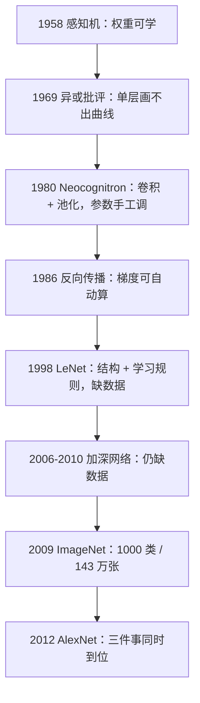
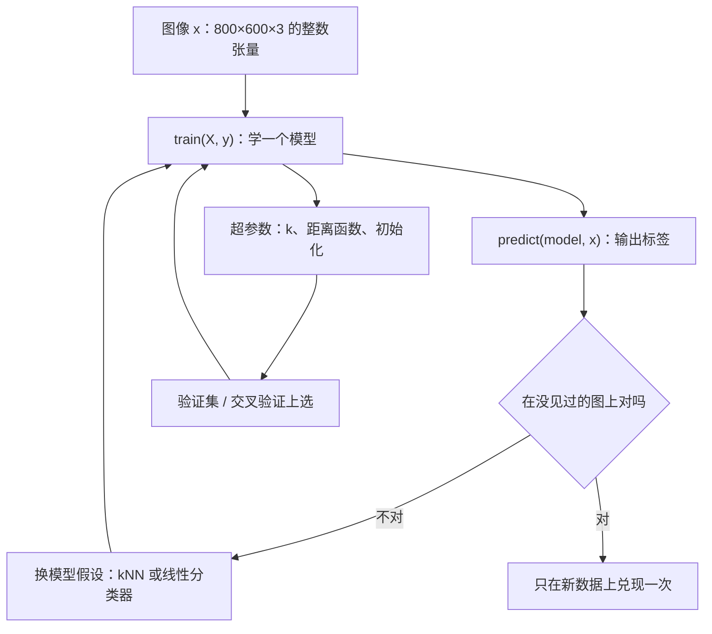
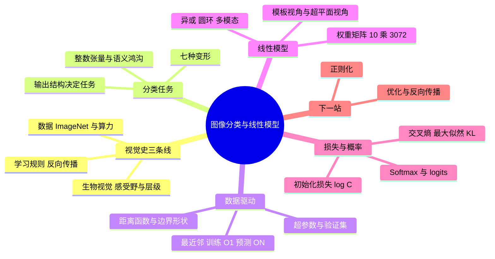

> **课程信息**
>
> - **课程名称**：Stanford CS231n: Deep Learning for Computer Vision（Spring 2025）
> - **本模块覆盖**：Lecture 1. Introduction（119 页）；Lecture 2. Image Classification with Linear Classifiers（102 页），合计 221 页
> - **主讲教师（各讲）**：Lecture 1 — Fei-Fei Li、Ehsan Adeli（Zane Durante 共同授课）；Lecture 2 — Ehsan Adeli
> - **授课日期范围**：2025-04-01 – 2025-04-03
> - **课程主页**：[cs231n.stanford.edu/2025](https://cs231n.stanford.edu/2025/schedule.html)
> - **官方课件**：[lecture_1_part_1.pdf](</attachments/cs231n-dc5970705b53abffc72bcfe2.pdf>)、[lecture_1_part_2.pdf](</attachments/cs231n-ca8f5b496ddaf6c80acb80f4.pdf>)、[lecture_2.pdf](</attachments/cs231n-191488d0a96f85574e8e2ebb.pdf>)
> - **字幕来源**：[cs231n_sp25_kor_sub · eng](https://github.com/lpaiu-cs/cs231n_sp25_kor_sub/tree/main/eng)（公开英文转写，中文由本书重写）
> - **版权说明**：幻灯片与课程材料版权归 Stanford University 及授课教师所有；本书为非官方学习笔记，仅用于学习与研究。

> **课件索引**：点击下方链接打开本地 PDF 的对应页；全部课件见 [课件索引](/notes/cs231n/slides)。页码按 PDF 文件页序定位，第 1 讲分为 Part 1 / Part 2。

[📄 L1 · 第 1 页（Part 1，PDF 第 1 页）｜本模块的起点：Lecture 1 的标题页](</attachments/cs231n-dc5970705b53abffc72bcfe2.pdf#page=1>)

这门课的第一个断言不是关于某个算法，而是关于难度：让机器「看见」很难，难在像素里根本没有语义。Lecture 1 把这句话拆成一段历史——5.4 亿年前的一次传感器事件、1959 年插进猫脑的电极、1986 年那条可微的学习规则、2009 年那一千类一百四十三万张图；Lecture 2 则把它压成一个可以打分的动作：输入一张 $800 \times 600 \times 3$ 的整数张量，输出 {狗、猫、卡车、飞机, …} 里的一个词。

把两讲并成一本书，主线不是「先历史、后方法」，而是同一条因果链的两次落地：**视觉任务的定义**（模型能输出什么）→ **数据驱动**（不写规则，写 `train` / `predict`）→ **近邻**（成本押在预测时刻）→ **参数化线性模型**（成本压进参数）→ **损失与概率**（把「哪个 $W$ 更好」变成可回答的问题）。Lecture 1 里那些看起来像前传的失败——缺非线性、缺学习规则、缺数据——恰好是 Lecture 2 每一步选择的理由。

## 1. 这门课的全部范围，是维恩图上被涂红的那一小瓣

*(参考时间: 00:00:05 – 00:07:35｜Lecture 1)*

[📄 L1 · 第 2 页（Part 1，PDF 第 2 页）｜Welcome：这门课只讲两个领域的交集](</attachments/cs231n-dc5970705b53abffc72bcfe2.pdf#page=2>)

开场第一件事是划范围。这门课不讲「AI 的全部」，只讲计算机视觉与深度学习相交的那一块——这个限定在接下来七页里被画成一张不断加圈的维恩图，但第一次出现时只是一句话：视觉不只是智能的一部分，它是智能的基石。

[📄 L1 · 第 3 页（Part 1，PDF 第 3 页）｜历届课堂合影：2015、2016、2017、2018、2020、2021、2023](</attachments/cs231n-dc5970705b53abffc72bcfe2.pdf#page=3>)

一页按年份排列的合影透露了课程的年龄：页面上标出的年份是 2015、2016、2017、2018、2020、2021、2023，横跨八年。对第一次听课的人来说，这页的用处是校准预期：你面对的不是一份临时拼凑的讲义，而是一条被十届学生压过的路径。

[📄 L1 · 第 4 页（Part 1，PDF 第 4 页）｜十周年：返校任教的历届讲师与任期](</attachments/cs231n-dc5970705b53abffc72bcfe2.pdf#page=4>)

十周年页把师资写成一张任期表：Fei-Fei Li 2015–2025、Andrej Karpathy 2015–2016、Justin Johnson 2016–2019 与 2025、Serena Yeung 2017–2019、Ranjay Krishna 与 Danfei Xu 各在 2020–2021、Jiajun Wu 2022、Ruohan Gao 2022–2023、Yunzhu Li 2023、Ehsan Adeli 与 Zane Durante 从 2024 年起接手。这些人后来分散到检测、视频、三维、机器人各个方向——课程覆盖面随他们流动，这就是 CS231n 每年都在扩张的原因。

[📄 L1 · 第 5 页（Part 1，PDF 第 5 页）｜维恩图第一帧：只有一个圈，人工智能](</attachments/cs231n-dc5970705b53abffc72bcfe2.pdf#page=5>)

从这里开始是一段连续构建，一帧加一个圈。第一帧只有一个椭圆：人工智能。没有定义、没有子领域，只是一个边界——圈外的东西不讨论。

[📄 L1 · 第 6 页（Part 1，PDF 第 6 页）｜维恩图第二帧：机器学习与计算机视觉同时进场](</attachments/cs231n-dc5970705b53abffc72bcfe2.pdf#page=6>)

第二帧同时压进两个圈：机器学习落在 AI 内部，计算机视觉与它大幅相交但不被包含。这个细节值得停一下：它意味着存在「不用机器学习也能做的视觉」（几何标定、滤波），也存在「与视觉无关的机器学习」。

[📄 L1 · 第 7 页（Part 1，PDF 第 7 页）｜维恩图第三帧：深度学习作为机器学习的真子集出现](</attachments/cs231n-dc5970705b53abffc72bcfe2.pdf#page=7>)

第三帧加上深度学习的圈，它被画成机器学习的真子集，并与计算机视觉交叠。这里给深度学习的定义很朴素——围绕神经网络这一族算法建立起来的技术集合——它没有宣称自己是新范式，只是被放在集合论的位置上。

[📄 L1 · 第 8 页（Part 1，PDF 第 8 页）｜维恩图第四帧：交集被涂红，箭头标出 This class](</attachments/cs231n-dc5970705b53abffc72bcfe2.pdf#page=8>)

第四帧是全讲最重要的一次操作：把「计算机视觉 ∩ 深度学习」那一小块涂成红色，用箭头标注 This class。红块只是两个大圈交界处的一小瓣——这正是要记住的比例：这门课不覆盖整个视觉，也不覆盖整个深度学习，只覆盖重叠的那一片。后面所有「我们不讲 X」的免责声明，都能回溯到这一帧。

[📄 L1 · 第 9 页（Part 1，PDF 第 9 页）｜维恩图第五帧：自然语言处理进场](</attachments/cs231n-dc5970705b53abffc72bcfe2.pdf#page=9>)

第五帧开始加邻居。第一个进来的是自然语言处理：它与机器学习相交，也与计算机视觉的圈重叠——后来的图文任务正是从这个重叠区长出来的。此时红块没有变大，加邻居不是为了扩大课程范围。

[📄 L1 · 第 10 页（Part 1，PDF 第 10 页）｜维恩图第六帧：语音识别补齐](</attachments/cs231n-dc5970705b53abffc72bcfe2.pdf#page=10>)

第六帧加语音识别。三个邻居并排之后，一个模式浮现出来：AI 的每个子领域都是「某类信号 + 机器学习」，差别只在信号的性质——像素是二维且带物理约束的，语音是一维时序，语言是离散符号。

[📄 L1 · 第 11 页（Part 1，PDF 第 11 页）｜维恩图第七帧：机器人学压进来，红块仍未扩大](</attachments/cs231n-dc5970705b53abffc72bcfe2.pdf#page=11>)

第七帧加上机器人学，它与计算机视觉大面积重叠，重叠处就是课程后来的具身智能板块；整张 AI 的椭圆也被画得歪斜，示意这个领域本身在变形。七帧下来，红块自始至终没变过大小——范围一旦划定，就不再随话题扩张。

[📄 L1 · 第 12 页（Part 1，PDF 第 12 页）｜维恩图扩展版：数学、神经科学、计算机科学、物理、心理学、生物学](</attachments/cs231n-dc5970705b53abffc72bcfe2.pdf#page=12>)

最后一帧换了一种加法：不再加 AI 的子领域，而是加支撑学科——数学、神经科学、计算机科学、物理、心理学、生物学。图从「领域地图」变成了「知识来源图」，这也解释了为什么要先讲一段生物视觉史：卷积网络的每一层设计，几乎都能在这张图的外圈找到出处。

[📄 L1 · 第 13 页（Part 1，PDF 第 13 页）｜今日议程：一段简史，加一份课程概览](</attachments/cs231n-dc5970705b53abffc72bcfe2.pdf#page=13>)

议程只有两条：计算机视觉与深度学习的简史，以及课程概览。历史占了接近一半的时间，这个配比本身就是论点——如果一门技术的历史里反复出现「数据不足」「算力不足」「没有可微的学习规则」这三种死法，那么理解它们比记住某个网络结构更有迁移价值。

### 历史为什么从 5.4 亿年前开始

[📄 L1 · 第 14 页（Part 1，PDF 第 14 页）｜寒武纪大爆发：5.3–5.4 亿年前，进化史上的一次大爆炸](</attachments/cs231n-dc5970705b53abffc72bcfe2.pdf#page=14>)

历史不从 1950 年代开始，而从 5.4 亿年前开始。化石研究显示，在寒武纪约一千万年的窗口里，动物物种数量出现爆炸式增长——对进化而言这是极短的时间。在此之前，生命基本漂在水里，陆地上还没有动物，用讲师的话说是「相当悠闲」。

[📄 L1 · 第 15 页（Part 1，PDF 第 15 页）｜四种眼睛：章鱼、复眼、变色龙、人类](</attachments/cs231n-dc5970705b53abffc72bcfe2.pdf#page=15>)

点燃这场爆发的假说不少（气候、海水化学成分），最有说服力的一个是「光进来了」：三叶虫演化出感光细胞。那不是透镜加视网膜的复杂器官，只是一个针孔，能把光收集起来。这一页的四种眼睛说明同一件事被自然解决了四次以上——眼睛不是稀有发明，而是被进化反复选中的方案。

讲师在这里给了一个比时间线更硬的论证：没有传感器时，生命只是代谢，被动地来了又走；有了传感器，动物才成为环境的参与者——它要活下去，别的动物可能成为它的晚餐，它也可能成为别人的晚餐。视觉驱动了神经系统的发育，而人类尤其视觉：超过一半的皮层细胞参与视觉处理。

[📄 L1 · 第 16 页（Part 1，PDF 第 16 页）｜暗箱：Gemma Frisius 1545 年的插图与达·芬奇的手稿](</attachments/cs231n-dc5970705b53abffc72bcfe2.pdf#page=16>)

从感光到成像，人类补上了另一半。暗箱的原理在古代中国、古希腊的文献里就有记载，达·芬奇、Gemma Frisius 都画过：让光穿过小孔，在暗室后壁投出倒像。这页的用意不在考据，而在指出一条界线——有了成像装置，不等于有了视觉。

[📄 L1 · 第 17 页（Part 1，PDF 第 17 页）｜计算机视觉已经无处不在](</attachments/cs231n-dc5970705b53abffc72bcfe2.pdf#page=17>)

相机在今天已经泛滥：手机、汽车、卫星、显微镜上都有。讲师紧接着给了一个限定：相机不是「看见」，就像眼睛本身也不是「看见」，它们都只是前端器件；真正的问题是视觉智能如何发生。这句话是整门课的引信——Lecture 2 第 008 页会把它变成一个具体的数字：$800 \times 600 \times 3$ 个 0 到 255 的整数里，没有一个数叫「猫」。

## 2. 两份遗产：感受野、层级，以及「看见」为什么是病态问题

*(参考时间: 00:07:38 – 00:17:09｜Lecture 1)*

[📄 L1 · 第 18 页（Part 1，PDF 第 18 页）｜分节页：我们从哪里来](</attachments/cs231n-dc5970705b53abffc72bcfe2.pdf#page=18>)

1950 年代是这条线的起点，而且起点不在计算机系，在神经科学实验室。这一页只提一个问题：我们从哪里来。答案分两支——一支研究「生物怎么看见」，一支研究「机器怎么学」，两支要到 2012 年才合成一股。

### 1959：一根电极插进麻醉猫的初级视皮层

[📄 L1 · 第 19 页（Part 1，PDF 第 19 页）｜Hubel 与 Wiesel，1959：把电极插进麻醉的猫脑](</attachments/cs231n-dc5970705b53abffc72bcfe2.pdf#page=19>)

实验做法今天看仍然粗暴有效：电极插进麻醉猫的初级视皮层，给猫看不同方向的亮条，记录单个神经元的放电。第一个结论是每个神经元有自己的**感受野（receptive field）**——它只对视野里一小块区域负责，这块区域很小，而且在初级视皮层里主要对有朝向的边缘、以及移动的有朝向边缘响应。页面左下角的 Response / No response 就是判据：方向对了放电，方向不对沉默。

第二个结论更像工程直觉，也更重要：视觉通路是**分层**的。简单细胞（simple cells）对特定朝向响应；复杂细胞（complex cells）保持朝向偏好，同时获得一定的平移不变性；再往上，神经元接收下层神经元的输出，感受野变大、选择性变复杂——从边缘到角点，再到物体。讲师特意声明这是「过度简化」，但她要的是那个概念：神经元彼此喂入，构成一张巨大的计算网络。

[📄 L1 · 第 20 页（Part 1，PDF 第 20 页）｜Larry Roberts，1963：第一篇计算机视觉博士论文](</attachments/cs231n-dc5970705b53abffc72bcfe2.pdf#page=20>)

计算机视觉作为学科，通常追溯到 Larry Roberts 1963 年的博士论文《Machine Perception of Three-Dimensional Solids》。他做的事今天看很小：给一张方块堆叠的照片，算出每个面的朝向、棱和顶点。三格图分别是原图、差分图、以及从中选出的特征点——一条从像素到几何结构的流水线。整篇论文只研究「形状」，但这是第一次有人把「看见」写成可执行的算法。

[📄 L1 · 第 21 页（Part 1，PDF 第 21 页）｜1959 与 1963 并置：两条线的起点只差四年](</attachments/cs231n-dc5970705b53abffc72bcfe2.pdf#page=21>)

这一页把 Hubel-Wiesel 与 Roberts 并排放在同一条时间轴上，底部给了 MIT 学位论文库的链接。并置的意图很清楚：生物视觉与机器视觉在同一条轴上起步，相差只有四年。此后六十年里它们反复交错——神经网络借生物学灵感，生物学反过来用网络解释大脑。

[📄 L1 · 第 22 页（Part 1，PDF 第 22 页）｜David Marr 的三级表示：原始草图、2½ 维草图、三维模型](</attachments/cs231n-dc5970705b53abffc72bcfe2.pdf#page=22>)

1970 年代，David Marr 试图把「看见」拆成有次序的表示层级。**原始草图（primal sketch）**抽出零交叉、斑点、边缘、线段端点、虚拟线、分组与曲线边界；**2½ 维草图（2½-D sketch）**补上局部表面朝向、深度与表面朝向的不连续；最后是**三维模型表示**，用表面与体积基元按层次组织起完整物体。页面上那颗篮球的四格图把这条链具象化了：原图、边缘图、被抠出来的前景圆盘、带明暗的球体。

Marr 的框架有个隐含要求：每一级表示都要能被下一级消费，而且不依赖具体物体。这个要求在 1970 年代无法实现——2½ 维草图需要可靠的深度线索，而单张图像里的深度信息本质上是不确定的。问题于是被推到一个更根本的位置：从二维图像恢复三维世界，是一个**病态问题（ill-posed problem）**。

### 病态问题的三种解法：多目、先验，或者放弃精确

光子把三维世界投影到近似二维的表面（三叶虫身上的一块斑，或我们的视网膜），信息在投影中丢失了；要还原回去，必须额外假设。自然界的解法是**多只眼睛**：大多数动物有两只，少数更多，靠视差三角化恢复深度——但两只眼睛还不够，还得解决对应点匹配。人类也并不精确：讲师说她大致知道物体的三维形状，但没有几何精度。承认这一点，才知道后面的三维视觉为什么那么难。

另一处差异更微妙：语言和视觉在本体论上不同。语言不存在于自然界，你无法指着某样东西说「那里有语言」——它是人脑生成的、一维的、序列化的；视觉面对的是一个真实存在的物理世界，遵守物理与材质规律。这个差别解释了大模型时代的一个现象：语言之所以能被自回归建模得如此成功，部分原因在于它本身就是序列；而视觉任务的形式要松散得多。

## 3. 没有数据的三十年：零件、边缘、分组、匹配

*(参考时间: 00:17:19 – 00:25:40｜Lecture 1)*

[📄 L1 · 第 23 页（Part 1，PDF 第 23 页）｜按零件识别（1970s）：广义柱体与图示结构](</attachments/cs231n-dc5970705b53abffc72bcfe2.pdf#page=23>)

1970 年代的先行者没有数据、没有算力、也没有今天的数学工具，却已经在啃「物体识别」。斯坦福的代表工作是 Rodney Brooks 与 Tom Binford 的**广义柱体（generalized cylinders）**：把物体拆成若干带截面变化的柱状基元；帕洛阿尔托另一处的工作是**图示结构（pictorial structures）**，把人或物体表示成部件组合加几何约束。两条路线共享同一个假设——物体可以由零件拼出来。这个假设后来被数据驱动的端到端方法推翻，但「组合性」在今天的场景图与三维部件生成里又回来了。

[📄 L1 · 第 24 页（Part 1，PDF 第 24 页）｜按边缘识别（1980s）：Canny 与 Lowe 的工作](</attachments/cs231n-dc5970705b53abffc72bcfe2.pdf#page=24>)

1980 年代数字照片开始出现，图像第一次可以被数字化地处理，边缘检测成了主战场。John Canny 1986 年的边缘算子与 David Lowe 1987 年的工作，构成了之后二十年视觉前端的标准件。讲师在这里插了一句很诚实的话：看着这些结果，你会有点失望——得到的只是些草图与轮廓，「好像哪儿也去不了」。

[📄 L1 · 第 25 页（Part 1，PDF 第 25 页）｜AI 寒冬：热情与经费一起退潮](</attachments/cs231n-dc5970705b53abffc72bcfe2.pdf#page=25>)

失望积累成了寒冬。幻灯片列了四条：AI 研究的热情与经费萎缩；「专家系统」没能兑现承诺；但 AI 的子领域仍在生长——计算机视觉、自然语言处理、机器人、计算生物学。最后这条是重点：寒冬冻结的是承诺，不是研究。

[📄 L1 · 第 26 页（Part 1，PDF 第 26 页）｜与此同时：认知科学与神经科学的奠基工作](</attachments/cs231n-dc5970705b53abffc72bcfe2.pdf#page=26>)

与寒冬并行的是另一条完全不受经费周期影响的线：认知科学与神经科学继续产出。这一段的价值在于它回答了「该做什么问题」。工程界在纠结边缘检测的阈值，心理学家在问「人类识别物体时到底用了什么信息」。

[📄 L1 · 第 27 页（Part 1，PDF 第 27 页）｜Biederman，1972：同一辆自行车，放进打乱的背景里就难认了](</attachments/cs231n-dc5970705b53abffc72bcfe2.pdf#page=27>)

Irv Biederman 1972 年发表在 Science 上的实验是个漂亮的对照：同一辆自行车，一张图背景正常，另一张图背景被打乱。从光子角度看，自行车在视网膜上的成像几乎一样，但识别难度完全不同。结论是：看见物体不是一次局部操作，被用来识别的不只是那个物体的像素——整幅图像的其余部分也在参与判断。

[📄 L1 · 第 28 页（Part 1，PDF 第 28 页）｜快速序列视觉呈现（RSVP）：每秒十张图](</attachments/cs231n-dc5970705b53abffc72bcfe2.pdf#page=28>)

第二个实验测速度。1970 年代 Potter 等人的 RSVP 范式：以每秒 10 帧的速率闪过一串自然图像，让被试检测其中是否出现某类目标。10 Hz 意味着每张图只有 100 毫秒，而观察者此前没见过这些图，也不知道目标会出现在第几帧、长什么样、什么姿态——却几乎都能报出来。

[📄 L1 · 第 29 页（Part 1，PDF 第 29 页）｜150 毫秒：大脑已经做出了「有动物/无动物」的判别](</attachments/cs231n-dc5970705b53abffc72bcfe2.pdf#page=29>)

速度被 Simon Thorpe 用电生理方法量化了：给被试戴上 EEG 帽看自然场景，任务只是判断画面里有没有动物；结果在图像呈现后约 **150 毫秒**，脑电信号里就出现了可区分的差异。不要小看这个数字：跟今天的 GPU 比它慢得离谱，但生物神经元的工作频率远低于晶体管，150 毫秒在神经通路上只够跳几跳——这已经是湿件能做到的极限速度。

[📄 L1 · 第 30 页（Part 1，PDF 第 30 页）｜物体与场景识别的神经相关物：FFA 与 PPA](</attachments/cs231n-dc5970705b53abffc72bcfe2.pdf#page=30>)

更进一步，大脑不只是「能识别」，还为此长出了专门的区域。Kanwisher 等人 1997 年报告了梭状回面孔区（FFA），Epstein 与 Kanwisher 1998 年在 Nature 上报告了旁海马位置区（PPA）——分别对脸和场景有选择性响应。这类发现的意义在于：视觉识别不是一块通用皮层在硬算，而是被演化分工过的。

[📄 L1 · 第 31 页（Part 1，PDF 第 31 页）｜视觉识别是视觉智能的基础任务](</attachments/cs231n-dc5970705b53abffc72bcfe2.pdf#page=31>)

把上面几条拼起来，得到一个方向性判断：既然人类视觉的核心能力是「在自然场景里认出物体」，那么计算机视觉就该把**自然场景下的物体识别**当作主战场，而不是继续画方块、描边缘。这一页是整个历史叙事的中点——从这里开始，问题定义变了。

[📄 L1 · 第 32 页（Part 1，PDF 第 32 页）｜按分组识别（1990s）：归一化割](</attachments/cs231n-dc5970705b53abffc72bcfe2.pdf#page=32>)

1990 年代的第一步是把前景从背景里分出来。Shi 与 Malik 1997 年的**归一化割（Normalized Cuts）**把图像分割写成图划分问题：像素是节点，相似度是边权，目标函数同时最小化簇间相似度、最大化簇内相似度。注意时间轴：这时仍是 AI 寒冬，但研究在推进。

[📄 L1 · 第 33 页（Part 1，PDF 第 33 页）｜按匹配识别（2000s）：SIFT](</attachments/cs231n-dc5970705b53abffc72bcfe2.pdf#page=33>)

第二步是特征。David Lowe 1999 年的 SIFT 把「关键点检测 + 尺度空间 + 方向直方图描述子」打包成一套可复用的流程：同一个物体在不同尺度、旋转、部分遮挡下仍能匹配。在深度学习之前，SIFT 加最近邻匹配是图像检索与三维重建的默认方案，也是很多人入行的第一课。

[📄 L1 · 第 34 页（Part 1，PDF 第 34 页）｜人脸检测：Viola-Jones，2001](</attachments/cs231n-dc5970705b53abffc72bcfe2.pdf#page=34>)

真正「进入产业」的第一个案例是人脸检测。幻灯片对 Viola 与 Jones 2001 年这项工作的评价只有一句：机器学习在视觉上最早的成功应用之一。讲师补了一段个人记忆——她读研一时这篇论文发表，五年后第一台消费级数码相机就用上了它的自动对焦。这是本讲第一次出现「论文 → 产品」的短路径。

[📄 L1 · 第 35 页（Part 1，PDF 第 35 页）｜数据集登场：Caltech 101 与 PASCAL VOC](</attachments/cs231n-dc5970705b53abffc72bcfe2.pdf#page=35>)

2000 年代初，互联网开始普及，数码相机开始普及，两件事叠加产生了一个新东西：数据。研究规模从几千张图涨到几万张图，随之出现 Caltech 101 与 PASCAL Visual Object Classes 挑战赛——后者第一次把「检测 + 分类」变成统一的评测协议。讲师在这里按下暂停：视觉这条线讲到这里，接下来要退回去讲另一条平行的线。

## 4. 另一条线：学习规则齐了，数据还没到

*(参考时间: 00:25:51 – 00:31:42｜Lecture 1)*

[📄 L1 · 第 36 页（Part 1，PDF 第 36 页）｜感知机：Rosenblatt，约 1957 年](</attachments/cs231n-dc5970705b53abffc72bcfe2.pdf#page=36>)

另一条线从单个神经元开始。Rosenblatt 的**感知机（Perceptron）**在 1950 年代后期提出（页面上标 ~1957，时间轴标 1958）：输入加权求和，过阈值，输出一个类别。它已经具备「从数据里学权重」的雏形。放在时间轴上，它和 Hubel-Wiesel 的猫实验只差一年，两条线其实同时起跑。

[📄 L1 · 第 37 页（Part 1，PDF 第 37 页）｜Minsky 与 Papert，1969：感知机学不了异或](</attachments/cs231n-dc5970705b53abffc72bcfe2.pdf#page=37>)

挫折来得很快。Minsky 与 Papert 1969 年指出，单层感知机无法表示异或：左侧真值表里，(0,0) 与 (1,1) 输出 0，(0,1) 与 (1,0) 输出 1，这四个点在二维平面上不存在一条直线能把两类分开。单层感知机只能画一条直线，于是做不到。这个结论在数学上无懈可击，但在传播中被读成了「神经网络这条路走不通」，直接导致这一方向冷落了十几年。

[📄 L1 · 第 38 页（Part 1，PDF 第 38 页）｜Neocognitron：福岛邦彦，1980](</attachments/cs231n-dc5970705b53abffc72bcfe2.pdf#page=38>)

转机来自日本。福岛邦彦 1980 年的 **Neocognitron** 是一个直接按 Hubel-Wiesel 层级结构搭出来的计算模型：简单细胞层做卷积，复杂细胞层做池化，两种层交替堆叠五六层，越往后感受野越大、选择性越抽象。它已经具备现代卷积网络的骨架，缺的只有一样东西——**没有实用的训练算法**。所有参数都是手工设计的，几百个参数要一点点调，才能认出数字与字母。这是一项惊人的工程成就，也是一条无法扩展的路。

[📄 L1 · 第 39 页（Part 1，PDF 第 39 页）｜反向传播：Rumelhart、Hinton、Williams，1986](</attachments/cs231n-dc5970705b53abffc72bcfe2.pdf#page=39>)

1986 年的**反向传播（backpropagation）**补上了那块拼图。做法是引入一个误差纠正目标函数：给定输入与正确答案，算出网络输出与答案的差，把这个误差沿网络反向传回去，每一层据此得到自己该往哪个方向调参。数学上它只是链式法则的反复应用；工程上它意味着**不再需要手工调参**——只要网络可微，梯度就能自动算出来。页面中间的示意图由 Lane McIntosh 绘制，画的就是这条误差回流的路径。

[📄 L1 · 第 40 页（Part 1，PDF 第 40 页）｜LeNet：LeCun 等人，1998](</attachments/cs231n-dc5970705b53abffc72bcfe2.pdf#page=40>)

第一个成功的落地是 Yann LeCun 在贝尔实验室做的卷积网络：把反向传播套到 Neocognitron 式的架构上，网络规模约七层，用来识别手写数字与字母。工程上做到足够稳——它被 NEC 做成商用系统，处理银行的手写支票。幻灯片给了一句总结：它与今天的卷积网络已经非常相似，差别只在规模、算力与数据。

[📄 L1 · 第 41 页（Part 1，PDF 第 41 页）｜2000 年代：把网络堆得更深](</attachments/cs231n-dc5970705b53abffc72bcfe2.pdf#page=41>)

2000 年代，一小批人继续把网络往深里堆——Hinton 与 Salakhutdinov 2006、Bengio 等 2007、Lee 等 2009、Glorot 与 Bengio 2010。这条路上有个尴尬的事实：它当时不是主流研究题目。会上讲的是 SVM、是特征工程、是核方法，神经网络被认为调不出好结果。

[📄 L1 · 第 42 页（Part 1，PDF 第 42 页）｜同一页的第二帧：更深了，但没有好数据集](</attachments/cs231n-dc5970705b53abffc72bcfe2.pdf#page=42>)

第二帧补上了第三个原因，也是最致命的一个：**没有合适的数据集**。数字与字母识别勉强可用，但把同一套系统放到自然照片上（猫、狗、微波炉、椅子、花），效果立刻崩掉。这不是「不方便」，而是数学问题：这些是高容量模型，容量越大越需要大量数据来约束，否则学到的只是训练集上的巧合。讲师给了一句后来被反复引用的话——数据是机器学习的第一等公民。



## 5. 2012：三件事同时到位

*(参考时间: 00:32:24 – 00:35:55｜Lecture 1)*

[📄 L1 · 第 43 页（Part 1，PDF 第 43 页）｜ImageNet：1,000 类、1,431,167 张图的分类挑战](</attachments/cs231n-dc5970705b53abffc72bcfe2.pdf#page=43>)

2000 年代初，Fei-Fei Li 与学生们把赌注押在数据上。他们先收集约十亿张候选图，清洗后得到约五千万张，再整理出约一千五百万张、覆盖两万两千个类别的标注数据——类别数量参照了认知科学文献里「人类幼年掌握的类别量级」。随后从中切出一个子集办比赛：**ImageNet 大规模视觉识别挑战赛（ILSVRC）**，1,000 个类别、1,431,167 张图，参赛者不限方法，只看识别准确率。

[📄 L1 · 第 44 页（Part 1，PDF 第 44 页）｜时间轴合集与 ILSVRC 错误率：2010 到 2017，以及人类基线](</attachments/cs231n-dc5970705b53abffc72bcfe2.pdf#page=44>)

这张图把两条线画到了同一张时间轴上：上排是视觉的里程碑（1959 Hubel-Wiesel、1963 Roberts、1970s Marr、1979 广义柱体、1986 Canny、1997 归一化割、1999 SIFT、2001 Viola-Jones、2004/2007 PASCAL、2009 ImageNet），下排是学习的里程碑（1958 感知机、1969 Minsky-Papert、1980 Neocognitron、1985 反向传播、1998 LeNet、2006 深度学习），中间横着一条蓝色的 AI Winter。图的上半部分还挂着 ILSVRC 的历年冠军错误率，这条曲线是整个模块最硬的算账材料：

| 年份 | 冠军系统 | Top-5 错误率 |
| :--- | :--- | ---: |
| 2010 | NEC-UIUC（Lin 等） | 28.2% |
| 2011 | Sanchez & Perronnin | 25.8% |
| 2012 | AlexNet（Krizhevsky 等） | 16.4% |
| 2013 | Zeiler & Fergus | 11.7% |
| 2014 | VGG（Simonyan & Zisserman） | 7.3% |
| 2014 | GoogLeNet（Szegedy 等） | 6.7% |
| 2015 | ResNet（He 等） | 3.6% |
| 2016 | SENet（Shao 等） | 3.0% |
| 2017 | SENet（Hu 等） | 2.3% |
| — | 人类基线（Russakovsky 等） | 5.1% |

两个数字值得记住：2012 年一年把错误率从 25.8% 压到 16.4%（相对下降约 36%），2015 年的 ResNet 已经把人类基线 5.1% 甩在身后。讲师口述时提到人类大约在 3% 以下，与幻灯片上的 5.1% 是不同评测口径，但结论一致：**在这条曲线上，人类的水平已经不是上限**。

[📄 L1 · 第 45 页（Part 1，PDF 第 45 页）｜2012：AlexNet 出现在同一条时间轴上](</attachments/cs231n-dc5970705b53abffc72bcfe2.pdf#page=45>)

比赛第一年，最好算法的错误率接近 30%；2011 年也没有惊喜；2012 年，Hinton 与学生用卷积网络参赛，把错误率几乎砍半。这条时间轴在这一年多了一个方块：AlexNet。讲师说，很多人把这一年当作现代 AI 重生的历史时刻。

[📄 L1 · 第 46 页（Part 1，PDF 第 46 页）｜AlexNet 的结构：五个卷积层加三个全连接层](</attachments/cs231n-dc5970705b53abffc72bcfe2.pdf#page=46>)

结构本身并不神秘：输入 $224 \times 224 \times 3$，先用 $11 \times 11$、步长 4 的卷积把分辨率压到 $55 \times 55$、48 个通道，再叠 $5 \times 5$ 与 $3 \times 3$ 卷积加最大池化，通道数涨到 128、192、192、128，最后接两个全连接层与 1000 维输出。

按图上标的尺寸可以估一笔参数账：第一层 $11 \times 11 \times 3 \times 48 \approx 1.7$ 万；而把 $6 \times 6 \times 128 = 4608$ 个激活接到 2048 维全连接，一个矩阵就是 $4608 \times 2048 \approx 944$ 万，两个 2048 维层之间再乘一个 $\approx 420$ 万。也就是说，「五个卷积层加三个全连接层」听起来只是层数配比，参数量却几乎全部压在后段——这个分布解释了为什么早期网络对显存那么敏感，也解释了后来为什么要用全局平均池化一类结构去拆掉大矩阵。

[📄 L1 · 第 47 页（Part 1，PDF 第 47 页）｜AlexNet 与 Neocognitron：相隔 32 年](</attachments/cs231n-dc5970705b53abffc72bcfe2.pdf#page=47>)

讲师把两张图并排放在一起，问了一个很好的问题：结构相似度这么高，为什么 1980 年不行、2012 年行？答案是两件事。其一是**反向传播**：一个原则上正确、数学上严格的学习规则，让参数不必再手工调。其二是**数据**：高容量模型需要海量数据驱动才能泛化，ImageNet 提供了这个量级。她还补了一句前瞻：这些模型的参数量在当时是百万级，而这条路最终会通向万亿级。

## 6. 2012 之后：任务谱系在膨胀，账单也在累积

*(参考时间: 00:36:04 – 00:41:45｜Lecture 1)*

[📄 L1 · 第 48 页（Part 1，PDF 第 48 页）｜论文数量的爆炸：CVPR 投稿与 arXiv 月度论文数](</attachments/cs231n-dc5970705b53abffc72bcfe2.pdf#page=48>)

2012 年之后第一个可测量变化是论文数量。左侧是 CVPR 的投稿与接收曲线：1990 年代基本平躺，2000 年代中期开始抬头，2012 年之后陡起来。右侧是 arXiv 上机器学习与 AI 的月度论文数，从 1994 年的近乎为零涨到 2020 年的每月数千。两条曲线是「一个领域突然变热」最直接的证据。

[📄 L1 · 第 49 页（Part 1，PDF 第 49 页）｜四代分类流水线：2010 手工特征、2012 AlexNet、2014 GoogLeNet 与 VGG、2015 ResNet](</attachments/cs231n-dc5970705b53abffc72bcfe2.pdf#page=49>)

这一页信息密度最高。2010 年的 NEC-UIUC 是纯手工流水线：稠密描述子网格（HOG、LBP）→ 局部坐标编码与超向量 → 池化与空间金字塔 → 线性 SVM；2012 年的 SuperVision 换成卷积网络；2014 年出现两条分支——GoogLeNet 用并行的多尺度分支（Inception）堆出窄而深的网络，VGG 用连续 $3 \times 3$ 卷积堆出规整的深层结构，通道数 64→128→256→512→512 逐段翻倍，末端接 fc-4096、fc-4096、fc-1000 与 softmax；2015 年的 ResNet 加入跨层连接，让梯度能绕过多层直接回传。四代系统做的是同一件事：把「人设计特征」换成「网络自己学特征」。

### 同一个网络，换一种输出结构就是一个新任务

[📄 L1 · 第 50 页（Part 1，PDF 第 50 页）｜两个任务：图像分类与图像检索](</attachments/cs231n-dc5970705b53abffc72bcfe2.pdf#page=50>)

同一套卷积特征可以迁移到别的任务上，最先被验证的是检索：把图像送进网络，取某一层的激活当描述子，用最近邻找相似图。这一步的意义在于它证明了网络学到的不是「标签」，而是可复用的表示——这正是后来迁移学习成为默认做法的起点。

[📄 L1 · 第 51 页（Part 1，PDF 第 51 页）｜目标检测与语义分割](</attachments/cs231n-dc5970705b53abffc72bcfe2.pdf#page=51>)

再往前一步是定位。**目标检测**要输出框与类别（Ren、He、Girshick、Sun 2015 的 Faster R-CNN 系列是代表），**语义分割**要给每个像素打类别标签（Farabet 等人 2012 年的多尺度卷积做法是早期代表）。从「这张图是什么」到「每个东西在哪」，输出结构变了，网络结构也随之改变。

[📄 L1 · 第 52 页（Part 1，PDF 第 52 页）｜视频分类与人体活动识别](</attachments/cs231n-dc5970705b53abffc72bcfe2.pdf#page=52>)

静态图像之外是时间维度。视频分类要判断一段片段在做什么（跑步、跳跃、打球），人体活动识别要给出更细的动作类别。Simonyan 等人 2014 年的双流网络是一个经典解法：一路看单帧的 RGB（外观），一路看连续帧的光流（运动），最后融合两路分数。

[📄 L1 · 第 53 页（Part 1，PDF 第 53 页）｜姿态识别与玩 Atari 游戏](</attachments/cs231n-dc5970705b53abffc72bcfe2.pdf#page=53>)

同一批技术还被搬到很不一样的地方：Toshev 与 Szegedy 2014 年用网络直接回归人体关键点坐标；Guo 等人 2014 年让网络从屏幕像素学习玩 Atari 游戏。后者已经越过了「识别」，进入「决策」——视觉第一次成为控制回路的输入端。

[📄 L1 · 第 54 页（Part 1，PDF 第 54 页）｜医学影像、鲸鱼识别、星系分类](</attachments/cs231n-dc5970705b53abffc72bcfe2.pdf#page=54>)

三个跨领域案例说明泛化能力。医学影像是天生的视觉问题——放射科、病理科的日常工作就是看图；鲸鱼识别来自 Kaggle 竞赛，用鲸鱼照片做个体识别（Levy 等人 2016）；星系分类（Dieleman 等人 2014）把同样的卷积网络用在天文图像上。讲师在这里点了一句：科学发现也吃到了红利，人类第一张黑洞照片背后就有计算摄影与视觉技术。

[📄 L1 · 第 55 页（Part 1，PDF 第 55 页）｜图像描述生成：一句人话概括一张图](</attachments/cs231n-dc5970705b53abffc72bcfe2.pdf#page=55>)

**图像描述（image captioning）**把视觉输出从标签变成句子。幻灯片上的四组结果分别是「一只白色的泰迪熊坐在草地上」「一个穿棒球服的男人在投球」「一个女人手里抱着一只猫」「一个男人踩在冲浪板上」。做法是卷积网络编码图像、循环网络解码成词序列（Vinyals 等人 2015；Karpathy 与 Fei-Fei 2015）。这一步之后，视觉系统的输出不再受限于预定义类别表。

[📄 L1 · 第 56 页（Part 1，PDF 第 56 页）｜关系理解：不只说有什么，还说它们之间是什么关系](</attachments/cs231n-dc5970705b53abffc72bcfe2.pdf#page=56>)

再进一步是关系。幻灯片给出的三元组包括 taller than（人高于人）、left of、wear on（人穿衬衫）、snow ski。这类标注来自 Visual Genome 一类的工作（Krishna、Lu、Bernstein、Fei-Fei，ECCV 2016），它把图像表示成场景图：节点是物体，边是关系。相比类别标签，场景图更接近「理解」这个词的日常用法。

[📄 L1 · 第 57 页（Part 1，PDF 第 57 页）｜风格迁移：把校园照片重画成梵高的星夜](</attachments/cs231n-dc5970705b53abffc72bcfe2.pdf#page=57>)

生成方向的第一批惊艳结果是**风格迁移（style transfer）**：拿一张内容图与一张风格图，优化出一张既有原构图又有油画笔触的新图（Gatys 等人 2016）。幻灯片上同时放了 Inceptionism 式的结果，那类图揭示了网络中层特征在「看」什么。讲师特意提到，这部分的开创性工作来自本课的客座讲师 Justin Johnson。

[📄 L1 · 第 58 页（Part 1，PDF 第 58 页）｜生成对抗网络：人脸生成](</attachments/cs231n-dc5970705b53abffc72bcfe2.pdf#page=58>)

**生成对抗网络（GAN）**把人脸生成推到了肉眼难辨的程度。幻灯片用的是 Progressive GAN（Karras 等人，ICLR 2018）：论文标题里的 Progressive Growing 说的就是它的关键——分辨率从低到高逐级加倍，每一级只负责补上一层还没画出的细节，训练因此比直接生成高分辨率稳定得多。

[📄 L1 · 第 59 页（Part 1，PDF 第 59 页）｜DALL·E：从文字直接生成图像](</attachments/cs231n-dc5970705b53abffc72bcfe2.pdf#page=59>)

文本到图像的转折点是 DALL·E（Ramesh 等人 2021）。输入一句描述，模型生成一张此前不存在的图。这一步把「生成」从风格变换推进到语义组合：模型必须同时理解名词、属性、数量与空间关系。

[📄 L1 · 第 60 页（Part 1，PDF 第 60 页）｜DALL·E 的更多结果：牛油果形状的椅子](</attachments/cs231n-dc5970705b53abffc72bcfe2.pdf#page=60>)

同一组结果的另一帧给出了更难的例子：把两种物体的形状与材质组合起来（比如牛油果质感的椅子）。讲师说这类图在今天看来已经不算什么——Midjourney 一类系统早已越过这个水平——但在 2021 年它是分水岭。

### 三股力量：算力、算法、数据

[📄 L1 · 第 61 页（Part 1，PDF 第 61 页）｜三根支柱：算力、算法、数据](</attachments/cs231n-dc5970705b53abffc72bcfe2.pdf#page=61>)

到这里，讲师给出了全讲的中心论点：这次爆发不是单一突破，而是**三股力量同时到位**。左边是算力——成排的 GPU 机柜；中间是算法——一个两层的小网络示意图；右边是数据——由无数图片拼成的墙。三者缺一，2012 年就不会发生；三者同时到位，才解释了为什么相似的网络结构在 1980 年失败、在 2012 年成功。

[📄 L1 · 第 62 页（Part 1，PDF 第 62 页）｜每美元能买到的浮点运算数：GPU 曲线在深度学习之后抬头](</attachments/cs231n-dc5970705b53abffc72bcfe2.pdf#page=62>)

算力这条线有硬指标可查：纵轴是每美元能买到的 GFLOP，横轴从 2004 到 2020。CPU 的蓝点几乎贴着地；GPU（FP32）的红点在 2007 年之后开始抬，2012 年之后更陡。图上的锚点从 GeForce 8800 GTX、GeForce GTX 580（标注为 AlexNet 时代）一路排到 GTX 1080 Ti、RTX 2080 Ti、RTX 3080 与 RTX 3090，纵轴上限 50。讲师的说法是：2020 年以前进步还算平稳，一旦深度学习开始反过来驱动芯片设计，曲线就彻底起飞了。

[📄 L1 · 第 63 页（Part 1，PDF 第 63 页）｜同一张图的第二帧：Tensor Core 把曲线又抬了一截](</attachments/cs231n-dc5970705b53abffc72bcfe2.pdf#page=63>)

第二帧加入第三条曲线：GPU 的 Tensor Core。这类专用单元为矩阵乘加做了硬件级优化（低精度、高吞吐），把「每美元 GFLOP」再抬高一个量级，纵轴上限重新标到 200。幻灯片上的注解很直白——「为深度学习准备的专用硬件」。这也解释了为什么同样的网络，换一代卡就能便宜一个数量级地训出来。

[📄 L1 · 第 64 页（Part 1，PDF 第 64 页）｜AI 的三条增长曲线：会议参会人数、创业公司数量、企业应用收入](</attachments/cs231n-dc5970705b53abffc72bcfe2.pdf#page=64>)

第三组图把视角拉到产业：AI 会议参会人数、开发 AI 系统的创业公司数量、企业级 AI 应用收入，三条曲线同时上扬。讲师用了一个夸张但好记的比喻——我们已经走出了 AI 寒冬，现在处在「AI 全球变暖」时期。

## 7. 成功之外：伤害、收益，与「还不会做的事」

*(参考时间: 00:42:02 – 00:44:40｜Lecture 1)*

[📄 L1 · 第 65 页（Part 1，PDF 第 65 页）｜尽管成功很多，计算机视觉还有很长的路](</attachments/cs231n-dc5970705b53abffc72bcfe2.pdf#page=65>)

讲完增长，讲师立刻转向反面。这一页只有一句转折：尽管成果丰硕，计算机视觉离「解决」还很远。接下来的三页分别讲它为什么危险、为什么有用、以及为什么还远远不够。

[📄 L1 · 第 66 页（Part 1，PDF 第 66 页）｜计算机视觉可能造成伤害：招聘中的视频面试评分](</attachments/cs231n-dc5970705b53abffc72bcfe2.pdf#page=66>)

伤害的第一种形式是偏见。所有大型 AI 系统都由数据驱动，而数据是人类活动的产物，天然携带历史偏见；偏见被模型学走，再以「客观算法」的名义施加到人身上。幻灯片举的例子是自动视频面试评分系统（页面标注案例致谢 Timnit Gebru）。讲师补了一句更要命的：人脸识别算法表现出的偏见，和人类自身的偏见是同一种。

[📄 L1 · 第 67 页（Part 1，PDF 第 67 页）｜计算机视觉也能救命：医学影像与看护](</attachments/cs231n-dc5970705b53abffc72bcfe2.pdf#page=67>)

另一面是收益。医学影像是最直接的应用：读片、筛查、随访。讲师、Adeli 与 Zane 三人的研究方向之一，就是用视觉技术为老龄人口与病人提供照护。她的提问方式是并列的：同一个技术，用在招聘上可能是伤害，用在诊断上可能是救命——「它完全坏吗？完全好吗？」这类问题没有工程解。

[📄 L1 · 第 68 页（Part 1，PDF 第 68 页）｜还有很多我们不知道怎么做的事](</attachments/cs231n-dc5970705b53abffc72bcfe2.pdf#page=68>)

最后一页最朴素：两张照片（其中一张是孩子们在玩），配一句「还有很多我们不知道怎么做的事」（页面致谢 Andrej Karpathy）。人类视觉里的细微、含混、幽默与情绪，今天的模型基本接不住。讲师说她希望学生带着这份「不够」离开课堂——不是挫败感，而是问题感。

## 8. 课程地图：四个板块里，这条主线站在第一格

*(参考时间: 00:44:48 – 00:49:31｜Lecture 1)*

[📄 L1 · 第 69 页（Part 1，PDF 第 69 页）｜今日议程（第二部分）：简史讲完，进入课程概览](</attachments/cs231n-dc5970705b53abffc72bcfe2.pdf#page=69>)

Adeli 接手后的第一页把议程原样搬了回来，两条都在——此时第一条已经讲完，第二条正要开始。同一页在长课里再出现一次很有效：它告诉听众现在在哪儿、还剩多少。

[📄 L1 · 第 70 页（Part 2，PDF 第 1 页）｜第二部分标题页：Lecture 1 – Part 2 – Overview](</attachments/cs231n-ca8f5b496ddaf6c80acb80f4.pdf#page=1>)

第二部分的标题页把讲次标清楚了。整门课被切成四个板块，下面按板块逐个说明「要解决什么任务、用什么模型」，最后落到课程运作。

[📄 L1 · 第 71 页（Part 2，PDF 第 2 页）｜授课团队：Fei-Fei Li、Ehsan Adeli、Zane Durante、Justin Johnson](</attachments/cs231n-ca8f5b496ddaf6c80acb80f4.pdf#page=2>)

四位核心教师轮流承担讲次：Fei-Fei Li 讲首讲与最后一讲（以人为本的 AI），Ehsan Adeli 与 Zane Durante 覆盖基础与感知部分，Justin Johnson 负责卷积网络、Transformer、生成模型这些偏「机制」的讲次。看到这张名单就能理解课程的组织方式——它不是一个人写完的教材，而是几位研究者各自讲自己最熟的那一段。

[📄 L1 · 第 72 页（Part 2，PDF 第 3 页）｜客座讲师：Jiajun Wu、Ranjay Krishna、Ruohan Gao、Yunzhu Li](</attachments/cs231n-ca8f5b496ddaf6c80acb80f4.pdf#page=3>)

客座讲师对应四个专门方向：Jiajun Wu（三维视觉）、Ranjay Krishna（视觉与语言）、Ruohan Gao（视频与多模态）、Yunzhu Li（机器人学习）。这条安排透露了设计逻辑——越靠后的板块越依赖专门研究者，而不是通用讲义。

[📄 L1 · 第 73 页（Part 2，PDF 第 4 页）｜课程四板块：深度学习基础、感知与理解、生成与交互、以人为本](</attachments/cs231n-ca8f5b496ddaf6c80acb80f4.pdf#page=4>)

四个板块第一次成清单出现：深度学习基础、感知与理解视觉世界、生成与交互式视觉智能、以人为本的应用与影响。这个划分不是按技术分的，而是按「问题层次」分的：先学会造工具，再用工具做感知，再做生成与交互，最后讨论它对社会的作用。

[📄 L1 · 第 74 页（Part 2，PDF 第 5 页）｜图像分类：给一张图，输出一个标签](</attachments/cs231n-ca8f5b496ddaf6c80acb80f4.pdf#page=5>)

第一板块从最基础的任务讲起：**图像分类**。给模型一张猫的图片，输出字符串 cat。任务定义短到一句话说完，但它是后面一切的地基——检测、分割、描述生成，本质上都建立在「能把图像映射到语义」这个能力上。讲师称它是「具有欺骗性的简单」。

[📄 L1 · 第 75 页（Part 2，PDF 第 6 页）｜加一层：线性分类器画一条分界线](</attachments/cs231n-ca8f5b496ddaf6c80acb80f4.pdf#page=6>)

第一帧加上**线性分类器**：把每张图表示成特征空间里的一个点（幻灯片用二维示意），分类就是找一条直线（高维时是超平面）把两类点分开。它的局限在同一帧里就写着：数据不是线性可分时，直线怎么画都不对。

[📄 L1 · 第 76 页（Part 2，PDF 第 7 页）｜再加一层：正则化与优化](</attachments/cs231n-ca8f5b496ddaf6c80acb80f4.pdf#page=7>)

第二帧加**正则化与优化**。模型太简单会欠拟合，太复杂会过拟合；正则化控制复杂度，优化负责在给定复杂度下找到最合适的参数。这两件事是「能训练出东西」的全部工程内涵——不只是拟合训练集，还要在新数据上站得住。

[📄 L1 · 第 77 页（Part 2，PDF 第 8 页）｜最后一层：神经网络](</attachments/cs231n-ca8f5b496ddaf6c80acb80f4.pdf#page=8>)

第三帧加**神经网络**。与线性分类器的区别只有一个：层与层之间夹了非线性，多层堆叠就能表示分段线性的复杂边界。讲师点明了它的现实地位——从 Google Photos 到 ChatGPT 的视觉能力，背后都是这类模型。这一板块剩下的讲次就是把这句结论拆开：怎么定义、怎么训、怎么调。

[📄 L1 · 第 78 页（Part 2，PDF 第 9 页）｜课程概览分节页（第二次出现）：第一板块讲完](</attachments/cs231n-ca8f5b496ddaf6c80acb80f4.pdf#page=9>)

四板块的分节页在整段里反复出现，文字一字不改，作用是把注意力从上一个板块拉回地图。这一页出现时，第一板块刚讲完——而这条「分类 → 线性 → 正则化与优化 → 神经网络」的阶梯，正是本模块接下来要展开的那一格。

[📄 L1 · 第 79 页（Part 2，PDF 第 10 页）｜课程概览分节页（第三次出现）：第二板块即将开始](</attachments/cs231n-ca8f5b496ddaf6c80acb80f4.pdf#page=10>)

紧接着的第三次出现对应第二个板块。真正的新内容在下一页：这一板块要先区分「任务」和「模型」两个概念。

## 9. 任务决定输出结构，模型决定归纳偏置

*(参考时间: 00:49:49 – 00:59:53｜Lecture 1)*

[📄 L1 · 第 80 页（Part 2，PDF 第 11 页）｜感知与理解视觉世界：任务与模型](</attachments/cs231n-ca8f5b496ddaf6c80acb80f4.pdf#page=11>)

这一页只有两个词：任务（tasks）与模型（models）。定义很干净——**任务**是要解决的具体问题（检测、分割、动作识别），**模型**是用来解决它的计算框架。两者必须对齐：用分类模型去做像素级分割，输出结构就不匹配。这条「任务决定输出结构」的原则会贯穿后面所有讲次。

[📄 L1 · 第 81 页（Part 2，PDF 第 12 页）｜分类之外的任务：语义分割、目标检测、实例分割](</attachments/cs231n-ca8f5b496ddaf6c80acb80f4.pdf#page=12>)

三个任务排在一起，差别一眼可见。**语义分割**给每个像素打类别标签（草、猫、树、天空），但不区分同类个体的数量——两只狗都标成 dog；**目标检测**输出边界框加类别，回答「有什么、在哪」；**实例分割**最细，给每个物体实例一个独立的掩码。三者的输出维度依次升高：一个标签、一组框、一张逐像素的图。

[📄 L1 · 第 82 页（Part 2，PDF 第 13 页）｜视频分类、多模态视频理解、可视化与理解](</attachments/cs231n-ca8f5b496ddaf6c80acb80f4.pdf#page=13>)

时间维度上的三个任务：**视频分类**判断片段里在做什么（在跑？在跳？）；**多模态视频理解**同时用画面与声音（幻灯片里的例子是有人演奏颤音琴，只看手部动作很难判断，加上音频就清楚了）；**可视化与理解**反过来问模型在看哪里——用注意力热图解释一次分类的依据。

[📄 L1 · 第 83 页（Part 2，PDF 第 14 页）｜超越多层感知机：卷积神经网络](</attachments/cs231n-ca8f5b496ddaf6c80acb80f4.pdf#page=14>)

模型部分从**卷积神经网络（CNN）**开始。一张图进来，经过若干卷积、下采样（池化）与全连接，最后出分类结果。这一页用的是 LeNet 的经典示意图，也就是历史部分讲过的那个结构——课程在这里第一次把「历史」变成「要亲手实现的东西」。

[📄 L1 · 第 84 页（Part 2，PDF 第 15 页）｜循环网络与注意力/Transformer](</attachments/cs231n-ca8f5b496ddaf6c80acb80f4.pdf#page=15>)

卷积之外还有两类结构：**循环神经网络（RNN）**处理序列（视频帧、词序列），**注意力机制与 Transformer**用全局加权替代局部卷积，擅长长程依赖。三者不是替代关系，而是归纳偏置不同：卷积假设局部性与平移等变，注意力假设「任意两个位置都可能相关」。

[📄 L1 · 第 85 页（Part 2，PDF 第 16 页）｜大规模分布式训练：数据并行与模型并行](</attachments/cs231n-ca8f5b496ddaf6c80acb80f4.pdf#page=16>)

这一页是本季度新增的内容。目标三条：在更大数据集上更快训练大模型、突破单卡单机的上限、以及把方法讲清楚。手段两条：**数据并行**把模型复制到每个 worker、把数据切开；**模型并行**把模型本身切到不同设备上、共享数据。两条路都要回答同一个附加问题——梯度同步是同步式还是异步式，前者一致但慢，后者快但会引入滞后。

[📄 L1 · 第 86 页（Part 2，PDF 第 17 页）｜课程概览分节页（第四次出现）：进入第三板块](</attachments/cs231n-ca8f5b496ddaf6c80acb80f4.pdf#page=17>)

分节页再次出现，指向第三个板块：生成与交互式视觉智能。

[📄 L1 · 第 87 页（Part 2，PDF 第 18 页）｜课程概览分节页（第五次出现）：二维识别到此为止](</attachments/cs231n-ca8f5b496ddaf6c80acb80f4.pdf#page=18>)

第五次出现的分节页之后，课程开始离开「二维识别」这个舒适区。接下来五个方向都要越出「输入一张图、输出一个标签」的前提。

[📄 L1 · 第 88 页（Part 2，PDF 第 19 页）｜超越二维识别：五个方向的过渡页](</attachments/cs231n-ca8f5b496ddaf6c80acb80f4.pdf#page=19>)

这一页是纯过渡页：前面所有任务都建立在二维图像上，接下来的自监督、生成、视觉语言、三维、具身，各自要拆掉其中一个前提。

[📄 L1 · 第 89 页（Part 2，PDF 第 20 页）｜自监督学习：从数据本身取训练信号](</attachments/cs231n-ca8f5b496ddaf6c80acb80f4.pdf#page=20>)

**自监督学习（self-supervised learning）**的动机是标签太贵，于是从数据本身构造训练信号。幻灯片给的示意图是一个孪生网络：同一只狗的一彩色、一灰度两张图 $x_1$、$x_2$ 分别送进共享权重 $\theta$ 的编码器，得到 $z_1 = \theta(x_1)$ 与 $z_2 = \theta(x_2)$，再用距离函数 $D(z_1, z_2)$ 输出一个标量——训练目标就是让「同一张图的两种增强」在这个标量上被判为近。它让「用海量无标注数据预训练」成为可能，也是近十年视觉突破的主要燃料之一。

[📄 L1 · 第 90 页（Part 2，PDF 第 21 页）｜生成模型：风格迁移](</attachments/cs231n-ca8f5b496ddaf6c80acb80f4.pdf#page=21>)

生成部分从**风格迁移**讲起：把斯坦福校园的照片重画成梵高《星夜》的笔触。技术上它是优化问题——同时最小化内容差异与风格统计差异。这页的作用是给「生成」一个直观定义：不是检索已有图像，而是产生一张此前不存在的图。

[📄 L1 · 第 91 页（Part 2，PDF 第 22 页）｜DALL·E 2：一句提示词生成一张图](</attachments/cs231n-ca8f5b496ddaf6c80acb80f4.pdf#page=22>)

文本到图像的更进一步：给一句提示（「泰迪熊在 1990 年代的技术条件下做新的 AI 研究，在水下」），模型生成整幅画面。这类系统的能力不只是画得像，而是把语言里的组合关系落成像素——主体、场景、风格、时代感同时被满足。

[📄 L1 · 第 92 页（Part 2，PDF 第 23 页）｜扩散模型：从纯噪声里「去噪」出一张图](</attachments/cs231n-ca8f5b496ddaf6c80acb80f4.pdf#page=23>)

**扩散模型（diffusion model）**是当前图像生成的主流。原理是学习一个反向过程：先把图像逐步加噪到纯噪声，再训练网络把每一步的噪声去掉；生成时从纯噪声出发，反复去噪，最后得到图像。幻灯片还预告了作业三——实现一个从文本提示生成 emoji 的模型，例子是「戴牛仔帽的脸」。

[📄 L1 · 第 93 页（Part 2，PDF 第 24 页）｜视觉语言模型：CLIP 的对比预训练](</attachments/cs231n-ca8f5b496ddaf6c80acb80f4.pdf#page=24>)

**视觉语言模型**把图像与文本映射到同一个表示空间。左侧是双向映射：给一句「Labrador sitting near water」生成狗的照片，也可以反过来给照片生成描述，标注的来源是检索增强的多模态语言模型（Yasunaga 等 2022）。右侧是 CLIP 的对比预训练：文本编码器与图像编码器各出一个 batch 的 $N$ 个向量，两两做内积得到 $N \times N$ 的相似度矩阵，对角线上那 $N$ 个蓝色方格是正样本，其余 $N^2 - N$ 对是负样本，训练目标就是把对角线推高、把其余压低。共同点是：一旦图文共享一个空间，检索、问答、描述生成就都成了同一个问题的不同问法。

[📄 L1 · 第 94 页（Part 2，PDF 第 25 页）｜三维视觉：重建、补全、单视图三维检测](</attachments/cs231n-ca8f5b496ddaf6c80acb80f4.pdf#page=25>)

**三维视觉**要输出的是几何而不是标签。幻灯片列了三项工作：3D-R2N2（Choy 等人 2016）用循环网络从多视图重建体素；Point-Voxel Diffusion（Zhou 等人 2021）做形状生成与补全；Mesh R-CNN（Gkioxari 等人，ICCV 2019）从单张图预测网格。它的价值在于让「理解」落到物理空间里，这对机器人与 AR/VR 是刚需。

[📄 L1 · 第 95 页（Part 2，PDF 第 26 页）｜具身智能：在物理世界里行动的智能体](</attachments/cs231n-ca8f5b496ddaf6c80acb80f4.pdf#page=26>)

最后一个方向是**具身智能（embodied intelligence）**：智能体必须感知、规划、执行。幻灯片给了两个代表工作：BEHAVIOR-1K（Li 等人 2022）提供 1,000 项日常活动的仿真基准；Mandlekar 与 Xu 等人 2020 的工作研究如何从人类演示中泛化到长程任务。这里的难点不在识别，而在「动作的后果」——环境会因为你的动作而改变。

[📄 L1 · 第 96 页（Part 2，PDF 第 27 页）｜课程概览分节页（第六次出现）：最后一块，以人为本](</attachments/cs231n-ca8f5b496ddaf6c80acb80f4.pdf#page=27>)

第六次出现的分节页对应最后一个板块：以人为本的应用与影响。整张地图到这里收官。

[📄 L1 · 第 97 页（Part 2，PDF 第 28 页）｜课程概览分节页（第七次出现）：地图收完，转入认可](</attachments/cs231n-ca8f5b496ddaf6c80acb80f4.pdf#page=28>)

第七次出现即收尾，紧接着是这一板块的引子——这个领域拿到了什么认可、它对人的生活意味着什么。

## 10. 认可与运转：从图灵奖到一张成绩单

*(参考时间: 01:00:05 – 01:02:45｜Lecture 1)*

[📄 L1 · 第 98 页（Part 2，PDF 第 29 页）｜2018 年图灵奖：Hinton、Bengio、LeCun](</attachments/cs231n-ca8f5b496ddaf6c80acb80f4.pdf#page=29>)

第一个认可是 2018 年的**图灵奖**——计算领域最高的技术奖项，颁给「对计算有持久重要性的重大贡献」。获奖者是 Geoffrey Hinton、Yoshua Bengio、Yann LeCun，理由是他们在概念与工程上的突破，使深度神经网络成为计算的关键组件。对一门课来说，这条信息的作用是确认：讲台上的这些方法已经不是实验室玩具。

[📄 L1 · 第 99 页（Part 2，PDF 第 30 页）｜2024 年诺贝尔物理学奖：Hinton 与 Hopfield](</attachments/cs231n-ca8f5b496ddaf6c80acb80f4.pdf#page=30>)

第二个认可更出乎意料：2024 年诺贝尔物理学奖授予 Hinton 与 John Hopfield，理由是「为使用人工神经网络进行机器学习奠定基础的发现与发明」。物理学奖颁给神经网络，争议不小，但它说明这套方法的源头确实在统计物理——Hopfield 网络本质上是一个能量函数最小化系统。

[📄 L1 · 第 100 页（Part 2，PDF 第 31 页）｜IEEE PAMI Longuet-Higgins 奖：2009 年的 ImageNet 论文](</attachments/cs231n-ca8f5b496ddaf6c80acb80f4.pdf#page=31>)

第三个是领域内的奖：IEEE PAMI 的 **Longuet-Higgins 奖**，每年只颁给十年前发表、对视觉研究产生显著影响的一篇论文。2019 年在 CVPR 上，它颁给了 2009 年的 ImageNet 论文（Deng、Dong、Socher、Li、Li、Fei-Fei）。页面上那句 That's Fei-Fei 是全场少见的自我指涉，也把前面那条数据线收了个尾——它最终以学术共同体的方式被追认。

[📄 L1 · 第 101 页（Part 2，PDF 第 32 页）｜CVPR 2025 与论文统计：投稿从千余篇涨到九千余篇](</attachments/cs231n-ca8f5b496ddaf6c80acb80f4.pdf#page=32>)

这一页把「领域变大」量化了。左侧是 CVPR 的投稿与接收统计：2006 年投稿 1,131 篇、接收 318 篇；2018 年投稿 3,309 篇；2023 年投稿 9,155 篇、接收 2,359 篇——十七年投稿量涨了约八倍，其中 2018 到 2023 这五年翻了三倍。右侧是 2025 年 CVPR 的举办地与城市照片（纳什维尔，6 月 11–15 日）。对刚入门的人来说，这组数字既是机会也是提醒：会议规模到这个量级，靠「跟热点」是跟不完的。

### 课程事务：十页压成一张表

[📄 L1 · 第 102 页（Part 2，PDF 第 33 页）｜课程运作：Logistics 分节页](</attachments/cs231n-ca8f5b496ddaf6c80acb80f4.pdf#page=33>)

从这一页开始是课程运作。**编者说明**：录制字幕里这一段没有对应口述（讲师从奖项直接跳到了学习目标），下面按幻灯片页面内容整理，只保留对读者有用的规则，作为 2025 春季学期的记录。

| 事项 | 2025 春季学期的规则 |
| :--- | :--- |
| 上课 | 周二、周四 12:00–13:20，NVIDIA 礼堂；不 Zoom 直播，Panopto 实时转播；课后录像进 Canvas |
| 讨论课 | 周五 12:30–13:20 共六次：04/04 Python/NumPy、04/11 反向传播、04/18 项目规范、04/25 PyTorch/TensorFlow、05/02 RNN 与 Transformer、05/09 期中复习 |
| 沟通 | 课程网站（大纲/讲义）、Ed（作业与评分）、课程邮箱、Gradescope（交作业）、Canvas（录像） |
| 作业 | 全部在 Google Colab 完成；作业一 4/9 发布、4/23 23:59 截止，内容恰好是 kNN、Softmax、两层网络、图像特征、优化器 |
| 评分 | 三次作业 12%+18%+15%=45%，随堂期中 20%，项目 35%，参与度最多额外 3% |
| 迟交 | 四次免费迟交日，每次作业最多用两天；之后每天扣 25%；项目报告不接受迟交 |

[📄 L1 · 第 103 页（Part 2，PDF 第 34 页）｜授课安排：周二、周四 12:00–13:20，NVIDIA 礼堂](</attachments/cs231n-ca8f5b496ddaf6c80acb80f4.pdf#page=34>)

四条硬信息：上课时间地点、不直播但 Panopto 实时转播、幻灯片课前挂网、全部录像课后上 Canvas。

[📄 L1 · 第 104 页（Part 2，PDF 第 35 页）｜课程网站：cs231n.stanford.edu](</attachments/cs231n-ca8f5b496ddaf6c80acb80f4.pdf#page=35>)

课程网站是唯一总入口：教学大纲、讲义、作业下载链接都在这里，页面会持续更新，所以要记得刷新。

[📄 L1 · 第 105 页（Part 2，PDF 第 36 页）｜周五讨论课：六次，12:30–13:20](</attachments/cs231n-ca8f5b496ddaf6c80acb80f4.pdf#page=36>)

六次讨论课的定位是「比正课更偏实操的手把手教程」，第一次就是 Python/NumPy/Colab。

[📄 L1 · 第 106 页（Part 2，PDF 第 37 页）｜Ed：与课程组沟通的主渠道](</attachments/cs231n-ca8f5b496ddaf6c80acb80f4.pdf#page=37>)

作业、项目、期中、后勤问题一律走 Ed（Canvas → Deep Learning for Computer Vision → Ed Discussion）；CGOE 学生要用 @stanford.edu 邮箱注册。

[📄 L1 · 第 107 页（Part 2，PDF 第 38 页）｜答疑时间：线下与线上并行](</attachments/cs231n-ca8f5b496ddaf6c80acb80f4.pdf#page=38>)

答疑从第二周开始：线下在 Huang 楼地下室，线上用 Zoom 加 QueueStatus 排队，轮到你时助教把你拉进一对一会议室。

[📄 L1 · 第 108 页（Part 2，PDF 第 39 页）｜沟通渠道总表](</attachments/cs231n-ca8f5b496ddaf6c80acb80f4.pdf#page=39>)

五个渠道分工明确：课程网站给材料，Ed 给讨论，课程邮箱给正式事务，Gradescope 收作业与成绩，Canvas 放录像。只有涉及荣誉准则时才用 Ed 的私密提问。

[📄 L1 · 第 109 页（Part 2，PDF 第 40 页）｜作业一：4/9 发布，4/23 23:59 截止](</attachments/cs231n-ca8f5b496ddaf6c80acb80f4.pdf#page=40>)

作业一的内容列表基本就是前几讲的知识点：k 近邻、线性分类器（Softmax）、两层神经网络、图像特征、深层网络与优化器——把「从零实现」和「用框架训练」压进一次作业。

[📄 L1 · 第 110 页（Part 2，PDF 第 41 页）｜评分方式：自动评分系统 + 公开/私有测试](</attachments/cs231n-ca8f5b496ddaf6c80acb80f4.pdf#page=41>)

评分走 Gradescope 的自动评分系统。测试分两套：公开测试让学生立刻看到结果，私有测试是公开测试的推广，用来彻底检查边界情况——这就是「本地通过」不等于满分的原因。

[📄 L1 · 第 111 页（Part 2，PDF 第 42 页）｜成绩构成与迟交政策](</attachments/cs231n-ca8f5b496ddaf6c80acb80f4.pdf#page=42>)

权重与迟交规则见上表。值得单独记的是项目报告的 29%：它和作业一加作业二（12% + 18% = 30%）几乎等价，也解释了为什么提案与里程碑只占 1% 和 2%——过程分很轻，结果分很重。

[📄 L1 · 第 112 页（Part 2，PDF 第 43 页）｜合作政策：四条规则](</attachments/cs231n-ca8f5b496ddaf6c80acb80f4.pdf#page=43>)

四条规则：不看别人的解答或代码；不分享自己的解答代码，但讨论思路与总体策略不但允许而且鼓励；在提交里注明合作过的人；不提交 AI 生成的答案。页面最后一句是重点——迟交或不完整，好过违反荣誉准则。

[📄 L1 · 第 113 页（Part 2，PDF 第 44 页）｜先修要求：Python、微积分、线性代数](</attachments/cs231n-ca8f5b496ddaf6c80acb80f4.pdf#page=44>)

先修只有三条：熟练的 Python（作业全用 Python 与 NumPy，后期用 PyTorch/TensorFlow）、大学微积分、线性代数。没有列出的是「深度学习先验」——这门课假定你从零开始。

[📄 L1 · 第 114 页（Part 2，PDF 第 45 页）｜可选教材](</attachments/cs231n-ca8f5b496ddaf6c80acb80f4.pdf#page=45>)

三本可选教材：Goodfellow、Bengio、Courville 的《Deep Learning》（有免费在线版，第 5、6、7 章讲向量微积分与连续优化）、《Mathematics of Deep Learning》（免费在线版）、《Dive into Deep Learning》（基于 NumPy 接口、带代码与讨论）。

### 学习目标与交接

[📄 L1 · 第 115 页（Part 2，PDF 第 46 页）｜学习目标：把应用形式化成任务，把模型训出来，知道领域在哪](</attachments/cs231n-ca8f5b496ddaf6c80acb80f4.pdf#page=46>)

学习目标分三层。第一层是**形式化**：把一个视觉应用写成任务，定义输入输出，估算需要多少数据与算力。第二层是**动手**：写代码、调试、训练卷积网络。第三层是**判断力**：知道这个领域近 0–5 年出了什么、开放问题在哪、部署前要考虑哪些伦理与社会因素。

[📄 L1 · 第 116 页（Part 2，PDF 第 47 页）｜为什么选这门课：研究者、工程师、跨学科、纯兴趣](</attachments/cs231n-ca8f5b496ddaf6c80acb80f4.pdf#page=47>)

四个理由对应四类人：想做视觉研究的（CVPR 2025、ICCV 2025 与斯坦福校内机会）；想去工业界做视觉工程的（Google AI 感知团队、Google Cloud Vision、Meta AI、Amazon AWS，以及 Nvidia、Apple、Microsoft、OpenAI、Salesforce）；想把视觉用到其他学科的；以及纯粹感兴趣的。

[📄 L1 · 第 117 页（Part 2，PDF 第 48 页）｜课程地图：四个板块对应的讲次区间](</attachments/cs231n-ca8f5b496ddaf6c80acb80f4.pdf#page=48>)

这张图给出讲次与板块的对应：深度学习基础（Lecture 2–4）、感知与理解视觉世界（Lecture 5–12）、重建与交互视觉世界（Lecture 13–17）、以人为本的人工智能（Lecture 18）。对照第 073 页会发现第三块的名字有细微差别（那里叫「生成与交互式视觉智能」），这是同一份大纲的两种说法，讲次划分一致。本模块只覆盖第一块的前两讲——也就是整条阶梯最底下的两级。

[📄 L1 · 第 118 页（Part 2，PDF 第 49 页）｜下次课：k 近邻与线性分类](</attachments/cs231n-ca8f5b496ddaf6c80acb80f4.pdf#page=49>)

下一讲进入正题：**k 近邻（kNN）**与**线性分类**。前者是最朴素的「记住训练集、投票决定」，后者是参数化模型的起点——一个是无参数方法的代表，一个是参数化方法的代表，放在一起讲是为了把「什么叫学习」说清楚。页面上的决策边界示意图由 Wolfram Cloud 绘制。

[📄 L1 · 第 119 页（Part 2，PDF 第 50 页）｜课程邮箱](</attachments/cs231n-ca8f5b496ddaf6c80acb80f4.pdf#page=50>)

最后一页只留一个邮箱地址：cs231n-staff-spr25@stanford.edu。整讲在这里结束。

## 11. 交接：为什么下一讲要把范围收窄到一个标签

*(参考时间: 01:02:30 – 01:02:45｜Lecture 1；00:00:05 – 00:00:17｜Lecture 2)*

[📄 L2 · 第 1 页｜Lecture 2 的标题页：Image Classification with Linear Classifiers](</attachments/cs231n-191488d0a96f85574e8e2ebb.pdf#page=1>)

Lecture 1 结束时留下了一张越来越长的任务清单：检索、检测、分割、视频、描述、生成、三维、具身。Lecture 2 却把镜头一路收窄，只处理其中最窄的一格——给一张图，输出一个词。这不是退步，而是选择了一个可以被完全算清楚的最小闭环：它的输入是确定的张量，输出是 $C$ 个数，中间每一步都能写出维度和公式。

| 任务（Lecture 1 出现的位置） | 模型输出 | CIFAR-10 口径的输出尺寸 | 本模块是否展开 |
| :--- | :--- | :--- | :--- |
| 图像分类（074；L2 第 007 页） | 一个标签 | 1 个整数，$C=10$ | 是，全模块的主线 |
| 图像检索（050） | 一个描述子 + 近邻表 | 3072 维向量或某层激活 | 借最近邻的框架 |
| 目标检测（051） | 一组框 + 类别 | $4K + K$（$K$ 个框） | 否 |
| 语义分割（051） | 逐像素标签 | $32 \times 32 = 1024$ 个标签 | 否 |
| 实例分割（081） | 每实例一个掩码 | $M \times 1024$ | 否 |
| 图像描述（055） | 一个词序列 | 变长 | 否 |
| 视频分类（052） | 一个片段标签 | 1 个标签，输入是 $T$ 帧 | 否 |

第一列是本模块从 Lecture 1 继承的任务谱系，第三列是把它放到 CIFAR-10 口径下算出来的输出尺寸。看清这张表就明白为什么必须先做分类：只有这一格的输出维度是常数，才可能写出「预测 = 一次矩阵乘法」这种可审计的等式；其余任务的输出维度都随图像内容变化，得先有一套可靠的特征，才能谈结构化输出。

第二个理由是成本。Lecture 1 反复出现「训练可以慢，推理必须快」这句潜台词：训练可以离线摊到集群上慢慢跑，一次前向却要为每一次点击负责。Lecture 2 把这句潜台词变成一条可计算的判据——训练 $O(1)$、预测 $O(N)$ 的 kNN 被判定为「方向反了」，而训练更贵、预测只要 $10 \times 3072$ 次乘加的线性分类器被判为可用。**成本放在哪一侧，是这一讲真正的技术内容**，也是下一节开始要算的第一笔账。

## 12. 一个 144 万维的整数张量，和一个词

*(参考时间: 00:00:30 – 00:04:43｜Lecture 2)*

[📄 L2 · 第 2 页｜作业一：4/9 发布、4/23 截止，五个主题从 kNN 一路排到优化器](</attachments/cs231n-191488d0a96f85574e8e2ebb.pdf#page=2>)

开场三页是行政信息，讲师没有展开讲。这张清单值得留意的地方不在截止日期，而在排序：本周要交的东西正好覆盖本讲与后面三讲的主干，说明课程把「从 kNN 到优化器」当成一条不可拆的最小闭环。

[📄 L2 · 第 3 页｜课程项目：4/25 提案截止，TA 按 Canvas 分组分配](</attachments/cs231n-191488d0a96f85574e8e2ebb.pdf#page=3>)

项目提案 4 月 25 日截止，每个小组会被指派一位 TA，组队走 Google Form；「某个题目算不算合格的 231n 项目」走 Ed 私信或答疑时间。

[📄 L2 · 第 4 页｜讨论课：本周五 12:30–13:20，讲 Python/NumPy 与 Colab](</attachments/cs231n-191488d0a96f85574e8e2ebb.pdf#page=4>)

第一次讨论课由 Emily Jin 主讲、Matthew Jin 协助，内容是 Python/NumPy 与 Google Colab——作业的全部代码都要跑在这个环境里。

[📄 L2 · 第 5 页｜课程大纲的三栏结构：今天只取第一栏顶部的三项](</attachments/cs231n-191488d0a96f85574e8e2ebb.pdf#page=5>)

大纲页把整门课切成三块：深度学习基础、感知与理解视觉世界、重建与交互视觉世界，最后落在以人为本的 AI 与公平伦理上。讲师说今天只想拿下第一块最上面的三项：数据驱动方法、线性分类、k 近邻——它们是后面所有模型的砖。

[📄 L2 · 第 6 页｜今天的议程：先定义分类任务，再看两种数据驱动方法](</attachments/cs231n-191488d0a96f85574e8e2ebb.pdf#page=6>)

议程两句话：定义图像分类任务；介绍两种基本的数据驱动方法——k 近邻与线性分类器。讲师还补了一句：备份页里还有别的方法，课后可以自己看。

[📄 L2 · 第 7 页｜给定标签集合，为这张猫图输出一个词](</attachments/cs231n-191488d0a96f85574e8e2ebb.pdf#page=7>)

分类任务的定义短得可以一口气念完：给定一张图像，再给定一个预先定好的标签集合 {狗、猫、卡车、飞机, …}，系统输出其中一个标签。对人是零成本的，因为视觉系统天生做整体理解，「这是一只猫」几乎是感知的副产品；对机器则是另一回事，它拿到的东西里根本没有「猫」这个单位。

[📄 L2 · 第 8 页｜语义鸿沟：同一张图在机器眼里是 800×600×3 的整数张量](</attachments/cs231n-191488d0a96f85574e8e2ebb.pdf#page=8>)

差距写在数字上。一张 $800 \times 600$ 的彩色图，本质是一个 $800 \times 600 \times 3$ 的张量：三个通道各自是一张灰度表，每个格子里装着 0 到 255 之间的整数。按 8 位一个整数算，这幅「猫」占用 1,440,000 个数字、约 1.44 MB 的原始数据——没有一个数字叫「猫」。

0 到 255 这个范围有具体来历：主流图像用 RGB 存，24 位格式（带 alpha 通道则 32 位），红绿蓝三个通道各分 8 位，组合出所有颜色。换句话说，语义鸿沟不是「数据不够多」，而是**表示层选错了**——用三个 8 位整数去承载「猫」，中间隔着的正是这一讲要搭的那座桥。

## 13. 七种变形之后，「写规则」这条路走不通

*(参考时间: 00:04:59 – 00:16:39｜Lecture 2)*

[📄 L2 · 第 9 页｜视角变化：相机一动，全部像素重写](</attachments/cs231n-191488d0a96f85574e8e2ebb.pdf#page=9>)

先说最容易被低估的一种：视角。相机只要平移一点，$800 \times 600 \times 3$ 里的每一个像素都会换一个值，哪怕那只猫一动不动地坐着。对人来说画面里还是同一只猫，对机器来说这是一个**全新的数据点**——没有任何一个数字保留下来作为线索。

[📄 L2 · 第 10 页｜光照：同一只猫在不同光源下，RGB 数值完全不同](</attachments/cs231n-191488d0a96f85574e8e2ebb.pdf#page=10>)

光照的麻烦更隐蔽。每个像素的 RGB 值并不是物体的属性，而是「表面材质 × 颜色 × 光源」的函数——讲师特意点明这是图形学与图像处理课上的老结论。同一只猫在暗室里和在正午阳光下，张量里的数字可以差出一大截，但标签不该变。

[📄 L2 · 第 11 页｜背景杂波：主体只占画面一小块，其余都是干扰](</attachments/cs231n-191488d0a96f85574e8e2ebb.pdf#page=11>)

接着是背景杂波：主体可能只占画面一角，剩下的全是干扰。讲师在这里反问台下「还有什么会改掉像素值」，学生补了背景杂波、缩放、分辨率；他对分辨率的回答很实在：模型通常先把图归一化到固定尺寸，所以绝对分辨率影响有限，真正难受的是**尺度变化**。

[📄 L2 · 第 12 页｜遮挡：第三只猫只剩尾巴和后爪，靠客厅这个上下文才判得回来](</attachments/cs231n-191488d0a96f85574e8e2ebb.pdf#page=12>)

遮挡是讲师花时间最多的一种。三张图依次是完整的猫、被挡掉一半的猫、以及只剩一条尾巴和一点爪子的猫。第三张单看几乎无从判断——可能是老虎，也可能是「尾巴很小的浣熊」——人是靠「这是在客厅沙发上」这条上下文把它补回「猫」的。

[📄 L2 · 第 13 页｜形变：猫的身体几乎没有刚性，姿态一变轮廓全变](</attachments/cs231n-191488d0a96f85574e8e2ebb.pdf#page=13>)

形变对猫这种软体动物尤其致命：同一只猫伸懒腰和蜷起来，轮廓几乎没有对应关系。这类变化对任何「逐像素比较」的距离函数都是灾难，因为像素之间根本不存在稳定的对应点。

[📄 L2 · 第 14 页｜类内差异：不同花色、体型、品种，仍然共享一个标签](</attachments/cs231n-191488d0a96f85574e8e2ebb.pdf#page=14>)

类内差异是另一个维度：大小、毛色、花纹、品种都不一样，标签却都是「猫」。它和形变是一对：形变发生在同一只猫身上，类内差异发生在不同猫之间，两者都让「同一个标签对应一大片像素模式」。

[📄 L2 · 第 15 页｜上下文：只看局部会被误判，整幅场景才给出正确答案](</attachments/cs231n-191488d0a96f85574e8e2ebb.pdf#page=15>)

最后一种是上下文。同一块局部画面，脱离场景会被读成老虎，放进真实场景、再加上阴影关系，才会被正确读回猫。这一条对算法的含义最狠：**有些判断必须依赖整幅图，甚至图外的信息**，而「逐像素比较」从定义上就拿不到这类信息。

[📄 L2 · 第 16 页｜现代视觉算法：大规模基准把分类精度推到了可用的位置](</attachments/cs231n-191488d0a96f85574e8e2ebb.pdf#page=16>)

这些变形解释了为什么「现代视觉算法」值得单独占一页：今天的准确率与鲁棒性并不是某一条巧妙规则带来的，而是 ImageNet 这一类大规模基准加上后续更大规模的数据与模型堆出来的。请注意这句话的结构——它把 Lecture 1 的历史结论（数据是第一等公民）直接变成 Lecture 2 的方法论前提。

### 硬编码为什么走不通

[📄 L2 · 第 17 页｜图像分类器：排序有比较规则，识别猫没有可以硬编码的步骤](</attachments/cs231n-191488d0a96f85574e8e2ebb.pdf#page=17>)

于是问题变成：能不能像排序算法那样，把识别猫的步骤写成 if-then-else？回答是不能，而且理由很朴素——排序有明确的比较规则（谁大谁小），识别猫没有可以写下来的判据。

[📄 L2 · 第 18 页｜Canny 1986 的规则链：找边缘、找角点，然后是一个问号](</attachments/cs231n-191488d0a96f85574e8e2ebb.pdf#page=18>)

历史上确实有人试过。Canny 1986 年那套边缘检测被拿来当第一步：先找边缘，得到一大堆轮廓，再在轮廓上找角点，统计特定类型的角点数量，最后用这些特征映射到类别。这条路在变化极小的图像上能奏效，但有两个死结：每加一个物体就要重写一整套规则，而「为每个物体想出一套规则」本身就是另一件难事。

### 用两个函数代替一套规则

[📄 L2 · 第 19 页｜数据驱动的三步：收集数据与标签、训练分类器、在新图上评估](</attachments/cs231n-191488d0a96f85574e8e2ebb.pdf#page=19>)

数据驱动的方法换了一个提法：不写规则，写两个函数。`train(X, y)` 吃进图像和标签，吐出一个模型；`predict(model, X_test)` 吃进模型和没见过的图，吐出预测标签。三步走：收集数据集与标签、训练分类器、在新图上评估。讲师回忆十几二十年前是用图片搜索引擎一张张攒数据，现在数据集基本都现成。



这三步看着平淡，却决定了后面所有的工程约束：**训练可以慢，预测必须快**；**调参只能看验证集，测试集只能用一次**。这两条会分别变成第 14 节的具体成本与第 15 节的具体纪律。

## 14. 最近邻：训练压到 O(1)，代价全押在预测上

*(参考时间: 00:16:50 – 00:29:17｜Lecture 2)*

[📄 L2 · 第 20 页｜章节页：Nearest Neighbor Classifier](</attachments/cs231n-191488d0a96f85574e8e2ebb.pdf#page=20>)

第一个分类器简单到近乎玩笑：训练阶段什么都不做，只是把训练集原样记在内存里；预测阶段找到与查询图最相似的那张训练图，把它的标签抄过来。这一节要讲的算法只有两条规则，却把「训练便宜、预测昂贵」这个反直觉的取舍演示得干干净净。

[📄 L2 · 第 21 页｜最近邻的两句话定义：背下全部数据与标签，预测时找最像的那张](</attachments/cs231n-191488d0a96f85574e8e2ebb.pdf#page=21>)

页面上只有两句话：记住全部数据与标签；预测最相似的训练图的标签。讲师的说法是「训练函数除了把数据留住，没有别的动作」——它甚至没有搬运数据，只保存了一份引用。

[📄 L2 · 第 22 页｜查询图与五张训练图：由距离函数决定谁是最近邻](</attachments/cs231n-191488d0a96f85574e8e2ebb.pdf#page=22>)

要让「最像」变成可执行的判断，还缺一个距离函数：给它两张图，返回一个数，数越小说明两张图越接近。页面上的例子是五张带标签的训练图（鹿、鸟、飞机、猫、车）和一张查询图，任务是逐对算距离。

[📄 L2 · 第 23 页｜L1 距离：逐像素相减取绝对值，再把整张图加起来](</attachments/cs231n-191488d0a96f85574e8e2ebb.pdf#page=23>)

最常用的选择是 $L1$ 距离，也就是逐像素相减、取绝对值、再全部加起来：


$$
d_1(I_1, I_2) = \sum_{p} \left| I_1^{(p)} - I_2^{(p)} \right|
$$


其中 $p$ 跑遍所有像素的所有通道。它对两张图的要求只有一条：形状必须一样——CIFAR-10 上就是两张 $32 \times 32 \times 3$ 张量逐元素相减。

[📄 L2 · 第 24 页｜四行核心代码：train 存表，predict 算距离、取 argmin、抄标签](</attachments/cs231n-191488d0a96f85574e8e2ebb.pdf#page=24>)

用 NumPy 写出来只有几行：`train` 把 `X` 和 `y` 存进成员变量；`predict` 对每张测试图算一遍全部训练样本的距离，取最小值的下标，回查标签。

```python
class NearestNeighbor:
    def train(self, X, y):
        # 训练阶段唯一的动作：把数据留住
        self.Xtr = X
        self.ytr = y

    def predict(self, X):
        num_test = X.shape[0]
        Ypred = np.zeros(num_test, dtype=self.ytr.dtype)
        for i in range(num_test):
            # L1：广播成 (N, D)，沿 D 求和得到 N 个距离
            distances = np.sum(np.abs(self.Xtr - X[i, :]), axis=1)
            min_index = np.argmin(distances)
            Ypred[i] = self.ytr[min_index]
        return Ypred
```

[📄 L2 · 第 25 页｜第一帧：train 只做了一次赋值，训练结束](</attachments/cs231n-191488d0a96f85574e8e2ebb.pdf#page=25>)

第一帧把训练单独框出来：两条赋值语句，没有循环、没有矩阵乘法、没有梯度。到这里「训练」这个词已经被掏空了——它退化成一次内存写入。

[📄 L2 · 第 26 页｜第二帧：predict 对每张测试图重复「算距离、取最近、抄标签」](</attachments/cs231n-191488d0a96f85574e8e2ebb.pdf#page=26>)

第二帧把 `predict` 展开成三步循环：对每张测试图算距离向量、取 `argmin`、把最近邻的标签抄过来。注意 `np.sum(..., axis=1)` 这一行把 $N$ 次比较压成一次广播运算，看上去没有循环了，但 $N \times D$ 次减法、取绝对值、加法一次也没少——**向量化改的是常数因子，不改复杂度**。

[📄 L2 · 第 27 页｜复杂度问答：训练 O(1)、预测 O(N)——方向反了](</attachments/cs231n-191488d0a96f85574e8e2ebb.pdf#page=27>)

这就引出全讲第一个算账时刻。设训练集有 $N$ 张图、每张 $D$ 维：训练是 $O(1)$，因为确实什么也没算；预测是 $O(N)$——每张测试图都要和全部训练图比一次。放到 CIFAR-10（$N = 50000$，$D = 3072$）上，一张测试图就是 $1.54 \times 10^8$ 次逐元素运算，一万张测试图是 $1.5 \times 10^{12}$ 量级。讲师用 ChatGPT 打了个比方：如果每次提问都要把网上所有可能的答案比一遍再回答，等它算完已经是几年后了。

方向反了才是要害。训练可以离线跑一整夜，慢一点、贵一点都无所谓；预测发生在用户面前，是产品必须付得起的那一下。这条偏好会一直延续到卷积网络：训练再贵也可以摊到集群上，前向传播的延迟却直接写在用户体验里。

[📄 L2 · 第 28 页｜近似最近邻与 faiss：把十亿级检索做成工程问题](</attachments/cs231n-191488d0a96f85574e8e2ebb.pdf#page=28>)

要把「预测慢」补上，工程界走了另一条路：不要求精确的最近邻，只要**近似**最近邻。讲师提到这类方法很多、超出本课范围，但给了一个能直接用的实现——Meta 的 faiss，对应论文是 Johnson 等人 2017 年的《Billion-scale similarity search with GPUs》。

[📄 L2 · 第 29 页｜1-近邻的空间划分：每个训练点占一块领地](</attachments/cs231n-191488d0a96f85574e8e2ebb.pdf#page=29>)

回到算法本身：最近邻到底在做什么？把每张训练图看成一个点，整张空间就会被切成若干块：落在哪一块，就继承那一块主人的标签。1-近邻的划分就是这样——每个训练点占一小片领地，边界是它和邻居的势力分界。

[📄 L2 · 第 30 页｜k 近邻：K=1/3/5 的多数投票，白色是无法决策的僵持区](</attachments/cs231n-191488d0a96f85574e8e2ebb.pdf#page=30>)

这张图立刻暴露了问题：正中间有一小块黄色，被绿色团团围住。它来自一个孤立的黄点——要么是噪声，要么是标注错了，但 1-近邻无条件相信它。改成 $k$ 近邻、让 $k$ 个邻居投票，这块飞地就会被周围的绿色吞掉；代价是出现了白色区域：三个类各占一票时无法决策。讲师把这个副作用反过来用——**白色区域恰好告诉你哪里该补数据**。

## 15. 距离函数画出的边界：菱形与圆

*(参考时间: 00:29:22 – 00:41:29｜Lecture 2)*

[📄 L2 · 第 31 页｜两种距离：L1 是曼哈顿距离，L2 是欧氏距离](</attachments/cs231n-191488d0a96f85574e8e2ebb.pdf#page=31>)

$k$ 定了，还有第二个选择没定：距离怎么算。$L2$（欧氏）距离把绝对值换成平方，最后开根号：


$$
d_2(I_1, I_2) = \sqrt{\sum_{p} \left( I_1^{(p)} - I_2^{(p)} \right)^2}
$$


页面把两种距离的直觉并排写着：$L1$ 像在方格城市里沿着街道走（曼哈顿距离），$L2$ 像鸟飞直线（欧氏距离）。

[📄 L2 · 第 32 页｜单位球对照：L1 是菱形、L2 是圆，同一组点到原点的距离都是 1](</attachments/cs231n-191488d0a96f85574e8e2ebb.pdf#page=32>)

两个公式的差别不只是开不开根号，而是**等距面的形状**。页面用同一组点算了一遍：原点 $O(0,0)$、点 $A(1,0)$、点 $B$。用 $L1$ 时取 $B(0.5, 0.5)$，$d_1(O,B) = 0.5 + 0.5 = 1$，与 $d_1(O,A) = 1$ 相等；用 $L2$ 时取 $B(1/\sqrt{2}, 1/\sqrt{2})$，$d_2(O,B) = \sqrt{1/2 + 1/2} = 1$，也与 $d_2(O,A) = 1$ 相等。也就是说：到原点距离为 1 的点，在 $L1$ 下围成一个菱形，在 $L2$ 下围成一个圆。

这个形状差异可以量化。点 $(0.5, 0.5)$ 正好落在菱形的边上（$L1$ 距离是 1），可它的 $L2$ 距离只有 $\sqrt{0.5} \approx 0.707$，稳稳落在圆内。换句话说，$L1$ 的单位球是圆的内接菱形：沿坐标轴方向两者一样远，沿对角方向 $L1$ 却明显「收紧」——对角线上的点被量得更远。

[📄 L2 · 第 33 页｜K=1 时的边界形状：L1 走直角阶梯，L2 走斜线](</attachments/cs231n-191488d0a96f85574e8e2ebb.pdf#page=33>)

把 $K=1$ 的两个划分并排放，形状差异一眼可见：$L1$ 的边界几乎全部平行于坐标轴，走成阶梯状；$L2$ 的边界是斜的、光滑的。讲师在这里追问了一个更本质的问题：为什么 $L1$ 对特征敏感？因为它的等距面是菱形，一旦旋转特征轴，菱形跟着转，同一个点到原点的距离立刻变了；而圆旋转之后还是自己，$L2$ 距离不变。

| 性质 | $L1$（曼哈顿） | $L2$（欧氏） |
| :--- | :--- | :--- |
| 单位球形状 | 菱形 | 圆 |
| 旋转特征轴后 | 距离改变，强依赖坐标轴 | 距离不变 |
| 决策边界形态 | 平行于坐标轴的阶梯 | 光滑斜线 |
| 适合的特征 | 稀疏、可解释、每个坐标都有含义 | 任意嵌入出来的连续特征 |

[📄 L2 · 第 34 页｜官方演示：拖动 k 与距离函数，实时看边界怎么变形](</attachments/cs231n-191488d0a96f85574e8e2ebb.pdf#page=34>)

课程网站挂了一个在线演示，可以拖 $k$ 与距离函数，实时看边界怎么变形。这类工具的价值在于把「超参数」这个抽象词变成可操作的滑动条——你会亲眼看到 $k$ 从 1 变到 5，边界的锯齿被抹平。

[📄 L2 · 第 35 页｜超参数：k 与距离函数都必须试出来，没有通用答案](</attachments/cs231n-191488d0a96f85574e8e2ebb.pdf#page=35>)

到这里，$k$ 近邻已经有了两个必须人来定的旋钮：$k$ 和距离函数。讲师给这类东西起了名字——**超参数（hyperparameter）**，即「关于算法本身的选择」，与训练过程中学到的参数相对。它的麻烦之处在于没有通用答案：$k$ 取多少、用哪种距离，强烈依赖数据集与问题。

### 四条选超参数的路，只有后两条能走

[📄 L2 · 第 36 页｜想法一：在训练集上选最优](</attachments/cs231n-191488d0a96f85574e8e2ebb.pdf#page=36>)

想法一：在训练集上挑表现最好的超参数。对 $k$ 近邻来说这是一场必输的游戏——$k=1$ 永远在训练集上 100% 正确，因为它把训练样本原样抄回去。

[📄 L2 · 第 37 页｜想法一的判决：k=1 永远在训练集上完美，所以这个标准毫无信息量](</attachments/cs231n-191488d0a96f85574e8e2ebb.pdf#page=37>)

页面直接把它判成 BAD：$k=1$ 在训练集上永远完美，所以这个标准毫无信息量。它检验的其实是「模型能不能背下来」，而不是「模型有没有学会」。

[📄 L2 · 第 38 页｜想法二：在测试集上选最优](</attachments/cs231n-191488d0a96f85574e8e2ebb.pdf#page=38>)

想法二：在测试集上挑表现最好的。这看起来聪明，实际上是作弊——你等于用测试集参与了模型选择，之后再也没有干净的数据能估计真实泛化能力。

[📄 L2 · 第 39 页｜想法二的判决：这是作弊，模型在新数据上的表现无从估计](</attachments/cs231n-191488d0a96f85574e8e2ebb.pdf#page=39>)

页面上的判决只有三个词：Never do this。测试集是最后一次性兑现用的，一旦用来看超参数，它的估计就带了乐观偏差，而且无法撤销。

[📄 L2 · 第 40 页｜想法三：切出验证集，训练、调参、评估三段分离](</attachments/cs231n-191488d0a96f85574e8e2ebb.pdf#page=40>)

想法三：把训练集切出一块做验证集，在训练集上训练、在验证集上选超参数，最后才在测试集上评估一次。这是标准答案，代价是验证集通常比训练集小得多，选出来的超参数带有抽样噪声。

[📄 L2 · 第 41 页｜想法四：五折交叉验证，每折轮流做验证集再取平均](</attachments/cs231n-191488d0a96f85574e8e2ebb.pdf#page=41>)

想法四：交叉验证。把训练数据切成 $K$ 折（页面用五折），每折轮流当一次验证集、其余当训练集，跑 $K$ 轮取平均。讲师补了一句很现实的注脚：小数据集上这几乎是必须的，但在大规模深度学习里并不常用——把五折训练重复五遍，算力账单会先把你劝退，所以实践中更常见的是「单验证集 + 经验」。

## 16. 28% 的天花板：像素距离不携带语义

*(参考时间: 00:41:45 – 00:45:58｜Lecture 2)*

[📄 L2 · 第 42 页｜CIFAR-10：10 类、5 万训练图、1 万测试图，每张 32×32×3](</attachments/cs231n-191488d0a96f85574e8e2ebb.pdf#page=42>)

把上面的东西放到真实数据上。CIFAR-10 有 10 个类、50,000 张训练图、10,000 张测试图，每张 $32 \times 32 \times 3$，出自 Alex Krizhevsky 2009 年的技术报告。它小到可以在笔记本上跑完，又难到能暴露方法之间的差别——这两点让它成了整个领域的试验田。

[📄 L2 · 第 43 页｜CIFAR-10 的最近邻检索：每行左起是查询图，右边十张是它的最近邻](</attachments/cs231n-191488d0a96f85574e8e2ebb.pdf#page=43>)

把最近邻跑一遍，每张测试图取前 10 个最近邻排成一行：第一列是查询图，右边十列是它的邻居。这张图比任何公式都直观——有些行看起来相当合理，有些行则完全离谱。

[📄 L2 · 第 44 页｜五折交叉验证选 k：k≈7 时约 28%，竖线是标准差](</attachments/cs231n-191488d0a96f85574e8e2ebb.pdf#page=44>)

接下来是非常标准的一步：用五折交叉验证扫一遍 $k$。横轴是 $k$（画到 100），纵轴是交叉验证准确率（0.24 到 0.32），每个点是一次单独的结果，折线穿过均值，竖线是标准差。图上 $k \approx 7$ 最好，准确率落在 28%–29% 附近；$k$ 再大，均值一路掉到 26% 左右，方差也变大。

28% 这个数字要放在正确的参照系里看：10 类问题的随机猜测是 10%，所以它确实学到了东西；但离可用还很远。讲师没有急着解释，而是先回到检索结果，指出错在哪——比如第四行，查询图是青蛙，排第一的邻居却更像一只狗。原因不难猜：两个物体的像素颜色分布本来就接近，**像素级距离分不清「长得像」和「是同一类」**。

[📄 L2 · 第 45 页｜不标对错的检索结果：错误需要逐行核对才能发现](</attachments/cs231n-191488d0a96f85574e8e2ebb.pdf#page=45>)

这一页是同一批检索结果，但没有任何标注。它的作用是让读者自己发现：不把红绿框画出来，你很难判断哪一行错了——这正是「28% 看起来还行」的心理来源。

[📄 L2 · 第 46 页｜同一张图加上红绿框：绿框猜对、红框猜错，错在哪一目了然](</attachments/cs231n-191488d0a96f85574e8e2ebb.pdf#page=46>)

加上红绿框之后，错误立刻显形：绿框猜对、红框猜错。幻灯片用同一张图的两帧对比，说明评测指标和肉眼判断之间隔着一次「标注」——这也解释了为什么后面所有实验都要先把错误样本挑出来看。

[📄 L2 · 第 47 页｜遮挡、平移一像素、染色：三种在人眼里差别巨大的改动，像素距离竟然相同](</attachments/cs231n-191488d0a96f85574e8e2ebb.pdf#page=47>)

这一页把问题钉死了。左边是原图，右边三张分别是遮挡版（眼睛和嘴被黑块盖住）、整体右移一像素版、整体染色版。在人看来这三张与原图的差别天差地别——遮挡版丢了一大块信息，平移版几乎一模一样。但按像素距离，它们到原图的 $L2$ 距离完全相同：遮挡只是改了几个像素的值，平移只是把整张图挪了一格，染色只是给每个通道加了一个常数。

[📄 L2 · 第 48 页｜k 近邻小结：训练集、投票、距离与 k 是超参数、测试集只用一次](</attachments/cs231n-191488d0a96f85574e8e2ebb.pdf#page=48>)

所以结论不是「$k$ 近邻不够好」，而是更精确的一句：**在像素上定义的距离本身不携带语义**。这句话是通往下一节的动机——与其继续在像素空间里找更聪明的邻居，不如换一个假设：让模型自己学一组参数，把像素映射成类别分数。

## 17. 参数化：用 30,730 个数替掉 1.5 亿个数

*(参考时间: 00:46:26 – 00:54:52｜Lecture 2)*

[📄 L2 · 第 49 页｜章节页：Linear Classifier](</attachments/cs231n-191488d0a96f85574e8e2ebb.pdf#page=49>)

换一个假设：不再保存样本，而是保存一组**参数**。图像进来，经过一个函数 $f$，直接吐出 10 个数——每个数是对应类别的分数（score），分数越高越像。讲师把这类做法叫参数化方法（parametric approach），参数记作 $W$，也叫权重（weights）。这一节要把「参数化」讲透：先看 $W$ 的形状是怎么被维度逼出来的，再看同一个 $W$ 可以怎么读——代数的点积、视觉的模板、几何的超平面——最后看它在哪些分布上必然失效。

[📄 L2 · 第 50 页｜参数化方法：3072 个数进，10 个类别分数出，中间夹着 W](</attachments/cs231n-191488d0a96f85574e8e2ebb.pdf#page=50>)

图上只有三个元素：左边一张图（3072 个数），中间 $f(x, W)$，右边 10 个分数，下面标注 parameters or weights。它和 kNN 的差别不在精度，而在**模型的大小与训练集解耦**：kNN 的「模型」就是训练集本身，线性分类器的模型是 $W$。

[📄 L2 · 第 51 页｜线性假设：输出等于权重矩阵乘输入向量](</attachments/cs231n-191488d0a96f85574e8e2ebb.pdf#page=51>)

线性分类器把这个函数定成最简单的形式：$f(x, W) = Wx$。这个选择不是因为它最强，而是因为它可分析——每一项都能写成点积，每个梯度都能手算，后面所有非线性模型都是在它上面加东西。

[📄 L2 · 第 52 页｜维度对齐：10×3072 乘 3072×1，得到 10×1](</attachments/cs231n-191488d0a96f85574e8e2ebb.pdf#page=52>)

维度必须对齐。CIFAR-10 的一张图被拉平成 $3072 \times 1$ 的列向量，输出是 $10 \times 1$ 的分数向量，所以 $W$ 只能是 $10 \times 3072$——这个形状不是约定，是被矩阵乘法逼出来的。

[📄 L2 · 第 53 页｜加上偏置 b：10×1，给每个类一个与输入无关的起点](</attachments/cs231n-191488d0a96f85574e8e2ebb.pdf#page=53>)

再加一个偏置 $b$（$10 \times 1$），$f(x, W) = Wx + b$。讲师强调它是**与输入无关**的一项，作用是把每个类的分数整体抬一点或压一点；几何上就是把决策面推离原点，这一点在几何视角那一段会看得更清楚。

[📄 L2 · 第 54 页｜线性分类器是神经网络的基本积木：叠起来就是多层网络](</attachments/cs231n-191488d0a96f85574e8e2ebb.pdf#page=54>)

更重要的是可组合性。把线性函数一层一层叠起来，就是神经网络；讲师说得直接：这是深度学习几乎所有架构里最重要的那块砖。

[📄 L2 · 第 55 页｜AlexNet 与 ResNet 的结构图：线性层在两种架构里都无处不在](</attachments/cs231n-191488d0a96f85574e8e2ebb.pdf#page=55>)

AlexNet（Krizhevsky 等，2012）与 ResNet（He 等，2015）的结构图里，线性层随处可见——卷积层和全连接层本质上都是「乘一个矩阵再加偏置」，只是卷积把同一个矩阵在空间位置上复用了一遍。

[📄 L2 · 第 56 页｜回到 CIFAR-10：32×32×3 的图，5 万张训练、1 万张测试](</attachments/cs231n-191488d0a96f85574e8e2ebb.pdf#page=56>)

为了把账算清楚，先回到 CIFAR-10 的尺寸：每张图 $32 \times 32 \times 3 = 3072$ 个数，5 万张训练、1 万张测试，10 个类。

[📄 L2 · 第 57 页｜四像素玩具例：把 2×2×1 的张量摊平成 \[56, 231, 24, 2\]](</attachments/cs231n-191488d0a96f85574e8e2ebb.pdf#page=57>)

再把问题缩小到不能再小：一张只有 4 个像素的图，3 个类别（猫、狗、船）。图被摊平成 4 维向量 $[56, 231, 24, 2]$，于是 $W$ 是 $3 \times 4$，$b$ 是 $3 \times 1$。这个玩具例子的价值在于：所有维度都小到可以手算，而所有结论都能按比例放大到 3072 维。

[📄 L2 · 第 58 页｜代数视角：3×4 的 W、3×1 的 b，算出猫 −96.8、狗 437.9、船 61.95](</attachments/cs231n-191488d0a96f85574e8e2ebb.pdf#page=58>)

代数视角下，一切都只是三行点积。以猫这一行为例：


$$
s_{\text{cat}} = 0.2 \times 56 + (-0.5) \times 231 + 0.1 \times 24 + 2.0 \times 2 + 1.1 = 11.2 - 115.5 + 2.4 + 4.0 + 1.1 = -96.8
$$


狗那一行给出 437.9，船那一行给出 61.95。三个数里狗最高，所以当前这个 $W$ 会把这张图判成狗——注意这只是「某个 $W$ 下的读数」，不是结论。

现在可以把两种方法的账并排算了。同样是 CIFAR-10 的 10 类问题：

| 方法（来源） | 模型里存什么 | 预测一次要算什么 | 规模（CIFAR-10） | 能画出的边界 |
| :--- | :--- | :--- | :--- | :--- |
| 手工规则（L1 第 024 页；L2 第 018 页） | 没有可学的参数，只有人写的代码 | 若干边缘算子与 if-then 判断 | 代码量随类别数线性增长 | 由人设计，无法覆盖自然图像 |
| kNN（L2 第 020–048 页） | 全部训练样本 | $O(N \cdot D)$，约 $1.5 \times 10^8$ 次运算 | $1.536 \times 10^8$ 个数，约 614 MB（float32） | 分段线性（Voronoi 划分） |
| 线性分类器（L2 第 049–082 页） | 30,730 个参数 | $10 \times 3072 = 30{,}720$ 次乘加 | 30,730 个数，约 120 KB（float32） | 每类一个超平面 |
| AlexNet（L1 第 046 页） | 约 $10^7$ 个参数 | 5 层卷积 + 3 层全连接 | 前向数亿次乘加 | 高度非线性 |

$W$ 有 $10 \times 3072 = 30{,}720$ 个数，$b$ 有 10 个，合计 30,730 个。对比 kNN 要保存的 $1.536 \times 10^8$ 个数：**三万个数对一亿五千万个数**，差了约 5000 倍——这就是「参数化」换来的东西：模型大小不再随训练集增长，预测退化成一次 $10 \times 3072$ 的乘法。

### 三种读法：代数、模板、超平面

[📄 L2 · 第 59 页｜章节页：Interpreting a Linear Classifier](</attachments/cs231n-191488d0a96f85574e8e2ebb.pdf#page=59>)

代数的点积已经看过了，剩下两种读法讲师分开讲——它们不是三种算法，而是同一个 $W$ 的三种观察角度。

[📄 L2 · 第 60 页｜视觉视角：W 的每一行重塑成一张类别模板，汽车那格能看到车头的红色](</attachments/cs231n-191488d0a96f85574e8e2ebb.pdf#page=60>)

**视觉视角。** $W$ 的每一行有 3072 个数，恰好和一张图的形状一样，可以重塑成 $32 \times 32 \times 3$ 的「图」来看。它不是训练样本，而是这一类别的**模板**：分数高意味着输入与这个模板的内积大。页面下方把 CIFAR-10 上训练好的 10 行全部画出来：汽车那一格底部有一团红色（车头），飞机那一格是偏蓝的天空色块，马那一格能看到侧面的轮廓。一个线性模型确实学到了「这一类平均长什么样」。

[📄 L2 · 第 61 页｜几何视角：每一行是一个超平面，b 把平面推离原点](</attachments/cs231n-191488d0a96f85574e8e2ebb.pdf#page=61>)

**几何视角。** 每一行 $W_k$ 定义了一个超平面 $W_k x + b_k = 0$，分数就是这个点到平面的有符号距离。二维示意里三条线分别把飞机、汽车、鹿从其他类里切出去；到了 3072 维，这些线变成超平面，画不出来，但道理一样。偏置 $b$ 在这里显出作用：没有它，所有平面都必须过原点，等于强行规定「全零输入对所有类打分为 0」，这显然不合理。

[📄 L2 · 第 62 页｜线性分类器解不了的三种分布：异或、圆环、多模态](</attachments/cs231n-191488d0a96f85574e8e2ebb.pdf#page=62>)

线性模型的边界也很清楚：**它只能画直线（超平面）**。页面给了三个反例——第一类占一、三象限而第二类占二、四象限（异或型）；第一类是「到原点距离在 1 到 2 之间」的圆环；第一类有三个分散的模态。这三种分布，任何一条直线都切不开。

这就是为什么这一节的标题用「替掉」而不是「改进」：线性模型不是 kNN 的更好版本，它换掉的是整个假设空间。它换来的是 5000 倍的模型压缩和 $O(1)$ 的预测，代价是边界被锁死成超平面——要突破这个几何天花板，只有两条路：把特征变换到线性可分的空间，或者把模型叠深。

## 18. 从分数到损失：把「多差」写成一个标量

*(参考时间: 00:54:57 – 00:57:20｜Lecture 2)*

[📄 L2 · 第 63 页｜选 W 的两步：先定义损失，再优化](</attachments/cs231n-191488d0a96f85574e8e2ebb.pdf#page=63>)

于是问题收敛成一个：怎么找到好的 $W$？讲师给了两步配方，并且明确说第二步是下一讲的内容：

1. 定义一个损失函数（loss function），把「当前 $W$ 在训练集上有多差」量化成一个数。
2. 找到一种高效的方法，把 $W$ 调到让这个数最小——也就是优化（optimization）。

[📄 L2 · 第 64 页｜三个样本三类的分数表：某次 W 下的原始读数](</attachments/cs231n-191488d0a96f85574e8e2ebb.pdf#page=64>)

为了谈损失，需要一个具体例子：3 个训练样本、3 个类（猫、车、蛙）。表格的三行是三个训练样本（真值分别是猫、车、蛙），三列是三个类别的分数（列序也是猫、车、蛙）。某个 $W$ 给出的读数是——第一列（真值猫）3.2、5.1、−1.7，第二列（真值车）1.3、4.9、2.0，第三列（真值蛙）2.2、2.5、−3.1。下面所有损失计算都从这张表出发。

[📄 L2 · 第 65 页｜损失函数：给「当前分类器有多差」打一个分](</attachments/cs231n-191488d0a96f85574e8e2ebb.pdf#page=65>)

损失函数的定义方式就是把「不满意程度」写下来：给它第 $i$ 个样本的分数向量和真实标签，它返回一个标量，越小越好。讲师用了 unhappiness 这个词——损失不是准确率，它是模型对自己错得有多离谱的一个自评。

[📄 L2 · 第 66 页｜形式化：L_i 只看第 i 个样本的分数与真实标签](</attachments/cs231n-191488d0a96f85574e8e2ebb.pdf#page=66>)

形式上，数据集是 $\{(x_i, y_i)\}_{i=1}^{N}$，$x_i$ 是图像，$y_i$ 是整数标签，$f(x_i, W)$ 是分数向量。单个样本的损失记作 $L_i$，它只由这一个样本的分数与真值决定。

[📄 L2 · 第 67 页｜平均：数据集上的损失是各样本损失的均值](</attachments/cs231n-191488d0a96f85574e8e2ebb.pdf#page=67>)

整个数据集上的损失是各样本损失的平均：


$$
L = \frac{1}{N} \sum_{i=1}^{N} L_i
$$


除以 $N$ 这一步看起来无关紧要——它不改变最优的 $W$，只改变损失的量级；但没有它，损失会随数据集大小漂移，学习率之类的超参数就没法跨数据集复用。讲师的原话是「我们通常按样本数归一化，虽然它没那么重要」——这句话在工程上其实很重要：它把「损失」从一个依赖数据集规模的量，变成了一个可以跨实验比较的量。

## 19. Softmax：分数不是概率，交叉熵是那把尺子

*(参考时间: 00:57:26 – 01:06:54｜Lecture 2)*

[📄 L2 · 第 68 页｜章节页：Softmax classifier](</attachments/cs231n-191488d0a96f85574e8e2ebb.pdf#page=68>)

现在只剩最后一件事：$L_i$ 具体长什么样。讲师选了 Softmax 这条路线，先说明动机——线性函数输出的分数是无界的，$-96.8$ 和 $437.9$ 都能出现，这种数不好读、也不好比较；如果能把它读成「属于这一类的概率」，事情就顺了。

[📄 L2 · 第 69 页｜把无界分数读成概率：多项逻辑回归的出发点](</attachments/cs231n-191488d0a96f85574e8e2ebb.pdf#page=69>)

Softmax 分类器又叫多项逻辑回归（multinomial logistic regression）：它把每个类的原始分数压进 $[0, 1]$，并且让所有类的概率加起来等于 1。这里的「多项」对应多类别，「逻辑回归」对应二分类那个熟悉的框架——讲师特意点明，这就是逻辑回归的多类版本。

[📄 L2 · 第 70 页｜Softmax 函数：把分数指数化](</attachments/cs231n-191488d0a96f85574e8e2ebb.pdf#page=70>)

函数本身只有两步。先取指数：


$$
p_k = \frac{e^{s_k}}{\sum_{j} e^{s_j}}
$$


[📄 L2 · 第 71 页｜指数化后的非负数：24.5、164.0、0.18](</attachments/cs231n-191488d0a96f85574e8e2ebb.pdf#page=71>)

以第 18 节那张表的第一列为例（猫 $3.2$、车 $5.1$、蛙 $-1.7$）：$e^{3.2} = 24.5$，$e^{5.1} = 164.0$，$e^{-1.7} = 0.18$。指数保证了结果永远是正数——概率的第一条要求就此满足。

[📄 L2 · 第 72 页｜归一化：0.13、0.87、0.00，和为 1](</attachments/cs231n-191488d0a96f85574e8e2ebb.pdf#page=72>)

再除以三者之和 $188.7$，得到 $0.13$、$0.87$、$0.00$。三条概率非负、相加为 1，是一个合法的分布。注意这里已经能读出模型的判断：它认为这张图 87% 是车——而正确答案是猫，所以这个 $W$ 正在犯错。

[📄 L2 · 第 73 页｜术语：未归一化的对数概率，也就是 logits](</attachments/cs231n-191488d0a96f85574e8e2ebb.pdf#page=73>)

术语要在这里对齐：指数化之后、归一化之前的那些数（3.2、5.1、−1.7）叫**未归一化的对数概率**，更常见的名字是 **logits**。之所以叫「对数概率」，是因为取完 Softmax 再取对数，正好回到它们（差一个常数）。

[📄 L2 · 第 74 页｜正确类的负对数：-log(0.13) = 2.04](</attachments/cs231n-191488d0a96f85574e8e2ebb.pdf#page=74>)

接下来定义损失。既然要「最大化正确类的概率」，而优化器习惯做最小化，就把符号反过来、再取对数——取对数一方面让数值更好处理，另一方面在最大似然视角下把概率的连乘变成连加：


$$
L_i = -\log p_{y_i} = -\log\!\left(\frac{e^{s_{y_i}}}{\sum_j e^{s_j}}\right)
$$


这个例子里正确类是猫，$p_{\text{cat}} = 0.13$，于是 $L_i = -\log 0.13 = 2.04$。分数越好，这个数越小；当 $p_{y_i} \to 1$ 时它趋于 0。

[📄 L2 · 第 75 页｜等价说法：最大似然估计，选择让观测数据概率最大的权重](</attachments/cs231n-191488d0a96f85574e8e2ebb.pdf#page=75>)

讲师顺带点出这套写法在别的课里的名字：它等价于**最大似然估计（Maximum Likelihood Estimation）**——选择权重让观测到的数据出现的概率最大，CS 229 里讲的就是同一件事。

### 负对数、KL 散度与交叉熵：同一个式子的三种说法

[📄 L2 · 第 76 页｜与 one-hot 的正确分布逐项对照](</attachments/cs231n-191488d0a96f85574e8e2ebb.pdf#page=76>)

为什么「负对数」是合理的？换一个视角看：正确标签可以写成一个 one-hot 分布 $(1, 0, 0)$，模型给出的是 $(0.13, 0.87, 0.00)$。两个分布摆在一起，问题变成「怎么度量它们的差距」。注意这里 $0.13$ 与 $1$ 的差，比 $0.87$ 与 $0$ 的差更致命——因为正确类的那一项是唯一被强制为 1 的。

[📄 L2 · 第 77 页｜KL 散度：度量模型分布与真实分布的差距](</attachments/cs231n-191488d0a96f85574e8e2ebb.pdf#page=77>)

信息论的答案是 KL 散度（Kullback–Leibler divergence）：它度量用 $q$ 去近似 $p$ 要多付多少比特。最小化 KL 散度，就是让两个分布尽量重合。

[📄 L2 · 第 78 页｜交叉熵：one-hot 下熵为 0，交叉熵退化成负对数](</attachments/cs231n-191488d0a96f85574e8e2ebb.pdf#page=78>)

再往前一步就是交叉熵：$H(p, q) = H(p) + D_{\mathrm{KL}}(p \| q)$。因为 $p$ 是 one-hot，它的熵 $H(p) = 0$，所以交叉熵恰好等于 KL 散度，也恰好等于 $-\log p_{y_i}$。这就是深度学习里到处出现的 cross entropy / BCE 的来历——三条路通向同一个式子。

[📄 L2 · 第 79 页｜汇总：最大化正确类概率，就是最小化它的负对数](</attachments/cs231n-191488d0a96f85574e8e2ebb.pdf#page=79>)

把整条链收拢：线性函数把图变成 logits，Softmax 把 logits 变成概率，负对数把概率变成损失，最小化损失就得到想要的 $W$。


[📄 L2 · 第 80 页｜Q1：Softmax 损失的下界是 0（取不到），上界是正无穷](</attachments/cs231n-191488d0a96f85574e8e2ebb.pdf#page=80>)

课尾留了两道口头题，都很适合当自检。第一问：Softmax 损失的取值范围？下界是 0——只要正确类的分数远高于其他类，$p_{y_i}$ 可以无限接近 1，$-\log$ 就无限接近 0（但取不到）；上界是 $+\infty$——正确类的概率可以压到 0，负对数随之爆炸。

[📄 L2 · 第 81 页｜Q2：初始化时损失为 log(C)，C=10 时约 2.3](</attachments/cs231n-191488d0a96f85574e8e2ebb.pdf#page=81>)

第二问：初始化时会发生什么？$W$ 很小时所有 logits 几乎相等，Softmax 退化成均匀分布 $1/C$，于是 $L_i = -\log(1/C) = \log C$。$C = 10$ 时约等于 $2.3$。这是个非常实用的体检指标：训练一开始如果损失不是 $\log C$ 附近，说明初始化、标签对齐或数据管线有 bug——它比看准确率更早、更灵敏。

[📄 L2 · 第 82 页｜收尾页：下一讲的两件事，正则化与优化](</attachments/cs231n-191488d0a96f85574e8e2ebb.pdf#page=82>)

时间到这里用完。最后一张正文页是全 deck 的收尾指针：接下来是**正则化**与**优化**——前者回答「怎样让模型在训练集之外也站得住」，后者回答「怎样真的把 $L$ 降下去」。本模块到这一步已经把「模型长什么样」和「怎么量它有多差」讲完，缺的正是这两件。

## 附录：课后阅读页（SVM 损失）

录制版在 01:06:54 结束，最后一句是关于 $\log 10 \approx 2.3$ 的问答；deck 从第 83 页起转入课后阅读。第 83 页的标题本身就写着 Reading Assignment – SVM Loss，第 84–97 页把多类 SVM 损失从头推一遍并配六个追问，第 98 页给代码骨架，第 99–102 页把 Softmax 与 SVM 并排对照。这些页面课堂上没有逐页讲，按本书约定收在这里，每页仍只出现一次。

### 另一种损失：多类 SVM（083–088）

[📄 L2 · 第 83 页｜课后阅读的入口页：Reading Assignment – SVM Loss](</attachments/cs231n-191488d0a96f85574e8e2ebb.pdf#page=83>)

SVM 损失和 Softmax 吃的是同一组分数，读法完全不同：它不构造概率，只问「正确类比错误类高出多少」。高出 1 以上就不罚，否则按差额线性惩罚。

[📄 L2 · 第 84 页｜多类 SVM 损失的定义：对 j≠y_i 的边距求和](</attachments/cs231n-191488d0a96f85574e8e2ebb.pdf#page=84>)


$$
L_i = \sum_{j \neq y_i} \max\left(0, s_j - s_{y_i} + 1\right)
$$


那个 $+1$ 是安全边距：模型不能只满足于「正确类分数最高」，还要高出至少 1 分才算过关。

[📄 L2 · 第 85 页｜解读帧一：分段函数——分差超过 1 时损失恒为 0](</attachments/cs231n-191488d0a96f85574e8e2ebb.pdf#page=85>)

第一帧把求和号里的每一项单独画出来：横轴是「错误类分数减正确类分数」，纵轴是这一项的损失。分差小于 $-1$（也就是正确类领先 1 分以上）时，损失被截成 0。

[📄 L2 · 第 86 页｜解读帧二：拐点左侧斜率为 1、右侧压平，这就是铰链](</attachments/cs231n-191488d0a96f85574e8e2ebb.pdf#page=86>)

第二帧标出斜率：拐点左侧斜率恒为 1，右侧压平为 0。这条折线就是**铰链（hinge）**，名字来自它的形状。

[📄 L2 · 第 87 页｜解读帧三：把「1」这段安全边距在图上标出来](</attachments/cs231n-191488d0a96f85574e8e2ebb.pdf#page=87>)

第三帧把「1」这段安全边距明确标在横轴上：它是免费区间的宽度，也是 SVM 与 Softmax 最本质的分歧——一个只要求「够用」，一个永远想更自信。

[📄 L2 · 第 88 页｜回到定义：把 j≠y_i 的项逐条加起来](</attachments/cs231n-191488d0a96f85574e8e2ebb.pdf#page=88>)

回到定义式：$L_i$ 是若干条折线之和，每条折线在「正确类领先 1 分」处折平。求和只跑 $j \neq y_i$，正确类自己那一项不参与。

### 三列算术：2.9、0、12.9（089–092）

[📄 L2 · 第 89 页｜猫这一列：2.9 + 0 = 2.9](</attachments/cs231n-191488d0a96f85574e8e2ebb.pdf#page=89>)

猫这一列（真值 3.2）：两个错误类的惩罚是 $\max(0, 5.1 - 3.2 + 1) = 2.9$ 与 $\max(0, -1.7 - 3.2 + 1) = 0$，合计 2.9。第一项之所以是 2.9，是因为车比猫高出 1.9 分，超出安全边距 0.9。

[📄 L2 · 第 90 页｜车这一列：两项都被截成 0，损失为 0](</attachments/cs231n-191488d0a96f85574e8e2ebb.pdf#page=90>)

车这一列两项都被 $\max$ 截成 0——正确类 4.9 比猫的 1.3、蛙的 2.0 都高出 1 分以上，边距早已满足，模型「满意」了，损失为 0。这是 SVM 损失与 Softmax 最关键的分歧：它不追求把概率推向 1，够用就停。

[📄 L2 · 第 91 页｜蛙这一列：6.3 + 6.6 = 12.9](</attachments/cs231n-191488d0a96f85574e8e2ebb.pdf#page=91>)

蛙这一列最惨：正确类 $-3.1$ 落后两个错误类（2.2 与 2.5）一大截，两个边距分别是 6.3 与 6.6，合计 12.9。

[📄 L2 · 第 92 页｜平均：5.27 就是这组参数在三个样本上的总账](</attachments/cs231n-191488d0a96f85574e8e2ebb.pdf#page=92>)

三列平均：$(2.9 + 0 + 12.9)/3 = 5.27$，这就是这个 $W$ 在整个数据集上的损失。

### 六个追问（093–097）

[📄 L2 · 第 93 页｜Q1–Q3：边距已满足、下界 0、初始化时 C−1](</attachments/cs231n-191488d0a96f85574e8e2ebb.pdf#page=93>)

三个问题挤在一页。Q1 问「车的分数整体降 0.5 会怎样」——答案是不变：两个边距本来就是 0，正确类再降 0.5，差额变成 $-2.1$ 与 $-1.4$，$\max$ 之后仍是 0。Q2 问最小值与最大值：下界 0、上界无穷。Q3 问初始化：所有 $s \approx 0$ 时每一项都是 $\max(0, 1) = 1$，共 $C-1$ 项，所以 $L_i = C - 1$（$C=10$ 时是 9）。

[📄 L2 · 第 94 页｜Q4：把 j=y_i 也算进去，只是整体加 1](</attachments/cs231n-191488d0a96f85574e8e2ebb.pdf#page=94>)

Q4 问「如果把 $j = y_i$ 也算进求和」——会多出一项 $\max(0, 1) = 1$，损失整体上移 1，最优的 $W$ 不变，但初始化时的体检值从 9 变成 10。

[📄 L2 · 第 95 页｜Q5：换成平均只改量级，不改最优解](</attachments/cs231n-191488d0a96f85574e8e2ebb.pdf#page=95>)

Q5 问「求和换成平均」——每一列有 $C-1$ 项，取平均就是除以 $C-1$，初始化时的损失从 9 变成 1；最优解不变，改变的只是量的尺度。

[📄 L2 · 第 96 页｜Q6：平方铰链，惩罚随边距平方增长](</attachments/cs231n-191488d0a96f85574e8e2ebb.pdf#page=96>)

Q6 换成平方铰链：边距项外面再套一个平方，错误越大惩罚增长越快。它在边距接近 0 时更平缓、在错误很大时更严厉。

[📄 L2 · 第 97 页｜同一页的对照帧：平方铰链与原始定义并排](</attachments/cs231n-191488d0a96f85574e8e2ebb.pdf#page=97>)

这一帧把平方铰链和原始定义叠在同一页上对照，两式只差一个平方号——这类并排页的作用是让「改动一行公式会带来什么」变得可见。

### 代码与两种损失的对照（098–102）

[📄 L2 · 第 98 页｜SVM 损失的代码骨架：算分数、算边距、置零对角线、求和](</attachments/cs231n-191488d0a96f85574e8e2ebb.pdf#page=98>)

代码页没有给完整实现，只留下四步骨架：先算分数，再算边距 $s_j - s_{y_i} + 1$，把 $j = y_i$ 的位置置零（因为求和只跑 $j \neq y_i$），最后沿 $j$ 求和。这个「置零对角线」技巧避免了在 NumPy 里写循环——把对角线抹掉，一次求和就完事。

```python
# 1. 算分数：scores = X @ W + b
# 2. 算边距：margins = scores - scores[range(N), y][:, None] + 1
# 3. 把 j = y_i 的位置置零，保证不把正确类算进去
# 4. 沿类别维求和，再对样本取平均
```

[📄 L2 · 第 99 页｜同一组分数的两种损失读数：1.58 与 0.452](</attachments/cs231n-191488d0a96f85574e8e2ebb.pdf#page=99>)

最后一组页把两种损失摆在同一条流水线上：同一组 $W$、$x_i$、$b$ 得到分数 $[-2.85, 0.86, 0.28]$，正确类是 2。铰链一侧：$\max(0, -2.85 - 0.28 + 1) + \max(0, 0.86 - 0.28 + 1) = 0 + 1.58 = 1.58$。Softmax 一侧先取指数（$0.058, 2.36, 1.32$）、归一化成 $(0.016, 0.631, 0.353)$，再对正确类取负对数。

**编者说明**：页面上写的是 $-\log(0.353) = 0.452$，这个数其实是换底为 10 的结果（$-\log_{10} 0.353 \approx 0.452$）；按全书统一使用的自然对数，它应该是 $1.04$。两种损失的公式本身没有分歧，差别只在这一处底数。

[📄 L2 · 第 100 页｜两个损失并列：一边是边距求和，一边是负对数](</attachments/cs231n-191488d0a96f85574e8e2ebb.pdf#page=100>)

需要提醒的是这两个数字不能横向比较：SVM 损失没有上界，Softmax 损失下界是 0，两者的数值尺度本来就不同。

[📄 L2 · 第 101 页｜三组对照分数：SVM 全为 0，Softmax 仍能分辨差距](</attachments/cs231n-191488d0a96f85574e8e2ebb.pdf#page=101>)

页面还留了三组对照分数（$y_i = 0$）：$[10, -2, 3]$、$[10, 9, 9]$、$[10, -100, -100]$。SVM 损失在三组上都是 0（正确类都领先 1 分以上），而 Softmax 分别是约 $0.001$、$0.55$、$\approx 0$——差距全在第二组那个「只领先 1 分」的 9 上。

[📄 L2 · 第 102 页｜把正确类分数翻倍：SVM 不动，Softmax 继续下降](</attachments/cs231n-191488d0a96f85574e8e2ebb.pdf#page=102>)

把正确类分数从 10 翻倍到 20，SVM 损失依旧全是 0（差值没变，边距早已满足），Softmax 却会明显下降，第二组会掉到 $10^{-5}$ 量级。这一页把两种损失的脾气说尽了：一个只关心「够不够」，一个永远想更自信。

| 对照项 | 多类 SVM 损失 | Softmax / 交叉熵 |
| :--- | :--- | :--- |
| 输入 | 同一组分数 $s$ | 同一组分数 $s$ |
| 中间步骤 | 只算边距，不构造概率 | 先指数化再归一化成概率 |
| 安全边距 | 有，固定为 1（可调） | 无显式边距 |
| 取值范围 | $[0, +\infty)$ | $(0, +\infty)$ |
| 初始化体检值 | $C - 1$（$C=10$ 时为 9） | $\log C$（$C=10$ 时约 2.3） |
| 分数整体平移 | 不变（只与差值有关） | 不变（Softmax 对平移不变） |
| 对「已经很自信」的样本 | 停止惩罚 | 继续压低损失 |

## 小结

*(参考时间: 01:02:30 – 01:02:45｜Lecture 1；01:06:00 – 01:06:54｜Lecture 2)*

- 视觉的难点不在成像而在解释：从二维投影恢复三维世界是病态问题，自然界的解法是多目加先验，工程的解法是数据加归纳偏置。
- 神经网络三次接近成功、三次被同一个短板挡住：1958 年缺非线性，1980 年缺学习算法，1998 年缺数据；2012 年是三件事第一次同时到位。
- 分类任务的成本要么在训练侧、要么在预测侧：kNN 训练 $O(1)$、预测 $O(N)$，线性分类器反过来——产品要的是后者。
- 距离函数不是细节而是模型的一部分：$L1$ 的单位球是菱形、边界走阶梯，$L2$ 的单位球是圆、边界走斜线，这个形状差异直接决定了谁能被分开。
- 超参数只能用验证集选：训练集上选必然选到 $k=1$，测试集上选等于提前花掉唯一的干净估计，交叉验证是小数据集的折中。
- 像素距离不携带语义：遮挡、平移一像素、染色三种改动在人眼里天差地别，$L2$ 距离却完全相同——这一条判了 kNN 在图像上的死刑。
- 参数化的收益是解耦：30,730 个参数替掉 $1.536 \times 10^8$ 个训练像素，模型大小不再随数据增长，预测退化成一次 $10 \times 3072$ 的乘法。
- 损失函数把「哪个 $W$ 更好」变成可优化的标量；交叉熵之所以成为默认，是因为它同时是最大似然、KL 散度与信息论编码长度。

## 工程定律

*(参考时间: 01:01:48 – 01:02:45｜Lecture 1；01:04:50 – 01:06:54｜Lecture 2)*

**定律一：成本不会消失，只会转移。** kNN 把成本挪到预测时刻（每张图 $1.5 \times 10^8$ 次运算），线性分类器把成本挪进参数（30,730 个数）。选模型之前先问一句：这笔账最后记在谁头上——离线集群，还是用户等待的那 200 毫秒。

**定律二：数据的规模决定假设空间能被约束到什么程度。** 1980 年的 Neocognitron 和 2012 年的 AlexNet 结构相似度极高，差别是后者有 1,431,167 张标注图和可自动求梯度的学习规则。高容量模型缺数据时，学到的只是训练集上的巧合。

**定律三：表示错了，再多数据也救不回来。** $800 \times 600 \times 3$ 的整数张量里没有一个数叫「猫」；遮挡、平移、染色三种改动能让 $L2$ 距离完全相同。换损失、调 $k$ 都是在旧表示里打转，真正的进展来自换表示——这就是从像素到特征、从特征到网络的全部历史。

**定律四：能被画成几何的东西，才能被诊断。** 线性模型的边界是超平面，所以异或、圆环、多模态三种分布在纸上一眼就能判死；Softmax 的损失有 $[0, +\infty)$ 的明确区间，所以初始化时损失必须接近 $\log C$。给模型配一个可解释的几何或数值参照，比多跑几组实验更省时间。

**定律五：验证集是纪律，不是流程。** 训练集上选超参数必然过拟合（$k=1$ 永远 100%），测试集上选则是提前兑现。唯一干净的顺序是：训练集学参数、验证集选超参数、测试集只用一次。

**定律六：先算量级，再写代码。** 3072 维、10 类、5 万样本这三个数决定了 $W$ 是 $10 \times 3072$、kNN 的模型是 614 MB、softmax 的初始损失是 2.3。这些量级在动手前就能算出来，它们比调参更能提前暴露设计错误。

**定律七：每一个模块都在为下一个模块准备接口。** 分类准备的是「输入张量 + 输出分数」这个接口，线性层准备的是「矩阵乘法 + 偏置」这个积木，交叉熵准备的是「标量损失」这个优化目标。看懂接口，比记住某一讲的公式更有迁移价值。


