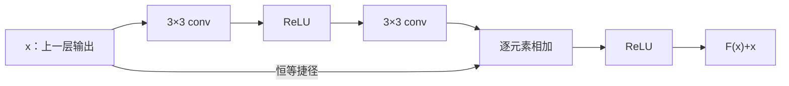
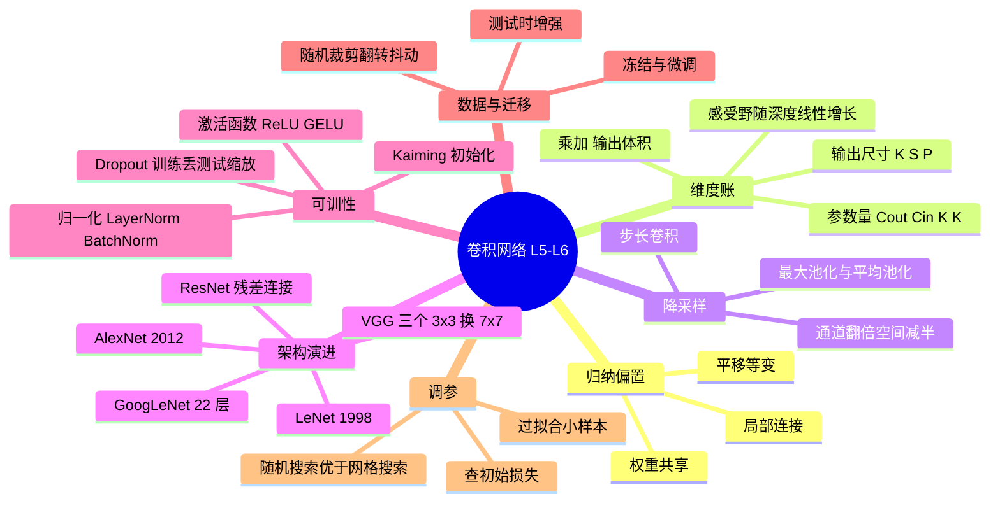

> **课程信息**
>
> - **课程名称**：Stanford CS231n: Deep Learning for Computer Vision（Spring 2025）
> - **本模块覆盖**：Lecture 5. Image Classification with CNNs｜Lecture 6. CNN Architectures（合计 238 页幻灯片）
> - **主讲教师**：Justin Johnson（Lecture 5）；Zane Durante（Lecture 6）
> - **授课日期范围**：2025-04-15 – 2025-04-17
> - **课程主页**：[cs231n.stanford.edu/2025](https://cs231n.stanford.edu/2025/schedule.html)
> - **官方课件**：[lecture_5.pdf](https://cs231n.stanford.edu/slides/2025/lecture_5.pdf)（141 页）、[lecture_6.pdf](https://cs231n.stanford.edu/slides/2025/lecture_6.pdf)（97 页），书中逐页插图
> - **字幕来源**：[cs231n_sp25_kor_sub · eng](https://github.com/lpaiu-cs/cs231n_sp25_kor_sub/tree/main/eng)（公开英文转写，中文由本书重写）
> - **版权说明**：幻灯片与课程材料版权归 Stanford University 及授课教师所有；本书为非官方学习笔记，仅用于学习与研究。


一张 32×32×3 的图展平成 3072 维向量之后，「相邻」这个关系就消失了：像素 $(0,0)$ 与 $(0,1)$ 在向量里隔了 3 个下标，与 $(31,31)$ 隔了 3071 个，而全连接层对这四种距离一视同仁。第 4 讲已经把「张量 → 损失 → 梯度」这条流水线磨成通用工具，本模块要回答的是：既然计算图里的节点可以自己设计，那么**为图像设计的节点应该长什么样**，以及**这些节点该怎么排成一个能训得动的网络**。

答案由两讲分工给出。第 5 讲只加两个算子——卷积层与池化层——然后把它们拆到维度级别，算清三笔账：参数从哪来、输出多大、感受野有多宽。第 6 讲接着回答装配问题：层怎么排（VGG、ResNet）、排好之后怎么训（初始化、归一化、Dropout、增强、迁移）。两讲之间有一条被反复验证的因果链：**架构能堆多深，取决于梯度能不能活着传到第一层**；VGG 用三个 3×3 换一个 7×7 是为了在同等感受野下省参数，ResNet 的恒等捷径是为了让「至少不差于浅层」变成一件容易优化的事，而 Kaiming 初始化与归一化则保证这些层在数值上不塌不炸。看懂这条链，后面检测、视频、生成各讲里出现的骨干网，都只是同一套算术的变体。

## 1. 一张图的三种表示：像素、手工特征、以及被展平毁掉的邻接

*(参考时间: 00:00:05 – 00:22:59｜Lecture 5)*

这一章要先把「输入是什么」讲透，因为卷积的全部合法性都建立在一个前提上：输入不是一串数，而是一张有邻接关系的二维网格。课程用三页复习交代流水线，用两页反例说明线性分类器不够强，再用六页手工特征说明「人设计表示」这条路走到过哪里，最后用一张对比图把端到端与两段式系统分开。顺序不是随意的：**先证明全连接层的假设错在哪，后面才知道卷积要修的是什么**。


作业一 4 月 23 日 23:59 截止，考点是 k 近邻（kNN）、线性分类器（SVM 与 Softmax）、两层神经网络，以及**图像特征**。最后这一项值得单独记一笔：它是本章后半段要拆开批判的对象，也是「人设计表示」这条路线在课程里的最后一次正式登场。


项目提案 4 月 25 日截止，助教的研究方向挂在课程网页的 office hours 页面上。这两页行政信息合起来标记了一次换挡：作业从「实现算子」变成「设计系统」，课程也从深度学习基础转入感知与理解视觉世界。


讲师的自我介绍不到一分钟，但把时间轴摆了出来：2015 到 2018 年在 Stanford 讲这门课，2019 到 2022 年在 Michigan 讲同一门，之后去了 Facebook AI Research，最近在做 World Labs。页脚那句「Stanford CS231n 10th Anniversary」说明这是课程的第十年——本讲后面反复引用的「2012 到 2020 卷积统治视觉」这条时间线，正好覆盖这门课自己的寿命。


课程被切成四段：深度学习基础（第 2–4 讲）、感知与理解视觉世界（第 5–12 讲）、生成与交互式视觉智能（第 13–16 讲）、以人为本的应用与影响（第 17–18 讲）。前三讲给了一台通用机器，接下来七讲要把这台机器塞进具体的视觉任务里，所以第 5 讲前半段在复习、后半段在换零件。


评分函数还是 $f(x,W)=Wx+b$：把图像拉成 3072 维列向量，乘一个 $10\times3072$ 的权重矩阵，得到 10 个类别的分数。复习的价值不在公式本身，而在于它把图像分类**编码成了输入张量到输出张量的映射**——后面判断「卷积层改变了什么」，基准线就是这张图。


第二步是损失：给定数据集 $(x,y)$ 与评分函数，用一个标量衡量当前权重有多差。分类问题常用 Softmax 损失，完整损失则是数据损失加正则项。这里的接口约定要记牢——**损失永远是一个标量**，后面推导梯度形状时会反复用到它。


第三步是搜索：SGD、SGD+动量、RMSProp、Adam 排成一行。讲师在这里插了一段现场逸事——就在前一天，ICLR 2025 把时间检验奖（Test of Time Award）颁给了 2015 年那篇提出 Adam 的论文。这个细节说明课程里的这些「标准件」不是教学玩具，而是十年后仍在被引用的工作。


问题出现了。**视觉视角**：权重矩阵的每一行可以还原成一张与输入同尺寸的图，于是每个类别就是一张整图模板，判断一只猫靠的是「这张图与猫模板的内积大不大」；讲师举的例子很扎人——学出来的「车」模板是一团红色，可车不必是红的。**几何视角**：每个样本是高维空间里的一个点，线性分类器只能用超平面切空间，而没有理由相信图像数据会这么配合。


补救办法是不要只用一个权重矩阵。两层网络在中间插一个 100 维隐层：$x\in\mathbb{R}^{3072}$ 先乘 $W_1$ 变成 100 维，过 ReLU，再乘 $W_2$ 得到 10 个分数。代数上只多了一步，表达能力却完全不同——它不再要求每个类别只有一张模板，而是先组合出一批中间「部件」，再用部件投票。参数量从 $3072\times10+10=30{,}730$ 涨到 $(3072\times100+100)+(100\times10+10)=308{,}310$，涨了十倍；把隐层加到 1000 维就是三百万量级，而输入仍然只是一张 32×32 的图。


参数变多、层数变深之后，手推每个参数的偏导不现实，于是引入计算图：每个节点是一种小的函数原语（矩阵乘、ReLU、hinge 损失……），数据从左往右前向算出损失，再反向算出梯度。幻灯片上 $x$ 与 $W$ 汇进评分节点，评分与标签进 hinge 节点得到数据损失，同时 $W$ 还分出一支进正则项 $R$，两支相加才是最终损失。这张图还说明另一件事：**正则项也是图的一部分**。它不是训练循环里额外加的一行判断，而是挂在权重上的一个节点，因此它的梯度同样由反向传播算出，只是这条路径不经过数据。把它画进图里，就不容易漏掉。


反向传播的关键在于它是**局部的**。每个节点只做两件事：前向时由输入算输出，反向时接收「上游梯度」（损失对本节点输出的偏导），乘以自己的「局部梯度」，吐出「下游梯度」（损失对本节点输入的偏导）。节点不必知道自己在整张图的哪个位置，也不必知道上游梯度是怎么来的——正是这种「无知」让框架成为可能。


把标量换成向量，局部梯度就变成雅可比矩阵。若节点 $f:\mathbb{R}^{D_z}\to\mathbb{R}^{D_y}$，局部雅可比是 $D_y\times D_z$ 的矩阵，第 $(i,j)$ 项回答「$z$ 的第 $j$ 个元素动一下，$y$ 的第 $i$ 个元素动多少」。幻灯片反复强调的那句话是：损失仍然是标量，所以**上游梯度的形状永远等于输出的形状，下游梯度的形状永远等于输入的形状**——形状对上了，实现就基本不会错。


再往上一层就到张量。若 $x$ 是 $D_x\times M_x$、$y$ 是 $D_y\times M_y$，理论上的局部雅可比尺寸是 $(D_xM_x)\times(D_yM_y)$——一个随张量大小平方增长的怪物。幻灯片把它画出来，正是为了让人看清「为什么不能真的去构造它」：一个 $1000\times1000$ 的矩阵乘若真的构造雅可比要 $10^{12}$ 个元素，而实际只需要「上游梯度乘权重的转置」这一步，$10^6$ 次乘加，差六个数量级。

> **编者说明**：实际实现里从不显式构造雅可比，而是直接算向量–雅可比乘积（vector-Jacobian product）。矩阵乘、卷积、池化的反向传播都是这种形式，所以显存开销与前向的激活同阶，而不是与参数量的平方同阶。这也是第 6 讲讨论「152 层怎么训得动」时的隐含前提。


课程在这里正式换段。幻灯片用一支橙色箭头标出当前位置：第 2–4 讲已经讲完，后三段变灰。这个看似多余的动画在提示听众做一次心态切换——前面的内容是通用机器，从这里开始要讨论「图像这种数据有什么特殊性」。


第二帧里箭头右移一行，落到第 5–12 讲上。这一段的七讲依次处理分类、架构、序列模型、检测分割、视频、大规模训练，而本讲是它的入口：先把「图像专用的算子」讲透，后面才有东西可堆。


幻灯片的画法很直白：上半部分是已经见过的全连接层（$x\to h\to s$）与激活函数（一条 ReLU 曲线），旁边写着「We have already seen these」；下半部分暂时空白，写着「Today: Image-specific operators」。今天不引入新的训练算法、不引入新的损失，只引入两个新的**算子**。


第二帧把下半部分补上：卷积层画成「一个局部窗口连到一个神经元」，池化层画成 $224\times224\times64$ 的体积缩到 $112\times112\times64$。四块积木齐全——全连接层、激活函数、卷积层、池化层。讲师特意强调，卷积网络「其实只是在已有框架上加了一点点东西」，真正的工作量在于理解这两个算子的形状与代价。


镜头拉回任务本身：给定一张图，假定类别集合 $\{dog, cat, truck, plane,\dots\}$ 已确定，输出其中一个类别。这看起来简单，却几乎是所有视觉任务的原型——检测是在图上加框，分割是把类别落到像素，本质上都建立在「从像素判类别」这件事上。


前面几讲的做法是让 $f(x)=Wx$ 直接吃像素：$x$ 就是三通道像素值的字面量，$W$ 的每一行是一个整图模板。这条路能走通，但它的假设很强——它默认「猫」这个概念可以用一张固定位置的像素模板概括，而现实里猫可以出现在任何位置、任何姿态、任何光照下。


于是有了另一条路：由人先设计一个特征提取器 $f$，把图像变成「更有意义」的表示，再把表示喂给分类器。这是 2000 年代到 2010 年前后的主流做法，核心假设是「人知道什么特征有用，网络只需要学会在特征上画边界」。关键在于**特征提取器是不可学习的**——它是一段固定代码，不会因为分类错了就调整自己，所以整个系统的上限在写那段代码时就被定死了。


第一个例子是颜色直方图：把颜色空间离散成一堆桶，统计落入每个桶的像素数量。它有用是因为有些问题确实只看颜色——判断苹果熟没熟，红色像素的比例就是强信号。但它也暴露了这类特征的代价：**空间结构被彻底销毁**，红色在左上角还是右下角，直方图完全一样。


第二个例子是方向梯度直方图（Histogram of Oriented Gradients, HoG），可以看作颜色直方图的对偶：基本不看颜色，只看局部边缘方向。做法是把图切成 8×8 的像素区域，每个区域内把边缘方向量化到 9 个 bin。幻灯片给了具体一笔账：320×240 的图被切成 40×30 个 bin，每 bin 9 个数，特征向量共 $30\times40\times9=10{,}800$ 维。


第三个例子是词袋（Bag of Words）。第一步从训练图里随机抽大量小图块做聚类，得到一本「视觉词典」；第二步把每张图编码成「词典里每个词出现了多少次」的直方图。这个思路来自文本检索，它把图像变成无序的词频向量——同样丢掉位置，但保留了一定的局部模式统计。


那个年代的常见套路是「全都拼上」：颜色直方图、HoG、词袋各算一遍，首尾相接成一个超长向量，再在上面训练线性分类器。这些特征今天基本不用了，但值得闻一闻味道，因为后面要对比的正是「由人设计特征」与「由梯度下降设计特征」这两种世界观。两个通病也在这里埋下：**维度爆炸**（拼得越多越容易过拟合）与**信息选择靠猜**（哪些该留、哪些该丢全凭设计者判断，判断错了在训练时无法被纠正）。


这张对比图是全讲的转折点。上半部分是老系统：图像 → 特征提取（一堆手工 C 代码或 MATLAB 代码）→ 线性分类器 → 10 个分数，蓝色箭头只覆盖分类器；下半部分是卷积网络：同样从图像到 10 个分数，但蓝色箭头覆盖了从像素到分数的**整条链路**。两套系统的接口完全一样，差别只在蓝色箭头覆盖的范围。上面那套里梯度回传止步于分类器，特征提取器收不到任何信号，所以它永远不会为了「把猫和狗分开」而调整；下面那套里梯度一路传回第一层，特征会针对任务自动变形。这就是端到端在数据充足时几乎总能赢的结构性原因：它不是「更聪明的特征」，而是「特征可以被任务纠正」。


那么问题出在哪？回到我们唯一会搭的那种网络：把 32×32×3 拉成 3072 维，乘 $W_1$ 到 100 维，ReLU，再乘 $W_2$ 到 10 维。它在数学上没有任何毛病，问题在于第一步——展平。


幻灯片打出红字：「Problem: The spatial structure of images is destroyed!」。像素 $(0,0)$ 与 $(0,1)$ 在向量里相隔 3 个下标，与 $(1,0)$ 相隔 96 个，而全连接层必须从数据里学会「下标 0 和下标 3 是邻居」这件事——每一对相邻像素都要单独占用一个参数，这个知识在权重矩阵里没有任何结构可以利用。讲师用一句话概括两种系统的分工：人工特征时代，人类设计的是**具体函数**；端到端时代，人类设计的是**函数族**。他还补了一句很重的话：梯度下降大概是比你更好的程序员，而大量数据大概比你更懂这个问题。

## 2. 1998 与 2012 之间隔着的不是算法，是 GPU

*(参考时间: 00:23:17 – 00:30:25｜Lecture 5)*

在讲算子之前，课程先用四帧示意图把「卷积网络」的整体形状定下来，再用一条时间线解释它为什么等了十四年。这一章的作用是给后面的算术一个位置感：**空间逐层变小、通道逐层变多**这个轮廓，后面所有的公式都是在解释它为什么必然如此。


这张图画法很朴素：左边是输入图像，中间一串「薄片」代表卷积与池化产生的特征图，越往右空间尺寸越小、通道越多，最后接到全连接层上。先记住这个轮廓，它是后面每一张架构图（包括第 6 讲的 VGG 与 ResNet）的共同骨架。


第二帧加上一句关键注释：卷积与池化算子提取特征时**保留了图像的二维结构**。这正是它们与全连接层的分水岭——全连接层要求先把图拍平，卷积层则要求保持 $H\times W$ 的排布，输入是三维体积，输出也是三维体积，只是高宽与深度变了。


第三帧补上末端：卷积部分之后接全连接层，组成多层感知机预测类别分数。这就把网络分成两个职责不同的部分——前半段是特征提取器，把像素变成一组紧凑响应；后半段是分类器，把响应变成 10 个分数。这个划分只是理解上的划分，训练时并没有分阶段。


最后一帧加上「用反向传播与梯度下降端到端训练」，把前三帧串成一个整体：卷积、池化、全连接、损失全在同一张计算图里，梯度从损失一路回传到最底层的滤波器。四帧拆开看，每条主张都不新鲜——保持二维结构、末端接分类头、端到端训练——合起来才是完整的架构定义，而这四条在 1998 年就已经齐了。


这张图对应 1998 年的论文《Gradient-based learning applied to document recognition》（LeCun、Bottou、Bengio、Haffner），任务是识别文档里的手写数字。它当年就 work 得不错，而且结构与 2010 年代的主流网络「基本长一个样」：卷积、池化、全连接、反向传播，一样都不缺。真正的问题是贵——没有 GPU、没有 TPU，算力只有今天的一小部分；输入只有 32×32、通道数是个位数，要放大到 224×224、64 通道，仅像素数就多 49 倍，再乘上通道与层数的增长，总算力需求高两三个数量级。


从 1998 跳到 2012，就是 AlexNet（Krizhevsky、Sutskever、Hinton）。结构上没有革命：还是卷积层加全连接层，只是更深、更宽、参数更多，损失函数依然简单，训练方式依然是端到端反向传播。真正变了的是外部条件——GPU 能算了，互联网与 ImageNet 提供了足够的数据。把这两页放在一起，就是为了说清一件事：**架构的胜负常常不由架构本身决定**。


2012 到 2020 年这段，卷积网络几乎横扫所有视觉任务。左边是检测：不仅判类别，还要在图上画框并给框贴标签（Faster R-CNN，Ren、He、Girshick、Sun，2015）；右边是分割：把标签落到每一个像素上（Farabet 等人，2012）。三个任务的输出空间值得对照——分类输出长度为 $K$ 的向量，检测输出 $N$ 个框（每个框 4 个坐标加 $K$ 个类别分数），分割输出一张与输入同尺寸的类别图。输出越复杂，需要的空间分辨率就越高，这也是分割网络必须把浅层高分辨率特征接回深层的原因。


语言方向也没被放过。图像描述（image captioning）要输入一张图、输出一句话，早期最成功的方案之一是「卷积网络提特征 + 循环网络生成句子」（Vinyals 等人 2015；Karpathy 与 Fei-Fei 2015）。幻灯片上六句生成字幕——「一只白色泰迪熊坐在草地上」「一个穿棒球服的男子在投球」「一个女人手里抱着一只猫」——是讲师用 Neuraltalk2 现场跑出来的例子。


反过来也行。文生图要输入一句话、生成一张图，早期真正开始好用的版本同样建立在卷积网络上；这张图出自 Stable Diffusion 的论文（Rombach 等人，CVPR 2022），例子里有水彩风格的「半鼠半松鼠吃汉堡」、毕加索风格的僵尸、印着「I love generative models!」的 T 恤。这项技术在最近两年进步极快，后面的讲次会专门处理。


2015 年这门课创办时，名字叫「Convolutional Neural Networks for Visual Recognition」——卷积网络与计算机视觉在当时几乎是同义词。幻灯片上那句「This class used to be focused on ConvNets!」是个自嘲：课名后来改了，因为领域变了；章节比例也跟着变，卷积只占两讲，后面还有检测、视频、生成、三维与机器人。


变化发生在 2017 年。Vaswani 等人的《Attention is all you need》提出 Transformer，一开始只处理文本序列。它和卷积的根本差别在于「看哪里」：卷积的视野由核大小与层数决定，注意力则可以一次看到整个序列，并按内容动态分配权重。


2021 年，Dosovitskiy 等人的《An Image is Worth 16x16 Words》把几乎一模一样的 Transformer 用在图像上：把图切成 16×16 的 patch，每个 patch 当成一个「词」。结果是在许多原本由卷积网络解决的问题上，把 CNN 换成 Transformer、其余保持不变，性能反而更好，而且更吃数据与算力——这恰好是这些年最不缺的两样东西。


幻灯片在这里加了一行「Wait until Lecture 8!」，把 Transformer 的细节推到后面。讲师的处理很坦诚：他不想在卷积网络明显不再是唯一答案的年份里，还把卷积讲成唯一真理；但他给出四条继续学的理由——历史意义、工程上仍在大量使用、能建立对图像算子的直觉、以及今天的系统常常是卷积与注意力的混合体。工程上更常见的做法就是混用：浅层用卷积提取局部特征，深层用注意力做全局交互，或者直接在卷积网络里插入注意力模块。所以真正要掌握的不是「哪个更好」，而是「各自的归纳偏置是什么、什么时候有用」。一个算子能不能长期存活，取决于它的归纳偏置是否仍然匹配数据与算力——卷积的偏置是「局部性 + 平移等变」，在数据少、算力紧的年代是巨大优势；当数据与算力都过剩时，这个偏置反而成了限制，这正是 2021 年之后发生的事。


历史讲完，画面切回一张纯标题页。接下来 60 分钟只做一件事：把卷积层拆到维度级别，看清它的每一个数字是怎么来的。

## 3. 卷积层：一个小模板滑遍全图，滑出 6×28×28

*(参考时间: 00:30:28 – 00:49:43｜Lecture 5)*

这一章是第 5 讲的重心。它从「全连接层的单个输出是一次整图点积」出发，把点积重新读成模板匹配，然后只改一件事：模板不再覆盖整张图，而是缩成 $5\times5\times3$ 的小块，并且**同一组权重在所有位置复用**。剩下的所有细节——深度必须对齐、偏置是每个滤波器一个、输出是三维体积——都是这两个改动的直接后果。


画面回到那张四宫格，这次只有上半部分亮着：全连接层与激活函数，旁边写着「We have already seen these」。这种「先摆出已知、再补未知」的排布，对应接下来的讲述顺序：先把全连接层重新解读一遍，再从它的局限里长出卷积层。


第二帧把卷积层与池化层补上，标注「Today: Image-specific operators」。所谓「图像专用」，指的是这两个算子的连接模式是为二维网格设计的——它们的参数共享方式、输出形状、乃至反向传播的写法，都依赖「输入是一张有空间结构的图」这个前提。


第三帧里池化层变灰，卷积层保持高亮。这是一个视觉提示：先讲卷积，池化留到后面。整讲的节奏也确实是「卷积占七成、池化占两成、剩下是等变性与总结」。


全连接层的做法前面见过：$32\times32\times3$ 的图像拉成 $3072\times1$ 的列向量，乘一个 $10\times3072$ 的权重矩阵，得到 10 个分数。幻灯片特意把「input activation」与「weights」分开标注，因为接下来要动的正是这两者的形状关系。


把视角落到单个输出上：10 个分数里的每一个，都是 $W$ 的某一行与整个 3072 维输入的点积。而点积可以读作**模板匹配**——两个向量方向越一致值越大，正交时为 0，方向相反时为负。所以全连接层等价于「准备了 10 张与输入同样大小的模板，逐个与整图比对」。这个解读是通向卷积层的钥匙。


卷积层的第一件事是拒绝展平。输入仍然是 $32\times32\times3$ 的体积，三个维度各有名字：高 32、宽 32、深 3（深度也叫通道）。保留这三个维度，等于保留了「谁挨着谁」这条信息，而这正是全连接层丢掉的东西。


接着引入滤波器：一个 $5\times5\times3$ 的小体积，空间上只有 5×5，深度上却与输入相同。幻灯片的措辞是「把滤波器在图像上滑动，逐点做点积」。注意这里的角色转换——模板不再与整图同尺寸，而是一小块「局部图案」。


幻灯片补了一条容易忽略的约束：**滤波器的深度永远等于输入的深度**。这不是约定俗成，而是点积的要求——要算内积，两个张量的元素个数必须相同。所以 3 通道的图只能配 3 通道的滤波器，$5\times5\times3$ 的滤波器与 $5\times5\times3$ 的图像块正好 75 个元素一一对应。


一次落点算出一个标量：$\sum_{c=1}^{3}\sum_{i=1}^{5}\sum_{j=1}^{5} W[c,i,j]\cdot X[c,i,j] + b$，也就是 75 维点积再加偏置。这个数回答的问题是：「当前这个位置上，图像长得有多像这个滤波器？」值越大，说明这块图像与模板越对齐。一个数显然不足以描述一块图像——窗口里 75 个数被压成一个自由度，要描述更多方面，就得用多个滤波器。


把窗口放到第一个位置，得到一个数，画成右侧一个小圆点。这一帧只有「一个输入块、一个输出」，是为了让「一个输出只依赖一个局部窗口」这件事变得直观——对比全连接层里「一个输出依赖全部 3072 个像素」，差别一目了然。


第二帧把窗口向右挪一格，权重完全不变，再算一次点积。这里出现了卷积最核心的两个性质：**参数共享**（同一个滤波器在所有位置复用同一组权重）与**局部连接**（每个输出只连一小块输入）。前者把参数量从「图像大小 × 类别数」压到「滤波器大小」，后者让输出天然带有位置信息。


第三帧继续平移。值得注意的是每次计算都是独立的：位置之间不共享中间结果，也不互相影响。这种「逐位置独立」让卷积在 GPU 上极易并行——本质上它是一批小矩阵乘，可以摊成一个大矩阵乘来实现（im2col 的思路），但那是实现细节，不改变语义。


到第四帧，窗口已经扫过大半张图，右侧的响应逐渐连成一片。这里讲师没有逐格数，而是直接跳到下一步：与其关心单个格子，不如关心「滑完所有位置之后得到什么」。


答案是激活图（activation map）。$32\times32$ 的输入配 $5\times5$ 的滤波器，水平和垂直方向各能放 $32-5+1=28$ 次，所以输出是一张 $28\times28$ 的平面，每个格子记录「原图对应位置有多像这个模板」。空间尺寸从 32 缩到 28，原因很简单：滤波器不能悬空，靠边的位置放不下完整的 5×5 窗口。


接下来加第二个滤波器（画成绿色），尺寸仍是 $5\times5\times3$，但权重是另一组。它同样滑遍全图，得到第二张 $28\times28$ 的激活图。两张图回答两个不同的问题：第一张可能在看「有没有某种边缘」，第二张可能在看「有没有某种颜色对比」。


把 6 个滤波器的结果摞起来，输出就是 $6\times28\times28$：两个空间维度来自滑动，第三个维度来自滤波器个数。与此同时，6 个滤波器本身组成一个四维张量 $6\times3\times5\times5$——第一维是「第几个滤波器」，后三维是单个滤波器的形状。这就是卷积层的完整输入输出契约：输入三维体积，输出三维体积，权重四维张量。四维张量的记账方式值得单独背下来，因为后面每一讲的参数量、FLOPs、显存估算都是在这张表上做代数：

| 对象 | 形状 | 本例 |
| --- | --- | --- |
| 输入（单张） | $C_{in}\times H\times W$ | 3×32×32 |
| 滤波器组 | $C_{out}\times C_{in}\times K\times K$ | 6×3×5×5 |
| 偏置 | $C_{out}$ | 6 |
| 输出（单张） | $C_{out}\times H'\times W'$ | 6×28×28 |
| 批量输入 | $N\times C_{in}\times H\times W$ | 2×3×32×32 |

注意滤波器组的第二维必须是 $C_{in}$：这不是设计选择，而是「每个滤波器都要看全部输入通道」的直接结果。一旦这一维对不上，点积就无法进行。


和线性层一样，卷积层也有偏置，区别在粒度：线性层是每个输出神经元一个 bias，卷积层是**每个滤波器一个 bias**，这里是 6 维向量。加的时候，第 $k$ 个 bias 被广播到第 $k$ 张激活图的全部 784 个位置——所以在参数表里它只占 6 个数，在计算里却参与了 4704 次加法。


把输出体积换个方向读，会得到另一种很有用的直觉：$28\times28$ 个空间位置，每个位置上挂着一个 6 维向量，向量里存着 6 个滤波器在该位置的响应。也就是说，卷积层把每个位置从一个「像素小块」变换成了一个「特征向量」——这正是后面所有「特征图」说法的来源。按「位置」读，卷积是一堆互不依赖的小点积，适合理解；按「通道」读，每个位置是一个特征向量，适合接后续的全连接层。


实际训练不会一张一张算。把 2 张图摞成 $2\times3\times32\times32$，卷积层一次算完，输出 $2\times6\times28\times28$。批维度只是把同一组滤波器在更多样本上复用，不引入任何新参数——这也是为什么卷积网络的显存开销主要来自激活而不是权重。


于是有了通用写法：输入 $N\times C_{in}\times H\times W$，权重 $C_{out}\times C_{in}\times K_w\times K_h$，偏置 $C_{out}$，输出 $N\times C_{out}\times H'\times W'$。四个超参数——滤波器个数 $C_{out}$、核大小 $K$、步长 $S$、填充 $P$——决定了所有权重的形状；而 $H'$ 与 $W'$ 由输入尺寸和这三个空间超参数共同决定。


$$
H'=\left\lfloor\frac{H-K+2P}{S}\right\rfloor+1,\qquad W'=\left\lfloor\frac{W-K+2P}{S}\right\rfloor+1
$$


参数量是 $C_{out}\times(C_{in}\times K\times K+1)$——括号里的 $+1$ 是每个滤波器一个偏置。用后面第 4 章那道例题验算：$10\times(3\times5\times5+1)=760$，与幻灯片上的数字一致。


有了卷积层，网络就可以堆了。最朴素的版本只有一层：$3\times32\times32$ 进，6 个 $5\times5\times3$ 的滤波器，出 $6\times28\times28$。这一层只有 $6\times(3\times5\times5+1)=456$ 个参数，而对应的全连接层需要 $10\times3072+10=30{,}730$ 个——参数效率的差别不是几倍，而是两个数量级。


第二层卷积接在后面，用 10 个 $5\times5\times6$ 的滤波器。注意这里的 6：它必须等于上一层的输出通道数，因为这一层的输入就是上一层的 6 张激活图。空间尺寸继续缩水，$28\to24$；通道数则从 6 涨到 10。这条「空间变小、通道变多」的规律，后面每一讲都会重复出现——它不是审美，而是「每降一次采样，就用更多通道补偿丢失的空间分辨率」这条守恒律的体现。


但这样堆是有 bug 的，而且是个严重的 bug。讲师在课上把问题抛给学生：「这个架构哪里不对？」有人答尺寸、有人答感受野、有人答显存，最后落到正解上——**全是线性的**。卷积是点积，点积是线性算子；两个线性算子的复合仍然是线性算子，所以两层卷积直接相连，表达能力等价于一层，中间那层白加了。补救办法与多层感知机一模一样：在两层之间插入非线性激活函数（这里是 ReLU）。顺序也不是随便排的——先卷积再 ReLU，意味着非线性作用在「匹配分数」上：先算这块图像与模板有多像，再把负的相似度压成 0；反过来先 ReLU 再卷积，等于先把输入截断，再去做匹配。两种都能训练，但前者语义清楚，也是后面所有架构图采用的约定。


这张图把本章的链路压成一行：卷积负责「局部模板匹配 + 参数共享」，ReLU 负责「非线性」，堆叠负责「从边缘组合成部件、再组合成物体」。少了任何一环，网络要么退化成线性模型，要么根本堆不深——第 6 讲讲 VGG 与 ResNet 时，默认的「一个卷积块」就是 conv → ReLU 这两步。


回到最初的问题：卷积滤波器到底在学什么？先用线性分类器做类比。线性分类器的每一行权重可以还原成一张与输入同尺寸的图，那就是这个类别的「整图模板」——学到的是「猫平均长什么样」。它的局限前面说过：一张模板概括不了所有姿态与配色。


多层感知机好一些，因为它有一整排模板（隐层单元），可以把整图拆成若干「整图级别的模式」再组合。但每个模板仍然是全图尺寸，仍然要求模式出现在固定位置。这两页放在一起是为了说明：**模板匹配本身没错，错的是模板太大、太死**。


卷积的答案是「小模板 + 滑动」。这张图是 AlexNet 第一层的 64 个滤波器，每个 $3\times11\times11$，直接当成小图渲染出来就能看懂：有的在找方向边缘（竖直、水平、斜向），有的在找对立色（绿与红、蓝与黄），还有的是彩色斑块。讲师强调这不是 AlexNet 或 ImageNet 的特例——只要任务合理，几乎所有卷积网络的第一层都会学到类似的东西。

顺便把两个概念分清。**参数**是训练中会被梯度改写的量——滤波器的每一个数、每个偏置。**超参数**是训练开始前定死、训练中不变的量——滤波器个数、核大小、步长、填充。前者决定「这个算子最后变成什么」，后者决定「这个算子有多大」。把两者混着谈，调参时会浪费大量时间：滤波器的数值不能手工调，只能靠数据；滤波器个数只能靠试验，梯度不会告诉你该加几个。


越往深处越难直接可视化，因为一个深层滤波器的输入不再是像素，而是上一层的激活图。幻灯片的做法反过来：拿一堆输入图像去刺激网络，把让某个滤波器响应最强的图块挑出来排成一行（可视化来自 Springenberg 等人，ICLR 2015，取自一个 ImageNet 模型的第 6 层）。于是能看到有的滤波器专挑眼睛，有的专挑文字，有的专挑轮子或圆弧——**深层学到的是更大、更抽象的结构**。还有一个容易被忽略的隐坑：随机初始化必须让**每个滤波器不同**。如果 6 个滤波器初值完全一样，前向时它们算出相同的激活，反向时收到相同的梯度，于是永远保持相同，6 个滤波器实际退化成 1 个。解决办法是给每个滤波器独立的随机初值，这就是对称性破缺。

## 4. 三本账：输出尺寸、感受野、乘加次数

*(参考时间: 00:49:47 – 00:59:29｜Lecture 5)*

讲完滤波器长什么样，课程切到算术。这一章只有一件事：把 $C_{out}$、$K$、$S$、$P$ 这四个超参数与三个结果量——输出尺寸、参数量、乘加次数——之间的关系写成公式，再在公式上做加减乘除。三本账分别对应三个工程约束：显存、模型大小、算力；它们由不同的量决定，所以「模型多大」和「跑得多慢」经常对不上。


幻灯片左边还是那条 $3\times32\times32\to6\times28\times28$ 的链路，右边标出这一层的两个参数张量：$W_1$ 是 $6\times3\times5\times5$，$b_1$ 是 6 维。接下来的十几页只做一件事——把这几个数字之间的关系写成公式。


为了不被通道维干扰，幻灯片把卷积「旋转 90 度、丢掉深度」，只留下一个 $7\times7$ 的平面和一个 $3\times3$ 的核。这个简化是安全的：卷积在通道方向上是求和，不影响空间尺寸，所以空间尺寸的规律可以完全在二维上推。


$3\times3$ 的窗口压在左上角，覆盖第 1–3 行、第 1–3 列。这个位置合法，因为窗口完整落在图内。


窗口右移一格，覆盖第 1–3 行、第 2–4 列，仍然合法。沿着这一行继续右移，直到窗口右边缘贴住图的右边界为止。


当窗口左边缘落在第 5 列时，它覆盖第 5–7 列，右边缘正好贴住边界；再往右就有一列悬空，不合法。所以水平方向一共有 5 个位置——这正是 $7-3+1=5$。


垂直方向同理也是 5 个位置，两个方向组合起来就是 $5\times5=25$ 个输出。幻灯片刻意让听众自己数一遍，因为「能放几次」这个直觉比公式本身更重要：**输出尺寸 = 合法落点的个数**。


写成公式就是 $W-K+1$。这个式子可以这样读：滤波器左边缘能取的位置从 1 到 $W-K+1$，一共 $W-K+1$ 个。核越大，能放的位置越少；输入越大，位置越多。


公式带来一个副作用：每做一次卷积，特征图就缩小 $K-1$。3×3 的核每层吃掉 2 像素，5×5 的核每层吃掉 4 像素。堆十层 3×3 之后，$32\times32$ 的图只剩 $12\times12$；堆二十层就没了。这不是理论问题，而是设计网络时必须处理的现实约束——第 6 讲的 VGG 之所以能堆 16 层还保持 $224\to7$ 的尺寸表，靠的就是「同尺寸卷积 + 定期池化」的交替。


解法叫填充（padding）：在输入四周补 $P$ 圈零，把图「撑大」再卷积。补零之后输出变成 $W-K+1+2P$。幻灯片上的例子是 $7\times7$ 补一圈变成 $9\times9$，$3\times3$ 的核滑完正好得到 $7\times7$——尺寸不变。讲师在这里留了一句警告：从信号处理的角度看，补零会在边界引入人为的不连续，「会在边界上造成一些问题」；但绝大多数实践选择忽略它，因为补零带来的工程便利（尺寸可预测、实现简单）远大于边界效应。


于是有了最常用的一组搭配：$K$ 取奇数，$P=(K-1)/2$。$K=3$ 配 $P=1$，$K=5$ 配 $P=2$，都能让「same padding」成立——输出高宽与输入相同，只有通道数变化。这条约定让「第几层的特征图多大」变成一个只需看降采样次数的简单问题。代价仍然藏在边界上：补零相当于宣称「图像外面全是黑的」，而真实图像的边界之外通常延续着某种内容，于是靠近边界的输出看到的输入分布与中心位置并不相同。一个直观的检验是：把同一块纹理分别放在图像中心与边缘，第一层卷积的响应强度往往不同。缓解办法是让网络自己学会处理边界，或者用更大的图让边界占比更小——这些都是工程折中，不是理论解法。


单层卷积里，输出每个元素只依赖输入的一块 $K\times K$ 区域，这块区域就叫**感受野**（receptive field）。$3\times3$ 的核意味着每个输出「看见」9 个输入像素，其余像素对它没有任何影响。


但网络是叠起来的。第二层的每个元素依赖第一层的一块 $K\times K$，而第一层的每个元素又依赖输入的一块 $K\times K$，展开之后，第二层对原始输入的感受野是 $K+(K-1)$。每加一层，感受野增加 $K-1$；$L$ 层之后是 $1+L(K-1)$。幻灯片在这里提了一句容易混淆的地方：「输入里的感受野」与「上一层里的感受野」是两个不同的量，算的时候要盯住参照系。


$$
R_L = 1 + L\,(K-1)
$$


它说明感受野是**深度**的函数，而不是参数量的函数。一个 $3\times3$ 的核只有 9 个权重，但堆 112 层就能覆盖 224 像素；反过来，一个 $11\times11$ 的大核只有一层，感受野也只有 11。这就解释了为什么现代网络偏爱小核深堆——同样的感受野，小核的参数量少得多，非线性也更多（第 6 讲会把这条理由算成 55% 这个具体数字）。


这条线性增长带来了麻烦。假设输入是 $224\times224$，全用 $3\times3$ 卷积，要覆盖整幅图需要 $1+2L\ge224$，也就是 $L\ge112$ 层。112 层纯 3×3 卷积在 2015 年是不可训练的数量级——不是算不动，而是梯度传不回去。感受野是「全局决策」的前提，而线性增长让这个前提太贵。


解法是**在网络内部降采样**：先把空间尺寸压小，再在小图上做卷积，这样同样多的层数就能覆盖更大的原始区域。降采样有两种做法——带步长的卷积，或者池化；前者是这一节的主题，后者是第 5 章的主题。


步长（stride）的改动只有一句话：窗口不再每次移一格，而是移 $S$ 格。$S=2$ 时，窗口位置从 1、2、3、4、5 变成 1、3、5，中间那些位置直接被跳过。


第二帧里窗口落在第 3 列，覆盖第 3–5 列；再下一步落在第 5 列，覆盖第 5–7 列。到这里已经能看出：合法的落点数从 5 个变成了 3 个。


滑完得到 $3\times3$ 的输出——空间尺寸从 7 降到 3，缩小了一半多一点。这不是「顺带」的效果，而是步长的**目的**：用一次卷积同时完成「特征提取」与「降采样」两件事。


把填充与步长合起来，就得到那个被讲师称为「有点丑」的公式：$H'=\lfloor (H-K+2P)/S\rfloor+1$。三项各司其职——$K$ 扣掉被核吃掉的部分，$2P$ 把填充补回来，$S$ 做除法，最后的 $+1$ 是「栅栏柱」式的位置计数。记住这个结构比记住符号更重要：**先算可用范围，再按步长数格子**。

代一组数校验：$H=7,K=3,P=0,S=2$ 时得 $(7-3)/2+1=3$，与幻灯片上的 $3\times3$ 一致；把 $S$ 改回 1 得 5；再加 $P=1$ 得 7。

堆叠带步长的卷积会带来一个质变：感受野从线性增长变成指数增长。以 $3\times3$、$S=2$ 为例，第 1 层感受野 3，第 2 层 $3+2\times2=7$，第 3 层 $7+2\times4=15$，通项约为 $2^{L+1}-1$。

| 层数 $L$（3×3 卷积） | 步长 1 的感受野 | 步长 2 的感受野 |
| --- | --- | --- |
| 1 | 3 | 3 |
| 2 | 5 | 7 |
| 3 | 7 | 15 |
| 4 | 9 | 31 |
| 5 | 11 | 63 |
| 6 | 13 | 127 |

这张表是整个模块的算术核心之一：同样的层数，只改一个超参数，感受野就从「只能看局部」变成「几乎能看全图」。代价是空间分辨率下降——每降一次采样，位置信息的精度就损失一半。第 6 讲的 ResNet 把这条规律用得最狠：四组残差块之间各做一次 stride 2，空间从 56 一路降到 7，感受野则在 152 层里累积到远超图像尺寸。


幻灯片给了一道完整的例题：输入 $3\times32\times32$，10 个 $5\times5$ 的滤波器，步长 1、填充 2。要求回答三个问题——输出多大、有多少可学习参数、要做多少次乘加。这三个问题恰好对应工程上的三个约束：显存、模型大小、算力。


输出通道数等于滤波器个数，所以是 10；空间尺寸套公式：$(32+2\times2-5)/1+1=32$。注意这里的 32 与输入的 32 数值相同但含义不同——前者是输出高宽，后者是输入高宽，幻灯片用两种蓝色区分，正是怕人把这笔账记混。


第二个问题：这一层有多少可学习参数？关键是把「每个滤波器有多少参数」与「一共有几个滤波器」分开算，别把空间位置也算进去——参数共享意味着无论滑到哪里，用的都是同一组权重。


单个滤波器是 $3\times5\times5=75$ 个权重，加 1 个偏置，共 76 个；10 个滤波器就是 760 个。对比同尺寸输入的全连接层：$10\times3072+10=30{,}730$ 个参数。**同样的输入输出接口，卷积层只有全连接层的 2.5%**，这就是参数共享的直接收益。


第三个问题最容易被低估：算力。参数量小不等于计算量小——卷积的参数是共享的，但每个位置都要重新算一次点积。


账是这么算的：输出体积 $10\times32\times32=10{,}240$ 个元素，每个元素是一次 75 维点积（$3\times5\times5$），合计 $75\times10{,}240=768{,}000$ 次乘加。这个数字与参数量 760 差了三个数量级——**参数共享省的是存储，不是计算**。

| 配置 | 输出 | 参数量 | 乘加次数 |
| --- | --- | --- | --- |
| 3×32×32 → 6 个 5×5 | 6×28×28 | 456 | 352,800 |
| 3×32×32 → 10 个 5×5，P=2 | 10×32×32 | 760 | 768,000 |
| 64×56×56 → 64 个 3×3，P=1 | 64×56×56 | 36,928 | 115,605,504 |
| 128×28×28 → 256 个 3×3，P=1 | 256×28×28 | 295,168 | 231,211,008 |

表格后两行才是现代网络的常态：一层的乘加就上亿次，参数量却只有几十万。于是推理的瓶颈在算力，训练的瓶颈在显存（前向的激活必须留着给反向传播用）——两个瓶颈都不由参数量决定。这条判断在第 6 讲会以另一种形式出现：ResNet 152 层之所以能塞进一张 GPU，靠的是「通道翻倍 + 空间减半」让激活体的体积大致恒定。


这一页把前面所有符号收进一张表：输入 $C_{in}\times H\times W$；超参数是核大小 $K$、滤波器个数 $C_{out}$、填充 $P$、步长 $S$；权重是 $C_{out}\times C_{in}\times K\times K$，偏置是 $C_{out}$；输出是 $C_{out}\times H'\times W'$，其中 $H'=(H-K+2P)/S+1$。右边还列了四组常见搭配：$K=3,P=1,S=1$；$K=5,P=2,S=1$；$K=1,P=0,S=1$；$K=3,P=1,S=2$（降采样两倍）。这四组基本覆盖了经典架构里 90% 的卷积层——第 6 讲的 VGG 整张网只用第一组，ResNet 的降采样只多用了第四组。


对应到 PyTorch，`nn.Conv2d` 的参数表里除了上面四个，还有两个讲师没展开的：`groups` 与 `dilation`。他的判断很直接——空洞卷积现在用得不多，分组卷积偶尔还会遇到，细节留到后面的讲次。这里只需要知道它们不改变「局部点积 + 滑动」这个本质，只是改变了「哪些输入通道连到哪些输出通道」以及「核里元素之间的间距」。


到目前为止讲的都是二维卷积：在两个空间维度上滑动，通道维做求和。它的权重形状 $C_{out}\times C_{in}\times K\times K$ 里，前两维是「通道映射」，后两维是「空间范围」。


去掉一个空间维度就得到一维卷积：输入 $C_{in}\times W$，权重 $C_{out}\times C_{in}\times K$，滑动的只有一个方向。它在语音、文本、时序信号上都很常见——本质上「局部模式在序列上重复出现」与「局部模式在图像上重复出现」是同一个假设。


再加一个维度就是三维卷积：输入 $C_{in}\times H\times W\times D$，权重 $C_{out}\times C_{in}\times K\times K\times K$，每个输出位置对应体积里的一个 $C_{out}$ 维向量。视频、医学影像（CT/MRI）、点云体素化都会用到它；参数与算力也随之立方增长，这是三维卷积在实践中最主要的成本来源。三层意思合起来：卷积不是「图像专用」的算子，而是「局部连接 + 参数共享 + 平移滑动」这套假设的载体——只要数据具备网格结构，这套假设就可以搬过去用。

## 5. 池化与平移等变：降采样凭什么不改变结论

*(参考时间: 00:59:33 – 01:07:56｜Lecture 5)*

卷积解决了「用什么模板」，步长解决了「看多远」，最后这一章补上「看的结果该不该受位置影响」。池化只有两个超参数、零个可学习参数，但它提供的性质——对小幅平移不敏感——是分类任务几乎所有精度提升的隐含前提，也是第 6 讲里 VGG 与 ResNet 每隔几层就插一次降采样的理论依据。


标题从「Today: Convolutional Networks」变成「Convolutional Networks」，卷积层仍是亮的，池化层还灰着。这张图出现在「卷积讲完、池化将讲」的位置，作用是把注意力从「怎么提特征」转到「怎么降采样」。


下一帧把高亮对调：卷积层变灰，池化层亮起。讲师对池化的态度很轻松——「谢天谢地，池化很简单」。它确实简单：没有可学习参数，只有两个超参数和一个聚合函数。


池化的输入是一个 $C\times H\times W$ 的体积，做法是**逐平面独立处理**：把 64 个 $224\times224$ 的平面一张张抽出来，各自降采样，再按原顺序摞回去。所以池化从不改变通道数，只改变空间尺寸——这一点与卷积正好相反（卷积改通道数，也可以改空间尺寸）。三个超参数是核大小、步长、聚合函数。


最常用的是最大池化。把单个深度平面切成互不重叠的 $2\times2$ 小块，每块取最大值：左上块 $\{1,1,5,6\}$ 取 6，右上块 $\{2,4,7,8\}$ 取 8，左下块 $\{3,2,1,2\}$ 取 3，右下块 $\{1,0,3,4\}$ 取 4，输出 $2\times2$。整个过程没有一次乘法，也没有一个参数。「取最大」这个动作带来一个副作用：**对小幅平移不敏感**。如果整幅图平移一个像素，最大池化的输出很可能一个数都不变——因为窗口内那个最大值往往还是它。幻灯片把这写成「gives invariance to small spatial shifts」，这就是池化在分类任务里好用的原因：类别不该因为猫往右挪了两像素就改变。


公式比卷积简单：$H'=(H-K)/S+1$，没有填充项（实践中几乎不用 padding），参数量为 0。常见设置是 $K=2,S=2$，正好把每个空间维度缩小一半。讲师提到偶尔也会用 $4\times4$、步长 2 这种「重叠池化」，但绝大多数情况就是「降两倍」。三个常见疑问课上都有明确回答。**要不要填充？** 通常不要；对最大池化而言，补零等价于在边界做了一次 ReLU，如果网络里已经有 ReLU，这个操作就是冗余的。**要不要再加非线性？** 看聚合函数：最大池化本身是非线性的，可以省掉一个 ReLU；平均池化是线性的，后面通常还要接 ReLU。**放在哪里？** 与卷积交替摆放，典型模式是 `[CONV CONV POOL] × N → FC`，让空间尺寸阶梯式下降。还有一个工程细节值得记下来：池化（以及卷积）要求同一批里的图尺寸一致。如果数据里长宽比不一，常见做法是统一缩放、补零到同一尺寸，或者做长宽比分桶（aspect ratio bucketing）——把样本按长宽比分组，每次迭代只取同一桶的图组成一个 batch。


最后这个概念听起来很吓人，其实只是一张交换图。上面一条路径：输入 $H\times W\times C$ 先过卷积或池化得到 $H'\times W'\times C'$，再把结果整体平移。下面一条路径：先把输入平移，再过同样的算子。问题是：这两条路径的结果一样吗？


答案是「在忽略边界条件的前提下」一样，写成公式就是 $\mathrm{Conv}(\mathrm{Translate}(X))=\mathrm{Translate}(\mathrm{Conv}(X))$。这个性质叫**平移等变性**（translation equivariance）：输入平移多少，输出就平移多少，其他一概不变。注意它与「平移不变性」不同——不变性要求输出完全不变，等变性只要求输出跟着一起挪。


为什么会这样？因为卷积的权重是共享的：同一个滤波器在图像的任何位置都做同一件事，所以「猫在左上角」与「猫在右下角」产生的响应，除了位置之外完全一样。讲师用了一个很朴素的例子——同一群人坐在长椅上，从左看和从右看都是「人和长椅」，位置变了，内容没变。等变性就是把这条直觉写进了算子。这也解释了本讲开头那句话的含义：**尊重二维结构**不只是「别展平」，而是把「位置无关」这个先验编码进算子——全连接层要花大量参数从数据里学这件事，卷积层则一开始就把它写死了。把四个算子的偏置并排看一遍，整条主线就清楚了：

| 算子 | 每个输出看哪里 | 权重是否共享 | 承诺的性质 | 代价 |
| --- | --- | --- | --- | --- |
| 全连接层 | 整个输入体积 | 不共享，每个输出一套 | 无位置先验 | 参数随图像尺寸平方增长 |
| 卷积层 | 一个 $K\times K$ 窗口 | 全图共享 | 平移等变 | 感受野线性增长，需靠降采样补 |
| 池化层 | 一个 $K\times K$ 窗口 | 无参数 | 小幅平移不变 | 丢失位置精度 |
| 自注意力 | 整个序列或整张图 | 共享投影矩阵 | 置换等变，位置需另行编码 | 代价随 token 数平方增长 |

> **编者说明**：表中前三行是第 5 讲的原话；自注意力一行只取了第 2 章「一次看到整个序列、按内容动态分配权重」这一句定性描述，「置换等变」与「平方代价」是通行教科书的补充，课堂上没有展开，具体推导留到第 8 讲。

讲师最后特意泼了一盆冷水：这个交换图是个数学趣事，**不要真的在代码里去平移特征图**。它的价值在于解释「为什么卷积适合图像」，而不是提供一个可以调用的操作。数学家管这种图叫交换图（commutative diagram），课堂上给出的评价是「数学家很喜欢这种东西」。


最后这张图把全讲收束成一张拼图：全连接层、激活函数、卷积层、池化层，四块积木按顺序拼接就得到卷积网络。讲师没有逐块复述，只留下一句判断——今天新增的只有两块，剩下的工作是把它们按正确的顺序和尺寸拼起来。


幻灯片以「Next time: CNN Architectures」收尾。这不是客套：本讲解决的是「单个算子怎么算」，下一讲解决「算子怎么排」。两讲合起来才是完整的卷积网络，而中间那句「怎么排」正是本模块后半程的全部内容。

## 附录 A：Lecture 5 的 19 页存档——旧速查、1×1 卷积与神经元视角

这两章收录 Lecture 5 课件末尾的 33 页「Appendix (Slides from Previous Years)」。按本书「幻灯片必须保持 deck 原始顺序」的约定，它们只能排在 Lecture 6 的 97 页之前，因此出现在模块中段而不是全书末尾。存档页的价值不在于新知识，而在于同一套算术的另一种排版：旧版速查用了不同的符号（$F$ 记核大小、$K$ 记滤波器个数），1×1 卷积补上了正文省略的第三种卷积，神经元视角则把「局部连接 + 权重共享」翻译成了「带约束的全连接层」。第 6 讲反复引用的「卷积块」概念，在这几页里有最直白的图解。


分隔页本身没有内容，只标明从这里开始是往年幻灯片的存档。


这一帧是旧版的「Today: Convolutional Networks」四宫格，与正文第 3 章开头那张同源，用来把听众带回算子层面。


写法与正文略有不同：假设输入是 $W_1\times H_1\times C$，卷积层需要四个超参数——滤波器个数 $K$、滤波器尺寸 $F$、步长 $S$、零填充 $P$；输出 $W_2\times H_2\times K$，其中 $W_2=(W_1-F+2P)/S+1$；参数量 $F^2CK$ 加 $K$ 个偏置。这套符号与正文的 $C_{out},C_{in},K$ 一一对应，只是把「核大小」记作 $F$。读论文时两套符号都会遇到，认准「谁乘谁」比认准字母更重要。


第二帧补上常见设置：$K$ 取 2 的幂（32、64、128、512）；$(F,S,P)=(3,1,1)$、$(5,1,2)$、$(5,2,\text{任意可整除值})$、$(1,1,0)$。注意第三个是「降采样两倍」的经典写法，第四个正是下面要说的 1×1 卷积。


1×1 卷积看起来像个玩笑：核只有一个像素，怎么提取空间特征？答案是它根本不提取空间特征——它在每个位置上做一个 64 维点积，把 64 个通道线性组合成 32 个通道。空间尺寸不变，通道数改变。这笔账用正文的公式一算就明白：$K=1,P=0,S=1$ 时 $H'=H$，参数量是 $32\times(64\times1\times1+1)=2080$。


换个说法：1×1 卷积等价于「在每个空间位置上独立地跑一个全连接层」，权重在所有位置共享。它的主要用途是升降维与跨通道信息融合：在不碰空间分辨率的前提下改变通道数，代价只有 $2080$ 个参数。后面几讲里凡是出现「先降维再升维」的结构，多半都是这一手。


这一页给出 `nn.Conv2d` 的典型调用形式，把四个超参数落到具体参数名上。幻灯片下方的注释说明 PyTorch 以 BSD 3-clause 许可发布——这类许可信息在课件里出现，是为了标明代码截图的来源。


把卷积层拆成神经元来看：每个输出是一个神经元，它的输入是 $5\times5\times3=75$ 个数，权重是 75 维，做一次点积加偏置。与全连接神经元的唯一区别是「它只看图的一小块」。


所以可以给出一句精确的类比：卷积层就是「带局部连接与权重共享的全连接层」。局部连接决定了每个神经元看多大，权重共享决定了同一组权重被多少个神经元复用。这句类比在调参时很有用——如果你把卷积核改大，改的是「局部连接」的范围；如果你改滤波器个数，改的是「有多少个不同模板」。


若有 5 个滤波器，卷积层就是 $28\times28\times5$ 个神经元排成的三维网格；同一空间位置上的 5 个神经元看着输入里同一块区域，只是权重不同。这句话把「通道」这个抽象维度解释清楚了：通道 = 同一位置上并行计算的多个不同模板。


对照页把全连接层再摆一次：3072 维输入，10 个神经元，每个都连全部 3072 个像素。两相对照，「局部 vs 全局」与「共享 vs 独立」这两组差别一目了然。


这一页没有任何文字，只有一张流程图：一张汽车图片依次经过 CONV、RELU、POOL，特征图从清晰的边缘逐渐变成抽象的斑块，最后接 FC 输出「car / truck / airplane / ship / horse」的分数条。它把前面所有公式的可视化结果压成一条水平线——**浅层看边缘，中层看部件，深层看语义**。


旧版的说法更简短：池化让表示更小、更易管理，并且对每张激活图独立操作。这两句与正文第 5 章完全一致，只是少了公式。


同一张 4×4 的数值例子上再做一次最大池化，输出 $2\times2$。存档页把它单独切出来，是因为这张 16 个数的方格图是课件里唯一一个可以手工验证的池化例子。


第二帧补上两条性质：没有可学习参数，引入空间不变性。这两条合起来解释了池化为什么「便宜且有用」——它不增加模型容量，只改变表示的空间精度。


旧版总结用的是 $F$ 与 $S$ 两个符号，输出 $W_2=(W_1-F)/S+1$，参数量为 0。与正文的池化速查页等价。


这一页给出 2015 年前后的标准范式：`[(CONV-RELU)*N - POOL?]*M - (FC-RELU)*K - SOFTMAX`，其中 $N$ 通常不超过 5、$M$ 很大、$K$ 在 0 到 2 之间；并指出 ResNet/GoogLeNet 已经在挑战这个范式（更深的卷积堆叠、更少的池化与全连接）。这句话是通向第 6 讲的暗线——范式里的三个问号（$N$ 多大、要不要 POOL、末端要不要 FC），正是下一讲要逐个回答的。


全连接层的定义页：每个神经元与整个输入体积相连，与普通神经网络没有区别。存档里保留它，是为了让「四块积木」在附录里仍然齐全。


这一页是一个浏览器演示的链接（ConvNetJS 的 CIFAR-10 训练可视化），可以实时看到损失下降与卷积核演化。课堂上没有演示，但它是理解「训练是一个循环」的最直观材料。

## 附录 B：Lecture 5 的 14 页存档——五步方法论与一组视觉神经科学史

剩下 14 页分成两半：一半把「深度学习五步法」重新排版，另一半是卷积网络的生物学源头。前者与第 1 章那条流水线同构，后者解释了为什么「局部感受野 + 分层组织」这两个词会反复出现在架构论文里。


第一步是把问题写成 $y=f(x)$，其中 $x$、$y$ 都是数字网格——图像分类里 $x$ 是 $32\times32\times3$，$y$ 是 10 个类别的分数。


第二步是定义损失，幻灯片上写的是 Softmax 损失：$L(s,y)=-\log\frac{e^{s_y}}{\sum_i e^{s_i}}$，其中 $s$ 是 $n$ 个分数组成的向量、$y$ 是 $[0,n)$ 里的整数标签。理想情况下正确类别的分数应趋于 $+\infty$，其余趋于 $-\infty$。


第三步是用可学习权重搭出从 $x$ 到 $y$ 的计算图，幻灯片给的例子是线性分类器 $f(x,W,b)=Wx+b$。注意这一步只是把「哪些算子按什么顺序连」写下来，具体数值还没定。


这一帧与上一帧内容相同，属于动画的停留帧，用来说明「计算图」这个概念在整页幻灯片里的位置。


第四步用反向传播算 $\mathrm{d}L/\mathrm{d}w$，第五步用优化算法找使损失最小的 $w$。这五步是正文第 1 章那条流水线的另一种排版，也是第 6 讲「怎么训」那一半的总目录。


Rosenblatt 的感知机（约 1957）是第一个可训练的分类器；Mark I 机器接了一台用 $20\times20$ 硫化镉光敏元件组成的相机，输入是 400 像素的图像，任务是识别字母。它的更新规则就是今天梯度下降的雏形。


Widrow 与 Hoff 的 Adaline/Madaline（约 1960）把线性单元堆成多层，是早期神经网络硬件的代表。


Rumelhart 等人的工作（1986）让反向传播真正流行起来，多层网络的训练从此有了通用算法——第 4 讲那套「局部梯度 + 链式法则」的工程化，源头就在这里。


Hinton 与 Salakhutdinov（2006）的深度信念网络证明深层网络可以被逐层预训练，重新激发了学界对「深度」的兴趣。这条路线后来被端到端训练取代，但它留下的问题——深层网络为什么难训——一直留到了 ResNet。


2010 到 2012 年间，深度网络在语音识别（Mohamed、Dahl、Hinton 2010；Dahl 等人 2012）与 ImageNet 分类（Krizhevsky、Sutskever、Hinton 2012）上同时取得突破——这是「深度学习复兴」真正落地的时刻。


这一页把源头追到神经科学：Hubel 与 Wiesel 在 1959、1962、1968 年的一系列论文里记录了猫视觉皮层单个神经元的感受野，发现有些细胞只对特定方向的边缘响应。卷积滤波器的「方向选择性」正是从这里来的——第 3 章那 64 个 AlexNet 滤波器里，一大半就是各种方向的边缘检测器。


另一条证据是视网膜拓扑映射：视觉皮层里相邻的细胞，对应视野里相邻的区域。这种「保留空间邻接」的组织方式，正是卷积层用权重共享去模拟的东西。


幻灯片用一张示意图说明早期视觉通路是分层的：视网膜 → LGN → V1 → V2……每层提取越来越复杂的特征。深层卷积网络的结构直觉，很大程度上来自这张图。


Fukushima 的 Neocognitron（1980）把上述发现工程化：S 层（simple cells）有可修改的参数，负责响应局部模式；C 层（complex cells）做池化，负责容忍位置变化；两者交替堆叠成「S C S C S C…」的三明治结构。这几乎就是现代卷积网络的直接祖先——卷积 + 池化 + 堆叠，四十年没有变过骨架。第 6 讲的 VGG 与 ResNet 换掉的只是「堆多深、怎么接捷径」，这个骨架一步没动。

## 6. 从算子到装配：为什么下一讲必须先回答「怎么排」再回答「怎么训」

*(参考时间: 01:07:40 – 01:07:56｜Lecture 5；00:00:05 – 00:16:11｜Lecture 6)*

第 5 讲的最后一句是：「下一讲我们看怎么把这些拼成 CNN 架构。」这句话把两讲的分工说得比任何目录都清楚——**第 5 讲给的是算子，第 6 讲给的是装配规则**。而存档页上那句「ResNet/GoogLeNet 已经挑战了这个范式」则提前预告了装配的难点：范式里的 `[(CONV-RELU)*N-POOL?]*M` 有三个自由度（$N$ 多大、要不要池化、末端要不要全连接），2015 年之后的答案与 2015 年之前完全不同。第 6 讲把全部内容切成两半，总览页上并排写着：How to build CNNs?（层、激活函数、架构、权重初始化）与 How to train CNNs?（数据预处理、数据增强、迁移学习、超参选择）。讲师自己的评价是下半场「密度低得多」，主要是能直接抄进项目的操作建议；真正需要动脑的推导集中在上半场。这张总览页在本讲里前后出现十次，每次回来红色就往下挪一格——它不是目录，是进度条。

两讲之间真正的因果链在这里：第 5 讲证明了「卷积 + 池化 + 非线性」可以堆，第 6 讲要证明的是**堆多深由什么决定**。答案是三件事的交替——感受野要够大（VGG 用 3×3 堆叠买）、参数要够少（同样用 3×3 堆叠省）、梯度要能传到底（ResNet 用恒等捷径买）。而这三件事能不能兑现，又取决于初始化与归一化这些「不增加容量」的技巧。所以本模块后半程的顺序是：先补层的清单（本章与第 7 章），再看架构（第 8、9 章），最后回到训练流程（第 10 至 12 章）——顺序与幻灯片一致，但因果是反过来的：**是架构的深度逼出了那些训练技巧**。


标题页把两个主题并排写出：Training CNNs 与 CNN Architectures，页脚是「10th Anniversary Lecture 6」。讲师 Zane Durante 是这门课的授课教师之一，本讲是他第二次上台——第 3 讲的正则化与优化也是他讲的，所以下半场那些训练建议与第 3 讲的内容是同一套语汇。


作业一 4 月 23 日 23:59 截止，项目提案 4 月 25 日截止。这一页与第 5 讲开头那两页是同一批信息，出现的位置说明了本讲的定位——作业一收尾、项目开工，正好是把「能搭一个 CNN」变成「能训一个 CNN」的节点。


总览页把全讲切成两半。上半场「如何搭建 CNN」下挂四行：网络里的层、激活函数、CNN 架构、权重初始化；下半场「如何训练 CNN」下挂四行：数据预处理、数据增强、迁移学习、超参选择。第一帧里上半场标红，下半场整支是灰的。


下一帧把强调翻了过来：红色落在「How to train CNNs?」上。这一帧的作用是先把下半场的位置标出来，免得听众以为「训练」是顺带提一句的内容——实际上八行里它占了一半。


第三帧又切回上半场，并把四行里的第一行 Layers in CNNs 单独点亮。从这里开始，这张页成了全讲的进度条：每讲完一块就回来一次，红色往下挪一格。


复习用一页讲完：一张 3×32×32 的 RGB 图像，配 6 个 5×5 的滤波器，每个滤波器在上面滑一遍，在每个位置做「逐元素相乘再求和，加 bias」，扫出一张 28×28 的激活图，六张叠起来就是 6×28×28 的输出体，最后接一个 ReLU。页面上特意补了两句提醒：「Don't forget bias terms!」与「Activation Function!」——这两处是手写实现时最常漏的。三个数字各有分工：**滤波器的深度必须等于输入的深度**（这里是 3，因为图像有三个通道），**滤波器的个数决定输出的深度**（这里是 6），而空间尺寸由 32、5、步长 1、零填充 0 一起决定，$32-5+1=28$。讲师追问了一句：如果后面再接一层卷积，它的深度该是多少？答案是 6——下一层的每个滤波器必须横跨全部六张激活图。这条「深度对齐」规则是后面所有架构图能读懂的前提：VGG 的 block 从 64 个滤波器涨到 512 个，涨的是滤波器个数，而每一层的输入深度恰好等于上一层的输出深度，所以整张网络在深度方向上是一条严丝合缝的链。


池化层比卷积简单得多：还是滑窗，但窗口 2×2、步长 2，窗口之间不重叠，所以高和宽各减半，深度原封不动。同一张 4×4 的数值表上，最大池化给出 $[[6,8],[3,4]]$，平均池化给出 $[[3.25,5.25],[2,2]]$。讲师的态度很务实：这两种都常用，新建架构时两种都试一遍、看哪个指标好，属于「没有先验、只能实验」的选择。


这张板子值得记住，因为整讲的结构就是它。上排三个（卷积层、池化层、全连接层）在第 5 讲已经拆过；下排三个（归一化层、Dropout、激活函数）是本讲要补的。全连接层的图注很直白：$x \to h \to s$，一次矩阵乘法加一个激活函数，就这么多。讲师的原话是：这些经典模型里其实只有三种层，却打败了在此之前人们试过的一切方法。


红框挪到「归一化层」上，公式一并给出：


$$
\hat{x}_{i,j}=\frac{x_{i,j}-\mu_j}{\sqrt{\sigma_j^2+\varepsilon}}
$$


这是所有归一化层共用的第一步：减均值、除标准差，把数据搬成零均值、单位方差，$\varepsilon$ 只是防止除零的小常数。整讲后面反复出现的差别，全在 $\mu_j$ 和 $\sigma_j$ 这两个统计量「用哪些数算出来」。


第二步才是关键：归一化之后并不停手，而是乘一个可学习的缩放、加一个可学习的平移，让模型自己决定「这一层最舒服的分布是什么」。幻灯片把高层想法写成两句：先归一化输入数据，再用学到的参数缩放与平移。这一步的 $\gamma$ 与 $\beta$ 是梯度下降学出来的参数，不是人定的超参——这也解释了为什么归一化层虽然「不增加表达能力」，却仍然有参数。


维度账写在同一页上。输入 $x$ 是 $N\times D$（N 个样本、每个是 D 维向量），统计量 $\mu,\sigma$ 是 $N\times 1$——每个样本各算一套，所以叫「逐样本」；学到的 $\gamma,\beta$ 是 $1\times D$——每个特征维度一套，所有样本共用。输出就是 $y=\gamma(x-\mu)/\sigma+\beta$，参数量是 $2D$，与样本数无关，这是它能塞进任何一层的原因。


讲师说这张图「看懂了就等于看懂了所有归一化层」。把输入想成一个 $N\times C\times H\times W$ 的立方体，每种归一化只是选一个不同的子集来算均值和方差：

- **层归一化（LayerNorm）**：每个样本单独处理，统计量覆盖该样本的 $C\times H\times W$ 全部数值，一个样本只有一个均值和一个标准差。
- **批归一化（BatchNorm）**：每个通道一套统计量，覆盖整个 mini-batch 的 $N\times H\times W$，也就是讲师说的「在 batch 内跨样本平均」。
- **实例归一化（InstanceNorm）**：再细一层，每个样本的每个通道各算一套，范围只有 $H\times W$。
- **组归一化（GroupNorm）**：把通道分成若干组，每个样本、每组通道算一套，粒度介于 LayerNorm 与 InstanceNorm 之间。

四者的公式骨架完全一样，差别只在「立方体上涂蓝的那一块是哪几维」。课堂上有同学连着追问三次，讲师的回答可以概括成两句话：LayerNorm 是每个样本一套统计量，BatchNorm 用的是 mini-batch 里跨样本的通道统计量；这里的「通道」就是深度，也就是每个空间位置上有多少个数值。

> **编者说明**：BatchNorm 训练时用当前 batch 的统计量，推理时改用训练中累积的滑动平均，这是它在工程上与 LayerNorm/InstanceNorm 的另一处分野；课堂没有展开这一层。这也解释了为什么 batch size 太小的时候 BatchNorm 会不稳——统计量的样本数不够。


讨论结束，画面切回组件板，红框还留在归一化那一格。这张板子在本讲里像一页活页笔记：红框走到哪一格，哪一格就从「待学」移到「已学」。它同时也是复习工具——如果四种归一化你分不清，先别看公式，回到那张立方体图上问一句「阴影涂的是哪几维」，答案立刻就出来了。


从归一化走到 Dropout，讲师的过渡只有一句：这是最后一个需要学的层，学完就可以开始看别人搭的架构了。红框落在 Dropout 上，它旁边还挂着一个「(sometimes)」——不是每个架构都有它，这一点与归一化不同。


机制本身一句话：每次前向传播，以概率 $p$ 把这一层的部分激活值随机置零。$p$ 是固定超参，0.5 最常见，0.25 也常用。置零之后这些单元对下一层的贡献是 0，所以工程上可以用掩码（mask）直接跳过计算——0 乘任何数都是 0。讲师给的目标函数很直白：**让模型更难拟合训练数据，从而泛化得更好**。


为什么这算好主意？讲师的回答是「更多是经验，不是理论」。最直观的解释在猫的那张特征表上：耳朵、尾巴、毛、爪子、狡黠的眼神，每一项投票给「猫」。如果某两个特征在你的数据集里总是同时出现，「有耳朵且毛茸茸」就几乎等价于猫，模型会死死抓住这对组合。Dropout 把其中一半随机挖掉，这对组合就不再总是一起出现，模型被迫学一组更宽泛的对应关系——术语叫阻止特征共适应（co-adaptation）。课堂上有同学追问：如果是「树」这个类别，你怎么决定丢哪些特征？答案是这个问题不成立——丢弃完全是随机的，人不做任何选择，也正因为不做选择，模型无法预判哪些特征会缺席。代价是训练时模型只看到一部分特征，训练集上的表现会变差；而测试时不再丢弃，全部特征归位，表现反而更好。


第二种解读更像算账：每个二值掩码对应一个子网络，Dropout 相当于同时训练一个指数级大的集成，而这些子网络共享同一套参数。页面上给的数字很有冲击力——一个 4096 个单元的全连接层有 $2^{4096}\approx 10^{1233}$ 种掩码，而宇宙里的原子「只有」约 $10^{82}$ 个。这也解释了为什么它只能算「近似」集成：不可能真的对 $10^{1233}$ 个模型做平均。


测试时的规则是这条思路的必然结果：不再丢弃任何单元，但要让每个神经元的输出等于它在训练时的期望输出。因为训练时只有一半单元在工作，测试时突然全开，进入下一层的数值会整体偏大，所以必须乘上保留概率 $1-p$ 把量级拉回去。


总结页把整节内容压成两行：训练时 drop，测试时 scale。讲师在这里说「具体代码我不讲了」，因为代码只是把这两件事翻译成几行，真正的坑不在写法，而在**别忘了第二件**：只做了 drop、没做 scale 的实现，指标会在推理时莫名其妙地掉一截，而且很难查。反向传播的问题也有同学问：被置零的单元怎么办？答案和 ReLU 的负半轴一样——那一路的梯度是 0，计算图上的这条路径不用再走，与之相连的权重在这一步不会被更新。不是「更新得少」，是这一步完全不更新。

## 7. 非线性：Sigmoid 死于饱和，ReLU 用半边定义域换效率

*(参考时间: 00:16:13 – 00:21:45｜Lecture 6)*

第 3 章讲过「没有非线性，两层卷积等于一层」。这一章把「用哪种非线性」讲完：卷积与全连接都是线性算子，池化是分段线性且零参数，整条链路的表达能力全靠激活函数撑起来。演化线索只有一条——**别让梯度在定义域的绝大部分上等于零**。


总览页回来一次，红色标到 Activation Functions 这一行。到此为止 CNN 的层已经讲完，剩下的问题是：这些线性算子叠在一起仍然是线性的，非线性从哪来。


红框移到右下角的激活函数上。卷积是乘加，全连接是矩阵乘，池化是取最大或取平均——前两者是线性的，池化是分段线性且一个参数都没有。这意味着：不插激活函数的话，整条链路在数学上仍然只是一个大的线性映射，深度完全白给。


这一帧比上一帧只多了一行字：Goal: Introduce non-linearities to our model。整节激活函数的动机就是这一句，后面五个候选函数都是在回答「用哪种非线性最不容易把梯度弄丢」。

![Sigmoid 的第一帧：把数值压到 \[0,1\]，并在两端饱和](</attachments/cs231n-6e81267ec9912ddce199b478.png>)

Sigmoid 的历史地位来自一个漂亮的解释：它像神经元的「放电率」，把任意实数压进 $[0,1]$。但讲师把它作为反面教材——多层 sigmoid 叠起来，反向传播时梯度会一层比一层小。幻灯片在这里把问题抛给全班：sigmoid 在哪些区域梯度很小？


答案是数值很正和很负的两端。从图上看得更清楚：只有 0 附近那一段导数才明显非零，越往两端越平，很快就接近 0。这意味着只要进入 sigmoid 的数值偏大或偏小，回传的梯度就接近于零，深层的网络还没开始学就先「哑」了。第 6 讲后面反复出现的「激活分布要稳定」，针对的正是这个症状。


ReLU 的第一条优点是正区间根本不饱和——导数是常数 1，回传多少就是多少。第二条优点是便宜：一次 max 比一次 exp 便宜得多。幻灯片上给的实测结论是收敛速度比 sigmoid 快约 6 倍。这两条加起来，就是 2012 年之后它迅速接管的原因。


ReLU 的毛病也在同一页上：输出不是零中心的，而且负区间的梯度恒为 0，这些神经元一旦掉进去就再也收不到梯度，术语叫死 ReLU（dead ReLU）。讲师做了一个很准的对比：sigmoid 是「除了中间一小段，几乎整个定义域梯度都接近 0」；ReLU 是「一半定义域梯度为 1，一半为 0」。后者显然更好，但仍然是半个定义域的死角。


GELU 就是来补这个死角的。它算的是 $f(x)=x\cdot\Phi(x)$，其中 $\Phi$ 是标准正态的累积分布函数——讲师用「高斯曲线下的面积」来解释：$x$ 很负时面积为 0，输出趋近 0；$x$ 很正时面积趋近 1，输出趋近 $x$。所以它在两端都收敛到 ReLU，但在 0 附近是光滑的、处处有非零梯度，训练时不会出现「拐点处梯度突然断掉」的情况。代价是比 ReLU 贵，而且大负值处的梯度仍然趋近 0。幻灯片的结论是：它现在是 Transformer 里的主力激活函数。


这一页把五个候选并排画出来：ReLU 是 $\max(0,x)$，Leaky ReLU 是 $\max(0.1x,x)$，ELU 在负半轴用 $\alpha(e^x-1)$ 换一段平缓的斜坡，GELU 是 $x\cdot\Phi(x)$，SiLU 是 $x\cdot\sigma(x)$。讲师的说法是「眯起眼睛看，它们长得都差不多」：左边一段平的，右边逐渐变成 $y=x$ 的直线，区别只在拐角怎么处理、负半轴怎么救。他还提了一个口误级别的细节——课堂上把这个 $x\cdot\sigma(x)$ 念成了 SELU，页面上写的其实是 SiLU；两个函数形状极像（$\sigma$ 与 $\Phi$ 本来就近似），但名字要以页面为准。


问题被写在页面上：CNN 里激活函数插在哪？


答案是「跟在一切线性算子后面」：全连接层之后、卷积层之后。讲师顺手澄清了术语——前馈层、线性层、全连接层是同一个东西，都是矩阵乘加激活。这个位置约定后面会反复用到：说「一个 3×3 卷积块」，默认就是 conv → ReLU。

## 8. 深度的第一次胜利：VGG 用三个 3×3 换一个 7×7

*(参考时间: 00:21:45 – 00:28:57｜Lecture 6)*

上半场的最后一块拼图是「别人已经搭好的网络长什么样」。这一章只讲一个模型，但它把「深度」这个变量单独拎了出来：VGG 的全部设计只有两条规则——只用 3×3 卷积（步长 1、填充 1），以及每两到三层卷积之后接一次 2×2 池化。规则越少，越容易看清「为什么小核堆深更划算」这笔账。


总览页再回来一次，这次红色标到 CNN Architectures。层讲完了，激活函数讲完了，接下来是别人已经搭好的网络。


这一页把两件事画在同一张图上：蓝柱是各年冠军在 ImageNet 上的 top-5 错误率，橙色三角是模型的层数。2010 年 Lin 等人 28.2%、2011 年 Sanchez 与 Perronnin 25.8%，都还是「浅层」方法；2012 年 AlexNet 把错误率压到 16.4%，只用了 8 层；2013 年 ZFNet 11.7%，还是 8 层；2014 年 VGG 19 层做到 7.3%、GoogLeNet 22 层做到 6.7%；2015 年 ResNet 152 层做到 3.6%，第一次越过人类的 5.1%；之后 2016 年 3.0%、2017 年 SENet 2.3%，层数停在 152 不再上涨。


红框先圈住 2012 年那一根柱子。AlexNet 的历史意义不是「更深」，而是「第一个在 ImageNet 上真正跑起来的 CNN，而且是靠 GPU 训出来的」——讲师明确说这段历史第 3 讲已经讲过，这里只做一个对照物。


红框挪到 2014 年那两根柱子上：VGG（19 层，7.3%）与 GoogLeNet（22 层，6.7%）。同一年两个模型并列上榜，这本身就是信息——堆深度不是唯一的路，只是这一讲选来细讲的那条路是 VGG，因为它把「深度」这个变量单独拎了出来，其余一切（滤波器大小、层数）都尽量规整。


用块状图（block diagram）读架构是这门课的基本功：一个方块代表一层或一组层。橙色块是 3×3 卷积、步长 1、填充 1——步长 1 意味着它访问每个位置而不跳过，填充 1 意味着卷积之后空间尺寸不变。池化统一是 2×2、步长 2。最后接三段全连接：4096、4096、1000，其中 1000 是 ImageNet 的类别数，**分类网络的最后一层永远等于你的类别数**。VGG16 与 AlexNet 的差别，用讲师的话说就是「AlexNet 的放大版」：卷积全部换成 3×3，而且一次连做两到三层再池化，而不是一层一池化。整张网只有三种层在重复，却把 top-5 错误率从 11.7% 打到 7.3%。


问题被写在架构图旁边：为什么是 3×3？讲师承认他不知道作者是先有直觉还是事后找理由，但他确定另一件事——ResNet 那篇是「先有一个思想实验，再去做实验」。这一句区分很重要：架构论文里的解释，有时是设计动机，有时是事后合理化。


要回答「为什么用 3×3」，得先会算感受野：激活图上的一个数值，究竟看到了输入图像的多大一块。这一页把三个 3×3 卷积串成 Input → A1 → A2 → A3，问题是 A3 上的一个值对应输入上的多大方块。注意这里用的是第 4 章那条公式 $R_L=1+L(K-1)$，只是把它画成了几何图。


第一层最好数：A1 的每个值来自输入上一个 3×3 的窗口，所以 A1 的感受野是 3×3。


A2 的每个值由 A1 上 3×3 个值算得，而这 9 个值各自又覆盖输入的 3×3，拼起来是 5×5——比 3×3 多出的那一圈，正是相邻窗口重叠的部分。


再退一层：A3 的一个值 → A2 的 3×3 → A1 的 5×5 → 输入的 7×7。


最后一帧把整块覆盖区填满，答案是 7×7。规律也很干净：**步长 1 的 3×3 卷积，每叠一层感受野加 2**（每往左、右、上、下各扩一格），三层就是 $3+2+2=7$。


结论叠在同一张图的下方：三个 3×3 卷积（步长 1）的堆叠，与一个 7×7 卷积有相同的有效感受野。


真正的理由在参数账上。设每层通道数都是 $C$，一个 3×3 卷积的滤波器有 $3\times3\times C$ 个权重，一共 $C$ 个滤波器，就是 $9C^2$；三层是 $27C^2$。而一个 7×7 卷积是 $49C^2$。也就是说，**同样的感受野，小卷积只要 55% 的参数**，而且中间多了两次 ReLU——非线性更多，能表示的关系更复杂。这一条「更少的参数 + 更多的非线性」是 VGG 留给后世的全部遗产。

把同一笔账推广到不同核大小，第 4 章的感受野公式与第 6 讲的参数公式就合成了一张表：

| 方案（等效感受野相同） | 层数 | 每层非线性 | 参数量（$C$ 通道） | 相对 7×7 的参数比 |
| --- | --- | --- | --- | --- |
| 一个 3×3 | 1 | 1 | $9C^2$ | 18% |
| 一个 5×5 | 1 | 1 | $25C^2$ | 51% |
| 一个 7×7 | 1 | 1 | $49C^2$ | 100% |
| 三个 3×3 堆叠 | 3 | 3 | $27C^2$ | 55% |

表格第二、三行说明了「大核」的代价，第四行说明了「小核堆叠」的性价比：感受野与 7×7 相同，参数只有 55%，非线性多两次。这也是后面所有架构（包括 ResNet 的残差块）默认使用 3×3 的原因——它不是审美偏好，而是这笔账的唯一解。

课堂上有同学追问：这种解释有多少是设计时的直觉，多少是事后追认？讲师说他无法替作者回答 VGG，但 ResNet 那篇他有把握——那是先有假设、再设计实验的典型。这个问题本身值得记住：读架构论文时，「为什么这么设计」和「为什么这么设计有效」是两件事。

## 9. 深度的第二次胜利：ResNet 把「学映射」改成「学残差」

*(参考时间: 00:29:02 – 00:41:37｜Lecture 6)*

VGG 证明「堆深有好处」，ResNet 接着问了一个更基本的问题：**堆深一定更好吗**？答案是「表达能力上是的，优化上不是」。这一章的全部推理只有四步：先给出反例（56 层输给 20 层，训练误差也输），再排除过拟合，再把问题定位到优化，最后用一个恒等捷径把「学恒等映射」变成「学零」。


红框最后一次移动，圈住 2015 年之后的三根柱子，旁边标了一句「Revolution of Depth」（深度革命）。从这里开始，本讲的主角与 VGG 换了个位置：不再是「怎么堆得更深更省」，而是「为什么堆深了反而更差」。


问题被原样写在页面上：在一个「plain」（没有任何花招）的卷积网络上继续堆层，会发生什么？


答案是一张反直觉的曲线：20 层和 56 层的两个模型，无论看训练误差还是测试误差，56 层都比 20 层更差。


如果只看测试误差，第一反应是过拟合。但训练误差也一样高，这就把过拟合排除掉了——过拟合的定义是训练集上很好、测试集上变差，而这里两边都差。讲师强调这一句是整讲的转折点：**模型不是记不住，是学不动**。


于是有了那条后来被反复引用的推理：深层模型的可表示函数集合是浅层模型的超集（把多出来的层设成恒等映射，就退化成浅层模型），所以表达能力只增不减；既然表达能力没问题，那问题一定在优化——深层模型更难训。


接下来的思想实验很漂亮：怎样让一个深层模型「至少不差于」浅层模型？按构造法，把浅层模型学到的层原样复制过来，再把多出来的层设成恒等映射（identity mapping），输出就等于输入。问题在于——**让一堆卷积层学会「什么都不做」，对梯度下降来说并不容易**。这个「不容易」是整篇论文的起点，而不是一个技术细节。


ResNet 的解法是换一个拟合对象：不让这些层直接去拟合想要的 $H(x)$，而是让它们拟合残差。


具体做法是把输入 $x$ 原样拷过这两层卷积，在出口处相加：$H(x)=F(x)+x$。于是「学恒等」变成「把 $F(x)$ 学成 0」——只要卷积核全学成 0（实践中是学成很小的值），输出就是 $x$。这条拷过去的支路就叫**残差连接**（residual connection），这一对卷积加一条捷径就叫**残差块**（residual block）。



这张图的顺序值得记住：ReLU 在相加**之后**，而不是在相加之前。这样主干上的输出可以是任意实数（包括负数），捷径传过来的 $x$ 也不会被截断——如果 ReLU 放在相加之前，$x$ 的负半轴会被抹掉，恒等映射就不再是恒等。


讲师用一句话总结了这件事的物理含义：**块里学的不再是特征本身，而是特征相对于输入的增量**（delta）。原来要一路把 $x$ 变成 $H(x)$，现在只要学这段差值；差值通常小得多，优化起来也容易得多。抽象层级的直觉并没有丢——每一块仍然在往更高层的表示走，只是它输出的是「上一层再加一点」。课堂上有两个技术追问值得记下来。第一，相加要求两个张量形状完全一致，这正是所有卷积都用 3×3、步长 1、填充 1 的原因：形状不变才好相加；一旦经过池化，尺寸变了，朴素相加就不成立，所以残差块都放在池化之前。第二，既然只是「加一条线」，能不能靠多训一会儿达到同样效果？讲师的回答是不能——plain 网络不是收敛慢，而是卡在很差的解上，训多久都追不上浅层模型；残差连接改变的是能不能走到好解，不是走多快。


把残差块摞起来就是 ResNet。图上那条绕过每一对卷积的线，就是 $x$ 被加回去的位置；每个残差块固定两个 3×3 卷积，第一个卷积后接 ReLU，相加之后再接一个 ReLU。右侧那张长条图能看出四组块的通道数分别是 64、128、256、512。


这条设计规则值得单独记：**每经过一组残差块，滤波器数翻倍、空间尺寸减半**，激活体的体积大致保持不变。讲师给的画面感是：输入是一张又薄又大的图，随着层数加深，它变得越来越小、越来越厚，最后压成一个向量去做分类。这条规则也解释了第 4 章那笔「算力账」为什么在深层网络里不会失控——每降一次分辨率，通道翻倍刚好把计算量拉平。


另一处细节是开头那个 7×7、步长 2 的卷积（stem）。讲师说这一层是纯经验产物：加上它，指标更好，没有更深的理论。它负责在进入残差块之前先把 224×224 砍到 112×112，省下后面所有的计算——第 4 章那张表里「一层的乘加就上亿次」说的正是这种位置，所以先降采样再堆块是唯一可行的顺序。


同一套积木能拼出不同深度，ImageNet 上常用的几档是 18、34、50、101、152 层。


结果页给的是三个数字：152 层、ILSVRC'15 分类冠军、3.57% 的 top-5 错误率，并且同一年把 ILSVRC'15 与 COCO'15 的分类、检测任务全部扫了一遍。讲师补了一句当时的氛围：那两年几乎所有视觉任务都默认用 ResNet 当骨干网。课堂上有同学问 152 这个数字是怎么定的。讲师的回答很诚实：他不知道作者的原始考量，但一般做法是从小往大试——先训 18 层，再加到 34 层看指标，一直加到收益不再明显为止（101 到 152 大约只差 1%），同时还要受显存限制：参数越多，能塞进一张卡的模型就越小。他还补了一句工程细节：这些不同深度的模型是各自独立训练的，不是从一个模型里「切」出来的。

把这一章与第 2 章的历史线合起来看，四代网络的差别可以排成一张表：

| 年份 | 模型 | 深度 | top-5 错误率 | 对「更深」的处理 | 留下的问题 |
| --- | --- | --- | --- | --- | --- |
| 2012 | AlexNet | 8 层 | 16.4% | 大核（11×11）起手，直接加宽加深 | 参数与算力都吃紧 |
| 2014 | VGG | 19 层 | 7.3% | 全换 3×3，靠堆叠换感受野 | 末端三段全连接占了大量参数 |
| 2014 | GoogLeNet | 22 层 | 6.7% | 同年并列，课堂上未展开其内部结构 | 深度之外还有别的自由度 |
| 2015 | ResNet | 152 层 | 3.6% | 残差连接，让「更深」在优化上可行 | 深度收益在 101 层后饱和 |
| — | 人类 | — | 5.1% | — | 2015 年首次被超过 |

表格最后两行值得放在一起看：人类 5.1% 这个数字在图上是一条横线，ResNet 的 3.6% 第一次落到它下面；而 101 到 152 只差约 1%，说明「堆深」这条路在 2015 年就摸到了收益递减的拐点——再往后，SENet 那 2.3% 靠的是别的东西（通道注意力），不是层数。

## 10. 初始化与输入归一化：让 152 层的激活既不塌也不炸

*(参考时间: 00:42:02 – 00:50:23｜Lecture 6)*

上半场到此结束。讲师在这里插了一句实话：架构已经会搭了，但同样的架构，权重初值选错就完全训不起来。这一章要解决的是数值问题，机制只有一条——**让每一层的激活分布保持大致相同**；初始化在参数侧做这件事，输入归一化在数据侧做同一件事。


总览页回来，红色落在上半场的最后一行 Weight Initialization。


问题被原样抛出：一个网络层的权重该初始化成什么？答案不是「随便随机」，因为随机也有量级——而量级错一步，152 层就会把误差放大或缩小到无法训练。


实验设置很干净：6 层全连接网络，每层 4096 维，权重取标准正态再乘 0.01，每层后接 ReLU，然后画出前向传播时每一层激活的均值和标准差。


结果是一条单调下滑的曲线：第一层还有像样的均值与方差，越往后越小，到最后几乎全部塌到 0 附近。讲师补了一句理想状态：**我们希望每一层的激活分布都差不多**，因为分布稳定，优化问题才好解。0.01 之所以「看起来很小很安全」，恰恰是因为它把每一层都按比例缩小了一点，乘六次就没了。


把标准差从 0.01 调到 0.05，只改了一个数字。


曲线立刻翻了个面：每一层都在放大，到后面均值和标准差都变成巨大的数。讲师的原话是「想象你在训一个 152 层的 ResNet」，这个放大过程重复 152 次，数值早就溢出了。0.01 会塌、0.05 会炸，中间那个「刚刚好」的值大概是 0.022——但这只是一个特定设置下的幸运数字，换一层维度就失效。课堂上有同学追问爆炸的机理，讲师用一个递推关系解释：每一层都是「随机矩阵乘向量再 ReLU」，如果这个乘法的平均增益大于 1，就会一层层放大；ReLU 又把负的一半砍掉，剩下的全为正，均值还会继续往正方向漂。反过来，增益小于 1 就一层层衰减。理想的初值，就是让这个增益恰好等于 1。


所以初始化不能是一个常数，它必须是这一层维度的函数：4096 维的全连接层和 2048 维的，需要的标准差不同。


答案就是 Kaiming 初始化（也叫 MSRA 初始化）：标准差取 $\sqrt{2/D_{\text{in}}}$，其中 $D_{\text{in}}$ 是该层的输入维度，系数 2 是专门为 ReLU 做的修正——ReLU 砍掉一半，方差就少一半，所以要先把方差补一倍回去。

```python
dims = [4096] * 7
hs = []
x = np.random.randn(16, dims[0])
for Din, Dout in zip(dims[:-1], dims[1:]):
    W = np.random.randn(Din, Dout) * np.sqrt(2 / Din)
    x = np.maximum(0, x.dot(W))
    hs.append(x)
```

效果页上是六层的直方图：均值 0.57、0.57、0.56、0.55、0.55、0.55，标准差 0.83、0.83、0.83、0.81、0.81、0.81——六层几乎是一条水平线。每张直方图都是一个「L」形：一半的质量堆在 0（ReLU 砍掉的那一半），另一半按半正态衰减。

讲师对推导的态度很坦率：过程不展开，「你们可以把它当成一个魔法公式，插进去就得到想要的性质」，想追根就去读 He 等人 2015 那篇。他还给了两条边界：卷积层用同一套公式，只是 $D_{\text{in}}$ 要按 $K\times K\times C_{\text{in}}$ 来算（核面积乘输入通道数）；如果哪天你发明了一种没人做过的新层，公式就不保证有效，只能拿几组初始化去试。

课堂最后有人问：既然归一化层能把激活拉回标准分布，是不是就不用操心初始化了？讲师承认归一化确实能挡住「爆炸」这个具体症状，但优化仍然可能更难——初始化解决的是起点，归一化解决的是沿途，两者不能互相替代。


总览页切到下半场，红色落到 Data Preprocessing。上半场（怎么搭）到此结束，剩下的四块都是「怎么训」。


图像上的预处理简单到可以一句话说完：对每个通道算一个均值和一个标准差（RGB 三个通道），然后每个像素减去本通道均值、除以本通道标准差。它要求你在训练前把整个数据集的统计量算出来，且**统计量是数据集相关的**。工程上的通行做法是直接用 ImageNet 的均值和标准差，哪怕你训的不是 ImageNet——讲师承认这不严谨，但它是事实标准，只有当你的数据分布离自然图像很远时才值得重算。

## 11. 正则化的统一句式：训练时注入随机，测试时把随机平均掉

*(参考时间: 00:50:25 – 01:07:14｜Lecture 6)*

下半场剩下四块，前两块讲「怎么让模型别记住训练集」，后两块讲「怎么在数据不够时借力」。讲师先给了一个可以套住所有技巧的句式：训练时注入某种随机性，测试时把这份随机性平均掉（有时只能近似）。Dropout 是这个句式的第一个例证，数据增强是同一套逻辑搬到输入上，Cutout 是搬到像素块上；而迁移学习稍微不同——它借的不是随机性，是别人在更大数据上训出来的权重。


总览页回来，这一次下半场的四行全部亮起，红色停在 Data augmentation 上。从这里到全讲结束，内容都是能直接抄进项目的操作。


讲师先给了一个句式，后面所有技巧都能套进去：训练时注入某种随机性，测试时把这份随机性平均掉（有时只能近似）。这句话把 Dropout、数据增强、Cutout 三者归到了同一个名字下，也解释了为什么它们都能提泛化——它们改变的是「模型看到的数据分布」，而不是模型本身。


Dropout 是这个句式的标准例证：训练时随机丢掉一半激活，测试时全部启用、再按保留概率缩放。同一套逻辑搬到输入上，就是数据增强。


流程图很短：从数据集里取一张图和它的标签（猫），在送进网络之前做一次变换，再算损失。讲师说这在现代深度学习里几乎是无条件启用的——「基本总是」。收益有两层：一是**等效扩大了数据集**，同一张图每次看到的都是不同版本；二是模型没法靠背题过关，训练损失会更高，但泛化更好。


最简单的增强是水平翻转。它对日常物体几乎免费，因为大多数物体左右对称；但对「要读文字」的任务是灾难——翻转之后就像照镜子，字全反了。竖直翻转则是另一回事：日常物体几乎不会倒过来出现，所以一般不用；但显微镜图像、俯拍图像里它完全合理。这条判断标准适用于所有增强：**这个变换之后，人类还认得出类别吗？**


最常用的一种叫随机缩放裁剪（random resized crop），页面上给了 ResNet 的完整参数。训练时：先在 $[256,480]$ 里随机取一个 $L$，把图像短边缩放到 $L$（保持长宽比），再从里面随机裁一块 224×224。测试时则做测试时增强（test time augmentation, TTA）：把图缩放到 $\{224,256,384,480,640\}$ 五个尺度，每个尺度取 10 个 224×224 的裁剪（四角 + 中心，再各自翻转），把所有预测平均。讲师对 TTA 的评价很实在：**1% 到 2% 的稳定提升**，代价是推理要跑 50 次前向（5 个尺度 × 10 个裁剪），只在「真的在乎最后零点几个点」的场合值得用。他还解释了随机缩放裁剪为什么好用：它同时改变了尺度、位置和有效分辨率，而人类看这些变体仍然认得出是猫。


颜色抖动（color jitter）走的是另一条路：随机调对比度和亮度，让画面偏灰或偏亮。这类变换都是传统图像处理，参数怎么定？讲师给了同一个判据——调到「看起来仍然像同一个分布、人还认得出」为止，就是合适的强度。


最后一种是 Cutout：训练时把图像的随机矩形区域置零（黑块或灰块），测试时用完整图像。讲师说它不算主流，但很能说明「增强可以按场景定制」——如果你的相机经常被遮挡、物体经常只露出一部分，这种增强就是在为部署环境做预习。幻灯片上还点出了三者的血缘：Dropout、数据增强、Cutout/随机裁剪，本质都是同一件事在不同位置上做。页面还补了一条适用范围：它在 CIFAR 这种小数据集上效果很好，在 ImageNet 这种大数据集上就不那么常见了。


总览页回来，红色落到 Transfer Learning。这是本讲最「能用」的一块：绝大多数人的数据集都没有一百万张图。


问题问得很直接：如果数据不多，还能训卷积网络吗？讲师说答案是能，但得聪明一点。


依据来自第 5 讲讲过的层级特征：第一层的滤波器（AlexNet 是 64 个 3×11×11）学到的还是边缘、色块、小图案，越往上越抽象。这意味着**底层的特征几乎是通用的**，和你的具体任务关系不大——这就是「借权重」这件事能成立的全部理由。


更强的证据在下一页：把图像送进网络，取分类层之前那个向量（4096 维或 2048 维），在特征空间里算 L2 距离找最近邻，同一类别的图像会紧紧聚在一起。也就是说，这个向量本身就是一个很好的特征表示——在它上面套一个线性分类器或 kNN，效果就已经不错。这相当于把 CNN 当成一个**预定义的特征提取器**，和旧范式里那些手工设计的特征（颜色直方图之类）占同一个位置，只是它强得多。


标准流程分三步。第一步：在一个超大数据集（ImageNet 或者互联网级数据）上训一个大模型，或者直接下载别人训好的。幻灯片上标了两篇把这件事做成「基线」的论文：Donahue 等人的 DeCAF（ICML 2014）与 Razavian 等人的「CNN Features Off-the-Shelf」（CVPR Workshops 2014）。


第二步（小数据集）：把除最后一层之外的所有层冻结——参数原样保留，梯度不回传——然后把 FC-1000 换成 FC-C（C 是你的类别数）并用 Kaiming 初始化，只训这一层。讲师说这一步在数学上等价于：先用整个网络把每张图变成一个 4096 维向量，再在这个向量上训一个线性分类器。这就是「把预训练模型当特征提取器」的字面意思。


第三步（较大的数据集）：解冻全部层，从预训练权重出发微调（fine-tune）整个网络。讲师说他自己几乎所有项目都走这一步：手里有一百万到一千万张图，先从一个在几十亿张图上训出来的模型出发，再在小数据集上微调，效果稳定好于从头训——因为那个模型见过的数据多，特征提取器更好，而微调又能让它适配你的具体问题。


讲师把选择摊成一张 2×2 的矩阵：横轴是「你的数据集与预训练数据有多像」，纵轴是「你有多少数据」，四个格子先空着。左侧还标了一句方向感：越靠上（数据越少）越应该用「更通用」的特征，越靠下越可以「更具体」。


相似 + 数据少：用线性分类器打在最后一层上（第二步）。相似 + 数据多：微调全部层（第三步）。


不相似 + 数据少：最难受的格子，只能换一个更接近的预训练模型，或者去收集数据。不相似 + 数据多：从头训和「预训练 + 微调」都值得试，哪个好没有定论，只能实验。讲师对这张矩阵的边界说得很清楚：只有「不相似 + 数据少」这一格没有可靠答案，其余三格在实践中都很稳。他还提到介于「只训最后一层」和「全训」之间的第三条路——只训一部分层，或者用 LoRA 这类方法只学低秩的增量（这与他前面讲残差时的「学差值而不是学值」是同一个思想），但具体细节留给 Transformer 那一讲。


页面的收尾是两条建议：找一个类似的大数据集训大模型，然后迁移到你的数据上；以及别自己从头训——PyTorch 的 `torchvision` 与 Hugging Face 的 `pytorch-image-models`（timm）里有现成的模型动物园（model zoo）。把这一章与前面几章的症状放在一起，训练技巧其实是一张「对症下药」的表：

| 症状 | 手段 | 机制 | 出现在 |
| --- | --- | --- | --- |
| 堆两层卷积仍等价于一层 | 激活函数（ReLU/GELU） | 在仿射变换后插入非线性 | Lecture 5 第 3 章、Lecture 6 第 7 章 |
| 深层激活塌到 0 或炸到溢出 | Kaiming 初始化 | 让每层增益恰好为 1 | Lecture 6 第 10 章 |
| 各层输入分布随训练漂移 | BatchNorm / LayerNorm | 固定统计量后再学缩放平移 | Lecture 6 第 6 章 |
| 特征互相共适应、训练集过拟合 | Dropout | 随机挖洞，破坏特征组合 | Lecture 6 第 6 章 |
| 数据量不足、模型背题 | 随机裁剪、翻转、抖动、Cutout | 训练注入随机，测试平均掉 | Lecture 6 第 11 章 |
| 标注量远小于任务复杂度 | 迁移学习 | 借大数据上的通用底层特征 | Lecture 6 第 11 章 |

这张表有一个共同点：除了激活函数，其余五项都不增加模型的表达能力，它们只做一件事——让已有的容量真的能被梯度下降用上。这也解释了为什么第 6 讲把它们放在架构之后讲：**先有值得训的架构，才谈得上怎么训**。

## 12. 调参：先证明模型能过拟合，再决定往哪调

*(参考时间: 01:07:14 – 01:10:34｜Lecture 6)*

最后一块内容密度最低，但最实用。讲师的框架不是「搜索超参」，而是「排查 + 搜索」：前三步是在确认代码没写错、模型能学，后四步才是找最优配置。这个顺序很重要——**在一个根本学不动的模型上做超参搜索，搜到的只是噪声**。


总览页最后一次回来，红色落到 Hyperparameter Selection。


流程的前三步是排查而不是搜索。第一步，看初始损失：刚初始化、还没训练时，损失应该落在理论值附近（随机猜的损失），差很远说明初始化或损失函数写错了。第二步，**过拟合一个小样本**：拿一两个样本甚至一张图，训练损失应该能掉到接近 0；如果掉不下去，代码里有 bug，或者这个模型根本表达不了你的问题。讲师说这一步还能顺带告诉你学习率的量级。第三步，用全部数据、打开一点点权重衰减，在约 100 次迭代内找一个能让损失明显下降的学习率，常用档位是 `1e-1`、`1e-2`、`1e-3`、`1e-4`、`1e-5`。


第四步是在学习率附近铺一张粗网格，每个配置只跑 1–5 个 epoch；第五步把网格收细、训练更久；第六步开始看曲线——下一组幻灯片就是四种典型形状。


第一种形状：训练和验证准确率都还在往上走。这时不用调参，接着训就行。


第二种形状是本讲的提问页：训练准确率一路向上，验证准确率冲到一个峰值之后开始下滑——中间那道口子就是过拟合。


讲师给的处方是二选一：加大正则化（Dropout、权重衰减、数据增强），或者去拿更多数据。两条都做不到，就只能在峰值处早停。他还提醒一个容易搞反的说法：看的是**准确率**曲线的形状；如果看损失，是训练损失下降、验证损失回升。


第三种形状：两条曲线几乎贴在一起，而且都不高。这不是过拟合，是欠拟合——模型容量不够或训练不够，可以训更久，也可以换更大的模型。四帧合起来是一张判据表：曲线都涨就继续训，间隙张开就加正则或加数据，两线贴合就加容量。


第七步只有一行字：GOTO 第五步。调参不是一个一次性流程，而是一个「粗调—细化—看曲线—再细化」的循环，直到验证指标不再改善。


最后一个问题：多个超参一起调，该不该穷举所有组合？讲师的答案是不该，**随机搜索优于网格搜索**。理由是那张示意图：纵横两个轴，一个是重要超参、一个是不重要超参。网格搜索每次只在重要参数上取几个离散值，其余的点全浪费在不重要参数的重复取值上；随机撒点则让重要参数被采得更密、更细。所以正确做法是给每个超参定一个区间，然后从区间里随机采样，一直采到指标不再提升。

## 13. 小结

*(参考时间: 01:10:38 – 01:10:59｜Lecture 6)*


上半页列的是「怎么搭」的四件事：层（Conv、FC、Norm、Dropout）、激活函数（ReLU、GELU 等）、架构（VGG、ResNet）、权重初始化——最后一条被概括成一句话，「维持激活分布」。这四个词就是上半场的全部考点。


下半页是「怎么训」的四件事：数据预处理（减均值、除标准差）、数据增强（裁剪、抖动）、迁移学习（先在 ImageNet 上训）、超参选择（查损失 + 随机搜索）。两页合起来八个主题，正好是本讲总览页上那八行。

- 卷积替换的不是「线性」，而是连接模式：每个输出只看一个 $K\times K$ 窗口，且所有位置共享同一组权重；由此换来参数与图像尺寸的解耦。
- 三笔账各由不同的量决定：输出尺寸看 $K,S,P$，参数量看 $C_{out}C_{in}K^2$，乘加次数看输出体积——所以「模型多大」与「跑得多慢」经常对不上。
- 感受野是深度与步长的函数：$1+L(K-1)$ 是线性，插入 stride 2 后接近指数；这就是「降采样」在架构里不可省的原因。
- 同等感受野下小核堆叠永远更省：三个 3×3 只要一个 7×7 的 55% 参数，还多两次非线性；这条算术是 VGG 之后所有架构的共同底座。
- 「更深反而更差」先排除过拟合（看训练误差），再怀疑优化；残差连接把「学恒等」换成「学零」，改变的是能不能走到好解，不是走多快。
- 归一化层共用一套两步公式，四种子类的差别只在「统计量覆盖哪几维」；初始化解决起点，归一化解决沿途，两者不能互相替代。
- Dropout、数据增强、Cutout 是同一个句式的三个位置：训练注入随机，测试把随机平均掉；区别只在随机性加在激活、图像还是像素块上。
- 数据不足时的正确顺序是：先增强（改数据分布），再迁移（借别人权重），最后才调参——调参只能在模型已经能学的前提下起作用。

## 工程定律

*(参考时间: 01:10:51 – 01:10:59｜Lecture 6)*

八条跨两讲提炼的经验法则，按「架构 → 数值 → 流程」排序。前四条关于「网络能不能表达」，后四条关于「这份表达能不能被训出来」。

1. **先算账，再画图。** 任何一层，先用 $C_{out}(C_{in}K^2+1)$ 估参数、用 $C_{out}H'W'C_{in}K^2$ 估乘加，两个数差三个数量级是常态。参数决定模型大小与显存占用，乘加决定训练与推理时间；把两者混为一谈，优化就会打偏。

2. **感受野是深度的函数，不是核大小的函数。** 单个 11×11 的核，感受野只有 11×11，而 112 层 3×3 能覆盖 224；反过来，堆深带来的感受野增长是线性的，只有插入 stride 2 或池化之后才接近指数。想让网络「看全图」，先问降采样了几次。

3. **同等感受野下，小核堆叠永远更省。** 三个 3×3 对一个 7×7 是 $27C^2$ 对 $49C^2$，参数只有 55%，非线性多两次。这条不等式解释了 VGG 之后几乎所有架构为什么默认 3×3。

4. **「更深更差」先看训练误差。** 训练与测试同时变差，说明问题在优化而不是泛化；此时加正则、加数据都是错的药。恒等捷径之所以有效，是因为它把「学一个映射」换成「学一个接近零的增量」，让「至少不差于浅层」从构造性论证变成可优化问题。

5. **归一化只统一公式，不统一统计量。** LayerNorm 每个样本一套，BatchNorm 每个通道跨 batch 一套，InstanceNorm 每样本每通道一套，GroupNorm 介于两者之间；选哪一种，等于选「在哪个维度上假设分布一致」。

6. **初始化与归一化是同一件事的两端。** Kaiming 的 $\sqrt{2/D_{\text{in}}}$ 让每层增益为 1，解决起点；归一化把每层拉回标准分布，解决沿途。前者失效时后者救不了（反之亦然），所以两个都要。

7. **训练注入随机，测试把随机平均掉。** Dropout、随机裁剪、颜色抖动、Cutout 全是这一个句式；忘了测试侧的缩放或平均，指标会在推理时莫名其妙掉一截，而且极难排查。

8. **数据不够时，顺序是增强 → 迁移 → 调参。** 增强改的是数据分布，迁移借的是别人的特征，调参只能在模型已经能学的前提下微调；把顺序倒过来，会在一个根本学不动的模型上浪费掉全部算力。


