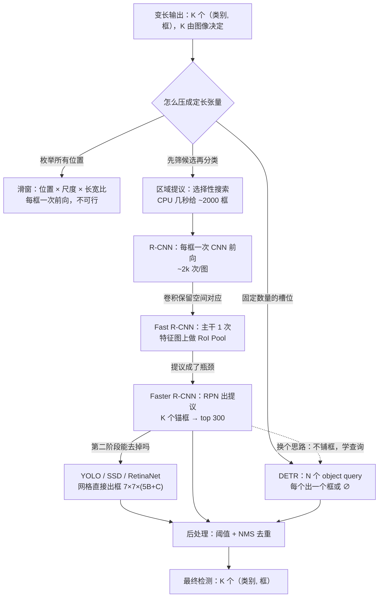
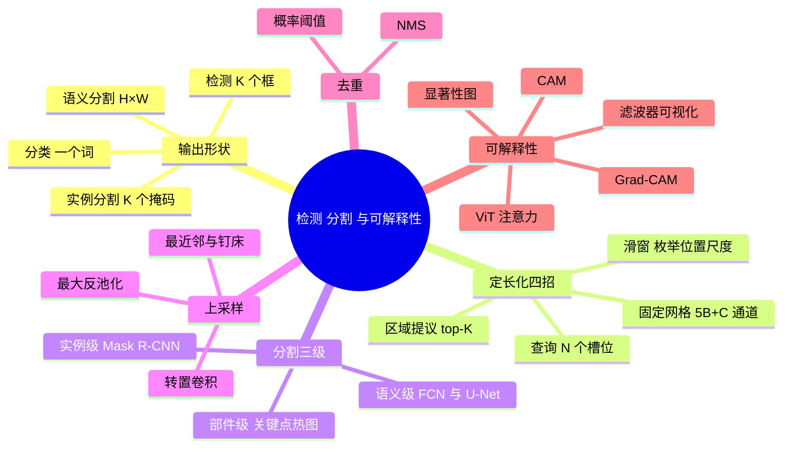

> **课程信息**
>
> - **课程名称**：Stanford CS231n: Deep Learning for Computer Vision（Spring 2025）
> - **本模块覆盖**：Lecture 9. Object Detection, Image Segmentation, Visualizing and Understanding（178 页幻灯片）
> - **主讲教师**：Ehsan Adeli
> - **授课日期范围**：2025-04-29
> - **课程主页**：[cs231n.stanford.edu/2025](https://cs231n.stanford.edu/2025/schedule.html)
> - **官方课件**：[lecture_9.pdf](https://cs231n.stanford.edu/slides/2025/lecture_9.pdf)（178 页，书中逐页插图）
> - **字幕来源**：[cs231n_sp25_kor_sub · eng](https://github.com/lpaiu-cs/cs231n_sp25_kor_sub/tree/main/eng)（公开英文转写，中文由本书重写）
> - **版权说明**：幻灯片与课程材料版权归 Stanford University 及授课教师所有；本书为非官方学习笔记，仅用于学习与研究。

前八个模块把「一张图进、一个标签出」这条流水线拆到了底：评分函数、损失、反向传播、卷积算子、骨干架构、序列模型。这条流水线有一个从没被质疑过的前提——**输出是定长的**。C 个类别的分数写死在最后一层的权重矩阵里，10 个数还是 1000 个数，在定义网络的那一刻就定好了。本模块要处理的三类任务，第一个动作都是拆掉这个前提。语义分割要输出 H×W 个标签；目标检测要输出若干个「类别 + 框」，而「若干个」的数量由图像内容决定；可解释性则反过来问：既然分数是一个定长向量，它究竟由图上哪一块撑起来的。输出一变长，工程上的账就全落到同一个地方——**怎么把不定长的答案编码进定长的张量**。本模块按这本账组织，不按幻灯片顺序复述：第 1 章先立起 Transformer 的「读出」机制，它是本讲终点 DETR 的地基；第 2–3 章处理分割这一支，核心矛盾是分辨率；第 4–6 章处理检测这一支，核心矛盾是输出长度，四个子问题（有几个、在哪里、是什么、怎么去重）分别由定长化编码、框回归、分类头与非极大值抑制回答；第 7 章把两支合成实例分割；第 8–9 章换方向，问网络凭什么这么答。

这一页没有技术内容，但标记了课程节奏：作业二之后紧跟着期中与项目里程碑。讲师在 00:03:21 交代了一句安排——把 ViT 复习完就停下来答疑，作业相关的问题那时一起问。所以下面这一章的前半段语速偏快，是在赶进度，不是在讲新东西。

## 1. ViT 的读出端只有两个接口：一个可学习的分类 token，或对 patch 做平均池化
*(参考时间: 00:00:28 – 00:15:53｜Lecture 9)*

把 Transformer 放在检测模块的开头，不是因为它排在第一页，而是因为它回答了本模块的终极问题。检测这条线走到 2020 年，答案是一个纯 Transformer 模型：定长化不靠网格、不靠锚框，而靠**一组固定数量的查询向量**。要看懂「查询凭什么能代替锚框」，得先看清 Transformer 是怎么从一串 token 里读出一个答案的——这正是 ViT 那七页在做的事。

这张图之所以被重放，是因为本讲最后一个模型会把它原样搬走：卷积骨干产出的特征图变成编码器的 token 序列，检测头变成解码器，而解码器输入端那组「查询」，第 6 章会以 object query 的名字再次出现。此刻只需要记住一件事——解码器不是把编码器的输出复制一遍，而是拿它当键值，用查询去里面取信息。

把「贵」和「好」分开算，这一页就是一张账表。循环网络要 O(N) 的隐状态显存，且必须逐时刻串行，不可并行；卷积可以并行，但单个输出的感受野有限，要靠堆很多层才能看到远处；自注意力让每个输出直连全部输入，代价是 O(N²) 计算与 O(N) 显存，好处是四次矩阵乘法就能并行算完。讲师的判断很干脆：更贵，但建模能力明显更好，所以今天的应用默认选它。这里埋着一个后文要用的推论。图像切成 patch 之后，序列长度 N 只有 196 左右（224/16 的平方），O(N²) 完全付得起；而在像素级任务里 N 会变成几万，自注意力就付不起了。**同一个算子，在两种分辨率下的可行性完全不同**——这条约束会决定第 6 章 DETR 为什么必须站在 CNN 特征图而不是原图上。

整页只有一张图和一行标注。接下来七帧都在它身上做同一件事：把一个二维像素网格变成一维向量序列。

切块是这条路线全部的秘密，也是它唯一的损失来源。序列模型只看得见「第几个 token」，看不见「这个 token 原本在图的左上还是右下」——位置在这道工序里被主动丢掉了。

224/16 = 14，每边切出 14 块，N = 196。这个数字幻灯片没有写，但它是后面所有计算量估算的基准：196 个 token、每个 768 维，进 Transformer 之前的张量是 196×D。

3×16×16 = 768 是算术结果，不是超参；真正的超参只有 D，也就是整个 Transformer 的宽度。这一步和文本里的词嵌入是同一件事——查表换成了矩阵乘。

位置是被切块丢掉的，所以要显式补回来：每个位置配一个 D 维可学习向量，直接加到对应 token 上。讲师补了一句实现上的自由——位置编码不必学，也可以人为指定，比如按 1、2、3 顺序编号，或者用 (x, y) 两套坐标各编一套再相加，效果差别不大。

到这一帧，输入的形状已经和一句自然语言的词向量序列完全同构，后面的层一行都不用改。唯一的改动是掩码：语言模型必须遮住未来，图像没有「未来」，每个 patch 可以看所有 patch。

分类结果怎么读出来？最常用的办法是硬塞一个额外的 token，它不对应图上任何一块，只负责在层层自注意力里「收集」全局信息。讲师回答过一个很自然的追问：它不是 bias，而是一个独立的可训练向量，最后会被一个前馈层或线性层映射成 C 类概率。这句话值得记住，因为第 6 章的 object query 用的是完全相同的构造。

patch 自己的输出向量在这一步被丢掉——它们并没有浪费，信息已经通过自注意力汇进了分类 token。这张架构图真正想说的是「一个 token 代表整张图」：读出端只留一个位置，其余位置在读出时被牺牲掉。

从这里开始，幻灯片把整条流水线重画一遍，只为换掉最后的头。第一帧仍是输入与切块，和前面没有区别。

这一步与前面那步完全相同，只是这次它要作为「池化头」版本的第一步被重新记账。

串好的 D 维向量在这一帧被明确标成 Transformer 的输入。到此为止，两条路线完全一样，分歧只发生在输出端。

措辞比前面更直白：不是告诉它序号，而是告诉它坐标。这一句差别在检测里会放大——框的回归依赖坐标，序号对回归没用。

这一条在语言模型里是禁忌，在图像里是默认：像素之间没有因果顺序，遮住一部分不会让任务变得更有意义，只会白丢信息。

输出是 N 个 D 维向量，一个 patch 一个，没有额外的汇总位置。这一帧的价值在于把「读出」变成一道摆明面的事实：所有信息都在 N 个向量里，你怎么读是你的事。

两条路线的工程差别只有一句：分类 token 让网络自己学着把信息汇总到一处，表达力更强；平均池化强行假设每个 patch 贡献等权，参数更少、更不容易过拟合。讲师说两者的监督方式完全一样——反向传播加 Softmax 或二分类交叉熵。这个「池化 + 全连接」的读法值得先记住。第 8 章讲 CAM 时，整个推导的前提就是分类器紧跟在全局平均池化之后；换句话说，CAM 能成立，靠的正是这一页这个不起眼的池化头。ViT 里可选地用池化，CAM 里必须用池化——同一件事，两种命运。

接下来九页是本讲唯一与检测无关的部分，作用是交代「2025 年的 Transformer 长什么样」。之所以值得花九页，是因为第 6 章的 DETR 用的就是这一版，而不是 2017 年那一版。

原版把归一化放在残差相加之后，意味着无论子层学出什么，输出都会被重新归一化一次，网络学不出严格的恒等映射。而恒等映射恰恰是深网络能训起来的前提——某一层实在没用，至少可以什么都不做。这个论证和卷积模块里 ResNet 残差的动机是同一个：**先保证「不变得更差」这条路存在，再谈变好**。

残差主干因此成了一条干净通路，梯度可以原样穿过；代价是主干数值不再被归一化约束，训练要靠 warmup 之类的手段稳住。幻灯片只给一句结论：训练更稳定。

$y_i = x_i/\mathrm{RMS}(x)\cdot\gamma_i$，其中 $\mathrm{RMS}(x)=\sqrt{\varepsilon+\frac{1}{N}\sum_{i=1}^{N}x_i^2}$。少一次求均值、少一次减法，在大模型上是实打实的算力节省。讲师对这类改动的态度很诚实：多数是经验上更稳，理论解释是事后补的。

$Y=\sigma(XW_1)W_2$，$W_1$ 是 D×4D，$W_2$ 是 4D×D。中间层宽度是输入的四倍，这是 Transformer 里最占参数的一块——一个 block 里 MLP 的参数量通常是自注意力的两倍以上。

$Y=\sigma(XW_1)\odot(XW_2)W_3$：一条支路算激活，另一条当开关，逐元素相乘决定放行多少。H 取 8D/3 时总参数量与 4D 版本持平，而非线性更强——用同样的参数预算换更复杂的门。

第四处改动是把「一个 MLP」变成「一组 MLP」，每一套独立的权重叫一个专家。

路由是这招的核心：每个 token 只被送到 E 个专家中的 A 个（A < E）。于是参数量按 E 增长、计算量只按 A 增长，这是目前同时做到「模型很大」和「推理不太贵」的主要手段。

第三帧把话挑明：GPT-4o、GPT-4.5、Claude 3.7、Gemini 2.5 Pro 这一档模型几乎必然使用 MoE，参数量在 1T 以上，但细节不再公布。讲师在答疑里补了两条经验：专家并行训练、各自随机初始化，所以会自然分化去学不同侧面；专家数 E 与活跃数 A 都是超参，通常预先定死，不做精调。

汇总页把这四条并列：Pre-Norm 是把归一化挪进残差，RMSNorm 是换一种归一化层，SwiGLU 是换一种 MLP，MoE 是学 E 个 MLP、每个 token 只用 A 个。四条加起来，就是「2017 年的架构」与「2025 年的模型」之间的全部结构差异。对本书而言，这一章要带走的不是这四个名词，而是两件会在后文复用的东西：**读出端可以是一个可学习的向量**（分类 token → object query），**归一化的位置决定了梯度能不能干净地穿过残差主干**（Pre-Norm → 深检测器的可训性）。为什么下一章要从「输出形状」重新讲起？因为 Transformer 给出的是一个定长张量，而检测要的是不定长列表——两者的接缝，就是接下来六章要处理的地方。

## 2. 输出形状决定架构：四类任务其实是同一条分类器的四次加条件
*(参考时间: 00:15:57 – 00:25:04｜Lecture 9)*

讲师在这一段先摆出一张四格图，然后逐格点亮。这张图值得当成整个模块的地图：四个任务的差别不在网络有多深，而在输出的形状——一个词、H×W 个词、若干个（词，框）、若干个（词，框，掩码）。形状一变，损失函数、标注成本、后处理方式全都跟着变，而网络的主干可以一动不动。

议程把全讲切成两块：Computer Vision Tasks（语义分割、目标检测、实例分割）与 Visualization & Understanding（层可视化、显著性图、CAM 与 Grad-CAM）。第一块占四分之三的时长，第二块只有十分钟，讲师自己说这是「把最重要的几个过一遍」。

四行字里最关键的是语义分割下方那句「No objects, just pixels」。它同时解释了两件事：为什么语义分割之后还需要目标检测（要个体），以及为什么检测之后还需要实例分割（要形状）。分类那一格写的是「No spatial extent」，检测与实例分割共用「Multiple Object」这个括号——它们的区别不在有没有多个物体，而在要不要像素级掩码。

镜头倒回第一讲：给定 {dog, cat, truck, plane, ...} 这样的标签集合，为一张猫图输出一个词。这张图在此处不是复习，而是靶子——后面所有任务都是在这句话上加减条件得到的。

同一张四格图，高亮挪到第二格。要的输出不是「图里有草、猫、树、天空」，而是每个像素属于哪一个类别。这等于把分类问题复制 H×W 份，一次性摊在一张图上。

形式化只有两行：测试时对新图像的每个像素分类，训练时每张图都要有逐像素的语义标注。讲师顺带提了历史成本——早年这类数据集是靠人坐下来一格一格标出来的，非常贵；现在有工具辅助，但标注仍是这条路线的主要开销。四个任务的差别可以压成一张表。注意最后一列：**损失函数的形式完全由输出形状决定**，网络结构反而没那么重要。

| 任务 | 输出形状 | 输出定长吗 | 标注成本 | 损失 |
| --- | --- | --- | --- | --- |
| 图像分类 | 1 个标签（C 维分数） | 是 | 每图一个词 | Softmax 交叉熵 |
| 语义分割 | H×W 个标签 | 是（与输入同大） | 每图一张像素标签图 | 逐像素 Softmax 求和 |
| 目标检测 | K 个（类别，框） | 否 | 每图若干框 | Softmax + L2（分类 + 回归） |
| 实例分割 | K 个（类别，框，掩码） | 否 | 框 + 每实例一张二值掩码 | 上述两项 + 掩码逐像素二值损失 |

表里「定长」那一列是整章的杠杆。语义分割看着输出很大，其实是定长的——H×W 由输入尺寸决定，网络照样能一次吐出来；检测看着输出很小，却是不定长的，K 由图像内容决定。**大而固定**可以硬算，**小而浮动**反而要重新设计架构，这是后面五章所有技巧的出发点。

最朴素的想法是只看这一个像素。第一帧只有一张图和问号，问题还没暴露。

答案是否定的：脱离上下文，单看一个像素值判断不出它是什么。一片绿色可能是草，也可能是树冠上的一块。所以要引入上下文，也就是看它周围的一块区域。

问号在这一帧变成「怎么建模这块上下文」——取以目标像素为中心的一个 patch，把它当作一张小图送进分类器。

具体做法：patch 过 CNN，输出中心像素的类别。幻灯片引的是 Farabet 等人 2013 年的场景标注工作与 Pinheiro 和 Collobert 2014 年的循环卷积版本。讲师强调网络可以任选——CNN、ResNet、ViT 都行，因为它做的就是一件早就熟悉的事：给一张小图分类。

代价写明在第五帧：一张 H×W 的图要跑 H×W 次前向，而相邻 patch 大幅重叠，重叠区域被反复计算了无数遍。这不是精度问题，是纯粹的浪费——后面所有分割架构的动机都从这里出发。

第一步改进是把「每个像素跑一次网络」换成「整张图跑一次网络」。但页面同时点出了障碍：分类架构为了变深，通常会在中途把特征图的空间尺寸降下来，而语义分割要求输出和输入一样大。

于是有了全卷积网络（FCN）：整张网里只有卷积，没有池化也没有跨步卷积，输入 3×H×W，中间保持 D×H×W，输出 C×H×W 的分数，最后一个 argmax 得到 H×W 的预测。

代价补在同一页的第二帧：在原始分辨率上维持 D 个通道做卷积，显存与算力都按 H×W 线性膨胀。讲师回顾说，早年 GPU 显存小，这一条几乎直接判了 FCN 的死刑——这也解释了为什么分割架构最终都走向「先降分辨率再升回来」。

这张图是本讲的分割主骨架。左边是已经会做的：D1×H/2×W/2 到 D2×H/4×W/4，通道变厚、空间变薄，感受野随之变大；右边要从低分辨率升回 D1×H/2×W/2 再到 C×H×W。幻灯片在这一帧只搭了骨架，还没有指定任何算子——形状先定下来，再问怎么填。

左边补齐了：池化、跨步卷积，都是第二模块里已经算过账的算子。右边照旧空着，页面上写的是「Upsampling: ???」——**下采样有一整套现成工具，上采样一个都没有**。这个不对称是整章的技术核心，也是下一章存在的理由。讲师在这里停下来提问：这个网络从一张图开始、到一张图结束，损失函数该怎么写？课堂上的回答是逐像素分类损失，讲师确认：对图上每个像素都算一次 Softmax 损失，再对所有像素求和，$L=\sum_{i}\ell_{\text{softmax}}(s_i, y_i)$，然后照常反向传播。这解释了两件事：为什么这类任务必须有逐像素的真值标签图；以及为什么分割的训练成本远高于分类——一个 batch 里，每个像素都是一个训练样本。

## 3. 语义分割：把分辨率压下去再升回来，中间那条捷径决定边界
*(参考时间: 00:25:13 – 00:33:07｜Lecture 9)*

上采样没有现成算子，这是上一章留下的缺口。这一章按「无参数 → 借编码器信息 → 有参数」三级把答案排开：最近邻与钉床是纯几何重排，最大反池化借用编码器记下的位置，转置卷积把上采样变成一层可训练的网络。三级走完，U-Net 那条横向箭头才有地方落。

最近邻把 2×2 输入的每个元素复制成输出里的一块 2×2；「钉床」（bed of nails）只在每块的左上角放原值，其余填零。后者看起来更浪费，但配合后面的卷积层，这些零会被邻域的有效值逐渐「填满」，等于让网络自己学怎么插值。两者都没有参数，都是固定的索引映射。

如果编码器用的是最大池化，解码器就可以做得更准：池化时记下每个窗口里最大值的位置（switch），反池化时把值放回那个位置，其余置零。幻灯片用「Remember which element was max!」标注这一对操作——这是编码器与解码器之间唯一需要传递的额外信息，代价是一份与特征图同大的索引张量。

第二条路线是让上采样也有参数。复习从最普通的卷积开始：3×3 滤波器、步长 1、填充 1，输入 4×4，输出还是 4×4。

第二帧把「点积」两个字标在滤波器与输入重叠的位置上：卷积的每一格输出，都是滤波器与输入某个 3×3 窗口的逐元素乘积之和。

窗口滑动一次，输出就长出一格。步长 1 意味着输入每动一格、输出也动一格，所以输入输出尺寸相同——这就是「无下采样卷积」的字面含义。

把步长改成 2，同样的滤波器就变成了下采样器：输入 4×4，输出只有 2×2。

跳格的位置在这一帧被标出来。步长 2 的效果是：输出里的相邻两格，对应输入里相隔两格的位置。

第三帧给出这句关键解读：步长是输入移动量与输出移动量的比值，所以跨步卷积可以读作「可学习的下采样」——它把 4×4 压成 2×2，压的方式由那 9 个权重决定，而不是由固定的池化规则决定。

把这层关系反过来，就得到转置卷积：输入 2×2，输出 4×4。讲师在课堂上把这一组页面快进过去了，理由是时间不够，只留下一句「它是常规卷积的逆操作，把卷积作用在输入的转置版本上，所以输出更大」，逐帧的构建过程留在幻灯片里。这里把它补完，因为它是后面所有解码器的默认零件。

角色互换了：普通卷积里是滤波器扫过输入、每个输出取一个加权和；转置卷积里是输入的每个值乘上整个滤波器，把一整块「印」到输出上。这一帧的标注是「Input gives weight for filter」，说的就是这件事。

步长的方向在这一帧被翻过来：滤波器在输出上每次移动 2 格，对应输入前进 1 格。于是步长从「压缩比」变成了「放大比」，2×2 就被放大成 4×4。

放大之后必然有重叠：相邻两次「印」的区域会撞在一起，处理办法是相加。

叠加完成就是最终的 4×4 输出。五帧连起来看，转置卷积并不神秘——它是「把每个输入值乘以滤波器、按步长铺到输出上、重叠处求和」，与普通卷积共用同一套权重，只是遍历顺序反了。这也解释了它为什么叫「转置」：卷积可以写成矩阵乘法，转置卷积就是乘同一个矩阵的转置（第 151–152 页的附录给了这个代数版本）。

一维例子把这件事算干净：输入只有 a 和 b，滤波器是 (x, y, z)。a 的三个副本占据输出第 1–3 格，得 (ax, ay, az)；b 的三个副本按步长 2 挪到第 3–5 格，得 (bx, by, bz)，其中第 3 格与 a 的第三格撞上，所以最终输出是 (ax, ay, az+bx, by, bz)。输入 2 个数、输出 5 个数，正好是「核大小 3、步长 2」的放大比：$(2-1)\times 2+3=5$。给定输入长度、核大小与步长，输出长度可以立刻验算。

回到骨架图，两栏都填满了：下采样是池化或跨步卷积，上采样是反池化或转置卷积。到这里 FCN 的账算完——它用一个网络、一次前向，输出整张分割图，比滑窗快了几个数量级。四种上采样方式真正的区别不是「谁更先进」，而是「谁需要编码器递过来的信息」：只有最大反池化需要池化时记下的位置，也正因为需要，它对边界的恢复最准；最近邻与钉床完全无参数，代价是输出里大量位置为零、要靠后续卷积填；转置卷积有参数，把「怎么插值」交给训练，代价是每个输出像素都要乘一次核。

U-Net 是这条路线最有名的实例。整张图呈 U 形：左半边是下采样路径，通道数从 64 涨到 1024，分辨率从 572×572 一路降到 32×32；右半边对称地升回去，最后输出与输入同尺寸的分割图。讲师强调它在医学影像里至今仍是强基线——不想上基础模型的时候，U-Net 及其变体还能给出接近最好的结果。

左半边在这一帧被定性：下采样让感受野变大，模型能看到更大的结构；代价是空间信息被丢弃，边界位置变得模糊。这两件事是同一枚硬币——想把「这是一只猫」判断对，就得看得足够远；看得足够远，就必然丢掉「猫耳朵在哪个像素」。

右半边的任务因此很明确：从低分辨率、语义强的特征里重建高分辨率的映射。但信息已经丢了，光靠上采样补不回来，边界会糊。

U-Net 的解法是那条横向的灰色箭头：把左侧同分辨率的高分辨率特征图复制过来，与右侧上采样的结果拼接（concatenate），再一起过卷积。这就是跳跃连接（skip connection）在分割里的形态——它不改变网络的深度，只是把「被丢掉的空间细节」原样递到对面。注意它和 ResNet 的残差不是一回事：残差是相加，保留的是数值通路；这里是拼接，保留的是特征内容。

汇总页把整章压成一句：分割网络就是一组卷积层，中间夹着下采样与上采样。讲师在这里又回答了一个问题——转置卷积的滤波器是训练出来的吗？是，它和其他卷积层没有区别，梯度照常回传。

最后一页点出这条路线做不到的事：输出只有像素类别，图上如果有两只狗，模型会说这两块都是 dog，但不知道它们是两只。原因不在网络容量，而在**监督信号里根本没有「个体」这个概念**——标签图里两只狗共用同一个类别编号，模型没有任何依据把它们分开。要回答「这是同一只还是两只」，必须先有「物体」这个概念，于是话题转到目标检测。

## 4. 检测的第一性问题是输出长度，滑窗是对它的第一次失败尝试
*(参考时间: 00:33:29 – 00:38:37｜Lecture 9)*

语义分割的输出大而固定，检测的输出小而浮动，后者才是真麻烦。这一章先把麻烦精确地定义出来（一个物体 4 个数，三个物体 12 个数，再多就是「很多个数」），再看两种最朴素的定长化尝试——单目标回归与滑窗——各自死在哪一步。它们死掉的方式不同，却指向同一个结论：**必须先有一个便宜的办法把「哪里」筛出来**。

前两列讲完被压成灰色，第三、四列的画面还暗着，只有下方那个「Multiple Object」的括号先亮起来——它在提示这两列的共同点：输出数量不再固定。

第三列亮起来：同一张客厅照片里，两只狗与一只猫被三个不同颜色的框圈出来，下方标签是 DOG、DOG、CAT。分类只输出一个词，检测要输出三个（类别，框）对，而「三」这个数字是这张图特有的。

先假设图里只有一个物体，问题立刻退化成「分类 + 定位」。主干之后接两个并行头：全连接 4096→1000 给类别分数，全连接 4096→4 给框的 (x, y, w, h)。关键认知是——定位可以当成回归问题，框的四个数就是四个连续变量。

损失也分成两路：类别用 Softmax 交叉熵，框用 L2 距离，因为框坐标本身就是实数，直接算预测框与真值框的欧氏距离即可。页面上那句「Treat localization as a regression problem!」是这一节唯一需要记住的话。

两路相加得到多任务损失 $L=L_{\text{cls}}+\lambda L_{\text{box}}$，一个标量、一次反传。讲师没有展开 $\lambda$ 怎么定，但这个结构在今天的检测器里几乎原样保留：分类头与回归头共享主干，各自出损失。

一旦图里不止一个物体，输出就变成了 CAT: (x,y,w,h)、DOG: (x,y,w,h)、DUCK: (x,y,w,h) 这样的列表。列表长度不固定，而网络的输出层是定长的矩阵乘法——这是整章要解决的核心矛盾。

幻灯片把这个矛盾画成三行：单个物体 4 个数，三个物体 12 个数，再多就是「很多个数」。每张图需要的输出数量都不同，所以「把输出维度定成 4N」这条路走不通——N 取多少都不对：取小了漏检，取大了浪费，而且训练时得先解决「哪个槽位对应哪个物体」的匹配问题。在继续往下走之前，值得把「检测」拆成四个可以独立追问的子问题。后面每一章只推进其中一两个，读者可以拿这张表当进度条。

| 子问题 | 一句话 | 由什么回答 | 在哪一章推进 |
| --- | --- | --- | --- |
| 有几个 | 输出长度由图像内容决定，网络只会吐定长张量 | 固定网格、固定查询数、top-K 提议，三种定长化编码 | 第 5 章的 top-300、第 6 章的网格与查询 |
| 在哪里 | 框是四个实数，不能直接当类别标签 | 相对提议框的偏移回归、相对锚框的偏移、DETR 的直接回归 | 第 5 章 |
| 是什么 | 每个框要给出类别 | 分类头、R-CNN 的每类 SVM、YOLO 的类分数 | 第 5–6 章 |
| 怎么去重 | 同一物体被许多个框同时答对 | 阈值筛 + 非极大值抑制（NMS） | 第 6 章末尾、附录第 170 页 |

这张表里最容易被低估的是最后一行。去重看起来只是收尾的清理工作，实际上它承担了定长化编码的副作用：滑窗会把同一个物体答上千遍，YOLO 一张图吐 98 个框，RPN 一次给出 2700 个候选。**编码得越稠密，去重就得越狠**，两者是同一笔账的两端。

第一个补救办法是把检测变成很多次分类：在图上取各种裁剪，让 CNN 判断这块是物体还是背景。第一帧是一个空框，三个问题依次回答 NO、NO、YES。

框滑到狗身上，答案翻过来：Dog? YES，Background? NO。检测就此被拆成「枚举所有框 + 逐框分类」。

第三帧只把框挪了一点，答案仍然是 Dog? YES。这个细节说明滑窗的隐含代价：相邻位置高度冗余，同一个物体被反复确认为 YES，而这些 YES 在后处理里要再花力气合并成一个。

框落在猫身上时 Cat? YES。页面右下角抛出问题：这个办法的问题在哪？

问题被写成一句话：需要在巨量的位置、尺度与长宽比上跑 CNN，计算上完全不可接受。这和语义分割的滑窗是同一个病——把「一次前向」拆成了「几万次前向」。区别在于分割的滑窗是 H×W 次（二维枚举），检测的滑窗是位置 × 尺度 × 长宽比（三维枚举），更贵。

于是有了区域提议（region proposal）：先用一种不需要神经网络的方法，找出图上「成块、像物体」的区域。幻灯片给的是选择性搜索（selective search）——在 CPU 上几秒钟给出约 2000 个提议框，页脚还列了 Alexe 等人的 objectness、BING、EdgeBoxes 三条同代路线。这一步不判断类别，只判断「这里可能有东西」，所以可以做得又快又糙。讲师说这是 2014 年前后的主流思路：把「在哪」和「是什么」拆成两个问题，各自用最合适的工具解决。代价也随之而来——**提议算法与检测网络是两套独立系统，前者的错误无法被后者纠正，后者的梯度也传不回前者**。这个裂缝要等到第 5 章末尾的 RPN 才被补上。

## 5. 从 R-CNN 到 RPN：把「哪里」从外部算法收进同一张特征图
*(参考时间: 00:38:48 – 00:43:12｜Lecture 9)*

有了提议，检测就变成「裁出来、分类、微调框」三步。这一章的三次迭代，每一次都在减少重复计算：R-CNN 把同一个卷积算了 2000 遍，Fast R-CNN 只算一遍，Faster R-CNN 干脆把提议也塞进这一遍里。三次改动背后是同一个观察——**卷积保留空间对应关系，所以特征图上的位置可以当像素坐标用**。

R-CNN 的第一帧只有输入图像。这张图出自 Girshick 等人 2014 年的论文，后面的七帧都在它上面加部件。

感兴趣区域（RoI）在这一帧加进来，数量约 2k。注意这些框大小不一，而 CNN 要求固定输入尺寸，所以下一步必须变形。

第三帧把每个框里的像素强行拉伸成 224×224。这个 warp 会破坏长宽比——一只细长的狗会被拉胖——是 R-CNN 后来被诟病的细节之一，但当时它让「任意框」能喂进标准分类网络。

最贵的一步出现在第四帧：每个 warp 后的区域都要完整地过一次卷积网络。2000 个框就是 2000 次前向，而它们中有大量像素是重复的——相邻提议框的重叠率常常超过一半。

第五帧给每个区域接一个 SVM 分类器，输出类别。R-CNN 用的不是 Softmax 而是每类一个 SVM，这是那个年代的惯例；它意味着分类器与卷积网络是分开训练的，梯度不共享。

第六帧补上框修正：不直接预测绝对坐标，而是预测相对提议框的四个修正量 (dx, dy, dw, dh)，把框「挪一点、缩一点」。用相对量而不是绝对量，是因为同一个物体在不同位置上都要被正确回归，绝对坐标会逼网络去记住位置——这个「预测相对量」的思想，后面在锚框和 DETR 里还会以不同形式出现两次。

第七帧把代价写出来：每张图需要约 2k 次独立的 forward pass。这就是 R-CNN 在工程上被判死刑的原因，也是下一节全部改进的出发点。

破局的想法只有一句：卷积保留空间信息，特征图上的位置与像素位置有明确对应，那为什么不等整张图过完卷积再裁剪？这一页用红字标出「Idea: Pass the image through convnet before cropping! Crop the conv feature instead!」——2000 次前向就此变成 1 次。这条思路能成立的前提是卷积的平移等变性：像素坐标除以总步长，就是特征图坐标。

Fast R-CNN 的六帧是同一张架构图的逐层搭建，第一帧先把旧架构摆在左边作对照，右边是新流水线要占的位置。

第二帧加上主干：整张图过一次 ConvNet，得到 conv5 特征图。主干可以是 AlexNet、VGG、ResNet 中任意一个，幻灯片把它们并列写在「Backbone network」下面——检测器的精度与速度很大程度上由这个选择决定，这也是后来「骨干网」成为独立研究方向的起点。

RoI 在这一帧被投到特征图上。因为卷积是平移等变的，一个框在两张图上的相对位置一致，所以投影只需要除以总步长。

第四帧做「裁剪 + 缩放特征」。这一步是 RoI Pool 的雏形，具体怎么把任意大小的特征区域压成固定尺寸，幻灯片留到附录里讲（第 153–159 页），核心是「切格子 + 每格取最大」，代价是两次量化带来的错位。

第五帧是 Per-Region Network：每个 RoI 的特征接一个很小的头，一路线性 + Softmax 出类别，一路线性出框偏移。至此每张图只过一次主干，代价从 2000 次前向降到 1 次加 2000 次小头——小头的计算量与主干不在一个量级。

第六帧把整条流水线拼齐。讲师对这条线的评价是：它把检测从「不可能实时」推进到「可以谈速度」，但还剩一个瓶颈没解决——那 2000 个提议仍然来自一个与网络无关的算法。附录里的实测数字把这笔账算得很清楚：Fast R-CNN 端到端 2.3 秒，去掉提议只要 0.32 秒，**提议吃掉了 85% 的时间**。

第三个瓶颈是提议本身。既然主干已经把图变成了 512×20×15 的特征图，为什么不在这张图上直接预测「哪里可能有物体」？RPN 就是这么来的：输入 3×640×480，输出 512×20×15，每个空间位置对应原图上一个 32 像素见方的格子（640/20 = 32）。

锚框（anchor）在这一帧引入：特征图上每个点放一个固定尺寸的框，它的作用是把「预测框」变成「预测相对锚框的偏移」。这和 R-CNN 的 (dx, dy, dw, dh) 是同一个思想，只是这次参照系是预先铺好的，而不是外部算法给的。

第三帧加上第一个头：对每个位置做二分类，判断对应的锚框里有没有物体，输出 1×20×15 的 objectness 图。注意这里不分具体类别，只分「物体 / 背景」——把「有没有」和「是什么」彻底拆开，是 RPN 能做得便宜的原因。

第四帧加上第二个头：对判为正的框，回归它到真值框的四个修正量，输出 4×20×15。

锚框从一个变成 K 个，覆盖不同尺度与长宽比。于是两张输出图的通道数分别乘 K：objectness 是 K×20×15，框变换是 4K×20×15。这一步把「多尺度」从一个网络结构问题变成了一个通道数问题——同一张特征图，用 K 组不同的参考框去解释它。

第六帧是收尾：把 K×20×15 个框按 objectness 排序，取前约 300 个当提议。以 K=9、20×15=300 个位置算，一共 2700 个候选框，其中只有约 300 个进入第二阶段——**RPN 在这里把「稠密预测」压成了「稀疏提议」**，而这 300 个框就是「有几个」这个子问题的第一个正式答案：不是数出来的，是排序取前 K 个。到这里，两阶段检测器的账算完了：第一阶段的提议与第二阶段的分类回归共用同一张特征图、同一次前向。讲师在答疑里给了一个很实际的评价：这类模型今天已经很少用了，因为它们本质上仍要跑两遍（一遍出提议、一遍逐区域分类），计算太重；但理解它怎么走到这一步，是理解后面所有单阶段模型的前提。

## 6. 单阶段与查询：YOLO 用网格换速度，DETR 用查询换掉锚框
*(参考时间: 00:44:35 – 00:57:38｜Lecture 9)*

上一章末尾剩下的问题是：第二阶段能不能也去掉？如果能，提议就不必先变成 300 个框再逐个分类，而可以在每个位置上直接吐出类别与框。这一章给出两个答案，方向完全相反：YOLO 用**固定网格**把「哪里」硬编码进输出张量的下标里，DETR 用**固定数量的查询**把「有几个」变成一个可学习的槽位数组。前者把先验写死在几何上，后者把先验交给训练。

把 RPN 的思路再往前推一步就是单阶段检测器：不再分「提议」与「分类」两段，每个格子上直接同时出框和类别。幻灯片给的账很清楚：图像切成 7×7 网格，每格 B 个基准框，每个框 5 个数 (dx, dy, dh, dw, confidence)，再加 C 个类别的分数，输出张量就是 $7\times7\times(5B+C)$。以 B=3、C=20 计，一共 7×7×35 = 1715 个数——一个固定尺寸的张量，变长问题被彻底消掉了。页面最后一句点评很到位：它很像 RPN，但是类别相关的。

YOLO（You Only Look Once）是这条路线最有名的名字，标题就写着 real-time object detection。讲师说即便在今天，工业应用里仍然大量拿它当基线，因为快且够准；他也提醒这个名字的字面意思就是它的设计哲学——整张图只看一次。

秘密全在这一帧：把图划成 S×S 的网格（这一版是 7×7）。每个格子只对自己覆盖的那一小块负责，「哪个框归哪个物体」这个分配问题由网格位置直接裁决——不需要提议，也不需要匈牙利匹配。代价是格子边界上的物体容易被漏掉或重复，这个缺陷后来靠多尺度特征与锚框缓解。

第三帧列出每个格子的三项输出：框里有物体的概率 P(object)、B 个边界框的 (x, y, h, w)、以及属于各类的概率 P(class)。这两项是分开出的：前者回答「这里有没有东西」，后者回答「那是什么东西」，相乘才是这个框属于某一类的置信度。

B 在这一帧被定成 2。这个数很小，含义是每个格子最多负责两个物体——对 7×7 的网格来说够用，因为物体中心通常落在不同格子里。

第五帧展示同一格子里两个框各自的概率。它们是并行输出的，网络并不需要在两个框之间做选择，选择留给后处理。

所有格子的框被叠回原图，线的粗细就是概率。到这一步，一张图会产生 7×7×2 = 98 个框，绝大多数是背景或重复——这就是单阶段检测器为速度付出的代价：**答案里塞满了冗余，得靠后处理挤掉**。

第七帧是后处理的结果：先按概率阈值筛，再用非极大值抑制（NMS）去掉互相重叠的重复框，剩下的就是最终检测。讲师没有展开 NMS 的细节，只说它是这类检测器的标准收尾；它的规则其实极简——按分数排序，每次取最高分的框，把与它 IoU 超过阈值的框全部删掉，重复到列表为空。

第三条路线把「锚框」整个删掉。DETR 的流水线是：CNN 提特征 → Transformer 编码器-解码器 → 直接输出一组框；训练时用二分匹配（bipartite matching）把预测框与真值框配对，再回归坐标。页面上那句「No anchors, no regression of box transforms」是本页的重点——它连「相对锚框的偏移」这个概念都不需要了。这一步和第 1 章接上了：DETR 的解码器输入端，就是 ViT 里那个分类 token 的推广。分类 token 是一个可学习向量，负责收集全局信息并输出一个类别；object query 是一组可学习向量，每个负责收集出**一个物体**的信息并输出（类别，框）或「无物体」。从「一个槽位」到「N 个槽位」，就是分类到检测的全部差别。

从这一帧开始，幻灯片把流水线的三个部件逐个放大。先放大主干：CNN 输出的特征图要与位置编码相加，否则 Transformer 无法区分空间位置——这和 ViT 里的位置嵌入是同一个问题，只不过这里的 token 来自特征图的每个空间位置。

主干内部在第三帧补完：特征图与位置编码在加号处合并。到这里，一张图已经被变成了一串带位置的 token，和 ViT 的输入形式一致。

镜头再推近一层，落在编码器上：多层自注意力加 MLP，输入输出都是同一串 token。这里的 token 数量由特征图决定（前面 RPN 那页的尺度是 20×15 = 300 个），远小于像素数，所以 O(N²) 的自注意力在这里付得起——这正是第 1 章那条「同一个算子在两种分辨率下可行性不同」的推论落地的地方。

第五帧补上解码器：它以编码器的输出为键值，输入端则是一小组可学习的查询向量（object queries）。讲师反复强调过这一点——这些查询不是图像块，也不是预先铺好的框，就是一堆可训练参数，网络自己学出「每个查询该盯住什么」。

最后一帧补上预测头：每个查询的输出过一个 FFN，得到一个类别加一个框，或者被判成 no object (∅)。右边那张图就是最终结果——两只海鸥被两个查询各自认领。讲师解释了这个设计的容量含义：**查询数就是你允许模型一张图最多检出多少个物体**，超过这个数的物体只能被丢掉，所以要按数据集调整。课堂答疑里还有三条值得记下的边界。其一，查询与物体之间没有任何显式的一一对应，是层层自注意力与交叉注意力让它们自然错开，再加监督把这种分工固化下来。其二，DETR 只用类别标签与框训练，不需要像素级分割；反过来，有分割标签时可以转成框来喂它。其三，全监督检测器无法泛化到训练集中没出现过的类别，只能输出「无物体」——零样本检测是另一条研究线。把五代模型排在一张表里，可以看出每一次迭代改的都只是「定长化」这一招，而「在哪里／是什么」这两个子问题的解法几乎没动过。

| 模型 | 年份 | 怎么把变长输出定长化 | 每图前向 | 还要外部提议吗 | 主要瓶颈 |
| --- | --- | --- | --- | --- | --- |
| R-CNN | 2014 | 外部给 2k 提议，逐框一个输出 | 约 2000 次 | 是（选择性搜索） | 卷积被重复计算 2000 遍 |
| Fast R-CNN | 2015 | 同上，但特征只算一次 | 1 次 + 每区域小头 | 是（选择性搜索） | 提议占端到端 85% 的时间 |
| Faster R-CNN | 2015 | RPN 出 2700 个候选，取 top-300 | 1 次 | 否 | 第二阶段仍要逐区域算 |
| YOLO / SSD / RetinaNet | 2016–2017 | 固定网格 $7\times7\times(5B+C)$ | 1 次 | 否 | 冗余框多，小目标弱 |
| DETR | 2020 | N 个查询各出一框或 ∅ | 1 次 | 否 | 查询数即容量上限，超过就丢 |

图里有一条容易被忽略的虚线：DETR 不是从 YOLO 演化来的，它绕开了整条「铺框—回归偏移」的技术栈，只保留「固定数量的输出槽位」这个思想。这也是本模块把它放在最后的原因——它证明定长化不一定要靠几何先验，也可以靠一组可学习的参数。

## 7. 实例分割：检测头旁边加一条 28×28 的支路，顺便把边界对齐做对
*(参考时间: 00:58:01 – 01:01:31｜Lecture 9)*

检测回答了「有几个、在哪、是什么」，剩下的是「形状」。讲师对这一章的口径很干脆：实例分割不需要新架构，只需要在检测器上多接一个输出。真正的技术含量不在「加一条支路」这个动作，而在两个细节——掩码为什么必须按类输出，以及 RoI Align 相对 RoI Pool 到底改了什么。这两个细节决定了掩码的边界是干净还是糊。

第四列要求两者兼得：既分个体，又给像素级掩码。注意它和检测共用「Multiple Object」这个括号，差别只在输出多了一张掩码——这正是本章要证明的事。

这一页只有一行标题，作用是把上一章的终点当作本章的起点。讲师的逻辑是：R-CNN 那条「主干 → 提议 → 逐区域分类与回归」的流水线不动，只在每个区域上再挂一个头。

于是有了 Mask R-CNN：在原来的分类头、框回归头之外，给每个 RoI 再加一条小分支，用一个小的全卷积网络预测 28×28 的二值掩码。讲师强调这个掩码是「每个 RoI 一张」，与输入图像里物体大小无关——28×28 是固定分辨率，一个占满半张图的人和一个远处的人，掩码都是 28×28。

第二帧把输入端的账写清楚：主干加 RPN 给出 RoI，RoI Align 把每个 RoI 的特征对齐采样成 256×14×14。用 Align 而不是 Pool，是因为池化要把框「吸附」到整数格子上，两次量化下来会带来几个像素的错位——对分类来说几个像素无所谓，对掩码来说错位就是边界糊。

第三帧补上掩码支路：256×14×14 的特征过两层卷积，输出 C×28×28——每个类别一张掩码，而不是所有类别共用一张。这样掩码分支与分类分支解耦，分类错了不会连带把掩码也画错；计算上也只是把最后两个卷积的输出通道从 1 改成 C，代价很小。

掩码的真值不是语义标签图，而是「这个 RoI 内部，哪些像素属于这个物体」的二值图。第一组示例把来源摆清楚：左图红框圈住床与柜子之间的一把椅子，右图是这只椅子在 28×28 网格上的二值形状，边缘带着锯齿——这正是固定低分辨率带来的量化。

第二帧在下方又叠了一组：同一个房间、框稍微挪了一点，掩码的边缘也跟着变。讲师用这一点说明掩码分支的学习目标——它学的是「框内这块像素属于谁」，而不是把整类物体的形状背下来。

第三帧补上第三组，页面从竖排变成网格排布。三组放在一起，「掩码与框是一对一，而不是与图像一对一」这件事变得一目了然。

四组齐了：右上那组框放得松，掩码也跟着变宽；下面两组换成了床上的人和床本身。这四对样本把「每类一张 28×28」这个设计讲透了——同一个框里，不同类别本来就该有不同的掩码（一个人坐床上，框里既有人的像素也有床的像素），所以掩码头必须按类输出 C 张，而不能只出一张。

结果页是这一章的说服力所在：同一张图里的人和物被分别框出、分别给出掩码，遮挡关系也处理得住。讲师的原话是「results have been very, very good」，但他随即补了一句现实评价——这类两阶段模型今天已经很少用了，因为计算太重。

同一个框架还能做姿态估计：把掩码分支换成关键点热图，一人一张，就得到人体骨架。这说明「每个 RoI 一条小全卷积支路」是一种通用接口，输出什么取决于你把支路接成什么样——掩码、关键点、甚至分割的粗粒度版本，都是同一个插槽的不同插件。

工程落地有现成的：TensorFlow Detection API 里有 Faster R-CNN、SSD、RFCN、Mask R-CNN；Detectron2（PyTorch）里有 Mask R-CNN、RetinaNet、Faster R-CNN、RPN、Fast R-CNN、R-FCN。两处都可以拿预训练模型在自己的数据上微调——这也是迁移学习在检测任务上的标准姿势。

复盘页把四类任务并排放回同一张图上。讲师在这里给了一个很实际的落点：这些任务的组合仍然出现在工业流水线上，比如分拣烂番茄——先检测出每一个番茄，再分类好坏，两个任务串起来才是一条可用的产线。把分割这条支线按「输出粒度」排一下，本讲其实走了三级。粒度每往下走一级，输出就多一个维度，而网络只需要多接一条支路。

| 粒度 | 输出 | 分个体吗 | 需要什么标注 | 本讲对应 |
| --- | --- | --- | --- | --- |
| 语义级 | 每个像素一个类别 | 否 | 逐像素类别图 | 第 3 章：FCN 与 U-Net |
| 实例级 | 每个实例一张 28×28 掩码 + 一个框 | 是 | 框 + 实例掩码 | 本章：Mask R-CNN |
| 部件级 | 每个实例一组关键点热图 | 是 | 关键点坐标 | 第 123 页的姿态分支 |

三级之间不是替代关系，而是叠加关系：实例分割的框来自检测，检测的主干来自分类，分类的损失来自第一模块。这也解释了为什么讲师的顺序是分类 → 语义分割 → 检测 → 实例分割——每一级都把上一级的输出当成自己的输入。

## 8. 可解释性：把梯度指向像素，把权重指向特征图
*(参考时间: 01:01:37 – 01:10:14｜Lecture 9)*

前半场问的是「网络输出什么」，后半场换一个方向：网络凭什么这么输出。讲师给的动机很实际——在医疗影像里，「有没有肿瘤」这句话本身没人关心，关心的是肿瘤在哪；而后一个问题只能靠可视化回答。这一章的三种工具是递进的：滤波器可视化看权重，显著性图对像素求梯度，CAM 把全连接权重乘回特征图。三者共同的底气是同一条性质——**卷积是空间一致的，所以特征图上的位置可以一路追回输入图像**。

议程页第二次出现，剩下的十分钟归第二块。讲师自己说这原本是能单独讲一节课的内容，这里只挑最重要的几个。

回到第一讲的线性分类器：权重矩阵的每一行可以重塑成一张图，就是这一类的模板。车那一类的模板看起来像一张正面朝向的车，因为这类样本在训练集里大多是这个姿态。这一页给出一个类比——如果线性模型的权重能看，卷积核的权重也应该能看。

这一层的卷积核是 64 个 3×11×11 的滤波器：64 是滤波器个数，决定输出通道数；3 恰好等于输入通道数，所以每个滤波器都能直接当成一张 11×11 的彩色小图显示出来。看到的是边缘、条纹、颜色斑块——最基础的方向与频率检测器。

换成 ResNet 与 DenseNet，第一层的核变成 64 个 3×7×7，画出来仍然是一堆条纹与色块。三个深度相差一个数量级的网络，第一层却长得很像——**第一层直接吃像素，能学的东西受输入统计量限制，与后面的深度无关**。讲师也点出了这种方法的边界：只有通道数等于 3 的那一层能直接画成 RGB 图，中间层动辄几百个通道，没法直接看。

从这一页开始问一个不同的问题：图上哪些像素对这个分数有贡献？第一帧只做前向，把图变成「Dog」这个类别的概率。

关键的一步是把求导的对象换掉。训练时求的是损失对权重的梯度，这里求的是类别分数对像素的梯度——「这个像素动一点，狗的分数会变多少」。得到的张量和输入同形（3×H×W），取绝对值再对三个通道取最大，压成一张 H×W 的灰度图，就是显著性图。右下角那张图里，狗的轮廓隐约可见。这一步和第 2 个模块的反向传播是同一台机器，只是被问了不同的问题：那时用 $\partial L/\partial W$ 更新参数，现在用 $\partial S_c/\partial x$ 解释输入。梯度不必只服务于训练。

换几张图看，显著性图大体能把主体勾出来，但边缘很碎、背景也有响应。讲师对它的评价是「在很多情况下非常有效」，但没有说它可靠——梯度告诉你哪些像素敏感，却不告诉你网络在哪块区域上建立了类别概念。要回答后一个问题，需要换一种加权方式。

CAM 换了一个角度：不改网络，只改读法。它要求网络在最后用全局平均池化（GAP）把 H×W×K 的特征图压成 K 维，再过一个全连接层得到 C 个分数。这个结构约束既是 CAM 能成立的原因，也是它只能用在最后一层的原因。注意这一步和第 1 章 ViT 的池化头是同一个结构：GAP 把空间信息平均掉，换来一个定长向量。CAM 的全部推导都建立在这个「平均」上——正因为每个空间位置对 $F_k$ 的贡献是等权的，才能把求和拆开、把权重乘回每个位置。

第一步是 GAP 的定义：$F_k=\frac{1}{HW}\sum_{h,w} f_{h,w,k}$ K 张特征图变成 K 个数，空间信息在这里被平均掉了——但也正因为是平均，每个空间位置对 $F_k$ 的贡献是等权的，这给后面的反推留了门。

第二步把分数写成池化特征的加权和：$S_c=\sum_k w_{k,c}F_k$。到这一步，C 个类别分数已经是 K 个池化数的加权和，空间信息暂时还看不见。

第二帧把 $F_k$ 的定义代进去：$S_c=\frac{1}{HW}\sum_k w_{k,c}\sum_{h,w}f_{h,w,k}$。此时外层仍是通道求和，空间求和还包在里面。

第三帧只做一件事——交换求和次序：$S_c=\frac{1}{HW}\sum_{h,w}\sum_k w_{k,c}f_{h,w,k}$。这一步是整个 CAM 的关键。一旦空间索引在外层，括号里那一项对每个 $(h,w)$ 都能单独算，算完就是一像素一个分数。讲师在这里解释了「为什么能一路追回图像空间」的底气：卷积是空间一致的，特征图上的位置与输入图上的感受野中心有固定对应。

第四帧把 $w_{k,c}f_{h,w,k}$ 单独框出来：第 k 张特征图在位置 $(h,w)$ 的激活，乘以它对第 c 类的重要性权重。这一步之后，「类别分数」与「空间位置」之间只剩一个求和的距离。

最后一帧给出定义：$M_{c,h,w}=\sum_k w_{k,c}f_{h,w,k},\qquad M\in\mathbb{R}^{C\times H\times W}$。整个 CAM 就这一行公式——把全连接层里属于第 c 类的 K 个权重，当成 K 张特征图的加权系数，加完再上采样回原图尺寸。它不是新网络，是**对已有权重的一次重新解读**。

结果页最有说服力：同一张建筑照片，问「宫殿」时热图落在屋顶与立面，问「圆顶」时落在穹顶，问「祭坛」时落到内部。同一张特征图，换一组权重就换一种解释，这正好说明权重里编码的是「哪类特征对哪类重要」。

问题也写在同一页上：这个推导要求分类器紧跟在 GAP 之后，所以只能套在最后一层卷积上。而现代 CNN 的最后一层之后往往还有好几层全连接或其他算子，CAM 在那里根本无从下手。另外，最后一层的特征图分辨率本来就低，热图天然很粗。

## 9. Grad-CAM 与注意力：拆掉「只能看最后一层」的限制
*(参考时间: 01:10:15 – 01:13:11｜Lecture 9)*

CAM 的约束来自它的证明方式——它必须知道确切的权重 $w_{k,c}$。Grad-CAM 的解法是把「权重」换成一个现算的量：类别分数对某一层激活的梯度。于是「哪一层」从硬约束变成一个可调的旋钮：层选得越靠后，语义越强、分辨率越低；选得越靠前，分辨率越高、语义越弱。

第一招是把「最后一层」这个限制去掉：任意挑一层，记它的激活为 $A\in\mathbb{R}^{H\times W\times K}$。

第二步：算 $\partial S_c/\partial A$。梯度的形状与激活相同，含义是「这个位置的这张特征图，对第 c 类的分数有多敏感」。

第三步：把梯度在空间上平均，得到 K 个标量 $\alpha_k=\frac{1}{HW}\sum_{h,w}\frac{\partial S_c}{\partial A_{h,w,k}}$。这一步的形状与 CAM 的 GAP 完全对应——只不过 CAM 用的是全连接权重 $w_{k,c}$，Grad-CAM 用梯度现算一个。**同一个公式，两种权重来源**，这是整章最漂亮的一处复用。

第四步：$M^c_{h,w}=\mathrm{ReLU}\left(\sum_k \alpha_k A_{h,w,k}\right)$。ReLU 不是装饰——它把「反对这一类」的证据全部压掉，只留下正贡献，所以热图看起来更干净。代价是负证据被丢掉了，如果模型是靠「缺少某个特征」来判断的，这张图会误导人。

结果与 CAM 同源但适用面大得多：任意层都能出图，任意网络结构都能用，因为只需要一次反向传播。讲师的原话是这类方法是理解 CNN 最常用、也最值得先学的工具之一。

对 Transformer 这类模型，这件事反而简单：自注意力矩阵里本来就存着「每个输出看哪些输入」的权重，把它按 patch 位置摊回图像就行，不需要梯度，也不需要改结构。左边几列是不同物体的注意力图，右侧四张是带置信度的例子：basketball 95.13%、beacon 99.81%、American_black_bear 92.99%、basketball 87.74%。讲师对这个对比的总结是：Transformer 自带解释接口，CNN 才需要 Grad-CAM 这类外挂。五种解释工具可以并排比较。选择哪一种，取决于你能接受多大的结构约束、以及你需要多细的空间分辨率。

| 工具 | 加权/求导的对象 | 适用网络 | 热图分辨率 | 要改网络结构吗 |
| --- | --- | --- | --- | --- |
| 滤波器可视化 | 直接看权重，不求导 | 通道数为 3 的前几层 | 与卷积核同大 | 否 |
| 显著性图 | 类别分数对输入像素的梯度 | 任意可微网络 | 原图分辨率 | 否 |
| CAM | 全连接权重 × 最后一层特征图 | 必须以 GAP 结尾 | 最后一层特征图 | 是（结构约束） |
| Grad-CAM | 类别分数对任意层激活的梯度 | 任意可微网络 | 所选层的分辨率 | 否 |
| ViT 注意力图 | 自注意力权重本身 | Transformer | patch 网格 | 否 |

## 小结：四种输出形状、三级粒度、五种解释工具
*(参考时间: 01:13:19 – 01:13:36｜Lecture 9)*

议程页最后一次出现，两个大块都划掉了。讲师说他原本以为这些内容讲不完。

最后一页指向第 10 讲：视频理解。它其实是本讲所有任务在时间轴上的延伸——分类、检测、分割都要在帧与帧之间保持一致，而「一致」正是下一讲的主题。把全模块压成几条可以带走的判断：

- 输出形状先于网络结构。定长输出（分类、语义分割）可以硬算，变长输出（检测、实例分割）必须先设计一种定长化编码，再谈网络怎么搭。
- 定长化有四种招法，代价各不相同：滑窗付算力，提议付延迟，网格付冗余，查询付容量上限。没有免费的，只有换算方式不同的。
- 检测的四次迭代只改「定长化」这一招，「回归框 + 分类」的内核几乎没动——所以看懂 R-CNN，后面四个模型都只是它的变体。
- 分割的三级（语义 → 实例 → 部件）是叠加而不是替代：每一级都拿上一级的输出当输入，每级只多接一条小支路。
- 转置卷积不是新算子，是同一套权重的反向遍历；它的输出尺寸可以用 $(N-1)\times s+K$ 直接验算。
- CAM 的全部推导只有一个动作——交换求和次序；Grad-CAM 把「权重」换成梯度，于是任意层都能解释。
- 解释性不是事后补救，而是结构的副产品：能对哪一层求梯度，就能解释哪一层；Transformer 只是把这件事变成了免费的。

## 工程定律
*(参考时间: 00:00:05 – 01:13:36｜Lecture 9)*

1. **先问答案的形状，再问网络的形状。** 一个模型的最后一层长什么样，由输出的语义决定。检测器之所以演化出网格、锚框、查询三种完全不同的头，是因为它们对「输出多长」给出了三种不同的回答。
2. **加速的唯一杠杆是复用，其余都是它的推论。** R-CNN 到 Fast R-CNN 把 2000 次前向压成 1 次，靠的是「卷积已经算过这张图」；RPN 再到单阶段，靠的是「提议也可以在这张特征图上算」。任何一次「同一个张量被重复计算」都是下手的地方。
3. **能预测相对量，就不要预测绝对量。** 框偏移 (dx, dy, dw, dh)、锚框偏移、转置卷积的步长比，本质是同一招：把「目标在哪」换成「相对参考系动多少」，网络就不必把位置背进权重里。
4. **分辨率与语义是一对不可兼得的量。** 下采样换感受野，上采样还不回已丢的信息；所以任何「既要定位准、又要语义强」的架构，最后都会长出一条把高分辨率特征递到解码器的捷径（U-Net 的拼接、FPN、DETR 的多尺度）。
5. **读出方式是一种设计选择，不是实现细节。** 分类 token、全局平均池化、object query、top-K 提议，都是把变长或高维的特征压成定长向量的不同写法。选哪种，决定了模型能不能解释、能解释到哪一层。
6. **后处理的强度，正比于编码的稠密度。** 网格越密、锚框越多，冗余框就越多，NMS 就越不可省。凡是「一次输出所有候选」的架构，都要为去重留出预算。
7. **可解释性来自结构，不来自附加模块。** 显著性图能用是因为网络可微，CAM 能用是因为最后是 GAP，注意力图能用是因为注意力权重本来就在前向里。想在某个粒度上解释模型，先确认那个粒度上有一个可读的张量。

## 附录：课堂未展示的幻灯片

讲师在 00:31:42 与 00:42:42 两次说明：坐标、维度与 RoI 的细节被他从正文里删掉了，全部放在 deck 末尾，让大家课后自己看。下面 29 页就是这批备份页，按 deck 原始顺序逐页说明，其中 RoI Pool 与 RoI Align 两组是理解第 5、7 章的关键。

这页是延伸阅读的入口，正文没有展开，页面上只留下标题。

把卷积写成矩阵乘法之后，「下采样」就对应一个稀疏矩阵乘输入向量：行数比列数少，每行只有与核重叠的那几项非零。

这是「transposed」三个字的代数解释：同一个矩阵的转置乘回去，维度自然变大，重叠处自然相加——第 3 章那五帧的几何过程，在这里变成了一个矩阵转置。

Fast R-CNN 的裁剪细节从这里开始，先摆出输入与特征图的尺寸关系。

投影靠的是总步长：像素坐标除以步长就是特征图坐标。

「吸附」是为了让框与特征图的格子对齐，代价是对齐误差最多半个格子。

固定尺寸是必须的，因为后面的全连接层要求输入维度固定。

切分不要求整除，子区域边界可以落在格子之间，这也是误差的来源之一。

最大池化保证无论输入区域多大，输出尺寸都一样——这是 RoI Pool 的全部本事。

两级量化（先吸附框、再切分）叠加起来，会让特征与真实物体错开几个像素，对检测影响不大，对掩码就是灾难。

Mask R-CNN 的修法很简单：去掉吸附这一步。

采样点的坐标可以是小数，值由周围四个格点插值得到，于是不再有量化误差。

这一帧给出双线性的定义，权重由采样点到四个格点的距离决定。

四个角点各是一个 512 维向量，插值对每个通道独立进行。

流程与 RoI Pool 完全一致，唯一的区别是采样点不再被量化——这也是 Mask R-CNN 掩码边界更干净的直接原因。

左图是训练时间：R-CNN 84 小时，SPP-Net 25.5 小时，Fast R-CNN 8.75 小时。右图是测试时间：R-CNN 49 秒，SPP-Net 4.3 秒，Fast R-CNN 2.3 秒；把区域提议的时间排除后，Fast R-CNN 只要 0.32 秒。这组数字是第 5 章「三次迭代都在减少重复计算」的实测证据。

这两组柱子放在一起就读出了下一个瓶颈：去掉提议后 Fast R-CNN 只需 0.32 秒，剩下的 2 秒几乎全花在提议上。

把提议网络做进主干之后，剩下的流程与 Fast R-CNN 完全一样：裁特征、逐区域分类。

四个损失分别是 RPN 的物体/非物体分类、RPN 的框回归、最终分类、最终框回归。四路一起反传，是「一次前向、两处监督」的实现方式。

同一张测试时间柱状图补上最后一根：Faster R-CNN 0.2 秒，比 Fast R-CNN 又快了一个数量级。

NMS 怎么去重、锚框怎么定、正负样本怎么采、框回归怎么参数化——这四件事决定实现成败，但都是工程量而非新思想。第 4 章把它列为第四个「子问题」，正是因为它虽然被跳过，却决定了一个检测器能不能用。

第一阶段每张图跑一次（主干加 RPN），第二阶段每个区域跑一次（裁特征、分类、回归偏移）。「两阶段」这个名字就是从这两行来的。

这个问题就是单阶段检测器的起点——第 6 章的 YOLO 与 SSD 正是把它答成「不要」。

三条结论写得很直白：Faster R-CNN 更慢但更准，SSD 更快但没那么准，主干越大越深通常越好。这张表把「检测器」拆成了四个可以独立选择的旋钮，今天看依然成立。

补上的这篇综述（Zou et al., Object Detection in 20 Years）把 2019 年之前的检测路线串成一条线，适合当延伸阅读。

做法与显著性图同源，只是求导的对象从类别分数换成了某个中间神经元的值——问的问题从「哪些像素让狗更像狗」变成「哪些像素让这个通道更兴奋」。

这就是 guided 的含义：负梯度一律截断，出来的图更干净，代价是不再是真正的梯度——它更像一次「只保留支持证据」的重建。

左边是让该神经元响应最强的真实图像块，右边是反推出来的合成图案，两者对照能看出这个神经元在找什么。

每一行对应一个神经元，行与行之间的差异就是不同通道分工的证据——这也是「中间层不可直接看」那条限制的一种绕法：不画权重，画「什么能让它兴奋」。
