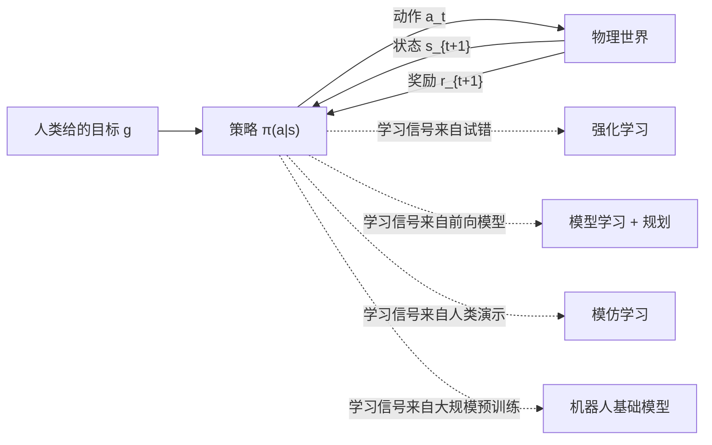
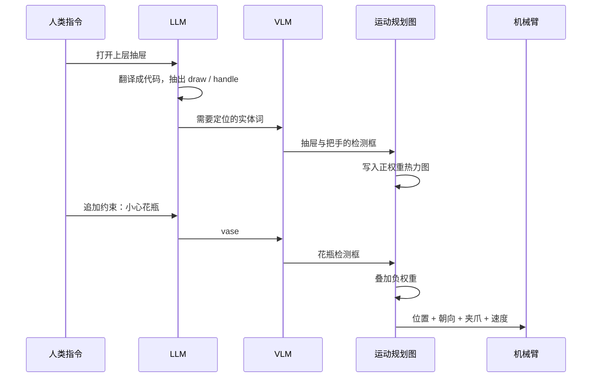
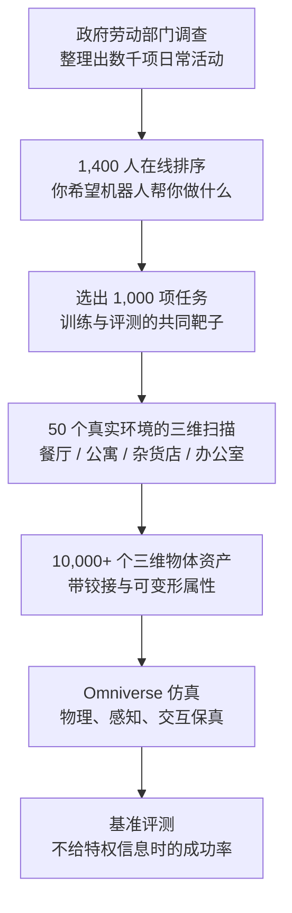
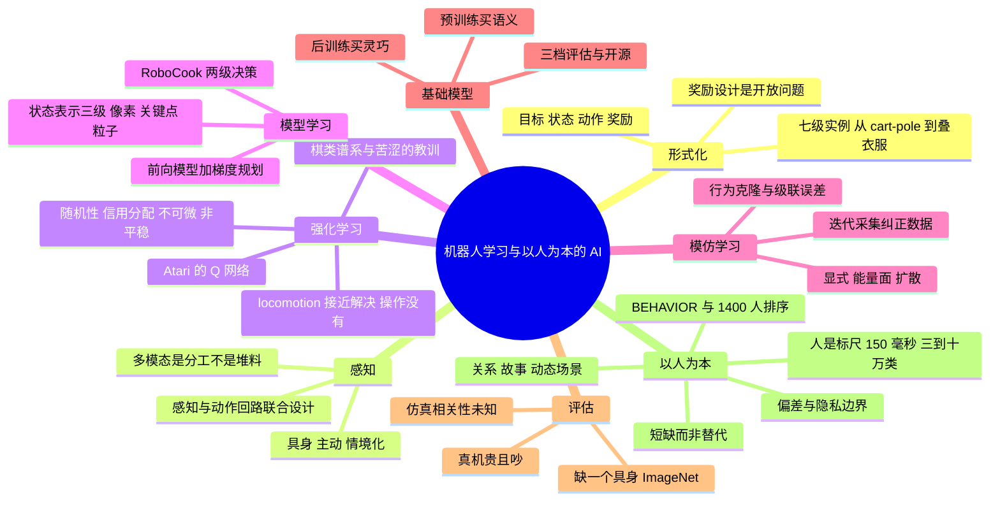

> **课程信息**
>
> - **课程名称**：Stanford CS231n: Deep Learning for Computer Vision（Spring 2025）
> - **本模块覆盖**：Lecture 17. Robot Learning（103 页幻灯片）；Lecture 18. Human-Centered AI（无公开课件）
> - **主讲教师（各讲）**：Yunzhu Li（L17）；Fei-Fei Li（L18）
> - **授课日期范围**：2025-05-29 – 2025-06-03
> - **课程主页**：[cs231n.stanford.edu/2025](https://cs231n.stanford.edu/2025/schedule.html)
> - **官方课件**：[lecture_17.pdf](</attachments/cs231n-349b77958e6dac51f943adbc.pdf>)（103 页，正文按页链接本地课件）。Lecture 18 无公开课件——2025 年课表里该讲的 slides 链接被注释掉，2024 年的 `lecture_18.pdf` 属于另一讲「3D Vision」，因此本模块不含任何第 18 讲插图，该讲内容全部依据课堂字幕重构，口述框架用 Mermaid 与表格复述并标注「据讲者口述整理」。
> - **字幕来源**：[cs231n_sp25_kor_sub · eng](https://github.com/lpaiu-cs/cs231n_sp25_kor_sub/tree/main/eng)（公开英文转写，中文由本书重写）
> - **版权说明**：幻灯片与课程材料版权归 Stanford University 及授课教师所有；本书为非官方学习笔记，仅用于学习与研究。

> **课件索引**：点击下方链接打开本地 PDF 的对应页；全部课件见 [课件索引](/notes/cs231n/slides)。页码按 PDF 文件页序定位，第 1 讲分为 Part 1 / Part 2。

[📄 L17 · 第 1 页｜第 17 讲标题页：Robot Learning，Yunzhu Li，2025 年 5 月 29 日](</attachments/cs231n-349b77958e6dac51f943adbc.pdf#page=1>)

这两讲是本课程的两端。第十七讲把「动作」写进模型：预测不再只是描述世界，而是改变世界。第十八讲把「人」写进问题定义：能力之外还有公平、隐私与谁受益。前面十六讲都在回答「看见什么」，这两讲回答的是「做什么」和「为谁做」。

两位讲者也不是陌生人。主持人在开场介绍里说，Yunzhu Li 2023 年就在这门课上授课，当时他正在斯坦福做博后，合作导师是 Fei-Fei Li 与 Jiajun Wu；第十七讲里那些「在我们实验室做的」工作，有一半就出自这个圈子。合起来读，两讲其实在算同一笔账。第十七讲反复称量的是**用多少真实交互换多远泛化**：试错最贵、学模型最省样本、抄演示最快落地、基础模型最泛但欠评估。第十八讲称量的是另一头——**这些能力最终落到谁身上**：模型替谁看、替谁做、把谁排除在外。一笔是成本，一笔是分配；缺任何一笔，机器人这件事都只是一段演示视频。

## 1. 一条因果边：动作会改写下一步的输入

*(参考时间: 00:01:36 – 00:05:05｜Lecture 17；00:00:05 – 00:04:46｜Lecture 18)*

前十六讲的成功可以压成一个句式：给定输入，预测输出。讲者先把这个句式摊成两页，再到第三页上把它拆掉。

[📄 L17 · 第 2 页｜监督学习复习页：数据是 $(x,y)$，目标是学 $x\to y$ 的映射，例子列出分类、回归、目标检测、语义分割、图像描述](</attachments/cs231n-349b77958e6dac51f943adbc.pdf#page=2>)

分类、回归、检测、分割、描述，全都落在这个模板里：损失度量预测与标签的距离，梯度沿这条距离改参数。它有一个不被写出来的前提——数据是别人给的，标签是别人标的，模型碰不到数据是怎么产生的。

[📄 L17 · 第 3 页｜自监督学习复习页：只有 $x$ 没有标签，目标是学数据内部的隐结构，例子是聚类、降维、特征学习、密度估计](</attachments/cs231n-349b77958e6dac51f943adbc.pdf#page=3>)

自监督把标签这一项划掉了，用数据自身构造的辅助损失来学表示，对无标注数据的利用效率是过去几年视觉进步的主要来源。但两页共享同一个世界观：**模型是旁观者**。它读到的分布是固定的，它写出的预测不会反过来改变那个分布。

[📄 L17 · 第 4 页｜机器人学习的问题设定：智能体在环境里执行动作，环境回传奖励，目标变成学一个能最大化奖励的动作序列](</attachments/cs231n-349b77958e6dac51f943adbc.pdf#page=4>)

机器人学习在这张图里多加了一个箭头：动作 $a_t$。讲者的说法很直接——你在真实世界里决定采取什么动作，世界就会因为这个动作而改变。于是问题从「拟合一个标签」变成「在物理约束下最大化一个目标函数」，数据也不再是给定的，而是由你自己的策略采样出来的。

这张图是整讲的骨架：中间那个回路始终不变，变的是**信号从哪来**。四种范式不是四个领域，而是同一张图上换掉「学习信号」这一根线。

[📄 L17 · 第 5 页｜四格视频拼图：机械臂倒咖啡、叠纸箱，人形机器人在实验室与家居环境作业，每格左下角标注 autonomous 与播放倍速](</attachments/cs231n-349b77958e6dac51f943adbc.pdf#page=5>)

讲者证明「这个领域在长」用的不是论文，是视频截帧：两格是双臂机械臂在木质台面上叠纸箱、磨咖啡，一格是人形机器人在实验室走动，一格是家用场景里的两台人形机器人。倍速标注本身是个信号——这些片子是加速播放的，真实节奏要慢得多，而这一点在第 13 章讲 π0 时会被他自己拿出来当问题讲。

[📄 L17 · 第 6 页｜融资新闻拼贴：Physical Intelligence 4 亿美元、Figure 6.75 亿美元、Skild AI 3 亿美元、1X 1 亿美元、The Bot Company 1.5 亿美元](</attachments/cs231n-349b77958e6dac51f943adbc.pdf#page=6>)

第二页把融资标题直接拼在一起：Physical Intelligence 4 亿美元（2024 年 11 月，Bezos 与 OpenAI 参投）、Figure 6.75 亿美元（2024 年 2 月，Microsoft、NVIDIA、OpenAI 参投）、Skild AI 3 亿美元（2024 年 7 月）、The Bot Company 1.5 亿美元、1X 的 1 亿美元 B 轮（2024 年 1 月）。这些数字指向的不是估值，而是成本结构：通用机器人要自己建数据采集链路、自己迭代硬件，而机器人数据没法像文本那样从互联网上爬。钱主要烧在「造数据」上。

[📄 L17 · 第 7 页｜大厂各自的机器人研究部门：Toyota Research Institute、Meta AI Research、Google Robotics、NVIDIA Research](</attachments/cs231n-349b77958e6dac51f943adbc.pdf#page=7>)

第三页换成大厂。两页并排的用意不是比较谁钱多，而是说明参与者结构变了：这个方向同时有初创公司与大厂研究部门在下注，它已经是一条产业赛道，而不是几个实验室的课题。

[📄 L17 · 第 8 页｜本讲提纲七项：问题形式化、机器人感知、强化学习、模型学习与基于模型的规划、模仿学习、机器人基础模型、遗留挑战](</attachments/cs231n-349b77958e6dac51f943adbc.pdf#page=8>)

提纲七项的顺序本身有讲究：先形式化（把「做动作」写成可优化的对象），再感知（动作的输入从哪来），然后依次是三种越来越省真实交互的学习方式，最后落在「这条路还没走完」的部分。后面每进入一个新主题，这张提纲都会再出现一次并移动红框，全讲共 8 次，是这堂课的进度条。

把镜头再拉远一次，第十八讲的开场给了这条线一个五亿年的前史：5.4 亿年前三叶虫长出感光细胞，生命第一次能主动探测外界。动物学家 Andrew Parker 的解释是，视觉一旦出现，生存就变成军备竞赛——要么演化出更好的眼睛与更快的反应，要么被淘汰，这场竞赛带来的物种爆发就是寒武纪大爆发。1960 年代的「Summer Vision Project」则设想让几个本科生用一个夏天造出「视觉系统的重要部分」，讲者的评价是：北极星很清楚，路程被严重低估，这个毛病今天大概还在。

据讲者口述整理，整场第十八讲的主线是三条：看得见（造出与人眼同级的物体识别）、看不见（超出人类分辨力的细粒度识别，以及人类自身的偏差与注意力上限）、想看见（把感知接到行动上，再问 AI 是放大器还是替代品）。这三条线的**验收标准完全不同**：第一条由人类定义，人能做到、模型做到就算过关；第二条要越过人类标注的天花板，此时「对齐人类」不再是目标；第三条的标准压根不在模型里，谁受益、谁被看见、谁被替代，这些量不进 loss，却决定技术能不能落地。把三条线的标准混为一谈，是这门课之外最常见的误读。

## 2. 形式化：四个词，一条被低估的边界

*(参考时间: 00:05:34 – 00:12:20｜Lecture 17)*

讲者在这里给了全场唯一一句「定义式」的对照：计算机视觉主要在学高维输入之上的表示；机器人学习则在解一个带约束的优化问题，约束是物理世界，目标函数由 goal 定义，解是一串动作。这句话解释了为什么本讲后面几乎不谈网络结构，只谈信号怎么来、代价多大。

[📄 L17 · 第 9 页｜问题形式化图：智能体接收目标 $g$ 与状态 $s_t$，输出动作 $a_t$，环境回传 $r_{t+1}$ 与 $s_{t+1}$](</attachments/cs231n-349b77958e6dac51f943adbc.pdf#page=9>)

四件东西把问题定死：**目标（goal）**可以是语言指令，也可以是一个测得出好坏的标量函数；**状态（state）**是智能体对环境当前状况的估计；**动作（action）**是交给执行器的指令；**奖励（reward）**是环境对这一步的打分。四者合起来定义了一个序贯决策问题。

把这句话展开成表，就能看清两门学问的分界线在哪：

| 维度 | 视觉任务（第 1–16 讲） | 机器人任务（第 17 讲） |
| :--- | :--- | :--- |
| 输入从哪来 | 别人采好、标好，分布固定 | 由自己的动作采样出来，分布随策略漂移 |
| 输出是什么 | 标签、框、掩码、一句话 | 一串动作，长度由任务决定 |
| 目标函数 | 逐样本损失，可微、可分解 | 轨迹末端的标量奖励，不可微、难分摊 |
| 错一次的代价 | 指标掉一点，可以重跑 | 打翻东西、撞到人，不可撤销 |
| 成功判据 | 固定测试集上的准确率 | 真机上的任务成功率，贵且吵 |

这张表最后一行是整讲的伏笔：前三行都能靠算法解决，最后一行不能。

### 2.1 七个实例：同一模板，不同的奖励形状

[📄 L17 · 第 10 页｜Cart-Pole：状态是角度、角速度、位置、水平速度，动作是水平推力，杆立直时每步得 1 分](</attachments/cs231n-349b77958e6dac51f943adbc.pdf#page=10>)

最经典的入门例子是 cart-pole：状态四维（杆的角度、角速度、小车位置、水平速度），动作一维（施加在小车上的水平力），杆保持直立时每个时间步给 1 分。它的价值在于三个条件全满足——状态完全可观测、奖励稠密、动力学已知，所以它只配当校准直觉的玩具。

[📄 L17 · 第 11 页｜四足 locomotion：状态是所有关节的角度、位置、速度，动作是关节力矩，奖励给直立与前进（图源 Schulman et al., ICLR 2016）](</attachments/cs231n-349b77958e6dac51f943adbc.pdf#page=11>)

换成四足机器人，同一模板立刻变重：状态是所有关节的角度、位置、速度，动作是施加到每个关节上的力矩，奖励在「保持直立且向前移动」时每步给 1。页脚标了出处（Schulman 等，《High-Dimensional Continuous Control Using Generalized Advantage Estimation》，ICLR 2016）——这是把策略梯度推到高维连续控制上的关键一步，也是后来 PPO 一系工作的前身。

[📄 L17 · 第 12 页｜Atari：状态是屏幕原始像素，动作是上下左右，奖励是每一步的分数增减（Mnih et al., 2013）](</attachments/cs231n-349b77958e6dac51f943adbc.pdf#page=12>)

Atari 换掉了状态的性质：状态是屏幕原始像素，动作是离散的上下左右，奖励是分数的即时增减。它的意义在于把感知与决策塞进同一个网络——第 4 章会看到，这个设定直接催生了用卷积网络拟合 Q 函数的做法。

[📄 L17 · 第 13 页｜围棋：整页只写了目标——赢下比赛](</attachments/cs231n-349b77958e6dac51f943adbc.pdf#page=13>)

这一页只写了目标，状态、动作、奖励都留白。讲者是故意先让「想赢」单独站一页，再在下一页把它补成一台机器能读的形式。

[📄 L17 · 第 14 页｜围棋的形式化：状态是棋盘上所有棋子的位置，动作是下一手落子，奖励只在终局给 1 或 0](</attachments/cs231n-349b77958e6dac51f943adbc.pdf#page=14>)

围棋是反面极端：状态是棋盘上所有棋子的位置（离散、巨大），动作是落子位置，而奖励**只在最后一手给出**，赢 1 输 0。奖励从「每步都有」变成「整局只有一个」，第 4 章的信用分配难题就是从这里长出来的。

[📄 L17 · 第 15 页｜文本生成：目标写的是预测下一个词，提示句是 CS231n midterm was ___](</attachments/cs231n-349b77958e6dac51f943adbc.pdf#page=15>)

提示句本身是个玩笑，但它把「状态」这个词在语言里的含义摆了出来：状态就是已经写下的那几个词。

[📄 L17 · 第 16 页｜文本生成的形式化：状态是句子里已有的词，动作是下一个词，猜对得 1 分](</attachments/cs231n-349b77958e6dac51f943adbc.pdf#page=16>)

大语言模型也被塞进了这个模板：状态是已有的词，动作是下一个词，猜对得 1、猜错得 0。这个映射看着像硬凑，其实点出了一件重要的事——**自回归语言模型是「奖励在每一步都即时可得」的特例**，所以它能用纯监督方式训练；一旦奖励挪到轨迹末端，监督学习就失效了。

[📄 L17 · 第 17 页｜聊天机器人：目标只写了「做一个好的陪伴者」](</attachments/cs231n-349b77958e6dac51f943adbc.pdf#page=17>)

「做一个好的陪伴者」是个连人类都说不清的目标，这正是选择它的理由：越难写成公式的目标，越只能靠人来打分。

[📄 L17 · 第 18 页｜聊天机器人的形式化：状态是当前对话，动作是下一句回复，奖励由人工评分给出 +1 / 0 / -1](</attachments/cs231n-349b77958e6dac51f943adbc.pdf#page=18>)

聊天机器人把奖励交给人类：人满意给 +1、不满意给 -1、中立给 0。这是「奖励不可微、只能采样」的最纯粹形态，也解释了这类系统为什么需要人在回路里持续标注偏好。

[📄 L17 · 第 19 页｜叠衣服机器人：目标是把布折成可判定的形状](</attachments/cs231n-349b77958e6dac51f943adbc.pdf#page=19>)

从这一页开始目标变成物理动作：把一块布折起来。真正的难处不在「叠」这个动作，而在「布」这种物体的状态几乎无法用低维向量描述。

[📄 L17 · 第 20 页｜叠衣服的形式化：动作是末端执行器运动与夹爪开合，奖励由人判定是否叠好](</attachments/cs231n-349b77958e6dac51f943adbc.pdf#page=20>)

这一页最接近真机器人：状态是多视角 RGB 或 RGB-D 观测（不是低维向量，而是图像），动作是末端执行器的运动加上夹爪的开合，奖励由人判断衣服是否叠好。讲者特意强调「该合上还是张开夹爪」也是动作的一部分——夹爪不是工具，是动作空间的一个维度。

> 编者说明：第 20 页 State 一行沿用了上一页的「Current conversation」，是课件制作时的复制残留；按讲师口述，这里的状态应为多视角 RGB / RGB-D 观测，以及机器人自身位姿与夹爪状态。

把七个实例并排，会看到一条从「玩具」到「真问题」的轴：

| 实例 | 状态 | 动作 | 奖励密度 | 它暴露的难点 |
| :--- | :--- | :--- | :--- | :--- |
| Cart-Pole | 4 维低维向量 | 1 维水平力 | 每步 1 | 几乎没有，用来校准直觉 |
| 四足 locomotion | 所有关节的角度、位置、速度 | 每个关节的力矩 | 每步 1 | 高维连续控制、sim-to-real 差距 |
| Atari | 屏幕原始像素 | 4 个离散按键 | 每步分数增减 | 感知与决策必须进同一个网络 |
| 围棋 | 棋盘上所有棋子位置 | 落子位置 | 只在终局 1 或 0 | 信用分配 |
| 文本生成 | 已经写下的词 | 下一个词 | 每步即时对错 | 奖励最稠密，所以能被纯监督吃掉 |
| 聊天机器人 | 当前对话 | 下一句回复 | 人工 +1 / 0 / -1 | 奖励不可微，只能采样 |
| 叠衣服 | 多视角 RGB / RGB-D | 末端运动 + 夹爪开合 | 人工 1 或 0 | 状态无法用低维向量描述 |

### 2.2 奖励设计：一句话说不清的那部分

形式化只写到「有奖励」就停了，讲者紧接着补了一段很少有课程会讲的内容：奖励怎么定，本身是个开放问题。同样是自动驾驶，「尽快到达」和「乘客坐得舒服」是两个方向相反的奖励；同样是叠衣服，有人要求折叠后占地面积最小，有人要求表面尽可能平整，甚至同一件衣服按不同人的偏好可以有完全不同的判据。

这段铺垫了一个后面反复出现的判断：机器人学习里最贵的往往不是网络，而是**把一个模糊的人类意图翻译成一个不会把策略带偏的标量**。第 4 章的非平稳性、第 14 章的评估困难，本质都是这件事的后遗症——你定了一个奖励，策略就会精确地优化它，包括你没想到的那些副作用。

## 3. 感知：机器人不是读者，是采样者

*(参考时间: 00:12:38 – 00:18:22｜Lecture 17)*

[📄 L17 · 第 21 页｜提纲第二次出现，红框从「问题形式化」移到「机器人感知」](</attachments/cs231n-349b77958e6dac51f943adbc.pdf#page=21>)

同一张提纲，红框下移一格。这一章要回答的是：机器人拿到的那点观测，和数据集里的一张图，差在哪。

[📄 L17 · 第 22 页｜问题形式化图上红箭头指向 State $s_t$：机器人感知就是这条输入边](</attachments/cs231n-349b77958e6dac51f943adbc.pdf#page=22>)

讲者的定义很朴素：物理世界给的是高维观测（RGB、RGB-D，也可能是触觉），机器人感知要做的是从中提炼出**对下游决策有用的结构化知识**——不是把场景描述得多完整，而是把与动作有关的那部分提出来。

[📄 L17 · 第 23 页｜机器人感知的三重困难：不完整的物体知识、不完美的动作、动态环境与其他智能体](</attachments/cs231n-349b77958e6dac51f943adbc.pdf#page=23>)

幻灯片列了三条现实。**知识不完整**：遮挡、传感器噪声、只能看到物体的一面。**动作不完美**：抓取不一定成功，手滑掉东西会反过来改变环境，感知系统必须能处理「自己把局面弄砸了」之后的状态。**环境会变**：不只是刚体，还有布料、绳子、颗粒这类可变形物体，以及狗、小孩、其他人在同一空间里乱动。

三条合起来解释了一个工程事实：机器人不会只装一个相机。只要某种传感器能提供有用信息就往上装——触觉告诉你抓稳没抓稳，相机告诉你整体局面，声音补上视觉被挡住的那一下。真正的设计难点不是「装几个」，而是让它们在同一个表示里互补：触觉给的是局部接触状态，视觉给的是全局位姿，两者的时间尺度都不一样。

[📄 L17 · 第 24 页｜机器人常用传感器：左侧是眼、耳、鼻、舌、手围着大脑，右侧是近距感应、深度相机、激光雷达、超声波、事件相机、工业读码器与触觉阵列](</attachments/cs231n-349b77958e6dac51f943adbc.pdf#page=24>)

这张图想说的是「多模态」在机器人里的具体含义——它不是把几种数据拼起来喂给一个大网络，而是每种传感器负责一段**物理上它才测得到**的信息。深度相机测不到接触力，触觉阵列测不到三米外的台阶。

[📄 L17 · 第 25 页｜香港大学先进机器人实验室的人形平台：图上逐一标注鱼眼相机、多传感头、感知计算机、三指夹爪、六轴力/力矩传感器、IMU、应变式压力传感器与 3.7 kWh 电池](</attachments/cs231n-349b77958e6dac51f943adbc.pdf#page=25>)

这一页给了一个把多模态做到极致的具体平台。能读出一台真机的全部账目：头部两个鱼眼相机；多传感头里是 3D 激光扫描仪加双目相机；三颗 Intel Core i7 组成感知计算机；Robotiq 三指自适应夹爪；六轴力/力矩传感器；IMU；应变式压力传感器；30 个自由度由 24 个液压执行器与 6 个电机驱动；3.7 kWh 锂电池；跑 Linux + ROS。

这张图真正想说的是：感知不是一个模型，是一台机器的带宽与供电。这么多路数据要同时进同一块计算机，工程关键就落在标定与同步上——所有传感器必须落到同一个坐标系、同一条时间轴上，否则「互补」会变成「互相干扰」。

[📄 L17 · 第 26 页｜左：Detectron 的实例分割结果；右：面对一堆叠在一起的物体，机器人必须先动手才能判断这是几个](</attachments/cs231n-349b77958e6dac51f943adbc.pdf#page=26>)

这一页是全讲最锋利的一次对照。左边是课程里熟悉的实例分割：给定一张 2D 图，给每个像素打上实例标签、画出轮廓。右边是同一类任务在机器人里的样子：桌上有一堆看起来像「一个物体」的东西，也可能是好几个套在一起的零件——**光看是分不出来的**。机器人必须自己决定「我该做什么动作才能看清」：推一下、拨一下、换个视角，用动作去换取信息。

[📄 L17 · 第 27 页｜机器人视觉的三个性质：具身（embodied）、主动（active）、情境化（situated），每个词下面各有一句定义](</attachments/cs231n-349b77958e6dac51f943adbc.pdf#page=27>)

三个形容词，每个都值得逐条记：

- **具身（embodied）**：机器人有物理身体，直接经历这个世界；它的动作是世界动态的一部分，并立刻反馈到自己的感觉上。
- **主动（active）**：机器人是主动的感知者；它知道自己为什么要想感知，自己选择看什么、去哪里看。讲者的例子很日常——想知道桌子后面有什么，把头探过去就是了。
- **情境化（situated）**：机器人身处世界中，处理的不是抽象描述，而是「此时此地」；世界直接塑造系统的行为。

对照之下，计算机视觉的数据集绝大多数是**被动采集**的：有人事先拍好、标好，模型只负责读。这不是哲学修辞，它决定了训练数据的分布由谁控制——被动数据集里，模型见过的东西与它将要遇到的东西是同一批；机器人遇到的东西，是它自己的策略挑出来的。

[📄 L17 · 第 28 页｜三套机器人系统：树林里的无人机、绿幕前做自主抓取的 PR2、人类旁边作业的双臂机器人（Sa et al. IROS 2014；Levine et al. JMLR 2016；Bohg et al. ICRA 2018）](</attachments/cs231n-349b77958e6dac51f943adbc.pdf#page=28>)

第一帧只有照片与文献。三个例子的共同点是——感知从来不是独立模块，它嵌在一个「看—动—再看」的循环里。

[📄 L17 · 第 29 页｜同一组照片的第二帧：每格圈出两个位置，分别标上 Perceive 与 Act，两个环之间用箭头连起来](</attachments/cs231n-349b77958e6dac51f943adbc.pdf#page=29>)

第二帧在每张照片上各圈两处：无人机那格，感知环在机腹相机、动作环在旋翼；PR2 那格，感知环在头部相机、动作环在夹爪；双臂那格，感知环在头部、动作环在手腕。两个环之间连上箭头，指向下一帧的结论。

[📄 L17 · 第 30 页｜第三帧加上标题式断言：机器人学习的一个关键挑战，是把感知—动作回路闭上](</attachments/cs231n-349b77958e6dac51f943adbc.pdf#page=30>)

第三帧在原图上加了一句话：机器人学习的一个关键挑战，是把感知—动作这个回路闭上。讲师在这里给了一个很实用的判据：机器人不需要知道环境的完整状态。扣衬衫纽扣时，只需要知道那颗纽扣附近的局部区域；于是感知的精度、范围、频率都应当与任务和下游决策**联合设计**，而不是先做一个通用感知器再往上接策略。

这句话在后面每一章都会以不同形式重现：模型该表示什么、策略该看哪里、数据该采哪里，答案都由任务决定。

## 4. 强化学习：把「试错」写成算法，然后撞上四堵墙

*(参考时间: 00:18:31 – 00:25:06｜Lecture 17)*

[📄 L17 · 第 31 页｜提纲第三次出现，红框移到「强化学习」](</attachments/cs231n-349b77958e6dac51f943adbc.pdf#page=31>)

[📄 L17 · 第 32 页｜强化学习的基本想法：智能体与环境交互，通过试错学会最大化奖励](</attachments/cs231n-349b77958e6dac51f943adbc.pdf#page=32>)

最直白的解法是让机器人尽可能多地与世界交互：把经验收集起来，观察「这个动作导致高奖励、那个导致低奖励」，再把行为往高奖励的方向挪。强化学习就是把这件事形式化——智能体不断与环境交互，用试错最大化奖励（或最小化代价）。

[📄 L17 · 第 33 页｜强化学习的回路：环境给出 $s_t$，智能体产生 $a_t$，环境回传 $r_{t+1}$ 与 $s_{t+1}$，然后重复](</attachments/cs231n-349b77958e6dac51f943adbc.pdf#page=33>)

这张图在时间轴上展开：环境给出 $s_t$，智能体产生 $a_t$，环境回传 $r_{t+1}$ 与 $s_{t+1}$，重复。注意它与监督学习的回路在结构上几乎同构——都是「输入进、输出出、拿反馈」的循环，区别全在反馈的性质上。

[📄 L17 · 第 34 页｜监督学习的回路：数据集给出 $x_t$，模型给出预测 $y_t$，与标签比较得到损失 $L_t$](</attachments/cs231n-349b77958e6dac51f943adbc.pdf#page=34>)

两页并排放在一起，讲师问了一个问题：**为什么强化学习与普通监督学习不同？**这个问题在页面上悬着，后面四页一条一条回答。

### 4.1 四条差别，一条比一条致命

| 差别 | 具体表现 | 对算法的直接后果 |
| :--- | :--- | :--- |
| 随机性（stochasticity） | 同样的动作，环境可能给出不同的下一个状态与不同的奖励 | 不能假设「一次失败 = 这个动作错」，只能估计期望 |
| 信用分配（credit assignment） | 奖励 $r_t$ 未必直接依赖动作 $a_t$，甚至可能只在终局出现 | 要把末端的一个标量摊回到几十上百步动作上 |
| 不可微（nondifferentiable） | 无法对世界反传，算不出 $\partial r_t / \partial a_t$ | 只能靠大规模采样做零阶的梯度估计 |
| 非平稳（nonstationary） | 智能体经历什么，取决于它自己怎么动 | 训练数据的分布随策略漂移，i.i.d. 假设失效 |

[📄 L17 · 第 35 页｜随机性：推箱子时支撑力的分布不同，同样一次推动会让箱子转到不同角度](</attachments/cs231n-349b77958e6dac51f943adbc.pdf#page=35>)

讲师用推箱子解释随机性：同样一次推动，若地面支撑力的分布稍有不同，箱子转过的角度就可能不一样。于是「这个动作好不好」本身是个随机变量，策略要优化的是期望而不是某一次的结果。这也是机器人策略天生需要鲁棒的原因——不是工程洁癖，是问题定义里就带着噪声。

[📄 L17 · 第 36 页｜信用分配：奖励 $r_t$ 未必直接依赖动作 $a_t$](</attachments/cs231n-349b77958e6dac51f943adbc.pdf#page=36>)

经典场景是围棋：只有到最后一手，你才知道自己赢了还是输了；而这个 0/1 的结果，可能是开局第一手就埋下的。把终局的一个标量，公平地摊回到中盘甚至开局的上百步决策上，是强化学习理论里最核心的难点之一。

[📄 L17 · 第 37 页｜不可微：无法对世界反向传播，也就无法直接算出 $\partial r_t / \partial a_t$](</attachments/cs231n-349b77958e6dac51f943adbc.pdf#page=37>)

第三条在工程上最要命：监督学习里整条链都是可微的，梯度一路回传到参数；而环境（真实世界或一个游戏模拟器）通常不可微，$\partial r_t/\partial a_t$ 根本不存在。讲者提到业界的做法——依赖大规模采样做梯度的零阶估计，用「扰动一下看奖励怎么变」来近似方向。代价是样本量，而样本量在真实机器人上就是时间与磨损。

[📄 L17 · 第 38 页｜非平稳性：智能体经历什么，取决于它怎么行动](</attachments/cs231n-349b77958e6dac51f943adbc.pdf#page=38>)

第四条最隐蔽：监督学习里你预测什么，不会影响数据集里的下一个样本；而在序贯决策里，你的动作决定了你下一步会看到什么状态。策略一变，数据分布就变，「训练集」与「测试集」不再是两批独立样本，而是同一条不断被自己改写的时间线。

### 4.2 Atari：把 Q 函数塞进一个卷积网络

[📄 L17 · 第 39 页｜案例设定：Atari 游戏，状态是屏幕像素，动作是上下左右，奖励是分数增减（Mnih et al., 2013）](</attachments/cs231n-349b77958e6dac51f943adbc.pdf#page=39>)

Atari 的设定在第 2 章出现过，这里被当作第一个「端到端」样本重讲：状态是原始像素，动作是四个离散按键，奖励是每一步的分数变化。页脚标注的是 Mnih 等人 2013 年的深度强化学习工作，也就是后来 DQN 的前身。

[📄 L17 · 第 40 页｜Q 网络结构：$4\times84\times84$ 的连续 4 帧输入，两层卷积后接 FC-256，最后输出每个动作的 Q 值](</attachments/cs231n-349b77958e6dac51f943adbc.pdf#page=40>)

这一页值得把每个数字都记住，因为它是深度强化学习最经典的工程配置：输入是 $4\times84\times84$——最近 4 帧灰度图堆叠（先做 RGB→灰度、下采样、裁剪），堆 4 帧是为了让网络从帧间差异里看出速度与方向；第一层 `Conv(4→16, 8×8, stride 4)`，第二层 `Conv(16→32, 4×4, stride 2)`，然后 `FC-256`，最后 `FC-A` 输出每个动作的 Q 值。四个动作时，最后一层给出 $Q(s_t,a_1),\dots,Q(s_t,a_4)$ 四个数。

Q 函数的定义是「在状态 $s$ 下执行动作 $a$ 之后，折扣累积未来奖励的期望」。用法极其简单：把当前状态喂进去，得到四个数，执行最大的那个。整套决策因此被压缩成一次前向传播——这是 Q-learning 在工程上最大的吸引力：**训练可以很贵，推理必须很便宜**。

讲者在这里明说了取舍：今天要覆盖的材料太多，不会深入强化学习的细节。于是下一章要做的不是把算法讲透，而是回答一个更粗的问题——这套东西，在什么条件下真的赢过。

## 5. 什么时候 RL 真的赢过：Breakout、四代 AlphaGo 与「苦涩的教训」

*(参考时间: 00:25:06 – 00:31:14｜Lecture 17)*

[📄 L17 · 第 41 页｜Breakout 训练过程演示页：页面上只放了一个 YouTube 链接](</attachments/cs231n-349b77958e6dac51f943adbc.pdf#page=41>)

课上放的是 Breakout 的训练录像。讲师按三个阶段解读：训练 10 分钟，智能体已经能碰到球，但经常漏接；训练 2 小时，接球变得稳定，能持续靠反弹拿分；训练更久之后，智能体自己发现了一个人类玩家很少用的策略——把球打到左侧墙壁上方，让球在砖块后面来回弹，一次消掉一大片。这是强化学习最有说服力的地方：**它能找到人类没想到的解**。

[📄 L17 · 第 42 页｜AlphaGo 谱系第一帧：只有 AlphaGo（2016 年 1 月）两行——模仿学习 + 树搜索 + 强化学习，击败 18 次世界冠军李世石；右侧是一盘棋谱](</attachments/cs231n-349b77958e6dac51f943adbc.pdf#page=42>)

第一帧只有 AlphaGo 一项。注意它的配方是「三件事拼起来」：模仿学习做初始化、树搜索做决策、强化学习做自我提升。其中模仿学习那一项，会在第 10 章以「抄演示」的形态单独展开一次。

[📄 L17 · 第 43 页｜第二帧加入 AlphaGo Zero（2017 年 10 月）：简化版，不再用模仿学习，击败当时排名第一的柯洁](</attachments/cs231n-349b77958e6dac51f943adbc.pdf#page=43>)

第二帧多了一行：AlphaGo Zero 把模仿学习这个模块整个拿掉，从零开始自我对弈。讲师把这一步称作「苦涩的教训」（the bitter lesson，Richard Sutton）的一个实例——**有时候最简的配方反而赢**，因为它更容易与扩展（scaling）兼容。模块越少，越容易被规模化。

[📄 L17 · 第 44 页｜第三帧加入 Alpha Zero（2018 年 12 月）：同一套算法推广到国际象棋与将棋](</attachments/cs231n-349b77958e6dac51f943adbc.pdf#page=44>)

第三帧加的是算法与游戏解耦：不再为每种棋写启发式，规则即接口。这一步新增的信息量比上一帧小，但它是「通用性」这三个字第一次被兑现。

[📄 L17 · 第 45 页｜第四帧加入 MuZero（2019 年 11 月）：用学到的模型做规划；页脚四条引用到这里也齐了](</attachments/cs231n-349b77958e6dac51f943adbc.pdf#page=45>)

第四帧是谱系里最关键的一次转向：MuZero 不再假设游戏规则已知，而是学一个隐空间的动力学模型，在这个模型里做规划。注意这一步与第 1 章那四种范式的对应关系——它从「纯试错」挪到了「学模型 + 规划」，而那正是第 7 章的主题。

讲师在这里插了一段个人经历，是本讲少见的「为什么做这行」：2016 年 1 月 AlphaGo 出来的时候，他正在决定研究方向，此前做的是计算机视觉；看到这条新闻之后转向决策问题，一路做到今天的机器人学习，理由是不满足于只处理被动采集的数据集。

[📄 L17 · 第 46 页｜第五帧加入李世石的照片与两句引语（引自韩联社 2019 年 11 月 27 日报道）](</attachments/cs231n-349b77958e6dac51f943adbc.pdf#page=46>)

第五帧加的是一张人的照片。两句引语是：「随着 AI 在围棋上出现，我意识到即使拼尽全力成为第一，我也不是最顶尖的」；「即使我成为第一，也有一个无法被击败的存在」。讲师没有对这段话做评价，只是把它放在四代系统之后——一个技术谱系的终点，是一个人的职业生涯。

[📄 L17 · 第 47 页｜更复杂的游戏：星际争霸 II 的 AlphaStar（2019 年 10 月，Science 2018 论文）与 Dota 2 的 OpenAI Five（2019 年 4 月，只有博客）](</attachments/cs231n-349b77958e6dac51f943adbc.pdf#page=47>)

再往后是复杂度更高的两款游戏。讲师对这一步的判断很干脆：只要算力给够、训练基础设施设计得当，比围棋复杂几个数量级的游戏也能被攻克；反过来说，**如果一个领域的规则能被精确模拟，它迟早会被强化学习吃掉**。这句判断是后面所有「为什么真实机器人不一样」的对照基线。

## 6. 真实机器人：locomotion 接近解决，操作还差一个量级

*(参考时间: 00:31:14 – 00:37:02｜Lecture 17)*

[📄 L17 · 第 48 页｜左：四足机器人跨越雪地、灌木与碎石（Science Robotics 2020）；右下：Unitree 2024 年 12 月的运动演示](</attachments/cs231n-349b77958e6dac51f943adbc.pdf#page=48>)

左边的论文改变了讲师对强化学习的看法。在此之前，RL 的成功基本停留在游戏里，因为游戏可以无限复制、训练与测试同分布；而真实机器人有仿真到现实的差距（sim-to-real gap）。这篇工作的结论是：**仿真不必模拟灌木和雪，只要把摩擦、几何等参数随机化得足够宽，真实世界就只是这个分布里的一个采样点**。右边的 Unitree 演示是同一套思路做出更极限的动态动作。

由此他给出了本讲最大胆的一个判断：在运动控制（locomotion）这个子领域，问题已经接近解决，而解法就是强化学习。他同时加了限定——这些演示里仍然有人在给高层指令（往哪个方向走、转不转身），机器人负责的是把高层指令翻译成每个关节的力矩。

[📄 L17 · 第 49 页｜灵巧操作：OpenAI 2019 年的魔方单手操作，与 2023 年的 Visual Dexterity](</attachments/cs231n-349b77958e6dac51f943adbc.pdf#page=49>)

操作（manipulation）就没那么乐观。OpenAI 2019 年让一只灵巧手在仿真里学会转魔方，再迁移到真机；讲师特意点出视频背后的两个事实：成功率很低，论文里实际测试的 trial 数量也很有限。右侧的 Visual Dexterity（Science Robotics 2023）把这件事推进到「任意形状物体的手内重定向」，但仍被归为「孤立任务上的成功」，不是通用能力。

[📄 L17 · 第 50 页｜无模型强化学习的两个基本问题：从试错中学习、需要大量交互](</attachments/cs231n-349b77958e6dac51f943adbc.pdf#page=50>)

幻灯片开始收账。第一条是学习方式：纯试错意味着每一点进步都要用真实交互换。第二条是量级：AlphaGo Zero 相当于在 40 天里学完人类三千年的围棋知识，听起来很浪漫，但换算成机器人就是几十年的等效机时；如果这个任务还有巨大的 sim-to-real gap、只能在真机上练，这个量级直接判死刑。

[📄 L17 · 第 51 页｜第二帧补上三条：安全隐患、可解释性有限、出错时怎么办](</attachments/cs231n-349b77958e6dac51f943adbc.pdf#page=51>)

第二帧加了三条。**安全**：课上放了一段人形机器人学习行走的录像，中间出现大量诡异姿态——这些姿态发生在真机上就是灾难。**可解释性**：策略是个黑箱，出问题时很难定位是哪一步的决策坏了。**纠错**：行为不对时，没有一个直观的接口告诉它「应该怎样」。

[📄 L17 · 第 52 页｜第三帧把对照对象换成人类：人有对世界的直觉模型，因而广泛适用、样本高效](</attachments/cs231n-349b77958e6dac51f943adbc.pdf#page=52>)

第三帧换掉了对照系。人并不是只靠试错学习，我们有一个关于世界的**直觉模型**，能在动手之前先「想象」结果，所以同样的事学一两遍就会，而且能迁移到没见过的场景。这一帧是全讲的转折点——它把问题从「怎么把试错做得更高效」改写成「能不能也学一个模型」。

## 7. 模型学习：先把「想象」训练出来，再反解动作

*(参考时间: 00:37:15 – 00:45:26｜Lecture 17)*

[📄 L17 · 第 53 页｜提纲第四次出现，红框移到「模型学习与基于模型的规划」](</attachments/cs231n-349b77958e6dac51f943adbc.pdf#page=53>)

[📄 L17 · 第 54 页｜同一个 agent 图，这次红框落在 Physical World 上：要学的是世界的状态转移](</attachments/cs231n-349b77958e6dac51f943adbc.pdf#page=54>)

红框从智能体挪到了物理世界。这一章要学的东西是状态转移函数 $P(s_{t+1}\mid s_t,a_t)$：给我当前状态和动作，预测下一个状态。有了它，决策就从「试」变成了「算」。

[📄 L17 · 第 55 页｜基于模型的规划：给定当前状态与目标，用模型预测候选动作序列的后果，再对动作求梯度](</attachments/cs231n-349b77958e6dac51f943adbc.pdf#page=55>)

幻灯片把规划写成三步循环。左边是几何直觉：左端灰点是当前状态，四条虚线是不同动作序列在模型里推出的轨迹，绿色实线是代价最小的那条，右下角的红点标出目标。右边是算法：**执行第一个动作 → 从环境拿到新状态 → 用梯度下降重新优化整条动作序列**。之所以只执行第一步，是因为模型一定不准，走一步就重新校准，比一条道走到黑安全。

这一页有两个「Key」值得单独记。`Key: GPU for parallel sampling / gradient descent`——因为模型是可微的，整条轨迹的代价可以对动作求导，而 GPU 能同时采样几百条候选轨迹并批量求梯度，这是这类方法在 2017 年之后突然实用的直接原因。`Key question: what should be the form of s_t?`——剩下的整章都在回答这个问题：状态到底该表示成什么。

### 7.1 三种状态表示，三代工作

[📄 L17 · 第 56 页｜像素动力学：Deep Visual Foresight 的网络结构，输入当前帧与动作，输出下一帧](</attachments/cs231n-349b77958e6dac51f943adbc.pdf#page=56>)

最早的选择是「状态就是图像」。Deep Visual Foresight（Finn & Levine, ICRA 2017）用一个带 LSTM 的编码器—解码器预测下一帧：输入是 $64\times64\times3$ 的当前帧，动作与末端状态（各 5 维）被平铺成特征图后拼进中间层，解码端用 CDNA 核生成 5 组变换后的图像，再用 compositing masks 合成最终预测。它的历史地位在于：这是第一批证明「像素级前向模型可以用来做规划」的工作，也是后来「世界模型」这条线的起点。

[📄 L17 · 第 57 页｜像素动力学的规划演示：比较预测帧与目标帧的像素距离，反推出该往哪推](</attachments/cs231n-349b77958e6dac51f943adbc.pdf#page=57>)

规划的做法很直接：把候选动作序列喂给模型，得到一串预测帧，算它们与目标帧的像素距离，选距离最小的那条执行。讲师指出这类方法的两个隐含代价：像素距离不等于任务距离（背景的一点变化会淹没物体的位移），而且预测多帧之后误差会累积。

## 8. 状态表示的三级台阶：像素、关键点、粒子

*(参考时间: 00:45:26 – 00:48:32｜Lecture 17)*

[📄 L17 · 第 58 页｜关键点动力学：用物体上的关键点作为状态，学习关键点随动作的三维运动（Manuelli, Li, Florence, Tedrake, CoRL 2020）](</attachments/cs231n-349b77958e6dac51f943adbc.pdf#page=58>)

第二代把表示从「所有像素」收缩到「少数关键点」：在物体上标若干关键点，跟踪它们在三维空间里的位置，学一个「给定推力和接触点、关键点怎么动」的模型。状态维度从几万降到几十，模型因此更容易学、规划也更快。这一步的代价是：关键点是人挑的，挑错了就等于把归纳偏置写死。

[📄 L17 · 第 59 页｜关键点动力学的真机画面：KUKA 机械臂推盒子，画面上叠加关键点轨迹与 Trajectory 4 标注](</attachments/cs231n-349b77958e6dac51f943adbc.pdf#page=59>)

这是视频截帧：库卡机械臂在木台上推一个纸盒，左上角标着第 4 条候选轨迹，右下角小窗里能看到关键点的彩色轨迹线。它展示的是「规划—执行—重规划」的实际节奏——每一帧都在用当前关键点位置重新求解，而不是照着一条预先算好的轨迹走。

[📄 L17 · 第 60 页｜粒子动力学：颗粒堆用一组粒子表示，上图是真实场景，下图是对应的粒子状态（Wang, Li, Driggs-Campbell, Fei-Fei, Wu, RSS 2023）](</attachments/cs231n-349b77958e6dac51f943adbc.pdf#page=60>)

第三代针对自由度更高的对象：颗粒、面团、布料。做法是把物体表示成一组粒子，状态就是所有粒子的位置。幻灯片横向排了四个时刻：真实场景里机械臂把一堆深色颗粒从右下推到左上角的圆形目标区（目标区用 goal mask 标出），下面一行是对应的粒子表示——粒子的分布形状与真实颗粒堆的轮廓一一对应。

[📄 L17 · 第 61 页｜不同颗粒介质：麦片、大米、胡萝卜、糖果，颗粒尺寸与形状差异很大](</attachments/cs231n-349b77958e6dac51f943adbc.pdf#page=61>)

同一套模型要处理不同尺度的颗粒。这页的作用是说明粒子表示的通用性——它不假设物体是刚体，也不假设颗粒大小一致，只要能把观测转成一组点，模型就能用。三代的差别因此可以压成一句话：**你在状态里写进了多少先验，模型就需要多少数据来补上剩下的部分**。

[📄 L17 · 第 62 页｜推到字母表：24 倍速下，机器人把颗粒堆推成 A 到 Z 的字母形状](</attachments/cs231n-349b77958e6dac51f943adbc.pdf#page=62>)

这是效果展示，标注 `24x speed`：机器人把颗粒堆从一个形状推到另一个形状，最终拼出字母。任务分两段——先做非平凡的整体再分布（把大部分颗粒挪到目标区域），再对齐细节（边缘、笔画）。讲师强调这类任务靠「反馈 + 重规划」才可靠：模型预测会有偏差，但每一步都能从环境拿到新观测，误差不会一路累积到不可收拾。

## 9. RoboCook：两级决策，和一个能往回跳的状态机

*(参考时间: 00:48:32 – 00:54:49｜Lecture 17)*

[📄 L17 · 第 63 页｜RoboCook 的实验台：机械臂、15 个 3D 打印工具、四台 RGBD 相机，红框内是面团与馅料](</attachments/cs231n-349b77958e6dac51f943adbc.pdf#page=63>)

这套系统（Shi, Xu, Clarke, Li, Wu, CoRL 2023，最佳系统论文奖）把粒子模型用到了做饺子：工作台上有 15 个 3D 打印工具（编号 1–15，含压板、滚轮、钩子、模具），四台 RGBD 相机从不同角度重建几何，红框里是面团和馅料。机器人要自己决定**用哪个工具**，以及**怎么用**。

[📄 L17 · 第 64 页｜粒子动力学预测：GNN 按 $a_0$ 到 $a_4$ 逐步展开状态，上行是预测、下行是真值，红点是工具粒子、蓝点是物体粒子](</attachments/cs231n-349b77958e6dac51f943adbc.pdf#page=64>)

这一页是全讲技术密度最高的一页。模型是一个图神经网络（GNN）：初始状态 $s_0$ 沿时间轴逐步展开，每一步吃进一个动作 $a_t$，输出 $s_{t+1}$，五步之后得到 $s_5$。可视化里红色粒子是工具、蓝色粒子是物体，左侧三张图分别是从顶视图、侧视图、透视图看到的初始构型；右侧 5 列上行是预测、下行是真值。这一帧的任务是「抓取」，能看出工具下压时颗粒堆的形变被预测得相当接近真值。

[📄 L17 · 第 65 页｜按压实况的第二帧：平板工具压在颗粒堆上，预测与真值的形变逐帧对齐](</attachments/cs231n-349b77958e6dac51f943adbc.pdf#page=65>)

第二帧换成「按压」：红色平板从上方压下，蓝色颗粒堆被压扁、向两侧铺开。与上一帧相比，新增的难点是接触面积大、形变非线性强——但预测列与真值列仍然对得上，说明粒子表示对大范围接触也成立。

[📄 L17 · 第 66 页｜按压实况的第三帧：换成圆柱滚轮工具压薄层，形变沿滚动方向传递](</attachments/cs231n-349b77958e6dac51f943adbc.pdf#page=66>)

第三帧再换工具：圆柱形滚轮压在蓝色薄层上，形变沿滚动方向传递。三帧连起来看，这套模型的卖点不是「预测得准」，而是**换工具、换动作、换材料都不用重训**——粒子的物理语义是通用的，工具只是另一组粒子。

[📄 L17 · 第 67 页｜全屏视频帧：12 倍速下的 RoboCook 工作台，底部一条阶段轴从初始面团排到饺子](</attachments/cs231n-349b77958e6dac51f943adbc.pdf#page=67>)

这一帧信息最密，别被它「没有标题」骗过去。左上角标着 `12x speed`；台面正中是一个面团，左上的木板上是已经包好的几只饺子，中间是金属饺子模具，右侧整整齐齐排着 15 个工具。关键是底部那条阶段轴：`Initial dough → Knife → Gripper → Press → Roller → Circle cutter → Pusher → Skin spatula → Filling spatula → Hook → Dumpling`，一共十一个阶段。

这条轴解释了为什么账本里要把决策拆成两级：整个任务是一条长程流水线，机器人每一步既要决定「现在处在哪个阶段、该用哪个工具」（离散、少选项），又要决定「用这个工具具体怎么动」（连续、多自由度）。它也解释了「恢复」是怎么做到的——人把面皮毁掉之后，高层判断当前观测更符合上游某个阶段，于是把指针拨回去，从那里重新往下走。所谓鲁棒，在这套系统里就是一个可以往回跳的阶段状态机。

### 9.1 这套方法的账本

讲者在问答里补了三个工程细节，比幻灯片本身更有信息量。

- **不做物理仿真**。系统里没有任何基于物理方程的仿真器；对照组用的是当时最好的可变形体模拟器 MPM（Material Point Method），即使做了大量系统辨识去估计材料参数，精度仍明显不如直接从真实交互里学的模型。讲者的说法是「我们的开环预测和真值对齐得很好，比任何物理仿真器都准」。
- **采样在离线做，在线只跑策略**。测试时对每个决策采样几百条轨迹太慢，所以他们在离线阶段做大规模采样，用这些数据蒸馏出一个策略网络；部署时只做一次前向传播。这里仍然是一个神经网络策略，只不过训练信号来自模型的预测，而不是人的演示。
- **两级决策分开训练**。高层是「用哪个工具」的分类器，用人类操作者示范 10 次采集的数据训练；低层是「给定工具、下一步怎么动」的策略。分开训练的好处是恢复能力：人把已经捏好的面团破坏掉之后，高层分类器能从当前观测判断出「回到更早的阶段」，而不是硬着头皮往下做。

这也解释了课上那段视频里最戏剧性的一幕：人不断往台面上加料、把面皮推开、甚至把成品整个毁掉，机器人仍然能重新开始。支撑这一幕的不是耐心，是每一步都在重新估计状态、重新选工具、重新规划。

## 10. 模仿学习：把「怎么做」折叠成监督信号

*(参考时间: 00:54:49 – 00:59:39｜Lecture 17)*

[📄 L17 · 第 68 页｜提纲第五次出现，红框移到「模仿学习」](</attachments/cs231n-349b77958e6dac51f943adbc.pdf#page=68>)

[📄 L17 · 第 69 页｜模仿学习：红框落在智能体上，标注「从演示数据集做监督学习」](</attachments/cs231n-349b77958e6dac51f943adbc.pdf#page=69>)

红框这次落在 `Agent` 上。讲者的定位是一句话：**模仿学习就是从演示数据集里做监督学习**——状态是输入，动作是标签。第 7 章把监督学习用在「学世界」上，这一章把监督学习用在「学策略」上；两者共用一个前提，即数据已经采好了。

[📄 L17 · 第 70 页｜从演示中学习：母亲与孩子玩积木的照片，母亲拿红色积木贴着耳朵「打电话」，孩子照着做](</attachments/cs231n-349b77958e6dac51f943adbc.pdf#page=70>)

讲师由此说明这件事并不新——人类从很小的时候就是靠模仿学会大量物理动作与社交行为，机器人只是把这个过程搬到了机械臂上。这也解释了为什么模仿学习在机器人领域研究了几十年，却在最近几年才真正好用：变的是策略的表达能力，不是这个想法本身。

[📄 L17 · 第 71 页｜行为克隆：左图对比训练轨迹与策略的期望轨迹，右图标注「没有可用于恢复的数据」](</attachments/cs231n-349b77958e6dac51f943adbc.pdf#page=71>)

最经典的算法是行为克隆（behavior cloning, BC）：学一个从观测 $o_t$ 到动作 $a_t$ 的映射 $\pi_\theta(a_t\mid o_t)$。左图画的是它坏掉的方式：黑线是训练轨迹，红线是策略实际走出的轨迹，一开始几乎重合，某个位置之后急剧分叉——因为策略在该处的输入已经略微偏离训练分布，它给出的动作就更偏，偏差再放大。右图把这件事画成一条跑道：黄色带是专家轨迹附近的数据覆盖区，一旦策略偏出带外，图上直接写着 `No data on how to recover`（没有数据教它怎么恢复），最后撞上红叉。

这就是**级联误差（cascading error）**：单步误差很小，但它把状态推到训练分布之外，下一步的误差更大，沿时间轴放大。它和监督学习的根本差别在于——监督学习里每个样本独立同分布，一个样本预测错了不影响下一个；而这里第 $t$ 步的输出就是第 $t+1$ 步的输入。

> 编者说明：经典分析里，行为克隆的期望代价随回合长度 $T$ 呈 $O(T^2)$ 累积（单步误差 $O(\epsilon)$，但要在 $T$ 个时刻上依次承受分布偏移）；这也是后来 DAgger 一类「边跑边问专家」方法的出发点。

[📄 L17 · 第 72 页｜迭代收集专家演示：专家给反馈 → 训练数据 → 监督学习 → 策略 → 环境 rollout → 轨迹，回到专家](</attachments/cs231n-349b77958e6dac51f943adbc.pdf#page=72>)

工程上的解法是把这个环闭上：先用专家演示训一版策略，放到真实环境里跑，专门收集失败的位置，再请专家在这些位置给出纠正动作（或者人直接接管示范一次），把纠正数据加进训练集重训。幻灯片画的正是这个循环——专家提供反馈与演示，产生训练数据，监督学习得到策略，策略在环境里 rollout 产生轨迹，轨迹又回到专家那里。讲师说这是「在真实世界里做任何模仿学习系统」的标准生命周期。

### 10.1 反过来：先学奖励，再学动作

[📄 L17 · 第 73 页｜逆强化学习：左侧是强化学习（奖励 → 行为），右侧是 IRL（行为 → 奖励）](</attachments/cs231n-349b77958e6dac51f943adbc.pdf#page=73>)

行为克隆有一个隐含的损失：它把任务本身丢掉了。演示里只写了「怎么做」，没写「为什么这么做」，于是策略学到的是动作的表面统计，而不是目标。逆强化学习（inverse reinforcement learning, IRL）走反方向：先从演示里反推出一个奖励函数，再用这个奖励去跑标准的强化学习。幻灯片用两个箭头把这件事讲得很清楚——RL 是「奖励经算法得到行为」，IRL 是「行为经算法得到奖励」。

[📄 L17 · 第 74 页｜逆强化学习的早期成果页：导出 PDF 时视频未渲染，只留下黑框](</attachments/cs231n-349b77958e6dac51f943adbc.pdf#page=74>)

这一页是视频占位：导出 PDF 时嵌入的视频没有被渲染，页面上只剩一个黑框。课上放的是斯坦福早期的直升机特技飞行——Pieter Abbeel 与 Andrew Ng 等人的工作，让模型直升机学会倒飞、横滚这类激进机动。讲师特意强调这是很老的工作，但在当时能让真机做出这种动作非常惊人；它的方法论意义在于证明了「从人的演示里反推奖励」这条路可以闭环。

## 11. 策略的三种表达：回归、能量面、扩散

*(参考时间: 00:59:39 – 01:03:08｜Lecture 17)*

[📄 L17 · 第 75 页｜显式策略与隐式策略：左边是 $F_\theta(o)$ 直接回归动作，右边是 $\arg\min_a E_\theta(o,a)$](</attachments/cs231n-349b77958e6dac51f943adbc.pdf#page=75>)

幻灯片把策略分成两类。**显式策略**（explicit policy）是一个函数 $F_\theta(o)$，直接从观测算出动作——行为克隆就是这一类，训练用回归或分类。**隐式策略**（implicit policy）不直接给动作，而是给一个能量函数 $E_\theta(o,a)$，动作由 $\arg\min_{a\in\mathcal{A}} E_\theta(o,a)$ 在推断时求出来。

这个改动解决的是行为克隆最尴尬的一个失效模式：**多模态演示**。同一个任务，人可能从左边绕也可能从右边绕；用 L2 回归去拟合两种示范，学到的是两者的平均——一条谁都没走过的中间路线，往往直接撞上障碍。能量函数不要求单一答案，它只要求「专家用过的动作能量低」，于是多个模态可以同时存在。

[📄 L17 · 第 76 页｜隐式行为克隆的真机结果：蓝色与黄色积木分装在不同托盘，机械臂逐个抓取摆放](</attachments/cs231n-349b77958e6dac51f943adbc.pdf#page=76>)

这一页给的是 IBC 在真机上的效果：桌面上有两个黑色托盘，左边装蓝色积木、右边装黄色积木，机械臂要把混在一起的积木按颜色分装。这类「接触丰富、初始构型多变」的任务正是显式回归最容易崩的地方——每一个初始摆放都对应一条略微不同的轨迹，用单一均值去拟合会不断撞到托盘边缘。

[📄 L17 · 第 77 页｜扩散策略：显式策略（回归 / 混合高斯 / 分类直方图）、隐式策略的能量面、以及用 $K$ 步去噪生成动作的扩散策略](</attachments/cs231n-349b77958e6dac51f943adbc.pdf#page=77>)

第三格是本讲引用最多的一张图，它把三代策略并排：

- **(a) 显式策略**：动作由 $F_\theta(o)$ 一次算出。虚线框里画了三种输出参数化——标量回归、混合高斯、分类直方图；三者都是在「用一个分布去压多模态」，模态一多就互相拉扯。
- **(b) 隐式策略**：学一个能量面 $E_\theta(o,a)$，动作是能量最低点。中间那张热力图就是能量地形，白色曲线是能量等值线；问题是要在推断时做内层优化，慢且可能落进局部极小。
- **(c) 扩散策略**：不直接求最低点，而是学能量场的梯度 $\nabla E(a)$，从一个噪声动作出发迭代 $K$ 步把它「推」到低能量区。右边那张箭头图就是学到的梯度场，白色曲线是目标流形，箭头处处指向它。

这个类比的落点是：**策略学习可以借用生成模型的全部工具箱**。行为克隆对应回归，IBC 对应能量模型，扩散策略对应扩散模型；每换一次生成模型，就换掉一类失效模式。讲师补充说这项工作最初在哥伦比亚大学做出来，主要负责人如今在斯坦福任教。

[📄 L17 · 第 78 页｜全屏视频帧：机械臂在白色料箱上方作业，画面叠加了绿色与橙色的分割掩码](</attachments/cs231n-349b77958e6dac51f943adbc.pdf#page=78>)

最后一页是全屏视频帧：一台白色机械臂悬在白色料箱上方，画面里叠加了绿色与橙色的实例掩码，说明策略的输入确实是像素级感知，而不是结构化的物体列表。它在书里只出现一次，作用是把镜头交给下一章。

## 12. 机器人基础模型：一个策略，一场还没出题的考试

*(参考时间: 01:03:08 – 01:11:02｜Lecture 17)*

[📄 L17 · 第 79 页｜提纲第六次出现，红框移到「机器人基础模型」](</attachments/cs231n-349b77958e6dac51f943adbc.pdf#page=79>)

[📄 L17 · 第 80 页｜机器人基础模型的定义：没有显式的状态表示与转移函数，就是一个把（观测, 目标）映射到动作的策略](</attachments/cs231n-349b77958e6dac51f943adbc.pdf#page=80>)

讲师先划清边界：机器人基础模型**没有**显式的状态表示，也**没有**显式的转移函数；它就是一个策略，输入是观测（或状态）加目标，输出是动作。这一点很重要——第 7 章那套世界模型在这里被放弃了，模型把关于世界的一切都压进了权重里。

[📄 L17 · 第 81 页｜同一条定义的两个来源：模仿学习一侧是 Diffusion Policy，强化学习一侧是 OpenAI 的魔方](</attachments/cs231n-349b77958e6dac51f943adbc.pdf#page=81>)

那么它和前面的模仿学习、强化学习有什么区别？答案是**没有本质区别，只有规模与泛化要求**。模仿学习一侧的代表是 Diffusion Policy，强化学习一侧的代表是 OpenAI 的魔方单手操作。它们用的是同一类函数逼近器，差别在于基础模型要求在大量任务、大量具身上都工作。

[📄 L17 · 第 82 页｜类比视觉语言模型：输出不总是完美，但总是合理；机器人版本是动作不总最优，但轨迹总是漂亮且合理](</attachments/cs231n-349b77958e6dac51f943adbc.pdf#page=82>)

讲者给了一个很好用的定义方式——类比当前的视觉语言模型：VLM 的输出不总是完美，但它总会生成**某种合理的东西**。机器人基础模型的目标同理：合成的动作不总是最优，但生成的轨迹总是「漂亮且合理」。他现场把这两个词拆开解释：`beautiful` 指没有抽搐抖动、平滑连续；`reasonable` 指听得懂语言指令。页末还列了别名：视觉—语言—动作模型（Vision-Language-Action Models, VLA）、大行为模型（Large Behavior Models, LBM）。

[📄 L17 · 第 83 页｜机器人基础模型的时间线：RT-1（2022-12）、RT-2（2023-07）、RT-X（2023-10）、OpenVLA（2024-06）、π0（2024-10），以及 2025 年的 Helix、Hi-Robot、Gemini Robotics、π0.5、GR00T、DYNA-1](</attachments/cs231n-349b77958e6dac51f943adbc.pdf#page=83>)

时间线把节奏摆了出来：RT-1 在 2022 年 12 月起步，此后大约每半年一个新模型——RT-2（2023 年 7 月）、RT-X（2023 年 10 月）、OpenVLA（2024 年 6 月）、π0（2024 年 10 月），2025 年则是一次爆发，页面上只写名字不写月份。讲师对这一段的评价很克制：这个领域「很吵」（noisy），因为一旦你把它叫基础模型，你就承诺了「广泛泛化」，而这需要大量证据才能证明——证据恰恰是最缺的东西。

### 12.1 π0：预训练 + 后训练，两段式

[📄 L17 · 第 84 页｜π0 的六个任务画面：洗衣、擦台面、叠纸箱、收拾餐桌、磨咖啡、清理杂物](</attachments/cs231n-349b77958e6dac51f943adbc.pdf#page=84>)

讲师选了 π0 作为唯一展开的例子，理由很直接：这是让他相信「这类模型能在真实环境里做可靠灵巧操作」的一个工作。六格分别是洗衣、擦台面、叠纸箱、收拾餐桌、磨咖啡、清理杂物，每格都标着 `autonomous` 与倍速——注意这里的倍速多为 1x 到 2x，接近真实节奏，而不是常见的加速宣传片。

[📄 L17 · 第 85 页｜π0 全景图，红框标出左侧的跨具身数据集：π cross-embodiment robot dataset](</attachments/cs231n-349b77958e6dac51f943adbc.pdf#page=85>)

全景图的左列是数据：π 自己的跨具身数据集，格子里标着 `bus table`、`pack bottles`、`bag groceries`、`open popcorn`、`load dishes`、`sort legos`、`make coffee`、`sweep table`、`empty dryer`、`set table`、`pack shelf`、`flatten box` 等任务，来自多种不同的机械臂平台。讲师的说法是：任何模型想被称为基础模型，都得有燃料，而燃料就是数据。

[📄 L17 · 第 86 页｜同一张图，红框移到预训练：互联网规模预训练 + Open X-Embodiment 数据集，产出 π0 视觉—语言—动作模型](</attachments/cs231n-349b77958e6dac51f943adbc.pdf#page=86>)

红框移到中间。预训练的关键设计是**不从零开始**：底座是一个已经在海量视觉—语言数据上训练过的 VLM，右边接一个 action expert（动作专家），两者用两类目标一起训练——一类是动作预测，一类是从视觉问答任务里搬来的目标。前一类让模型会出动作，后一类让模型不丢掉语义知识。讲师强调这个组合的意义：语义层面的泛化是「白送」的，因为 VLM 已经学过；需要靠机器人数据补的是动作层面的泛化。

[📄 L17 · 第 87 页｜同一张图，红框移到后训练：高质量后训练数据，含高灵巧任务与未见任务](</attachments/cs231n-349b77958e6dac51f943adbc.pdf#page=87>)

红框再移到下方的「高质量后训练数据」。这一块的逻辑借自大语言模型社区：基座模型给的是一个还不错的起点，但要在某个具体任务上做到很好，必须用该任务的数据做后训练。幻灯片把后训练数据分成两堆——高灵巧任务（high dexterity tasks）与未见任务（unseen tasks）。

[📄 L17 · 第 88 页｜第一档评估：红框标出「零样本、分布内任务」，页面上方标注简单分布内任务](</attachments/cs231n-349b77958e6dac51f943adbc.pdf#page=88>)

接下来三页在同一张图上继续移红框，这次标的是评估档位。第一档是**零样本的分布内任务**（zero-shot in-distribution），页面上方标注「简单分布内任务」——直接用基座模型跑，例子是收拾餐桌。讲师的说法是：这些任务在预训练阶段大概率见过类似形态，基座模型已经够用。

[📄 L17 · 第 89 页｜第二档评估：红框标出「针对困难任务的专门后训练」，页面上方标注复杂分布内任务](</attachments/cs231n-349b77958e6dac51f943adbc.pdf#page=89>)

第二档是**针对困难任务的专门后训练**（specialized post-training to difficult tasks），页面上方标注「复杂分布内任务」，例子是清空公寓烘干机、批量叠衬衫。任务仍在分布内，但对灵巧度与长程一致性的要求高得多，必须用任务数据微调。

[📄 L17 · 第 90 页｜第三档评估：红框标出「针对未见任务的高效后训练」，页面上方标注未见任务](</attachments/cs231n-349b77958e6dac51f943adbc.pdf#page=90>)

第三档是**针对未见任务的高效后训练**（efficient post-training to unseen tasks）：把抽屉里的东西放回去、更换纸巾卷。这一档的关键词是「高效」——不是把模型重训一遍，而是用少量任务数据快速适配。三档合起来其实是同一个问题的三种预算：**你有多少任务数据，就买多少性能**。

## 13. 从办公室实拍到开源：π0 落地时的三个约束

*(参考时间: 01:11:02 – 01:13:59｜Lecture 17)*

[📄 L17 · 第 91 页｜讲者自拍的现场视频：两台黑色机械臂在木桌上折纸箱，桌上放着打开的笔记本电脑](</attachments/cs231n-349b77958e6dac51f943adbc.pdf#page=91>)

这一页是讲师前一天在 Physical Intelligence 办公室里用手机拍的：两台黑色机械臂在木桌上折一个纸箱，旁边是一台打开的笔记本。它的作用是把前面所有精修过的演示视频拉回现场——没有打光、没有剪辑，镜头还在抖。

[📄 L17 · 第 92 页｜π0 开源页：2025 年 2 月 4 日发布，Apache-2.0 许可，仓库 Physical-Intelligence/openpi](</attachments/cs231n-349b77958e6dac51f943adbc.pdf#page=92>)

最后一页是开源公告：2025 年 2 月 4 日发布，仓库 `Physical-Intelligence/openpi`，Apache-2.0 许可。README 里写明仓库包含两类模型——π0（基于流的扩散式 VLA）与 π0-FAST（基于 FAST 动作分词器的自回归 VLA），并提供在 1 万小时以上机器人数据上预训练好的 base checkpoint，以及开箱使用与在自己的数据集上微调的样例。公告里还有一句很实在的免责声明：π0 是为他们自己的机器人开发的，与 ALOHA、DROID 这类常见平台不同，「它可能不适用于你，但欢迎试试」。

讲者补了三条问答，信息量比幻灯片大：

- **为什么比人慢**。演示数据是人遥操作同一台机器人采的，而遥操作本身就比用自己的手慢——具身形态不熟、机械臂离身体有距离、还有遮挡，操作者得不停换视角确认「现在该不该进入下一阶段」。策略是在这种数据上学的，速度上限就被数据采集方式锁死了。
- **长程任务能走多远**。他对叠纸箱这种长程任务的表现很满意，但明确说不相信「一个巨大策略」能覆盖家庭场景里的所有事（叠衣服、铺床、清理地板）。他的判断是需要高层抽象——场景图、符号表示之类的东西作为条件，喂给 VLA 去分派任务。
- **泛化从哪来**。语义层面的泛化来自预训练 VLM，是免费的；动作层面的泛化必须靠机器人数据后训练补上，这一部分没有捷径。

## 14. 评估：这一行真正的瓶颈，与「具身界的 ImageNet」

*(参考时间: 01:13:59 – 01:17:10｜Lecture 17)*

[📄 L17 · 第 93 页｜提纲第七次出现，红框移到「遗留挑战」](</attachments/cs231n-349b77958e6dac51f943adbc.pdf#page=93>)

[📄 L17 · 第 94 页｜真实世界评估：ALOHA 2 的工位阵列，成排布置的遥操作台](</attachments/cs231n-349b77958e6dac51f943adbc.pdf#page=94>)

讲师把评估放在所有挑战的第一位，理由是它决定了这个领域能不能形成「共同进步」。现状是评估主要在真实世界做：图里是 Google Robotics 的 ALOHA 2 工位阵列，成排的遥操作台排成网格，既用来采数据也用来评测。代价是**又贵又吵**：结果取决于初始构型怎么摆、灯光怎么打、台面摩擦多大，换个人做同一套评测，数字就不一样。他转述了对方的一句话——「我们的预算足够大，大到还能继续往前走」——这句话本身就是对现状的注解。

更要命的是第二条：**训练损失与真实成功率之间只有很弱的相关性**。监督学习里损失直接度量模型好坏，这里损失度量的是单步动作预测的准确度，而任务成功要看几十上百步的累积；训练目标是单步似然，评估指标是任务成功率；训练时看的是短程，测试时考的是长程。三个错位叠在一起，就没有一个便宜指标能替代真机评测。

[📄 L17 · 第 95 页｜仿真评估：BEHAVIOR 基准的场景拼贴、Habitat 3.0 里的家庭场景与人形机器人](</attachments/cs231n-349b77958e6dac51f943adbc.pdf#page=95>)

那能不能搬到仿真里评？幻灯片列了五个卡点：sim-to-real gap 在刚体、可变形体、布料上程度完全不同；资产生成效率低（一个场景要建很久）；真实世界的数字化本身是难题；程序化生成要同时保证真实与多样；最后也最重要的是——**仿真里的排名和真实世界的排名相不相关**，这件事没人能保证。图里给了两个代表：斯坦福物理实验室做的 BEHAVIOR 基准（大量家庭活动的虚拟场景），以及 Meta 的 Habitat 3.0（带人形机器人与人类的家庭仿真）。

幻灯片右上角有一个红框，写着 `ImageNet in Embodied AI?`——这是整节的落点。ImageNet 之所以成功，是因为有几年时间里「在 ImageNet 上进步」几乎等价于「在计算机视觉上进步」；具身智能缺的就是这样一个平台：一个任何进步都能在上面被量出来、且与真实世界强相关的基准。

这个问题没法在第十七讲里回答，因为它的一半不在技术里。**尺子从哪来？** 第十八讲给的答案不是更好的仿真器，而是一次对人的调查——先看历史（人的词汇表怎么变成 ImageNet），再看方法（1,400 个人怎么排出一份任务清单）。

## 15. 从基础策略到基础世界模型，再到系统工程

*(参考时间: 01:17:10 – 01:18:25｜Lecture 17)*

[📄 L17 · 第 96 页｜基础策略 → 基础世界模型：动作条件的机器人交互数据同时喂养两者，两者之间是双向箭头](</attachments/cs231n-349b77958e6dac51f943adbc.pdf#page=96>)

讲师在这里给了一个自己的定义：世界模型就是**动作条件的未来预测**（action-conditioned future prediction）。幻灯片画的是一个很经济的结构：同一批「动作条件的机器人交互数据」，一路喂给基础策略，一路喂给基础世界模型，两者之间还有双向箭头。

他给的理由是一个不该浪费的观察：现在大家为了训策略，采集了大规模的动作条件交互数据；这些数据里藏着大量动力学知识，如果只拿来做策略学习，「那就太浪费了」。反过来，世界模型能给策略提供想象出来的 rollout，策略能给世界模型提供更相关的数据分布——这正是第 7 章「学模型 + 规划」在基础模型尺度上的重演。

[📄 L17 · 第 97 页｜世界模型的四条线索：World Models 的骑行想象插图、1X 的三帧门厅预测、DayDreamer 的隐空间编解码结构、NVIDIA Cosmos 的人形机器人画面](</attachments/cs231n-349b77958e6dac51f943adbc.pdf#page=97>)

左边是 World Models 那张著名的插图（骑车的人头顶想着自己骑车的画面）——世界模型的核心就是这种「先在脑子里过一遍」的能力；右上角是 1X 的世界模型对门厅画面的三帧预测；左下是 DayDreamer 的结构（隐状态 $h_t$ 递推、编码器/解码器重建观测、预测下一帧 $\hat{x}_t$）；右下是 NVIDIA 的 Cosmos 世界基础模型。

幻灯片右侧列了四个还没答案的问题，值得抄下来当研究清单：要不要 3D？要不要结构先验？学习和物理各占多少？与真实世界的相关性怎么保证？这四个问题在第 7 章以「状态该表示成什么」的形式出现过，只是尺度大了一号。

[📄 L17 · 第 98 页｜为具身智能体定制的基础模型：现有 LLM / VLM 在几何与物理交互上会失败，RLHF 需要变成「从具身反馈中学习」](</attachments/cs231n-349b77958e6dac51f943adbc.pdf#page=98>)

接下来三页讲师明确说了一句「我可以快速跳过」，所以只做了带过，但页面上的判断仍然成立。这一页的论点是：现有基础模型不是为具身智能体设计的——LLM/VLM 在涉及几何、具身、物理交互的任务上会失败；对应的研究方向是把「从人类反馈做强化学习」（RLHF）推广成「从具身反馈做强化学习」。页面下方摆着 GPT、Segment Anything、DINOv2 三个标志性模型，意思是：通用视觉与语言模型的成功，还没自动转化成具身能力。

[📄 L17 · 第 99 页｜适应与终身学习：适应新场景（凌乱的厨房）、适应人类偏好（BEHAVIOR-1K 的偏好分数曲线）、在经验中变强（孩子学做饭）](</attachments/cs231n-349b77958e6dac51f943adbc.pdf#page=99>)

第二页讲适应：适应新场景、适应人类偏好、自我提升/终身学习。中间那张图很有意思——横轴是活动排名（1 到 2090），纵轴是偏好分数，蓝色区域标着 BEHAVIOR-1K，气泡里写着「如果机器人替你做这件事，你能受益多少」。它其实是在问一个评估之外的问题：**这两千多项活动里，哪些真的值得机器人去做**。

[📄 L17 · 第 100 页｜系统工程：Figure 的 Helix 双系统（7B VLM 做语义推理、80M transformer 做快速控制）与 Physical Intelligence 的 Hi-Robot 两级策略](</attachments/cs231n-349b77958e6dac51f943adbc.pdf#page=100>)

第三页是讲师认为最容易被忽略的一条：**每一项机器人工作都是系统工作**。左图是 Figure 的 Helix：System 2 是 7B 的预训练 VLM，跑在 7–9 Hz 做语义推理；System 1 是 80M 的 transformer，跑在 200 Hz 做快速反应控制；两者通过 latent vector 通信，机器人图像 20 Hz、关节角 7–9 Hz、手指位置 20 Hz。右图是 PI 的 Hi-Robot：高层策略（VLM）输出「低层语言指令」，低层策略（VLA）结合关节状态输出动作。两张图的共同点是**频率分层**——慢的想、快的做。延迟、算力、模块之间怎么说话，这些不是实现细节，它们决定了整个架构。

[📄 L17 · 第 101 页｜提纲第八次出现，作为收尾前的最后一次导航](</attachments/cs231n-349b77958e6dac51f943adbc.pdf#page=101>)

[📄 L17 · 第 102 页｜未来图景：八张 AI 生成的家用机器人图，覆盖扫地、擦桌、洗衣、整理行李、煎蛋、端汉堡、铲雪、陪老人喝茶](</attachments/cs231n-349b77958e6dac51f943adbc.pdf#page=102>)

倒数第二页是八张 AI 生成的家用机器人图，页面左下角老实标着 `Images generated using AI`。讲师用它收尾的方式很克制——这不是路线图，是需求清单：这些场景里目前只有极少数能被现有系统可靠完成。

[📄 L17 · 第 103 页｜下一讲预告：Human-Centered AI](</attachments/cs231n-349b77958e6dac51f943adbc.pdf#page=103>)

最后一页是下一讲预告：Human-Centered AI，由 Fei-Fei Li 主讲。它不只是课程事务——把一个讲了一百零三页技术的人，交给一个准备讲「这些技术该被谁用」的人，这个交接本身就是设计。

## 16. 人是标尺：150 毫秒、一个 3 万到 10 万的数字，和一次 22,000 类的除法

*(参考时间: 00:04:48 – 00:14:57｜Lecture 18)*

第十七讲把话筒交出去的时候，留下的是两个问题：尺子从哪来，以及这些能力最终为谁而做。第十八讲的第一段先回答前一个问题的历史版本——**视觉这把尺子最初是谁画的**。答案不是工程师，是人的眼睛和大脑；这条线决定了整个领域六十年的靶子长什么样，也解释了为什么第 14 章那个红框至今没有答案。

两个实验，一个半个世纪前，一个世纪之交。前者的受试者观看一段从未见过的视频，视频以 10 Hz 播放——每帧在屏幕上只停留约 100 毫秒——任务是在毫无先验的复杂场景里找出一个人。人眼毫无困难。讲者强调的不是「找得快」，而是**以物体为中心的理解有多稳**：帧率压到临界值、场景完全陌生，人类的物体级理解仍然不需要犹豫。

后者用脑电帽（EEG cap）测量大脑电信号，让受试者区分「动物」与「非动物」——一个概念上相当复杂的判断——结果是刺激出现后约 150 毫秒就已经完成。考虑到颅骨下面那套湿件（wetware）的物理限制，这个速度是惊人的。对做工程的人来说，这两个数字的真正含义是：人眼是一条被演化压缩到极致的推理管线，它没有「先检测后分类」的显式阶段，而是一次前向就出结论。

神经科学还给了一个更硬的证据：物体理解在大脑里有专门的对应区域——面部区、场景（地点）区、身体部位区。演化愿意为「认物体」这件事单独划出地皮，说明它在生存里的权重极高。（编者说明：文献里这三处通常写作 fusiform face area、parahippocampal place area、extrastriate body area；字幕只描述了功能，没有给出缩写。）这也解释了计算机视觉的路径依赖：既然人类智能里有一块专门做物体识别，那么让机器获得视觉智能的第一步，自然就是把物体识别做出来。

### 16.1 两次失败，和一次范式转向

任务定义朴素得近乎无害：给定一张图像，让计算机说出图里有什么物体。可一旦形式化，麻烦立刻出现——光照、纹理、背景、遮挡、视角、尺度，每一项都是一个连续变化的维度，组合起来是无穷多种可能的输入；同一个物体在像素空间里可以落在任意远的位置上。讲者的说法是：这在数学上是一个根本困难的任务，而不是「再调调参数」的问题。

第一波尝试（1970s–1990s）的灵感来自心理学，而且是一种带点自嘲的心理学：人靠自我内省推测自己怎么工作，有时内省过了头。内省的结论是「先看到几何部件，再把部件按构型组合成物体」，于是有了预设部件加构型的建模路线。讲者的评语很干脆：数学上优美、简单，但不工作——部件是人指定的，构型是人设计的，规则本身不从数据里学到任何东西；真实世界的姿态、遮挡、纹理一变，需要枚举的构型就爆炸。

第二波（2000s）是 AI 领域真正重要的一次转向，讲者形容为「计算机编程与统计建模的联姻」。它带来三条认识，每条都推翻一点第一波的假设：世界太复杂，靠手调模型不可能泛化；必须学参数，而且要设计出具备可学习性的模型族与相应的学习规则；必须有数据——当时还不知道需要多少，只知道需要。随机场、贝叶斯网、支持向量机因此同时开花，物体识别有了国际基准赛，但类别数很少，大家先把算法拉到同一小片场地上比一比。讲者的措辞是「我们在一点点往前挪」（inching together）。

讲师对内省这条路线的批评其实很锋利：我们「有时过度内省」，把自己的认知当成设计图纸。部件模型的问题不只是部件选错了，而是**它把「人如何描述看见的东西」误当成了「人如何看见」**。人能说出「手柄、杯身、杯盖」，但说出这些词是语言系统的产物，不是视觉系统内部的计算步骤。这个区分后来被深度学习反复验证：端到端训练出来的特征，和人手工起名字的部件对不上。

### 16.2 Biederman 数字与 ImageNet 的那笔除法

最后一个解锁点又来自认知科学。心理学家 Irv Biederman 长期猜想：人能识别的物体类别数量极其庞大——他给这个猜想配了一个数字，6 到 7 岁的儿童大约能识别 **3 万到 10 万个**不同的视觉类别。数字来自两处证据的合成：词典里名词的数量，以及儿童识别物体的行为研究。讲者说她私下把它叫作「Biederman 数字」。

这个数字对当时的计算机视觉是一盆冷水：21 世纪头十年过半，这个领域还在几十个类别、几万张图上打转，而一个七岁小孩的「训练集」是这个量级。数据规模于是成了下一个必须撞开的瓶颈——它直接指向 ImageNet。

ImageNet 项目把这个数字当真了：约 **22,000 个物体类别、超过 1,500 万张图像**。做一笔除法：15,000,000 ÷ 22,000 ≈ 680，平均每类不到 700 张图。这个数字说明 ImageNet 的贡献不是「图多」，而是**类别的粒度第一次接近人类的日常词汇表**；每类几百张的密度并不奢侈，它恰好够让一个高容量模型学到类间的边界。

再算一笔反方向的账。若按 ImageNet 平均每类约 680 张的密度去铺满 Biederman 数字的上限（10 万类），需要约 6,800 万张图像——比 ImageNet 大近五倍。这是量级估算，假设每类密度相同；真实的长尾分布里稀有类别只会更稀疏。这笔账解释了为什么 ImageNet 停在 22,000 类而不是 100,000 类：**类别数与每类密度是一对必须同时妥协的量**，任何数据集都只能在两者之间选一个点，而选点的方式决定了后面十年的算法会长成什么样。

| 参照系 | 视觉类别数 | 图像规模 |
| :--- | :--- | :--- |
| 6–7 岁儿童（Biederman 猜想） | 3 万–10 万 | 来自日常经验，无法计数 |
| ImageNet（2009 起） | 约 22,000 | 超过 1,500 万张 |
| 若按 ImageNet 密度覆盖 10 万类 | 100,000 | 约 6,800 万张（推算） |
| 深度学习之前的基准赛 | 少量类别（讲者只说 tiny，未给数字） | 少量图像 |

### 16.3 2012 年那扇门，和门后面的长尾

ImageNet 挑战赛提供数据，卷积网络提供算法，两块 GPU 提供算力，三者 2012 年汇合，讲者称之为深度学习诞生的时刻。三项里任何一项缺席，门都不会开：数据的规模决定模型能见到多少变化，算力决定能跑多深，算法决定梯度能不能穿过这么多层还有信号。

（编者说明：那次提交用两块 GPU，直接原因是当时单卡显存装不下这个网络的参数与激活，把模型切到两张卡上是显存逼出来的工程选择，而不是一套并行训练方法论——本书第十一讲讨论的所有并行策略，起点都是同一个约束。）

今天可以拿算法去看世界上任意一张图，认出大的、小的、任意朝向的物体。是不是 100% 可靠？不是，总有长尾问题等着解决。但就工业应用而言，物体识别已经走得很远，讲者用的词是「一个成熟的问题」（a matured problem）。这句话给整门课一个坐标：前面十七讲的大部分技术——更好的归一化、更省的注意力、更强的数据增强——都在这条已经成熟的赛道里做精度与效率的边际改进。

而对机器人来说，这段历史最刺人的地方在最后一列：视觉的类别表是**人的词汇表**，两万二千个名词就能覆盖日常；机器人要做的动作没有这样一份公共词表，也没有一个「动作版 ImageNet」把评测统一起来。第 2 章那张表里「成功判据」这一行的空白，到这里才显出它的来历。

## 17. 光有名字不够：关系、故事，与还没定下来的真值

*(参考时间: 00:15:05 – 00:23:26｜Lecture 18)*

讲者用两张图说明差距：两张图里都有羊驼和一个人；如果只做物体标注，两张图得到完全相同的标签集合。但看第二张时故事完全变了——不是物种变了，也不是人数变了，而是**人与羊驼之间的空间与语义关系变了**。标签系统对这个变化毫无感知。一个只输出类别名的表示，把所有「物体如何组织成场景」的信息都丢掉了，而人类看懂一张图靠的正是这部分信息。

心理学家 Jeremy Wolfe 写过一篇讲得很清楚的论文，主张对复杂自然场景的理解必须把物体之间的关系编码进表示里。计算机视觉随后沿着这条建议走，代表作是当时还是博士生的 Ranjay Krishna 的论文：用**场景图（scene graph）**做表示——节点是物体实体，边是实体之间的关系，属性挂在节点上描述具体形态。

场景图的密度值得注意。一张「两个人、其中一个人在喂另一个人吃蛋糕」的照片，物体层面只有三四个实体，但因为动作、姿态、身体部位、食物、容器都能成为节点，最后能生成一张相当密的图。这也解释了为什么这类数据标注成本高：图的规模随场景复杂度超线性增长，而自然场景总是比看上去复杂。

这条线上后来建了 Visual Genome，把物体、关系、以及较长的故事性描述放在同一个数据集里。讲者最喜欢的一个工作是**不常见关系的零样本学习**：人骑马常见，人戴帽子常见，马戴帽子不常见；人坐椅子常见，消防栓在草坪上常见，人坐在消防栓上不常见。后一类组合在自然图像里极少，靠大数据反复采样根本采不到。但用组合式的场景图表示，可以先把常见关系学好，再在表示空间里把「主体—关系—客体」重新组合，推导出没见过的组合。这里值得记住的机制是：**零样本能力来自表示的可分解性，而不是来自更多的数据**。

关系还不够。能讲出一个更丰富的故事、并且用自然语言讲出来，才是下一个大目标，时间点是 2014 年——距 AlexNet 那次突破只有两年。做法是把卷积网络和语言模型拼起来：CNN 提特征，LSTM 逐词生成。Andrej Karpathy 的博士论文是这条线上最早的系统性工作之一，同时展示了图像描述（image captioning）与稠密描述（dense captioning）——后者把描述落到区域级别，有 Justin Johnson 的贡献，他后来是本课的共同讲师。

| 任务形式 | 模型输出 | 真值从哪里来 | 主要评价方式 |
| :--- | :--- | :--- | :--- |
| 物体分类 | 一个类别名 | 人工标注的类名 | 准确率 / Top-5 |
| 场景图 | 实体 + 关系 + 属性 | 人工标注的稠密图 | 关系召回、图匹配 |
| 图像描述 | 一句或多句自然语言 | 人工写的参考句 | BLEU / CIDEr 类文本指标 |
| 动态活动理解 | 谁在何时做了什么 | 时序动作标注 | 动作与关系的联合准确率 |

这张表从上往下读，会看到两件事同时变坏：真值越来越难写，评价越来越不可靠。到动态场景这一级，连「正确答案」都要人来裁量——一段视频里「他在做什么」可能同时有三四个都说得通的答案。这也是讲者说它「未解决」的第二层原因：不只是模型不行，**评测本身还没定下来**。

动态场景的难度是另一个量级：关系更复杂，运动更复杂，摄像机自己在动，场景里的行动者各自在做不同的事。讲者与合作者（Ehsan Adeli 等）的工作叫多物体多行动者活动理解（multi-object multi-actor activity understanding），发表才几年；要同时抓住「谁」「在做什么」「和谁一起做」「接下来可能做什么」，她的判断是仍然未解决。

这个判断的工程后果很直接。你如果在硅谷，会听到大量关于机器人的兴奋；但真要有在日常环境里和人共处的机器人，它必须能读懂这一场里谁在做什么、下一步是什么。第 13 章里讲者说 π0 需要一个「场景图之类的高层抽象」来分派任务，这一章告诉你那层抽象长什么样、为什么还不牢——两讲在这里咬合上了。

这一段收尾时讲者给了两句总结：数据、算力、神经网络算法在 2012/2013 前后真正汇合，现代 AI 由此开始，这不是某一条曲线的胜利，而是三条曲线在同一时刻交叉；这条路上几乎每一个问题的定义都来自认知科学、心理学与神经科学，反过来 AI 也在帮助脑研究。两句合起来，其实是给「造出和人眼一样强的视觉」这件事下了定义：它从来不是纯工程，靶子是别人（大脑）画好的。

## 18. 看见人看不见的：超人分辨力、人的漏洞，与一条不采集身份的光路

*(参考时间: 00:23:37 – 00:38:17｜Lecture 18)*

第二段的题目是把 AI 推到人的能力之外。最干净的例子是细粒度分类：多数人认不出几种恐龙，更别说上万种鸟、上万种车型——除了少数把图鉴背下来的孩子。这条线叫细粒度物体分类（fine-grained object categorization）。讲者的判断有两层：它仍然没有被完全解决；而在生成式 AI 与多模态大模型的时代，它反而被冷落了，因为它不是主流叙事的一部分。但她认为它迟早会重新变得重要。

早期的一个实验用约 4,000 个鸟种的数据集训练分类器，然后按分类树的层级看错误率。结果是单调的：**名字越具体（往「种」走），错误率越高；名字越笼统（往「目」「纲」走），错误率越低**。这个单调关系本身就是诊断工具——它告诉你瓶颈不在特征提取，而在类间差异已经小到接近成像噪声。分类树越往下，类间差异越小，而类内差异（姿态、光照、个体差异）并不随层级减小；到了「种」这一层，判别所需的信号可能只是喙长差几个像素、羽色差一个色阶，与成像噪声、压缩伪影处在同一量级。这时模型不是「没学会」，而是**可用信噪比已经接近极限**。

讲者更喜欢的另一个例子是车型识别。实验室训练了一个按品牌、型号、年份（make / model / year）分类的细粒度车辆分类器；1970 年代之后，不同品牌、型号、年份的组合有几千种。然后他们没有停在识别：取 Google 街景图像，覆盖全美约 100 到 200 个主要城市，用分类器把街上每辆车的具体型号读出来，再把这些分布与社会指标对齐。结果的相关性很强——车型分布与教育水平、收入水平、投票行为、环境指标都高度相关。

这件事的意义不在识别精度，而在**测量能力**。没有任何个人、甚至任何一群人类审查员，能对上百个城市的街道做这种规模的逐车统计。视觉在这里不是「替代人看」，而是让人看见一个原本不可能被看见的量。讲者由此给出这一段的中心句：AI 正在推远「人能看到什么」的边界。

### 18.1 人的三个漏洞，与写在视觉系统里的偏差

但人类视觉也有硬限制。**Stroop 测试**：字你都会读，可如果要求你「尽快说出字的颜色」而不是字本身，你会发现它和你打架——红色写成「绿」、黄色写成「紫」，这是视觉注意与自动化阅读之间的竞争。**变化盲（change blindness）**：两张图交替闪烁，中间有一个相当大的变化（讲者给的例子是汽车引擎盖），你要看几秒才能发现；注意力没有落在那里，变化就等于不存在。

**医疗错误**这一条不再是趣味实验。医疗错误是美国医疗体系里的第三大死因，标志性图像是「剪刀留在病人体内」，但真实情况更琐碎：缝针、针头、一小块纱布。今天多数医院靠人工清点加清单；一旦数目对不上，手术必须暂停，而平均暂停时间接近一小时——病人多暴露一小时的细菌与出血风险，只为找回一件东西。AI 在这里的位置很具体：用一个演示系统在术中清点纱布。讲者特意强调这是 demo，不是可部署系统，保真度还不够；但方向清楚——**它不是替医生做判断，而是替医生补上「不会疲劳的眼睛」**。

讲者说她最喜欢的一个视觉错觉是棋盘格：A、B 两格的灰度其实完全相同。她把答案直接给你，你再看那张图，依然「看到」它们不同——即使下面已经把两块灰色并排摆出来了。原因是演化把一套关于世界的常识物理预装进了视觉：物体有形状、光源有方向、阴影有生成规则，大脑先假定光照，再反推表面反射率；这套先验太深，深到你无法用意志覆盖它。

由此推进到这一讲最关键的一句判断：**人类的视觉系统里有偏差（bias）**。偏差可以来自演化构造，可以来自社会经验，也可以来自你被暴露在其中的数据。有些偏差是无害的错觉，有些则会变成不公平——几年前的人脸识别算法在特定肤色、特定性别上明显更差，而这类误差会落到自动驾驶、医疗这些高风险场景里。她 2025 年的观察是：问题没有解决，但至少学术界和工业界都在看它了，这比几年前「没人注意」要好得多。

把这两节的人和机器并排，会看到一组很不对称的数字：

| 维度 | 人 | 今天的模型 |
| :--- | :--- | :--- |
| 物体级判断延迟 | 约 150 毫秒（EEG 测得的动物 / 非动物判断） | 一次前向，毫秒级到几十毫秒，但需要专用硬件 |
| 能分辨的类别数 | 3 万–10 万（Biederman 猜想） | ImageNet 约 2.2 万类；细粒度到「种」仍不可靠 |
| 长时间作业 | 会疲劳、会漏看（变化盲、清点失误） | 不疲劳，这是它在病房场景里稳定成立的优势 |
| 偏差来源 | 演化先验 + 社会经验 + 被暴露的数据 | 训练数据 + 目标函数 + 评测集的选择 |

第四行是这张表真正的落点：人的偏差写在视觉系统里，模型的偏差写在数据里，两者都不会因为「模型更大」而消失。

### 18.2 隐私是设计约束，不是事后补丁

第二段还有第三种「看不见」，而且是故意的：有些信息本来就不该被看见。回到她实验室那篇关于病房智能摄像头的论文：摄像头要帮医生看得更好，同时要处理的不只是人脸，还有整段身体信息，甚至房间本身（家里的布置会泄露生活习惯）。隐私在这里不是一个开关，而是一组需要逐项决定的边界：哪些像素允许离开设备、哪些只能留在本地、哪些连本地都不该存。

| 手段 | 保护的是什么 | 保留了哪些可用信息 | 主要代价 |
| :--- | :--- | :--- | :--- |
| 模糊 / 失焦 | 身份、面部细节 | 场景布局、大致位置 | 动作细节一起被抹掉 |
| 掩蔽（masking） | 指定区域 | 区域之外的全部内容 | 必须先知道要遮哪里 |
| 降维 | 身份级细节 | 低维结构、统计量 | 下游任务精度下降 |
| 联邦学习 | 原始数据不出端 | 梯度 / 模型更新 | 通信与系统复杂度上升 |
| 加密 | 传输与存储 | 密文域计算能力 | 算力开销 |

第一行最能说明冲突：**模糊与失焦能保护隐私，但它同时抹掉了「这个人在做什么」——而对很多应用来说，那恰恰是唯一有用的信息**。这不是工程细节，是目标冲突：保护的对象与需要的信号落在同一批像素上。

讲者用一个她很欣赏的工作说明怎么绕开（她特意声明这不是她实验室的工作，由合作团队的学生主导）。做法是硬件与软件联合设计：定制一枚镜头，在光学层面就把画面按特定方式滤波——摄像机真正采到的画面里，看不到人脸，也看不到身体外观；因为这枚镜头是为配套软件专门设计的，软件仍能从滤波后的信号里恢复运动与活动信息。于是系统保住了「这个孩子在做什么」，却拿不到「这个孩子是谁」。

这个思路的价值在于层次：隐私保护被放进了光学路径，而不是在拿到高清图之后再打码。前者从物理上就没有采集身份信息，后者只是把已采集的信息藏起来。

第二段的三件事——超人分辨力、人的偏差、隐私的反向约束——最后收敛到一句判断：AI 既能放大我们的能力，也能放大我们的问题。如果我们有偏差，AI 会把偏差放大；如果我们有注意力上限，AI 可以补上；如果我们不想被看见，AI 必须学会不看。所以造 AI 时不能只取技术视角，还要取人的视角。这是全讲的第二条 take-home，也是从「技术」转向「人」的那一步。

## 19. 从看见到行动：短缺比「替代」更接近事实

*(参考时间: 00:38:23 – 00:47:23｜Lecture 18)*

第三段的题目是「造出人类想看到的东西」，而且不止于看——要把看与做接起来。切入点是今天社会对 AI 最大的焦虑：劳动。讲者的态度是先把两端都摆出来：否认岗位变化是错的，人类历史上每一次技术变迁都改变了劳动力市场，有些改变非常痛苦，某些时刻甚至导向内战与战争；但另一方面，这种变化有时候也不可避免。头条式的「机器人抢走工作」把图景简化了。

然后是一个反直觉的补充：过去两年生成式 AI 冲击最严重的并不是体力劳动，而是白领岗位，尤其是软件工程与办公室里的分析性工作。长期以来「机器替代体力劳动者」的叙事，和这一轮实际发生的事恰好错位。

如果只看替代叙事，会漏掉图景的另一半——劳动力短缺，而且缺在最需要人的地方：养老与医疗。链条是这样的：现代医学进步拉长预期寿命，社会整体变老，这是好事；但同时年轻人要工作，社会才有活力，那么谁来照顾老人、谁来照顾慢性病患者？美国医院里护理人员的流失率已经高到「没有足够的手、耳朵和眼睛去照看病人」的程度。讲者的结论是：与其用 replace 来描述，不如用 augment（增强）。

医疗系统里有一批地方长期缺人盯着：手术室、病房、药房、病人家中。讲者给它们起了个名字——健康的**暗空间（dark spaces of health）**。这些空间的共同点不是没有数据，而是没有足够的人去持续解读数据。对应的技术路线叫环境智能（ambient intelligence）：把智能传感器与机器学习算法组合起来，从这些场景里提取对健康关键的信号，及时提醒病人、家属或医生。这条线由 Ehsan Adeli 等人主导。

**手卫生**：医院获得性感染是美国病人死亡的主要原因之一，讲者给了一个对比：它每年致死的人数是全美交通事故的三倍。这类病菌主要通过病房之间的人员流动传播，然后在环境里繁殖，手卫生因此是关键环节，而这个项目早在 COVID 之前就开始了。难点在「怎么测」：医院试过人工审查员，但护士都不够，更不可能雇足够多的审查员，而且人有疲劳、注意力有限，前面刚讲过变化盲；试过 RFID 徽章，徽章靠近洗手液分配器就记一次，问题是它太不具体——病房和走廊都很窄，站在洗手液旁边不等于在洗手。他们的方案是把只采深度信息的智能传感器装进病房（画面里是蓝色的深度视频，不采彩色纹理），再用视觉算法做动作分类：这个人在洗手，还是没洗。深度图里没有面部细节，这已经是低成本的隐私设计。结果上，与人工真值对比，算法比人更准也更稳定；讲者给了一个很有说服力的换算：要与算法达到相近质量，几乎得让四个人看同一段视频，而这在运营上完全不可行。

**ICU**：重症监护室是病人与生死相搏的地方，也是花钱的地方——它花掉美国 GDP 的约 1%。ICU 的目标之一是让病人安全地转出，而恢复的关键动作之一是早期活动（mobilization）——让病人动起来，而且必须动对。这件事在流程上异常复杂：要有护士协助、医生下医嘱、按指定时间执行、还要评估动作是否到位；对健康人来说是本能，对 ICU 病人来说是治疗。他们与 Stanford 以及犹他州的 Intermountain 医院合作，在 ICU 里装传感器，监测四类动作：下床、上床、离椅、入椅。

**居家养老（aging in place）**：老人希望在自己家里独立、健康地生活。讲者提到 COVID 初期的教训——老年群体死亡率高，很大程度是因为医院被挤兑、系统过载，所以把人安全地留在家里本身就是一种医疗能力。传感器能做的事不少：用热成像做感染的早期发现，监测行动能力，理解睡眠模式与饮食模式。但讲者紧接着指出了这条路的天花板：传感器是信息采集系统，它不能走过去把病人翻个身，不能端水，不能把药送到老人手里。信息到位之后，还差一双手。

| 场景 | 传感器能提供的 | 传感器做不到的 | 需要谁补上 |
| :--- | :--- | :--- | :--- |
| 手术室 | 器械与纱布的清点、流程节点识别 | 递器械、缝合 | 护士与外科医生 |
| 病房 | 手卫生动作分类、感染风险信号 | 提醒并纠正当下行为 | 现场医护 |
| ICU | 四类活动的检测与趋势 | 扶病人起身、评估疼痛 | 护士 |
| 居家 | 感染、睡眠、饮食、行动能力的早期信号 | 端水、送药、翻身 | 家属或机器人 |

这张表从左往右读是一条单向的落差：**感知系统的产出是「信息」，照护的产出是「动作」**。信息可以规模化复制，动作不能——这正是具身智能存在的理由，也解释了它为什么比感知难一个量级：感知错了可以重看一遍，动作错了会伤到人。

## 20. 具身智能：开放指令、零分基准，与 1,400 人的偏好排序

*(参考时间: 00:47:29 – 01:04:23｜Lecture 18)*

讲者对具身智能兴奋的理由不是「机器人很酷」，而是它**把感知与行动闭成一个环**。她把这个环拉回寒武纪：眼睛一出现，动物就开始移动，看见与行动在演化上是同一件事的两面，而不是两个模块。现实则很难：机器人很慢、很笨拙，很难适应需要泛化的场景；今天机器人学习领域进步很大，斯坦福是中心之一，但多数工作仍被限制在三重约束里——短时程任务（抓取、放置）、个案式的实验设置、缺少标准基准。这三条正好对应三件事：任务从哪来、环境怎么建、成绩怎么比。

### 20.1 开放指令：LLM 写代码，VLM 定位，热力图做规划

第一个约束是任务从哪来。如果必须预先指定任务集合，机器人就永远困在一个封闭世界里；而今天的 LLM 是完全开放的——你什么都能和它聊。讲者的学生想把这个差距补上：能不能给机器人一条从未训练过的指令，它也能做？

例子的设置很小：训练集里是「那种门」，野外遇到的是「这种门」，目标是在野外泛化。技术路线是把 LLM 与视觉语言模型（VLM）当作两级的翻译器：指令进来（比如「打开上层抽屉」），LLM 把它翻译成代码，代码里出现 `draw`、`handle` 这类实体词；把这些实体词交给 VLM，VLM 在场景里检测出抽屉与把手的位置；检测结果更新一张运动规划图——用热力图表示机械臂该往哪里使劲、哪里不要碰；再给一条追加约束（「小心那个花瓶」），走同一条链路，这次得到的是负权重，与前一张图叠加；规划图不只编码位置，还编码末端朝向、夹爪开合与速度，最后交给机械臂执行。

据讲者口述整理，这个闭环的时序关系是：

关键在于这条链路里没有任何一环需要「为这个任务训练一个策略」。LLM 负责把自然语言拆成可执行的符号，VLM 负责把符号落到像素坐标，规划器负责把这些坐标变成带正负权重的场；三个模块各自都是通用模型，组合起来的泛化能力来自语言与视觉的开放词汇表，而不是来自机器人数据的覆盖。同一个系统还能做铰接物体操作（开合柜门、抽屉）、铺纸巾、扫地、取吐司、摆餐桌，以及应对在线扰动。

从系统设计的角度看，这套做法把「泛化」的负担从策略网络转移到了通用模型上。传统模仿学习的泛化边界由示教数据分布决定；这里凡是 LLM 能命名、VLM 能定位的物体，都能进入规划图，边界改由通用模型的知识决定。代价同样清楚：整条链路是开环的符号传递。若 LLM 生成的代码写错了实体名，VLM 会忠实地检测一个不存在的物体并给出热力图，系统没有任何机制能察觉「语言层错了」。缺的正是用执行反馈纠偏的那一层——那属于策略学习的主场。

### 20.2 谁来决定机器人该做什么：1,400 人的排序

第二个约束是环境与成绩。机器人研究仍然缺少好的基准：实验室里的实验条件可控，真实世界却更复杂、更不确定、变化更大、更依赖交互与社会性，而且是多任务的。对比很刺眼：自然语言处理和计算机视觉都因为建起了大规模数据集而受益巨大，机器人领域还没有等价物。实验室的项目叫 BEHAVIOR——Benchmark for Everyday Household Activities in Virtual, Interactive, and Ecological Environments，直译就是「虚拟、可交互、生态化的日常家务活动基准」。名字里的三个形容词就是设计目标：日常家务（不是抓取积木）、可交互（不是看视频）、生态化（不是孤立场景）。

建基准之前有个价值问题，讲者特意把它单独拎出来：凭什么由我们来定机器人该做哪些任务？她先讲了个笑话：每个做机器人的研究生都只想要两个任务——洗衣服和洗碗机。这没问题，但出了研究生院，任务清单该由谁定？

他们的做法是不自己拍脑袋，而是做一次以人为本的调查：先从美国、欧洲等地劳动部门的政府调查里整理出**数千项日常活动**；再到网上招募尽可能多样的人（最终找到 1,400 人），请他们判断「你希望机器人帮你做哪些」，然后对结果排序。结论与直觉部分吻合、部分相反。吻合的部分：清洁类压倒性靠前——擦厨房地板、刷马桶、拖地，人真心想要。相反的部分更能说明问题：人不希望机器人替你打壁球，不希望它替你买婚戒，甚至不希望它替你冲婴儿米粉。讲者的解释是：有些动作对我们有情感或社会意义，它们的价值不在「被完成」，而在「由谁完成」。她还现场做了个投票——擦厨房地板、铲雪、叠衣服，举手的人多；做早餐，答案开始分裂；拆圣诞礼物，几乎没人愿意。

讲者也主动交代了这次调查的局限：她想要尽可能多样的人群，但自评「还有改进空间」。1,400 人对数千项活动做判断，样本量与覆盖面都只是起点；更重要的是，不同文化对「哪些事该由机器做」的答案很可能不同，而这一版调查主要覆盖欧美。换句话说，**这份排序是一份有立场的先验，不是一份客观的任务清单**——它把「人的偏好」写进了基准的基因里，而这恰恰是它的价值所在。

### 20.3 50 个场景、10,000 个资产、Omniverse，和一个零分

有了排序，就有了一把可以下刀的尺子：从几千项里选出**1,000 项**人最希望得到帮助的任务，作为训练与评测目标。接下来是建环境，这部分的工作量常被低估——扫描或获取 50 个真实环境的三维场景，覆盖餐厅、公寓、杂货店、办公室；采集超过 10,000 个三维物体资产（讲者说这个数字已经过时，实际更多），每个都带属性：是否铰接、是否可变形；与 NVIDIA 的 Omniverse 团队合作，目标是物理、感知、交互三方面都高保真，包括热传导透明性、布料与液体的可变形；最后用人类被试的感知真实感研究，与其他仿真环境做对比。

据讲者口述整理，从「人想要什么」到「能不能做到」是一条单向流水线：

这条流水线的每一级都在做减法：数千项活动减到 1,000 项任务，50 个真实环境减成可仿真的场景，10,000 个资产减成有物理属性的刚体与软体。减法的依据始终是「人想要」，而不是「工程上好做」——这是它与一般基准最大的区别。

最该记住的一组数字在这里。把今天的机器人算法丢进 BEHAVIOR，不给任何特权信息——不许知道物体在哪、不许知道成功判定，直接放进环境里做——**成功率是 0**。这一点值得多说一句，因为这不是模型崩了，而是任务定义在拒绝取巧：BEHAVIOR 的任务是长时程的，要找到物体、在多个子目标之间排序、失败后还要恢复；而「不给特权信息」意味着不许直接读仿真器里的物体位姿。今天多数机器人策略是在「已知物体在哪」的前提下训练的，把这个前提拿掉，成功率归零并不奇怪——它暴露的是训练设置与评测设置之间的落差，而不是某个网络结构不够深。

一旦开始给特权信息，或者用让任务变简单的假设（magic motion、完美记忆之类），分数才开始动。讲者的读法有两面：只看「不给特权信息」那一行，会对今天的机器人很沮丧；但对研究生来说这是好消息，因为它意味着空间还很大。演示里的机器人也印证了这一点：整理房间时动作很慢（讲者特意说明没有加速播放），会拿不起瓶子，也会走错方向、把东西放到错的位置。同一套任务在数字环境与真实环境里各有一份「数字孪生」，用来测从仿真到真实的迁移（sim2real）；她的判断仍是：未解决，还有很长的路。这套环境还被用来研究视障患者——把患者放进安全的虚拟环境里做研究，本身就是一种伦理上的改进。

最后一个演示更接近科幻：他们与心理学家、医生合作，用脑电（EEG）帽控制机械臂，一名学生戴着帽子，机械臂「凭想法」做出一份日式餐食。讲者强调这是非侵入式的，信号来自头皮电信号，不是植入电极。前提条件是校准：需要先把「想法」与动作原语（lift、place、drop 这类）做预训练对齐，之后才能用连续的脑电信号驱动整段任务。她把它定位在临床——这项技术真正的前途是帮助重度瘫痪的病人重新获得动手的能力，而这件事就发生在去年。

把这一节的基准与第 14 章的评估并排，三种「尺子」的差别就一目了然：

| 维度 | ImageNet 式静态基准 | 仿真基准（BEHAVIOR / Habitat 3.0） | 真机评测（ALOHA 2 工位） |
| :--- | :--- | :--- | :--- |
| 真值来源 | 人工标注的类名 | 仿真器状态 + 任务成功判定 | 人眼判断成功与否 |
| 单次成本 | 极低，可反复跑 | 中，建场景贵、跑起来便宜 | 极高，要人、要机时、要场地 |
| 复现噪声 | 几乎为零 | 取决于资产与物理参数 | 初始构型、灯光、台面摩擦都在变 |
| 与真实世界相关性 | 高（同一分布） | 未知，sim-to-real gap 是开放问题 | 定义上为 1，但样本太少 |
| 能否形成共同进步 | 能，排行榜即可 | 若相关性成立则能 | 不能，只有少数实验室玩得起 |

这张表的第二列是过去十年的答案，第三列是 BEHAVIOR 想成为的答案，第四列是今天的现状。第 14 章那个 `ImageNet in Embodied AI?` 的红框，在这里第一次有了候选者——它的名字不叫数据集，叫**带人类偏好排序的可交互环境**。

BEHAVIOR 项目的目的是三个词：增强人（augmenting people）、大规模且多样、真实且生态化的物理与感知。这三条合起来是她对具身智能的定义——不是造一个更灵活的机械臂，而是造一个能在人的环境里替人分担的环境智能体。而任务清单的来源，必须是人的偏好，不是工程师的便利。

> 编者说明：本讲没有使用「空间智能」（spatial intelligence）这个词，讲者把它叫「把感知与行动闭成一个环」。业界后来用空间智能指代同一组能力——三维理解加上在三维空间里行动——本书沿用讲者的说法，只在需要与「二维识别」区分时标注。

## 21. 小结：为什么机器人是视觉智能的终极压力测试

*(参考时间: 01:04:29 – 01:05:00｜Lecture 18)*

- 两讲的差别不在难度，在**因果方向**：分类器的输出不改变输入，机器人的动作会改写下一步看到的世界；非平稳、信用分配、不可微全是这条因果边的推论。
- 四条学习路线是同一张回路图上换「学习信号」：试错最贵、上限最高；学模型最省样本但依赖表示；抄演示最快落地但会被分布偏移咬；基础模型最泛但欠评估。
- 状态表示就是方法本身：像素、关键点、粒子三级台阶，对应三种可解的对象复杂度；选错表示，后面的优化怎么调都学不动。
- 「仿真不必完美，随机化够宽就行」在 locomotion 上已被验证，在操作上仍是开放问题，根子是接触与可变形体。
- 评估是这一行真正的瓶颈：真机贵且吵，仿真相关性未知，训练损失与成功率弱相关；在出现「具身界的 ImageNet」之前，进展很难被共同度量。
- 尺子的合法性来自人：ImageNet 的类别表是人的词汇表，BEHAVIOR 的 1,000 项任务是 1,400 个人的排序；技术问题到这里变成一次价值选择。
- 能力与边界必须一起交付：150 毫秒、3 万到 10 万类定义了靶子，Stroop、变化盲、棋盘格错觉提醒我们靶子本身有偏差；隐私要在采集之前解决，而不是在拿到高清图之后打码。

那么，为什么说机器人是视觉智能的终极压力测试？

因为只有在机器人这里，视觉的每一个环节都被同一条时间线串起来，而且不许反悔：感知决定状态，状态决定规划，规划决定动作，动作改写下一秒的观测；模型错了不能重跑，因为它已经把世界推动了一点。静态基准可以只考一层，机器人考的是整条链——表示够不够、模型准不准、策略稳不稳、评估可不可信、以及这一切最后落在谁身上。前十六讲各自解决的那一层，在这里没有一层可以被跳过；第十七讲把这些层焊进同一条回路，而第十八讲补上的那一层，是这些答案最终要交给谁来验收。

## 工程定律

*(参考时间: 00:01:36 – 01:18:25｜Lecture 17；00:00:05 – 01:05:00｜Lecture 18)*

1. **动作是唯一会改写数据分布的监督信号**。任何在静态数据集上成立的假设（i.i.d.、训练测试同分布、损失可分解），在闭环里都要重新验证一遍。
2. **表示先于算法**。像素、关键点、粒子不是三种实现，而是三种「问题可解性」；换表示比换优化器更能改变结果。
3. **仿真不必完美，随机化够宽就行——但这条只在刚体动力学上被验证过**。碰到接触、布料、颗粒，随机化能不能覆盖真实分布仍是开放问题。
4. **模仿学习的失效是数据覆盖问题，不是损失函数问题**。级联误差不会因为换一个更漂亮的头而消失，只会因为补上「偏出去之后怎么办」的纠正数据而消失。
5. **预训练买语义，后训练买灵巧**。语义泛化可以白送，动作泛化必须用机器人数据换；「有多少任务数据就买多少性能」是这类模型的定价方式。
6. **没有尺子的领域不会共同进步**。当训练损失与任务成功率弱相关时，唯一能对齐社区的是基准；而基准的题目由谁出，决定了这个领域往哪长。
7. **感知给信息，执行给动作，两者之间的落差就是具身智能的定义域**。传感器可以规模化，手不能；这是机器人比感知难一个量级的根本原因。
8. **偏差与隐私都要在系统设计的第一行解决**。数据里的偏差不会因为模型更大而消失，身份信息一旦被采集就无法靠打码真正归还。

### 全模块地图

