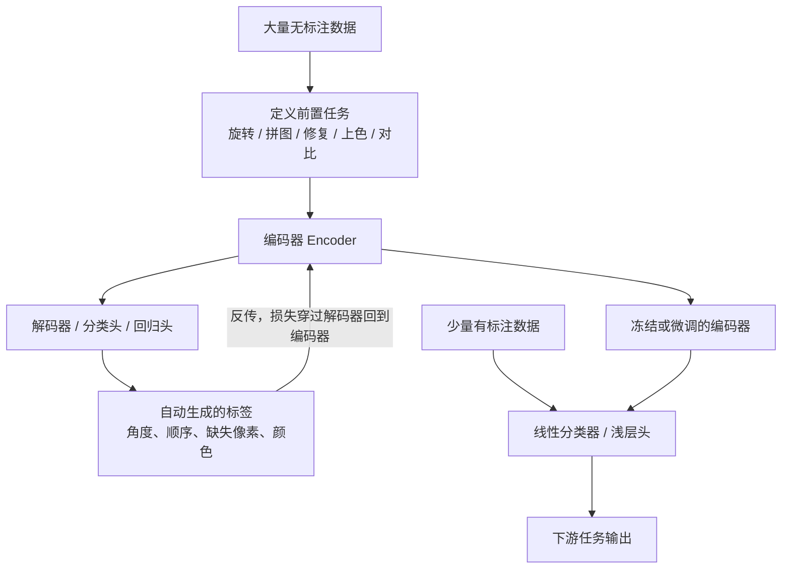
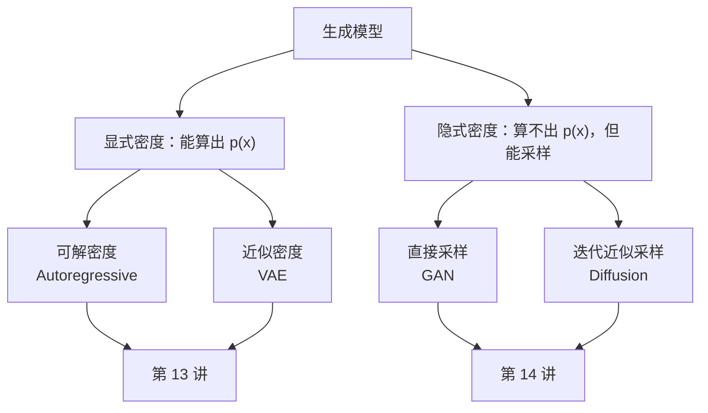
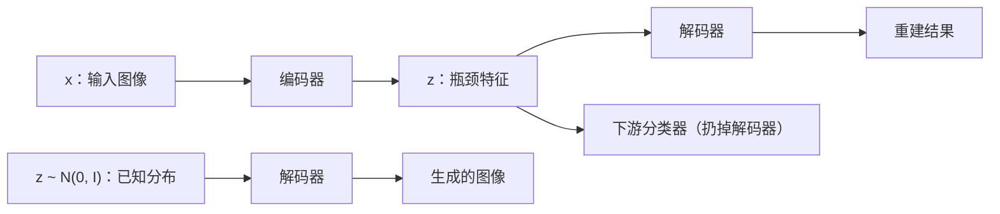
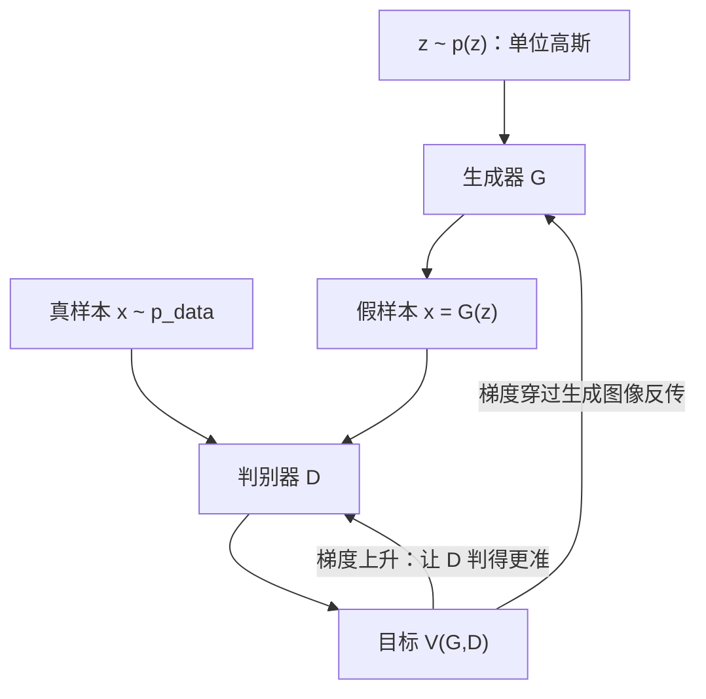
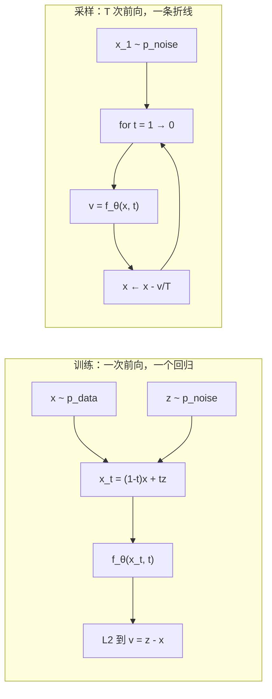
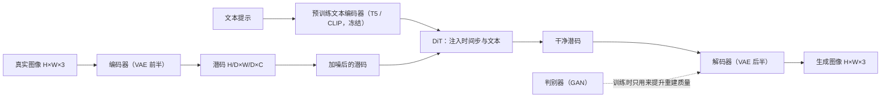
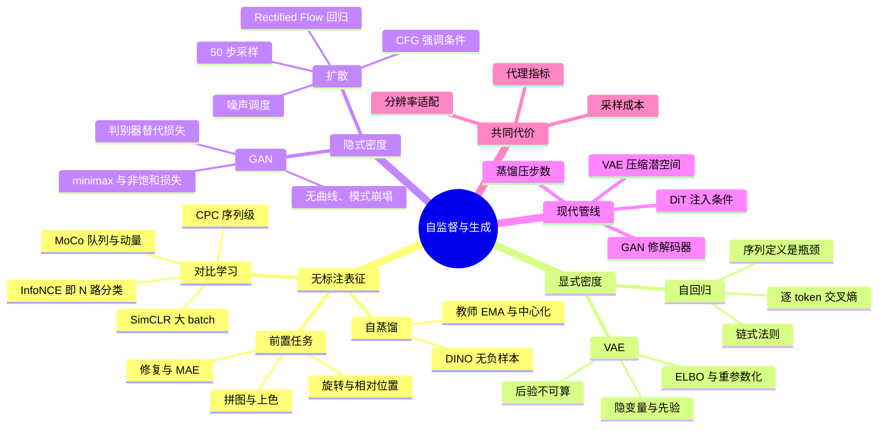

> **课程信息**
>
> - **课程名称**：Stanford CS231n: Deep Learning for Computer Vision（Spring 2025）
> - **本模块覆盖**：Lecture 12. Self-Supervised Learning；Lecture 13. Generative Models 1；Lecture 14. Generative Models 2（共 354 页幻灯片）
> - **主讲教师（各讲）**：Ehsan Adeli（L12）；Justin Johnson（L13、L14）
> - **授课日期范围**：2025-05-08 – 2025-05-20
> - **课程主页**：[cs231n.stanford.edu/2025](https://cs231n.stanford.edu/2025/schedule.html)
> - **官方课件**：[lecture_12.pdf](https://cs231n.stanford.edu/slides/2025/lecture_12.pdf)（115 页）、[lecture_13.pdf](https://cs231n.stanford.edu/slides/2025/lecture_13.pdf)（116 页）、[lecture_14.pdf](https://cs231n.stanford.edu/slides/2025/lecture_14.pdf)（123 页），书中逐页插图
> - **字幕来源**：[cs231n_sp25_kor_sub · eng](https://github.com/lpaiu-cs/cs231n_sp25_kor_sub/tree/main/eng)（公开英文转写，中文由本书重写）
> - **版权说明**：幻灯片与课程材料版权归 Stanford University 及授课教师所有；本书为非官方学习笔记，仅用于学习与研究。


三讲串起来看是一笔账。第 12 讲想办法把「标签」这项成本从预算里划掉：不给标签，只给像素，让模型自己造出一个四分类题、一个拼图题、一个上色题，或者干脆把同一张图的两个视角拉近、把别人的视角推远。交付物只有一个——编码器，或者更准确地说，是编码器吐出的那个 $z$。第 13 讲立刻指出这个交付物的缺口：$z=f(x)$ 只回答了「这张图该被压成什么」，没回答「什么样的 $z$ 才配生成出一张图」，要回答后者就得写出 $p(x)$，而写出 $p(x)$ 比学一个 $f$ 难得多。第 14 讲则把两种难度焊接在一起：今天的文生图系统里，压缩图像的编解码器是一个 VAE（第 13 讲的产物），去噪的主干是一个 Transformer（第 12 讲那套架构），补清晰度的判别器是一个 GAN（第 13 讲族谱的右半边），而条件来自一个冻结的预训练编码器（第 12 讲自监督的直接后裔）。所以本模块不是三段并列的知识，而是一条因果关系链：**没有标签时，你只能学表征；表征学好了，你会发现它没法反向生成；想生成，就得在「密度可算」「sample 可得」之间做取舍；最后工程上没人愿意取舍，于是把四种范式拼成一条流水线**。每一讲的结尾都欠着下一讲一笔债，本章按这笔债的偿还顺序重排。

## 1. 标签是唯一扩不动的资源：从 4096 维坐标到前置任务

*(参考时间: 00:00:05 – 00:08:20｜Lecture 12)*


事务页只有三行：期中考试在下周二 5/13 的上课时间进行，复习课在 5/9 中午 12:30，项目提案反馈已发到 Gradescope。它标出了这一讲的时间坐标——这是期中前的最后一讲，也是全课程里唯一一次把「数据从哪来」当成主题而不是前提。上一讲解决的是「算得动」：显卡怎么用、梯度怎么切到几十张卡上、batch 怎么扩。这一讲处理同一件事的另一半：算力可以买、可以租、可以堆，标注不能。模型参数从百万涨到十亿只用了几年，而人工标签的产能曲线几乎是平的——这个剪刀差就是自监督存在的全部理由。


这张动机图把成本藏在了排版里。四个格子是分类、语义分割、目标检测、实例分割，下面三行小字写明监督粒度：分类「No spatial extent」，一张图一个标签；语义分割「No objects, just pixels」，每个像素一个类别（草地、猫、树、狗、天空）；实例分割「Multiple objects」，还要把同类物体逐个分开。一张 $224\times224$ 的图有 50,176 个像素，分类只要 1 个标签，语义分割理论上要 5 万个——中间差着四个数量级。任何能绕开人工标签、又能保住精度的方法，在这个价差面前都值得一试。回到上周的「看进去」：显著性图、类激活图、把中间层响应投射回像素。这一讲要借的不是这些工具，而是它们暴露的事实——网络中间那些数字有结构，不是乱码。


左列是查询图，中左是像素空间的 L2 最近邻，中右是特征空间的 L2 最近邻，最右那张网络剖面图标红了 fc7。像素空间的近邻全是同色块、同纹理的糊图；特征空间里每张查询图后面跟着的都是同类物体。差别来自被框住的那一条：fc7 输出的 4096 维向量。两张图在像素上可以差很远，在这个 4096 维空间里却可以很近——「学到的表示」在工程上的含义就是这个：一个可以拿来做距离度量的坐标系。同一页幻灯片再出现一次，标题从「上周：可视化与理解」换成「学到的表示」。这个换名是本讲的转折：上一讲用它证明「模型学到了东西」，这一讲要问「这个东西能不能直接拿来用」——如果 4096 维当特征、接一个线性分类器就能出类别，那我们已经有一个与标签无关、可复用的中间产物了。


箭头继续往右伸：4096 维 → Class Labels。到这里问题才被摆上桌：大规模训练的困难在哪？答案是需要大量标注数据。而这个 4096 维之所以有用，恰恰因为整条链路是被标签拽着训出来的；标签一撤，链路就断。于是核心提问变成一句可以写在白板上的话：有没有办法在没有海量人工标注的前提下训练神经网络，并且仍然拿到好特征？自监督的回答是把链路拆成两段。左边是前置任务（pretext task）：用数据本身定义任务，不需要人工标注，形式上属无监督，但训练时用的是监督学习的目标函数——分类或回归。右边是下游任务（downstream task）：你真正在意的应用，手上没有大数据集，但那批数据有标签。两段之间共享的只有一样东西：编码器。图上那个 Trained Encoder 就是全部的交付物。



这张图值得记住它的形状：上面那条是闭环（自监督训练），下面那条是开环（迁移）。它刻意没有写「前置任务的表现要好」——后面会反复出现同一句话：我们不在乎模型在旋转预测或拼图上有多少准确率，只在乎它顺手学出来的编码器在下游有多好用。请注意这张图缺了什么：编码器只交付 $z$，没有任何一处告诉你「怎样的 $z$ 能生成一张图」。这个缺口一直留到第 13 讲才被正面处理。


拆开第一段：图像进编码器压成学到的表示，后面的模块把表示映射到输出空间，而那里的标签不是人标的，是数据自动生成的。这个后置模块可以叫解码器、分类器或回归器，取决于任务被定义成什么形状——要重建像素就是解码器，要预测四类角度就是分类器，要回归连续角度就是回归器。讲师在这里补了一句容易被忽略的话：当后置模块是解码器时，整个东西更接近自编码器（autoencoder）。这句话是本模块最长的一条伏笔：它在第 12 讲是 MAE，在第 13 讲是 VAE，在第 14 讲是潜空间扩散里那对冻结的编解码器。下游阶段做的只是替换：编码器保留，解码器换成分类器（图上写 FC），标签来源换成真实标注。要训的只有最后一段，编码器可以冻结也可以跟随微调。这套流程成立只需要两个条件，而它们互相拉扯：前置任务必须难到值得学，否则编码器学不到东西；又必须不需要人工标注，否则等于什么都没省。整讲剩下的部分，本质上就是在不同任务上反复检查这两个条件满足得怎么样。

## 2. 前置任务的验收标准：任务准确率是最会骗人的指标

*(参考时间: 00:08:37 – 00:14:57｜Lecture 12)*


定义前置任务并不简单，讲师的原话是「not that straightforward」。这页给了四个跑通过的样例：图像补全（遮住一部分，预测被遮内容）、旋转预测（输出它被转过的角度 $\theta$）、拼图（打乱 patch，输出正确顺序）、上色（给灰度图，预测颜色）。四条共享同一套合法性论证，写在页面底部：解这些任务的过程会逼模型学到好特征；这些任务的标签可以完全自动生成。第一条决定上限——不需要理解物体就能做对的任务，学到的特征也不会理解物体；第二条决定成本——只要标签能自动生成，数据量就可以无限扩。评估这页列了五项，讲师按重要性重排过：前置任务表现（最容易测，也最能骗人——任务简单时准确率可以很高而特征一无是处）；表示质量（线性评估协议、聚类、t-SNE 三条手段）；鲁棒性与泛化；计算效率；迁移与下游表现。他明确点了名：五项里最重要的是最后一项。理由很工程——前置任务的准确率是代理指标，只有下游指标才是你付钱买的东西；而代理指标与真实目标之间的相关性，恰恰是自监督研究里最不可控的一环。


左边一大堆无标签数据，中间自监督学习加特征提取器（一个卷积网络），右上角是旋转任务的输出：图像被转 0/90/180/270，网络输出四类之一。这一步的产物不是那个四分类器，而是编码器。第二帧把下游接上：特征提取器后面挂一个线性分类器（图上写 conv + linear classifier），用目标任务的少量标注训练，最后在目标任务上评估。注意第一帧里的 fc 和四分类头被整段拿掉了。讲师强调这里要的是浅层网络，理由很直接：如果特征真的好，把类别读出来不需要复杂映射；如果必须靠一个深网络才能读出类别，那信息不在特征里，而在你新加的那几层里被重新学了一遍。这就是线性评估协议（linear evaluation protocol）的全部逻辑，它会在第 6 章（MAE 的 linear probing）与第 7 章（SimCLR 的线性探针）反复出现。


这一页把视野拉出计算机视觉：视觉（Doersch 等，2015）、语言建模（GPT-4，2023）、语音合成（Wavenet，van den Oord 等，2016）、机器人/强化学习（Dense Object Net，Florence 与 Manuelli 等，2018），中间标着 Today's lecture 的格子是本讲覆盖范围。讲师在这里说了本讲最重的一句判断：让今天这些大语言模型成为可能的范式，正是自监督——训练语料绝大部分是原始文本，没有人逐句标注。他还给了一个很具体的例子：湾区路上跑数据的自动驾驶车，商业逻辑的一部分就是数据可以自己采、不必自己标。这句话也解释了第 14 讲为什么要把条件信号交给一个预训练文本编码器：那类编码器本身多半就是自监督训出来的。议程分两块：上半场是图像变换类前置任务（旋转、修复、重排、上色），加上重建路线的最新形态 MAE；下半场是对比表示学习（直觉与形式化、SimCLR 与 MoCo、CPC、DINO）。同一页的第二帧只改一件事：下半场变灰。这是讲师的进度条用法，第 67 页这张议程会以相反形态再出现一次。把议程当两段而不是四段很重要——前半场的关键词是「我设计一个变换」，后半场的关键词是「我定义一种关系」，这两件事的抽象层级不同，也决定了它们后面能不能跨模态复用。

## 3. 几何变换类任务：旋转、相对位置、拼图

*(参考时间: 00:15:26 – 00:26:25｜Lecture 12)*

### 3.1 旋转预测的赌注全押在「视觉常识」上


这是全讲最干净的一个假设：一个模型只有在具备「这个物体正立时该长什么样」的视觉常识时，才能认出它被转过的角度。这句话把任务难度和特征质量绑在了一起——要做对，模型必须知道鸟的喙朝前、人的头朝上、车的轮子朝下。实现很直接：一张原图 $X$，用四个确定性函数 $g(X,y)$ 分别转 0、90、180、270 度，得到 $X^0,\dots,X^3$，标签就是 $y\in\{0,1,2,3\}$。讲师特意点明这不是回归——不预测精确角度，只在四类里选。四分类的好处是任务稳定、类别平衡：每张图必然且只生成四个样本，每类各占 25%。


第二帧补上训练那半边：四个旋转版本进入同一个 ConvNet $F(\cdot)$，后面四个目标框写着 Maximize prob. $F^y(X^y)$。共享权重是这里唯一的精巧之处——四个角度各训一个网络，学到的会是四份互不相干的特征，也就没有「通用表示」可言。数据量的账也好算：原本 $N$ 张图变成 $4N$ 个样本，标签零成本。这是所有图像变换类任务的共同红利——数据增强从正则化手段升级成了标签工厂。评估用 CIFAR-10：整个训练集上做旋转自监督预训练，冻结 conv1、conv2，只用一小部分有标签数据学 conv3 和线性层。横轴是标注样本数（20、100、400、1000、5000），纵轴是测试准确率。曲线里有两件事：低标注区间差距巨大——20 个标注样本时半监督版本已在 65% 左右，随机初始化只有 39% 附近，26 个百分点全来自预训练；高标注区间两条线合流——5000 个样本时都爬到 92%–93%。这正好划出自监督的适用边界：**它买的是低标注区间的那段斜率，不是上限**。


这张表是本讲第一个硬数字。任务列是 VOC 2007 的分类（%mAP）、检测（%mAP）与分割（%mIoU）：ImageNet 全监督（上限参照）为 78.9 / 79.9 / 56.8 / 48.0（分类 fc6-8、分类 all、检测、分割）；随机初始化为 53.3 / 43.4 / 19.8；旋转自监督把地板抬到 72.97 / 54.4 / 39.1——分类涨近 20 点，分割直接翻倍，但距全监督仍差 2–9 点，而这几点是 1000 类人工标签换来的。讲师的原话是：旋转预训练「不等于在全 ImageNet 上预训练，但已经很接近」。表里还有一排其他自监督方法，RotNet 在三列上都排最前，但表内排序并不稳定：分类列 Jigsaw 的 67.6 压过 Split-Brain 的 67.1，检测列 ColorProxy 的 65.9 又反超 Jigsaw——前置任务的选择会系统性地偏向某类下游任务，这正是第 7 章那个转折的伏笔。第三个评估角度是把特征投射回像素，看模型在「看哪里」。全监督模型的注意力往往更集中——它只需要解决分类，抓住眼睛和眼睛周围的形状就够了；自监督模型的覆盖范围明显更宽，因为它不知道下游是什么，只能对整图建立更整体的理解。这不是「自监督更好」的证据，而是一个结构性差异：**监督信号越窄，特征就越容易被压成只服务那一个任务的形状**。这句话在对比学习里会以另一种形式出现——投影头存在的理由，就是不让对比损失把特征压得太窄。

### 3.2 从「哪一个 patch」到「哪一种排列」


第二个任务是相对位置（Doersch 等，2015）：图切成 3×3 网格，取中心 patch 作参照，问模型「这个 patch 相对中心在哪个位置」。八个非中心位置对应八类，又是一个 8 路分类。它把「理解图像」拆成「理解部件之间的空间关系」——这个拆法比旋转更细，因为旋转只用一个全局标量，位置关系要落在具体的两块区域上。Noroozi 与 Favaro 在 2016 年把这个想法推到极端：同样 3×3 网格，9 个 patch 全部打乱，让网络预测正确排列。讲师当场提问这样的设置共有多少种排列，学生喊出 $9!=362{,}880$。直接做 36 万路分类既没必要也不稳，因为很多排列只差一次相邻交换，视觉上几乎一样；作者的做法是建一张查找表，只保留 64 个彼此差异最大的置换，任务变成 64 路分类。

讲师补了一句很实在的评语：64 这个数字近乎任意，选它不是理论推导的结果，而是为了让任务落在可控的分类规模上——$\log_2 64=6$ bit 的信息量，对一张图已经不算少。迁移结果按同一套 VOC 协议评测，图上 Ours 是拼图特征，对照是 Doersch 等的相对位置方法。讲师没有逐个念数字，只给结论：拼图在三类任务上都超过了之前的框架。这一点值得留意——两个任务用的是同一张 3×3 网格、同一批图像，区别只在「预测单个 patch 的位置」还是「预测整组 patch 的排列」，后者把任务从识别局部内容推进到了识别全局布局，特征质量就上了一个台阶。边界也很清楚：一个只会判断 90 度旋转的网络并不理解物体是什么，只是理解了朝向；同理，会拼图的网络理解的是布局，不是语义。

## 4. 修复与上色：像素和颜色本身能不能当标签

*(参考时间: 00:26:30 – 00:37:04｜Lecture 12)*

### 4.1 遮住一块，让模型把缺失的像素写回来


第三个任务是修复（inpainting），Pathak 等的 Context Encoders（2016）。掩码策略简单到不能再简单：在输入图上盖掉一块矩形区域，让模型补回来。它的合法性来自一个事实——被盖掉的内容在原始数据里是存在的，所以手上一直有标准答案，只是这个答案从来不需要人标注。这也是「自监督」这个词最字面的解释：监督信号本来就长在数据里，你只是把它遮起来再让模型猜。结构是编码器—解码器：编码器把被遮的图压进特征空间，中间接若干全连接层，解码器把特征还原成缺失区域的像素，损失比较输出与真实像素。讲师把它归到自编码器一类，但加了一个限定语——这是「用掩码目标训练的自编码器」，重建的不是整张图，而是被遮住的那部分。这个限定决定了编码器必须学到什么：目标是整图时，网络可以学会恒等映射而什么都不理解；目标只落在缺失区域时，恒等映射失效，网络必须从上下文推断内容。


但修复的评估有个天然麻烦，讲师专门停下来讲：同一个缺口有无数种合理补法。天空可以补成蓝的也可以补成灰的，草地可以补成绿的也可以补成黄的，没有哪一种算错。用 L2 衡量时，模型会倾向输出这些合理答案的平均值——于是早期重建结果普遍发虚、发糊，边缘被抹平。这个诊断的价值远超这一页：**这不是模型不够大，而是损失函数在鼓励平均**。第 13 讲的 VAE 会以另一种机制重演同一件事（高斯似然 + 对角协方差），第 14 讲的潜空间扩散会专门用 GAN 来补这个洞。解法是加一个对抗项，让「看起来真不真」也进入损失：


$$
L(x)=L_{recon}(x)+L_{adv}(x),\qquad L_{recon}(x)=\left\|M*\left(x-F_\theta((1-M)*x)\right)\right\|_2^2
$$


$M$ 是掩码（被遮处取 1、未遮处取 0），$*$ 是逐元素相乘，$F_\theta$ 是编码器加解码器。于是 $(1-M)*x$ 表示只把可见部分喂进去，$x-F_\theta(\cdot)$ 是逐像素误差，再乘一次 $M$ 就只统计被遮区域——**损失只在缺口上算，可见区域一个像素都不计**。这与 MAE 的做法完全一致，可以看作同一配方在更大规模上的重演。对抗项是标准 GAN 写法，讲师明确说留到下一讲展开，这里只需要知道它解决的是「糊」。请注意这个零件在本模块里出现了三次：这里是修复损失的一项，第 13 讲变成族谱右半边的 GAN，第 14 讲变成潜空间扩散里给解码器补清晰度的判别器。


四列并排就是这条论证的全部证据：输入（带缺口的上下文）、纯重建、纯对抗、重建加对抗。纯重建平滑但没有细节；纯对抗能生成纹理却可能跑偏；两者相加才既有结构又有质感。讲师在这页只补了一句判断：加上对抗项之后，重建出来的部分看起来好了一些。这句话在七年后的 LDM 里会被放大成一条工程原则——解码器的模糊必须由判别器来治。同一套 VOC 迁移协议下，修复特征也拿到了增益，而且分布在分类、检测、语义分割三列上。讲师在这里埋了一个回扣：「我待会儿会回到基于重建的框架和掩码，因为这是目前预训练最常用的模型或前置任务之一」——他指的就是第 52 页开始的 MAE。从 2016 年的 Context Encoder 到 2021 年的 MAE，同一条线索走了五年，中间变的是遮挡策略、编码器骨架和规模，不变的是那个损失：只算缺口。

### 4.2 上色：把亮度与颜色拆开，就有了一对免费的监督信号


第四个任务是上色。彩色图通常存 RGB，但三个通道混在一起，亮度和颜色纠缠不清；换成 LAB 色彩空间就可以拆开：$L$ 是亮度，$a$、$b$ 是两个色度通道。于是任务变成输入 $X\in\mathbb{R}^{H\times W\times 1}$、输出 $\hat{Y}\in\mathbb{R}^{H\times W\times 2}$。讲师在这里插了一段旁白：色彩空间有很多种，计算机视觉里最常用 RGB，但要把亮度和颜色分开就得换 LAB 这类空间；把三个通道叠回去就还原出彩色图。这段话解释了为什么上色是合法任务：**颜色在数据里，只是被拆到了另外两个通道上**。第二帧把结果接回去：灰度输入经 $F$ 输出 ab，再与 $L$ 拼接成 $(\mathbf{X},\hat{\mathbf{Y}})$，右图从伪彩色的通道可视化变成一张真正的彩色照片。这一帧的意义在于把「预测两个通道」翻译成「生成一张彩图」，也顺手说明了评估方式：颜色对不对，人眼一看就知道——这类任务的好处是评估成本也接近零。


顺着「给定一部分通道，预测另一部分」往下推，自然会问：为什么只能 L → ab？反方向同样成立。这就是 split-brain 自编码器（Zhang 等）：输入分成 L 通道与 ab 通道两路，网络 $\mathcal{F}_1$ 学 L → ab，$\mathcal{F}_2$ 学 ab → L，两支输出拼回原图，与输入算 L2。讲师说训练时两个函数一起训，最后合并生成整张图再算损失，任何距离函数都能用。精巧之处是**两支互为监督**：一支的输入是另一支的目标，所以既不需要外部标签，也不需要设计两套任务。第二帧把它抽象成通用形式：输入图 $X$ 被切成两组通道 $X_1$（蓝）与 $X_2$（黄），两条路径分别做跨通道预测 $X_1\to\hat{X}_2$、$X_2\to\hat{X}_1$，拼起来得到 $\hat{X}$。

这个形式一旦成立，「颜色」就不再是必要条件——任何可以自然分组的数据都能套进来。这也是自监督方法从「发明变换」走向「利用数据结构」的第一步，而第 7 章会把这一步走到底：把「分组」换成「同一物体的两个视角」。讲师给的例子正是 RGB-D 传感器：一帧数据里既有 RGB 通道，也有深度通道（图上标的是 HHA 深度编码），于是可以让 RGB 预测深度、深度预测 RGB，两支拼成 predicted RGB-HHA image。他说这类跨模态预测在机器人应用里是很成功的下游任务，也解释了 split-brain 这个名字的来历：一个自编码器被劈成两半，各自负责一半通道。

### 4.3 上色的两个副产品：一个能用的工具，一张能讲故事的图


评估做法是在整个 ImageNet 训练集上做自监督预训练，下游用 $F_1$ 与 $F_2$ 的拼接特征，评测数据用 Places（Zhou，2016）的标签。结论是：这些特征在预测类别上有相当不错的准确率，但仍然不如全监督——因为这里没有任何标签参与。拼接这个动作值得注意：两路各自看过不同通道，特征带互补信息；把两路拼起来，等于把「亮度里学到的形状」和「颜色里学到的语义」合在一起用。这是 split-brain 相对单向上色唯一的结构性优势。讲师在这里换了个角度谈上色的价值：它不只是预训练手段，本身就是一个能用的工具——可以把没有彩色版本的照片和视频上色。这一页的例子是一张黑白老照片，模型给出的颜色是棕褐色的皮毛与灰绿色的背景。更能说明问题的是这张：约塞米蒂的半圆顶、桥、树，以及水面上完整的倒影。模型上色的不只是物体本身，连倒影里的山、树、桥也被赋予了与实物一致的颜色。模型没有被显式告知「水会反射」，它是在海量数据里学到这一点的。讲师紧跟了一句限定：这些模型都出现在大语言模型、大视觉模型之前，是为特定任务训练的，不是为「解决一切」训练的；看到这种「理解物理世界」的迹象时，要把它当成有意思的副产品，而不是通用能力的证据。这个限定同样适用于整讲：自监督证明了「无标签预训练可行」，没有证明「一个任务能通吃」。

## 5. 视频上色：时间一致性把跟踪逼成副产品

*(参考时间: 00:37:09 – 00:44:46｜Lecture 12)*


把上色推到视频，任务描述里多了一个自由度，也多了一条约束。设定是：$t=0$ 的参考帧是彩色的，$t=1,2,3,\dots$ 的目标帧是灰度的，任务是为这些帧上色；页面中间那句问话是全部难点所在——「这些帧该怎么上色？」单帧上色时每帧都可以独立猜一个合理颜色，视频里不行，因为同一个人在同一段视频里的衣服不会突然变色。第二帧把答案写了出来：Should be the same color。由此得到本节的假设——**学会给视频帧上色，应该能让模型学会在没有标签的情况下跟踪区域或物体**。理由很直接：要给 $t=3$ 帧里的人配上正确颜色，模型必须先在 $t=0$ 帧里找到同一个人，再把那个位置的颜色搬过来。跟踪不是被显式监督的，它是完成任务的必要中间步骤。Vondrick 等的做法是：在学习到的特征空间里为参考帧和目标帧建立映射，把这些映射当作「指针」，用它们把参考帧上的颜色（LAB 空间）复制到目标帧。讲师强调这套机制和注意力是同一件事——为每个目标像素，计算它相对于参考帧所有像素的注意力权重。请注意这个说法在 2025 年的语境里不是比喻：第 14 讲里 DiT 用 cross-attention 把文本 token 注入图像 token，做的就是同一类「按相似度搬运信息」的操作，只不过搬的是语义而不是颜色。


第一步是注意力图：对目标帧里的一个像素，用 CNN 特征算出它与参考帧每个像素的相似度，输出一张与参考帧同尺寸的权重图。第二步是加权求和：把这个像素的预测颜色写成参考帧所有像素颜色的加权平均，权重就是上一步的注意力。维度上这是一个很轻的操作：$H\times W$ 的目标帧，每个像素要对参考帧的 $H\times W$ 个位置算权重，代价是 $O(H^2W^2)$；实际实现会在低分辨率特征图上做，这也是它能跑起来的原因。第三步才是训练信号：预测颜色与真实颜色之间算损失。注意这里监督的是**颜色**，不是「对应关系」——网络为了让颜色对，自己把对应关系逼了出来。这正是自监督的标准套路：监督一个便宜的、自动可得的目标，让真正想要的表示成为副产品。这一页也把整套方法的成本说清楚了：没有额外标注、没有光流、没有检测框，唯一的监督就是视频自己。


三列排布是这类论文的标准展示方式：左列参考帧（彩色）、中列目标帧（灰度）、右列预测。讲师要观众看的不是「颜色准不准」，而是「前后帧是否一致」。他给了反例作对照：如果每帧独立上色，人物的衬衫颜色会跳变，因为没有约束要求它保持一致。第二个场景里，黄色练功服的人物在多帧之间保持同一个颜色，而姿态在变、位置在动——这说明注意力确实锁在了「那个人」上，而不是锁在某个固定坐标上。


既然注意力给出的是「目标帧的这个像素对应参考帧的哪个像素」，它就不只能传颜色：把参考帧上的分割掩码按同样的权重映射过去，就得到目标帧的分割；把标好的姿态关键点搬过去，就成了关键点跟踪。讲师的原话是，因为你在算对参考帧的注意力，你实际上能够跟踪物体、跟踪片段，甚至识别视频里的关键点。这条结果链是整讲最有说服力的一段：一个为「上色」而设计的任务，最后交付的是跟踪、分割传播与关键点传播三种能力，而它们的训练标签只有视频本身。

## 6. MAE：遮掉 75%，让重建变成可扩展的预训练

*(参考时间: 00:45:41 – 00:54:16｜Lecture 12)*


MAE（He 等，2021）和前面的修复是同一族，但把规模推了上去。第 28 页的修复只遮一块矩形，MAE 遮的是一大批不规则的 patch，而且遮得更狠：页面上并排给出 50% 与 75% 两种比例。为什么要遮这么多？两条理由：**难度**——遮得越多，剩下的上下文越少，任务越不可能靠纹理糊弄过去，模型必须真正理解物体结构；**数据**——遮得越多，同一张图能变出的遮挡版本就越多，数据量凭空翻好几倍。整条流水线画在一页上：输入图切成网格、大部分格子被盖掉；只有可见的 patch 被送进编码器（灰色大块）；编码器输出一串 token；到了解码器入口，被遮的位置用灰色 token 补上，组成与 patch 数等长的序列；解码器输出每个 patch 的重建；右边是重建结果与目标的对照。注意这条链上有一处不对称：**编码器只看到一部分 token，解码器看到全部**。这一点是 MAE 与经典自编码器的分水岭，也是这一节反复要讲的地方——第 14 讲的潜空间扩散会把这条「不对称」原则反过来用：编码器又大又贵但只跑一次，解码器只负责把潜码还原。


页面四条要点构成设计说明：切分沿用 ViT，图像分成互不重叠的 patch；均匀随机采样 75% 遮掉；高遮挡比例是任务有意义的必要条件——遮得太少，模型可以靠邻近像素插值交差；最技术的一条是**编码器端不放 mask token**，只把可见的 25% 喂进去，这正是编码器可以做得极大的原因。第三条值得展开：重建类任务有一个天然捷径，缺口很小时卷积的感受野就能把答案从邻居插值出来，模型根本不需要语义；遮挡比例本质上是在切断这条捷径。编码器的工作拆成三步：可见 patch 做线性投影映射到嵌入空间；加位置编码（与 ViT 一致，只是位置索引对应原始网格位置）；送进一串 Transformer block。因为输入只有 25% 的 token，编码器每个 token 的计算量可以远大于解码器——页面上给的数字是**编码器每 token 的计算量超过解码器的 9 倍**。这个 9 倍可以自己核：按 16×16 patch 切 224×224 的图共 196 个 patch，75% 遮挡后编码器只处理 49 个，解码器要处理 196 个；把编码器做深、解码器做浅，总开销反而被压在可控范围。这是 MAE 能 scale 的核心账。


解码器做相反方向的事：先把编码器输出按原始顺序摆回网格，在被遮位置插入一个**共享的可学习 mask token**，再给所有 token 加位置编码；然后过若干 Transformer block，最后一层线性投影把每个 token 映射成像素。讲师对 mask token 的解释很老实：它是一个可学习参数，没法严格解释它编码了什么，只能说它大致相当于「一个平均 patch」的占位；关键在于它是共享的——所有被遮位置用同一个向量，参数量就与遮挡比例解耦了。页面最后一句是结构判断：解码器只负责重建，训练结束后整段丢弃，因此它与编码器设计完全解耦，不像传统自编码器或 UNet 那样要求两边对称。这就是非对称自编码器（asymmetrical autoencoder）。损失是像素空间的均方误差，并且**只对被遮的 patch 计算**——可见区域的重建是恒等映射，算进去只会稀释梯度。这一条与第 31 页的修复损失是同一个思想，只不过那里用掩码 $M$ 做逐元素相乘，这里直接用 patch 集合筛选。用 MSE 而不是感知损失或对抗损失是明确的取舍：像素级 MSE 会带来偏平滑的重建，但它简单、稳定、可扩展；而 MAE 的目标本来就不是生成好看的图，是训出好编码器。这一点和第 4 章那段「L2 鼓励平均」的诊断并不矛盾——同一个模糊，在生成任务里是缺陷，在预训练任务里可以忍受。


编码器训好之后有两条下游路线，页面画成上下两个框。**linear probing**：预训练模型冻结，只在末尾加一个线性层预测标签，用来评估表示质量。**fine-tuning**：预训练模型不冻结，连同新加的一层或多层一起训。讲师对两者的定位很清楚：linear probing 衡量的是「在受限条件下表示本身有多好」，fine-tuning 挖掘的是「模型接近真实潜力时能到什么水平」。论文里两个数字都要报，前者是表示质量的下界，后者是实用性能的上界。这套二分法在本模块后面还会以别的名字出现：第 14 讲的文本编码器是冻结的（T5、CLIP 只做前向），而扩散主干是端到端训的。这一页列了需要做的选择：遮挡比例、解码器深度、解码器宽度、编码器是否使用 mask token、重建目标、数据增强、掩码采样方法、训练计划。讲师的原话是「这么多建模与超参选择」，语气里带着无奈——这类方法可调空间太大，论文的说服力必须靠消融堆出来。

他挑了两个讲：遮挡比例，75% 给出了很高的准确率，这就是它被选中的原因，不是先验；采样方式，主要比较随机遮挡与网格/块状遮挡，结论是随机遮挡最好，因为块状遮挡会把整片区域抹掉，剩下的 patch 空间相关性太强，随机遮挡则让每个可见 patch 的邻居都被打散。最后一页是对比。讲师说 MAE 在这套比较里明显更好，包括当时更强的对比学习方法 DINO 与 MoCo v3；他对这条重建路线的评价也很直接：如今要在原始数据集上做预训练，MAE 是最常被拿起来用的框架之一。注意这场比较的对手全是判别式方法（DINO、MoCo v3 都在用对比或自蒸馏），而 MAE 用的是重建——两条路线的差别不在损失形式，而在「标签从哪来」：对比学习从样本之间的关系里取标签，重建从被遮住的像素里取标签。第 12 讲到这里已经把「标签可以免费」这件事榨到了极限，但它仍然只交付一个编码器；要让这个编码器能反向吐出新图，就得回答「$p(x)$ 长什么样」，而那正是第 13 讲的第一句话。

## 7. 对比学习：把「是不是同一个物体」写成 N 路分类

*(参考时间: 00:54:22 – 01:13:34｜Lecture 12)*

### 7.1 前置任务的两个病：手工设计，且不通用


上半场的总结先给三条判断链：前置任务关注「视觉常识」（预测旋转、修复、重排、上色）；为了解这些任务，模型被迫学到关于自然图像的好特征；而我们通常**不在乎这些前置任务本身的性能**，只在乎特征对下游有多有用。第二帧补上两个问题，这是本讲的转折：为每个任务单独设计前置任务很繁琐，每换一个领域就得重新设计一遍；学到的表示可能并不通用——你在旋转任务上学到的特征，是为「判断朝向」服务的。两个问题都不是效率问题，而是方法论问题：如果每个下游任务都需要一个专门设计的前置任务，那自监督没有摆脱手工设计，只是把手工设计从标注环节挪到了任务设计环节。这一页把四个任务并排放在一起，底部两行字是全讲第二个转折：学到的表示可能被绑在某个特定前置任务上；能不能设计一个更通用的前置任务？讲师没有立刻给答案，而是先把它变成可操作的问题：如果「通用」意味着什么任务都能用，那这个任务至少不能依赖某种特定变换（旋转、遮挡、颜色），它得直接来自数据里物体与物体之间的关系。

### 7.2 三件套：同一物体的两个视角该靠近，别人的该远离


答案从一对关系开始成形。我们手上一直有两种关系：同一张图经过不同变换后仍然是同一个物体；数据集里其他的图是**不同的**物体。前者免费、无限、不需要任何语义标注。第二帧把对照补上，任务就从「预测某个变换的参数」变成了「判断两个视角是不是同一个物体」——它不依赖具体是旋转还是裁剪，也不依赖颜色空间或 patch 顺序，只依赖「物体同一性」这一个概念。第三帧给出动作：同一物体的表示在特征空间里**拉近**（attract），不同物体的表示**推远**（repel）。到这里，前置任务的设计从「发明一个变换」变成了「定义一种关系」，抽象层级提高了，这正是它后面能通用于图像、视频、音频、文本的原因。回到议程，这次灰掉的是上半场。下半场四行：直觉与形式化、实例级对比（SimCLR 与 MoCo）、序列级对比（CPC）、无标签自蒸馏（DINO）。


这一页与第 66 页是同一张图，讲师在进入形式化之前又放了一遍，把「拉近/推远」固定成一个视觉锚点——后面所有公式，本质上都是在给这两个箭头写代价函数。形式上只需要三个角色：**reference** 是参照样本 $x$；**positive** 是它的一个变换版本 $x^+$；**negative** 是数据集（或当前 batch）里其他物体的样本 $x^-$。讲师强调这里用的是 batch 内学习：同一批里其他样本的变换版本自然就是负样本，不需要额外构造。这也埋下了后面所有工程问题的种子——负样本的质量与数量，从此变成了一个要花显存去买的东西。

### 7.3 从评分函数到 InfoNCE：一个换了名字的 Softmax


形式化的起点是一个评分函数 $s$。给定编码器 $f$，我们希望 $s(f(x),f(x^+))$ 高、$s(f(x),f(x^-))$ 低。注意这里没有规定 $s$ 长什么样，也没有规定 $f$ 是什么网络——这是一个只约束**相对大小**的目标，所有具体的对比方法都是在填这两个空。要把它写成可优化的损失只需一步：把正样本的得分和所有负样本的得分放进同一个 softmax，再取负对数。


第二帧把公式里的求和展开成带省略号的长串。这一步视觉上不起眼，却是理解 InfoNCE 的关键：分母里每一项都是一个负样本，负样本越多分母越大，正样本要胜出就越难——难度会随负样本数量自动增加。第三帧给公式加上颜色标注，完整形式是


$$
L=-\mathbb{E}_x\left[\log\frac{\exp\left(s(f(x),f(x^+))\right)}{\exp\left(s(f(x),f(x^+))\right)+\sum_{j=1}^{N-1}\exp\left(s(f(x),f(x_j^-))\right)}\right]
$$


页面底部那句 This seems familiar... 是讲师留给课堂的提示。


答案揭晓：这就是 $N$ 路 softmax 分类器的交叉熵。把 $N$ 个候选（1 个正样本 + $N-1$ 个负样本）看成 $N$ 个类别，正样本是正确类别，其余是错误类别，于是「对比学习」=「在 $N$ 个样本里把正样本找出来」。讲师把这段等价关系讲了两遍，因为它决定了后面所有工程选择：既然是分类，就需要 softmax 的数值稳定性；既然类别是「其他样本」，类别数就等于 batch 里的样本数；既然要训得好就得让 $N$ 大——这正是 SimCLR 疯狂堆 batch 的根本原因。**这也是本模块的第一条暗线：自监督与生成模型都在把某个现成的分类/回归损失套在一批自动生成的标签上。** 第 14 讲里判别器解的是真假二分类，扩散解的是速度回归，三者是同一个套路的三种外壳。

这一页给了这个名字和它的理论身份。损失叫 InfoNCE（information noise contrastive estimation），出自 van den Oord 等 2018。两条性质：它是 $f(x)$ 与 $f(x^+)$ 之间互信息的一个**下界**；负样本数 $N$ 越大，这个界越紧；详细推导见 Poole 等 2019。讲师把「下界」讲得很小心：负的 InfoNCE 是互信息的下界，所以最小化 InfoNCE 等价于最大化互信息。理论上「界越紧」这句话，在工程上直接翻译成一条硬约束：要更大的 $N$。讲师说得很直白——用这种损失训练网络需要巨大的 batch size，负样本越多，收敛越好也越快。这句话是 SimCLR 与 MoCo 全部分歧的源头。

### 7.4 SimCLR：一个 batch 就是一道 2N 路分类题


SimCLR（Chen 等，2020）把前面所有零件拼成一个尽可能简单的框架，页面上三个部件正好对应三个设计决定：正样本怎么来（对同一张图做两种随机数据增强——随机裁剪、随机颜色失真、随机模糊）；相似度怎么算（余弦相似度作为评分函数 $s$）；特征在哪个空间比（不是直接比编码器输出 $h$，而是先过投影网络 $g(\cdot)$，在 $z=g(h)$ 里做对比）。第三个决定是后面要单独讲的投影头，前两个决定则解释了为什么 SimCLR 的增强策略被看得那么重——增强就是标签生成器，增强不够狠，正样本对太容易，任务就没有难度。


一页图说明数据流：一张原图进入增强管线，采样出两种不同的增强组合，得到两个视图。讲师特意强调「所有种类的变换都说得通」——在 SimCLR 的设定里，增强的选择不是理论推导出来的，而是实验调出来的。第二帧把这件事写成公式：从增强函数族里采样 $t_1,t_2$，作用在同一张图上得到 $\tilde{x}_i=t_1(x)$、$\tilde{x}_j=t_2(x)$。页面右下角有一条红字提醒，讲师在课上也念了一遍：作业 3 里用的是略有不同的写法，请按作业说明做。


第二帧把损失接上：对每个正样本对算 InfoNCE，负样本取 **batch 内所有非正样本**。这是 SimCLR 与 MoCo 的第一个分水岭——负样本完全来自当前 batch，没有队列、没有历史。第三帧补上遍历：batch 里有 $N$ 张原图，经过两种增强变成 $2N$ 个视图；每个视图轮流当一次 reference，各算一次损失，最后取平均。于是每个 batch 贡献 $2N$ 个损失项。


矩阵形式把整件事变得很干净：$2N$ 个视图过编码器加投影头得到 $\mathbf{z}\in\mathbb{R}^{2N\times D}$；两两算余弦相似度 $s_{i,j}=z_i^\top z_j/(\|z_i\|\|z_j\|)$，得到一张 $2N\times2N$ 的亲和矩阵（affinity matrix）。配对规则固定：第 $2k$ 个与第 $2k+1$ 个是一对正样本；对角线是自己跟自己，相似度恒为 1，必须屏蔽。第二帧把这张矩阵和分类彻底接上：每一行就是一个分类标签，第 $i$ 行的任务是「在 $2N$ 个候选里挑出我的配对视图」，正确答案是 $p(i)$，其余 $2N-2$ 个全是负类：


$$
\ell_i=-\log\frac{\exp\left(s_{i,p(i)}\right)}{\sum_{k\neq i}\exp\left(s_{i,k}\right)}
$$


整个 batch 的损失就是对 $i$ 取平均。这也解释了为什么 batch 越大越好：$2N$ 越大，每道题的候选越多，题目越难，梯度里的信号越丰富。


这张图值得记住，因为 MoCo 后面只改两处：把「2N 个视图」换成「一个 batch + 一个队列」，把「同一批算梯度」换成「只有 query 那一路算梯度」。这也是本模块里第一次出现「用数据结构替代算力」的思路，第 14 讲的 LDM 会用完全相同的手法——用潜码替代像素，把计算量从数据规模里解耦出去。


评估沿用标准协议：在 ImageNet 全集上用 SimCLR 训编码器，冻结它，用有标签数据在特征上训一个线性分类器。结论是：SimCLR 不用任何标签，只靠线性分类器就超过了之前所有自监督方法，甚至逼近全监督的结果。他补了一个很重要的限定：因为学的是更通用的特征，网络本身需要更大；而且在准确率上它仍然只是「可比」，不是「超过」。后面 MoCo v3 那页会给出这条限定的另一面：参数从 86M 加到 632M，线性探针也只从 76.7 走到 79.1。换一个评估角度：不再冻结，而是用 ImageNet 上 1% 或 10% 的标签微调整个编码器。这是半监督设定，比线性探针更接近实际用法——现实里你手上总有一点点标签，问题是用这一点点能撬动多少。讲师没有念具体数字，但这个设定本身说明了自监督的商业逻辑：**预训练买的是「少量标签也能用」，而不是「完全不要标签」**。


第一个设计选择是投影头。讲师专门回答了一个问题：为什么不直接用编码器输出 $h$，而要绕一层 $g$ 得到 $z$？幻灯片给的解释可以拆成三步：对比学习的目标会**丢弃**对下游有用但对比任务不需要的信息；表示空间 $z$ 被训练成对数据变换不变的，所以变换相关信息在 $z$ 里被压掉了；而通过投影头 $g$，这些信息可以保留在 $h$ 里。换句话说，$z$ 是「为任务牺牲掉的表示」，$h$ 是「留给下游的表示」，投影头在两者之间划了一条隔离带。这个解释有点反直觉——通常我们以为多加一层只会引入更多非线性，这里它起的却是「丢弃的容器」的作用。也正因为如此，下游用的是 $h$ 而不是 $z$，这一点常被实现者搞错。第 14 讲的文本编码器把同一原则推到极致：整个编码器都冻结，只把它的输出当作条件向量喂给生成器。第二个设计选择是大 batch，讲师用了感叹号：large training batch size is crucial for SimCLR。理由前面已经推过——负样本数等于 $2N-2$，batch 不够大，InfoNCE 的界就松，特征就糊。代价写在页面下半部分：大 batch 在反传时要保存大量中间激活，显存占用巨大，ImageNet 实验里必须在 TPU 上做分布式训练。这就把 SimCLR 推到一个尴尬位置：方法极简，复现门槛极高——不是每个人都有一个 TPU pod。

### 7.5 MoCo：用一个队列把负样本从 batch 里解耦


MoCo（He 等，2020）的出发点就是上面那个尴尬。三条改动写在页面右侧：维护一个**键队列**（queue of keys），存历史 batch 的负样本；梯度只通过 query 那一路回传，key 那一路标着 no_grad；把 min-batch 大小与键的数量**解耦**，于是可以用很小的 batch 支撑大量负样本。第三条是全部价值所在：SimCLR 里负样本数 = $2N-2$，两者绑死；MoCo 里负样本数 = 队列长度，想设多大设多大，与显存只通过队列本身线性相关，而队列存的只是 $D$ 维向量，不是激活。no_grad 这一笔也值得说清楚：队列里的键是过去若干个 batch 用**旧参数**算出来的，如果对它们求梯度，就等于在优化一个已经过时的目标，梯度方向会打架；干脆不回传，让它们只作为常数负样本参与分母。但键编码器不能永远不动，否则队列里的键会与当前编码器的表示空间脱节。MoCo 的解法是动量更新：


$$
\theta_k\leftarrow m\,\theta_k+(1-m)\,\theta_q
$$


其中 $\theta_q$ 是 query 编码器（正常 SGD 更新），$\theta_k$ 是 key 编码器（只做指数滑动平均），$m$ 取接近 1 的值。讲师的原话是：训练只影响 query 编码器，随时间用动量 $m$ 更新 key 编码器。这个式子的含义是**表示空间缓慢漂移**：key 编码器跟着 query 走，但走得很慢，于是队列里那些老键在当前空间里仍然大致有效。这是 MoCo 全部巧妙之处——它用一条一阶滞后替代了「重新计算所有键」。这个技巧在本讲后面还会以另一种身份出现：DINO 的教师网络同样靠 EMA 更新，只不过那里被平滑的是整个教师模型，而不只是一个负样本编码器。


整条流水线一页画完：采样增强生成正样本对；query 过 $f_q$，key 过 $f_k$（无梯度）；用队列里的键当负样本算 InfoNCE；$f_k$ 用动量更新；队列按先进先出（FIFO）替换最老的键。讲师评价这套框架在实现上非常成功，而且后续版本很多——FIFO 队列实现简单、几乎不增加代码复杂度，却把「负样本预算」变成了一个独立的超参。MoCo v2 是一次纯粹的工程合并：从 SimCLR 拿来非线性投影头和更强的数据增强；从 MoCo 保留动量更新的队列，从而在大量负样本上训练而**不需要 TPU**。讲师把这条逻辑讲成「两条路线的杂交」：SimCLR 证明了投影头和强增强有用，MoCo 证明了队列可以替代大 batch，两者并不冲突，于是拼在一起。


三帧叠起来是一张完整的消融表（ResNet-50 主干，ImageNet 线性分类加 VOC 检测）。基线 MoCo v1 的线性探针是 60.6；单加 MLP 头到 66.2，涨 5.6 点；单加强增强只到 63.4，涨 2.8 点；两者都加到 67.3；再加余弦学习率计划到 67.5，训 800 个 epoch 到 71.1。第二帧的结论是把 batch 大小与负样本数解耦之后，MoCo v2 用更小的 batch（256 对 8192）超过了 SimCLR；第三帧补上最后一句：这一切都在小得多的显存占用下完成，页面还特意解释 end-to-end 在这里指的就是 SimCLR。把 256 与 8192 放在一起就是这一节的全部论点：SimCLR 要用 32 倍大的 batch 才能凑出同量级的负样本，而 MoCo 用队列把这份预算挪出了显存。

## 8. 从实例到序列，再到自蒸馏：负样本预算的四次转移

*(参考时间: 01:13:40 – 01:14:17｜Lecture 12)*


到这里，对比学习的所有变体都在回答同一个问题：负样本从哪来。这一页给出分类法：**实例级**（instance-level）对比学习基于正/负实例，代表是 SimCLR 与 MoCo；**序列级**（sequence-level）对比学习基于序列与时间顺序，代表是 CPC（Contrastive Predictive Coding）。差别在于「正样本」的定义：实例级说「同一张图的两个视图是正的」，序列级说「同一个序列里相邻或未来的片段是正的」。后者的适用面大得多——音频、文本、视频、甚至图像的 patch 行，只要有顺序就能用。

CPC 的名字本身就把方法讲完了：**Contrastive** 是用对比学习去对比「对的」序列与「错的」序列；**Predictive** 是给定当前上下文预测未来的模式；**Coding** 是学到有用的特征向量（code）供下游使用。图上的结构是一排输入 $x_{t-3},\dots,x_t,x_{t+1},\dots,x_{t+4}$，每个先过 $g_{enc}$ 得到 $z_t$，再由 $g_{ar}$ 沿时间汇总出上下文向量 $c_t$；$c_t$ 发出多条虚线箭头指向未来的 $z_{t+1}$ 到 $z_{t+4}$。


第一步只有一句话：把序列中所有样本编码成向量 $z_t=g_{enc}(x_t)$。这一步与 SimCLR 的编码器完全同构，区别只是输入不再是单张图，而是序列里的一个个片段。第二步是 CPC 独有的：用自回归模型 $g_{ar}$ 把一段上下文汇总成上下文码 $c_t$，幻灯片脚注说明原论文这里用的是 GRU-RNN。这一步的物理含义是「记忆」：$c_t$ 要压缩足够多的历史信息，才能支撑后面预测多个时间步。这也是 CPC 与实例级方法最本质的不同——它的正样本不是同一时刻的另一个视图，而是**未来**。第三步把损失接上：在 $c_t$ 与未来的码 $z_{t+k}$ 之间算 InfoNCE，评分函数是时间相关的：


$$
f_k(x_{t+k},c_t)=\exp\left(z_{t+k}^\top W_k\,c_t\right)
$$


其中 $W_k$ 是可训练矩阵。注意下标 $k$：预测一步之后与预测四步之后用的是**不同的** $W_k$，因为不同时间距离上的对应关系不一样；漏掉这个下标，模型会退化成「只学好预测一步」。负样本来自同一 batch 里其他序列的 $z_{t+k}$——所以 CPC 的负样本是「别的时间序列的未来」，而不是「别的图」。


论文的第一个实验是音频：原始波形被切成短帧，每帧编码成 $z_t$，上下文码去预测未来若干帧的编码。任务本身没有任何标签——语音信号自己就是监督。这个设定在直觉上很有说服力：要预测未来的声音片段，模型必须理解音素、语调、说话人的特征，这些都是语音识别真正需要的东西。评估还是线性分类：冻结表示，在 LibriSpeech 上训一个线性分类器，好处是评测的是表示本身，而不是某个微调技巧。CPC 也能用在图像上：把图像切成 patch 网格，把**每一行 patch 当成序列里的一个时间步**，用上面几行作上下文预测下面几行。这样一张静态图就被读成了一个序列，CPC 的机制原封不动搬了过来。这条思路与 MAE 有一个共同直觉——图像的二维结构可以被展平成一维顺序，然后让「预测未来」去逼模型理解空间布局；区别在于 CPC 预测的是表示（在特征空间里对比），MAE 重建的是像素。


MoCo v3 出现在这里有点反常：它的摘要第一句就是 This paper does not describe a novel method。它做的是实证研究——把自监督 ViT 的训练配方逐项拆开，发现不稳定性是主要问题，而且这种不稳定会被「看起来不错」的结果掩盖。幻灯片上的数字（ImageNet 线性探针）：ViT-B（86M）76.7、ViT-L（304M）77.6、ViT-H（632M）78.1、ViT-BN-H（632M）79.1、ViT-BN-L/7（304M）81.0；端到端微调下 ViT-B 79.9、ViT-L 84.1。

注意最后一行：304M 的模型在线性探针上超过了 632M 的模型，说明**训练稳定性比参数量更能决定结果**。DINO（Caron 等，2021）换了一个完全不同的目标。论文首页那张 Figure 1 值得细看：它是无监督训练的 ViT 最后一层 [CLS] token 的自注意力图，8×8 个 patch，模型从未见过任何标签，注意力却精准落在物体上——鸟、船、长颈鹿、飞机——并且能给出无监督的物体分割。讲师对 DINO 的定位只有一句：架构与 MoCo 类似，但它不是对比学习，因为它有学生网络与教师网络。


这页把 DINO 的机制画全了：同一张图 $x$ 生成两个视图 $x_1,x_2$；学生 $g_{\theta_s}$ 处理 $x_1$，教师 $g_{\theta_t}$ 处理 $x_2$；两边过 softmax 得到分布 $p_1,p_2$；损失是交叉熵 $-p_2\log p_1$。教师那一路有三处特殊处理：**centering**（减去一个中心向量）、**sharpening**（用较低温度让分布更尖）、以及 stop-gradient（图上标着 sg）。教师参数不通过梯度更新，而是指数滑动平均 $\theta_{\text{teacher}}\leftarrow\tau\theta_{\text{teacher}}+(1-\tau)\theta_{\text{student}}$。

右半张图把这两个动作的目的说清楚了：centering 防止某一维 dominate（否则所有样本会塌到同一个输出），sharpening 防止塌成均匀分布，两者互相制衡，才让「学生追教师」不塌缩。这也是自蒸馏与对比学习的根本区别——**它不需要负样本**，塌缩是靠 centering 与 sharpening 挡住的。于是负样本预算的四次转移完成了：SimCLR 用大 batch 买负样本，MoCo 用队列省负样本，CPC 用时间顺序换负样本，DINO 干脆不要负样本。幻灯片直接把论文的 Algorithm 1 贴了出来，核心是那个 $H(t,s)$ 函数：

```python
def H(t, s):
    t = t.detach()                      # 教师一侧：停梯度
    s = softmax(s / tps, dim=1)         # 学生：自己的温度
    t = softmax((t - C) / tpt, dim=1)   # 教师：先减中心 C，再用更低的温度
    return -(t * log(s)).sum(dim=1).mean()
```

配套更新只有三行：`update(gs)` 用 SGD 更新学生；`gt.params = l*gt.params + (1-l)*gs.params` 按动量率 `l` 更新教师；`C = m*C + (1-m)*cat([t1, t2]).mean(dim=0)` 用两个教师输出的均值滑动更新中心。两个动量率（网络 `l`、中心 `m`）加两个温度（`tps`、`tpt`），就是 DINO 全部的可调旋钮。


DINO v2 展示了另一种可视化：对同一列图像的所有 patch 做 PCA，把前三个主成分染成 RGB。结果是「相同部件在姿态、风格甚至物体类别变化时仍然匹配」——鹰的翅膀、大象的躯干、马的四肢、卡车的轮子都能对上，背景则被第一个主成分的阈值滤掉。这张图的说服力在于：它展示的不是分类准确率，而是**密集特征的语义对齐能力**——这正是密集预测类下游任务所需要的东西，也正是第 14 讲里文生图系统愿意直接拿一个冻结编码器当条件来源的原因。


四张总结页的第一张把对比学习收敛到一行公式：InfoNCE 就是在正负样本之间做 $N$ 路分类，同时它是 $f(x)$ 与 $f(x^+)$ 之间互信息的下界；上半场的所有方法，本质上都是这一个损失的不同负样本构造方式。第二张给 SimCLR 三条评价：非线性投影头让表示学习更灵活；实现简单、学视觉表示有效；但需要大 batch 才有效，显存开销大。三句话里前两句是优点，第三句是它被 MoCo 取代的直接原因。


第三张给 MoCo：用动量编码器做对比学习；把负样本数与 minibatch 解耦，不用 TPU 也能大 batch；MoCo v2 把 SimCLR 的非线性投影头与强增强搬了过来——三条正好对应 7.5 的三次改动。第四张给 CPC：用「对的序列」对比「错的序列」；InfoNCE 配一个时间相关的评分函数；可以套用到很多学习问题上，但在图像特征学习上不如实例级方法有效。最后一句是这一节的诚实之处：序列级方法在音频、文本上很自然，到了图像上却要先造一个序列（比如按行切 patch），这个「造」的过程本身损失了信息。

## 9. 交接：第 12 讲欠下的两笔账，正好是第 13 讲的全部内容

*(参考时间: 01:14:17 – 01:14:35｜Lecture 12；00:00:05 – 00:10:23｜Lecture 13)*


最后一页是过渡：下一讲讲生成模型。本讲埋下的两条线在这里合流——第 31 页那个被明确留到下一讲的对抗损失，和第 57 页「只在缺口上算」的像素重建，正是生成模型里最基本的两类零件。但更根本的一笔账不是这两个零件，而是**产物**：自监督交付的是一个编码器，它能把图压成 $z$，却没有给出「$z$ 服从什么分布」「怎么从 $z$ 采样回一张图」。第 12 讲的每一页都可以读成「怎么把 $x$ 变成 $z$」，第 13 讲的每一页则要读成「怎么把 $z$ 变回 $x$，并且保证采样出来的东西算得上是样本」。课堂最后不到一分钟里带过的四页值得单独记一句，因为它们是本讲唯一的量化收尾。

这一页给 CPC 图像版的评估结论：在 ResNet-V2 骨干上，CPC 的 ImageNet top-1 达到 48.7，是表里最高的自监督结果（同一张表里 AlexNet conv5 那一组的最高值是 Jigsaw 的 38.1，Colorization 为 35.2）；但右侧那张「准确率—参数量」散点图显示，SimCLR、MoCo、CPCv2 这些实例级方法已经整体排在它上方。一张图同时说明了序列级方法的贡献与天花板。


Florence 等（2018）的 Dense Object Net 把对比学习从「整图」下移到「像素级特征描述子」：背景随机化、跨物体损失、直接多物体、合成多物体四种设定，用绿色箭头标同一物体上的对应像素（正样本）、红色箭头标不同物体上的对应像素（负样本）。它回答的是机器人领域更关心的问题——不是「这张图是什么」，而是「这个像素属于哪个物体」。同一方法的定性结果：每两行一组，上排是原始帧，下排是把逐像素特征做 PCA 后染色的可视化——同一物体在不同帧、不同位置上的特征颜色保持一致，说明描述子确实学到了「这是同一个东西」。


最后一页是一个反例式检验：画面里只有一块空白的洞洞板，没有任何可辨认的物体，逐像素特征图仍然给出了平滑一致的颜色场。它想说明这种密集描述子并不依赖「检测到物体」，而是对每个像素都给一个稳定的嵌入。第 13 讲开场先把上一讲没讲完的部分补完——这是本模块里唯一一次「下一讲先回顾上一讲」，也是两讲真正的接缝。讲师的原话是上一讲的对比学习部分没讲完，所以前十分钟先补齐；从内容上看，这十分钟补的正是 MoCo、DINO、DINOv2 这条「用动量与自蒸馏替代负样本」的支线。


事务页只有两行：明天 5/16 Assignment 3 发布，项目里程碑同期截止。整段口播里没有一句提到这两行——讲师开口就是 Welcome back to CS231N lecture 13。把它记在这里，是因为它标出了课程的时间坐标：作业三与项目里程碑都落在 5 月 16 日，而生成模型这条线要到下一讲才收尾。复习的第一页只画了骨架：左边是没有标签的数据集，中间编码器抽出特征表示，右边分两路——一路是解码器，预测某种从数据自身自动生成的目标；另一路是分类器或回归器，等下游任务出现时才接上。整页没有出现任何人工标注，因为在这个阶段标签还不存在。


第二帧只在解码器旁补了一个 FC，补出的却是整个两段式流程：先在全部无标签数据上训好编码器—解码器，然后**扔掉解码器**，把编码器接到一个可能很小的全连接网络上，在有标签的小任务上微调。讲师给这个流程配的规模账很具体：十亿张从互联网上抓来的无标签图，换到只肯标几十、几百、几千个样本的下游任务上，让后者的表现被前者学到的通用知识抬起来。前置任务的共同点被一句话说破：先对输入像素做一次几何扰动，再让模型从这个被破坏的版本恢复扰动前的信息。旋转是预测转了多少度；重排是把图切成 patch 让模型还原相对位置；重建是挖掉一块再补回去，MAE 走的就是这条路。幻灯片上还列了 inpainting 与 coloring 两个变体，本质都是同一件事的换皮。


这一页是上一讲对比学习部分的目录：直觉与形式化、实例级对比（SimCLR 与 MoCo）、序列级对比（CPC）、无标签自蒸馏（DINO）。它出现的位置说明了一件事——第 12 讲的议程页在这里被重新点亮，两讲共享同一张进度条。对比学习的机制可以压成一句话：相似的对拉近，不相似的对推远。落到实现上，一张猫图裁出两个视角，一只猴图裁一个视角再转成黑白；所有增强版本过同一个特征提取器，再算一个巨大的相似度矩阵。讲师在这里报了一个容易记错的数：$n$ 张图各做两次增强得到 $2n$ 个样本，矩阵是 $2n\times2n$，也就是 $4n^2$ 个元素，全部两两比较。


这一帧只加了一行字：Problem: Need large batch size with lots of negatives。原因不是显存不够，而是任务太容易——一个 batch 里只有寥寥几个负样本时，模型很容易靠颜色、纹理这类廉价线索把两个猫视角认成一对。要让问题难到能提供有效学习信号，就得把 batch 开大；batch 一大，又回到第 11 讲那套大规模分布式训练。MoCo 要切断的正是「负样本数 = batch size」这条绑带。它维护一个 key 队列，装着过去若干次迭代见过的样本；当前 batch 走正常的 query 编码器并照常反传，队列里的 key 走另一个动量编码器。因为 key 那边数据量太大、塞不进显存，所以**不对它反传**——动量编码器的权重不靠梯度下降，而是当前编码器权重的指数滑动平均：旧权重乘 0.99，再加 1% 的新权重。讲师原话说他也没有很好的直觉解释这个更新为什么一定成立，但经验证据非常强。副产品才是关键：负样本数量与 batch size 解耦，一个小 batch 也能对着成千上万个 key 做对比。


DINO 的骨架与 MoCo 同源：一个正常反传的编码器加一个动量编码器。差别在损失——不再用 softmax 后的点积，而是用 KL 散度去匹配两个分支的输出分布；骨干也从 ResNet 换成视觉 Transformer（ViT）。讲师把它的定位说得很直白：细节不必记，知道它存在就行，因为下一个模型在实践中更常用。DINOv2 的关键改动不是损失，而是数据规模：从 ImageNet 的 100 万张扩到约 1.42 亿张，并且找到了一套能在这个规模上稳定收敛的自监督配方。结果是特征质量足够好，今天很多人直接拿它当现成的视觉骨干，再微调到自己任务上。讲师顺带给了这个领域的进步公式：更大的网络、更多的数据、更多的 GPU、更多的 FLOPs——过去十年真正变的是这些，而不是那几行概率公式。

## 10. 标签轴与概率轴：无监督不等于生成

*(参考时间: 00:10:34 – 00:15:01｜Lecture 13)*


翻到这一页，讲师给了一个跨度很大的判断：生成模型十年前「完全不工作」——样本是低分辨率的一团糊，你得眯着眼才能看出一点希望；如今语言模型、图像生成、视频生成都是它的下游。更值得记的是紧接着的补充：基本思想这十年没怎么变，变的是算力、更稳的训练配方、更大的数据集和分布式训练；算法上的真正改动主要发生在下一讲的扩散模型里。这句话为整个模块定了调：第 13、14 讲讲的多数公式都能追溯到十年前，能跑起来是工程的红利。讲师先退一步把术语钉死。监督学习的数据集是成对的 $(x,y)$，$x$ 是数据、$y$ 是标签，目标是学一个从 $x$ 到 $y$ 的函数；分类、回归、目标检测、语义分割、图像描述都落在这个框里。同一页右侧开始逐格补例子。第一格是分类：输入一张猫的照片，输出一个类别标签。


第二格把标签换成一句话：输入还是那张图，输出是一段描述文字（页面注明这句由 neuraltalk2 生成）。监督信号从一个类别变成一串词，但任务形状没变——仍是给定 $x$ 预测某个 $y$。第三格是目标检测：输出不再是一个标签，而是一组框加类别（DOG、DOG、CAT），被预测的对象从整张图细到了图上的每个物体。第四格是语义分割：给每个像素分配一个类别。四格连起来说明一件事——监督学习的 $y$ 可以是标量、句子、框集合或逐像素图，形状差别很大，但都需要人把它标出来。这也回扣了第 12 讲第 4 页那张标注粒度图：越靠右的任务，$y$ 越贵。两栏并排之后差别只剩两行：数据从 $(x,y)$ 变成 $x$（just data, no labels），目标从「学一个映射」变成「从数据里挖隐藏结构」。讲师对无监督的描述带着明显的保留：它更含糊、更难定义，甚至没有明确任务——你只是希望在这个过程中撞上一些好东西，通常是能拿去迁移的表示。


第一类例子是 K-means 聚类：没有标签，只要求把数据分成若干簇，簇的结构从原始像素里自己长出来。第二类是降维，页面用 PCA 演示 $3\to2$：找一个人为指定的低维子空间或流形，让数据在里面还能保持原来的结构。讲师特意提醒，聚类和降维经常有概率解释，但**不必须**被当成概率模型——它们属于「无监督」这条轴，不等于「生成」这条轴。第三类才是本讲的正题：密度估计。上方是一维密度（散点加拟合曲线），下方是二维密度（左为曲面、右为热力图），左上一维那张的版权归 Ian Goodfellow, 2016、经许可转载。问题在这里第一次变成「什么样的概率函数生成了我看到的这些样本」。这条轴和「生成 / 判别」是正交的：你可以做无监督但非概率的学习（聚类），也可以做有监督的概率建模（softmax 分类器）。这个正交性是本讲结构的支点——很多读者把「生成模型」等同于「无监督」，其实两者是两条独立的坐标轴。

## 11. 归一化对象决定难度：p(y|x) 让标签竞争，p(x) 让全宇宙图像竞争

*(参考时间: 00:15:10 – 00:26:40｜Lecture 13)*


讲师把「生成 vs 判别」单独拎成一条轴，理由是这条轴天生是概率的：我们假设数据背后有一个概率结构，三种模型只是选了不同的变量去做条件。页面上并排写着三行：判别式模型学 $p(y|x)$（数据 $x$、标签 $y$）；生成模型学 $p(x)$；条件生成模型学 $p(x|y)$。三个式子的符号几乎一样，差别只在谁被放在竖线右边——而这个位置决定了谁在为概率质量打架。第二帧补上整讲最关键的约束：密度函数 $p(x)$ 给每个可能的 $x$ 分配一个正数，数值越大表示越可能出现；并且它是归一化的，$\int_X p(x)\,dx=1$。讲师把这条约束叫作概率模型的力量来源：总量固定为一个单位，写下一个分布就等于把这一份质量切开、抹到所有可能的 $x$ 上，于是任何一个 $x$ 的密度被抬高，其他 $x$ 的密度必然被压低。这句「同一张预算表」是理解后续所有取舍的钥匙——第 12 讲的编码器从来不需要处理这种耦合，它只要把每张图单独映射成一个向量。


第三帧把这份预算落到判别式模型上：给定一张猫图，模型输出 $P(\text{cat}\mid\cdot)$ 与 $P(\text{dog}\mid\cdot)$，两者相加为 1。注意这里的「给定」意味着**每张图各有一套分布**，图与图之间没有共享的预算。第四帧又叠了一张狗的照片，同时把左侧「生成模型」和「条件生成」两块定义框调成灰色，视线只留判别式。两张图各自配一组柱子：猫图那组 $P(\text{cat})$ 高、$P(\text{dog})$ 低，狗图那组柱子的顺序整个翻过来。

页面右下角的结论是：可能的标签在为概率竞争，图像之间没有竞争。这句话是判别式模型的全部秘密——它为每个输入单独开一场小规模竞赛，赛场之间互不干扰。这也解释了为什么第 12 讲的判别式预训练能把特征训得那么窄：窄是它的优点，也是它的天花板。第五帧把一张抽象画塞进输入位，问题立刻暴露：标签空间在训练时就固定成 cat/dog 两个词，模型没有「这不是猫也不是狗」的出口，只能硬着头皮给出一个二选一的分布。讲师说这可以看作缺点，但更重要的是理解机制——判别式模型**必须**对每个可能的输入都给出一套标签分布，它没有弃权的语法。


换成 $p(x)$，竞赛的参赛者变了：所有可能存在的图像都在争夺同一份质量，页面标注是 All possible images compete for probability mass。第二帧加的那段话是全讲最有哲学味的一处：既然所有图像都在同一张预算表上，模型就被迫回答「狗更可能站着还是坐着」「三腿狗是不是比三臂猴更可能出现」。讲师的判断是三腿狗应该拿到更多质量——狗丢一条腿是现实中会发生的事，三臂猴则几乎只能出现在科幻图里。要给出这种判断，模型必须真的理解视觉世界的结构，而不是记住像素共现。第三帧把这件事翻成工程语言：既然质量有限，模型就可以把不合理的输入压到极低甚至零概率。假设你只想要一个「动物园动物」的生成模型，那么一张抽象画就该拿到零质量——这就是判别式模型缺的那个「拒绝」开关。这个开关在今天的实务里有直接对应：一个训练良好的扩散模型对明显不合理的提示词也会给出低质量输出，本质上就是它把概率质量铺得很薄。


第四帧换成条件生成 $p(x|y)$：给定 cat 和给定 dog 各有一行 $P(\cdot\mid\cdot)$，每一行内部是全体图像在竞争，于是竞赛的组织方式变成「按标签分组」。讲师顺势把 $y$ 推向更复杂的形态：如果 $y$ 是一段文字、一整段话，甚至另一张图加一段文字，那么模型要解决的就是一个相当病态的问题——它得对画面里的物体做很深的推理。三种模型不是三个孤岛。贝叶斯公式给出换算关系：有了判别式 $p(y|x)$、数据边缘 $p(x)$ 与标签先验 $p(y)$，就能拼出条件生成 $p(x|y)=p(y|x)p(x)/p(y)$。讲师的说法更宽：把贝叶斯公式随便怎么移项，任意拿到其中两个就能得到第三个。这个式子在整讲后面还会以另一种形式出现——ELBO 的推导正是从贝叶斯展开出发的，只不过那里「算不出的那一项」从分母换成了后验。


第二帧把公式里的三块分别贴了标签：条件生成模型、无条件生成模型、标签先验。页面同时给了一句限定：理论上可以从其他部件搭出条件生成模型，but not common in practice。实践中大家直接从零训练条件生成模型；例外是下一讲的扩散模型，那里有时会联合训练条件与无条件两个版本——这正是 CFG 的技术前提。用途这页从判别式开始，因为最不需要创造力：训练完之后可以给数据分配标签；副产品是在预测标签的过程中，中间层往往长出了可迁移的特征表示——ImageNet 上训出来的骨干网络就是这么来的。


第二帧给生成模型补上三行：检测离群点（看某张图的密度是不是低得离谱）、无标签的特征学习、以及采样生成新数据。讲师对后两项的评价相当不客气：无条件密度估计在自监督学习上**一直不太成功**，实践里远不如第 12 讲的对比学习；而无条件采样基本没用，因为它对生成什么毫无控制。这条判断很重要，它解释了为什么第 14 讲几乎不谈无条件生成，直接从条件 Rectified Flow 讲起。第三帧是条件生成的两行：一边给标签一边拒绝离群点（遍历所有 $y$ 看 $p(x|y)$ 是否都太低），以及按标签采样。前者讲师说实践中很少用；后者才是真正的主战场——$y$ 是一段文字时，你可以写下「一只穿着热狗口味 T 恤的猫站在月球上」，然后拿到一张全新的图。今天所有文生图产品都活在这一行上。


第四帧收口：文献里说「生成模型」时，无条件与条件两种都算，但条件生成在实践中占绝对多数。讲师提醒读者注意一个写作习惯——很多论文为了让公式好看会把条件 $y$ 省掉，只写 $p(x)$；他自己在这一讲的幻灯片里也一直这么干，所以后面每见到一个 $p(x)$，脑子里都应该自动补上 given $y$。这个提醒在本模块里格外有用：第 14 讲的 $v_{cfg}$ 之所以能成立，靠的正是同一个模型同时会做条件与无条件两种生成。讲师的答案只有一条：输出有歧义。判别式任务里很多映射是确定的（图里有几只猫，答案就是一个数），但只要同一个输入对应一整个输出空间，就需要建模分布而不是建模函数。第一例是语言建模：输入「写一首关于生成模型的押韵短诗」，可能的诗有无数首，模型只能采样其中一首。幻灯片上那首短诗本身就在讲这件事——They sample from a learned P, / A distribution—structured, free.


第二例是文生图：同一个提示词，讲师眼里看到的是一张，ChatGPT 给出的是另一张，两张都对。生成模型的价值不在于选出「唯一正确」的那张，而在于它原则上建模了整个空间，可以从里面按需要采样。第三例是图生视频：画面是他把 AirPods 举在一个纸箱上方，接下来可能松手、可能移开手、也可能 AirPods 变形。这三种未来都合理，模型要建模并采样的是「可能的未来」这个集合。从「一首诗」到「一张图」再到「一段视频」，输出空间的维度和模态在变，但问题结构完全一样——这正是第 14 讲敢用同一套 Rectified Flow 处理图像和视频的原因。

## 12. 族谱：两刀切出四片叶子

*(参考时间: 00:27:07 – 00:34:26｜Lecture 13)*


族谱这张图是本讲的骨架（图改编自 Ian Goodfellow 2017 年的 GAN 教程）。第一帧只有根节点，因为分类的第一刀要问的是：这个模型能不能算出 $p(x)$ 的数值。第二帧落下左支：显式密度（explicit density），标注是 Model can compute P(x)。这一支的全部工作就是写出 $p(x)$ 或 $p(x|y)$ 的解析形式，并且对任意样本都能把数值取出来。注意「能算」是一个很强的要求：它意味着给定一张具体的图，模型能告诉你一个数。


第三帧补上右支：隐式密度（implicit density），标注是 Cannot compute p(x) but can sample from P(x)。模型内部并没有一个可以取值的密度函数，但你依然能从它里面抽样本——密度是被「隐式地」学到的。这一支的存在本身就是对「生成必须建模密度」的一次反驳。第四帧在显式密度下面切第二刀：真能精确算出 $p(x)$ 的叫可解密度（tractable density），代表是自回归模型。


第五帧补上另一片叶子：只能给出近似 $p(x)$ 的叫近似密度（approximate density），代表是变分自编码器（VAE）。它给出的是一个下界，不是真值——这是第 16 章整整一章要算的账。第六帧转到右支：一次网络评估就能直接吐出样本的叫直接法（direct），代表是生成对抗网络（GAN）。


第七帧补上第四片叶子：需要跑一个迭代过程才能逼近样本的叫间接法（indirect），代表是扩散模型。讲师在这里特意交代，indirect 这个词是他前一天临时造的，没有公认叫法——重要的不是名字，而是「没有一次前向就能出样本的解析函数」这个性质。最后一帧只加了两个标签：Today 落在自回归与 VAE 下面，Next Time 落在 GAN 与扩散下面。讲师对这个四分法相当得意——两个分支、四片叶子，正好一天讲一半。



课堂上有三个追问值得记下来。第一，为什么整页都写 $p(x)$ 而不写 $p(x|y)$？讲师承认这是他故意的，就是想让人问出来；后面所有 $p(x)$ 都应读作条件版本。第二，能不能把迭代过程当黑盒，假装它是直接采样？原则上可以，但样本只能是近似的——扩散模型要走无穷多步才能拿到真正的样本，实际只能走有限步，MCMC 一类方法过去也有同样的性质。第三，近似密度和隐式直接采样差在哪？差别在于前者**至少能取出一个数值**（哪怕是个界），后者在任何地方都找不到密度值，只能采样。这三个回答合起来说明了族谱的分类标准不是「模型结构」，而是「你能拿到什么」。

## 13. 自回归：链式法则不要任何假设，代价是把一次生成拆成 T 次预测

*(参考时间: 00:34:59 – 00:45:16｜Lecture 13)*


族谱上的第一片叶子是自回归模型，它属于可解密度：$p(x)$ 不但写得出解析式，还能对任意样本算出确切数值。它的全部技术含量在于怎么把这件事写得可训。第一步只有一行：目标是为密度写下一个显式函数 $p(x)=f(x,W)$，其中 $W$ 是神经网络的权重。也就是说，网络吃进一张图、吐出「这张图有多可能出现」这一个数。第二步才有数据集：给定 $x^{(1)},\dots,x^{(N)}$，求让整份数据最可能出现的权重


$$
W^{*}=\arg\max_{W}\prod_{i=1}^{N}p(x^{(i)})
$$


页面上把这行注为「最大化训练数据的概率」，也就是最大似然估计（maximum likelihood estimation, MLE）。注意上标 $i$ 指的是第 $i$ 个样本——这个记号约定在下一节会被反复强调。


第三帧加上 log 技巧：取对数后最大化对象不变（log 单调），但连乘变成连加


$$
W^{*}=\arg\max_{W}\sum_{i=1}^{N}\log p(x^{(i)})
$$


讲师给了两条理由：连乘在数值上很快下溢，而求和好处理、好求导，也能拆到多个样本上并行。这两条理由在第 14 讲会以更极端的形式出现——扩散模型的整个训练就是一个逐样本的 L2 回归，连归一化都不用管。


第四帧把 $p$ 替换成网络输出，得到真正能跑的形式 $W^{*}=\arg\max_W\sum_i \log f(x^{(i)},W)$，页面右下角写着 This is our loss function。到这一步，生成建模就退化成一个普通的训练循环：前向算 $\log f$，反传，更新。这里有两处容易被跳过的细节：**似然与概率的区别**——谈概率时分布固定、你在挪 $x$；谈似然时样本固定、你在挪分布。以及背后的假设：存在一个宇宙用来生成数据的真实分布 $p_{\text{data}}$，我们永远看不到它，只能拿到它吐出的有限样本；再叠加独立同分布假设，联合概率才能因式分解成逐样本概率之积。MLE 本身不假设任何数据结构的代价是它也给不出任何计算路径——$p(x)$ 仍是一个定义在整张图上的函数。自回归模型加的第一条假设很朴素：存在某种标准方式，把样本 $x$ 切成一个序列 $x_1,\dots,x_T$。讲师在这里提醒记号陷阱：上标是不同样本，下标是同一样本的不同片段，两者不能混。第二帧套上概率的链式法则：


$$
p(x)=p(x_1)\,p(x_2\mid x_1)\,p(x_3\mid x_1,x_2)\cdots=\prod_{t=1}^{T}p(x_t\mid x_1,\dots,x_{t-1})
$$


这条等式对任何联合分布都成立，不需要任何假设——它只是把「一次预测整张图」换成了「预测 $T$ 个更小的条件分布」。真正的假设只有一个：序列的切法（比如按扫描线顺序）。


第三帧只加了一个标注：Language modeling with RNN，外加一句「这个我们见过」。RNN 的结构天生匹配链式法则——隐状态沿时间前传，第 $t$ 步的隐状态只包含前 $t-1$ 个片段的信息，从它预测下一个片段的分布，正好是 $p(x_t\mid x_{<t})$。第四帧把标注换成 Language modeling with masked Transformer，标题也变成结论：LLMs are Autoregressive Models。Transformer 靠掩码注意力实现同样的因果性——把注意力矩阵的右上三角遮掉，每个位置就只能看见前缀，于是整条序列的条件概率可以一次前向全部算出来。为什么非要拆？讲师给了一笔硬账：词表大小为 $V$、序列长度为 $T$ 时，直接建模联合分布需要 $V^T$ 个条目，指数爆炸；拆成条件分布后，每一步只需要一个 $V$ 维分布，参数从指数级降到线性级。代价是必须按顺序生成，$T$ 个片段就要 $T$ 次前向（训练时可以并行，因为每个位置的真值前缀都已知）。


文本天生适合自回归：它本来就是一维的，而且本来离散，正好套上用了整个学期的 softmax 交叉熵。图像两样都不占——不是一维，也常被当成连续值。讲师的「手里有锤子」方案是把图光栅化：常见格式每通道 8 bit，一个像素就是三个 0 到 255 的整数，于是整张图变成一条一维序列，每个元素是一个子像素值，预测它就是一个 256 类的分类问题。页面右下角用一张白板照片做了嵌套说明（正是「一个人在白板前讲生成模型」那张），下方两排共六个 RGB 小立方体标出扫描线顺序：先沿通道走完一个像素，再走到右边一个像素。第二帧加上问题：Too expensive。

$1024\times1024$ 的图有 $3\times1024\times1024\approx3.1\times10^6$ 个子像素，序列长度就是三百万。今天的模型确实能吃下百万级序列，但代价随长度增长得很快，而且高分辨率根本没法这样标度。幻灯片上引的两篇是这条路的代表作：PixelRNN 与 PixelCNN（van den Oord 等，2016）。第三帧给了预告式的解法：不要按子像素建模，改成按图块建模——先用某种过程把图压成一串一维 token，再对 token 序列做自回归。讲师说这条路最近两年又回来了，下一讲会展开。这一帧的价值不在答案，而在它点出了自回归模型在图像上的真正瓶颈：**序列的定义方式**，而不是似然目标本身。第 14 讲最后会用「离散潜码 + 自回归」把这条路重新接上。

## 14. 自编码器：先用一个瓶颈换一个隐空间

*(参考时间: 00:45:21 – 00:52:51｜Lecture 13)*


族谱的第二片叶子是 VAE，属于近似密度。它牺牲了密度的精确值，换来一件自回归模型给不了的东西。这页把取舍写在了一起。上半段是 PixelRNN / PixelCNN：用神经网络显式参数化密度 $p_W(x)=\prod_t p_W(x_t\mid x_1,\dots,x_{t-1})$，训练目标就是训练数据的似然。下面两行是 VAE：它定义一个**不可解**（intractable）的密度，既不能显式计算也不能直接优化，but we will be able to directly optimize a lower bound on the density。讲师把动机说得毫不含糊：既然自回归已经能算精确密度，放弃它必然要换到别的东西——换来的是隐变量。VAE 在学的过程里会自然长出「能代表这张图的向量」，这些向量本身就有用（检索、编辑、下游任务），值得用精确密度去换。


同一张分隔页的第二帧做了个文字动画：Variational 和 VAEs 变成浅灰，Autoencoders 被划了下划线。讲师的解释是「我们把 V 去掉几页」，因为这门课还没正式讲过自编码器。自编码器的目标和无监督学习一致：不用标签，从输入 $x$ 里抽出特征 $z$，希望 $z$ 里编码了物体身份、外观、场景类型这些对下游有用的信息。编码器可以是 MLP、CNN、Transformer，任选。


第二帧只加了一句 Problem: How can we learn without labels? 这正是上一讲反复出现的问题，只是这次换了个更笨的答案。第三帧补上解码器：$z$ 再被映射回一个 $\hat{x}$，训练目标是让 $\hat{x}$ 尽量接近 $x$。页面给这个做法配了一句双关——Autoencoding = Encoding yourself。讲师自己吐了个槽：这大概是有史以来最傻的损失函数，我们花大量算力去学一个已知的恒等映射。


第四帧把损失写死：$\mathcal{L}=\lVert\hat{x}-x\rVert^2$，页面特意标了两句——这一项**不用任何标签**，只吃原始数据，这就是它算自监督的原因。第五帧是自监督那一套的老套路：训练完把解码器扔掉，把编码器特征接一个 softmax 分类器输出预测标签。请注意这一步和第 12 讲 MAE 的关系：两者都扔掉解码器，但 MAE 的解码器只是训练期脚手架，而这里的解码器马上还要用——它是第 15 章的入口。


第六帧把箭头反过来：只留解码器，如果能造出新的 $z$，就能生成新图像，这正是生成模型想要的用法。第七帧泼冷水：Problem: Generating new z is not any easier than generating new x。你只是把「在像素空间采样」换成了「在隐空间采样」，如果 $z$ 的分布同样未知、同样没有解析形式，问题只是被搬了个位置。第八帧给出 VAE 的核心动作：强行规定所有 $z$ 都来自一个已知分布。只要这条约束成立，推理时直接从该分布抽一个 $z$、过解码器，就得到了一个新样本——采样问题被彻底消掉。这一步看起来粗暴，其实是全讲最聪明的一招：它不去「学会」$p(z)$，而是**宣布** $p(z)$ 是什么，然后把学习压力全部转移到编码器上，要求编码器把数据挤进这个预先定好的形状里。



这张图把两条出路画在了一起：上一条是自监督（用 $z$ 做下游任务），下一条是生成（从已知分布采 $z$ 再解码）。传统自编码器只能走上面那条——下面那条路的入口 $p(z)$ 是空的。这也是为什么讲师说「生成新的 $z$ 不比生成新的 $x$ 容易」：括号里缺的正是这一项。

## 15. VAE：后验算不出来，就再训一个网络去猜它

*(参考时间: 00:53:00 – 01:02:59｜Lecture 13)*


这一节的标题页只给了一个信息源：页脚写着 Kingma 与 Welling, Auto-Encoding Variational Bayes, ICLR 2014——后面的推导都是对这篇论文的通俗重述。讲师对 variational 这个词为什么叫这个只说了一句「说来话长」，本讲不追词源，只追那三行公式怎么来的。页面先给出两条目标：从原始数据里学出隐特征 $z$，以及能从模型里采样生成新数据。注意这两条在自编码器里只兑现了第一条，第二条才是 VAE 要补的。


第二帧补上概率假设：每个 $x^{(i)}$ 都由一个看不见的隐变量 $z$ 生成，数据是「先在隐空间抽一个 $z$，再由 $z$ 生成 $x$」这个两步过程的产物。讲师给的直觉是：$x$ 是图像，$z$ 是决定这张图的属性、朝向之类的因素——它包含生成这张图所需要的一切信息，但你永远观察不到它。第三帧画出训练后的采样流程：从先验里采一个 $z$，再从条件分布 $p(x\mid z)$ 里采一个 $x$。这条流程成立的唯一前提是 $z$ 的先验已知。第四帧把先验钉死：假设 $p(z)$ 是一个简单分布，实践中几乎总是标准高斯 $\mathcal{N}(0,I)$。这一步是整个方法能落地的支点——它把「未知的隐空间分布」换成了一个可以随时抽样的解析对象。请对比第 14 章的自编码器：那里 $z$ 的分布是训练完才知道、而且往往没有解析形式的，所以采样无从下手。


第五帧回到熟悉的路：基本思路还是最大似然。如果数据集里除了 $x$ 还附带 $z$，那就可以直接训一个条件生成模型 $p_\theta(x\mid z)$，问题当场结束；但我们没有 $z$ 的标注。第六帧把 $z$ 积分掉：


$$
p_\theta(x)=\int p_\theta(x,z)\,dz=\int p_\theta(x\mid z)\,p_\theta(z)\,dz
$$


这一步没有任何近似，只是把联合分布按链式法则拆开再边缘化。


第七帧开始逐项验收：$p_\theta(x\mid z)$ 是解码器——一个准备用最大似然去训的神经网络，这一项没问题。第八帧验收第二项：$p_\theta(z)$ 就是刚假设的高斯先验，解析式已知，也没问题。第九帧判死刑：Problem, we can't integrate over all z。$p_\theta(x\mid z)$ 是被神经网络参数化的复杂函数，对整个隐空间做解析积分没有闭式解；用有限采样去近似一个高维积分、还把它塞进训练的内层循环，代价和方差都不可接受。讲师在这一页把生成模型的一般套路讲透了：写下若干概率项，希望其中一部分是能手算的简单分布，另一部分是待训的网络——而现在恰好有一项既不是前者也不是后者。这句话可以当成后面所有取舍的判据：VAE 扔掉精确性换下界，GAN 扔掉密度换样本质检，扩散扔掉一步采样换回归目标，都是同一类「换」。

### 15.1 换条路：贝叶斯把难题挪到后验上


贝叶斯公式给出另一个写法：


$$
p_\theta(x)=\frac{p_\theta(x\mid z)\,p_\theta(z)}{p_\theta(z\mid x)}
$$


页面把这三块竖着排开，准备逐项再验收一次。这个动作值得学：同一个量用两种方式展开，一条路上卡住，就换另一条路看卡在哪——这是整讲唯一的解题策略。


分子第一项 $p_\theta(x\mid z)$ 还是解码器，可算；分子第二项 $p_\theta(z)$ 还是高斯先验，可算。整个式子里没有积分了——看起来问题解决了。分母出问题：$p_\theta(z\mid x)$ 是给定图像后隐变量的后验，要算它就得再算一次 $p_\theta(x)=\int p_\theta(x\mid z)p_\theta(z)dz$——绕回原点。讲师说这正是当初引入贝叶斯的全部动机，也是它失败的地方。请注意这个失败的形状：不是「算不出来」，而是「算它需要算另一个算不出来的东西」，是一个循环依赖。


解法是 VAE 的真正招式：既然后验算不出来，就再训一个神经网络去逼近它。记这个近似网络为 $q_\phi(z\mid x)$，参数 $\phi$ 与解码器的 $\theta$ 相互独立；它输入一张图、输出隐空间上的一个分布。注意这一步的性质：它不是一个数学近似（比如泰勒展开），而是一个**可学习的替代品**——用一个网络去顶替一个算不出的概率量。这个思路在第 14 讲还会出现一次：CFG 里那个「无条件模型」也是在顶替一个算不出的量（分类器梯度）。把 $q_\phi$ 代回贝叶斯式，得到可计算的近似：


$$
p_\theta(x)\approx\frac{p_\theta(x\mid z)\,p(z)}{q_\phi(z\mid x)}
$$


这一步只是替换，没有任何保证——$q_\phi$ 未必真的等于后验。整讲后面所有的推导，本质都在处理这个「未必」。

### 15.2 两个网络，和「网络怎么输出一个分布」的花招


页面把两个网络的职责写清楚：解码器输入隐码 $z$、输出数据 $x$ 上的分布；编码器输入数据 $x$、输出隐码 $z$ 上的分布。两者各有独立权重，联合训练。讲师提醒这一步并不平凡：$q_\phi(z\mid x)\approx p_\theta(z\mid x)$ 这个条件没法直接强制，只能靠训练去逼近。第二帧加了个旁注，问的是初学者最常卡住的地方：神经网络的输出是向量，怎么会是分布？答案是让网络输出分布的**参数**，把分布的形状固定成人选好的族。第三帧给出具体形式：


$$
p_\theta(x\mid z)=\mathcal{N}\big(\mu_{x\mid z},\ \sigma^{2}\big),\qquad q_\phi(z\mid x)=\mathcal{N}\big(\mu_{z\mid x},\ \Sigma_{z\mid x}\big)
$$


解码器只输出均值 $\mu_{x\mid z}$，方差 $\sigma^2$ 固定；编码器输出两个向量，一个是均值 $\mu_{z\mid x}$，另一个是对角协方差 $\Sigma_{z\mid x}$。讲师专门解释了为什么必须是**对角**：$h\times w$ 的图像若要建模像素两两之间的协方差，需要 $(hw)^2$ 个元素，装不下也没数据支撑；对角化之后协方差退化成一个与 $z$ 同形状的向量，网络输出两个同形状向量即可。这个「装不下」的账值得自己算一遍：$256\times256$ 的图有 65,536 个像素，全协方差是 $4.3\times10^9$ 个数，光存下来就是十几 GB。


第四帧把似然展开：


$$
\log p_\theta(x\mid z)=-\frac{\lVert x-\mu_{x\mid z}\rVert^{2}}{2\sigma^{2}}+C
$$


固定方差时，最大化它对 $z$ 的似然完全等价于最小化 $x$ 与网络输出均值之间的 L2 距离——自编码器那个「最傻的损失」在这里重新出现，只不过这次它是从概率假设里推出来的，而不是拍脑袋定的。讲师在这里补了一个很实用的边界：解码器本可以也输出逐像素方差，但那样没有意义——既然不建模像素间相关性，从这样的分布采样等于在均值图上加一层逐像素独立噪声，看起来像噪点而不像新图。所以实践中的做法是：把解码器**假装**成一个分布，但永远只用它的均值，从不真的从里面采样。这是一个明确的工程妥协，值得在复现代码时记住。


最后一帧回到原点，把问题抛给下一页：有了编码器、解码器、近似的后验，训练目标到底是什么？

## 16. ELBO：把算不出的 KL 丢掉，剩下的两项正好能训

*(参考时间: 01:03:03 – 01:11:58｜Lecture 13)*

讲师说这是整讲唯一要认真做点数学的一页。推导只有五步，但每一步都在做同一件事：把不可计算的东西挪到一个可以丢掉的项里。

### 16.1 五步推导


起点是最大似然本身，用贝叶斯公式展开：


$$
\log p_\theta(x)=\log\frac{p_\theta(x\mid z)\,p(z)}{p_\theta(z\mid x)}=\log\frac{p_\theta(x\mid z)\,p(z)\,q_\phi(z\mid x)}{p_\theta(z\mid x)\,q_\phi(z\mid x)}
$$


第二步是恒等变形：分子分母同乘 $q_\phi(z\mid x)$，值不变。


这一帧只是把上一步的动作标出来——上下同乘同一个量，为的是凑出后面能认出来的形状。讲师的原话是「现在我们做点傻事」，但这一步是整个推导的枢纽：没有这个乘法，后面既凑不出 KL，也凑不出期望。第三帧把对数拆开并重新排列：


$$
=\log p_\theta(x\mid z)-\log\frac{q_\phi(z\mid x)}{p(z)}+\log\frac{q_\phi(z\mid x)}{p_\theta(z\mid x)}
$$


三项的颜色在页面上是对应的，方便追踪谁是谁。排列顺序看起来随意，其实是为下一步「认出 KL」做准备。


第四帧是关键的观察：$\log p_\theta(x)$ 本身与 $z$ 无关（所有 $z$ 都会约掉），所以可以给它套一层对任意分布的期望而不改变值：$\log p_\theta(x)=\mathbb{E}_{z\sim q_\phi(z\mid x)}[\log p_\theta(x)]$。这里选 $q_\phi(z\mid x)$ 作为期望分布，正是为了配合右边三项。第五帧把期望分配到三项上：


$$
=\mathbb{E}_{z}\big[\log p_\theta(x\mid z)\big]-\mathbb{E}_{z}\Big[\log\frac{q_\phi(z\mid x)}{p(z)}\Big]+\mathbb{E}_{z}\Big[\log\frac{q_\phi(z\mid x)}{p_\theta(z\mid x)}\Big]
$$


到这一步仍然是精确等式，没有引入任何近似。


第六帧把后两项认出来——它们就是 KL 散度的定义：


$$
=\mathbb{E}_{z\sim q_\phi(z\mid x)}\big[\log p_\theta(x\mid z)\big]-D_{\mathrm{KL}}\big(q_\phi(z\mid x)\,\|\,p(z)\big)+D_{\mathrm{KL}}\big(q_\phi(z\mid x)\,\|\,p_\theta(z\mid x)\big)
$$


KL 散度衡量两个分布的差异，非负，且只在两分布相同时取 0。

### 16.2 三项各是什么，以及为什么可以扔掉第三项


第一项 $\mathbb{E}_{z\sim q_\phi(z\mid x)}[\log p_\theta(x\mid z)]$ 是重建项，流程可以顺着读出来：把 $x$ 送进编码器得到 $q_\phi(z\mid x)$，从这个分布采一个 $z$，再送进解码器，要求它还原出 $x$。由于 $p_\theta(x\mid z)$ 是对角高斯，给定一个采样到的 $z$，这一项就是第 15 章那条 L2（只差常数因子）；期望本身用一次采样估计即可。第二项 $D_{\mathrm{KL}}(q_\phi(z\mid x)\|p(z))$ 是先验项：编码器对每张图预测的分布，应该靠近事先设定的先验（标准高斯）。两个高斯之间的 KL 有闭式解，不需要采样估计——这也是为什么先验要选高斯，而不只是「简单分布」：它必须简单到能和任意对角高斯算 KL。


第三项 $D_{\mathrm{KL}}(q_\phi(z\mid x)\|p_\theta(z\mid x))$ 是后验逼近项：它要求近似后验真的贴住真后验。而真后验正是当初算不出的那个量，所以这一项对高斯也没有闭式解。第四帧做了全讲最划算的一步：KL 永远 $\ge0$，所以把第三项扔掉，剩下的两项一定是 $\log p_\theta(x)$ 的下界。这不是近似等式，而是**不等式**——丢掉的部分有多大，误差就有多大，但方向永远站在我们这边。第五帧写下最终的训练目标：


$$
\log p_\theta(x)\ \ge\ \mathbb{E}_{z\sim q_\phi(z\mid x)}\big[\log p_\theta(x\mid z)\big]-D_{\mathrm{KL}}\big(q_\phi(z\mid x)\,\|\,p(z)\big)
$$


最大化右边，就是在最大化真实似然的一个下界。讲师提醒这里的心态：我们从来没有真正优化过 $\log p(x)$，优化的是它的下界；下界抬高不保证真值同步抬高，但这是唯一可算的东西。这个心态在第 14 讲会以另一种形式重现：扩散模型的损失也不是似然本身，而是一个可算的回归目标。


这一页把符号收拢：联合训练编码器 $q_\phi(z\mid x)=\mathcal{N}(\mu_{z\mid x},\Sigma_{z\mid x})$ 与解码器 $p_\theta(x\mid z)=\mathcal{N}(\mu_{x\mid z},\sigma^2)$，最大化数据似然的变分下界；它还有个更常被叫的名字——证据下界（Evidence Lower BOund, ELBo）。证据指的是 $\log p(x)$ 本身，下界就是它的替代品。

### 16.3 训练循环的五步，和两个互相拉扯的损失


训练流程从一张只有公式的页面开始：屏幕上只有「最大化变分下界」那两行式子，右侧是空白。后面的六帧会把编码器—解码器框图和五个步骤一格一格填进去。第一步：把输入 $x$ 送进编码器，得到 $q_\phi(z\mid x)=\mathcal{N}(\mu_{z\mid x},\Sigma_{z\mid x})$，也就是一对向量。


第二步是 KL 项落地：先验损失要求编码器输出接近标准高斯，即均值趋近 0、协方差趋近单位阵。这一项直接把隐空间「拽」成一个规整的球形分布，是后面能采样的根本原因。第三步是采样，也是整套方法在工程上最关键的一处。直接从 $\mathcal{N}(\mu_{z\mid x},\Sigma_{z\mid x})$ 采样这个动作本身不可导，梯度传不回编码器；重参数化技巧把它改写成


$$
z=\epsilon\odot\Sigma_{z\mid x}+\mu_{z\mid x},\qquad \epsilon\sim\mathcal{N}(0,I)
$$


随机性被挪到与参数无关的 $\epsilon$ 上，$z$ 对 $\mu$、$\Sigma$ 就是普通的可导运算，梯度可以一路回传到编码器。注意这里是逐元素乘（$\odot$），因为协方差被假设成对角。


第四步：把采到的 $z$ 送进解码器，得到 $p_\theta(x\mid z)=\mathcal{N}(\mu_{x\mid z},\sigma^2)$，实际只取均值 $\mu_{x\mid z}$。第五步：重建损失要求 $\mu_{x\mid z}$ 与 $x$ 的 L2 距离尽量小。到这里五步闭环，整页变成一份可以直接照着写代码的伪代码。最后一帧在公式下方补了一段说明：The loss terms fight against each other。重建损失希望 $\Sigma_{z\mid x}=0$、且每个 $x$ 有自己独一无二的 $\mu_{z\mid x}$——那样解码器可以确定性地还原任何一张图，重建误差归零。

先验损失希望 $\Sigma_{z\mid x}=I$、$\mu_{z\mid x}=0$——那样所有输入都映射到同一个标准高斯，隐空间规整但没有任何区分度。两个目标方向相反，训练过程就是在找一个平衡点：既要能重建，又要让隐空间保持可采样的形状。这也是 VAE 不可能把重建做到完美的原因——要让隐空间连续、可采样，模型必须容忍 $\Sigma_{z\mid x}>0$，也就是主动放弃一部分像素级的确定性。这段话解释了第 12 讲那个「L2 输出发虚」的现象在 VAE 里为什么更严重：它不只是损失在鼓励平均，还有一条 KL 项在主动压缩信息。

### 16.4 采样与解耦


训练结束后生成样本只需要两步：从 $\mathcal{N}(0,I)$ 采一个 $z$，过解码器取均值。不需要编码器，也不需要任何迭代过程——这就是「一次前向出样本」的含义，也是 VAE 相对第 14 讲扩散模型的唯一速度优势。对角先验还有一个副作用：它让 $z$ 的各维在统计上独立，于是可以单独变动某一维看效果。页面上是一张扫描网格，横轴变动 $z_2$、纵轴变动 $z_1$，手写数字在网格里平滑地从一个类别过渡到另一个类别，而不是突变。讲师把这种现象叫「解耦变化因子」（disentangling factors of variation），他的说法是这些维度「经常」编码了某些有用的、可解释的、彼此正交的东西。需要说清楚的是，这是对角高斯的**副产品**，不是被显式优化的目标——所以它经常成立，但不保证每一维都那么干净。这一点在 GAN 那一讲会被反过来问：如果解耦只是副产品，能不能用别的方式拿到更干净的潜空间？StyleGAN 的回答是把 $z$ 先映射成 $w$，再把 $w$ 逐层注入。

## 17. 交接：从「算不算得出」到「稳不稳定」

*(参考时间: 01:12:01 – 01:12:15｜Lecture 13；00:00:05 – 00:00:20｜Lecture 14)*


结尾三页把全讲折回去。第一页重复第 10 章那张对照表：监督是 $(x,y)$ 上学映射，无监督是 $x$ 上找结构。第二页重复第 11 章的三种模型与密度归一化约束，提醒读者这三者的差别只在「谁在为概率质量竞争」。


第三页是完整族谱，Today / Next Time 两个标签都还在原位。四片叶子今天只走了两片：可解密度的自回归、近似密度的 VAE。最后一页是预告：下一讲补右半边——生成对抗网络与扩散模型。到此为止，本模块已经出现了三种「为了可算而放弃一点东西」的交易：自回归放弃并行（必须逐 token 生成），VAE 放弃精确密度（只优化下界），而下一讲的 GAN 会放弃得更彻底——连密度都不写了。

| 第 12 讲的零件 | 在第 13 讲变成什么 | 在第 14 讲变成什么 |
| --- | --- | --- |
| 编码器 $f(x)\to z$ | 编码器 $q_\phi(z\mid x)$，输出一个分布而非一个点 | LDM 的编码器，冻结、只求可逆与低信息损失 |
| MAE 的掩码重建损失 | 自编码器的 L2 重建项 | VAE 重建项与扩散的 L2 速度回归 |
| 修复损失里的对抗项 | 族谱右半边的 GAN | LDM 解码器旁的判别器，专治模糊 |
| InfoNCE 的 N 路 softmax | ——（判别式思路的延续） | 判别器的真假二分类，同一个 softmax 习惯 |
| DINO 的教师 EMA | —— | 各类扩散蒸馏里的教师模型 |
| 线性探针评估协议 | 报 VAE 下界与重建误差的相对位置 | 报 FID 与人类偏好，本质仍是代理指标 |

这张表说明的不是「方法长得像」，而是**零件的复用**：同一个编码器、同一个 L2、同一个对抗项，在第 12 讲是为了学表示，在第 13 讲是为了写密度，在第 14 讲是为了把密度变成一条可积分的路径。看懂这张表，后面两讲就没有新零件了，只有新组装方式。


第 14 讲接着讲右半边。开场第一句就把上一讲的落点复述了一遍：我们讲的是生成模型与判别模型的区别，而关键在「对什么做归一化」。事务页只交代两件事：Assignment 3 在 5 月 30 日截止，项目报告在 6 月 4 日截止。它出现的位置说明了本讲的处境——学期进入收尾，而生成模型这条线只剩这一讲，所以节奏被迫压缩：GAN 占前半小时，扩散模型要在剩下不到一小时内从直觉一路讲到工业级管线。

## 18. GAN：把损失函数外包给第二个网络

*(参考时间: 00:00:20 – 00:13:54｜Lecture 14)*


复习只花了两句话，但落点很准：这三种模型都是概率模型，差别不在网络结构，而在**你要预测什么、以什么为条件、以及最关键的——对谁做归一化**。判别模型学 $p(y|x)$，标签空间很小，归一化只在几个类别之间分摊概率；生成模型学 $p(x)$，必须满足 $\int_X p(x)\,dx=1$，于是一张图里出现的每一种可能都在争夺同一份概率质量。讲师把这句话当成全讲的引子：生成模型难，难在它必须把质量铺满整个数据空间，而不只是把一条决策边界画对。这张树状图值得先记住骨架。第一层分叉是显式密度与隐式密度：前者要真的输出一个 $p(x)$ 或它的近似，后者只要求能采样。显式密度再分两支——可解密度对应自回归，近似密度对应 VAE；隐式密度也分两支——直接采样的对应 GAN，通过迭代过程逼近样本的对应扩散。上一讲走完了左半边，本讲走右半边。


自回归的做法是把数据摊平成一个序列，然后做链式分解 $p(x)=\prod_{t=1}^{T}p(x_t\mid x_1,\dots,x_{t-1})$。对图像来说，这个「序列」就是像素值——讲师特意强调通常取**离散**形式，把每个像素当成 0 到 255 的 8 位整数，于是整个模型是一个离散序列模型，骨干用 RNN 或 Transformer。这解释了它为什么似然可算、训练稳定，也解释了它为什么推理慢：生成一张图必须按顺序把序列走完一遍，没有任何并行余地。VAE 换了一条路：不直接算 $p(x)$，而是引入潜变量 $z$，优化似然的一个下界：


$$
\log p_\theta(x)\ \ge\ \mathbb{E}_{z\sim q_\phi(z\mid x)}\left[\log p_\theta(x\mid z)\right]-D_{KL}\left(q_\phi(z\mid x)\,\|\,p(z)\right)
$$


编码器 $q_\phi(z\mid x)=\mathcal{N}(\mu_{z\mid x},\Sigma_{z\mid x})$ 把一张图压成一个高斯，解码器 $p_\theta(x\mid z)=\mathcal{N}(\mu_{x\mid z},\sigma^2)$ 再把潜码还原成图。讲师在这里补了一句贯穿全场的话：**最大似然是这一切背后共同的执念**，无论形式怎么变，训练生成模型的目标总是让观测到的数据在模型下概率尽可能大。


同一张树上多了一组标注：左半边写 Last Time，右半边写 Today，GAN 与扩散分别挂在「直接」和「间接」两个叶子上。这一页实际上就是本讲的目录，只不过用的是分类学而不是标题列表——它同时预告了一件事：右边这两支的共同点是算不出密度，区别在于「用什么代价换到样本」。幻灯片在这里插了一页纯标题页，把话题正式切到 GAN。讲师的原话是：这是我们会看到的第一种隐式密度模型。


回顾页把前两种模型的目标函数并排写出来：自回归直接最大化训练数据的似然，VAE 最大化似然的下界。两者的共同点是——**都有一个写下来的、可以对着它做梯度下降的目标**。这句话是后面所有麻烦的对照物。这一帧在底部加了第三行：生成对抗网络放弃建模 $p(x)$，但允许我们从 $p(x)$ 中抽取样本。注意措辞——不是「近似 $p(x)$」，而是「不建模 $p(x)$」。模型内部不存在任何可以读出的密度值，只有一条从噪声到数据的通路。设定很朴素：手上有一批样本 $x_i$，假设它们抽自某个真实分布 $p_{data}$，而我们希望能从这个分布里采样。讲师对 $p_{data}$ 的描述是全场最像哲学的一段：它是「宇宙用来生成数据的那条分布」，里面掺着物理、历史，也许还有社会政治的约束。这句话的作用不是修辞，而是提醒你——**你永远拿不到 $p_{data}$ 的解析式**，能拿到的只有一个有限的数据集。顺带回答了一个课堂提问：想生成从来没见过的概念（比如独角兽）是不可能的，因为 $p_{data}$ 由你选的数据集定义；模型只能在你给过的相近事物之间做泛化。


第二帧引入潜变量 $z$，它服从一个我们自己指定、并且完全了解的简单先验 $p(z)$——通常是单位高斯，因为我们既会采样也知道它的解析性质。然后设想一个数据生成过程：采一个 $z$，过一个生成器网络 $x=G(z)$，得到的 $x$ 就服从所谓的生成器分布 $p_G$；改网络参数、改架构、改训练方式，都会诱导出不同的 $p_G$。**整个 GAN 训练的目标只有一句：让 $p_G$ 逼近 $p_{data}$。** 第三帧把流水线画出来：从 $p_z$ 采样得到具体的 $z$，喂进生成器 $G$，输出一张生成图像。讲师对它的定义是「把已知分布的样本转换成数据分布样本」的网络。关键的一帧：右侧多出一个判别器网络 $D$，输入一张图，输出它是真还是假。生成器负责骗过它，判别器负责识破它。

为什么需要这个网络？因为在前两种模型里，我们都是自己写下一个目标函数来逼 $p_G$ 靠近 $p_{data}$；GAN 的做法是**把这个任务交出去**，让另一个神经网络自己学出一个「像不像」的判据。这一步的意义超出技术细节：它把「设计损失函数」这件需要领域知识的事，换成了「再训一个网络」这件只需要数据和算力的事。最后一帧把两个网络连成一个系统，标注「联合训练 $G$ 和 $D$，希望 $p_G$ 收敛到 $p_{data}$」。这里有课堂提问：生成器到底能不能从判别器那里得到反馈？答案是能，而且这正是整套机制成立的原因——反馈形式是梯度。$G$ 和 $D$ 都只是神经网络，复合起来仍是一个可微系统，梯度可以从判别器的输出一路反传，穿过那张生成图像，落回生成器的参数上。**生成器唯一的监督信号，就是穿过判别器的那条梯度链**；除了正则项，没有任何辅助损失在直接告诉它该生成什么。



这张图里有两条回路值得盯住：一条让判别器自己变强，另一条让生成器被迫跟着变强。两条回路共用同一个标量 $V$，这正是后面所有训练困难的根源。把它和第 12 讲那张自监督流程图并排放：那边是「一个网络 + 自动生成的标签」，这边是「两个网络 + 自动生成的真假标签」——标签依旧是免费的，只是这一次由对手现场生产。


目标函数写成一场极小极大博弈：


$$
\min_G \max_D\ \mathbb{E}_{x\sim p_{data}}\left[\log D(x)\right]+\mathbb{E}_{z\sim p(z)}\left[\log\left(1-D(G(z))\right)\right]
$$


讲师按颜色拆解：蓝色属于生成器，红色属于判别器。


先定义 $D$ 的输出含义：$D(x)=P(x\ \text{is real})$，取值 0 表示判为假、1 表示判为真；实际训练中它输出 0 到 1 之间的软概率。有了这个语义，对数里的两项才有意义。固定 $G$，只看 $D$：左边一项要求对真数据 $D(x)=1$，右边一项要求对假数据 $D(G(z))=0$。因为 $\log$ 单调，最大化 $\log D(x)$ 等价于最大化 $D(x)$；而想让 $D(G(z))$ 接近 0，就要最大化 $\log(1-D(G(z)))$。

于是整个 $\max_D$ 就是一个标准的真假二分类目标——**判别器在解的问题，和任何图像分类器没有本质区别**，只是数据集一半来自真实数据、一半来自生成器。这也是本模块第二条暗线的落点：第 12 讲的 InfoNCE 是 N 路分类，这里的 $D$ 是二分类，两者都在用现成的分类损失吃自动生成的标签。换到生成器视角，固定 $D$：左边那一项只涉及真数据，与 $G$ 完全无关，可以直接划掉。生成器只关心右边，而它的诉求与判别器相反——它希望假数据被判成真，也就是希望 $D(G(z))=1$。所以同一个 $\log(1-D(G(z)))$，判别器要最大化、生成器要最小化。这就是「对抗」两个字的全部含义。


把四项打包成一个标量 $V(G,D)$，博弈就可以写成 $\min_G\max_D V(G,D)$；优化方式是交替更新，判别器做梯度上升、生成器做梯度下降。页面给出的骨架代码只有两行：

```python
while True:
    D = D + alpha * dV_dD      # 判别器梯度上升，想把 V 做大
    G = G - alpha * dV_dG      # 生成器梯度下降，想把 V 做小
```

注意两行的符号相反：判别器是 `+`，生成器是 `-`。讲师把这个结构称为 GAN 训练的全部——没有别的损失项，没有别的辅助目标，就是这两行在一个死循环里交替执行。也正因为只有这两行，后面关于「GAN 难训」的所有抱怨，都不是实现细节问题，而是这个博弈本身的性质。

## 19. V 不是损失：理论最优很美，却既不保证收敛也不告诉你进度

*(参考时间: 00:14:05 – 00:24:30｜Lecture 14)*


这一页只加了一句红字，但它是全讲最重要的一句话：**我们并没有在最小化任何一个总损失，所以没有训练曲线可看**。原因是 $V$ 的绝对值不带信息——它同时取决于生成器和判别器的水平。判别器弱，生成器随便骗骗就能拿到好看的数；判别器强，生成器必须更强才能拿到同样的数。不同的 $(G,D)$ 组合可以给出完全相同的 $V$，所以盯着 $V$ 无法判断 $p_G$ 是否在逼近 $p_{data}$。讲师顺手回答了「那画两条曲线分别看 $G$ 和 $D$ 行不行」：可以画，但通常没什么用。他提到这背后有数百篇论文尝试过改目标、去掉 $\log$、换成 Wasserstein 之类的距离，五年、几千人的投入，最后大家训练时用的还是这个最朴素的写法。


把训练动力学摊开看。刚开始生成器是随机初始化的，输出基本是噪声，判别器只要几轮迭代就能把真假分开，于是 $D(G(z))\approx0$——判别器几乎确定地说「这是假的」。麻烦就在这里：生成器要最小化 $\log(1-D(G(z)))$，而当 $D(G(z))\to0$ 时，这条曲线在原点附近**几乎是平的**。梯度接近零，意味着训练初期生成器几乎学不到东西：它确实在做梯度下降，只是每一步都小到可以忽略。补丁只有一行：把生成器的目标从最小化 $\log(1-D(G(z)))$ 换成最小化 $-\log D(G(z))$。

两者在「希望 $D(G(z))$ 变大」这件事上方向一致，但后者在 $D(G(z))\to0$ 时梯度很陡——判别器越自信地说假，生成器得到的推力越大。代价是此时生成器和判别器**优化的已经不是同一个 $V$**：判别器仍在最大化 $\log(1-D(G(z)))$，生成器最小化的是另一个量。讲师说，从零训练 GAN 时这个改动在实践中极其重要；他也顺带承认，这正是「没有统一损失」这件事的具体表现。这个补丁在今天的扩散模型里有一个精神上的后裔：CFG 里生成器用的也不是原始目标，而是一个手工拼出来的向量差。


接下来的问题是：这个目标在数学上到底好不好？讲师说他以前有 slides 一步步走这个证明，今天没时间，只给结论。把内层 $\max_D$ 解出来，对任意固定的 $p_G$，最优判别器是


$$
D^*(x)=\frac{p_{data}(x)}{p_{data}(x)+p_G(x)}
$$


这个式子可以用一句话读出来：**在某个点上，判别器输出的「真」的概率，正比于该点上真实密度与生成密度的相对大小**。若 $p_G=p_{data}$，则 $D^*(x)=1/2$——判别器彻底分不出来，只能瞎猜。讲师特意点破一个尴尬之处：这个式子写在纸上很漂亮，但你永远算不出来，因为它需要 $p_{data}$ 的密度；而如果你有 $p_{data}$ 的密度，这件事早就做完了。


把 $D^*$ 代回外层，可以证明外层目标在且仅在 $p_G=p_{data}$ 时取到最小值。也就是说，理论上存在一个唯一的平衡点：生成器完美复现数据分布，判别器退化到 1/2。这就是 GAN 让人觉得「这东西应该能成」的全部理论依据。紧接着的两条 caveat 把上面的美好打了折：第一，推导假设 $G$ 和 $D$ 都有无限容量、能表示任意函数，而真实的网络是固定大小、固定容量的；第二，这个结论只说明「最优点在哪」，完全不说明「梯度下降加梯度上升能不能走到那里」，尤其是在有限数据上。讲师的原话是：这给了我们一点理论安慰，但在实践中既不强也不成立。课堂上的两个追问也值得记：判别器初期学得太好要不要紧——不要紧，因为这里的「数据集」是生成器现造的，整个优化是**非平稳**的；会不会卡在局部极小值——同样是几百篇论文、一堆启发式，没有一个真正留下来。

## 20. 潜空间是 GAN 的礼物，也是它的陷阱

*(参考时间: 00:24:34 – 00:30:44｜Lecture 14)*


回到工程。$G$ 和 $D$ 都是神经网络，历史上基本都是 CNN——讲师补了一句：GAN 在 ViT 流行之前就已经失宠了，否则大概率也会用 ViT。真正让 GAN 在非玩具数据上跑通的是 DC-GAN（Radford et al., ICLR 2016），一个五层卷积网络，在那时给出了相当惊艳的样本。这一帧在右侧贴了两张论文首页，是讲师的一个玩笑也是一个人物注脚：DC-GAN 的一作 Alec Radford 紧接着做了 GPT-1 和 GPT-2。讲师由此串起一条线索——做图像生成的人后来跳去做离散文本生成，并在那里做出了最重要的工作；**「给分布建模」这件事在像素和 token 上是同一件事**。这句话对本模块尤其重要：第 13 讲的自回归图像模型与第 14 讲的扩散模型，本质上和第 12 讲的语言自监督共用同一套「用前缀预测下一个」的骨架。唯一被单独点名的另一篇是 StyleGAN。讲师没有展开细节，只给了一句建议：想学 GAN 的最佳实践就去读它。它的核心是把 $z$ 先经映射网络变成 $w$，再在每一层用 AdaIN 把 $w$ 变成一组缩放和平移：


$$
\mathrm{AdaIN}(x,w,b)_i=w_i\,\frac{x_i-\mu(x)}{\sigma(x)}+b_i
$$


注意这里的 $w_i$ 与 $b_i$ 和 $x$ 同形状——每一层、每个通道都有自己的缩放和平移，全部由那个解耦出来的 $w$ 预测。噪声则从另一条支路以逐像素的形式注入，控制细节的随机性。这个「把标量条件变成逐通道仿射变换」的手法，会在第 25 章的 DiT 里原样出现，用来注入时间步。


GAN 一个很讨喜的性质是潜空间通常是**平滑**的。取两个潜向量 $z_0,z_1$，在它们之间插值 $z_t=t\,z_0+(1-t)\,z_1$，把整条路径上的每个点都过一遍生成器，得到的图像会平滑地互相演变，而不是跳变。这页用的是 StyleGAN3（Alias-Free GAN）的示例：一路 $z$ 平滑变化，画面里的动物也随之平滑变形。讲师对它的解读是——模型在潜空间里自发整理出了某种有用的结构。但他立刻补了一句反例，防止你把这当成必然：生成器完全可以无视 $z$、只记住训练集里的十张图，无论给什么 $z$ 都吐其中一张。这同样能骗过判别器（输出与真样本逐位相同），而且是这个目标函数下的合法解——它相当于在十几个样本附近堆了几个狄拉克尖峰，其余地方概率为零。

**这种解不会有任何平滑的潜空间。** 总结页把账算清楚。优点：形式简单；调好了能出极好的图（StyleGAN 系列的分辨率和质感就是证据）。缺点：没有损失曲线可看；训练不稳定，说崩就崩——模式崩塌、突然出现 NaN 或 Inf、判别器发疯、生成器开始输出纯噪声，而你没有曲线可以诊断；很难扩展到真正的大模型和大数据的规模。页脚那句是历史定位：**大约 2016 到 2021 年，GAN 是生成模型的首选**。还有两个课堂问答值得留下：我们把什么换掉了——VAE 换来了潜向量但样本糊，GAN 换来了清晰样本但丢掉了可控的潜向量；推理时判别器怎么办——直接扔掉，采一个 $z$ 过一遍生成器就出图，**推理成本是一次前向**，这是 GAN 至今仍被惦记的唯一硬优势。

## 21. 扩散：把生成改写成一条从噪声走回数据的路

*(参考时间: 00:30:50 – 00:45:11｜Lecture 14)*


把 GAN 挤下神坛的是另一类模型。这一页列了五篇论文，本身就是一条时间线：Sohl-Dickstein 等（2015）提出用非平衡热力学做深度无监督学习；Song 与 Ermon（NeurIPS 2019）用估计数据分布梯度来做生成；Ho 等的 DDPM（NeurIPS 2020）让它真正好用；Song 等的 SDE 框架（ICLR 2021）与 DDIM（ICLR 2021）分别给出连续时间视角和更快的确定性采样。讲师先打预防针：**这个方向的术语和记号非常混乱**，不同论文用不同符号指同一件事，有的论文要读五页数学才告诉你它在干什么。所以本讲不追求覆盖所有变体，只讲一种现代、干净的实现——Rectified Flow。他还预先声明了一个立场：有人认为 Rectified Flow 不算扩散模型，他不在意，「对我来说它就是扩散的一种」。


扩散模型的第一个硬约束藏在细节里：噪声分布 $z\sim p_{noise}$ 通常取单位高斯，而且**必须和数据同形状**。如果你的图是 $H\times W\times3$，那么噪声也必须是 $H\times W\times3$——这和 GAN 里那个维度低得多的 $z$ 完全不同，后面所有「慢」的根源都在这里。引入噪声等级 $t\in[0,1]$：$t=0$ 表示干净数据，$t=1$ 表示纯噪声，中间是把噪声按比例混进数据得到的 $x_t$。于是同一条数据在这个视角下变成了一族样本，从清晰到全糊连续过渡。


训练目标：给网络一张带噪图 $x_t$ 和噪声等级 $t$，让它**只去掉一点点噪声**。注意是「一点点」，不是「还原成原图」——这一点是扩散与自编码器的分野。第 13 讲的自编码器要求一步还原，扩散只要求一步挪动一小段，把难度摊到了几十步上。推理是一个迭代过程：先从 $p_{noise}$ 采一张纯噪声 $x_1$，喂给网络，它被迫在这团纯噪声里「看出」一点点数据结构的影子；拿回稍微干净一点的图，再喂进去，再去一点……重复足够多次，就走到 $x_0$。讲师对这个设定的评价很坦诚：「这是个很怪的设定，但这就是扩散的直觉。」至于步数是不是固定超参、噪声具体怎么加、一步去多少——这一页故意含糊，因为不同形式化给出不同答案。为了把上面那套含糊的说法变具体，讲师换成几何语言：画两个分布，蓝的是 $p_{noise}$，红的是 $p_{data}$。他同时提醒这个画法的危险——二维空间里成立的直觉，在一千维里往往完全失效，但没办法，幻灯片上只放得下二维。


每次训练迭代采三样东西：$z\sim p_{noise}$、$x\sim p_{data}$（就是从训练集里抽一张图）、$t\sim\mathrm{Uniform}(0,1)$。然后做两件事：在 $x$ 到 $z$ 的连线上取一个插值点


$$
x_t=(1-t)\,x+t\,z
$$


并把这条连线的方向定义成速度 $v=z-x$。$t=0$ 时 $x_t=x$，$t=1$ 时 $x_t=z$，所以 $t$ 确实是从数据走到噪声的比例。


训练目标就是让网络看着 $x_t$ 和 $t$，把那个速度向量预测出来：


$$
L=\left\|f_\theta(x_t,t)-v\right\|_2^2
$$


讲师强调：**就这么多**。没有对抗、没有下界、没有重要性采样，就是一个回归问题。这一点值得停下来对比：第 12 讲的 MAE 也是 L2 回归（只算缺口），第 13 讲的 VAE 也含一个 L2 重建项——三个模型横跨三讲，用的都是同一个损失，差别只在「回归的目标是什么」：MAE 回归像素，VAE 回归均值，扩散回归速度。


页面上给了完整实现：

```python
for x in dataset:
    z = torch.randn_like(x)            # 与 x 同形状的单位高斯
    t = random.uniform(0, 1)           # 噪声等级
    xt = (1 - t) * x + t * z           # 直线插值
    v = model(xt, t)                   # 网络预测速度
    loss = (z - x - v).square().sum()  # 目标速度就是 z - x
```

讲师在这里吐槽了一句很有价值的话：论文里读到的晦涩，和真正跑起来需要的代码，中间隔着的距离大得惊人——**核心训练循环就是这六行**。他还对比了 GAN 的处境：训练扩散模型时你有一条能看的损失曲线，损失降下去模型一般就在变好；而对经历过「GAN 疯狂年代」的人来说，第一次看到这条平滑下降的曲线是会感动的那种体验。


推理端比训练复杂，这也是扩散相对 GAN 唯一的明显劣势。第一件事是定步数 $T$，Rectified Flow 通常取 50；讲师说 30 也勉强能用。从 $p_{noise}$ 采一个 $x_1$，这是全噪声。


循环从 $t=1$ 递减到 $0$，步长 $1/T$。每一步先用网络评估当前点的速度 $v_t=f_\theta(x_t,t)$。这里的关键理解是：**网络预测的 $v_t$ 不会直接把你送到干净样本**，它只指示方向。于是做一步更新 $x\leftarrow x-v_t/T$。因为 $v$ 的方向是「从数据指向噪声」，所以要往反方向走。图上标出了第一步之后的位置 $x_{2/3}$（这里用 $T=3$ 演示）。


在新位置上再问一次网络，得到 $v_{2/3}$。注意这一步的 $v$ 与上一步不同——**速度场是位置和时间的函数，每走一步都要重新问**。继续沿新方向走一小步，落到 $x_{1/3}$，到这里路径已经明显偏向红色那团云。


最后一步落到 $x_0$，它已经落在 $p_{data}$ 的云里，这就是模型的输出样本。第八帧把整条轨迹合成一张图：$x_1\to x_{2/3}\to x_{1/3}\to x_0$，以及沿途两次评估出的 $v_{2/3}$、$v_{1/3}$。可以看到轨迹不是直线而是折线——每一步都用当前点的局部速度重新定向，这正是「数值积分」的样子。


算法补上最后一行 Return x。「50 步」这个数字现在有了具体含义：**50 次网络前向**，而不是 GAN 的 1 次。最后一帧补了两样东西：把 $x_0$ 用黄圈标出来强调它才是交付物，以及完整采样代码：

```python
sample = torch.randn(x_shape)
for t in torch.linspace(1, 0, num_steps):
    v = model(sample, t)
    sample = sample - v / num_steps
```

和训练代码对照着看会发现一个漂亮的事实：**采样就是拿模型预测的速度做梯度下降**，只不过步长是 $1/T$、目标是走到 $t=0$。讲师说，把训练和采样放在一页上，「扩散模型就没那么吓人了」。



这张图把扩散的全部结构画完了：左边是训练，一次前向、一个回归；右边是采样，$T$ 次前向、一条折线。所谓「扩散很复杂」，复杂的是数学形式化，不是这张图。


这一页把训练与采样并置：训练是从真实配对 $(x,z)$ 里学一个速度场，采样是从纯噪声出发沿这个速度场积分。两张图画在同一组分布上，是为了让你看清它们共享同一个几何对象。讲师在这里停下来讲了一段本讲最抽象也最值钱的话：真正难的问题在于——**你手上有一堆能采样的 $z$，也有一堆想要生成的 $x$，但你从来不知道哪个 $z$ 该对应哪个 $x$**。所有生成模型都是在绕着这个死结做文章：VAE 让模型自己预测一个 $z$ 再预测 $x$，然后强行把 $z$ 拉成能采样的分布；GAN 干脆不监督这层关系，让生成器在前馈过程中自己长出一个映射，判别器只在分布层面把关；扩散则把它变成对曲线的积分，用「每个点上的局部方向」绕过全局配对。如果一开始就知道配对，这件事早就结束了。这段话解释了为什么后面每一节都在改细节而不是改框架：**框架层面的自由度，其实只有「怎么在没有配对的情况下逼近分布」这一件事**。

## 22. CFG：两条速度向量之差就是「更听话」

*(参考时间: 00:45:19 – 00:49:50｜Lecture 14)*


上一讲就说过，无条件生成基本没有意义，我们真正在意的是条件生成。这一页先摆出图景：$p_{data}$ 不是一个整体，它由若干子分布拼成，比如「方形」和「三角形」各是一团，图上分别标成 $p_{data}(x\mid y=\blacktriangle)$ 与 $p_{data}(x\mid y=\blacksquare)$。此时两段代码都压成灰色，意思是先看清楚问题长什么样。改动只有两处，都被红框圈住了：数据集的迭代对象从 `x` 变成 `(x, y)`，模型调用从 `model(xt, t)` 变成 `model(xt, y, t)`。也就是说，**条件不过是一个额外的辅助输入**，训练目标（预测速度、L2 损失）一个字都没改。


采样端同样只加了一个东西：`y = user_input()`。这一行看起来是废话，其实是整段内容的重点——**$y$ 从训练时的数据标签，变成了推理时用户可以控制的信号**。它可以是文本提示、可以是一张输入图、可以是任何在推理时才拿到的东西。条件生成之所以有用，全靠这一行把控制权交出去。但这里冒出一个新问题，用绿字写在页面中间：能不能控制模型**多听**条件 $y$？讲师说，如果就这么朴素地训，模型往往不够听话——生成的图与提示词对不上。这就引出了后面十一页的主角。无分类器引导（CFG）对训练循环的改动只有一行：

```python
if random.random() < 0.5:
    y = y_null      # 以 50% 概率抹掉条件信息
```

讲师说 50% 是个超参，但实践中大家基本都用 50。这一行的效果是：**同一个模型同时学会了条件与无条件两种模式**。给它真实的 $y$，它做条件生成；给它 `y_null`，它就退化成一个无条件的扩散模型。


为什么这样就能控制强调程度？先看图：取一个带噪的 $x_t$，它可能来自任何一个子分布，也可能是由噪声混出来的。把 `y_null` 喂进去，模型给出 $v_\varnothing=f_\theta(x_t,y_\varnothing,t)$。这个向量指向**整个数据分布 $p(x)$ 的重心**——因为它没见过条件，只能往所有数据的平均方向走。换成真正的条件 $y$，模型给出 $v_y=f_\theta(x_t,y,t)$。这个向量指向**那个条件对应的子分布**，也就是方块那一团。现在有了两个方向，就可以做一点线性代数：


$$
v_{cfg}=(1+w)\,v_y-w\,v_\varnothing
$$


把 $v_\varnothing$ 从 $v_y$ 里减掉，等于**扣掉「所有数据的平均走向」这个公共分量**，剩下的部分全归条件；再乘上 $(1+w)$ 放大它。结果是一条比 $v_y$ 更偏、更用力地指向条件子分布的向量。


采样时就把这个 $v_{cfg}$ 当作速度来用。注意 $w=0$ 时公式退化成 $v_y$，也就是回到纯条件生成；$w$ 越大，条件被强调得越狠。


这一帧把强调换到采样一侧，准备展示改动后的采样代码。代码变成：

```python
for t in torch.linspace(1, 0, num_steps):
    vy = model(sample, y, t)
    v0 = model(sample, y_null, t)
    v  = (1 + w) * vy - w * v0
    sample = sample - v / num_steps
```

这里有个必须记住的账：**每次迭代要多跑一次前向**，采样成本直接翻倍。


讲师专门解释了名字的由来，并且明确说这个命名很蠢。「无分类器」是相对于更早的 classifier guidance（Dhariwal 与 Nichol）而言的：那类方法额外训一个判别式的 $p(y|x)$，采样时把它对 $x$ 的梯度 $\partial\log p(y|x)/\partial x$ 加到速度上。CFG 做的事本质相同，但把那个分类器去掉了——用同一个生成模型在 `y_null` 下的输出来替代分类器的作用。两篇论文只隔了九个月，名字却一直留到了今天。请注意这里和第 11 章的呼应：贝叶斯可以把 $p(y|x)$、$p(x)$、$p(x|y)$ 互相换算，CFG 正是这条换算关系的工程版本——它没有额外的分类器，而是用同一个网络的两次前向凑出了「条件相对于无条件的增量」。


讲师对它的评价毫不含糊：这是实践中最重要的一招，几乎所有高质量扩散模型都在用。代价也写在同一页上：采样成本翻倍。这解释了后面蒸馏为什么重要——CFG 让每一步变贵一倍，蒸馏让步数少一个数量级，两者正好互相抵消。

## 23. 最优预测与噪声调度：中间最难，就该多练中间

*(参考时间: 00:49:53 – 00:52:16｜Lecture 14)*


接下来是七页 Optimal Prediction。讲师在这一页上只花了十几秒：「最优预测这一节我跳过，不是没意思，是怕时间不够。」但紧接着讲噪声调度时，他又把这一节的结论完整说了一遍——因为不解释「为什么中间最难」，就说不清为什么要换 $t$ 的分布。所以这七页的内容并没有丢，只是被压进了下一节的开场白。问题本身是：给定 $x_t$ 和 $t$，网络的**最优**输出是什么？页面上给出了答案的一半——由于 $x_t=(1-t)x+tz$ 是多对一的映射，同一个 $x_t$ 可能对应许多组 $(x,z)$，而网络只能看到 $x_t$。在平方损失下，最优预测就是这些可能性的条件期望，也就是**对它们取平均**。这就是扩散模型输出偏平滑的根本原因，和第 4 章「L2 鼓励平均」是同一件事的第三次出现。


极端情况很好分析。$t=1$ 时 $x_t=z$ 是纯噪声，里面不含任何关于 $x$ 的信息，此时最优预测就是 $p_{data}$ 的均值方向——所有答案的平均。对称地，$t=0$ 时 $x_t=x$ 是干净数据，噪声完全未知，最优预测是 $p_{noise}$ 的均值方向。两端都只需要学两个常数向量。真正难的是中间。$t$ 在 0.5 附近时，$x_t$ 里既有结构也有噪声，能解释它的 $(x,z)$ 组合非常多，条件期望要把这些全都平均掉，得到的方向往往是「模糊的折中」。


矛盾就在这里：均匀采样 $t$ 意味着**两端容易的样本和中间困难的样本权重一样**，训练算力被大量花在了「学两个常数向量」上。解决方向也就顺理成章：把 $p(t)$ 换成非均匀的，往中间加权。


这一页把上一节的结论变成一条曲线：横轴 $t$，纵轴 $p(t)$，形状是中间高、两端低的鼓包。具体形式叫 logit-normal 采样——先对一个正态分布采样，再过 logit 变换压到 $(0,1)$，得到的密度正是这种形状。还有一类叫平移（shifted）调度，形状不对称，整体往噪声大的一侧偏。原因是分辨率：高分辨率图像相邻像素的相关性很强，要把信息真正破坏掉需要更大的噪声；低分辨率图像相关性弱，同样的噪声就过头了。讲师由此得出一个相当重要的判断——**这套东西不会自动适配分辨率**。


这一页把 Rectified Flow 的完整设定收回一张图：训练侧的采样与回归、采样侧的迭代积分，加上右侧关于 $p(t)$ 的三条经验。讲师的评价是：这是一个简单、可扩展的设定，能套用到很多生成建模问题上。紧接着补上的红字是它的软肋：直接在像素空间、高分辨率上跑，效果并不好。这个「不好」不是靠微调噪声调度就能抹平的，它直接催生了下一节——也是当今几乎所有图像生成系统的实际形态。

## 24. 现代管线：VAE 压、DiT 算、GAN 收尾

*(参考时间: 00:52:26 – 00:56:05｜Lecture 14)*


讲师先纠正自己前面的一句话：他说扩散模型是最流行的生成模型，这「有点撒谎」——真正被到处使用的是**潜空间扩散模型（LDM）**。它是一个多阶段流程，第一阶段先训一对编码器/解码器，编码器把 $H\times W\times3$ 的图像压成 $H/D\times W/D\times C$ 的潜码，解码器再把它还原。具体数字：空间下采样 $D=8$，通道数 $C=16$。于是 $256\times256\times3$ 的图变成 $32\times32\times16$ 的潜码——**元素数从 196,608 降到 16,384，整整 12 倍**。这一对编解码器通常是带注意力的 CNN，近几年也有工作改用 ViT。第二阶量：扩散模型不再看像素，而是看潜码。训练时把图像过编码器得到潜码，给潜码加噪，让模型学着去噪。讲师强调了一个容易被忽略的细节——**编码器是冻结的**，梯度不会回传到它身上，它只负责把图变成潜码。这一步在本模块的结构上意义重大：它意味着第 13 讲那个 VAE 在这里被降级成了一个「数据预处理模块」，训练目标从「重建得好」变成了「可逆、信息损失小」。


训练结束，进入推理：先采一个随机潜码，形状就是 $H/D\times W/D\times C$。


然后按前面那套 50 步的流程反复去噪。注意这里每一步的开销是按潜码尺寸算的，不是按像素——**这就是 LDM 省下来的东西**。去噪完拿到干净潜码，最后过一遍解码器，得到 $H\times W\times3$ 的图像。页脚补了一句定位：这是当今最常见的形态。


讲师把问题抛给课堂：我们见过什么编解码器结构？答案在下一帧。它就是一个 VAE——前面推过的那套编码器输出高斯、解码器输出高斯的架构。唯一的区别是 KL 项的权重取得非常小：我们不真的需要潜码服从标准高斯，只需要它可逆、信息损失小。这个改动看起来是细节，实际上是对第 16 章那条「两个损失互相拉扯」的明确表态：在 LDM 里，重建质量优先于先验规整。


但 VAE 有个老毛病：**解码器输出偏糊**。而在 LDM 里这是致命的——解码器的重建质量是整条流水线的上限，如果它还原出来的图就是糊的，后面扩散模型生成得再好也没用。这个「糊」的来源我们在第 4 章和第 16 章各见过一次：L2 损失鼓励平均，KL 项又主动压缩信息。解法是把 GAN 请回来：在解码器后面接一个判别器，判「重建图 vs 真图」。重建图要被推得像真图，糊的问题就被对抗损失顶掉了。请注意这个零件第 12 讲第 31 页就出现过一次，当时的身份是「修复损失里的对抗项」；绕了两讲，它又回到了同一个位置——给一个被 L2 训糊的解码器补细节。于是全讲的伏笔在这里收口。讲师的原话是：「最先进的生成建模，是 VAE 吗？是 GAN 吗？是扩散吗？**全都是。**」现代管线同时训练一个 VAE、一个 GAN 判别器和一个扩散模型——VAE 负责压，GAN 负责让解码器不糊，扩散负责在潜空间里生成。他说：「很抱歉，这就是一锅乱炖。」



这张图里，实线是推理时真正跑的通路，虚线只在训练阶段存在——**推理时判别器被丢弃**，这一点和 GAN 完全一致。把这张图和第 12 讲那张自监督流程图并排看，会发现一个讽刺的事实：自监督当年为了「不要标签」而发明的编码器—解码器结构，如今在生成模型里被用来「压缩数据」，而它省下的算力正好够扩散模型跑 50 步。

## 25. DiT 与文生视频：条件从哪儿进，token 从哪儿涨

*(参考时间: 00:56:09 – 01:02:25｜Lecture 14)*


网络本体反而最近几年变清爽了：直接用标准的 Transformer 块，也就是所谓的 DiT。真正需要设计的只有一个问题——**怎么把条件注入进去**。这里有三样输入要进网络：带噪图像、时间步 $t$、条件信号（比如文本）。第一种机制是让网络预测一组缩放和平移，去调制 Transformer 块内部的中间激活。这基本上就是时间步 $t$ 的标准注入方式——和 StyleGAN 的 AdaIN 是同一个思想：把标量条件变成逐通道的仿射变换。第 20 章埋下的那个零件在这里第二次出现，只是这次它调制的不是卷积层，而是注意力块。


第二种机制利用了 Transformer 的本性：它就是一个序列模型，那就**把什么都塞进序列**。文本 token 可以和图像 token 拼在一起做联合注意力（joint attention），也可以作为单独的键值做交叉注意力（cross-attention）。讲师总结的现代惯例是：时间步走 scale/shift，文本走序列拼接（通常是 cross-attention，有时 joint attention）。这个「按相似度搬运信息」的操作，正是第 5 章视频上色里那个注意力指针的一般形式。把上面所有零件拼起来就是文生图。提示词先过一个预训练文本编码器（T5、CLIP 之类，通常冻结），得到 $D\times L$ 的文本嵌入；它和 $h\times w\times c$ 的带噪潜码一起进 DiT，输出干净潜码，再经 VAE 解码器变成图像。页面上的示例提示词是讲师前一天写的：一只猴子在埃菲尔铁塔前和老虎握手，猴子戴着香蕉做的帽子，老虎两腿站立穿西装。


用一个真实模型把数字落地：FLUX.1 [dev] 用 T5 + CLIP 双文本编码器，编解码器做 8 倍下采样，扩散模型本身是 120 亿参数的 Transformer。潜码是 $128\times128\times16$，DiT 之前还额外做了一次 $2\times2$ 的 patchify，讲师给出的序列长度是 **1024 个图像 token**。1024 这个数字记住它，马上要拿来对比。文生视频的管线长得一模一样，唯一的差别是潜码多了一个时间维：从 $h\times w\times c$ 变成 $t\times h\times w\times c$，解码器也从空间自编码器变成时空自编码器，在时间和空间上同时下采样。页面上的提示词换成了一段关于红脸白毛猴子泡温泉的描述。


这一帧在右下角贴了 Meta Movie Gen 的生成结果作为佐证。数字对比很残酷。MovieGen 的文本编码器是 UL2 + ByT5 + MetaCLIP，编解码器做 $8\times8\times8$ 下采样，扩散模型是 **300 亿参数**的 DiT。带噪潜码 $32\times128\times72\times16$，干净潜码 $33\times128\times72\times16$，输出 $257\times1024\times576\times3$ 的视频；$1\times2\times2$ 的 patchify 之后，序列长度达到 **76,000 个 token**——是文生图那 1024 个 token 的七十多倍。讲师由此给出这条线的核心结论：视频扩散模型的贵，几乎全部贵在序列长度上，而不是参数或架构；想要高帧率、高分辨率、多帧数，token 数就按这三个维度同时膨胀。

| 维度 | FLUX.1 [dev]（文生图） | MovieGen（文生视频） |
| --- | --- | --- |
| 文本编码器 | T5 + CLIP | UL2 + ByT5 + MetaCLIP |
| 潜码形状 | $128\times128\times16$ | $33\times128\times72\times16$ |
| 编解码器下采样 | 8 倍空间 | $8\times8\times8$ 时空 |
| DiT 参数量 | 120 亿 | 300 亿 |
| patchify | $2\times2$ | $1\times2\times2$ |
| 图像或视频 token 数 | 1,024 | 76,000 |
| 每次采样前向次数 | 约 50（CFG 再翻倍） | 约 50（CFG 再翻倍） |

这张表把「视频为什么贵」拆成了三个乘数：时间维（33）、空间分辨率（$128\times72$ 的潜码）、通道（16）。参数量只涨了 2.5 倍，token 数涨了 74 倍——注意力的开销是 token 数的平方，所以真正的成本爆炸发生在表的后两行，而不是参数那一行。


这一页把过去一年半的模型排成时间轴，颜色区分三类：绿色是开源模型，橙色是有技术报告的，红色是完全不给技术信息的。从 2024 年初 Google 的 WALT（460M）到 2025 年 5 月的 Wan（14B）、Hunyuan（13B）、Cosmos（14B）、MovieGen（30B），参数量从 4.6 亿一路涨到 300 亿，跨了近两个数量级。讲师说这 18 个月几乎每周都有新模型，并且当天上午 11 点 Google 刚发布 Veo 3——他是在来学校的车上读完的博客；Veo 3 会联合建模声音，能同时输出音频和画面。至于 Sora 的历史地位，他的说法是：它不是第一个视频扩散模型，但它是第一个效果好到让人震动的，采用了 DiT + Rectified Flow 这条现代路线（他不确定 Sora 是否真的用了 Rectified Flow），「那是视频扩散的一英里四分钟时刻」，之后所有大厂都在追。

## 26. 蒸馏、广义扩散与三种视角：同一份流程换四个函数

*(参考时间: 01:02:30 – 01:11:26｜Lecture 14)*


扩散最大的工程问题是慢：采样要迭代 30 到 50 次，而模型本身可能是几百亿参数、序列长度几万，讲师把它称为「推理时的灾难」。解法是一类叫蒸馏（distillation）的算法：拿一个需要 30–50 步的模型，用某种方式改造成只需很少步数、仍能出好样本的模型，有时甚至一步到位，还能把 CFG 一起「烤」进去。代价是样本质量会掉——所有蒸馏方法的技巧都在于**尽量少掉**。讲师列了六篇 2022–2025 年的文献（Progressive Distillation、Consistency Models、Adversarial Diffusion Distillation、LADD、sCM、Moment Matching），并说这是一个非常活跃的方向。

请注意这里的账：CFG 让每步贵一倍、蒸馏让总步数少一个数量级，两项工程正好互相抵消，这也是今天文生图能在几百毫秒内出图的原因。讲完工程，回到数学。这一页把 Rectified Flow 的目标重新写一遍，作为对照的基准：采样 $x\sim p_{data}$、$z\sim p_{noise}$、$t\sim p_t$，令 $x_t=(1-t)x+tz$、$v_{gt}=z-x$，预测 $v_{pred}=f_\theta(x_t,t)$，最小化 $\|v_{gt}-v_{pred}\|_2^2$。右边这一列就是「广义扩散」：把两个线性组合的系数都换成 $t$ 的函数——


$$
x_t=a(t)\,x+b(t)\,z,\qquad y_{gt}=c(t)\,x+d(t)\,z
$$


网络输入 $x_t$ 与 $t$，输出 $y_{pred}$，损失仍是 L2。**所有扩散变体的差别，就是往这四个槽里塞什么函数。**


对照着填：Rectified Flow 是 $a(t)=1-t$、$b(t)=t$、$c(t)=-1$、$d(t)=1$，此时 $y_{gt}=z-x$，正是那个速度向量。讲师用这个框架解释了一件让人安心的事：DDPM、SDE、flow matching 这些名字背后是同一个算法，换的只是四个函数。第二类叫方差保持（VP）：$a(t)=\sigma_t$、$b(t)=\sqrt{1-\sigma_t^2}$。选这种形式有一个明确的好处——如果 $x$ 与 $z$ 独立且方差都是 1，那么 $x_t$ 的方差也恒为 1，噪声不会把数值尺度吹爆；代价是把两个函数折叠成一个 $\sigma_t$，而这个 $\sigma_t$ 仍然要你自己定。


第三类叫方差爆炸（VE）：$a(t)=1$、$b(t)=\sigma_t$。此时信号原样保留、噪声越加越大，所以 $\sigma_1$ 必须大到足以淹没 $x$ 里的全部信号，否则 $t=1$ 时还有信息残留。除了插值方式，回归目标也能换。页面列了三组 $(c,d)$：预测干净数据（$c=1,d=0$）就是 x-prediction；预测加进去的噪声（$c=0,d=1$）就是 ε-prediction，DDPM 用的是这个；预测两者的混合（$c=b,d=-a$）就是 v-prediction。三种目标在数学上等价（知道其中两个就能解出第三个），但在不同噪声区间上的数值条件数差别很大。


讲师承认这套参数化让人崩溃：本来选超参就够难了，现在要选的是**以 $t$ 为自变量的函数**，凭直觉根本设不出来，必须有数学指导。这就把他引到最后一节。第一种形式化：扩散是一个潜变量模型。每个干净样本 $x_0$ 都对应一整条加噪轨迹 $x_1,\dots,x_T$，这些中间状态观察不到，是潜变量；于是可以照搬第 16 章那套推导，优化似然的变分下界。这条线从 Sohl-Dickstein 等（2015）一直延伸到 DDPM。请对照一下：VAE 的潜变量是「一条向量」，扩散的潜变量是「一整条轨迹」——同一个 ELBO 框架，潜空间的形状换了。


第二种形式化完全换了一套语言：对任意分布 $p(x)$ 定义得分函数 $s(x)=\nabla_x\log p(x)$，它是一个向量场，指向概率密度高的方向。扩散模型可以被理解为「学习数据分布的得分函数」，而且是在多个噪声等级上各学一个——于是你得到的是一族得分函数，而不只是一个。第三种形式化把加噪写成随机微分方程（SDE）：$d\boldsymbol{x}=f(\boldsymbol{x},t)\,dt+g(t)\,d\boldsymbol{w}$，网络学的是这个 SDE 的数值积分器。讲师很坦诚地说这条他自己也没完全搞懂。但这个视角有个实际好处：一旦把采样看成解 SDE，就能借用数值分析里所有更高级的积分器，而 Rectified Flow 里那个「沿 $v$ 走一步」，本质上就是最朴素的前向欧拉法。


如果想继续往下读，讲师推荐了 Sander Dieleman 的博客文章，里面给了扩散模型的八种不同视角，并说这位作者写的所有关于扩散的文章都值得看。这也解释了为什么同一篇论文的符号彼此不兼容——视角不同，记号自然不同。最后半页是一个回马枪。第 13 讲讲的自回归模型在原始像素上太慢——序列就是逐像素铺开，长到没法按顺序采样。但如果把 token 换成**离散潜码**，序列长度立刻降一两个数量级，自回归就又行了。具体做法：先训一对编解码器，把图像压成**整数**潜码（这一步对应 VQ-VAE 系列）；再在这个离散序列上训一个自回归模型；采样时从自回归模型里抽出潜码序列，过解码器得到图像。这条路线在 Taming Transformers、Parti 等工作里被推到过很高的质量。讲师把它放在结尾，是为了说明**现代生成建模不止扩散一条路**，而且这两条路共享同一个骨架：编码器、解码器、在潜空间上建模。把这条路线和第 24 章的 LDM 并排看，两者的差别只有一处——潜码是离散的还是连续的，于是「谁来建模潜码」从自回归换成了扩散。

## 27. 小结

*(参考时间: 01:11:38 – 01:12:03｜Lecture 14)*


总结页只有三行：生成对抗网络、扩散模型、潜空间扩散模型。讲师对这堂课的定性是「旋风式的巡礼」——两个大类别，最后落到一个把两者都装进去的现代管线。下一讲转向视觉与语言。而本模块真正该带走的是下面几条判断：生成模型的难度由「对谁归一化」决定，标签的免费程度决定自监督的天花板；自回归用并行换精确密度，VAE 用精确密度换隐变量，GAN 用密度换清晰样本，扩散用采样步数换可读的损失曲线；现代系统的每一个零件都只为解决一个具体工程问题而生——VAE 压维度、GAN 治模糊、DiT 扛序列、CFG 管听话、蒸馏管速度。

## 工程定律

*(参考时间: 01:11:52 – 01:11:59｜Lecture 14)*

把三讲压成一张表，四种范式不是四个竞争方案，而是四条「用什么东西换什么东西」的交易记录：

| 范式 | 密度 | 训练目标 | 采样成本 | 典型失败模式 |
| --- | --- | --- | --- | --- |
| 自回归 | 可解，能算 $p(x)$ | 逐 token 交叉熵（最大似然） | $T$ 次前向，严格串行 | 序列太长、高分辨率无法标度 |
| VAE | 近似，只给下界 | 重建 L2 加 KL | 1 次前向 | 样本糊、两个损失互相拉扯 |
| GAN | 隐式，算不出密度 | minimax 对抗 | 1 次前向 | 模式崩塌、无曲线可诊断、规模上不去 |
| 扩散 | 隐式，迭代逼近 | 到速度或噪声的 L2 回归 | 30–50 次（CFG 翻倍） | 采样贵、分辨率不自动适配 |

- **能被自动生成的标签，才撑得起规模**。旋转角度、拼图排列、缺失像素、颜色通道、真假判定、速度向量——本模块六个模型用的都是同一招：把监督信号从人手里挪到数据自身的结构里。凡是需要人先标一遍的任务，都不具备可扩展性。
- **负样本、潜码、步数，本质都是同一种预算**。SimCLR 用 batch 买负样本，MoCo 用队列把这份预算挪出显存，LDM 用潜码把像素预算压小 12 倍，蒸馏把 50 步压成 1 步。工程上的每一次跃迁，都是把某个瓶颈从「算力」搬到「数据结构」上。
- **想要密度，就得放弃一样东西**。自回归放弃并行，VAE 放弃精确值（只优化下界），GAN 放弃密度本身，扩散放弃一步到位。没有哪种范式是免费的；选型问题实际上是「你更怕哪一个代价」的问题。
- **代理指标可以优化，但不能当成目标**。前置任务的准确率不等于特征质量，ELBO 不等于似然，$V(G,D)$ 不等于生成质量，FID 也不等于人类偏好。本模块里每一次「指标很好看但结果很糟」，都发生在把代理当成目标的时候。
- **采样成本是范式选择的第一道硬约束**。GAN 的 1 次前向和扩散的 50 次前向，决定了它们各自能落在什么产品里；CFG 让成本翻倍、蒸馏把它压回去，这条拉锯几乎定义了 2023 年之后的推理优化路线。
- **分辨率与规模不会自动适配**。噪声调度必须随分辨率平移，像素空间的扩散在高分辨率上直接失效，所以才有了潜空间；序列长度按时间、空间、通道三个维度同时膨胀，所以视频比图像贵七十倍。任何「同一套超参走天下」的期待都会被这一条打破。
- **现代系统是拼装的，每个零件只负责一件事**。VAE 负责可逆压缩，GAN 负责补细节，DiT 负责在潜空间里去噪，冻结的文本编码器负责条件——第 12 讲学到的表征、第 13 讲学到的密度、第 14 讲学到的路径，最后各自在一个岗位上工作。
- **条件信号必须被显式放大**。无论是给 $\log(1-D(G(z)))$ 换梯度形状，还是把 $v_y$ 减去 $v_\varnothing$ 再放大，本模块反复出现同一个动作：模型的默认行为总是「平均」，想让输出听条件的话，就得在目标或采样端手工加一个放大器。


