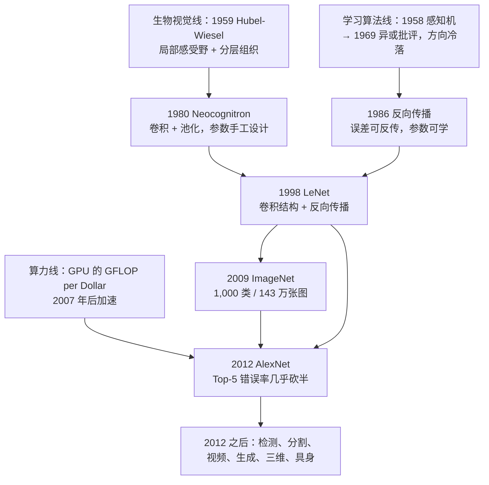
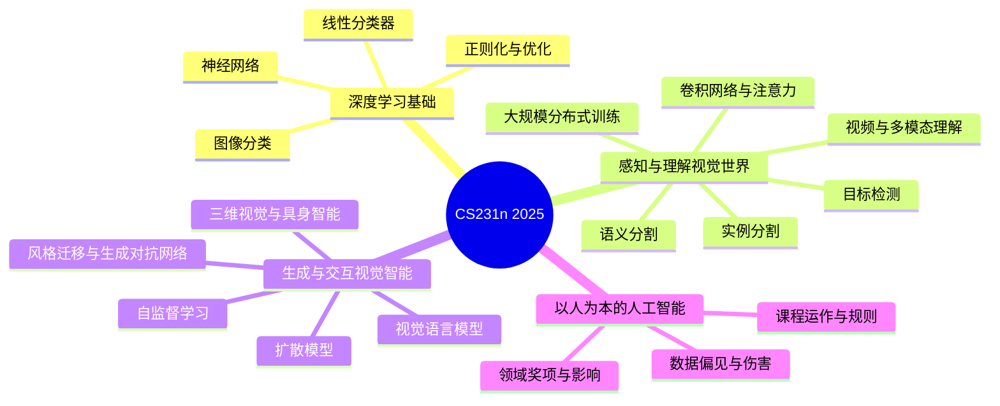

> **课程信息**
>
> - **课程名称**：Stanford CS231n: Deep Learning for Computer Vision（Spring 2025）
> - **本讲主题**：Lecture 1. Introduction
> - **主讲教师**：Fei-Fei Li、Ehsan Adeli（Zane Durante 共同授课）
> - **授课日期**：2025-04-01
> - **课程主页**：[cs231n.stanford.edu/2025](https://cs231n.stanford.edu/2025/schedule.html)
> - **官方课件**：[lecture_1_part_1.pdf](</attachments/cs231n-dc5970705b53abffc72bcfe2.pdf>) 与 [lecture_1_part_2.pdf](</attachments/cs231n-ca8f5b496ddaf6c80acb80f4.pdf>)（合计 119 页，正文按页链接本地课件）
> - **字幕来源**：[cs231n_sp25_kor_sub · eng](https://github.com/lpaiu-cs/cs231n_sp25_kor_sub/tree/main/eng)（公开英文转写，中文由本书重写）
> - **版权说明**：幻灯片与课程材料版权归 Stanford University 及授课教师所有；本书为非官方学习笔记，仅用于学习与研究。

---

> **课件索引**：点击下方链接打开本地 PDF 的对应页；全部课件见 [课件索引](/notes/cs231n/slides)。页码按 PDF 文件页序定位，第 1 讲分为 Part 1 / Part 2。

[📄 L1 · 第 1 页（Part 1，PDF 第 1 页）｜本讲标题页：CS231n 2025 春季学期第一讲](</attachments/cs231n-dc5970705b53abffc72bcfe2.pdf#page=1>)

这门课要回答的问题听起来近乎挑衅：让机器"看见"到底难在哪里。人类看一眼照片就知道里面有一只猫，视网膜上的光子分布却只是一堆亮度值——从亮度到"猫"这一步，没有解析解。整讲给出的答案不是某一个算法，而是一条历史链：视觉系统必须是分层的、学习必须是可微的、数据必须大到足以约束高容量模型。这三件事分别对应 1959 年的猫脑实验、1986 年的反向传播、2009 年的 ImageNet。

本讲由两位老师接力。Fei-Fei Li 用四十四分钟把计算机视觉与神经网络两条平行线索讲成一部简史，落点是 2012 年那场竞赛；Ehsan Adeli 接手后给出的是一张课程地图——四个板块、每块要解决什么任务、用什么模型、以及这门课的规则与要求。历史部分看起来是"故事"，但它解释了后面每一讲的技术选择从哪里来：为什么卷积要共享权重、为什么池化要存在、为什么"没有数据"曾让整个领域停滞二十年。

## 1. 视觉是智能的基石：5.4 亿年前那次「传感器事件」

*(参考时间: 00:00:05 – 00:07:35｜Lecture 1)*

[📄 L1 · 第 2 页（Part 1，PDF 第 2 页）｜开场：这门课由三位教师共同讲授](</attachments/cs231n-dc5970705b53abffc72bcfe2.pdf#page=2>)

课程从自我定位开始：它不讲"AI 的全部"，只讲两件事的交集——计算机视觉与深度学习。这个范围界定后面会被反复画成一张维恩图，但第一次出现时只是一句话：视觉不但是智能的一部分，更是智能的基石。把话说到这个份上，是在为整门课争取一个前提：视觉不是"给图片打标签"的应用题，而是理解智能如何从感知中生长出来的入口。

[📄 L1 · 第 3 页（Part 1，PDF 第 3 页）｜历届课堂的合影（2015–2023）](</attachments/cs231n-dc5970705b53abffc72bcfe2.pdf#page=3>)

一张按年份排列的合影页透露了这门课的年龄。2015 年开课时它还是一门新课，2025 年它已经办了十年；照片里的人数在变，主题从"图像分类"扩展到生成、三维、具身，但课程骨架没变。对第一次听课的人来说，这页的用处是校准预期：你面对的不是一份临时拼凑的讲义，而是一套被十届学生反复压过的路径。

[📄 L1 · 第 4 页（Part 1，PDF 第 4 页）｜十周年：返校任教的历届讲师](</attachments/cs231n-dc5970705b53abffc72bcfe2.pdf#page=4>)

十周年页把这条师资线索画清楚了。Fei-Fei Li 从 2015 年教到 2025 年；Andrej Karpathy 是 2015–2016；Justin Johnson 2016–2019、2025 回归；Serena Yeung 2017–2019；Ranjay Krishna 与 Danfei Xu 各在 2020–2021；Jiajun Wu 2022、Ruohan Gao 2022–2023、Yunzhu Li 2023；Ehsan Adeli 与 Zane Durante 从 2024 年起接手。这些人后来分散到检测、视频、三维、机器人各个方向——课程内容随他们流动，这解释了为什么 CS231n 的覆盖面每年都在扩张。

[📄 L1 · 第 5 页（Part 1，PDF 第 5 页）｜维恩图第一帧：人工智能这个大圈](</attachments/cs231n-dc5970705b53abffc72bcfe2.pdf#page=5>)

从这里开始是一段连续构建，一帧加一个圈。第一帧只有一个圈：人工智能。没有定义、没有子领域，只是一个边界——圈外的东西不讨论。这种画法的好处是后面每加一个圈，观众都能立刻看出新圈与旧圈是包含、相交还是并列。

[📄 L1 · 第 6 页（Part 1，PDF 第 6 页）｜维恩图第二帧：机器学习与计算机视觉两个圈进场](</attachments/cs231n-dc5970705b53abffc72bcfe2.pdf#page=6>)

第二帧同时压进两个圈：机器学习落在 AI 内部，计算机视觉与它大幅相交但不被包含。这个细节值得停一下——它意味着存在"不用机器学习也能做的视觉"（比如几何标定、滤波），也存在"与视觉无关的机器学习"。课上把机器学习称作解决 AI 问题最重要的数学工具，而这一帧正是那句话的图形版。

[📄 L1 · 第 7 页（Part 1，PDF 第 7 页）｜维恩图第三帧：深度学习作为机器学习的子集出现](</attachments/cs231n-dc5970705b53abffc72bcfe2.pdf#page=7>)

第三帧加上深度学习的圈，它被画成机器学习的真子集，并与计算机视觉交叠。深度学习在这里的定义很朴素：围绕神经网络这一族算法建立起来的一套技术。注意它没有宣称自己是"新范式"，只是被放在集合论的位置上——这为后面"神经网络早在 1950 年代就出现过、只是当时不叫深度学习"的叙事埋了伏笔。

[📄 L1 · 第 8 页（Part 1，PDF 第 8 页）｜维恩图第四帧：交集被涂红，箭头标出「这门课」](</attachments/cs231n-dc5970705b53abffc72bcfe2.pdf#page=8>)

第四帧是本讲最重要的一次操作：把"计算机视觉 ∩ 深度学习"那一小块涂成红色，用箭头标注 This class。红块只是两个大圈交界处的一小瓣——这正是讲师想让人记住的比例：这门课不覆盖整个视觉，也不覆盖整个深度学习，只覆盖两者重叠的那一小片。后面所有"我们不讲 X"的免责声明，都可以回溯到这一帧。

[📄 L1 · 第 9 页（Part 1，PDF 第 9 页）｜维恩图第五帧：自然语言处理进入图中](</attachments/cs231n-dc5970705b53abffc72bcfe2.pdf#page=9>)

第五帧开始加入邻居。第一个进来的是自然语言处理：它同样与机器学习相交，与计算机视觉的圈也有重叠（后来的图文任务正是从这个重叠区长出来的）。此时红块没有变化——加邻居不是为了扩大课程范围，而是为了说明视觉从来不是孤立的学科。

[📄 L1 · 第 10 页（Part 1，PDF 第 10 页）｜维恩图第六帧：语音识别补上](</attachments/cs231n-dc5970705b53abffc72bcfe2.pdf#page=10>)

第六帧加语音识别。三块邻居并排之后，一个模式浮现出来：AI 的每个子领域都是"某个信号 + 机器学习"，差别只在信号的性质——像素是二维且带物理约束的，语音是一维时序，语言是离散符号。这个差别在后面被讲师单独拎出来讲，因为它决定了三类任务不能用同一套归纳偏置。

[📄 L1 · 第 11 页（Part 1，PDF 第 11 页）｜维恩图第七帧：机器人学进场，红块仍未扩大](</attachments/cs231n-dc5970705b53abffc72bcfe2.pdf#page=11>)

第七帧加上机器人学，它与计算机视觉大面积重叠——重叠处就是后来课程里的具身智能板块。整段构建到此为止共七个圈，而红块自始至终没变过大小。这是全讲最克制的一处设计：范围一旦划定，就不再随话题扩张。

[📄 L1 · 第 12 页（Part 1，PDF 第 12 页）｜维恩图扩展版：数学、神经科学、计算机科学、物理、心理学、生物学](</attachments/cs231n-dc5970705b53abffc72bcfe2.pdf#page=12>)

最后一帧换了一种加法：不再加"AI 的子领域"，而是加"支撑学科"——数学、神经科学、计算机科学、物理、心理学、生物学。这一帧把图从"领域地图"改成了"知识来源图"，也解释了 CS231n 为什么要先讲一段生物视觉史：卷积网络的每一层设计，几乎都能在这张图的外圈找到出处。

[📄 L1 · 第 13 页（Part 1，PDF 第 13 页）｜今日议程：一段简史，加一份课程概览](</attachments/cs231n-dc5970705b53abffc72bcfe2.pdf#page=13>)

议程只有两条：计算机视觉与深度学习的简史，以及课程概览。比例上历史占了接近一半，这个安排本身就是论点——如果一门技术的历史里反复出现"数据不足""算力不足""没有可微的学习规则"这三种死法，那么理解它们比记住某个网络结构更有迁移价值。

[📄 L1 · 第 14 页（Part 1，PDF 第 14 页）｜寒武纪大爆发：5.3–5.4 亿年前，进化史上的一次"大爆炸"](</attachments/cs231n-dc5970705b53abffc72bcfe2.pdf#page=14>)

历史从 5.4 亿年前开始，而不是从 1950 年代开始。化石记录显示，在寒武纪约一千万年的窗口里，动物物种数量出现爆炸式增长——对进化而言这是极短的时间。在此之前，地球上的生命基本漂在水里，没有陆地动物，用讲师的话说是"相当悠闲"。

[📄 L1 · 第 15 页（Part 1，PDF 第 15 页）｜四种不同的眼睛：章鱼、复眼、变色龙、人类](</attachments/cs231n-dc5970705b53abffc72bcfe2.pdf#page=15>)

是什么点燃了这场爆发？气候、海水化学成分都有假说，但最有说服力的一个答案是"光进来了"：三叶虫演化出感光细胞。那不是透镜加视网膜的复杂器官，只是一个针孔，能把光收集起来。这一页的四种眼睛说明同一件事被自然解决了四次以上——眼睛不是稀有发明，而是被进化反复选中的方案。

[📄 L1 · 第 16 页（Part 1，PDF 第 16 页）｜暗箱：Gemma Frisius 1545 年的插图与达·芬奇的手稿](</attachments/cs231n-dc5970705b53abffc72bcfe2.pdf#page=16>)

从感光到成像，人类补上了另一半。暗箱的原理在古代中国、古希腊的文献里就有记载，达·芬奇、Gemma Frisius 都画过：让光穿过小孔，在暗室后壁投出倒像。幻灯片的用意不在考据，而在指出一条界线——**有了成像装置不等于有了视觉**。相机只是眼睛，看见发生在后面的解释过程里。

[📄 L1 · 第 17 页（Part 1，PDF 第 17 页）｜计算机视觉已经无处不在](</attachments/cs231n-dc5970705b53abffc72bcfe2.pdf#page=17>)

相机在今天已经泛滥，手机、汽车、卫星、显微镜上都有。但讲师紧接着给了一个限定：相机不是"看见"，就像眼睛本身也不是"看见"，它们都只是前端器件。真正的问题是视觉智能如何发生——这正是这门课的全部内容。这一句把前面十七页的生物史与后面的工程史扣在了一起。

## 2. Hubel-Wiesel 的两份遗产：感受野，与层级

*(参考时间: 00:07:38 – 00:17:09｜Lecture 1)*

[📄 L1 · 第 18 页（Part 1，PDF 第 18 页）｜分节页：我们从哪里来？](</attachments/cs231n-dc5970705b53abffc72bcfe2.pdf#page=18>)

1950 年代是这条线的起点，而且起点不在计算机系，在神经科学实验室。这一页只提一个问题：我们从哪里来。答案分两支——一支研究"生物怎么看见"，一支研究"机器怎么学"，两支要到 2012 年才合成一股。

### 1959：一根电极插进麻醉猫的初级视皮层

[📄 L1 · 第 19 页（Part 1，PDF 第 19 页）｜Hubel 与 Wiesel，1959：把电极插进麻醉的猫脑](</attachments/cs231n-dc5970705b53abffc72bcfe2.pdf#page=19>)

实验做法今天看仍然粗暴有效：把电极插进麻醉猫的初级视皮层，给猫看不同方向的亮条，记录单个神经元的放电。他们得到两个结论。第一，每个神经元有自己的**感受野（receptive field）**——它只对视野里一小块区域负责，而不是整幅图像；这块区域很小，且在初级视皮层里主要对**有朝向的边缘**（以及移动的朝向边缘）响应。左下角那两栏"Response / No response"就是判据：方向对了就放电，方向不对就沉默。

第二个结论更重要，也更像工程直觉：视觉通路是**分层**的。简单细胞（simple cells）对特定朝向响应，复杂细胞（complex cells）在保持朝向偏好的同时获得一定的平移不变性；再往上，神经元接收下层神经元的输出，感受野变大、选择性变复杂——从边缘到角点，再到物体。讲师特意声明这是"过度简化"，但她要的是那个概念：神经元彼此喂入，构成一张巨大的计算网络。这句话在 1980 年变成了 Neocognitron，在 1998 年变成了 LeNet。

### 1963–1970s：从方块世界到 Marr 的三级表示

[📄 L1 · 第 20 页（Part 1，PDF 第 20 页）｜Larry Roberts，1963：第一篇计算机视觉博士论文](</attachments/cs231n-dc5970705b53abffc72bcfe2.pdf#page=20>)

计算机视觉作为一门学科，通常追溯到 Larry Roberts 1963 年的博士论文《Machine Perception of Three-Dimensional Solids》。他做的事今天看很小：给一张方块堆叠的照片，算出每个面的朝向、棱和顶点。三格图分别是原图、差分图、以及从中选出的特征点——一条从像素到几何结构的流水线。整篇论文只研究"形状"，但这是第一次有人把"看见"写成了可执行的算法。

[📄 L1 · 第 21 页（Part 1，PDF 第 21 页）｜1959 与 1963 并置：两条时间线的起点](</attachments/cs231n-dc5970705b53abffc72bcfe2.pdf#page=21>)

这一页把 Hubel-Wiesel 与 Roberts 并排放在同一条时间轴上，底部给了 MIT 学位论文库的链接。并置的意图是：生物视觉与机器视觉在同一条轴上起步，且相差只有四年。此后六十年里它们反复交错——神经网络借生物学灵感，生物学反过来用网络解释大脑，这种互相借用在 2012 年之后变得更频繁。

[📄 L1 · 第 22 页（Part 1，PDF 第 22 页）｜David Marr 的三级表示：原始草图、2½ 维草图、三维模型](</attachments/cs231n-dc5970705b53abffc72bcfe2.pdf#page=22>)

1970 年代，David Marr 试图把"看见"拆成有次序的表示层级。**原始草图（primal sketch）**抽出零交叉、斑点、边缘、线段端点、虚拟线、分组与曲线边界；**2½ 维草图（2½-D sketch）**补上局部表面朝向、深度与表面朝向的不连续；最后是**三维模型表示**，用表面与体积基元按层次组织起完整物体。幻灯片上那颗篮球的四格图把这条链具象化了：原图、边缘图、被抠出来的前景圆盘、带明暗的球体。

Marr 的框架有个隐含要求：每一级表示都要能被下一级消费，且不依赖具体物体。这个要求在当时无法实现——2½ 维草图需要可靠的深度线索，而单张图像里的深度信息本质上是不确定的。于是问题被推到一个更根本的位置：从二维图像恢复三维世界，是一个**病态问题（ill-posed problem）**。

### 从二维恢复三维：自然界的解法，以及它的不精确

这正是本讲最"哲学"的一段。光子把三维世界投影到近似二维的表面（三叶虫身上的一块斑，或我们的视网膜），信息在投影中丢失了；要把它还原回去，必须额外假设。自然界的解法是**多只眼睛**：大多数动物有两只，少数更多，靠视差三角化恢复深度——但两只眼睛还不够，还得解决对应点匹配。人类也并不精确：讲师说她大致知道物体的三维形状，但没有几何精度。承认这一点，才知道后面的三维视觉为什么那么难。

另一处差异更微妙：语言和视觉在本体论上不同。语言不存在于自然界，你无法指着某样东西说"那里有语言"——它是人脑生成的、一维的、序列化的；视觉面对的是一个真实存在的物理世界，遵守物理与材质规律。这个差别解释了大模型时代的一个现象：语言之所以能被自回归建模得如此成功，部分原因在于它本身就是序列；而视觉任务的形式要松散得多。

## 3. 1970s–2000s：零件、边缘、分组、匹配，一次没有数据的试错

*(参考时间: 00:17:19 – 00:25:40｜Lecture 1)*

[📄 L1 · 第 23 页（Part 1，PDF 第 23 页）｜按零件识别（1970s）：广义柱体与图示结构](</attachments/cs231n-dc5970705b53abffc72bcfe2.pdf#page=23>)

1970 年代的先行者没有数据、没有算力、也没有今天的数学工具，却已经在啃"物体识别"。斯坦福的代表工作是 Rodney Brooks 与 Tom Binford 的**广义柱体（generalized cylinders）**：把物体拆成若干带截面变化的柱状基元；帕洛阿尔托另一处的工作是**图示结构（pictorial structures）**，把人或物体表示成部件的组合与部件间的几何约束。两条路线共享同一个假设——物体可以由零件拼出来。这个假设后来被数据驱动的端到端方法推翻了，但"组合性"在今天的场景图与三维部件生成里又回来了。

[📄 L1 · 第 24 页（Part 1，PDF 第 24 页）｜按边缘识别（1980s）：Canny 与 Lowe 的工作](</attachments/cs231n-dc5970705b53abffc72bcfe2.pdf#page=24>)

1980 年代数字照片开始出现，图像第一次可以被"数字化地"处理，边缘检测成了主战场。John Canny 1986 年的边缘算子（高斯平滑 + 梯度 + 非极大值抑制 + 双阈值）与 David Lowe 1987 年的工作，构成了之后二十年视觉前端的标准件。但讲师在这里插了一句很诚实的话：看着这些结果，你会有点失望——得到的只是些草图与轮廓，"好像哪儿也去不了"。

[📄 L1 · 第 25 页（Part 1，PDF 第 25 页）｜AI 寒冬：热情与经费一起退潮](</attachments/cs231n-dc5970705b53abffc72bcfe2.pdf#page=25>)

失望积累成了寒冬。幻灯片列了四条：AI 研究的热情与经费萎缩；"专家系统"没能兑现承诺；但 AI 的子领域仍在生长——计算机视觉、自然语言处理、机器人、计算生物学。最后这条是重点：寒冬冻结的是承诺，不是研究。课上还补了一句，"你们中很多人还没出生的时候"就进入寒冬了。

[📄 L1 · 第 26 页（Part 1，PDF 第 26 页）｜与此同时：认知科学与神经科学的奠基工作](</attachments/cs231n-dc5970705b53abffc72bcfe2.pdf#page=26>)

与寒冬并行的是另一条完全不受经费周期影响的线：认知科学与神经科学继续产出。这一段的价值在于它给出了**该做什么问题**的答案。工程界在纠结边缘检测的阈值，心理学家在问"人类识别物体时到底用了什么信息"。

[📄 L1 · 第 27 页（Part 1，PDF 第 27 页）｜Biederman，1972：同一只自行车，放在被 scramble 的背景里就难认了](</attachments/cs231n-dc5970705b53abffc72bcfe2.pdf#page=27>)

Irv Biederman 1972 年发表在 Science 上的实验是个漂亮的对照：同一辆自行车，一张图背景正常，另一张图背景被打乱。从光子角度看，自行车在视网膜上的成像几乎一样，但识别难度完全不同。结论是：看见物体不是一次局部操作，被用来识别的不只是那个物体的像素——整幅图像的其余部分也在参与判断。

[📄 L1 · 第 28 页（Part 1，PDF 第 28 页）｜快速序列视觉呈现（RSVP）：一秒钟十张图](</attachments/cs231n-dc5970705b53abffc72bcfe2.pdf#page=28>)

第二个实验测速度。1970 年代 Potter 等人的 RSVP 范式：以每秒 10 帧的速率闪过一串自然图像，让被试检测其中是否出现某类目标。10 Hz 意味着每张图只有 100 毫秒。被试此前没见过这些图，也不知道目标会出现在第几帧、长什么样、什么姿态——却几乎都能报出来。

[📄 L1 · 第 29 页（Part 1，PDF 第 29 页）｜150 毫秒：大脑已经做出了"有动物/无动物"的判别](</attachments/cs231n-dc5970705b53abffc72bcfe2.pdf#page=29>)

速度被 Simon Thorpe 用电生理方法量化了。给被试戴上 EEG 帽看自然场景，任务只是判断画面里有没有动物；结果在图像呈现后约 **150 毫秒**，脑电信号里就出现了可区分的差异。讲师提醒听众不要小看这个数字：跟今天的 GPU 比，150 毫秒慢得离谱，但生物神经元的工作频率远低于晶体管，150 毫秒在神经通路上只够跳几跳——这已经是湿件能做到的极限速度。

[📄 L1 · 第 30 页（Part 1，PDF 第 30 页）｜物体与场景识别的神经相关物：FFA 与 PPA](</attachments/cs231n-dc5970705b53abffc72bcfe2.pdf#page=30>)

更进一步，大脑不只是"能识别"，还为此长出了专门的区域。Kanwisher 等人 1997 年报告了梭状回面孔区（FFA），Epstein 与 Kanwisher 1998 年在 Nature 上报告了旁海马位置区（PPA）——分别对脸和场景有选择性响应。这类发现的意义在于：视觉识别不是一块通用皮层在硬算，而是被演化分工过的。

[📄 L1 · 第 31 页（Part 1，PDF 第 31 页）｜视觉识别是视觉智能的基础任务](</attachments/cs231n-dc5970705b53abffc72bcfe2.pdf#page=31>)

把上面几条拼起来，得到一个方向性判断：既然人类视觉的核心能力是"在自然场景里认出物体"，那么计算机视觉就应该把**自然场景下的物体识别**当作主战场，而不是继续画方块、描边缘。这一页是整个历史叙事的中点——从这里开始，问题定义变了。

[📄 L1 · 第 32 页（Part 1，PDF 第 32 页）｜按分组识别（1990s）：归一化割](</attachments/cs231n-dc5970705b53abffc72bcfe2.pdf#page=32>)

1990 年代的第一步是把前景从背景里分出来。Shi 与 Malik 1997 年的**归一化割（Normalized Cuts）**把图像分割写成图划分问题：像素是节点，相似度是边权，目标函数同时最小化簇间相似度与最大化簇内相似度。注意时间轴：这时仍是 AI 寒冬，但研究在推进。

[📄 L1 · 第 33 页（Part 1，PDF 第 33 页）｜按匹配识别（2000s）：SIFT](</attachments/cs231n-dc5970705b53abffc72bcfe2.pdf#page=33>)

第二步是特征。David Lowe 1999 年的 SIFT 把"关键点检测 + 尺度空间 + 方向直方图描述子"打包成一套可复用的流程：同一个物体在不同尺度、旋转、部分遮挡下仍能匹配。在深度学习之前，SIFT + 最近邻匹配是图像检索与三维重建的默认方案，也是很多人入行的第一课。

[📄 L1 · 第 34 页（Part 1，PDF 第 34 页）｜人脸检测：Viola-Jones，2001](</attachments/cs231n-dc5970705b53abffc72bcfe2.pdf#page=34>)

真正"进入产业"的第一个案例是人脸检测。Viola 与 Jones 2001 年的方法用积分图加速 Haar 特征、用 AdaBoost 挑特征、用级联结构把大部分窗口在几毫秒内否掉——在当时的 CPU 上做到实时。幻灯片上的评价是"机器学习在视觉上最早的成功应用之一"。讲师的个人记忆更生动：她读研一时这篇论文发表，五年后第一台消费级数码相机就用上了它的自动对焦。

[📄 L1 · 第 35 页（Part 1，PDF 第 35 页）｜数据集登场：Caltech 101 与 PASCAL VOC](</attachments/cs231n-dc5970705b53abffc72bcfe2.pdf#page=35>)

2000 年代初，互联网开始普及，数码相机开始普及，两件事叠加产生了一个新东西：数据。研究规模从几千张图涨到几万张图，随之出现了 Caltech 101 与 PASCAL Visual Object Classes 挑战赛——后者第一次把"检测 + 分类"变成统一的评测协议，训练集、验证集、评测服务器各就各位。讲师在这里按下暂停：视觉这条线讲到这里，接下来要退回去讲另一条平行的线。

## 4. 平行线：感知机、Neocognitron、反向传播、LeNet，然后是数据

*(参考时间: 00:25:51 – 00:35:55｜Lecture 1)*

[📄 L1 · 第 36 页（Part 1，PDF 第 36 页）｜感知机：Rosenblatt，约 1957 年](</attachments/cs231n-dc5970705b53abffc72bcfe2.pdf#page=36>)

另一条线从单个神经元开始。Rosenblatt 的**感知机（Perceptron）**在 1957 年提出（幻灯片的时间轴把它标在 1958 年）：输入加权求和，过阈值，输出一个类别。它已经具备"从数据里学权重"的雏形——误差出现时按误差方向调整权重。放在时间轴上，它和 Hubel-Wiesel 的猫实验只差一年，两条线其实同时起跑。

[📄 L1 · 第 37 页（Part 1，PDF 第 37 页）｜Minsky 与 Papert，1969：感知机学不了异或](</attachments/cs231n-dc5970705b53abffc72bcfe2.pdf#page=37>)

挫折来得很快。Minsky 与 Papert 1969 年指出，单层感知机无法表示异或：左侧真值表里，(0,0) 与 (1,1) 输出 0，(0,1) 与 (1,0) 输出 1，这四个点在二维平面上不存在一条直线能把两类分开。单层感知机只能画一条直线，于是它做不到。这个结论在数学上无懈可击，但在传播中被读成了"神经网络这条路走不通"，直接导致这一方向冷落了十几年。

[📄 L1 · 第 38 页（Part 1，PDF 第 38 页）｜Neocognitron：福岛邦彦，1980](</attachments/cs231n-dc5970705b53abffc72bcfe2.pdf#page=38>)

转机来自日本。福岛邦彦 1980 年的 **Neocognitron** 是一个直接按 Hubel-Wiesel 层级结构搭出来的计算模型：简单细胞层做卷积，复杂细胞层做池化，两种层交替堆叠五六层，越往后感受野越大、选择性越抽象。它已经具备现代卷积网络的骨架，缺的只有一样东西——**没有实用的训练算法**。所有参数都是手工设计的，几百个参数要一点点调，才能认出数字与字母。这是一项惊人的工程成就，也是一条无法扩展的路。

[📄 L1 · 第 39 页（Part 1，PDF 第 39 页）｜反向传播：Rumelhart、Hinton、Williams，1986](</attachments/cs231n-dc5970705b53abffc72bcfe2.pdf#page=39>)

1986 年的**反向传播（backpropagation）**补上了那块拼图。做法是引入一个误差纠正目标函数：给定输入与正确答案，算出网络输出与答案的差，把这个误差沿计算图反向传回去，每一层据此得到自己该往哪个方向调参。数学上它只是链式法则的反复应用，工程上它意味着**不再需要手工调参**——只要网络可微，梯度就能自动算出来。幻灯片中间的示意图（Lane McIntosh 绘制）画的就是这条误差回流的路径。

[📄 L1 · 第 40 页（Part 1，PDF 第 40 页）｜LeNet：LeCun 等人，1998](</attachments/cs231n-dc5970705b53abffc72bcfe2.pdf#page=40>)

第一个成功的落地是 Yann LeCun 在贝尔实验室做的卷积网络。他把反向传播套到 Neocognitron 式的架构上，网络规模约七层，用来识别手写数字与字母；工程上做到足够稳，被 NEC 做成商用系统，处理银行的手写支票。幻灯片给了一句总结：它与今天的卷积网络已经非常相似。差别只在规模、算力与数据。

[📄 L1 · 第 41 页（Part 1，PDF 第 41 页）｜2000 年代：把网络堆得更深](</attachments/cs231n-dc5970705b53abffc72bcfe2.pdf#page=41>)

2000 年代，一小批人继续把网络往深里堆——Hinton 与 Salakhutdinov 2006、Bengio 等 2007、Lee 等 2009、Glorot 与 Bengio 2010。这条路上有个尴尬的事实：它当时不是主流研究题目。会上讲的是 SVM、是特征工程、是核方法，神经网络被认为调不出好结果。

[📄 L1 · 第 42 页（Part 1，PDF 第 42 页）｜同一页的补充：更深了，但没有好数据集](</attachments/cs231n-dc5970705b53abffc72bcfe2.pdf#page=42>)

幻灯片在第二帧补上了第三个原因，也是最致命的一个：**没有合适的数据集**。数字与字母识别勉强可用，但把同一套系统放到自然照片上（猫、狗、微波炉、椅子、花），效果立刻崩掉。讲师强调，这不是"不方便"，而是数学问题：这些是高容量模型，容量越大越需要大量数据来约束，否则学到的只是训练集上的巧合。她给了一句后来被反复引用的话——数据是机器学习的第一等公民。

[📄 L1 · 第 43 页（Part 1，PDF 第 43 页）｜ImageNet：1,000 类、1,431,167 张图的分类挑战](</attachments/cs231n-dc5970705b53abffc72bcfe2.pdf#page=43>)

2000 年代初，Fei-Fei Li 与学生们把赌注押在数据上。他们先收集约十亿张候选图，清洗后得到约五千万张，再整理出约一千五百万张、覆盖两万两千个类别的标注数据——类别数量的选择参照了认知科学文献里"人类幼年掌握的类别量级"。随后从中切出一个子集办比赛：**ImageNet 大规模视觉识别挑战赛（ILSVRC）**，1,000 个类别、1,431,167 张图，参赛者不限方法，只看识别准确率。

[📄 L1 · 第 44 页（Part 1，PDF 第 44 页）｜时间轴合集：从 1959 到 2009 的所有里程碑](</attachments/cs231n-dc5970705b53abffc72bcfe2.pdf#page=44>)

这一页把两条线画到了同一张时间轴上：上排是视觉的里程碑（1959 Hubel-Wiesel、1963 Roberts、1970s Marr、1979 广义柱体、1986 Canny、1997 归一化割、1999 SIFT、2001 Viola-Jones、2004/2007 PASCAL、2009 ImageNet），下排是学习的里程碑（1958 感知机、1969 Minsky-Papert、1980 Neocognitron、1985 反向传播、1998 LeNet、2006 深度学习），中间横着一条蓝色的 AI Winter。两条线此前的每一次接近都错过了，缺的分别是数据、算力或学习规则。

这两条线只在少数几个点上真正接上过：1986 年的反向传播给卷积结构补上了学习规则，1998 年的 LeNet 把两者合起来但受限于数据，2012 年的 AlexNet 才把三者凑齐。把这条因果链画出来，后面每一讲的位置也就清楚了。

[📄 L1 · 第 45 页（Part 1，PDF 第 45 页）｜2012：AlexNet 出现在同一条时间轴上](</attachments/cs231n-dc5970705b53abffc72bcfe2.pdf#page=45>)

比赛第一年，最好算法的错误率接近 30%，而人类的错误率在 3% 以下——差距大到没有悬念。2011 年也没有惊喜。2012 年，Hinton 与学生用卷积网络参赛，把错误率几乎砍半。这条时间轴在这一年多了一个方块：AlexNet。

[📄 L1 · 第 46 页（Part 1，PDF 第 46 页）｜AlexNet 的结构：五个卷积层加三个全连接层](</attachments/cs231n-dc5970705b53abffc72bcfe2.pdf#page=46>)

结构本身并不神秘：输入 224×224×3，先用 11×11、步长 4 的卷积核把分辨率压下来，再叠若干 5×5 与 3×3 卷积加最大池化，通道数从 48 一路涨到 192、192、128，最后接两个 2048 维全连接层与一个 1000 维输出层。真正的新东西不在图上，而在图的背后：这些权重是学出来的，不是设计出来的。

按幻灯片上标的尺寸可以估一下参数量。第一层 11×11×3 的卷积核共 48 个，权重约 11×11×3×48 ≈ 1.7 万个；而两层 2048 维全连接之间的一个权重矩阵就是 2048×2048 ≈ 420 万个。也就是说，"五个卷积层加三个全连接层"听起来只是层数配比，参数量却几乎全部压在后三层上——这个分布解释了为什么早期的网络对显存那么敏感，也解释了为什么后来的架构要把大矩阵全连接换成别的形式。

[📄 L1 · 第 47 页（Part 1，PDF 第 47 页）｜AlexNet 与 Neocognitron：相隔 32 年](</attachments/cs231n-dc5970705b53abffc72bcfe2.pdf#page=47>)

讲师把两张图并排放在一起，问了一个很好的问题：结构相似度这么高，为什么 1980 年不行、2012 年行？答案是两件事。其一是**反向传播**：一个原则上正确、数学上严格的学习规则，让参数不必再手工调。其二是**数据**：高容量模型需要海量数据驱动才能泛化，ImageNet 提供了这个量级。她还补了一句前瞻：这些模型的参数量在当时是百万级，而这条路最终会通向万亿级。

## 5. 2012 之后：任务在膨胀，账单也在累积

*(参考时间: 00:36:04 – 00:44:40｜Lecture 1)*

### 从论文数量到架构迭代

[📄 L1 · 第 48 页（Part 1，PDF 第 48 页）｜论文数量的爆炸：CVPR 投稿与 arXiv 月度论文数](</attachments/cs231n-dc5970705b53abffc72bcfe2.pdf#page=48>)

2012 年之后的第一个可测量变化是论文数量。左侧是 CVPR 的投稿与接收曲线，1990 年代基本平躺，2000 年代中期开始抬头，2012 年之后陡起来；右侧是 arXiv 上机器学习与 AI 的月度论文数，从 1994 年的近乎为零涨到 2020 年的每月数千。这两条曲线是"一个领域突然变热"最直接的证据。

[📄 L1 · 第 49 页（Part 1，PDF 第 49 页）｜四代分类流水线：2010 手工特征、2012 AlexNet、2014 GoogLeNet 与 VGG、2015 ResNet](</attachments/cs231n-dc5970705b53abffc72bcfe2.pdf#page=49>)

这一页是全场信息密度最高的一张。2010 年的 NEC-UIUC 系统是纯手工流水线：稠密描述子网格（HOG、LBP）→ 局部坐标编码与超向量 → 空间金字塔池化 → 线性 SVM；2012 年的 SuperVision 换成卷积网络（图中标出了各层的感受野与步长）；2014 年出现两条分支——GoogLeNet 用并行的多尺度分支（Inception 模块）堆出窄而深的网络，VGG 用连续 3×3 卷积堆出规整的深层结构，通道数 64→128→256→512→512 逐段翻倍，最后接 fc-4096、fc-4096、fc-1000 与 softmax；2015 年的 ResNet（MSRA）加入跨层连接，让梯度能绕过多层直接回传。四代系统做的是同一件事：把"人设计特征"换成"网络自己学特征"。

### 任务谱系：从分类一路扩张到定位、时序与生成

[📄 L1 · 第 50 页（Part 1，PDF 第 50 页）｜两个任务：图像分类与图像检索](</attachments/cs231n-dc5970705b53abffc72bcfe2.pdf#page=50>)

同一套卷积特征可以迁移到别的任务上，最先被验证的是检索：把图像送进网络，取某一层的激活当描述子，用最近邻找相似图。这一步的意义在于它证明了网络学到的不是"标签"，而是可复用的表示——这正是后来迁移学习成为默认做法的起点。

[📄 L1 · 第 51 页（Part 1，PDF 第 51 页）｜目标检测与语义分割](</attachments/cs231n-dc5970705b53abffc72bcfe2.pdf#page=51>)

再往前一步是定位。**目标检测**要输出框与类别（Ren、He、Girshick、Sun 2015 的 Faster R-CNN 系列是代表），**语义分割**要给每个像素打类别标签（Farabet 等人 2012 年的多尺度卷积做法是早期代表）。从"这张图是什么"到"每个东西在哪"，任务的输出结构变了，网络结构也随之改变。

[📄 L1 · 第 52 页（Part 1，PDF 第 52 页）｜视频分类与人体活动识别](</attachments/cs231n-dc5970705b53abffc72bcfe2.pdf#page=52>)

静态图像之外是时间维度。视频分类要判断一段片段在做什么（跑步、跳跃、打球），人体活动识别要给出更细的动作类别。Simonyan 等人 2014 年的双流网络是一个经典解法：一路看单帧的 RGB（外观），一路看连续帧的光流（运动），最后融合两路分数。

[📄 L1 · 第 53 页（Part 1，PDF 第 53 页）｜姿态识别与玩 Atari 游戏](</attachments/cs231n-dc5970705b53abffc72bcfe2.pdf#page=53>)

同一批技术还被搬到很不一样的地方：Toshev 与 Szegedy 2014 年用网络直接回归人体关键点坐标（姿态识别）；Guo 等人 2014 年让网络从屏幕像素学习玩 Atari 游戏。后者已经越过了"识别"，进入"决策"——视觉第一次成为控制回路的输入端。

[📄 L1 · 第 54 页（Part 1，PDF 第 54 页）｜医学影像、鲸鱼识别、星系分类](</attachments/cs231n-dc5970705b53abffc72bcfe2.pdf#page=54>)

三个跨领域案例说明了泛化能力。医学影像是天生的视觉问题——放射科、病理科的日常工作就是看图；鲸鱼识别来自 Kaggle 竞赛，用鲸鱼的照片做个体识别（Levy 等人 2016）；星系分类（Dieleman 等人 2014）把同样的卷积网络用在天文图像上。讲师在这里点了一句：科学发现也吃到了红利，人类第一张黑洞照片背后就有计算摄影与视觉技术。

[📄 L1 · 第 55 页（Part 1，PDF 第 55 页）｜图像描述生成：一句人话概括一张图](</attachments/cs231n-dc5970705b53abffc72bcfe2.pdf#page=55>)

**图像描述（image captioning）**把视觉输出从标签变成句子。幻灯片上的四组结果分别是"一只白色的泰迪熊坐在草地上""一个穿棒球服的男人在投球""一个女人手里抱着一只猫""一个男人踩在冲浪板上"。做法是卷积网络编码图像、循环网络解码成词序列（Vinyals 等人 2015；Karpathy 与 Fei-Fei 2015）。这一步之后，视觉系统的输出不再受限于预定义类别表。

[📄 L1 · 第 56 页（Part 1，PDF 第 56 页）｜关系理解：不只说有什么，还说它们之间是什么关系](</attachments/cs231n-dc5970705b53abffc72bcfe2.pdf#page=56>)

再进一步是关系。幻灯片给出的三元组包括 "taller than"（人 高于 人）、"left of"、"wear on"（人 穿 衬衫）、"snow ski"。这类标注来自 Visual Genome 一类的工作（Krishna、Lu、Bernstein、Fei-Fei，ECCV 2016），它把图像表示成场景图：节点是物体，边是关系。相比类别标签，场景图更接近"理解"这个词的日常用法。

[📄 L1 · 第 57 页（Part 1，PDF 第 57 页）｜风格迁移：把校园照片重画成梵高的星夜](</attachments/cs231n-dc5970705b53abffc72bcfe2.pdf#page=57>)

生成方向的第一批惊艳结果是**风格迁移（style transfer）**：拿一张内容图与一张风格图，优化出一张既有原构图又有油画笔触的新图（Gatys 等人 2016）。幻灯片上同时放了 DeepDream 式的结果（Inceptionism），那类图揭示了网络中层特征在"看"什么。讲师特意提到，这部分的开创性工作来自本课的客座讲师 Justin Johnson。

[📄 L1 · 第 58 页（Part 1，PDF 第 58 页）｜生成对抗网络：人脸生成](</attachments/cs231n-dc5970705b53abffc72bcfe2.pdf#page=58>)

**生成对抗网络（GAN）**把人脸生成推到了肉眼难辨的程度。幻灯片用的是 Progressive GAN（Karras 等人，ICLR 2018）：从 4×4 的低分辨率开始逐级加倍，先生成轮廓再生成细节。逐级增长的好处是训练稳定——高分辨率直接训练容易崩，而从低分辨率长上去，每一级都只需要学"上一层没画出的细节"。

[📄 L1 · 第 59 页（Part 1，PDF 第 59 页）｜DALL·E：从文字直接生成图像](</attachments/cs231n-dc5970705b53abffc72bcfe2.pdf#page=59>)

文本到图像的转折点是 DALL·E（Ramesh 等人 2021）。输入一句描述，模型生成一张此前不存在的图。这一步把"生成"从风格变换推进到语义组合：模型必须同时理解名词、属性、数量与空间关系。

[📄 L1 · 第 60 页（Part 1，PDF 第 60 页）｜DALL·E 的更多结果：牛油果形状的椅子](</attachments/cs231n-dc5970705b53abffc72bcfe2.pdf#page=60>)

同一组结果的另一帧给出了更难的例子：把两种物体的形状与材质组合起来（比如牛油果质感的椅子）。讲师说这类图在今天看来已经不算什么——Midjourney 一类系统早已越过这个水平——但在 2021 年它是分水岭。

### 三股力量：算力、算法、数据

[📄 L1 · 第 61 页（Part 1，PDF 第 61 页）｜三根支柱：算力、算法、数据](</attachments/cs231n-dc5970705b53abffc72bcfe2.pdf#page=61>)

到这里，讲师给出了全讲的中心论点：这次爆发不是单一突破，而是**三股力量同时到位**。左边是算力——成排的 GPU 机柜；中间是算法——一个四层的小网络示意图；右边是数据——由无数图片拼成的墙。三者缺一，2012 年就不会发生；三者同时到位，才解释了为什么相似的网络结构在 1980 年失败、在 2012 年成功。

[📄 L1 · 第 62 页（Part 1，PDF 第 62 页）｜每美元能买到的浮点运算数：GPU 曲线在深度学习之后抬头](</attachments/cs231n-dc5970705b53abffc72bcfe2.pdf#page=62>)

算力这条线有硬指标可查：纵轴是每美元能买到的 GFLOP，横轴是时间。CPU 曲线几乎是平的；GPU（FP32）曲线在 2007 年之后开始上扬，2012 年之后更陡，图上的标注点从 GeForce 8800 GTX（AlexNet 时代）一路排到 GTX 580、GTX 1080 Ti、RTX 2080 Ti、RTX 3080/3090。讲师的说法是：2020 年以前进步还算平稳，一旦深度学习开始反过来驱动芯片设计，曲线就彻底起飞了。

[📄 L1 · 第 63 页（Part 1，PDF 第 63 页）｜同一张图的第二帧：Tensor Core 把曲线又抬了一截](</attachments/cs231n-dc5970705b53abffc72bcfe2.pdf#page=63>)

第二帧加入第三条曲线：GPU 的 Tensor Core。这类专用单元为矩阵乘加做了硬件级优化（低精度、高吞吐），把"每美元 GFLOP"再抬高一个量级。幻灯片上的注解很直白——"为深度学习准备的专用硬件"。这也解释了为什么同样的网络，换一代卡就能便宜一个数量级地训出来。

[📄 L1 · 第 64 页（Part 1，PDF 第 64 页）｜AI 的三条增长曲线：会议参会人数、创业公司数量、企业应用收入](</attachments/cs231n-dc5970705b53abffc72bcfe2.pdf#page=64>)

第三组图把视角拉到产业：AI 会议参会人数、开发 AI 系统的创业公司数量、企业级 AI 应用收入，三条曲线同时上扬。讲师用了一个夸张但好记的比喻——我们已经走出了 AI 寒冬，现在处在"AI 全球变暖"时期。

### 成功之外：偏见、收益，与做不到的事

[📄 L1 · 第 65 页（Part 1，PDF 第 65 页）｜尽管成功很多，计算机视觉还有很长的路](</attachments/cs231n-dc5970705b53abffc72bcfe2.pdf#page=65>)

讲完增长，讲师立刻转向反面。这一页只有一句转折：尽管成果丰硕，计算机视觉离"解决"还很远。接下来的三页分别讲它为什么危险、为什么有用、以及为什么还远远不够。

[📄 L1 · 第 66 页（Part 1，PDF 第 66 页）｜计算机视觉可能造成伤害：招聘中的视频面试评分](</attachments/cs231n-dc5970705b53abffc72bcfe2.pdf#page=66>)

伤害的第一种形式是偏见。所有大型 AI 系统都由数据驱动，而数据是人类活动的产物，天然携带历史偏见；偏见被模型学走，再以"客观算法"的名义施加到人身上。幻灯片举的例子是自动视频面试评分系统（HireVue 一类），案例致谢 Timnit Gebru。讲师补了一句更要命的：人脸识别算法表现出的偏见，和人类自身的偏见是同一种。

[📄 L1 · 第 67 页（Part 1，PDF 第 67 页）｜计算机视觉也能救命：医学影像与看护](</attachments/cs231n-dc5970705b53abffc72bcfe2.pdf#page=67>)

另一面是收益。医学影像是最直接的应用：读片、筛查、随访。讲师、Adeli 与 Zane 三人的研究方向之一就是用视觉技术为老龄人口与病人提供照护。她的提问方式是并列的：同一个技术，用在招聘上可能是伤害，用在诊断上可能是救命——"它完全坏吗？完全好吗？"这类问题没有工程解。

[📄 L1 · 第 68 页（Part 1，PDF 第 68 页）｜还有很多我们不知道怎么做的事](</attachments/cs231n-dc5970705b53abffc72bcfe2.pdf#page=68>)

最后一页最朴素：两张照片（其中一张是孩子们在玩），配一句"还有很多我们不知道怎么做的事"（幻灯片致谢 Andrej Karpathy）。人类视觉里的细微、含混、幽默与情绪，今天的模型基本接不住。讲师说她希望学生带着这份"不够"离开课堂——不是挫败感，而是问题感。

## 6. 课程地图：四个板块，从分类一路走到具身

*(参考时间: 00:44:48 – 00:59:53｜Lecture 1)*

[📄 L1 · 第 69 页（Part 1，PDF 第 69 页）｜今日议程（第二部分）：简史讲完，进入课程概览](</attachments/cs231n-dc5970705b53abffc72bcfe2.pdf#page=69>)

Adeli 接手后的第一页把议程原样搬了回来，两条都在——此时第一条已经讲完，第二条正要开始。这种"同一页再出现一次"的做法在长课里很有效：它告诉听众现在在哪儿、还剩多少。

[📄 L1 · 第 70 页（Part 2，PDF 第 1 页）｜第二部分标题页：Overview](</attachments/cs231n-ca8f5b496ddaf6c80acb80f4.pdf#page=1>)

第二部分的标题页把讲次标清楚了：Lecture 1 – Part 2 – Overview。整门课被切成四个板块，下面按板块逐个说明"要解决什么任务、用什么模型"，最后落到课程运作。

[📄 L1 · 第 71 页（Part 2，PDF 第 2 页）｜授课团队：Fei-Fei Li、Ehsan Adeli、Zane Durante、Justin Johnson](</attachments/cs231n-ca8f5b496ddaf6c80acb80f4.pdf#page=2>)

四位核心教师轮流承担讲次：Fei-Fei Li 讲首讲与最后一讲（以人为本的 AI），Ehsan Adeli 与 Zane Durante 覆盖基础与感知部分，Justin Johnson 负责卷积网络、Transformer、生成模型这些偏"机制"的讲次。看到这张名单就能理解课程的组织方式——它不是一个人写完的教材，而是几位研究者各自讲自己最熟的那一段。

[📄 L1 · 第 72 页（Part 2，PDF 第 3 页）｜客座讲师：Jiajun Wu、Ranjay Krishna、Ruohan Gao、Yunzhu Li](</attachments/cs231n-ca8f5b496ddaf6c80acb80f4.pdf#page=3>)

客座讲师对应四个专门方向：Jiajun Wu（三维视觉）、Ranjay Krishna（视觉与语言）、Ruohan Gao（视频与多模态）、Yunzhu Li（机器人学习）。这条安排透露了课程的设计逻辑——越靠后的板块越依赖专门研究者，而不是通用讲义。

[📄 L1 · 第 73 页（Part 2，PDF 第 4 页）｜课程四板块：深度学习基础、感知与理解、生成与交互、以人为本](</attachments/cs231n-ca8f5b496ddaf6c80acb80f4.pdf#page=4>)

四个板块的清单第一次出现：深度学习基础、感知与理解视觉世界、生成与交互式视觉智能、以人为本的应用与影响。注意这个划分不是按技术分的，而是按"问题层次"分的：先学会造工具，再用工具做感知，再做生成与交互，最后讨论它对社会的作用。

### 深度学习基础：分类、线性模型、正则化、神经网络

[📄 L1 · 第 74 页（Part 2，PDF 第 5 页）｜图像分类：给一张图，输出一个标签](</attachments/cs231n-ca8f5b496ddaf6c80acb80f4.pdf#page=5>)

第一个板块从最基础的任务讲起：**图像分类**。给模型一张猫的图片，输出字符串 "cat"。任务定义简单到可以用一句话说完，但它是后面一切的地基——检测、分割、描述生成，本质上都建立在"能把图像映射到语义"这个能力上。讲师称之为"具有欺骗性的简单"。

[📄 L1 · 第 75 页（Part 2，PDF 第 6 页）｜加一层：线性分类器画一条分界线](</attachments/cs231n-ca8f5b496ddaf6c80acb80f4.pdf#page=6>)

第一帧加的是**线性分类器**。把每张图表示成特征空间里的一个点（幻灯片用二维示意），分类就是找一条直线（高维时是超平面）把两类点分开。它的局限也很清楚：数据不是线性可分时，直线怎么画都不对。

[📄 L1 · 第 76 页（Part 2，PDF 第 7 页）｜再加一层：正则化与优化](</attachments/cs231n-ca8f5b496ddaf6c80acb80f4.pdf#page=7>)

第二帧加**正则化与优化**。模型太简单会欠拟合，太复杂会过拟合；正则化控制复杂度，优化负责在给定复杂度下找到最合适的参数。这两件事是"能训练出东西"的全部工程内涵——不只是拟合训练集，还要在新数据上站得住。

[📄 L1 · 第 77 页（Part 2，PDF 第 8 页）｜最后一层：神经网络](</attachments/cs231n-ca8f5b496ddaf6c80acb80f4.pdf#page=8>)

第三帧加**神经网络**。与线性分类器的区别只有一个：层与层之间夹了非线性，多层堆叠就能表示分段线性的复杂边界。讲师点明了它的现实地位——从 Google Photos 到 ChatGPT 的视觉能力，背后都是这类模型。这一板块剩下的讲次就是把这句结论拆开：怎么定义、怎么训、怎么调。

[📄 L1 · 第 78 页（Part 2，PDF 第 9 页）｜课程概览分节页（第二次出现）](</attachments/cs231n-ca8f5b496ddaf6c80acb80f4.pdf#page=9>)

四板块的分节页在整段里会反复出现，文字一字不改，作用是把注意力从上一个板块拉回地图。这一页出现时，第一板块刚讲完。

[📄 L1 · 第 79 页（Part 2，PDF 第 10 页）｜课程概览分节页（第三次出现）](</attachments/cs231n-ca8f5b496ddaf6c80acb80f4.pdf#page=10>)

紧接着的第三次出现，对应第二个板块即将开始。真正的新内容在下一页：这一板块要先区分"任务"和"模型"两个概念。

### 感知与理解：先分任务，再配模型

[📄 L1 · 第 80 页（Part 2，PDF 第 11 页）｜感知与理解视觉世界：任务与模型](</attachments/cs231n-ca8f5b496ddaf6c80acb80f4.pdf#page=11>)

这一页只有两个词：任务（tasks）与模型（models）。定义很干净：**任务**是要解决的具体问题（检测、分割、动作识别），**模型**是用来解决它的计算框架。两者要对齐——用分类模型去做像素级分割，输出结构就不匹配。这条"任务决定输出结构"的原则会贯穿后面所有讲次。

[📄 L1 · 第 81 页（Part 2，PDF 第 12 页）｜分类之外的任务：语义分割、目标检测、实例分割](</attachments/cs231n-ca8f5b496ddaf6c80acb80f4.pdf#page=12>)

三个任务排在一起，差别一眼可见。**语义分割**给每个像素打类别标签（草、猫、树、天空），但不区分同类个体的数量——两只狗都标成"狗"；**目标检测**输出边界框加类别，回答"有什么、在哪"；**实例分割**最细，给每个物体实例一个独立的掩码，把检测与分割合起来。三者的输出维度依次升高：一个标签、一组框、一张逐像素的图。

[📄 L1 · 第 82 页（Part 2，PDF 第 13 页）｜视频分类、多模态视频理解、可视化与理解](</attachments/cs231n-ca8f5b496ddaf6c80acb80f4.pdf#page=13>)

时间维度上的三个任务：**视频分类**判断片段里在做什么（在跑？在跳？）；**多模态视频理解**同时用画面与声音（幻灯片里的例子是有人演奏颤音琴，只看手部动作很难判断，加上音频就清楚了）；**可视化与理解**则反过来问模型在看哪里——用注意力热图解释一次分类的依据。

[📄 L1 · 第 83 页（Part 2，PDF 第 14 页）｜超越多层感知机：卷积神经网络](</attachments/cs231n-ca8f5b496ddaf6c80acb80f4.pdf#page=14>)

模型部分从**卷积神经网络（CNN）**开始。一张图进来，经过若干卷积、下采样（池化）与全连接，最后出分类结果。这一页用的是 LeNet 的经典示意图，也就是前面历史部分讲过的那个结构——课程在这里第一次把"历史"变成"要亲手实现的东西"。

[📄 L1 · 第 84 页（Part 2，PDF 第 15 页）｜循环网络与注意力/Transformer](</attachments/cs231n-ca8f5b496ddaf6c80acb80f4.pdf#page=15>)

卷积之外还有两类结构：**循环神经网络（RNN）**处理序列（视频帧、词序列），**注意力机制与 Transformer**用全局加权替代局部卷积，擅长长程依赖。三者不是替代关系，而是归纳偏置不同：卷积假设局部性与平移等变，注意力假设"任意两个位置都可能相关"。

[📄 L1 · 第 85 页（Part 2，PDF 第 16 页）｜大规模分布式训练：数据并行与模型并行](</attachments/cs231n-ca8f5b496ddaf6c80acb80f4.pdf#page=16>)

这一页是本季度新增的内容。目标有三条：在更大数据集上更快训练大模型、突破单卡单机的上限、以及搞清楚怎么做。手段有两条：**数据并行**把模型复制到每个 worker、把数据切开；**模型并行**把模型本身切到不同设备上、数据共享。两条路都要回答同一个附加问题——梯度同步是同步式还是异步式，前者一致但慢，后者快但会引入滞后。

[📄 L1 · 第 86 页（Part 2，PDF 第 17 页）｜课程概览分节页（第四次出现）](</attachments/cs231n-ca8f5b496ddaf6c80acb80f4.pdf#page=17>)

分节页再次出现，指向第三个板块：生成与交互式视觉智能。

[📄 L1 · 第 87 页（Part 2，PDF 第 18 页）｜课程概览分节页（第五次出现）](</attachments/cs231n-ca8f5b496ddaf6c80acb80f4.pdf#page=18>)

第五次出现的分节页之后，课程开始离开"二维识别"这个舒适区。

### 生成与交互：自监督、生成模型、视觉语言、三维与具身

[📄 L1 · 第 88 页（Part 2，PDF 第 19 页）｜超越二维识别](</attachments/cs231n-ca8f5b496ddaf6c80acb80f4.pdf#page=19>)

这一页是个纯过渡页：前面所有任务都建立在二维图像上，接下来的五个方向都要越出这个前提——自监督、生成、视觉语言、三维、具身。

[📄 L1 · 第 89 页（Part 2，PDF 第 20 页）｜自监督学习：从数据本身取训练信号](</attachments/cs231n-ca8f5b496ddaf6c80acb80f4.pdf#page=20>)

**自监督学习（self-supervised learning）**的动机是标签太贵。做法是从数据本身构造训练信号：遮住一部分让模型补全、把同一张图做两种增强让模型认同、预测相对位置等等。它让"用海量无标注数据预训练"成为可能，也是近十年视觉突破的主要燃料之一。

[📄 L1 · 第 90 页（Part 2，PDF 第 21 页）｜生成模型：风格迁移](</attachments/cs231n-ca8f5b496ddaf6c80acb80f4.pdf#page=21>)

生成部分从**风格迁移**讲起：把斯坦福校园的照片重画成梵高《星夜》的笔触。技术上它是优化问题——同时最小化内容差异与风格统计差异。这页的作用是给"生成"一个直观定义：不是检索已有图像，而是产生一张此前不存在的图。

[📄 L1 · 第 91 页（Part 2，PDF 第 22 页）｜DALL·E 2：一句提示词生成一张图](</attachments/cs231n-ca8f5b496ddaf6c80acb80f4.pdf#page=22>)

文本到图像的更进一步：给一句提示（"泰迪熊在 1990 年代的技术条件下做新的 AI 研究，在水下"），模型生成整幅画面。讲师强调这类系统的能力不只是画得像，而是把语言里的组合关系落成像素——主体、场景、风格、时代感同时被满足。

[📄 L1 · 第 92 页（Part 2，PDF 第 23 页）｜扩散模型：从纯噪声里"去噪"出一张图](</attachments/cs231n-ca8f5b496ddaf6c80acb80f4.pdf#page=23>)

**扩散模型（diffusion model）**是当前图像生成的主流。原理是学习一个反向过程：先把图像逐步加噪到纯噪声，再训练网络把每一步的噪声去掉；生成时从纯噪声出发，反复去噪，最后得到图像。幻灯片还预告了作业三——实现一个从文本提示生成 emoji 的生成模型（例子是"戴牛仔帽的脸"）。

[📄 L1 · 第 93 页（Part 2，PDF 第 24 页）｜视觉语言模型：CLIP 的对比预训练](</attachments/cs231n-ca8f5b496ddaf6c80acb80f4.pdf#page=24>)

**视觉语言模型**把图像与文本映射到同一个表示空间。幻灯片左图是 CLIP 的对比预训练：一个 batch 里 N 对图文，对角线上的 N 对是正样本，其余 N²−N 对是负样本，训练目标是把正样本的相似度推高、负样本压低。右图是检索增强的多模态语言模型。共同点是：一旦图文共享一个空间，检索、问答、描述生成就都成了同一个问题的不同问法。

[📄 L1 · 第 94 页（Part 2，PDF 第 25 页）｜三维视觉：重建、补全、单视图三维检测](</attachments/cs231n-ca8f5b496ddaf6c80acb80f4.pdf#page=25>)

**三维视觉**要输出的是几何而不是标签。幻灯片列了三项工作：3D-R2N2（Choy 等人 2016）用循环网络从多视图重建体素；Point-Voxel Diffusion（Zhou 等人 2021）做形状生成与补全；Mesh R-CNN（Gkioxari 等人，ICCV 2019）从单张图预测网格。讲师点出它的价值：三维表示让"理解"落到物理空间里，这对机器人与 AR/VR 是刚需。

[📄 L1 · 第 95 页（Part 2，PDF 第 26 页）｜具身智能：在物理世界里行动的智能体](</attachments/cs231n-ca8f5b496ddaf6c80acb80f4.pdf#page=26>)

最后一个方向是**具身智能（embodied intelligence）**：智能体必须感知、规划、执行。幻灯片给了两个代表工作：BEHAVIOR-1K（Li 等人 2022）提供 1,000 项日常活动的仿真基准；Mandlekar 与 Xu 等人 2020 的工作研究如何从人类演示中泛化到长程任务。这里的难点不在识别，而在"动作的后果"——环境会因为你的动作而改变。

[📄 L1 · 第 96 页（Part 2，PDF 第 27 页）｜课程概览分节页（第六次出现）](</attachments/cs231n-ca8f5b496ddaf6c80acb80f4.pdf#page=27>)

第六次出现的分节页，对应最后一个板块：以人为本的应用与影响。

[📄 L1 · 第 97 页（Part 2，PDF 第 28 页）｜课程概览分节页（第七次出现）](</attachments/cs231n-ca8f5b496ddaf6c80acb80f4.pdf#page=28>)

第七次出现即收官，紧接着是这一板块的内容：这个领域拿到了什么认可、它对人的生活意味着什么。

四个板块与它们的内部结构可以压成一张图，后面每一讲都能在图上找到落点：

## 7. 从图灵奖到课程表：这个领域凭什么成立

*(参考时间: 01:00:05 – 01:02:45｜Lecture 1)*

[📄 L1 · 第 98 页（Part 2，PDF 第 29 页）｜2018 年图灵奖：Hinton、Bengio、LeCun](</attachments/cs231n-ca8f5b496ddaf6c80acb80f4.pdf#page=29>)

第一个认可是 2018 年的**图灵奖**——计算领域的最高技术奖项，颁给"对计算有持久重要性的重大贡献"。获奖者是 Geoffrey Hinton、Yoshua Bengio、Yann LeCun，理由是他们在概念与工程上的突破，使深度神经网络成为计算的关键组件。对一门课来说，这条信息的作用是确认：讲台上的这些方法已经不是实验室玩具。

[📄 L1 · 第 99 页（Part 2，PDF 第 30 页）｜2024 年诺贝尔物理学奖：Hinton 与 Hopfield](</attachments/cs231n-ca8f5b496ddaf6c80acb80f4.pdf#page=30>)

第二个认可更出乎意料：2024 年诺贝尔物理学奖授予 Hinton 与 John Hopfield，理由是"为使用人工神经网络进行机器学习奠定了基础的发现与发明"。物理学奖颁给神经网络，争议不小，但它说明这套方法的源头确实在统计物理—— Hopfield 网络本质上是一个能量函数最小化系统。

[📄 L1 · 第 100 页（Part 2，PDF 第 31 页）｜IEEE PAMI Longuet-Higgins 奖：2009 年的 ImageNet 论文](</attachments/cs231n-ca8f5b496ddaf6c80acb80f4.pdf#page=31>)

第三个是领域内的奖：IEEE PAMI 的 **Longuet-Higgins 奖**，每年只颁给十年前发表、对视觉研究产生显著影响的一篇论文。2019 年在 CVPR 上，它颁给了 2009 年的 ImageNet 论文（Deng、Dong、Socher、Li、Li、Fei-Fei）。幻灯片上那句"That's Fei-Fei"是全场少见的自我指涉，也把历史叙事收了个尾——前面讲的数据这条线，最终以学术共同体的方式被追认。

[📄 L1 · 第 101 页（Part 2，PDF 第 32 页）｜CVPR 2025 与论文统计：投稿从千余篇涨到九千余篇](</attachments/cs231n-ca8f5b496ddaf6c80acb80f4.pdf#page=32>)

这一页把"领域变大"量化了。左侧是 CVPR 的投稿/接收统计：2006 年投稿 1,131 篇、接收 318 篇，2023 年投稿 9,155 篇、接收 2,359 篇——十七年投稿量涨了约八倍。右侧是 2025 年 CVPR 的举办地与城市照片（纳什维尔，6 月 11–15 日）。对一个刚入门的人来说，这组数字既是机会也是提醒：会议规模到这个量级，靠"跟热点"是跟不完的。

### 课程运作：上课、讨论课、答疑、评分

[📄 L1 · 第 102 页（Part 2，PDF 第 33 页）｜课程运作：Logistics 分节页](</attachments/cs231n-ca8f5b496ddaf6c80acb80f4.pdf#page=33>)

接下来是课程运作部分。**编者说明**：录制字幕里这一段没有对应口述（讲师从奖项直接跳到了学习目标），下面按幻灯片页面内容整理，作为 2025 春季学期课程规则的记录。

[📄 L1 · 第 103 页（Part 2，PDF 第 34 页）｜授课安排：周二、周四 12:00–13:20，NVIDIA 礼堂](</attachments/cs231n-ca8f5b496ddaf6c80acb80f4.pdf#page=34>)

四条硬信息：每周二、四 12:00–13:20 在 NVIDIA 礼堂上课；不做 Zoom 直播，但通过 Panopto 实时转播；幻灯片在每次课前不久挂到课程网站；所有讲座都会录像，课后放到 Canvas 的 "Panopto Course Videos" 标签下。

[📄 L1 · 第 104 页（Part 2，PDF 第 35 页）｜课程网站：cs231n.stanford.edu](</attachments/cs231n-ca8f5b496ddaf6c80acb80f4.pdf#page=35>)

课程网站是唯一的总入口：教学大纲、讲义、作业下载链接都在这里。幻灯片上的提示是"记得刷新"——课程进行中页面会持续更新。

[📄 L1 · 第 105 页（Part 2，PDF 第 36 页）｜周五讨论课：六次，12:30–13:20](</attachments/cs231n-ca8f5b496ddaf6c80acb80f4.pdf#page=36>)

六次周五讨论课，时间是 12:30–13:20，地点同为 NVIDIA 礼堂：04/04 Python/NumPy 复习、04/11 反向传播复习、04/18 期末项目说明与规范、04/25 PyTorch/TensorFlow 复习、05/02 RNN 与 Transformer、05/09 期中复习。定位是"比正课更偏实操的手把手教程"，第一次就是 Python/NumPy/Colab。

[📄 L1 · 第 106 页（Part 2，PDF 第 37 页）｜Ed：与课程组沟通的主渠道](</attachments/cs231n-ca8f5b496ddaf6c80acb80f4.pdf#page=37>)

作业、项目、期中、后勤相关的问题一律走 **Ed**（Canvas → Deep Learning for Computer Vision → Ed Discussion）。CGOE 学生需要用 @stanford.edu 邮箱注册，遇到问题联系 scpd-customerservice@stanford.edu。

[📄 L1 · 第 107 页（Part 2，PDF 第 38 页）｜答疑时间：线下与线上并行](</attachments/cs231n-ca8f5b496ddaf6c80acb80f4.pdf#page=38>)

答疑从第二周开始，线上线下都有。线下在 Huang 楼地下室，跟着 CS231n 的指示牌走；线上用 Zoom 加 QueueStatus 排队，轮到你时助教会把你拉进一对一的会议室。具体时间表在课程网站上。

[📄 L1 · 第 108 页（Part 2，PDF 第 39 页）｜沟通渠道总表](</attachments/cs231n-ca8f5b496ddaf6c80acb80f4.pdf#page=39>)

五个渠道分工明确：课程网站（大纲、讲义、作业链接）、Ed（绝大多数沟通、作业与评分问题，只有涉及荣誉准则时才用私密提问）、课程邮箱 cs231n-staff-spr25@stanford.edu、Gradescope（交作业与收成绩）、Canvas（看讲座与讨论课录像）。

[📄 L1 · 第 109 页（Part 2，PDF 第 40 页）｜作业一：4/9 发布，4/23 23:59 截止](</attachments/cs231n-ca8f5b496ddaf6c80acb80f4.pdf#page=40>)

所有作业都在 Google Colab 上完成。作业一的内容列表基本就是前几讲的知识点：k 近邻、线性分类器（Softmax）、两层神经网络、图像特征、深层网络与优化器。它把"从零实现"和"用框架训练"这两件事都压进了一次作业里。

[📄 L1 · 第 110 页（Part 2，PDF 第 41 页）｜评分方式：自动评分系统 + 公开/私有测试](</attachments/cs231n-ca8f5b496ddaf6c80acb80f4.pdf#page=41>)

评分走 Gradescope 的自动评分系统，好处是标准一致。测试分两套：公开测试让学生立刻看到结果，私有测试是公开测试的推广，用来彻底检查实现的边界情况——这也是为什么"本地通过"不等于"满分"。

[📄 L1 · 第 111 页（Part 2，PDF 第 42 页）｜成绩构成与迟交政策](</attachments/cs231n-ca8f5b496ddaf6c80acb80f4.pdf#page=42>)

权重：三次作业 12% + 18% + 15% = 45%，随堂期中 20%，课程项目 35%（提案 1%、里程碑 2%、最终报告 29%、海报与海报环节 3%），参与度最多 3% 额外加分。迟交政策：四次免费迟交，每次作业最多用两天，之后每天扣 25%，项目报告不接受迟交。

[📄 L1 · 第 112 页（Part 2，PDF 第 43 页）｜合作政策：四条规则](</attachments/cs231n-ca8f5b496ddaf6c80acb80f4.pdf#page=43>)

四条规则值得逐条记住：不看别人的解答或代码，提交的必须是你自己的作品；不分享自己的解答代码，但讨论思路与总体策略不但允许而且鼓励；在提交里注明合作过的人；不提交 AI 生成的答案。幻灯片最后一句话是重点——迟交或不完整，好过违反荣誉准则。

[📄 L1 · 第 113 页（Part 2，PDF 第 44 页）｜先修要求：Python、微积分、线性代数](</attachments/cs231n-ca8f5b496ddaf6c80acb80f4.pdf#page=44>)

先修要求只有三条：熟练的 Python（作业全部用 Python 与 NumPy，后期用 PyTorch/TensorFlow，课程网站上有 Python 教程）、大学微积分、线性代数。没有列出的是"深度学习先验"——这门课假定你从零开始。

[📄 L1 · 第 114 页（Part 2，PDF 第 45 页）｜可选教材](</attachments/cs231n-ca8f5b496ddaf6c80acb80f4.pdf#page=45>)

三本可选教材：Goodfellow、Bengio、Courville 的《Deep Learning》（有免费在线版，第 5、6、7 章讲向量微积分与连续优化）；《Mathematics of Deep Learning》（免费在线版）；《Dive into Deep Learning》（基于 NumPy 接口、带代码与讨论的交互式教材）。

### 学习目标、选课理由与下次课

[📄 L1 · 第 115 页（Part 2，PDF 第 46 页）｜学习目标：把应用形式化成任务，把模型训出来，知道领域在哪](</attachments/cs231n-ca8f5b496ddaf6c80acb80f4.pdf#page=46>)

学习目标分三层。第一层是**形式化**：把一个视觉应用写成任务，定义输入输出，估算需要多少数据与算力。第二层是**动手**：写代码、调试、训练卷积网络，会用 PyTorch 与 TensorFlow。第三层是**判断力**：知道这个领域近 0–5 年出了什么、开放问题在哪、部署前要考虑哪些伦理与社会因素。

[📄 L1 · 第 116 页（Part 2，PDF 第 47 页）｜为什么选这门课：研究者、工程师、跨学科、纯兴趣](</attachments/cs231n-ca8f5b496ddaf6c80acb80f4.pdf#page=47>)

四个理由对应四类人：想做视觉研究的（CVPR 2025、ICCV 2025，以及斯坦福校内的研究机会）；想去工业界做视觉工程的（Google AI 感知团队、Google Cloud Vision、Meta AI、Amazon AWS，以及 Nvidia、Apple、Microsoft、OpenAI、Salesforce 等）；想把视觉用到其他学科里的；以及纯粹感兴趣的。

[📄 L1 · 第 117 页（Part 2，PDF 第 48 页）｜课程地图：四个板块对应的讲次区间](</attachments/cs231n-ca8f5b496ddaf6c80acb80f4.pdf#page=48>)

这张图给出了讲次与板块的对应：深度学习基础（Lecture 2–4）、感知与理解视觉世界（Lecture 5–12）、重建与交互视觉世界（Lecture 13–17）、以人为本的人工智能（Lecture 18）。对照第 073 页会发现板块名字有细微差别（第三块在那里叫"生成与交互式视觉智能"），这是同一份大纲在不同页上的两种说法，讲次划分是一致的。

[📄 L1 · 第 118 页（Part 2，PDF 第 49 页）｜下次课：k 近邻与线性分类](</attachments/cs231n-ca8f5b496ddaf6c80acb80f4.pdf#page=49>)

下一讲进入正题：**k 近邻（kNN）**与**线性分类**。前者是最朴素的"记住训练集、投票决定"的思路，后者是参数化模型的起点——一个是无参数方法的代表，一个是参数化方法的代表，放在一起讲是为了把"什么叫学习"这件事说清楚。幻灯片上的决策边界示意图由 Wolfram Cloud 绘制。

[📄 L1 · 第 119 页（Part 2，PDF 第 50 页）｜课程邮箱](</attachments/cs231n-ca8f5b496ddaf6c80acb80f4.pdf#page=50>)

最后一页只留一个邮箱地址：cs231n-staff-spr25@stanford.edu。整讲在这里结束。

## 小结

*(参考时间: 01:02:30 – 01:02:45｜Lecture 1)*

- 视觉的难点不在"成像"而在"解释"：从二维投影恢复三维世界是病态问题，自然界的解法是多目 + 先验，工程的解法是数据 + 归纳偏置。
- Hubel-Wiesel 留下了两份可复用的遗产——局部感受野与层级组织；卷积网络的每一个设计选择都能追溯到这两条。
- 神经网络三次接近成功、三次被同一个短板挡住：1958 年缺非线性（异或），1980 年缺学习算法（参数靠手工），1998 年缺数据（自然图像上直接崩）。
- 2012 年的分水岭不是某个新结构，而是"反向传播 + ImageNet + GPU"三件事同时到位；同样的网络放在 1980 年只会是一次手工调参的工程壮举。
- 数据不是便利设施而是数学必需品：模型容量越大，越需要数据来约束假设空间，否则学到的只是训练集上的巧合。
- 任务决定输出结构：分类输出一个标签、检测输出框、分割输出逐像素掩码、生成输出一张图，模型必须与任务的输出维度对齐。
- 生成与交互这条线（自监督、扩散、视觉语言、三维、具身）的共同点是：监督信号越来越弱，对数据规模与世界先验的依赖越来越强。
- 技术的中立性是幻觉：同一套视觉系统可以用于招聘筛选，也可以用于医学筛查，判断标准不在模型里。

## 附录：官方参考与延伸阅读

- 课程主页与日程：[cs231n.stanford.edu/2025/schedule.html](https://cs231n.stanford.edu/2025/schedule.html)
- 本讲课件：[lecture_1_part_1.pdf](</attachments/cs231n-dc5970705b53abffc72bcfe2.pdf>)、[lecture_1_part_2.pdf](</attachments/cs231n-ca8f5b496ddaf6c80acb80f4.pdf>)
- Hubel & Wiesel 的猫视觉皮层实验（1959）：本讲第 019 页；Marr 的三级表示：第 022 页
- Rosenblatt 感知机（1958）、Minsky & Papert 对异或的批评（1969）：第 036–037 页
- Fukushima 的 Neocognitron（1980）：第 038 页；Rumelhart、Hinton、Williams 的反向传播（1986）：第 039 页
- LeCun 等人的 LeNet（1998）：第 040 页；Deng 等人的 ImageNet（2009）：第 043 页；Krizhevsky、Sutskever、Hinton 的 AlexNet（NeurIPS 2012）：第 045–047 页
- 作业与课程规则以当届课程网站为准；本讲第 109–114 页的运作信息仅对应 2025 春季学期。
- 版权说明：幻灯片版权归 Stanford University 与授课教师所有；本书为非官方学习笔记，仅用于学习与研究。
