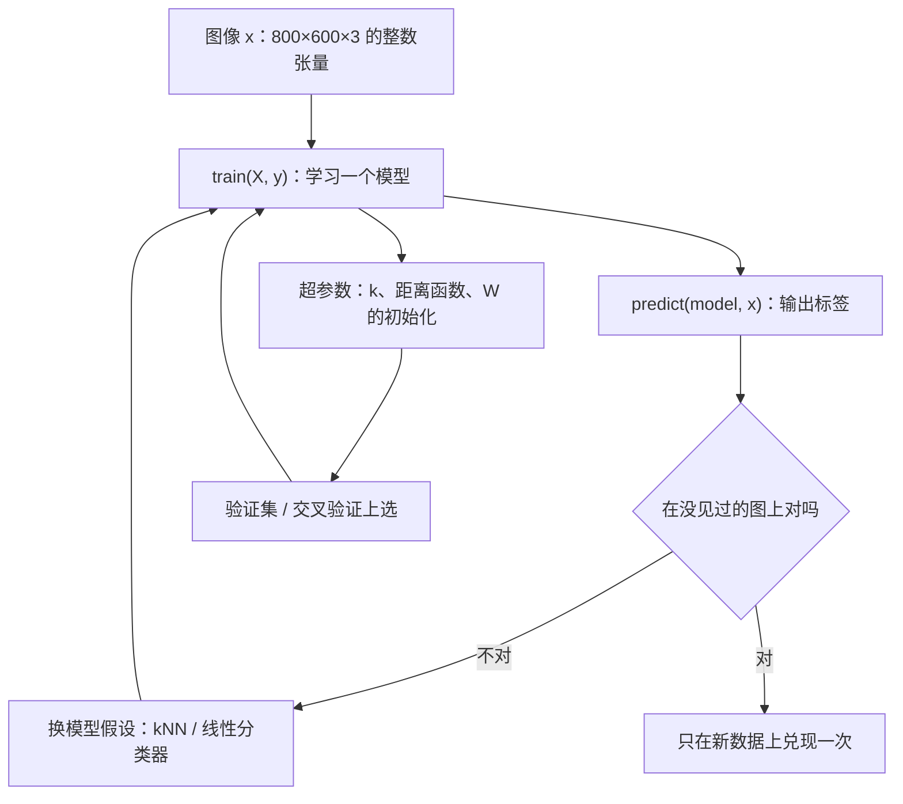

> **课程信息**
>
> - **课程名称**：Stanford CS231n: Deep Learning for Computer Vision（Spring 2025）
> - **本讲主题**：Lecture 2. Image Classification with Linear Classifiers
> - **主讲教师**：Ehsan Adeli
> - **授课日期**：2025-04-03
> - **课程主页**：[cs231n.stanford.edu/2025](https://cs231n.stanford.edu/2025/schedule.html)
> - **官方课件**：[lecture_2.pdf](</attachments/cs231n-191488d0a96f85574e8e2ebb.pdf>)（102 页，正文按页链接本地课件）
> - **字幕来源**：[cs231n_sp25_kor_sub · eng](https://github.com/lpaiu-cs/cs231n_sp25_kor_sub/tree/main/eng)（公开英文转写，中文由本书重写）
> - **版权说明**：幻灯片与课程材料版权归 Stanford University 及授课教师所有；本书为非官方学习笔记，仅用于学习与研究。

> **课件索引**：点击下方链接打开本地 PDF 的对应页；全部课件见 [课件索引](/notes/cs231n/slides)。页码按 PDF 文件页序定位，第 1 讲分为 Part 1 / Part 2。

[📄 L2 · 第 1 页｜本讲标题页：Image Classification with Linear Classifiers](</attachments/cs231n-191488d0a96f85574e8e2ebb.pdf#page=1>)

上一讲把计算机视觉的任务谱系铺开，这一讲把镜头收窄到一个可以打分的动作：给一张图，从 {狗、猫、卡车、飞机、…} 里挑一个词。任务简单到三岁小孩都会，却是后面所有模型的公共出口——检测、分割、检索、生成，最后都要回答同一句话："这张图里是什么"。讲师也交代了它会反复出现的原因：分类是个足够干净的基准，能把算法的差别暴露出来。

本讲的骨架是两次成本转移。第一次把"写规则"换成"存样本"：最近邻把训练压到 $O(1)$，代价是每次预测都要和整个训练集比一遍距离。第二次把"存样本"换成"存参数"：线性分类器只留一个 $10 \times 3072$ 的矩阵，预测退化成一次矩阵乘法。两次转移的账都记在同一个地方——预测时刻的开销，以及模型有没有把"没见过的图"当回事。要让"哪个 $W$ 更好"成为可回答的问题，就必须引入损失函数；而要让分数具备概率的含义，就要走 Softmax 与交叉熵。这条链子的末端正好接上下一讲：优化。

## 1. 一个 144 万维的整数张量，和一个词

*(参考时间: 00:00:05 – 00:04:43｜Lecture 2)*

录制版的开场三页是行政信息，讲师没有展开讲，但页面上把这一周的时间表写得很清楚：作业一 4 月 9 日（周三）放出、4 月 23 日 23:59 截止，五个主题依次是 k 近邻、线性分类器与 Softmax、两层神经网络、图像特征、深度网络与优化器；课程项目提案 4 月 25 日截止，每个小组会被指派一位 TA，组队走 Google Form。

[📄 L2 · 第 2 页｜作业一：4/9 发布、4/23 截止，五个主题从 kNN 一路排到优化器](</attachments/cs231n-191488d0a96f85574e8e2ebb.pdf#page=2>)

这张清单值得留意的地方不在截止日期，而在它的排序：本周要交的东西正好覆盖了本讲与后面三讲的主干，说明课程把"从 kNN 到优化器"当成一条不可拆的最小闭环。

[📄 L2 · 第 3 页｜课程项目：4/25 提案截止，TA 按 Canvas 分组分配，选题疑问走 Ed 私信或答疑时间](</attachments/cs231n-191488d0a96f85574e8e2ebb.pdf#page=3>)

[📄 L2 · 第 4 页｜讨论课：本周五 12:30–13:20，NVIDIA Auditorium 线下与 Zoom 线上同步，讲 Python/NumPy 与 Colab](</attachments/cs231n-191488d0a96f85574e8e2ebb.pdf#page=4>)

大纲页把整门课切成三块：深度学习基础、感知与理解视觉世界、重建与交互视觉世界，最后统一落在以人为本的 AI 与公平伦理上。讲师说今天只想拿下第一块最上面的三项：数据驱动方法、线性分类、k 近邻——它们是后面所有模型的砖。

[📄 L2 · 第 5 页｜课程大纲的三栏结构：今天只取第一栏顶部的三项](</attachments/cs231n-191488d0a96f85574e8e2ebb.pdf#page=5>)

分类任务的定义短得可以一口气念完：给定一张图像，再给定一个预先定好的标签集合 {狗、猫、卡车、飞机、…}，系统输出其中一个标签。对人是零成本的，因为视觉系统天生做整体理解，"这是一只猫"几乎是感知的副产品；对机器则是另一回事，它拿到的东西里根本没有"猫"这个单位。

[📄 L2 · 第 6 页｜今天的议程：先定义分类任务，再看两种数据驱动方法](</attachments/cs231n-191488d0a96f85574e8e2ebb.pdf#page=6>)

[📄 L2 · 第 7 页｜给定标签集合，为这张猫图输出一个词](</attachments/cs231n-191488d0a96f85574e8e2ebb.pdf#page=7>)

差距写在下面这张图上。一张 800×600 的彩色图，本质是一个 $800 \times 600 \times 3$ 的张量：三个通道各自是一张灰度表，每个格子里装着 0 到 255 之间的整数。按 8 位一个整数算，这幅"猫"占用 1,440,000 个数字、约 1.44 MB 的原始数据——没有一个数字叫"猫"。

[📄 L2 · 第 8 页｜语义鸿沟：同一张图在机器眼里是 800×600×3 的整数张量](</attachments/cs231n-191488d0a96f85574e8e2ebb.pdf#page=8>)

0 到 255 这个范围有具体来历，讲师在后面的答问里补了这一点：主流图像用 RGB 存，24 位格式（带 alpha 通道则 32 位），红绿蓝三个通道各分 8 位，组合出所有颜色。换句话说，语义鸿沟不是"数据不够多"，而是**表示层选错了**——用三个 8 位整数去承载"猫"，中间隔着的正是本讲要搭的那座桥。

## 2. 七种变形之后，"写规则"这条路走不通

*(参考时间: 00:04:59 – 00:16:39｜Lecture 2)*

先说最容易被低估的一种：视角。相机只要平移一点，800×600×3 里的每一个像素都会换一个值，哪怕那只猫一动不动地坐着。对人来说画面里还是同一只猫，对机器来说这是一个**全新的数据点**——没有任何一个数字保留下来作为线索。

[📄 L2 · 第 9 页｜视角变化：相机一动，全部像素重写](</attachments/cs231n-191488d0a96f85574e8e2ebb.pdf#page=9>)

光照的麻烦更隐蔽。每个像素的 RGB 值并不是物体的属性，而是"表面材质 × 颜色 × 光源"的函数——这是图形学与图像处理课上的老结论，讲师特意点明它的来源。同一只猫在暗室里和在正午阳光下，张量里的数字可以差出一大截，但标签不该变。

[📄 L2 · 第 10 页｜光照：同一只猫在不同光源下，RGB 数值完全不同](</attachments/cs231n-191488d0a96f85574e8e2ebb.pdf#page=10>)

接着是背景杂波：主体可能只占画面一角，剩下的全是干扰。

[📄 L2 · 第 11 页｜背景杂波：主体只占画面一小块，其余都是干扰](</attachments/cs231n-191488d0a96f85574e8e2ebb.pdf#page=11>)

遮挡是讲师花时间最多的一种。三张图依次是完整的猫、被挡掉一半的猫、以及只剩一条尾巴和一点爪子的猫。第三张单看几乎无从判断——可能是老虎，也可能是"尾巴很小的浣熊"——人是靠"这是在客厅沙发上"这条上下文把它补回"猫"的。

[📄 L2 · 第 12 页｜遮挡：第三只猫只剩尾巴和后爪，靠客厅这个上下文才判得回来](</attachments/cs231n-191488d0a96f85574e8e2ebb.pdf#page=12>)

形变对猫这种软体动物尤其致命：同一只猫伸懒腰和蜷起来，轮廓几乎没有对应关系。

[📄 L2 · 第 13 页｜形变：猫的身体几乎没有刚性，姿态一变轮廓全变](</attachments/cs231n-191488d0a96f85574e8e2ebb.pdf#page=13>)

类内差异是另一个维度：大小、毛色、花纹、品种都不一样，标签却都是"猫"。

[📄 L2 · 第 14 页｜类内差异：不同花色、体型、品种，仍然共享一个标签](</attachments/cs231n-191488d0a96f85574e8e2ebb.pdf#page=14>)

最后一种是上下文。同一块局部画面，脱离场景会被读成老虎，放进真实场景、再加上阴影关系，才会被正确读回猫。这一条对算法的含义是：**有些判断必须依赖整幅图，甚至图外的信息**，而"逐像素比较"这条路从定义上就拿不到这类信息。

[📄 L2 · 第 15 页｜上下文：只看局部会被误判，整幅场景才给出正确答案](</attachments/cs231n-191488d0a96f85574e8e2ebb.pdf#page=15>)

讲师在这里反问台下："除了光照和视角，还有什么会改掉像素值？"学生补了背景杂波、缩放、分辨率。他对分辨率的回答很实在：模型通常先把图归一化到固定尺寸，所以绝对分辨率影响有限，真正难受的是**尺度变化**——同一个物体在画面里忽大忽小，像素模式随之完全改变。

这些变形解释了为什么"现代视觉算法"值得单独占一页：今天的准确率与鲁棒性并不是某一条巧妙规则带来的，而是 ImageNet 这一类大规模基准加上后续更大规模的数据与模型堆出来的。

[📄 L2 · 第 16 页｜现代视觉算法：大规模基准把分类精度推到了可用的位置](</attachments/cs231n-191488d0a96f85574e8e2ebb.pdf#page=16>)

### 硬编码为什么走不通

于是问题变成：能不能像排序算法那样，把识别猫的步骤写成 if-then-else？讲师的回答是不能，而且理由很朴素——排序有明确的比较规则，识别猫没有。

[📄 L2 · 第 17 页｜图像分类器：排序有比较规则，识别猫没有可以硬编码的步骤](</attachments/cs231n-191488d0a96f85574e8e2ebb.pdf#page=17>)

历史上确实有人试过。Canny 1986 年那套边缘检测被拿来当第一步：先找边缘，得到一大堆轮廓，再在轮廓上找角点，统计特定类型的角点数量，最后用这些特征去映射到类别。这条路在变化极小的图像上能奏效，但它有两个死结：每加一个物体就要重写一整套规则，而"为每个物体想出一套规则"本身就是另一件难事。

[📄 L2 · 第 18 页｜Canny 1986 的规则链：找边缘、找角点，然后是一个问号](</attachments/cs231n-191488d0a96f85574e8e2ebb.pdf#page=18>)

### 用两个函数代替一套规则

数据驱动的方法换了一个提法：不写规则，写两个函数。`train(X, y)` 吃进图像和标签，吐出一个模型；`predict(model, X_test)` 吃进模型和没见过的图，吐出预测标签。第一步收集数据集与标签——讲师回忆十几二十年前是用图片搜索引擎一张张攒的，现在数据集基本都现成；第二步训练分类器；第三步在新图上评估。

[📄 L2 · 第 19 页｜数据驱动的三步：收集数据与标签、训练分类器、在新图上评估](</attachments/cs231n-191488d0a96f85574e8e2ebb.pdf#page=19>)

这三步看着平淡，却决定了后面所有的工程约束：**训练可以慢，预测必须快**；**调参只能看验证集，测试集只能用一次**。这两条会分别在第 3 节和第 4 节变成具体的成本与具体的纪律。



## 3. 最近邻：训练压到 O(1)，代价全押在预测上

*(参考时间: 00:16:50 – 00:29:17｜Lecture 2)*

第一个分类器简单到近乎玩笑：训练阶段什么都不做，只是把训练集原样记在内存里；预测阶段找到与查询图最相似的那张训练图，把它的标签抄过来。讲师的说法是"训练函数除了把数据留住，没有别的动作"。

[📄 L2 · 第 20 页｜章节页：Nearest Neighbor Classifier](</attachments/cs231n-191488d0a96f85574e8e2ebb.pdf#page=20>)

这一节要讲的算法只有两条规则，却把"训练便宜、预测昂贵"这个反直觉的取舍演示得干干净净——它同时也是一块试验田，超参数、距离函数、训练/验证/测试的切分方式都会在这里第一次露面。

[📄 L2 · 第 21 页｜最近邻的两句话定义：背下全部数据与标签，预测时找最像的那张](</attachments/cs231n-191488d0a96f85574e8e2ebb.pdf#page=21>)

要让"最像"变成可执行的判断，还缺一个距离函数。给它两张图，它返回一个数，数越小说明两张图越接近。幻灯片上的例子是五张带标签的训练图（鹿、鸟、飞机、猫、车）和一张查询图，任务是逐对算距离。

[📄 L2 · 第 22 页｜查询图与五张训练图：由距离函数决定谁是最近邻](</attachments/cs231n-191488d0a96f85574e8e2ebb.pdf#page=22>)

最常用的选择是 $L1$ 距离，也就是逐像素相减、取绝对值、再全部加起来：


$$
d_1(I_1, I_2) = \sum_{p} \left| I_1^{(p)} - I_2^{(p)} \right|
$$


其中 $p$ 跑遍所有像素的所有通道。它对两张图的要求只有一条：形状必须一样——CIFAR-10 上就是两张 $32 \times 32 \times 3$ 张量逐元素相减。

[📄 L2 · 第 23 页｜L1 距离：逐像素相减取绝对值，再把整张图加起来](</attachments/cs231n-191488d0a96f85574e8e2ebb.pdf#page=23>)

用 NumPy 写出来只有几行，页面上给的是完整可运行的版本：`train` 把 `X` 和 `y` 存进成员变量；`predict` 对每张测试图算一遍全部训练样本的距离，取最小值的下标，回查标签。

```python
class NearestNeighbor:
    def train(self, X, y):
        # 训练阶段唯一的动作：把数据留住
        self.Xtr = X
        self.ytr = y

    def predict(self, X):
        num_test = X.shape[0]
        Ypred = np.zeros(num_test, dtype=self.ytr.dtype)
        for i in range(num_test):
            # L1 距离：广播成 (N, D)，沿 D 求和得到 N 个距离
            distances = np.sum(np.abs(self.Xtr - X[i, :]), axis=1)
            min_index = np.argmin(distances)
            Ypred[i] = self.ytr[min_index]
        return Ypred
```

[📄 L2 · 第 24 页｜四行核心代码：train 存表，predict 算距离、取 argmin、抄标签](</attachments/cs231n-191488d0a96f85574e8e2ebb.pdf#page=24>)

注意这一行里的 `np.sum(..., axis=1)`：它把 $N$ 次比较压缩成一次广播运算，看上去没有循环了，但 $N \times D$ 次减法、取绝对值、加法一次也没少——**向量化改的是常数因子，不改复杂度**。

[📄 L2 · 第 25 页｜第一帧：train 只做了一次赋值，训练结束](</attachments/cs231n-191488d0a96f85574e8e2ebb.pdf#page=25>)

[📄 L2 · 第 26 页｜第二帧：predict 对每张测试图重复"算距离、取最近、抄标签"](</attachments/cs231n-191488d0a96f85574e8e2ebb.pdf#page=26>)

### 训练 O(1)，预测 O(N)

这就引出了全讲第一个"算账时刻"。设训练集有 $N$ 张图，每张 $D$ 维：训练是 $O(1)$，因为确实什么也没算；预测是 $O(N)$——每张测试图都要和全部训练图比一次。放在 CIFAR-10 上（$N = 50000$，$D = 3072$），一张测试图就是 $1.54 \times 10^8$ 次逐元素运算，一万张测试图是 $1.5 \times 10^{12}$ 量级。讲师用 ChatGPT 打了个比方：如果每次提问都要把网上所有可能的答案比一遍再回答，等它算完已经是几年后了。

[📄 L2 · 第 27 页｜复杂度问答：训练 O(1)、预测 O(N)——方向反了](</attachments/cs231n-191488d0a96f85574e8e2ebb.pdf#page=27>)

方向反了才是要害。训练可以离线跑一整夜，慢一点、贵一点都无所谓；预测发生在用户面前，是产品必须付得起的那一下。这条偏好会一直延续到卷积网络：训练再贵也可以摊到集群上，前向传播的延迟却直接写在用户体验里。

要把"预测慢"这条短板补上，工程界走了另一条路：不要求精确的最近邻，只要**近似**最近邻。讲师提到这类方法很多、超出本课范围，但给了一个能直接用的实现——Meta 的 faiss，对应论文是 Johnson 等人 2017 年的《Billion-scale similarity search with GPUs》。

[📄 L2 · 第 28 页｜近似最近邻与 faiss：把十亿级检索做成工程问题](</attachments/cs231n-191488d0a96f85574e8e2ebb.pdf#page=28>)

回到算法本身，最近邻到底在做什么？把每张训练图看成一个点，整张空间就会被切成若干块：落在哪一块，就继承那一块主人的标签。1-近邻的划分长这样——每个训练点占一小片领地，边界是它和邻居的"势力分界"。

[📄 L2 · 第 29 页｜1-近邻的空间划分：每个训练点占一块领地](</attachments/cs231n-191488d0a96f85574e8e2ebb.pdf#page=29>)

这张图立刻暴露了问题：正中间有一小块黄色，被绿色团团围住。它来自一个孤立的黄点——要么是噪声，要么是标注错了，但 1-近邻无条件相信它。改成 $k$ 近邻、让 $k$ 个邻居投票，这块飞地就会被周围的绿色吞掉。代价是出现了白色区域：三个类各占一票时无法决策。讲师把这个副作用反过来用——**白色区域恰好告诉你哪里该补数据**。

[📄 L2 · 第 30 页｜k 近邻：K=1/3/5 的多数投票，白色是无法决策的僵持区](</attachments/cs231n-191488d0a96f85574e8e2ebb.pdf#page=30>)

## 4. k 近邻与两种距离：决策边界是被距离函数画出来的

*(参考时间: 00:29:22 – 00:41:29｜Lecture 2)*

$k$ 定了，还有第二个选择没定：距离怎么算。$L2$（欧氏）距离把绝对值换成平方，最后开根号：


$$
d_2(I_1, I_2) = \sqrt{\sum_{p} \left( I_1^{(p)} - I_2^{(p)} \right)^2}
$$


[📄 L2 · 第 31 页｜两种距离：L1 是曼哈顿距离，L2 是欧氏距离](</attachments/cs231n-191488d0a96f85574e8e2ebb.pdf#page=31>)

### 菱形与圆：等距面决定边界

两个公式的差别不只是开不开根号，而是**等距面的形状**。幻灯片用同一组点算了一遍：原点 $O(0,0)$、点 $A(1,0)$、点 $B$。用 $L1$ 时取 $B(0.5, 0.5)$，$d_1(O,B) = 0.5 + 0.5 = 1$，与 $d_1(O,A)=1$ 相等；用 $L2$ 时取 $B(1/\sqrt{2}, 1/\sqrt{2})$，$d_2(O,B) = \sqrt{1/2 + 1/2} = 1$，也与 $d_2(O,A)=1$ 相等。也就是说：到原点距离为 1 的点，在 $L1$ 下围成一个菱形，在 $L2$ 下围成一个圆。

[📄 L2 · 第 32 页｜单位球对照：L1 是菱形、L2 是圆；同一条"距离 1"的等值线形状不同](</attachments/cs231n-191488d0a96f85574e8e2ebb.pdf#page=32>)

这个形状差异可以量化。点 $(0.5, 0.5)$ 正好落在菱形的边上（$L1$ 距离是 $0.5 + 0.5 = 1$），可它的 $L2$ 距离只有 $\sqrt{0.5} \approx 0.707$，稳稳落在圆内。换句话说，$L1$ 的单位球是圆的内接菱形：沿坐标轴方向两者一样远，沿对角方向 $L1$ 却明显"收紧"——对角线上的点被量得更远。这正是 $L1$ 对特征轴敏感、并且倾向把差异摊到各个坐标上的来源。

把 $K=1$ 的两个划分并排放，形状差异一眼可见：$L1$ 的边界几乎全部平行于坐标轴，走成阶梯状；$L2$ 的边界是斜的、光滑的。

[📄 L2 · 第 33 页｜K=1 时的边界形状：L1 走直角阶梯，L2 走斜线](</attachments/cs231n-191488d0a96f85574e8e2ebb.pdf#page=33>)

讲师在这里追问了一个更本质的问题：为什么 $L1$ 对特征敏感？因为它的等距面是菱形，一旦旋转特征轴，菱形跟着转，同一个点到原点的距离立刻变了；而圆旋转之后还是自己，$L2$ 距离不变。结论是使用场景不同——如果特征本身有明确含义、你希望距离尊重每个坐标（比如稀疏的、可解释的特征），$L1$ 更合适；如果特征只是某种任意嵌出来的坐标，旋转不该改变语义，那就该用 $L2$。

[📄 L2 · 第 34 页｜官方演示：拖动 k 与距离函数，实时看边界怎么变形](</attachments/cs231n-191488d0a96f85574e8e2ebb.pdf#page=34>)

到这一步，$k$ 近邻已经有了两个必须人来定的旋钮：$k$ 和距离函数。讲师给这类东西起了名字——**超参数（hyperparameter）**，即"关于算法本身的选择"，与训练过程中学到的参数相对。它的麻烦之处在于没有通用答案：$k$ 取多少、用哪种距离，强烈依赖数据集与问题，只能逐个试。

[📄 L2 · 第 35 页｜超参数：k 与距离函数都必须试出来，没有通用答案](</attachments/cs231n-191488d0a96f85574e8e2ebb.pdf#page=35>)

### 四条选超参数的路

于是问题变成"怎么试才算数"。幻灯片列了四条路：前两条是坑，后两条才是正解。

想法一：在训练集上挑表现最好的超参数。对 $k$ 近邻来说这是一场必输的游戏——$k=1$ 永远在训练集上 100% 正确，因为它把训练样本原样抄回去。

[📄 L2 · 第 36 页｜想法一：在训练集上选最优](</attachments/cs231n-191488d0a96f85574e8e2ebb.pdf#page=36>)

[📄 L2 · 第 37 页｜想法一的判决：k=1 永远在训练集上完美，所以这个标准毫无信息量](</attachments/cs231n-191488d0a96f85574e8e2ebb.pdf#page=37>)

想法二：在测试集上挑表现最好的。这看起来聪明，实际上是作弊——你等于用测试集参与了模型选择，之后再也没有干净的数据能估计真实泛化能力。

[📄 L2 · 第 38 页｜想法二：在测试集上选最优](</attachments/cs231n-191488d0a96f85574e8e2ebb.pdf#page=38>)

[📄 L2 · 第 39 页｜想法二的判决：这是作弊，模型在新数据上的表现无从估计](</attachments/cs231n-191488d0a96f85574e8e2ebb.pdf#page=39>)

想法三：把训练集切出一块做验证集，在训练集上训练、在验证集上选超参数，最后才在测试集上评估一次。这是标准答案，代价是验证集通常比训练集小得多，选出来的超参数带有抽样噪声。

[📄 L2 · 第 40 页｜想法三：切出验证集，训练、调参、评估三段分离](</attachments/cs231n-191488d0a96f85574e8e2ebb.pdf#page=40>)

想法四：交叉验证。把训练数据切成 $K$ 折（幻灯片用五折），每折轮流当一次验证集、其余当训练集，跑 $K$ 轮取平均，用平均值来选超参数。讲师补了一句很现实的注脚：小数据集上这几乎是必须的，但在大规模深度学习里并不常用——把五折训练重复五遍，算力账单会先把你劝退，所以实践中更常见的是"单验证集 + 经验"。

[📄 L2 · 第 41 页｜想法四：五折交叉验证，每折轮流做验证集再取平均](</attachments/cs231n-191488d0a96f85574e8e2ebb.pdf#page=41>)

## 5. CIFAR-10 上的 28%：像素距离为什么到此为止

*(参考时间: 00:41:45 – 00:45:58｜Lecture 2)*

把上面的东西放到真实数据上。CIFAR-10 有 10 个类、50,000 张训练图、10,000 张测试图，每张 $32 \times 32 \times 3$，出自 Alex Krizhevsky 2009 年的技术报告。

[📄 L2 · 第 42 页｜CIFAR-10：10 类、5 万训练图、1 万测试图，每张 32×32×3](</attachments/cs231n-191488d0a96f85574e8e2ebb.pdf#page=42>)

把最近邻跑一遍，每张测试图取前 10 个最近邻，排成一行：第一列是查询图，右边十列是它的邻居。这张图比任何公式都直观——有些行看起来相当合理，有些行则完全离谱。

[📄 L2 · 第 43 页｜CIFAR-10 的最近邻检索：每行左起是查询图，右边十张是它的最近邻](</attachments/cs231n-191488d0a96f85574e8e2ebb.pdf#page=43>)

接下来是非常标准的一步：用五折交叉验证扫一遍 $k$。每个点是一次单独的结果，折线穿过均值，竖线是标准差。图上 $k \approx 7$ 最好，准确率落在 28%–29% 附近。

[📄 L2 · 第 44 页｜五折交叉验证选 k：k≈7 时约 28%，标准差由竖线给出](</attachments/cs231n-191488d0a96f85574e8e2ebb.pdf#page=44>)

28% 这个数字要放在正确的参照系里看：10 类问题的随机猜测是 10%，所以它确实学到了东西；但离可用还很远。讲师没有急着解释，而是先回到检索结果，指出错在哪——比如第四行，查询图是青蛙，排第一的邻居却更像一只狗。原因不难猜：两个物体的像素颜色分布本来就接近，**像素级距离分不清"长得像"和"是同一类"**。

[📄 L2 · 第 45 页｜不标对错的检索结果：错误需要逐行核对才能发现](</attachments/cs231n-191488d0a96f85574e8e2ebb.pdf#page=45>)

[📄 L2 · 第 46 页｜同一张图加上红绿框：绿框猜对、红框猜错，错在哪一目了然](</attachments/cs231n-191488d0a96f85574e8e2ebb.pdf#page=46>)

下面这张图把问题钉死了。左边是原图，右边三张分别是遮挡版、整体右移一像素版、整体染色版。在人看来这三张与原图的差别天差地别——遮挡版丢了一大块信息，平移版几乎一模一样。但按像素距离，它们到原图的距离完全相同。

[📄 L2 · 第 47 页｜遮挡、平移一像素、染色：三种在人眼里差别巨大的改动，像素距离竟然相同](</attachments/cs231n-191488d0a96f85574e8e2ebb.pdf#page=47>)

所以讲师给的结论不是"$k$ 近邻不够好"，而是更精确的一句：**在像素上定义的距离本身不携带语义**。这句话是通往下一节的动机——与其继续在像素空间里找更聪明的邻居，不如换一个假设：让模型自己学一组参数，把像素映射成类别分数。

[📄 L2 · 第 48 页｜k 近邻小结：训练集、投票、距离与 k 是超参数、测试集只用一次](</attachments/cs231n-191488d0a96f85574e8e2ebb.pdf#page=48>)

## 6. 线性分类器：把整张图折叠成一个 10×3072 的矩阵

*(参考时间: 00:46:26 – 00:57:20｜Lecture 2)*

换一个假设：不再保存样本，而是保存一组**参数**。图像进来，经过一个函数 $f$，直接吐出 10 个数——每个数是对应类别的分数（score），分数越高越像。讲师把这类做法叫参数化方法（parametric approach），参数记作 $W$，也叫权重（weights）。

[📄 L2 · 第 49 页｜章节页：Linear Classifier](</attachments/cs231n-191488d0a96f85574e8e2ebb.pdf#page=49>)

这一节要把"参数化"讲透：先看 $W$ 的形状是怎么被维度逼出来的，再看同一个 $W$ 可以怎么读——代数的点积、视觉的模板、几何的超平面——最后看它在哪些分布上必然失效。

[📄 L2 · 第 50 页｜参数化方法：3072 个数进，10 个类别分数出，中间夹着 W](</attachments/cs231n-191488d0a96f85574e8e2ebb.pdf#page=50>)

线性分类器把这个函数定成最简单的形式：$f(x, W) = Wx$。

[📄 L2 · 第 51 页｜线性假设：输出等于权重矩阵乘输入向量](</attachments/cs231n-191488d0a96f85574e8e2ebb.pdf#page=51>)

维度必须对齐。CIFAR-10 的一张图被拉平成 $3072 \times 1$ 的列向量，输出是 $10 \times 1$ 的分数向量，所以 $W$ 只能是 $10 \times 3072$——这个形状不是约定，是被矩阵乘法逼出来的。

[📄 L2 · 第 52 页｜维度对齐：10×3072 乘 3072×1，得到 10×1](</attachments/cs231n-191488d0a96f85574e8e2ebb.pdf#page=52>)

再加一个偏置 $b$（$10 \times 1$），$f(x, W) = Wx + b$。讲师强调它是**与输入无关**的一项，作用是把每个类的分数整体抬一点或压一点，几何上就是把决策面推离原点——这一点在后面"几何视角"那一段会看得更清楚。

[📄 L2 · 第 53 页｜加上偏置 b：10×1，给每个类一个与输入无关的起点](</attachments/cs231n-191488d0a96f85574e8e2ebb.pdf#page=53>)

算一笔参数账。$W$ 有 $10 \times 3072 = 30720$ 个数，$b$ 有 10 个，合计 30,730 个。对比 k 近邻：它要保存 50,000 张训练图，也就是 $1.54 \times 10^8$ 个数，按 float32 算是约 614 MB。**三万个数对一亿五千万个数**，差了约 5000 倍——这就是"参数化"换来的东西：模型大小不再随训练集增长，而预测是一次 $10 \times 3072$ 的乘法。

更重要的是可组合性。把线性函数一层一层叠起来，就是神经网络；讲师说得直接：这是深度学习几乎所有架构里最重要的那块砖。

[📄 L2 · 第 54 页｜线性分类器是神经网络的基本积木：叠起来就是多层网络](</attachments/cs231n-191488d0a96f85574e8e2ebb.pdf#page=54>)

AlexNet（Krizhevsky 等，2012）与 ResNet（He 等，2015）的结构图里，线性层随处可见——卷积层和全连接层本质上都是"乘一个矩阵再加偏置"，只是权重被共享了一部分。

[📄 L2 · 第 55 页｜AlexNet 与 ResNet 的结构图：线性层在两种架构里都无处不在](</attachments/cs231n-191488d0a96f85574e8e2ebb.pdf#page=55>)

为了把这件事算清楚，讲师把问题缩小到不能再小：一张只有 4 个像素的图，3 个类别（猫、狗、船）。图被摊平成 4 维向量 $[56, 231, 24, 2]$，于是 $W$ 是 $3 \times 4$，$b$ 是 $3 \times 1$。

[📄 L2 · 第 56 页｜回到 CIFAR-10：32×32×3 的图，5 万张训练、1 万张测试](</attachments/cs231n-191488d0a96f85574e8e2ebb.pdf#page=56>)

[📄 L2 · 第 57 页｜四像素玩具例：把 2×2×1 的张量摊平成 \[56, 231, 24, 2\]](</attachments/cs231n-191488d0a96f85574e8e2ebb.pdf#page=57>)

代数视角下，一切都只是三行点积。以猫这一行为例：


$$
s_{\text{cat}} = 0.2 \times 56 + (-0.5) \times 231 + 0.1 \times 24 + 2.0 \times 2 + 1.1 = 11.2 - 115.5 + 2.4 + 4.0 + 1.1 = -96.8
$$


狗那一行给出 437.9，船那一行给出 61.95。三个数里狗最高，所以当前这个 $W$ 会把这张图判成狗——注意这只是"某个 $W$ 下的读数"，不是结论。

[📄 L2 · 第 58 页｜代数视角：3×4 的 W、3×1 的 b，算出猫 −96.8、狗 437.9、船 61.95](</attachments/cs231n-191488d0a96f85574e8e2ebb.pdf#page=58>)

### 三种读法：代数、模板、超平面

代数的点积已经看过了，剩下两种读法讲师分开讲。

[📄 L2 · 第 59 页｜章节页：Interpreting a Linear Classifier](</attachments/cs231n-191488d0a96f85574e8e2ebb.pdf#page=59>)

**视觉视角。** $W$ 的每一行有 3072 个数，恰好和一张图的形状一样，可以重塑成 $32 \times 32 \times 3$ 的"图"来看。它不是训练样本，而是这一类别的**模板**：分数高意味着输入与这个模板的内积大。把 CIFAR-10 上训练好的 10 行全部画出来，能看到汽车那一格底部有一团红色（车头），飞机那一格是偏蓝的天空色块——一个线性模型确实学到了"这一类平均长什么样"。

[📄 L2 · 第 60 页｜视觉视角：W 的每一行重塑成一张类别模板，汽车那格能看到车头的红色](</attachments/cs231n-191488d0a96f85574e8e2ebb.pdf#page=60>)

**几何视角。** 每一行 $W_k$ 定义了一个超平面：$W_k x + b_k = 0$，分数就是这个点到平面的有符号距离。二维示意里三条线分别把飞机、汽车、鹿从其他类里切出去；到了 3072 维，这些线变成超平面，画不出来，但道理一样。偏置 $b$ 在这里显出作用：没有它，所有平面都必须过原点，等于强行规定"全零输入对所有类打分为 0"，这显然不合理。

[📄 L2 · 第 61 页｜几何视角：每一行是一个超平面，b 把平面推离原点](</attachments/cs231n-191488d0a96f85574e8e2ebb.pdf#page=61>)

线性模型的边界也很清楚：**它只能画直线（超平面）**。幻灯片给了三个反例——第一类占一、三象限而第二类占二、四象限（异或型）；第一类是"到原点距离在 1 到 2 之间"的环；第一类有三个分散的模态。这三种分布，任何一条直线都切不开。

[📄 L2 · 第 62 页｜线性分类器解不了的三种分布：异或、圆环、多模态](</attachments/cs231n-191488d0a96f85574e8e2ebb.pdf#page=62>)

### 从分数到损失

于是问题收敛成一个：怎么找到好的 $W$？讲师给了两步配方，并且明确说第二步是下一讲的内容。

1. 定义一个损失函数（loss function），把"当前 $W$ 在训练集上有多差"量化成一个数。
2. 找到一种高效的方法，把 $W$ 调到让这个数最小——也就是优化（optimization）。

[📄 L2 · 第 63 页｜选 W 的两步：先定义损失，再优化](</attachments/cs231n-191488d0a96f85574e8e2ebb.pdf#page=63>)

为了谈损失，需要一个具体例子：3 个训练样本、3 个类（猫、车、蛙），某个 $W$ 给出的分数是猫 `[3.2, 1.3, 2.2]`、车 `[5.1, 4.9, 2.5]`、蛙 `[-1.7, 2.0, -3.1]`（行是样本、列是类别）。

[📄 L2 · 第 64 页｜三个样本三类的分数表：某次 W 下的原始读数](</attachments/cs231n-191488d0a96f85574e8e2ebb.pdf#page=64>)

损失函数的定义方式就是把"不满意程度"写下来：给它第 $i$ 个样本的分数向量和真实标签，它返回一个标量，越小越好。

[📄 L2 · 第 65 页｜损失函数：给"当前分类器有多差"打一个分](</attachments/cs231n-191488d0a96f85574e8e2ebb.pdf#page=65>)

形式上，数据集是 $\{(x_i, y_i)\}_{i=1}^{N}$，$x_i$ 是图像，$y_i$ 是整数标签，$f(x_i, W)$ 是分数向量。单个样本的损失记作 $L_i$，它只由这一个样本的分数与真值决定。

[📄 L2 · 第 66 页｜形式化：L_i 只看第 i 个样本的分数与真实标签](</attachments/cs231n-191488d0a96f85574e8e2ebb.pdf#page=66>)

整个数据集上的损失是各样本损失的平均：


$$
L = \frac{1}{N} \sum_{i=1}^{N} L_i
$$


除以 $N$ 这一步看起来无关紧要——它不改变最优的 $W$，只改变损失的量级；但没有它，损失会随数据集大小漂移，学习率之类的超参数就没法跨数据集复用。讲师的原话是"我们通常按样本数归一化，虽然它没那么重要"——这句话在工程上其实很重要。

[📄 L2 · 第 67 页｜平均：数据集上的损失是各样本损失的均值](</attachments/cs231n-191488d0a96f85574e8e2ebb.pdf#page=67>)

## 7. Softmax：分数不是概率，交叉熵是那把尺子

*(参考时间: 00:57:26 – 01:06:54｜Lecture 2)*

现在只剩最后一件事：$L_i$ 具体长什么样。讲师选了 Softmax 这条路线，先说明动机——线性函数输出的分数是无界的，$-96.8$ 和 $437.9$ 都能出现，这种数不好读、也不好比较；如果能把它读成"属于这一类的概率"，事情就顺了。

[📄 L2 · 第 68 页｜章节页：Softmax classifier](</attachments/cs231n-191488d0a96f85574e8e2ebb.pdf#page=68>)

Softmax 分类器又叫多项逻辑回归（multinomial logistic regression）：它把每个类的原始分数压进 $[0, 1]$，并且让所有类的概率加起来等于 1。这里的"多项"对应多类别，"逻辑回归"对应二分类那个熟悉的框架。

[📄 L2 · 第 69 页｜把无界分数读成概率：多项逻辑回归的出发点](</attachments/cs231n-191488d0a96f85574e8e2ebb.pdf#page=69>)

### 先指数、再归一化

函数本身只有两步。先取指数：


$$
p_k = \frac{e^{s_k}}{\sum_{j} e^{s_j}}
$$


[📄 L2 · 第 70 页｜Softmax 函数：先对每个分数取指数](</attachments/cs231n-191488d0a96f85574e8e2ebb.pdf#page=70>)

以第 6 节那张分数表为例（猫 $3.2$、车 $5.1$、蛙 $-1.7$）：$e^{3.2} = 24.5$，$e^{5.1} = 164.0$，$e^{-1.7} = 0.18$。指数保证了结果永远是正数——概率的第一条要求就此满足。

[📄 L2 · 第 71 页｜指数化后的非负数：24.5、164.0、0.18](</attachments/cs231n-191488d0a96f85574e8e2ebb.pdf#page=71>)

再除以三者之和 $188.7$，得到 $0.13$、$0.87$、$0.00$。三条概率非负、相加为 1，是一个合法的分布。注意这里已经能读出模型的判断：它认为这张图 87% 是车。

[📄 L2 · 第 72 页｜归一化：0.13、0.87、0.00，和为 1](</attachments/cs231n-191488d0a96f85574e8e2ebb.pdf#page=72>)

术语要在这里对齐：指数化之后、归一化之前的那些数（3.2、5.1、-1.7）叫**未归一化的对数概率**，更常见的名字是 **logits**。之所以叫"对数概率"，是因为取完 Softmax 再取对数，正好回到它们（差一个常数）。

[📄 L2 · 第 73 页｜术语：未归一化的对数概率，也就是 logits](</attachments/cs231n-191488d0a96f85574e8e2ebb.pdf#page=73>)

接下来定义损失。既然要"最大化正确类的概率"，而优化器习惯做最小化，就把符号反过来、再取对数——取对数一方面让数值更好处理，另一方面在最大似然视角下把概率的连乘变成连加：


$$
L_i = -\log p_{y_i} = -\log\!\left(\frac{e^{s_{y_i}}}{\sum_j e^{s_j}}\right)
$$


这个例子里正确类是猫，$p_{\text{cat}} = 0.13$，于是 $L_i = -\log 0.13 = 2.04$。分数越好，这个数越小；当 $p_{y_i} \to 1$ 时它趋于 0。

[📄 L2 · 第 74 页｜正确类的负对数：-log(0.13) = 2.04](</attachments/cs231n-191488d0a96f85574e8e2ebb.pdf#page=74>)

讲师顺带点出这套写法在别的课里的名字：它等价于**最大似然估计（Maximum Likelihood Estimation）**——选择权重让观测到的数据出现的概率最大，CS 229 里讲的就是同一件事。

[📄 L2 · 第 75 页｜等价说法：最大似然估计，选择让观测数据概率最大的权重](</attachments/cs231n-191488d0a96f85574e8e2ebb.pdf#page=75>)

### 负对数、KL 散度与交叉熵：同一个式子的三种说法

为什么"负对数"是合理的？换一个视角看：正确标签可以写成一个 one-hot 分布 $(1, 0, 0)$，模型给出的是 $(0.13, 0.87, 0.00)$。两个分布摆在一起，问题变成"怎么度量它们的差距"。

[📄 L2 · 第 76 页｜与 one-hot 的正确分布逐项对照](</attachments/cs231n-191488d0a96f85574e8e2ebb.pdf#page=76>)

信息论的答案是 KL 散度（Kullback–Leibler divergence）：它度量用 $q$ 去近似 $p$ 要多付多少比特。最小化 KL 散度，就是让两个分布尽量重合。

[📄 L2 · 第 77 页｜KL 散度：度量模型分布与真实分布的差距](</attachments/cs231n-191488d0a96f85574e8e2ebb.pdf#page=77>)

再往前一步就是交叉熵：$H(p, q) = H(p) + D_{\mathrm{KL}}(p \| q)$。因为 $p$ 是 one-hot，它的熵 $H(p) = 0$，所以交叉熵恰好等于 KL 散度，也恰好等于 $-\log p_{y_i}$。这就是深度学习里到处出现的 "cross entropy" / "BCE" 的来历——三条路通向同一个式子。

[📄 L2 · 第 78 页｜交叉熵：one-hot 下熵为 0，交叉熵退化成负对数](</attachments/cs231n-191488d0a96f85574e8e2ebb.pdf#page=78>)

把整条链收拢：线性函数把图变成 logits，Softmax 把 logits 变成概率，负对数把概率变成损失，最小化损失就得到想要的 $W$。

[📄 L2 · 第 79 页｜汇总：最大化正确类概率，就是最小化它的负对数](</attachments/cs231n-191488d0a96f85574e8e2ebb.pdf#page=79>)


课尾留了两道口头题，都很适合当自检。

第一问：Softmax 损失的取值范围？下界是 0——只要正确类的分数远高于其他类，$p_{y_i}$ 可以无限接近 1，$-\log$ 就无限接近 0（但取不到）；上界是 $+\infty$——正确类的概率可以压到 0，负对数随之爆炸。

[📄 L2 · 第 80 页｜Q1：Softmax 损失的下界是 0（取不到），上界是正无穷](</attachments/cs231n-191488d0a96f85574e8e2ebb.pdf#page=80>)

第二问：初始化时会发生什么？$W$ 很小时所有 logits 几乎相等，Softmax 退化成均匀分布 $1/C$，于是 $L_i = -\log(1/C) = \log C$。$C = 10$ 时约等于 $2.3$。这是个非常实用的体检指标：训练一开始如果损失不是 $\log C$ 附近，说明初始化、标签对齐或数据管线有 bug。

[📄 L2 · 第 81 页｜Q2：初始化时损失为 log(C)，C=10 时约 2.3](</attachments/cs231n-191488d0a96f85574e8e2ebb.pdf#page=81>)

时间到这里用完。最后一张正文页是全 deck 的收尾指针：接下来是正则化与优化——前者回答"怎样让模型在训练集之外也站得住"，后者回答"怎样真的把 $L$ 降下去"。

[📄 L2 · 第 82 页｜收尾页：下一讲的两件事，正则化与优化](</attachments/cs231n-191488d0a96f85574e8e2ebb.pdf#page=82>)

## 小结

*(参考时间: 00:00:05 – 01:06:54｜Lecture 2)*

| 判断 | 一句话理由 |
| :--- | :--- |
| 语义鸿沟是表示问题 | 800×600×3 的整数张量里没有一个数叫"猫"，换表示才有出路 |
| 分类的成本要么在训练、要么在预测 | 最近邻训练 $O(1)$、预测 $O(N)$；产品要的是反过来 |
| 像素距离不携带语义 | 遮挡、平移一像素、染色三种改动的 $L1$ 距离完全相同 |
| 距离函数决定边界形状 | $L1$ 的单位球是菱形，边界走直角；$L2$ 是圆，边界走斜线 |
| 超参数只能靠验证集 | 训练集选 $k$ 必然选到 1，测试集选则是作弊，交叉验证是折中 |
| 参数化把模型从数据里解耦 | 30,730 个参数替掉 $1.54 \times 10^8$ 个训练像素，预测变成一次矩阵乘法 |
| 线性模型的边界是超平面 | 异或、圆环、多模态三类分布，任何直线都切不开，这是后面要加非线性的原因 |
| Softmax 损失以 $\log C$ 开局 | 初始化时 $p = 1/C$，所以 $L = \log C \approx 2.3$，这是最省事的正确性检查 |

如果只带走三句话：

1. **训练与预测的成本可以互相挪，但不能凭空消失。** kNN 把成本挪到预测，线性分类器把成本挪进参数；前者的账是 $O(N)$，后者的账是模型容量。
2. **一个损失函数只要满足"越小越好"就够了，剩下的交给优化器。** 交叉熵之所以流行，是因为它同时是最大似然、KL 散度和信息论意义上的最优编码长度。
3. **线性模型的天花板是几何的，不是数据的。** 再加数据也切不开异或，唯一的出路是把特征变换或把模型叠深——这正是第 4 讲之后的主线。

## 附录：课堂未展示的幻灯片

录制版在 01:06:54 结束，最后一句是"$\log 10 \approx 2.3$"；deck 从第 83 页起转入课后阅读。第 83 页的标题本身就写着 Reading Assignment – SVM Loss，第 84–97 页把多类 SVM 损失从头推一遍并配六个追问，第 98 页给代码骨架，第 99–102 页把 Softmax 与 SVM 并排对照。这些页面课堂上没有逐页讲，按本书约定收在这里，每页仍只出现一次。

### 另一种损失：多类 SVM（083–088）

[📄 L2 · 第 83 页｜课后阅读的入口页：Reading Assignment – SVM Loss](</attachments/cs231n-191488d0a96f85574e8e2ebb.pdf#page=83>)

SVM 损失和 Softmax 吃的是同一组分数，读法完全不同：它不构造概率，只问"正确类比错误类高出多少"。高出 1 以上就不罚，否则按差额线性惩罚。

[📄 L2 · 第 84 页｜多类 SVM 损失的定义：对 j≠y_i 的边距求和](</attachments/cs231n-191488d0a96f85574e8e2ebb.pdf#page=84>)

[📄 L2 · 第 85 页｜解读帧一：分段函数——分差超过 1 时损失恒为 0](</attachments/cs231n-191488d0a96f85574e8e2ebb.pdf#page=85>)

[📄 L2 · 第 86 页｜解读帧二：拐点左侧斜率为 1、右侧压平，这就是铰链](</attachments/cs231n-191488d0a96f85574e8e2ebb.pdf#page=86>)

[📄 L2 · 第 87 页｜解读帧三：把"1"这段安全边距在图上标出来](</attachments/cs231n-191488d0a96f85574e8e2ebb.pdf#page=87>)

三帧讲的是同一件事的三个侧面：$L_i$ 是若干条折线之和，每条折线在"正确类领先 1 分"处折平。那个 1 是安全边距，它让模型不满足于"刚好对"，而是要求"对得足够明显"。

[📄 L2 · 第 88 页｜回到定义：把 j≠y_i 的项逐条加起来](</attachments/cs231n-191488d0a96f85574e8e2ebb.pdf#page=88>)

### 三列算术：2.9、0、12.9（089–092）

猫这一列：$s_{y_i} = 3.2$，两个错误类给的惩罚是 $\max(0, 5.1-3.2+1) = 2.9$ 与 $\max(0, -1.7-3.2+1) = 0$，合计 2.9。

[📄 L2 · 第 89 页｜猫这一列：2.9 + 0 = 2.9](</attachments/cs231n-191488d0a96f85574e8e2ebb.pdf#page=89>)

车这一列两项都被 $\max$ 截成 0——正确类 4.9 比猫的 1.3、蛙的 2.0 都高出 1 分以上，边距早已满足，模型"满意"了，损失为 0。这是 SVM 损失与 Softmax 最关键的分歧：它不追求把概率推向 1，够用就停。

[📄 L2 · 第 90 页｜车这一列：两项都被截成 0，损失为 0](</attachments/cs231n-191488d0a96f85574e8e2ebb.pdf#page=90>)

蛙这一列最惨：正确类 $-3.1$ 落后两个错误类（2.2 与 2.5）一大截，两个边距分别是 6.3 与 6.6，合计 12.9。

[📄 L2 · 第 91 页｜蛙这一列：6.3 + 6.6 = 12.9](</attachments/cs231n-191488d0a96f85574e8e2ebb.pdf#page=91>)

三列平均：$(2.9 + 0 + 12.9)/3 = 5.27$，这就是这个 $W$ 在整个数据集上的损失。

[📄 L2 · 第 92 页｜平均：5.27 就是这组参数在三个样本上的总账](</attachments/cs231n-191488d0a96f85574e8e2ebb.pdf#page=92>)

### 六个追问（093–097）

三个问题挤在一页。Q1 问"车的分数整体降 0.5 会怎样"——答案是不变，正确类领先得足够多，边距早就被截断在 0，再降 0.5 也还是 0。Q2 问最小值与最大值：下界 0、上界无穷。Q3 问初始化：所有 $s \approx 0$ 时每一项都是 $\max(0, 1) = 1$，共 $C-1$ 项，所以 $L_i = C-1$（$C=10$ 时是 9）。

[📄 L2 · 第 93 页｜Q1–Q3：边距已满足、下界 0、初始化时 C−1](</attachments/cs231n-191488d0a96f85574e8e2ebb.pdf#page=93>)

Q4 问"如果把 $j = y_i$ 也算进求和"——会多出一项 $\max(0, 1) = 1$，损失整体上移 1，最优的 $W$ 不变，但初始化时的体检值从 9 变成 10。

[📄 L2 · 第 94 页｜Q4：把 j=y_i 也算进去，只是整体加 1](</attachments/cs231n-191488d0a96f85574e8e2ebb.pdf#page=94>)

Q5 问"求和换成平均"——每一列有 $C-1$ 项，取平均就是除以 $C-1$，初始化时的损失从 9 变成 1；最优解不变，改变的只是量的尺度。

[📄 L2 · 第 95 页｜Q5：换成平均只改量级，不改最优解](</attachments/cs231n-191488d0a96f85574e8e2ebb.pdf#page=95>)

Q6 换成平方铰链：边距项外面再套一个平方，错误越大惩罚增长越快。

[📄 L2 · 第 96 页｜Q6：平方铰链，惩罚随边距平方增长](</attachments/cs231n-191488d0a96f85574e8e2ebb.pdf#page=96>)

这一帧把平方铰链和原始定义叠在同一页上对照，两式只差一个平方号。

[📄 L2 · 第 97 页｜同一页的对照帧：平方铰链与原始定义并排](</attachments/cs231n-191488d0a96f85574e8e2ebb.pdf#page=97>)

### 代码与两种损失的对照（098–102）

代码页没有给完整实现，只留下四步骨架：先算分数，再算边距 $s_j - s_{y_i} + 1$，把 $j = y_i$ 的位置置零（因为求和只跑 $j \neq y_i$），最后沿 $j$ 求和。这个"置零"技巧避免了在 NumPy 里写循环——把对角线抹掉，一次求和就完事。

[📄 L2 · 第 98 页｜SVM 损失的代码骨架：算分数、算边距、置零对角线、求和](</attachments/cs231n-191488d0a96f85574e8e2ebb.pdf#page=98>)

最后一组页把两种损失摆在同一条流水线上：同一组 $W$、$x_i$、$b$ 得到分数 $[-2.85, 0.86, 0.28]$，正确类是 2。铰链给出 1.58；Softmax 一侧先取指数（$0.058, 2.36, 1.32$）、归一化成 $(0.016, 0.631, 0.353)$，再对正确类取负对数。

[📄 L2 · 第 99 页｜同一组分数的两种损失读数：1.58 与 0.452](</attachments/cs231n-191488d0a96f85574e8e2ebb.pdf#page=99>)

需要提醒的是这两个数字不能横向比较：SVM 损失没有上界，Softmax 损失下界是 0，两者的数值尺度本来就不同。

[📄 L2 · 第 100 页｜两个损失并列：一边是边距求和，一边是负对数](</attachments/cs231n-191488d0a96f85574e8e2ebb.pdf#page=100>)

页面还留了三组对照分数，问两种损失各是多少。第一组 $[10, -2, 3]$、第二组 $[10, 9, 9]$：SVM 损失在两组上都是 0（正确类都领先 1 分以上），而 Softmax 分别是约 $0.001$ 与 $0.55$——差距全在第二组那个"只领先 1 分"的 9 上。

[📄 L2 · 第 101 页｜三组对照分数：SVM 全为 0，Softmax 仍能分辨差距](</attachments/cs231n-191488d0a96f85574e8e2ebb.pdf#page=101>)

把正确类分数从 10 翻倍到 20，SVM 损失依旧全是 0（差值没变，边距早已满足），Softmax 却会明显下降，比如第二组会掉到 $10^{-5}$ 量级。这一页把两种损失的脾气说尽了：一个只关心"够不够"，一个永远想更自信。

[📄 L2 · 第 102 页｜把正确类分数翻倍：SVM 不动，Softmax 继续下降](</attachments/cs231n-191488d0a96f85574e8e2ebb.pdf#page=102>)
