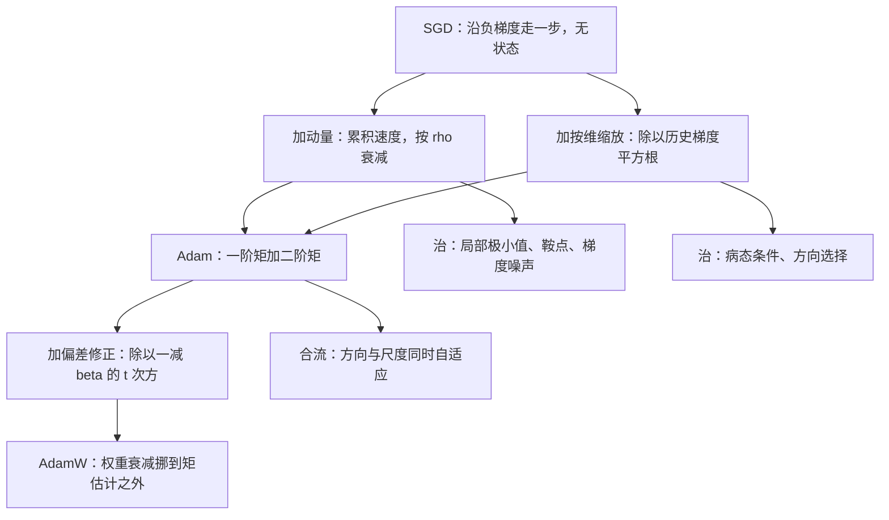

> **课程信息**
>
> - **课程名称**：Stanford CS231n: Deep Learning for Computer Vision（Spring 2025）
> - **本讲主题**：Lecture 3. Regularization and Optimization
> - **主讲教师**：Zane Durante
> - **授课日期**：2025-04-08
> - **课程主页**：[cs231n.stanford.edu/2025](https://cs231n.stanford.edu/2025/schedule.html)
> - **官方课件**：[lecture_3.pdf](</attachments/cs231n-daa797312883cf04a10a3ab0.pdf>)（119 页，正文按页链接本地课件）
> - **字幕来源**：[cs231n_sp25_kor_sub · eng](https://github.com/lpaiu-cs/cs231n_sp25_kor_sub/tree/main/eng)（公开英文转写，中文由本书重写）
> - **版权说明**：幻灯片与课程材料版权归 Stanford University 及授课教师所有；本书为非官方学习笔记，仅用于学习与研究。

> **课件索引**：点击下方链接打开本地 PDF 的对应页；全部课件见 [课件索引](/notes/cs231n/slides)。页码按 PDF 文件页序定位，第 1 讲分为 Part 1 / Part 2。

[📄 L3 · 第 1 页｜本讲封面：Lecture 3 正则化与优化](</attachments/cs231n-daa797312883cf04a10a3ab0.pdf#page=1>)

上一讲把图像分类压缩成一个线性评分函数 $f(x,W)=Wx$。到这一步，"给一张图算出每一类的分数"已经没有秘密；没解决的是两个更基本的问题：**这些分数到底算不算好**，以及**当权重还不知道时，怎么把它找出来**。这一讲正好一分为二：前半段补上损失函数里一直缺的那一项，后半段把"找 W"从一个搜索问题变成一段可以反复执行的过程。

两个问题的分量并不对等。正则化看起来只是加一项惩罚，实际是在决定"我们愿意要哪一个解"——同一份训练数据往往对应无穷多个零损失的 W，惩罚项决定你最后落在哪一个上。优化看起来只是"往低处走"，可所有的工程复杂度都来自地形本身：狭长的谷、平坦的鞍点、带噪声的梯度，以及一个必须随时间变化的学习率。

讲义前三页是课程事务，课堂上没有展开，但它们会直接影响你后面几周怎么用作业，所以先照录。

[📄 L3 · 第 2 页｜课程事务：作业一的时间与答疑政策](</attachments/cs231n-daa797312883cf04a10a3ab0.pdf#page=2>)

作业一在本讲次日（4/9）发布，4/23 23:59 截止；答疑时间只回答高层问题，不做代码调试，页面上写的是 No Code Show Policy。这条政策的实际含义是：梯度写错、维度对不上，得你自己定位——而这正是第 4 节末尾那个"梯度检查"的用途。换句话说，本讲给的不只是两个概念，还有一套自己查错的手段。

[📄 L3 · 第 3 页｜课程事务：项目 proposal 与答疑时间表](</attachments/cs231n-daa797312883cf04a10a3ab0.pdf#page=3>)

项目 proposal 4/25 截止；助教的专长方向与答疑时间表都挂在课程网页（cs231n.stanford.edu/office_hours.html）上，线下与线上混合。选题之前先看哪位助教懂你想做的方向，比事后临时问要省事得多。

[📄 L3 · 第 4 页｜课程事务：Ed 置顶帖与期中考试安排](</attachments/cs231n-daa797312883cf04a10a3ab0.pdf#page=4>)

Ed 上的置顶帖要全部读完，勘误和补充说明都发在那里；想在校内参加期中考试的同学（CGOE）需要发邮件到 cs231n-staff-spr25@stanford.edu 登记。

## 1. 上一讲留下的三个决定，和它们没能回答的问题

*(参考时间: 00:00:17 – 00:11:05｜Lecture 3)*

[📄 L3 · 第 5 页｜复习章标题：上一周的内容](</attachments/cs231n-daa797312883cf04a10a3ab0.pdf#page=5>)

复习不是把上一讲重讲一遍，而是把三个已经做出的决定摆出来，看哪一个会在今天崩掉。这三个决定是：用数据而不是规则来分类、用一种距离度量"相似"、用线性函数把图像映射成分数。

[📄 L3 · 第 6 页｜图像分类：给定标签集合，把输入图像映射到其中一个标签](</attachments/cs231n-daa797312883cf04a10a3ab0.pdf#page=6>)

**第一个困难不在算法，在表示。** 人看到的是"猫"这个概念，机器拿到的是一张 32×32 的像素网格，每个位置三个整数，一共 3072 个离散值。从这堆数字回到"猫"这个语义标签，中间隔着的这条沟——讲师叫它语义鸿沟（semantic gap）——才是分类真正要解决的问题。它也顺带解释了为什么 $W$ 的宽度是 3072 而不是别的数：$32\times32\times3$。

[📄 L3 · 第 7 页｜识别的六种困难：视角、光照、形变、遮挡、背景杂乱、类内差异](</attachments/cs231n-daa797312883cf04a10a3ab0.pdf#page=7>)

六张图对应六种困难，其中两处讲师讲得比图更细。猫是典型的**可形变物体（deformable object）**：它能扭、能蜷、能伸，同一个类别在像素层面几乎没有稳定形状，任何依赖"形状模板"的规则都会失效。遮挡那张更有意思——画面里只剩一条翘在坐垫外的尾巴，人靠"尾巴的形状 + 猫的行为常识"把它补全成一只猫，而算法手里没有常识。再加上背景杂乱与类内差异，"if-else 规则"这条路不是不准，是规则的组合数会爆炸。

[📄 L3 · 第 8 页｜数据驱动的做法：kNN、1-NN 与 5-NN、train/validation/test 三分](</attachments/cs231n-daa797312883cf04a10a3ab0.pdf#page=8>)

于是换成数据驱动：与其写规则，不如把训练样本存起来，来一个新样本就找距离最近的那些邻居投票。1-NN 直接抄最近邻的标签，5-NN 取最近 5 个的多数票，这里的 5 就是超参数 $k$。数据要切成三份而不只是两份：**验证集用来挑超参数**（在 $k$ 的取值上扫一遍，画一条"验证集准确率 vs $k$"的曲线，取最高点），测试集只用来回答"在完全没见过的数据上表现如何"。这两件事混在一起，挑超参数的过程本身就会把测试集的信息泄漏进模型选择。

课堂上两个提问值得记下来，因为它们区分了两种很容易混淆的"距离"。第一个是距离度量本身：k 近邻（kNN）比的是**样本之间**的距离，最常用的是 L1（曼哈顿）与 L2（欧氏）。讲师举的例子是原点到两个点的距离——(1, 0) 与 (0.5, 0.5) 到原点的 L1 距离都是 1，因为只能横着走再竖着走，(0.5, 0.5) 要拆成两段 0.5；但在 L2 下前者是 1、后者是 $\sqrt{0.5}\approx0.707$，所以 L2 的等距线是圆，L1 的等距线是菱形（转 45° 的正方形）。第二个提问是"线性分类器的模板是不是就是一个最近邻"：不是。模板是权重矩阵的一行、是那个线性函数的系数，它不对应任何一个训练样本，几何上它是一条决策边界的法方向。

[📄 L3 · 第 9 页｜线性分类器 f(x,W)=Wx+b：3072 维输入、10 个类的分数](</attachments/cs231n-daa797312883cf04a10a3ab0.pdf#page=9>)

把图摊平成 3072 维向量之后，$W$ 是 $10\times3072$ 的矩阵（讲师口述时说成 3071，按 $32\times32\times3$ 应为 3072），$b$ 是 10 维。同一个东西有三种读法，今天三种都会用到：**代数读法**——$W$ 的每一行是一个类别的评分器，与 $x$ 做内积再加偏置；**模板读法**——把某一行 reshape 回 $32\times32\times3$ 画出来，看到的就是这个类别"长什么样"的加权模板；**几何读法**——每一行是输入空间里的一个超平面，$w^\top x + b = 0$ 是决策边界，符号决定样本落在哪一侧。几何读法最有用：把数据画出来，一眼就能看出红蓝两团点能不能被一条直线分开——如果不能，那问题就不在优化，而在模型族本身。这条伏笔埋在这里，要到第 7 章末尾的 094 页才收。

[📄 L3 · 第 10 页｜三个训练样本、三个类别下的分数矩阵，以及损失函数的定义](</attachments/cs231n-daa797312883cf04a10a3ab0.pdf#page=10>)

具体到这张分数表：cat 那一列 (3.2, 5.1, −1.7) 里正确类只排第二，car 的 5.1 更高，判错；car 那一列 (1.3, 4.9, 2.0) 正确类最高，判对；frog 那一列 (2.2, 2.5, −3.1) 正确类垫底，错得最离谱。三列分数的"好坏"没法靠肉眼排序：cat 只输了 1.9 分，frog 输了 5.6 分，凭什么说后者更糟、糟多少？于是需要一个把整列分数压成一个数的函数：


$$
L = \frac{1}{N}\sum_{i=1}^{N} L_i\left(f(x_i, W),\, y_i\right)
$$


这就是**数据损失（data loss）**：模型预测与训练标签的吻合程度，越小越好。上一讲讲过的 Softmax 与交叉熵是它的具体实现（正确类概率高则损失低、概率低则损失高），这里不重复推导。问题在于，只最小化这一项，模型会不惜一切代价去拟合训练集——包括把训练集里的噪声也当成规律学下来。损失函数还缺一项。

## 2. 正则化：主动把训练损失做差一点

*(参考时间: 00:11:07 – 00:19:30｜Lecture 3)*

[📄 L3 · 第 11 页｜只有数据损失时，损失函数只关心预测是否匹配训练数据](</attachments/cs231n-daa797312883cf04a10a3ab0.pdf#page=11>)

第二项要做的事情听上去自相矛盾：**故意让模型在训练数据上表现差一点**。讲师把它讲得很直白——这一项的目的不是提高训练集上的分数，而是让模型不要在训练集上"做得太好"，好在没见过的数据上做得更好。训练集变差、测试集变好，这两件事必须同时发生，否则就不叫正则化。

[📄 L3 · 第 12 页｜正则化的定义：防止模型在训练数据上表现过好](</attachments/cs231n-daa797312883cf04a10a3ab0.pdf#page=12>)

为什么"训练集上太好"是个坏信号？用一张只有五个点的玩具图就能说清。

[📄 L3 · 第 13 页｜正则化的直觉：五个训练点，要拟合一条曲线](</attachments/cs231n-daa797312883cf04a10a3ab0.pdf#page=13>)

给定这五个点，可以画出无穷多条曲线穿过它们。图里给了两条候选：$f_1$ 与 $f_2$。

[📄 L3 · 第 14 页｜两个候选模型：f1 穿过所有点，f2 有意偏离](</attachments/cs231n-daa797312883cf04a10a3ab0.pdf#page=14>)

$f_1$ 精确穿过每一个点，数据损失几乎为 0；$f_2$ 每个点都差一点。如果只看训练损失，$f_1$ 完胜。但如果这五个点是从某个更平滑的规律里采样出来的、本身带着测量噪声，那么 $f_1$ 学到的是"噪声长什么样"，$f_2$ 学到的才是"规律长什么样"。

[📄 L3 · 第 15 页｜正则化把模型从"贴合数据"往"贴合规律"的方向推](</attachments/cs231n-daa797312883cf04a10a3ab0.pdf#page=15>)

结论就是那一行字：正则化顶着"别拟合得太好"的力，作用是**不去拟合数据里的噪声**。同一个直觉在哲学里有名字——奥卡姆剃刀：多个互相竞争的假说里，先选最简单的那个；只有当简单假说被证明错了，再去试更复杂的。

[📄 L3 · 第 16 页｜奥卡姆剃刀：多个竞争假说中，最简单的那个最好](</attachments/cs231n-daa797312883cf04a10a3ab0.pdf#page=16>)

写成公式，就是在数据损失后面挂一项惩罚，再用一个系数把它们缝起来：


$$
L(W) = \underbrace{\frac{1}{N}\sum_{i=1}^{N} L_i\left(f(x_i,W), y_i\right)}_{\text{数据损失}} + \underbrace{\lambda R(W)}_{\text{正则项}}
$$


[📄 L3 · 第 17 页｜损失函数的完整形态：数据损失加正则项，λ 是强度](</attachments/cs231n-daa797312883cf04a10a3ab0.pdf#page=17>)

$\lambda$ 是**正则化强度**，又一个人为设定的超参数，取值从 0（完全不正则化）到任意大（惩罚压倒一切）。它不是靠训练学出来的，而是像 $k$ 一样在验证集上扫。这一项之所以重要，是因为它把"模型好不好"从单一目标变成了两个目标的加权和：数据损失说"你要对训练集负责"，正则项说"你别太用力"。

[📄 L3 · 第 18 页｜三种最简单的正则项：L2、L1 与弹性网络](</attachments/cs231n-daa797312883cf04a10a3ab0.pdf#page=18>)

三个具体形式都是对权重矩阵逐元素操作再求和：L2 是平方和 $R(W)=\sum_k\sum_l W_{k,l}^2$；L1 是绝对值和 $R(W)=\sum_k\sum_l |W_{k,l}|$；弹性网络把两者按系数 $\beta$ 混起来。它们的差别不在公式长短，而在**对大数和小数的惩罚力度不同**，这一点第 3 节会用一道选择题算清楚。

[📄 L3 · 第 19 页｜更复杂的正则化：Dropout、批归一化、随机深度、分数池化](</attachments/cs231n-daa797312883cf04a10a3ab0.pdf#page=19>)

图里还列了一串"不那么像惩罚项"的正则化：Dropout、批归一化（BatchNorm）、随机深度（stochastic depth）、分数池化（fractional pooling）。它们的共同点是都在训练时往网络里注入某种随机性或约束，让模型不能依赖某一条固定通路；代价是它们会改变网络结构本身，调起来比 L1/L2 麻烦得多。讲师的说法是这类方法每年都有新论文，属于活跃研究方向，本课只覆盖一小部分。

[📄 L3 · 第 20 页｜为什么要正则化：表达偏好、简化模型、改善优化](</attachments/cs231n-daa797312883cf04a10a3ab0.pdf#page=20>)

页面上给了三条理由，第三条最容易被忽略。**表达偏好**：如果你相信这个问题的解应该是"摊开的"或"稀疏的"，就用对应的惩罚项把这个偏好写进目标函数。**简化模型**：如果正则化压的是高次多项式项，模型确实会变简单。**改善优化**：L2 项是平方，画出来是抛物线，加上它相当于给损失面加了一份曲率，凸性更好、更容易优化——这一条本课不展开，但它意味着正则化不只影响泛化，也影响训练本身快不快。

三条理由里只有前两条是"让模型变简单"。讲师特意纠正了一个流行的误解：正则化并不总是让模型变简单，Dropout 就是个反例——它让模型在训练时更"难学"，结构上反而更复杂，但在测试集上更好。真正统一的定义只有一句：**训练集上更差、测试集上更好**。

## 3. L2 摊平、L1 稀疏：把"偏好"写成可优化的项

*(参考时间: 00:19:36 – 00:24:22｜Lecture 3)*

[📄 L3 · 第 21 页｜填空题：给定 x 与两个权重向量，L2 会偏好哪一个](</attachments/cs231n-daa797312883cf04a10a3ab0.pdf#page=21>)

这一节用一道现场举手题把"偏好"变成可算的东西。输入是 $x=[1,1,1,1]$，两个候选权重 $w_1=[1,0,0,0]$ 与 $w_2=[0.25,0.25,0.25,0.25]$。两者的内积都等于 1，也就是**数据损失完全相同**——模型对训练集的拟合能力一模一样，区别只在于权重怎么分布。

[📄 L3 · 第 22 页｜L2 的答案：它偏好摊开的 w2](</attachments/cs231n-daa797312883cf04a10a3ab0.pdf#page=22>)

答案是把两边的权重摊平。算一下就明白为什么：$R_{L2}(w_1)=1^2=1$，而 $R_{L2}(w_2)=4\times(1/4)^2=1/4$，后者低四倍。所以 L2 在"同样能得 1 分"的两个解里会选 $w_2$——它把权重**分散**到所有输入维度上，而不是押在单一维度。课堂投票里多数人选对了 2 号，讲师的说法是"L2 喜欢把权重的负担摊开"。

[📄 L3 · 第 23 页｜L1 的追问：同样两个权重，换成 L1 会偏好哪个](</attachments/cs231n-daa797312883cf04a10a3ab0.pdf#page=23>)

紧接着的第二个问题是个陷阱。L1 是绝对值求和：$R_{L1}(w_1)=1$，$R_{L1}(w_2)=4\times0.25=1$，**两个答案打平**。课堂上多数人举手选 1 号（稀疏的那个），直觉是对的，但理由不是这一项的大小——单看损失函数，这两个解完全等价。讲师的处理方式很干脆：承认这是陷阱题，然后给出为什么实践中确实会看到 1 号——当某个权重可以被压到 0 而性能几乎不变时，优化过程会倾向于把它压到 0。

这个"为什么"值得补一步推导（编者说明：对两项分别求导即可得到）：L2 对某个权重的梯度是 $2W_{k,l}$，权重越接近 0，被往回拉的力量越小，于是它可以停在很小的非零值上；L1 的梯度是 $\mathrm{sign}(W_{k,l})$，只要权重不为 0，就始终有一个固定大小的力把它往 0 推。两者叠加的结果是：L2 得到一组"都小、但都不为零"的权重，L1 得到一组"大量精确为零"的权重——这就是稀疏性（sparsity）的来源，也是为什么说 L1 等价于"用更少的系数做线性模型"。讲师在解释里用的是平方的直觉（0.001 平方后变成 $10^{-6}$，惩罚几乎消失），结论与求导一致。

顺带记一个课堂上没答完的问题：把其中一个数换成 0.9 这样的值时，L1 的偏好会不会翻转？讲师被问到后没有展开就转回了复习，这属于"留给你自己在作业里算"的那类问题。

[📄 L3 · 第 24 页｜复习：数据集、评分函数、Softmax 损失与完整损失](</attachments/cs231n-daa797312883cf04a10a3ab0.pdf#page=24>)

复习页把整条链子重新串了一遍，其中关于 Softmax 的那句解释值得抄下来：它的作用是把**任意一组实数**变成一组和为 1 的概率。分数越高的类，概率越接近 1；其余类被压到接近 0。这件事之所以重要，是因为损失需要对"正确类的概率"取负对数：概率接近 1 时损失接近 0，概率接近 0 时损失趋于无穷——两端的行为正好符合"错得越离谱罚得越重"。

[📄 L3 · 第 25 页｜复习页的第二个版本：完整损失里加上了正则项](</attachments/cs231n-daa797312883cf04a10a3ab0.pdf#page=25>)

第二版复习页只多了一件事：在逐样本损失的平均后面加上 $\lambda R(W)$。到这里"怎么评价一个 W"已经完全确定：数据损失管拟合，正则项管偏好，$\lambda$ 管两者的兑换率。剩下的问题只有一个，也是本讲后半段的全部内容——**这个 W 从哪里来**。课堂上有人追问"用权重幅度做正则化，凭什么等于模型更简单"，讲师承认 L1 的情形比较直接（系数少了），但一般情形并不成立，最终还是要回到"训练差、测试好"这个定义上。

## 4. 优化：蒙着眼在一张看不见的地形上找最低点

*(参考时间: 00:24:37 – 00:33:51｜Lecture 3)*

[📄 L3 · 第 26 页｜优化章标题](</attachments/cs231n-daa797312883cf04a10a3ab0.pdf#page=26>)

损失函数一旦确定，问题就变成一个纯粹的最优化问题：在 $W$ 构成的高维空间里，找一个让 $L(W)$ 最小的点。讲师用的比喻是地形（loss landscape）：把损失值当成海拔，把参数当成地面上的坐标，训练就是在这片地形上走到最低的谷底。

[📄 L3 · 第 27 页｜损失地形的三维视图：两个参数轴加一根损失轴](</attachments/cs231n-daa797312883cf04a10a3ab0.pdf#page=27>)

这个比喻有个显而易见的漏洞：人站在山上，抬头就能看见哪边低、谷底在哪。讲师自己把这个漏洞补上了——**把走路的人蒙上眼睛**。看不见远景，只能用脚感受脚下这一点的倾斜方向和坡度，然后朝下坡方向迈一步。这个修正版才是优化算法的真实处境：它永远只知道当前位置的局部斜率，不知道全局最低点在哪里。

[📄 L3 · 第 28 页｜蒙着眼的人在地形上：只能感知脚下这一点的坡度](</attachments/cs231n-daa797312883cf04a10a3ab0.pdf#page=28>)

在这个设定下，"怎么走"有无数种策略。先看一个明知很笨、但值得作为下界的策略。

[📄 L3 · 第 29 页｜策略一：随机搜索——采样一千个 W，挑损失最小的那个](</attachments/cs231n-daa797312883cf04a10a3ab0.pdf#page=29>)

随机搜索就是一个 for 循环：随机生成 1000 个 $W$，逐个算损失，留下最好的那个。没有任何数学，也没有任何方向信息。

[📄 L3 · 第 30 页｜随机搜索在 CIFAR-10 上的成绩：15.5%](</attachments/cs231n-daa797312883cf04a10a3ab0.pdf#page=30>)

它在 CIFAR-10 上拿到 **15.5%** 的准确率——比 10 类随机猜的 10% 好一点，而现代方法在这个数据集上已经做到约 **99.7%**。这个数字的意义在于给出一个量级参照：任何"真正的"优化算法都应该远远超过它，否则说明梯度根本没起作用。讲师对它的评价很克制：不严谨，但比随机基线强，走投无路时不算最差的选择。

[📄 L3 · 第 31 页｜策略二：沿着斜率走——每一步朝下坡方向](</attachments/cs231n-daa797312883cf04a10a3ab0.pdf#page=31>)

第二个策略就是把蒙眼人的动作形式化：感受脚下坡度，朝下坡方向走一步，重复。这一步之后的所有算法——动量、RMSProp、Adam——都只是在这个动作上做修补。

[📄 L3 · 第 32 页｜一维导数的极限定义，以及多维情形下的梯度](</attachments/cs231n-daa797312883cf04a10a3ab0.pdf#page=32>)

一维的斜率是导数，定义是那个熟悉的极限：


$$
\frac{df}{dx} = \lim_{h\to 0}\frac{f(x+h)-f(x)}{h}
$$


多维时把每个维度各算一次，得到的就是**梯度** $\nabla_W L$，一个和 $W$ 同形状的向量。两个性质后面要用：任意方向 $u$ 上的斜率等于梯度与该方向的点积 $\nabla_W L \cdot u$；而斜率最陡的下坡方向就是**负梯度** $-\nabla_W L$。梯度指向上坡，负梯度指向下坡——这一句话解释了后面所有更新公式里那个减号。

[📄 L3 · 第 33 页｜数值梯度：当前 W、当前损失 1.25347，梯度一格一格地填](</attachments/cs231n-daa797312883cf04a10a3ab0.pdf#page=33>)

最直接的算法实现就是把极限定义硬算一遍。图上左边是当前的 9 个权重分量（0.34, −1.11, 0.78, 0.12, 0.55, 2.81, −3.1, −1.5, 0.33, …），下方是当前损失 1.25347；右边一列全是问号，等着被填。

[📄 L3 · 第 34 页｜数值梯度第一帧：把第一个分量加上 h](</attachments/cs231n-daa797312883cf04a10a3ab0.pdf#page=34>)

取 $h=0.0001$，只把第一个分量改成 $0.34+0.0001$，重新前向算一遍损失，得到 1.25322——比原来小了 0.00025。

[📄 L3 · 第 35 页｜数值梯度第二帧：算出第一个分量的偏导](</attachments/cs231n-daa797312883cf04a10a3ab0.pdf#page=35>)

于是 $\partial L/\partial W_1 \approx (1.25322-1.25347)/0.0001 = -2.5$。负数意味着"把这个分量调大，损失会下降"，符合预期。

[📄 L3 · 第 36 页｜数值梯度第三帧：把第二个分量加上 h](</attachments/cs231n-daa797312883cf04a10a3ab0.pdf#page=36>)

换第二个分量：$-1.11+0.0001$，损失变成 1.25353，比原来大了。

[📄 L3 · 第 37 页｜数值梯度第四帧：第二个分量的偏导为正](</attachments/cs231n-daa797312883cf04a10a3ab0.pdf#page=37>)

$\partial L/\partial W_2 \approx (1.25353-1.25347)/0.0001 = +0.6$。正号意味着"调大反而更差"，更新时应该往反方向走。

[📄 L3 · 第 38 页｜数值梯度第五帧：第三个分量加上 h，损失没有变化](</attachments/cs231n-daa797312883cf04a10a3ab0.pdf#page=38>)

第三个分量 $0.78+0.0001$ 之后，损失仍然是 1.25347，小数点后五位一模一样。

[📄 L3 · 第 39 页｜数值梯度第六帧：第三个分量的偏导为 0](</attachments/cs231n-daa797312883cf04a10a3ab0.pdf#page=39>)

$\partial L/\partial W_3 \approx 0$。这个 0 不是算错了：损失只打印到小数点后五位，变化量小于 $10^{-5}$，换算成梯度就是 $|g|<0.1$ 这个量级——在显示的精度里它看起来就是 0。

[📄 L3 · 第 40 页｜数值梯度第七帧：给这个方法下判决——慢，而且只是近似](</attachments/cs231n-daa797312883cf04a10a3ab0.pdf#page=40>)

到这里可以给这个方法下判决了。要填满整个梯度向量，得对**每一个**分量各做一次完整的前向计算：3072 维就要 3072 次，几百万参数就要几百万次。而且它只是近似——$h$ 取大了截断误差大，取小了浮点相减会丢有效数字，两头都不讨好。

[📄 L3 · 第 41 页｜换个角度：损失本来就是 W 的函数](</attachments/cs231n-daa797312883cf04a10a3ab0.pdf#page=41>)

所以讲师说"这很傻"。因为损失根本就是 $W$ 的一个显式函数：从 $W$ 到分数是一次矩阵乘法，从分数到损失是 Softmax 加对数，全过程都是初等函数的复合——它当然可导。

[📄 L3 · 第 42 页｜用微积分直接求解析梯度](</attachments/cs231n-daa797312883cf04a10a3ab0.pdf#page=42>)

既然可导，就直接用链式法则把 $\nabla_W L$ 写出来。$x_i$ 与 $y_i$ 是数据、当作常数，只有 $W$ 是变量；虽然中间隔着指数和对数，但求导过程是机械的。这一推导留作作业，课堂上只强调它的结果形态。

[📄 L3 · 第 43 页｜解析梯度的形态：dW 是数据与 W 的某个函数](</attachments/cs231n-daa797312883cf04a10a3ab0.pdf#page=43>)

右边那一列问号被一次填满：$dW = [-2.5, 0.6, 0, 0.2, 0.7, -0.5, 1.1, 1.3, -2.1, \dots]$，与数值梯度算出来的前三个分量完全一致。差别在代价：一次前向加一次反向就得到全部 3072 个分量，总开销只是单次前向的常数倍；而数值梯度要 3072 次前向。这里差的是一个 $N$ 倍，不是一个常数因子。

[📄 L3 · 第 44 页｜两种梯度的对照，以及梯度检查的做法](</attachments/cs231n-daa797312883cf04a10a3ab0.pdf#page=44>)

对照表值得背下来：数值梯度**近似、慢、好写**；解析梯度**精确、快、容易写错**。工程上的结论不是二选一，而是"永远用解析梯度训练，但用数值梯度验一次"——这个流程叫**梯度检查（gradient check）**：把 $h$ 取到 $10^{-4}$ 量级，比较两边算出的分量是否在同一量级、符号是否一致。作业里的梯度检查就是干这个的。

课堂上还有一个值得记的问题：如果某个损失函数更好，但它不可导，能不能用数值梯度硬上？讲师的回答分两层——构造一个"更好但不可导"的损失本身很难；而且如果损失在定义域的大部分都不可导（比如一堆互不连通的点），沿最陡方向走就失去意义，因为你根本没有一个连续的地形可以走。反过来，如果函数是凸的，这套下坡法就工作得很好。这也解释了为什么深度学习的损失函数几乎都是可导的：不是因为可导更优雅，而是因为只有可导才能用梯度。

## 5. 梯度下降与 SGD：三个病灶都来自"只看局部斜率"

*(参考时间: 00:33:56 – 00:44:44｜Lecture 3)*

[📄 L3 · 第 45 页｜梯度下降章标题](</attachments/cs231n-daa797312883cf04a10a3ab0.pdf#page=45>)

有了梯度，算法只有一行：算出当前位置的梯度，沿负方向走一步，步长由学习率决定。


$$
W \leftarrow W - \alpha \nabla_W L(W)
$$


$\alpha$ 是步长（学习率）。这个式子里唯一需要解释的是"走多远"：$\alpha$ 是固定的，但梯度本身会变，所以**实际位移是 $\alpha$ 乘以当前梯度的模**——地形平坦处梯度小，走得就短；陡峭处梯度大，走得就远。这一点后面会变成麻烦。

[📄 L3 · 第 46 页｜梯度下降的俯视图：从原始 W 出发，沿负梯度方向走到谷底](</attachments/cs231n-daa797312883cf04a10a3ab0.pdf#page=46>)

换成俯视图更好理解：颜色是损失值，紫蓝是高处、红黄是谷底，箭头是负梯度方向，白色虚线是走出来的轨迹。轨迹并不指向"全局中心"，它每一步都只对着当前点的局部下坡方向——这正是蒙眼人走路的样子。讲师在这里补了一个常被忽略的细节：更新公式里没有"停止"这一项，真按公式写会永远循环下去。实践中只有两种停法，一是**固定迭代次数**，二是**看损失的变化量**——当损失每步只降 $10^{-5}$ 甚至 $10^{-9}$ 量级时就停下来，认为已经够好。

[📄 L3 · 第 47 页｜镜头推近之后的地形：一条弯过去的长谷](</attachments/cs231n-daa797312883cf04a10a3ab0.pdf#page=47>)

把镜头推近，只剩一条弯曲的谷。这张没有文字的图是必要的过渡：真实的高维损失面不是同心圆，而是这种狭长、弯曲、尺度极不均匀的形状，后面三个"病灶"全部来自这种几何。

[📄 L3 · 第 48 页｜随机梯度下降：用一个小批量近似整个数据集的梯度](</attachments/cs231n-daa797312883cf04a10a3ab0.pdf#page=48>)

下一个问题是算账。完整梯度要对 $N$ 个样本求和，$N$ 是百万级时一步更新就要遍历整个数据集，代价无法接受。**随机梯度下降（SGD）** 的做法是每步只采样一个小批量（minibatch），用这一批的平均梯度当作全量的估计。批大小 32/64/128 最常见，幻灯片上的示例代码取 256。因为每次采的是随机子集，所以叫"随机"；实践中不会纯随机抽，而是把整个数据集打乱后依次取完再重新打乱——**遍历全部样本一次叫一个 epoch**。

到这里 SGD 已经可以跑了，但它有三个结构性的毛病。有意思的是这三个毛病不是算法写错了，而是"只看局部斜率"这件事本身的后果。

[📄 L3 · 第 49 页｜SGD 的第一个问题：一个方向变化快、另一个方向变化慢](</attachments/cs231n-daa797312883cf04a10a3ab0.pdf#page=49>)

第一个问题是**病态条件（poor conditioning）**。图里画的是等损失线：横向（$w_1$）很平，纵向（$w_2$）很陡，等高线被拉成一圈圈极扁的椭圆。问一句：梯度下降在这种地形上会怎么走？

[📄 L3 · 第 50 页｜第一帧的答案：浅方向进展极慢，陡方向来回抖动](</attachments/cs231n-daa797312883cf04a10a3ab0.pdf#page=50>)

答案就是那条红色锯齿：**沿平缓方向进展极慢，沿陡峭方向来回抖动**。原因不难推：负梯度方向几乎垂直于谷底走向，于是每一步都在"横穿山谷"而不是"沿谷下行"；陡方向上的分量被反复越过、再被拉回，能量全耗在来回振荡上。如果学习率再大一点，振荡幅度会逐次放大，最后直接飞出山谷——讲师把这种失效单独点了一句：学习率过大时会真的发生。

[📄 L3 · 第 51 页｜同一帧补一条旁注：这叫条件数很大](</attachments/cs231n-daa797312883cf04a10a3ab0.pdf#page=51>)

页面底部补的旁注给了这件事一个名字：损失函数的**条件数（condition number）** 很大，定义是 Hessian 矩阵最大奇异值与最小奇异值之比。陡方向的二阶导大、平方向的二阶导小，比值就大；比值越大，等高线越扁，SGD 越难走。这个量在后面会反复出现——它也是动量与 RMSProp 想要对付的东西。

[📄 L3 · 第 52 页｜SGD 的第二个问题：损失面上有局部极小值或鞍点](</attachments/cs231n-daa797312883cf04a10a3ab0.pdf#page=52>)

第二个问题是**梯度为零的点**。损失面上存在局部极小值，也存在鞍点：某个方向上它是谷底，另一个方向上它是山脊。

[📄 L3 · 第 53 页｜梯度为零时，梯度下降原地不动](</attachments/cs231n-daa797312883cf04a10a3ab0.pdf#page=53>)

在这一点上梯度是 0，更新量 $\alpha\cdot 0=0$，参数一动不动。落在局部极小值里还算"运气不好但不算错"，落在鞍点上则是纯粹的白跑——旁边明明有更深的谷，可它连方向都感觉不到。

[📄 L3 · 第 54 页｜鞍点在高维空间里比局部极小值常见得多](</attachments/cs231n-daa797312883cf04a10a3ab0.pdf#page=54>)

讲师强调了一个反直觉的经验事实：**维度越高，鞍点越多、局部极小值越少**。直觉是——要让一个点成为局部极小值，所有方向都得向上弯；而只要有一个方向向下弯，它就是鞍点。参数从几万涨到几亿，方向数跟着涨，"恰好全都向上弯"的概率急剧变小。幻灯片引的是 Dauphin 等人 2014 年那篇专门讨论高维非凸优化中鞍点问题的论文。

[📄 L3 · 第 55 页｜二维鞍点的形状：一个方向向上弯，一个方向向下弯](</attachments/cs231n-daa797312883cf04a10a3ab0.pdf#page=55>)

二维的鞍点最好认：像马鞍，前后方向向下、左右方向向上，正中间那一点两个方向的斜率都是 0。三维以上没法画，但"一半方向向上、一半方向向下"的结构是一样的。

[📄 L3 · 第 56 页｜SGD 的第三个问题：小批量带来的梯度噪声](</attachments/cs231n-daa797312883cf04a10a3ab0.pdf#page=56>)

第三个问题来自 SGD 自己：梯度是小批量的估计，不是全量的真值，所以每一步都带噪声。方向大体对着谷底，但每一步都会偏。这个噪声既是麻烦（收敛慢、终点抖动），也是好处（噪声本身能把参数从鞍点附近推出去）——后面动量与批大小的取舍都跟这一点有关。

[📄 L3 · 第 57 页｜四个病灶并列，以及动量给出的四条修正轨迹](</attachments/cs231n-daa797312883cf04a10a3ab0.pdf#page=57>)

这张四联图是本讲的转折点：局部极小值、鞍点、病态条件、梯度噪声，四个场景各画一次 SGD（黑）与 SGD + 动量（蓝）的轨迹。可以看到蓝色轨迹在四个场景里都更"直"——它不在鞍点停住，不在陡方向抖动，也不被噪声带偏。下面从代码层面看动量到底改了什么。

[📄 L3 · 第 58 页｜SGD 的两行更新代码](</attachments/cs231n-daa797312883cf04a10a3ab0.pdf#page=58>)

```python
while True:
    dx = compute_gradient(x)
    x -= learning_rate * dx
```

两行，没有状态。所有后续优化器的差别，都是在这两行之间插入"记忆"。

## 6. 动量、RMSProp、Adam、AdamW：把"往哪走"拆成可设计的部件

*(参考时间: 00:44:47 – 00:59:12｜Lecture 3)*

[📄 L3 · 第 59 页｜SGD 加动量：把梯度换成速度](</attachments/cs231n-daa797312883cf04a10a3ab0.pdf#page=59>)

动量的物理类比是滚下山的球：球不会每一刻都重新决定方向，它带着上一段路积攒的速度。写成代码只多一个状态变量：

```python
vx = 0
while True:
    dx = compute_gradient(x)
    vx = rho * vx + dx
    x -= learning_rate * vx
```

$v_x$ 是速度，$\rho$ 是衰减系数（通常 0.9 或 0.99）。$\rho$ 越大，新速度越依赖旧速度，记忆越长。幻灯片第一版把 $\rho$ 叫"摩擦"（friction），下一页改口叫"动量"——名字不同，作用一样：它决定"过去"和"现在"各占多少权重。

[📄 L3 · 第 60 页｜同一页的第二帧：rho 的称呼从摩擦改成动量](</attachments/cs231n-daa797312883cf04a10a3ab0.pdf#page=60>)

这个改动为什么能同时治四个病？讲师逐条对应过：局部极小值——带着速度冲过去，只要 $\rho$ 够大就能翻过小坡；鞍点——梯度虽然为 0，速度不为 0，会沿着原来的方向继续走一段；病态条件——陡方向上的正负分量在累加时互相抵消，平方向上的同号分量越积越大，等于自动把"抖动"过滤掉、把"前进"放大；梯度噪声——噪声方向随机，累加后互相抵消，而四个场景共有的那个真实方向被保留下来。这也解释了为什么动量"平均"掉了噪声：它做的是梯度的滑动平均。

课堂上有人追问：动量会不会因为冲过头而更难收敛？讲师的回答是"会"——它可能收敛得慢一些，但更可能停在更好的点上；而且到底哪个更好是**经验问题**，有些模型上不加动量的 SGD 反而更快，所以实践中的做法是把几种都试一遍。

[📄 L3 · 第 61 页｜动量的另一种等价写法](</attachments/cs231n-daa797312883cf04a10a3ab0.pdf#page=61>)

幻灯片还给了另一种写法，把速度与更新合并成一步。讲师明说这一页"为了赶时间跳过证明"，但结论要记住：两种写法产生**完全相同的参数序列**，只是把 $v_x$ 显式存下来还是隐式推导出来的区别。看别人代码时不要因为公式长得不一样就以为算法不同。

[📄 L3 · 第 62 页｜RMSProp：按维度缩放梯度](</attachments/cs231n-daa797312883cf04a10a3ab0.pdf#page=62>)

动量记的是梯度的方向，RMSProp 记的是梯度的**大小**。它维护一个"梯度平方的滑动平均"：

```python
grad_squared = 0
while True:
    dx = compute_gradient(x)
    grad_squared = decay_rate * grad_squared + (1 - decay_rate) * dx * dx
    x -= learning_rate * dx / (np.sqrt(grad_squared) + 1e-7)
```

关键在最后一行：梯度被除以 $\sqrt{\text{grad\_squared}}$。某个维度历史上梯度一直很大，分母就大，这一步就走得短；某个维度历史上梯度很小，分母就小，这一步就走得长。分母里的 $10^{-7}$ 只是防止除零。

[📄 L3 · 第 63 页｜同样的更新，换一个说法：逐参数学习率](</attachments/cs231n-daa797312883cf04a10a3ab0.pdf#page=63>)

这个机制的正式名字叫**逐参数学习率（per-parameter learning rate）** 或**自适应学习率**。名义上只有一个 $\alpha$，但每个维度实际得到的步长是 $\alpha/\sqrt{s}$，$s$ 逐维不同——等于给每个参数配了一个自己的学习率，而这个学习率是从历史梯度里自动估出来的。

[📄 L3 · 第 64 页｜RMSProp 的效果提问](</attachments/cs231n-daa797312883cf04a10a3ab0.pdf#page=64>)

课堂上把这个问题又抛回给学生：在这种狭长山谷里，RMSProp 会怎么走？

[📄 L3 · 第 65 页｜答案：陡方向被压制，平方向被加速](</attachments/cs231n-daa797312883cf04a10a3ab0.pdf#page=65>)

答案就是上面那段推导的直译：**陡方向被压住，平方向被加速**。在病态条件那个例子里，RMSProp 会迅速把"横穿山谷"的分量压小，把"沿谷下行"的分量放大，于是轨迹很快转向谷底方向——这正是 SGD 最缺的那件事。

[📄 L3 · 第 66 页｜三条轨迹并列：SGD、SGD 加动量、RMSProp](</attachments/cs231n-daa797312883cf04a10a3ab0.pdf#page=66>)

三条轨迹摆在一起看很清楚：SGD 慢而抖；动量会冲过头再折回来（讲师在这里又提了一次"会过冲"）；RMSProp 最快转向正确的方向，因为它每一步都在改**方向**，而不只是改速度。

[📄 L3 · 第 67 页｜Adam：动量与 RMSProp 的合流](</attachments/cs231n-daa797312883cf04a10a3ab0.pdf#page=67>)

Adam 就是把上面两个机制叠起来，各管一半：

```python
first_moment = 0
second_moment = 0
while True:
    dx = compute_gradient(x)
    first_moment = beta1 * first_moment + (1 - beta1) * dx
    second_moment = beta2 * second_moment + (1 - beta2) * dx * dx
    x -= learning_rate * first_moment / (np.sqrt(second_moment) + 1e-7)
```

一阶矩（first moment）是动量的速度项，二阶矩（second moment）是 RMSProp 的平方项。所谓"一阶/二阶"只是借了物理与统计的用词：一个记梯度的均值，一个记梯度平方的均值。到这里 Adam 已经能跑了——除了第一步。

[📄 L3 · 第 68 页｜Adam 的第一个时间步会出问题](</attachments/cs231n-daa797312883cf04a10a3ab0.pdf#page=68>)

问题出在初始化：$m_0=0$、$v_0=0$，而 $\beta_1,\beta_2$ 都接近 1（0.9 和 0.999）。第一步时 $m_1=(1-\beta_1)dx=0.1\,dx$，$v_1=(1-\beta_2)dx^2=0.001\,dx^2$，于是更新量里的分母是 $\sqrt{0.001\,dx^2}\approx0.032\,|dx|$，而分子是 $0.1\,dx$——两者一除，步长被放大了约 3 倍，而且放大的倍数只取决于 $\beta$，与梯度大小无关。讲师的说法是"分母几乎为 0，于是第一步大得离谱"。

[📄 L3 · 第 69 页｜Adam 的完整形式：加上偏差修正](</attachments/cs231n-daa797312883cf04a10a3ab0.pdf#page=69>)

修法是为两个矩各配一个与时间步相关的校正：


$$
\hat m_t = \frac{m_t}{1-\beta_1^t}, \qquad \hat v_t = \frac{v_t}{1-\beta_2^t}
$$


第 $t$ 步时，$m_t$ 是过去梯度的加权和，权重之和只有 $1-\beta_1^t$，所以除以它就把"初期没攒够"这件事补回来了。$t$ 变大以后 $1-\beta^t\to1$，校正自动消失——它只在前几十步起作用。

[📄 L3 · 第 70 页｜同一页补上推荐默认值](</attachments/cs231n-daa797312883cf04a10a3ab0.pdf#page=70>)

幻灯片给的默认值是 $\beta_1=0.9$、$\beta_2=0.999$、学习率 $10^{-3}$ 或 $5\times10^{-4}$。这三组数是"先用它跑起来"的起点，不是最优解；讲师的原话是"对很多模型来说是个很好的出发点，行不行得通另说"。

[📄 L3 · 第 71 页｜四种优化器的轨迹对比：Adam 兼具两者特征](</attachments/cs231n-daa797312883cf04a10a3ab0.pdf#page=71>)

四条轨迹叠在一张图里，Adam 的形状确实介于动量与 RMSProp 之间：起步像 RMSProp 一样迅速转向，中段像动量一样保持方向。这一步是"两个机制并不冲突"的可视化证据。

[📄 L3 · 第 72 页｜AdamW：正则化与优化器如何交互](</attachments/cs231n-daa797312883cf04a10a3ab0.pdf#page=72>)

接下来是本讲最容易被跳过、但在工程上很实用的一节：**L2 正则化到底应该加在哪里**。

[📄 L3 · 第 73 页｜先给一个不置可否的答案：取决于实现](</attachments/cs231n-daa797312883cf04a10a3ab0.pdf#page=73>)

答案是"取决于你把它放在哪"。两种放法在法律上都叫"L2 正则化"，但优化器感受到的东西完全不同。

[📄 L3 · 第 74 页｜标准 Adam：L2 项被算进梯度里，参与矩估计](</attachments/cs231n-daa797312883cf04a10a3ab0.pdf#page=74>)

标准 Adam 的做法是把 $\lambda R(W)$ 和数据损失加在一起求梯度，于是这个梯度进入一阶矩和二阶矩，**参与了动量和缩放的全部计算**。后果是：正则化的强度会被自适应学习率重新缩放——某个权重被衰减得快，它历史梯度大，分母也大，实际衰减反而变慢。

[📄 L3 · 第 75 页｜AdamW：把衰减项挪到矩估计之后](</attachments/cs231n-daa797312883cf04a10a3ab0.pdf#page=75>)

AdamW 的做法是把两者拆开：矩估计只用数据损失的梯度，权重衰减作为独立的一步加在最后。这样"往哪走"完全由损失决定，衰减只负责把权重往原点拉，不受 $\beta$、$\epsilon$ 的干扰。这就是 weight decay（权重衰减）这个名字的来历——它是一步独立的收缩，而不是梯度的一部分。

[📄 L3 · 第 76 页｜同一页补一张 ImageNet 上的对照曲线](</attachments/cs231n-daa797312883cf04a10a3ab0.pdf#page=76>)

幻灯片右侧的曲线是同一网络在 ImageNet 上的准确率：用 weight decay 的那条（蓝）在整个训练过程中都压在 L2 那条（橙）上面，30 个 epoch 时大约 0.94 对 0.93，前 10 个 epoch 的差距更明显（约 0.87 对 0.82）。讲师补了一句产业界的证据：Meta 的 Llama 系列都用 AdamW，推测就是因为这点差别。

课堂上有人问：既然效果差不多，为什么要多写一步？讲师的解释是——你希望速度与动量是**损失**的函数，而不是**权重本身**的函数；如果你想让优化过程尽量只跟着损失走，就得把正则项从矩估计里摘出去，但又不想放弃正则化，于是放在最后一步。



这张图的读法是"每加一个部件治一种病"：动量治的是"只看当前这一步"的短视，RMSProp 治的是"所有维度共用一个步长"的粗糙，Adam 把两者叠起来，AdamW 再解决"正则化被优化器改写"的副作用。四个部件之间没有替代关系，只有叠加关系。

## 7. 学习率不是常数：调度、二阶方法与通往非线性的一步

*(参考时间: 00:59:15 – 01:08:33｜Lecture 3)*

[📄 L3 · 第 77 页｜学习率调度章标题](</attachments/cs231n-daa797312883cf04a10a3ab0.pdf#page=77>)

前面所有算法都假定 $\alpha$ 是一个固定数。这一节要把这个假定去掉：学习率不仅可以是变量，而且**几乎在所有现代模型里都是变量**。

[📄 L3 · 第 78 页｜同一个损失曲线，四种学习率，哪个最好](</attachments/cs231n-daa797312883cf04a10a3ab0.pdf#page=78>)

四种学习率画在同一张损失曲线上，读法很直接：太高会振荡发散（loss 涨上去），太低会慢得看不出下降，偏高但不发散的那种会在最优点附近来回跳、再也压不下去，只有适中的那条既能快速下降又能持续改善。

[📄 L3 · 第 79 页｜答案：四种都可能是好学习率](</attachments/cs231n-daa797312883cf04a10a3ab0.pdf#page=79>)

然后讲师把这个问题拆了：**四种都可能是对的**——取决于你训练到哪一步。前期需要大学习率快速下降，后期需要小学习率精修；同一个训练过程里"最好"的学习率本来就在变。于是他顺理成章地引入调度（schedule）：让 $\alpha$ 随训练进程变化。

[📄 L3 · 第 80 页｜阶梯式衰减：在固定 epoch 处把学习率乘 0.1](</attachments/cs231n-daa797312883cf04a10a3ab0.pdf#page=80>)

最简单的一种是**阶梯衰减**：到了固定的几个 epoch 就把学习率乘 0.1。ResNet 的经典配方是在第 30、60、90 个 epoch 各降一次。图上能直接看到三次断崖：损失从约 4.0 一路降到 1.0 附近，每次降学习率后曲线都会立刻"再往下探一截"——这正是"学习率太大导致压不下去"的直接证据。

[📄 L3 · 第 81 页｜余弦衰减：学习率按半个余弦从最大值降到 0](</attachments/cs231n-daa797312883cf04a10a3ab0.pdf#page=81>)

第二种是**余弦衰减**，曲线就是半个余弦：从 $\alpha_0$ 平滑降到 0。幻灯片给的公式是


$$
\alpha_t = \frac{1}{2}\alpha_0\left(1+\cos\frac{t\pi}{T}\right)
$$


其中 $\alpha_0$ 是初始学习率，$\alpha_t$ 是第 $t$ 个 epoch 的学习率，$T$ 是总 epoch 数。它和阶梯衰减的差别在形状：阶梯是分段常数、有突变，余弦则是处处连续——起步平缓、中段最陡、收尾又变平缓。

[📄 L3 · 第 82 页｜同一页换一张图：余弦调度下的训练损失](</attachments/cs231n-daa797312883cf04a10a3ab0.pdf#page=82>)

这一帧只换了左边的图——从"学习率随 epoch 变化"换成"训练损失随 epoch 变化"，横轴拉到 300 个 epoch。可以看到损失在中段一直保持稳定下降（不是早早压平），到 250 个 epoch 左右才贴近 0。讲师想说的就是这件事：**损失曲线的形状很大程度上是调度器决定的**，拿它去比较不同模型时必须先对齐调度。

[📄 L3 · 第 83 页｜再加一条线性衰减](</attachments/cs231n-daa797312883cf04a10a3ab0.pdf#page=83>)

第三帧在公式区加了一条**线性衰减** $\alpha_t=\alpha_0(1-t/T)$，左边换成一条直线。右下角的文献也跟着换成了 BERT 那篇——每一帧只保留用这种调度的代表作，这个细节本身说明"哪种调度"往往和"哪个模型家族"绑在一起。

[📄 L3 · 第 84 页｜再加一条逆平方根衰减](</attachments/cs231n-daa797312883cf04a10a3ab0.pdf#page=84>)

第四帧补上**逆平方根** $\alpha_t \propto 1/\sqrt{t}$，引用换成 Transformer 那篇。到这一帧，四种调度的公式全部到齐，形状覆盖了"分段常数、余弦、线性、幂律"四类。讲师的说法是这类变体数量没有上限，选哪个取决于模型与数据，只能试。

[📄 L3 · 第 85 页｜线性 warmup：先从 0 线性升到最大值，再走衰减](</attachments/cs231n-daa797312883cf04a10a3ab0.pdf#page=85>)

比"怎么降"更容易被忽略的是"怎么起步"。**线性 warmup** 的做法是前若干个迭代（幻灯片给的量级是约 5000 步）把学习率从 0 线性升到 $\alpha_0$，之后才接上余弦或逆平方根。原因是初始学习率太大时，前几步的梯度方向还很不可靠，直接大步走会让损失炸掉；warmup 相当于给优化器一段"试探期"。同一页还有一条经验法则：**批大小放大 $N$ 倍，初始学习率也放大 $N$ 倍**（Goyal 等人 2017 年那篇一小时训完 ImageNet 的文章）。讲师强调这是经验规律而非定理——梯度在批内的方差随批大小下降，所以单步可以走得更远，但"线性"这个比例是实验拟合出来的。

[📄 L3 · 第 86 页｜一阶优化：用梯度构造线性近似，再走到近似的最小点](</attachments/cs231n-daa797312883cf04a10a3ab0.pdf#page=86>)

讲完调度，讲师用最后几分钟交代了一个"知道它存在就行"的分支：二阶优化。先看一直在用的东西长什么样——用当前点的梯度构造一个**线性近似**。

[📄 L3 · 第 87 页｜线性近似与一步更新](</attachments/cs231n-daa797312883cf04a10a3ab0.pdf#page=87>)

具体做法是两步：用梯度在当前位置切一条直线（或超平面）近似损失，然后走到这个近似的最小点。对线性近似来说，最小值在无穷远处，所以实际做的是"沿这个方向走固定步长"——这正是梯度下降。所有一阶方法（SGD、动量、RMSProp、Adam）都属于这一类，区别只在"走哪个方向、走多远"。

[📄 L3 · 第 88 页｜二阶优化：用梯度与 Hessian 构造二次近似](</attachments/cs231n-daa797312883cf04a10a3ab0.pdf#page=88>)

二阶方法把近似从直线换成抛物线：不仅用斜率，还用曲率。

[📄 L3 · 第 89 页｜二阶泰勒展开与牛顿更新公式](</attachments/cs231n-daa797312883cf04a10a3ab0.pdf#page=89>)

写成公式就是二阶泰勒展开


$$
J(\theta) \approx J(\theta_0) + (\theta-\theta_0)^\top \nabla_\theta J(\theta_0) + \frac{1}{2}(\theta-\theta_0)^\top H (\theta-\theta_0)
$$


令导数为 0 解出极值点，得到**牛顿更新** $\theta^* = \theta_0 - H^{-1}\nabla_\theta J(\theta_0)$。注意它和梯度下降的差别：步长不再是标量 $\alpha$，而是矩阵 $H^{-1}$——曲率大的方向自动走小步，曲率小的方向自动走大步，病态条件被一次性校正掉了。这也回答了前面那个提问："能不能用 Hessian 决定方向"——能，这就是。

[📄 L3 · 第 90 页｜代价：Hessian 有 N 平方个元素，求逆是 N 立方](</attachments/cs231n-daa797312883cf04a10a3ab0.pdf#page=90>)

问题在算账。Hessian 是 $N\times N$ 的矩阵，$N$ 是参数个数：幻灯片给的量级是"数千万到数亿"，那意味着 $10^{14}$ 量级的元素个数，存不下；求逆是 $O(N^3)$，更算不动。讲师补了一句很实际的判断：就算你愿意花这个时间，把同样的算力用来多喂一些数据，收益通常更大。所以在今天的网络规模下，二阶方法基本不出现。

[📄 L3 · 第 91 页｜实践建议：默认 Adam，追求极限用 SGD 加动量，全批量时才考虑二阶](</attachments/cs231n-daa797312883cf04a10a3ab0.pdf#page=91>)

收尾给了三条可以直接照用的建议。**默认选 Adam 或 AdamW**：新问题上先跑它，即使学习率固定不变往往也能跑出可用的结果。**SGD 加动量有时能超过 Adam**，但代价是要调的东西更多——没有 RMSProp 那一项帮忙缩放，学习率得试很多个，调度也得试。**如果你能负担全批量更新**（整个训练集塞进一个 batch），那说明数据或模型不大，这时候才值得去看二阶及更高阶的方法。

[📄 L3 · 第 92 页｜往前看：现在的评分函数还是线性的](</attachments/cs231n-daa797312883cf04a10a3ab0.pdf#page=92>)

最后一个问题是留给下一讲的：这一整讲讲的所有优化技术，优化的对象始终是那个线性评分函数 $f(x,W)=Wx$。如果模型本身不够强，再好的优化器也只能把它优化到它自己的上限。

[📄 L3 · 第 93 页｜两层神经网络：两个权重矩阵，中间夹一个非线性](</attachments/cs231n-daa797312883cf04a10a3ab0.pdf#page=93>)

下一讲要优化的对象长这样：$f = W_2\max(0, W_1 x)$。两个权重矩阵，中间夹一个 ReLU（逐元素取 $\max(0,\cdot)$），这就是最小的神经网络。形状上，$x\in\mathbb{R}^{D}$（$D=3072$）、$W_1\in\mathbb{R}^{H\times D}$、$W_2\in\mathbb{R}^{C\times H}$（$C=10$），中间那个 $H$ 是隐层宽度，成了新的超参数——参数量从线性模型的 $10\times3072$ 变成 $H\times(D+C)$，模型的容量就由这个 $H$ 决定。讲师特意说明实践里每一层还会各加一个可学习的偏置，幻灯片为了清爽省略了。

[📄 L3 · 第 94 页｜为什么需要非线性：红蓝两团点无法用一条直线分开](</attachments/cs231n-daa797312883cf04a10a3ab0.pdf#page=94>)

为什么非要夹那个非线性？回到第 1 节的几何读法就明白了：图上红蓝两团点是一圈套一圈的，**任何一条直线都分不开它们**。如果只是把两个线性变换叠起来（$W_2W_1x$），合起来仍是一个线性变换，等于什么都没加。

[📄 L3 · 第 95 页｜做法：先把点变换到另一个坐标系，再用线性分类器](</attachments/cs231n-daa797312883cf04a10a3ab0.pdf#page=95>)

出路是先把数据变到另一个空间。幻灯片给的例子是极坐标：$f(x,y)=(r(x,y),\theta(x,y))$，把平面上的点换成"到原点的距离 + 角度"，原本一圈套一圈的结构在新坐标里就变成了可以用一条直线切开的两团。神经网络的每一层做的正是这件事——只不过这个变换不是人手设计的，而是和分类器一起学出来的。

[📄 L3 · 第 96 页｜命名：这类网络更准确的名字是全连接网络](</attachments/cs231n-daa797312883cf04a10a3ab0.pdf#page=96>)

顺带纠一个名字。"神经网络"这个词太宽，这一讲要讲的结构更准确的名字是**全连接网络（fully-connected network）**，有时也叫**多层感知机（MLP）**。叫"全连接"是因为相邻两层之间每个神经元都连到下一层的每一个神经元，权重矩阵里没有人为置零的位置。

[📄 L3 · 第 97 页｜下一讲：神经网络与反向传播](</attachments/cs231n-daa797312883cf04a10a3ab0.pdf#page=97>)

下一讲两件事：神经网络本身，以及反向传播——它回答的是"多层堆起来之后，怎么算出 $\partial L/\partial x$"。本讲推梯度的办法（对 $W$ 求导、把 $x$ 当常数）在多层结构里会变成一条链，链式法则要系统地用起来，那就是计算图与反向传播的内容。

## 小结

*(参考时间: 01:06:04 – 01:08:33｜Lecture 3)*

| 要点 | 一句话解释 |
| :--- | :--- |
| 损失有两项 | 数据损失管"拟合训练集"，正则项管"别拟合得太狠"，$\lambda$ 是两者的兑换率 |
| 零损失不唯一 | 能让训练损失为 0 的 $W$ 通常有无穷多个，正则化决定你落在哪一个上 |
| L2 摊平、L1 稀疏 | 同样得分的两个解，L2 选权重分散的那个；L1 的惩罚对大小权重一视同仁，于是把小的推到 0 |
| 梯度是"一次前向换全部偏导" | 数值梯度好写但慢一个数量级，解析梯度快但会写错，所以两者要对照一次 |
| SGD 的三个病灶 | 病态条件下抖动、鞍点上停住、小批量带来噪声——三者都不是实现 bug，而是"只看局部斜率"的必然 |
| 动量治方向、RMSProp 治尺度 | 前者做梯度的滑动平均，后者按维度除以历史梯度平方根，Adam 把两者叠加再加偏差修正 |
| 学习率必须变 | 前期大、后期小；余弦加 warmup 是通用配方，批大小放大 $N$ 倍则学习率也放大 $N$ 倍 |
| 二阶方法被内存挡住 | Hessian 是 $N^2$、求逆是 $N^3$，$N$ 上百万时不可行，所以深度学习里基本只有一阶方法 |

## 附录：课堂未展示的幻灯片

讲义最后 22 页是标注为 "Appendix (Slides from Previous Years)" 的旧年份备份页，课堂上没有讲。它们不是可有可无的边角料：其中包含 Nesterov 动量、AdaGrad、L-BFGS 三个本讲正文提到但没有展开的方法，以及一段用 SVM 损失重讲"零损失不唯一"的完整推导。下面按原顺序逐页记录。

[📄 L3 · 第 98 页｜备份页：附录章标题，标明这些幻灯片来自往年](</attachments/cs231n-daa797312883cf04a10a3ab0.pdf#page=98>)

这一页本身就是说明：以下内容不属于 2025 年的授课范围，只是讲义保留的历史材料。把它当成"如果还有时间会讲"的延长线来读，比当成必读内容更合适。

### Nesterov 动量：先看一步再取梯度

[📄 L3 · 第 99 页｜备份页：动量更新的完整写法](</attachments/cs231n-daa797312883cf04a10a3ab0.pdf#page=99>)

动量更新被拆成三块：速度、梯度、实际步。一句话概括是"把当前位置的梯度与速度结合，得到真正用于更新权重的步长"。

[📄 L3 · 第 100 页｜备份页：动量与 Nesterov 动量的对照](</attachments/cs231n-daa797312883cf04a10a3ab0.pdf#page=100>)

右半边是 Nesterov 的改动：不取当前位置的梯度，而是**先按速度往前看一步**，取那个"将要到达的点"的梯度，再与速度混合。

[📄 L3 · 第 101 页｜备份页：往前看一步的位置](</attachments/cs231n-daa797312883cf04a10a3ab0.pdf#page=101>)

图上标出的正是那个前瞻点——它不在参数当前位置上，而是沿速度方向先往前推一步。

[📄 L3 · 第 102 页｜备份页：换算到当前位置的写法](</attachments/cs231n-daa797312883cf04a10a3ab0.pdf#page=102>)

问题随之而来：前瞻点的梯度不好直接写进以当前位置为自变量的更新式，于是需要一次变量代换。

[📄 L3 · 第 103 页｜备份页：变量代换之后的等价形式](</attachments/cs231n-daa797312883cf04a10a3ab0.pdf#page=103>)

代换之后形式重新变得干净，代价是速度的定义里多了一项对梯度的修正。页面右下角指向课程讲义 neural-networks-3 一节。

[📄 L3 · 第 104 页｜备份页：Nesterov 的最终形式](</attachments/cs231n-daa797312883cf04a10a3ab0.pdf#page=104>)

这一页与上一页只差变量代换的展开写法，结论一致：Nesterov 与普通动量只差"梯度取在哪一点"，实现上仍是两行。

[📄 L3 · 第 105 页｜备份页：三种方法的轨迹对比](</attachments/cs231n-daa797312883cf04a10a3ab0.pdf#page=105>)

三条轨迹并列：SGD 最抖，动量会冲过头，Nesterov 的过冲更小——因为它在到达之前就提前"看到"了坡要变缓。

### AdaGrad 与 RMSProp 的前身

[📄 L3 · 第 106 页｜备份页：AdaGrad 的定义](</attachments/cs231n-daa797312883cf04a10a3ab0.pdf#page=106>)

AdaGrad 是本讲 RMSProp 那一节的祖先：同样按维度缩放梯度，但分母用的是**历史梯度平方的累加和**，没有衰减。

[📄 L3 · 第 107 页｜备份页：AdaGrad 会发生什么](</attachments/cs231n-daa797312883cf04a10a3ab0.pdf#page=107>)

问题与正文 RMSProp 那一页同款：在"一个方向陡、一个方向平"的山谷里，按累加平方和缩放的步长会走出什么轨迹。

[📄 L3 · 第 108 页｜备份页：陡方向被压、平方向被加速](</attachments/cs231n-daa797312883cf04a10a3ab0.pdf#page=108>)

答案与 RMSProp 一致——陡方向被压住，平方向被加速。

[📄 L3 · 第 109 页｜备份页：步长在长时间尺度上会怎样](</attachments/cs231n-daa797312883cf04a10a3ab0.pdf#page=109>)

第二个追问把时间尺度拉长：分母只增不减，步长会随时间怎么变。

[📄 L3 · 第 110 页｜备份页：步长最终衰减到零](</attachments/cs231n-daa797312883cf04a10a3ab0.pdf#page=110>)

因为分母是单调递增的累加和，步长会**一路衰减到 0**，训练后期几乎停住。这正是 RMSProp 要修的缺陷。

[📄 L3 · 第 111 页｜备份页：RMSProp 就是漏水的 AdaGrad](</attachments/cs231n-daa797312883cf04a10a3ab0.pdf#page=111>)

把"累加"换成"带衰减的滑动平均"，分母不再无限增长，步长就不会归零。幻灯片给的名字很形象：漏水的 AdaGrad（leaky AdaGrad）。

### 拟牛顿法与 L-BFGS

[📄 L3 · 第 112 页｜备份页：拟牛顿法用秩一更新近似逆 Hessian](</attachments/cs231n-daa797312883cf04a10a3ab0.pdf#page=112>)

既然 $O(N^3)$ 的求逆不可行，就用一系列秩一（rank-1）更新逐步逼近逆 Hessian，每次只要 $O(N^2)$——这就是 BFGS 类方法。L-BFGS 更进一步：连完整的逆 Hessian 都不存，只保留最近若干步的向量对。

[📄 L3 · 第 113 页｜备份页：L-BFGS 的适用边界](</attachments/cs231n-daa797312883cf04a10a3ab0.pdf#page=113>)

它的边界写得很清楚：**全批量、确定性**的 $f(x)$ 上表现很好；换到小批量随机设定里结果会明显变差。把小批量下的二阶方法做对，至今仍是研究课题。

[📄 L3 · 第 114 页｜备份页：旧版的实践建议](</attachments/cs231n-daa797312883cf04a10a3ab0.pdf#page=114>)

与正文第 91 页的建议几乎相同，只有最后一条不同：这里推荐的是"能全批量就试 L-BFGS，并且记得关掉所有噪声源"，而不是"去看二阶方法"。

### 用 SVM 损失重讲"零损失不唯一"

[📄 L3 · 第 115 页｜备份页：Softmax 与 SVM 两种损失的对照](</attachments/cs231n-daa797312883cf04a10a3ab0.pdf#page=115>)

同一组 $W$、$x_i$、$b$ 算出同一组分数 $(-2.85, 0.86, 0.28)$，标签是第 2 类：走合页损失（hinge loss）得到 1.58，走交叉熵得到 0.452。同一组预测、两个完全不同的数值——这也提醒一件事：损失值只在同一种损失内部可比，跨模型比较 loss 没有意义。

[📄 L3 · 第 116 页｜备份页：如果找到 W 使损失为 0，这个 W 唯一吗](</attachments/cs231n-daa797312883cf04a10a3ab0.pdf#page=116>)

接下来的三页换成 SVM 损失重推一遍"零损失不唯一"：假设已经找到一组让总损失为 0 的权重，问这个解是否唯一。

[📄 L3 · 第 117 页｜备份页：不唯一，2W 也让损失为 0](</attachments/cs231n-daa797312883cf04a10a3ab0.pdf#page=117>)

答案是不唯一：把 $W$ 整体放大一倍，损失仍然是 0。

[📄 L3 · 第 118 页｜备份页：把 2W 代进去逐项算一遍](</attachments/cs231n-daa797312883cf04a10a3ab0.pdf#page=118>)

这一页把账算完：原来 car 那一列的损失是 $\max(0,1.3-4.9+1)+\max(0,2.0-4.9+1)=0$；把分数整体翻倍后变成 $\max(0,2.6-9.8+1)+\max(0,4.0-9.8+1)$，两项仍然是 0。也就是说 $W$ 与 $2W$ 在训练集上完全等价，而它们的泛化行为并不相同。

[📄 L3 · 第 119 页｜备份页：那么在 W 与 2W 之间怎么选](</attachments/cs231n-daa797312883cf04a10a3ab0.pdf#page=119>)

最后一个问题正好回到第 2 节：既然 $W$ 和 $2W$ 打平，选择的标准只能来自数据损失之外——**正则项**。这也解释了为什么 L2 惩罚与"权重整体缩放"这件事直接相关：在所有等价的缩放里，它挑出模长最小的那个。
