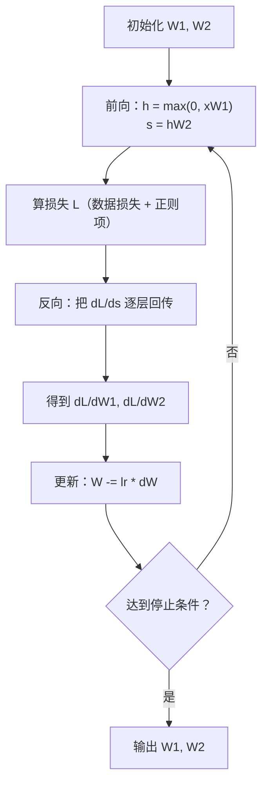
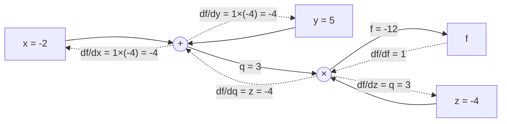

> **课程信息**
>
> - **课程名称**：Stanford CS231n: Deep Learning for Computer Vision（Spring 2025）
> - **本讲主题**：Lecture 4. Neural Networks and Backpropagation
> - **主讲教师**：Ehsan Adeli
> - **授课日期**：2025-04-10
> - **课程主页**：[cs231n.stanford.edu/2025](https://cs231n.stanford.edu/2025/schedule.html)
> - **官方课件**：[lecture_4.pdf](</attachments/cs231n-906b09877d36e121705ee895.pdf>)（147 页，正文按页链接本地课件）
> - **字幕来源**：[cs231n_sp25_kor_sub · eng](https://github.com/lpaiu-cs/cs231n_sp25_kor_sub/tree/main/eng)（公开英文转写，中文由本书重写）
> - **版权说明**：幻灯片与课程材料版权归 Stanford University 及授课教师所有；本书为非官方学习笔记，仅用于学习与研究。

> **课件索引**：点击下方链接打开本地 PDF 的对应页；全部课件见 [课件索引](/notes/cs231n/slides)。页码按 PDF 文件页序定位，第 1 讲分为 Part 1 / Part 2。

[📄 L4 · 第 1 页｜本讲标题页：Neural Networks and Backpropagation（2025 年 4 月 10 日）](</attachments/cs231n-906b09877d36e121705ee895.pdf#page=1>)

第 3 讲结束时，一条完整的训练流水线其实已经闭合了：数据 $(x,y)$ → 线性打分 $s=Wx$ → 损失 $L$ → 梯度 $\partial L/\partial W$ → 沿负梯度走一步。整条链上唯一没被认真对待的环节是模型本身——它始终只有一个 $W$。这一讲做两件事：先把打分函数从"一层线性"换成"线性与非线性交替堆叠"，再补上那台能把任意深度的堆叠的梯度算出来的机器。

第二件事才是重点。讲师说他早年读书时常把这台机器称作"让网络从自己的错误里学习的魔法过程，只不过比人更有组织、也多一点数学"，并给了一个更硬的判断：后面整个学期会讲到的每一个算法，都在使用某种形式的反向传播。所以这一讲不引入新的损失、新的优化器，只回答一个问题——$\partial L/\partial W$ 到底怎么系统性地算出来，而不是每次都在纸上重推一遍矩阵微积分。

## 1. 复习停在哪儿：损失、梯度、优化器都齐了，就差模型

*(参考时间: 00:00:05 – 00:09:53｜Lecture 4)*

### 一页纸的复盘

两页行政通知先划掉，但都有实际用途：项目提案 4 月 25 日（周五）截止，各助教的专长挂在 office hours 页面上，选题之前先按方向找人问；明天的讨论课由 Matthew Jin 主讲、Emily Jin 协助，主题正好是反向传播。

[📄 L4 · 第 2 页｜行政页：项目提案 4/25 截止，助教专长公布在 office hours 页面](</attachments/cs231n-906b09877d36e121705ee895.pdf#page=2>)

这两条不是寒暄，它们决定了这一周的节奏：提案要落地成"数据集 + 基线 + 指标"，而基线能不能跑起来，取决于你能不能自己写出一次正确的反向传播。讨论课排在正课次日，本质上是给今天的内容留了一个慢速重放。

[📄 L4 · 第 3 页｜行政页：次日的讨论课主题就是 Backpropagation](</attachments/cs231n-906b09877d36e121705ee895.pdf#page=3>)

讨论课被安排在正课次日，等于给今天的推导留了一次慢速重放。接下来进入复盘：上一讲的整条流水线要重新摆一遍，因为今天引入的每个符号都建在它上面。

[📄 L4 · 第 4 页｜复盘分隔页：Recap](</attachments/cs231n-906b09877d36e121705ee895.pdf#page=4>)

分隔页只有标题，没有内容。它的作用是提醒：接下来五分钟讲的全部是"已知条件"。

[📄 L4 · 第 5 页｜Recap 全页：数据集、评分函数 s=f(x;W)=Wx、Softmax 与 Hinge 两套损失，以及 W 分两路汇入 L 的数据流](</attachments/cs231n-906b09877d36e121705ee895.pdf#page=5>)

上面这一页值得逐块读，因为后面所有符号都沿用它的写法。数据是 $(x_i, y_i)$ 的集合；评分函数取线性形式 $s = f(x;W) = Wx$；损失有两种常见写法：


$$
L_i = -\log\frac{e^{s_{y_i}}}{\sum_j e^{s_j}}, \qquad L = \frac{1}{N}\sum_{i=1}^{N} L_i + R(W)
$$


$$
L_i = \sum_{j \neq y_i}\max\left(0,\; s_j - s_{y_i} + 1\right)
$$


右边那张流程图是整门课的地图：$W$ 一路走向 score function，再走向 data loss；同时 $W$ 还有一条独立的分支走向 regularization loss；两条分支在 $L$ 处相加。讲师特意回应了一个反复被问到的问题——为什么课上一路只用 Softmax。答案是它不是唯一选项，只是分类任务里最常用的一种；Hinge（当年叫 SVM loss）在早期神经网络里同样常见，差别在于 Hinge 不把分数变成概率，它只要求正确类别的分数比其它类别高出至少一个边界（margin），这个边界在图里就是那个 $+1$。条件满足时损失为 0，被违反时损失从边界开始线性增长。

这个对照很实用：Softmax 关心"正确类别的概率质量有多大"，Hinge 关心"正确类别领先了没有、领先够不够"。前者对分数做全局归一化，后者只看成对比较。二者都不改变今天要讲的东西——不管取哪种损失，梯度都必须从损失一路回传到每一个 $W$。

### 梯度下降与两种梯度

[📄 L4 · 第 6 页｜把损失面想成一片山谷：每个点是一组 W，目标是走到谷底](</attachments/cs231n-906b09877d36e121705ee895.pdf#page=6>)

讲师把损失函数画成一片山谷，谷底是最小值，山谷上的每一个点对应一组权重 $W$。训练就是在这片地形上往下走：算出 $\nabla_W L$，然后朝它的反方向迈一步，步长由学习率决定。这个比喻的价值在于它解释了为什么"梯度"是唯一的必需品——不需要知道地形的全局形状，只要知道脚下这一点的最陡下降方向，就能一步步逼近谷底。

[📄 L4 · 第 7 页｜数值梯度与解析梯度的取舍：慢但好写，快但易错](</attachments/cs231n-906b09877d36e121705ee895.pdf#page=7>)

两种梯度的分工值得记牢。数值梯度用 $\frac{L(W+h)-L(W-h)}{2h}$ 这种差分近似，慢、只是近似，但几乎不可能写错；解析梯度用链式法则推出来的闭式表达，快、精确，但推导和实现都容易出错。实践中的做法不是二选一，而是"写解析版，用数值版做单元测试"——这也是后面所有框架里 gradient check 的来历。

[📄 L4 · 第 8 页｜随机梯度下降：全量求和太贵，用小批量估计梯度](</attachments/cs231n-906b09877d36e121705ee895.pdf#page=8>)

全量损失要对 $N$ 个样本求和，$N$ 一大就贵得不可接受。小批量（minibatch）的做法是从中采样几十到几百个样本，用子集的平均梯度作为全量梯度的估计，常见的批量大小是 32、64、128、256。这里藏着一个后面会反复用到的假设：子集梯度是全量梯度的无偏估计，噪声随批量增大而减小。

### 优化器与学习率

[📄 L4 · 第 9 页｜上一讲提过的几个优化器：SGD、SGD+Momentum、RMSProp、Adam](</attachments/cs231n-906b09877d36e121705ee895.pdf#page=9>)

四个优化器按"是否利用历史梯度"排成一条线：SGD 只看当前梯度；Momentum 把历史梯度做指数滑动平均，用来穿过狭长山谷里的震荡；RMSProp 按每个参数的历史梯度平方缩放步长；Adam 两者都做。讲师没有展开细节，只给了一句实用的经验：越靠后的优化器越不需要手工调衰减。

[📄 L4 · 第 10 页｜学习率调度：阶梯、余弦、线性、逆平方根四种曲线](</attachments/cs231n-906b09877d36e121705ee895.pdf#page=10>)

学习率调度的四种常见形状在这一页并排给出。阶梯式（step）在几个固定 epoch 把学习率乘 0.1，幻灯片举的例子是 ResNet 在 30、60、90 轮各降一次；余弦式平滑地降到 0；线性式匀速下降；逆平方根按 $1/\sqrt{t}$ 衰减。图上标了三个符号：$\alpha_0$ 是初始学习率，$\alpha_t$ 是第 $t$ 轮的学习率，$T$ 是总轮数。讲师补了一句当下的变化：Adam 及其变体把这一步编码进了优化器内部，很多时候不再需要显式衰减。

### 今天的版图：这十页模型共用同一个底座

复习到此为止。讲师用一句话把话题推到今天："with that, I want us to get to the topic of neural networks and see how we can actually build neural networks and solve more exciting and harder problems."（00:09:53）紧接着是一段没有旁白的连续放映，从"Today: Deep Learning"的分隔页开始，一口气放了近几年的代表作。

[📄 L4 · 第 11 页｜分隔页：Today: Deep Learning](</attachments/cs231n-906b09877d36e121705ee895.pdf#page=11>)

放映从这一张分隔页开始，第一组是 2022 年的 DALL-E 2，之后是更新一代的 DALL-E 3，再往外扩到语言、分割与视频。

[📄 L4 · 第 12 页｜DALL-E 2 的三个提示词：在月球上做 AI 研究的泰迪熊、上人体解剖课的兔子、在喜马拉雅山打坐的猫](</attachments/cs231n-906b09877d36e121705ee895.pdf#page=12>)

这三张图放在 2022 年是需要解释的：文本描述里出现的对象、场景、风格，全部由模型凭空生成。画面质量之外，真正的新东西是"同一个模型能对任意组合的语义做出反应"，而不是对某个类别做分类。

[📄 L4 · 第 13 页｜DALL-E 2 背后的论文页：Hierarchical Text-Conditional Image Generation with CLIP Latents](</attachments/cs231n-906b09877d36e121705ee895.pdf#page=13>)

论文标题里的两个词后来变成了通用配方：hierarchical（先粗后细的分层生成）与 CLIP latents（用图文对比学习得到的共享语义空间）。这两条线索都会在第 12 讲之后重新出现。

[📄 L4 · 第 14 页｜DALL-E 3 的第一例：长提示词描述一只拟人化臭鼬的中景肖像，画面按数字艺术风格渲染](</attachments/cs231n-906b09877d36e121705ee895.pdf#page=14>)

第一例的提示词把景别、材质、风格全写死了，画面几乎是逐句兑现的。第二例换到完全不同的题材与画风，用来表明这不是针对某一类提示词调出来的效果。

[📄 L4 · 第 15 页｜DALL-E 3 的第二例：图像小说插画，满月下的城市街道、红发女子与拿蒸汽朋克电话的摊主](</attachments/cs231n-906b09877d36e121705ee895.pdf#page=15>)

这两页的看点在提示词的长度和细节密度：皮毛质感、服装材质、镜头景别、人物关系都被写进了条件里，而画面基本逐条兑现。对应的论文标题是 Improving image generation with better captions——把"听懂长描述"当成一个独立的能力来做。

[📄 L4 · 第 16 页｜GPT-4 的发布页](</attachments/cs231n-906b09877d36e121705ee895.pdf#page=16>)

从语言模型直接跳到分割模型，任务跨度很大，但底层的训练范式并没有换。

[📄 L4 · 第 17 页｜Segment Anything：一个提示就能切出任意对象的分割模型](</attachments/cs231n-906b09877d36e121705ee895.pdf#page=17>)

从生成到分割，任务形态差别很大，但结构上是同一类东西：输入（图像、文本、点或框提示）经过一个巨大的可微函数，输出（像素、token、掩码），中间是数量庞大的参数，全部靠梯度训练。

[📄 L4 · 第 18 页｜Sora：把视频生成当作世界模拟器](</attachments/cs231n-906b09877d36e121705ee895.pdf#page=18>)

后两页把这个说法拆成两种具体能力：一种是把静态图变成有动作的视频，一种是按指令改写已有视频的内容。

[📄 L4 · 第 19 页｜Sora 的两种用法：给 DALL-E 生成的静态图加动画，以及视频到视频的编辑](</attachments/cs231n-906b09877d36e121705ee895.pdf#page=19>)

第二页列出的两种用法很能说明问题：一张柴犬戴贝雷帽的静态图可以被"动起来"；一段实拍视频可以被改写成"太空里的彩虹公路"或换成约书亚树的场景。它要求模型同时保持时间一致性和语义可控性。

[📄 L4 · 第 20 页｜Sora 的规模实验：基础算力、4 倍算力、32 倍算力下的样本质量对比](</attachments/cs231n-906b09877d36e121705ee895.pdf#page=20>)

最后一页把结论压成三个字：more compute。同样的架构、同样的数据分布，只把训练算力放大 4 倍、32 倍，样本的物理合理性和细节稳定性就跟着上一个台阶。讲师没有对这一页做评论，但它和本讲的关系非常直接——算力能换来质量的前提，是梯度能算对、能算快、能在上千层上不炸。

这些页的共同点不是任务，而是底座：全部是"线性变换 + 非线性 + 线性变换"的超长堆叠，全部靠反向传播把损失信号送回每一个参数。今天剩下的一小时，就是把这个底座拆开看。

## 2. 一层不够：隐藏层买到的不是"深"，是"可组合的模板"

*(参考时间: 00:10:13 – 00:25:55｜Lecture 4)*

### 从 f = Wx 到 f = W2 max(0, W1x)

[📄 L4 · 第 21 页｜分隔页：Neural Networks](</attachments/cs231n-906b09877d36e121705ee895.pdf#page=21>)

讲师从最熟悉的地方接上：$f = Wx$ 就是"最基础的神经网络"，因为它只有一层。这个说法不是文字游戏，它把"层"定义成了"一次线性映射 + 一次逐元素非线性"的组合单元，于是加层就是加一个 $W$ 和一个非线性。

[📄 L4 · 第 22 页｜原来的线性打分器：(Before) f = Wx](</attachments/cs231n-906b09877d36e121705ee895.pdf#page=22>)

加一层就是在 $Wx$ 外面再套一个 $W_2$ 和一次逐元素非线性：原来直接输出分数，现在先输出一组中间量，再由中间量组合成分数。

[📄 L4 · 第 23 页｜两层网络：(Now) f = W2 max(0, W1x)，并标出 x∈R^D、W1∈R^{H×D}、W2∈R^{C×H}](</attachments/cs231n-906b09877d36e121705ee895.pdf#page=23>)

从这一页开始，符号必须记死：输入 $x \in \mathbb{R}^D$，第一层权重 $W_1 \in \mathbb{R}^{H \times D}$，第二层权重 $W_2 \in \mathbb{R}^{C \times H}$，其中 $D$ 是特征维数、$C$ 是类别数、$H$ 是隐藏层神经元个数——一个你自己选的超参数。幻灯片底部还有一句容易被跳过的话：实践中每一层还会加一个可学习的偏置（bias），只是写公式时为了简洁省掉了。

维度对齐是这类网络唯一不能错的地方：$W_1$ 把 $D$ 维压成 $H$ 维，$\max(0,\cdot)$ 不改变形状，$W_2$ 再把 $H$ 维映射成 $C$ 维。任何一层写反，后面的矩阵乘法立刻报错——这也解释了为什么后面讲反向传播时，"形状对不对"会成为检查梯度最有效的手段。

### 非线性不是装饰：两个月亮与极坐标

[📄 L4 · 第 24 页｜线性分类器分不开的两团点：一类在月牙内侧，一类在外侧](</attachments/cs231n-906b09877d36e121705ee895.pdf#page=24>)

这张图在讲线性分类器时出现过：两类点交错成两个弯月，任何一条直线都切不开。它说明的不是"线性分类器不好"，而是"在这个坐标系里，类别边界不是线性的"。

[📄 L4 · 第 25 页｜同一个数据集换到极坐标 (r, θ) 后，一条直线就能分开](</attachments/cs231n-906b09877d36e121705ee895.pdf#page=25>)

把每个点从 $(x,y)$ 映射到极坐标 $(r,\theta)$，两团点在新的二维空间里立刻被一条直线分开。讲师用这个例子说明：真正需要的不是"更复杂的分类器"，而是"一次把数据搬到可分空间的变换"。神经网络做的就是让这个变换本身可学习——$\max(0, W_1x)$ 里的 $W_1$ 学到的正是这样一次映射，只不过它不需要人去指定用极坐标还是别的坐标系。

这个例子还隐含一个边界：手工设计的特征变换在低维、可视化的问题上完全够用，但图像有 3072 维（$32\times32\times3$），没人能靠观察写出正确的变换。可学习性在这里不是优雅，是唯一可行的路径。

### 100 个模板而不是 10 个

[📄 L4 · 第 26 页｜命名问题：这类只含矩阵乘法的网络更准确的名字是 fully-connected network 或 MLP](</attachments/cs231n-906b09877d36e121705ee895.pdf#page=26>)

"神经网络"这个词太宽，讲师建议在课上用更准确的说法：全连接网络（fully-connected network），或者多层感知机（multi-layer perceptrons, MLP）。理由是结构上它只有矩阵乘法和逐元素非线性，没有任何"神经元"特有的东西。

[📄 L4 · 第 27 页｜三层网络：再叠一个 W3 与一个非线性](</attachments/cs231n-906b09877d36e121705ee895.pdf#page=27>)

层数可以一直叠下去，但真正决定网络行为的是每一层的维度怎么变，而不是层数本身。

[📄 L4 · 第 28 页｜层级计算：x(3072) → W1 → h(100) → W2 → s(10)](</attachments/cs231n-906b09877d36e121705ee895.pdf#page=28>)

这一页是全讲最实用的算账页：输入的 3072 维（$32\times32\times3$）经 $W_1$ 变成 100 维的 $h$，再经 $W_2$ 变成 10 类的分数。

| 量 | 形状 | 元素数 |
| --- | --- | --- |
| $x$ | $3072$ | 3,072 |
| $W_1$ | $100 \times 3072$ | 307,200 |
| $h$ | $100$ | 100 |
| $W_2$ | $10 \times 100$ | 1,000 |
| $s$ | $10$ | 10 |

不含偏置的参数量是 308,200，其中 99.7% 集中在第一层。这个分布不是巧合，也不是问题：第一层要覆盖输入空间的所有方向，第二层只需要在 100 个已经"有意义"的方向上做线性组合。

[📄 L4 · 第 29 页｜学习上百个模板：中间的 100 个神经元可以各自对应一个局部模式](</attachments/cs231n-906b09877d36e121705ee895.pdf#page=29>)

前面讲线性分类器时说过，10 个输出对应 10 个模板，每个模板是整张图的像素级原型。现在中间多了 100 个神经元，等于允许网络学 100 个模板，而且这 100 个模板可以被 10 个类共享。讲师的例子很具体：鸟、猫、鹿、狗、青蛙、马都有眼睛，那么"眼睛"这个模板就不必在每个类里各学一遍，它在隐藏层学一次，然后被多个输出类按不同权重复用。这就是"组合"的含义——隐藏层学的不是整个物体，而是可以被复用的部件。

幻灯片上还有一句概括：learn 100 templates instead of 10，并且 share templates between classes。这两句合起来解释了为什么加一层带来的不是"更深的同类模型"，而是表达形式的改变。

### 去掉 max 会发生什么

[📄 L4 · 第 30 页｜激活函数登场：那个 max 有正式名字，叫 activation function](</attachments/cs231n-906b09877d36e121705ee895.pdf#page=30>)

幻灯片先把问题摆出来：如果试着建一个没有激活函数的网络，会发生什么？

[📄 L4 · 第 31 页｜如果没有激活函数：W2W1 可以合并成一个 W3，整个网络塌回线性分类器](</attachments/cs231n-906b09877d36e121705ee895.pdf#page=31>)

这一问一答是整讲的第一个关键论证，值得完整复述。去掉 $\max$ 后，模型变成 $f = W_2 W_1 x$；而 $W_2 W_1$ 本身就是一个矩阵，记作 $W_3$，于是 $f = W_3 x$——层数还在，表达能力却回到了单层线性分类器。换句话说，**深度必须靠非线性来"锁住"**，否则所有线性层会被矩阵乘法折叠成一层。这也是为什么后面讲任何新结构（卷积、残差、注意力）时，第一个要问的问题总是"非线性在哪里"。

### 激活函数货架：ReLU 是默认选项

[📄 L4 · 第 32 页｜激活函数全家福：ReLU、Leaky ReLU、Sigmoid、Tanh、ELU、GELU、SiLU](</attachments/cs231n-906b09877d36e121705ee895.pdf#page=32>)

这一页把七个候选并排画了出来，红框圈住的 ReLU 是默认答案：

- **ReLU**：$\max(0,x)$，正半轴导数恒为 1，负半轴恒为 0。计算最便宜，梯度不会在正区间衰减。
- **Leaky ReLU**：$\max(0.1x, x)$，负半轴留一个小斜率，用来避免"死神经元"——输入长期为负时 ReLU 的梯度恒为 0，这个神经元就再也不更新了。
- **ELU**：负半轴用 $\alpha(e^x-1)$，讲师认为它比 Leaky ReLU 更好，因为输出更接近零中心。
- **GELU**：$x\cdot\Phi(x)$，用高斯累积分布做门控，在 Transformer 里最常见。
- **SiLU**：$x\cdot\sigma(x)$，Google 在 EfficientNet 一类模型里用过。
- **Sigmoid / Tanh**：把值压进 $(0,1)$ 和 $(-1,1)$，问题也在这里——两端导数趋近 0，层一深就出现梯度消失。讲师的说法是：这两个通常不放在网络中间，而是放在最后的输出层，用来把结果二值化或压到概率区间。

七种函数共享的唯一定义性特征是"非线性"，其余差异都是工程取舍：是否可导、是否零中心、是否饱和、计算是否便宜。这四条的权重在不同架构里不一样，所以才会同时存在这么多种。

### 维度、命名与一次前向

[📄 L4 · 第 33 页｜架构命名：3-layer / 2-hidden-layer 指的是同一件事；1-hidden-layer 指两层网络](</attachments/cs231n-906b09877d36e121705ee895.pdf#page=33>)

命名混乱是初学者最常见的坑：说"3 层网络"时，通常数的是带权重的层（两个隐藏层 + 一个输出层），所以它和"2 个隐藏层网络"是同一个东西；而"1 个隐藏层网络"其实是两层网络。幻灯片把这两种叫法并排摆出来，意思是：听到层数先问一句"数不数输入层"。

[📄 L4 · 第 34 页｜一次前向计算：3-4-4-1 的网络，激活函数取 sigmoid，附 numpy 五行实现](</attachments/cs231n-906b09877d36e121705ee895.pdf#page=34>)

这一页把抽象的公式落成代码：输入是 $3\times1$，两个隐藏层各 4 个神经元，输出 1 个标量；$W_1$ 是 $4\times3$，$W_2$ 是 $4\times4$，$W_3$ 是 $1\times4$。前向就是三行矩阵乘法夹两次激活：

```python
# 3-4-4-1 前向，激活函数用 sigmoid
f  = lambda x: 1.0 / (1.0 + np.exp(-x))
x  = np.random.randn(3, 1)          # 3x1
h1 = f(np.dot(W1, x) + b1)          # 4x1
h2 = f(np.dot(W2, h1) + b2)         # 4x1
out = np.dot(W3, h2) + b3           # 1x1
```

注意最后一层没有接激活函数：输出层要不要非线性，取决于任务是回归还是分类，这一页演示的是回归式的标量输出。

### 现场提问：激活函数怎么选、能不能全用同一个

这一段的问答比正文更有信息量，因为它是"没有定理时工程师怎么决策"的样本。

第一个问题：新问题该选哪个激活函数？讲师的回答很干脆——多数情况下是经验性的（empirical）。起步的做法是跟随架构惯例：CNN 里常用什么、Transformer 里常用什么，就先用那一个；如果是在设计一个全新的网络，那么它和别的超参数一样，是你必须做的一个选择，而不是能从理论推出来的结论。

第二个问题：这些函数到底共享什么？答案是"制造非线性"，其余都是次要属性——可导（否则没法反向传播）、零中心、平滑度，这些会影响收敛速度，但都不是定义性的。

第三个问题：能不能整个网络所有神经元都用同一个激活函数？通常可以，全连接网络里几乎总是这么做的；例外在输出层，那里按任务需要换成 sigmoid 或 tanh。这个答案背后其实是一条工程约定：激活函数是"层类型"的属性，不是"神经元"的属性。

## 3. 二十行代码之外：容量、正则化，以及"别拿网络大小当正则项"

*(参考时间: 00:26:09 – 00:39:01｜Lecture 4)*

### 二十行里的四个块

讲师给了个很具体的说法：用 Python 写一个两层网络的训练，不到 20 行。这话成立的前提是把代码切成四块，每一块都不长。

[📄 L4 · 第 35 页｜二十行实现的总览页：定义网络、前向、解析梯度、梯度下降四块](</attachments/cs231n-906b09877d36e121705ee895.pdf#page=35>)

这一页先给出四个块的标题，代码体还没展开。四个块的分工是：定义网络（维度与初始化）、前向传播（逐层算激活与损失）、解析梯度（本讲的正题）、梯度下降（用梯度更新参数）。讲师在这里点明：前三块都能照着公式写出来，真正的难点只在解析梯度那一块，而这一讲剩下的时间几乎全部花在它上面。

[📄 L4 · 第 36 页｜第一帧：先只有"定义网络"这一块](</attachments/cs231n-906b09877d36e121705ee895.pdf#page=36>)

第一帧把数据形状摆出来：$N$ 是样本数，$D_{in}$ 是输入维数，$D_{out}$ 是输出维数，$h$ 是隐藏层神经元数；$x$、$y$ 随机生成，$W_1$、$W_2$ 随机初始化。这一步之所以单独成帧，是因为后面所有梯度公式的形状都由这四个量决定。

[📄 L4 · 第 37 页｜第二帧：加上"前向传播"](</attachments/cs231n-906b09877d36e121705ee895.pdf#page=37>)

第二帧多出的是前向：把输入逐层乘上权重、过激活、得到预测，再算损失。注意这里没有"训练"发生——前向只是在给定参数下把损失算出来，它同时也把反向传播要用的中间值留在了内存里。

[📄 L4 · 第 38 页｜第三帧：加上"计算解析梯度"这一块](</attachments/cs231n-906b09877d36e121705ee895.pdf#page=38>)

第三帧是整页的核心，也是讲师反复强调"我们还没真正进去"的部分。它要回答的是：给定前向留下的中间量，$\partial L/\partial W_1$ 与 $\partial L/\partial W_2$ 怎么用几行矩阵乘法写出来。

[📄 L4 · 第 39 页｜第四帧：补上"梯度下降"，一次迭代闭合](</attachments/cs231n-906b09877d36e121705ee895.pdf#page=39>)

第四帧把循环补全：算完梯度就沿负方向更新 $W_1$、$W_2$，一次迭代到此结束。四块拼起来就是一个完整的训练循环：



这个循环的形状后面不会变：换数据集、换损失、换优化器，变的只是 B、C、D 三格里填什么。反向传播要解决的正是 D 格——一个能对任意复杂的前向图自动求导的通用过程。

### 神经元数量、过拟合与 λ

[📄 L4 · 第 40 页｜不同隐藏层规模下的决策边界：神经元越多，边界越弯曲](</attachments/cs231n-906b09877d36e121705ee895.pdf#page=40>)

这一页把同一个二分类问题用不同容量的网络各训练一遍。规律很直观：隐藏层只有几个神经元时，边界接近直线或简单曲线，欠拟合；神经元增加到几十个，边界开始贴合数据分布；再多，边界会绕开个别点、出现孤岛——那是过拟合。讲师把这个现象和第 2 讲的 kNN 直接类比：$k=1$ 时每个点自成一块，边界碎得没法泛化；给网络过多容量，效果是一样的。

[📄 L4 · 第 41 页｜不要用网络规模当正则项：改用更强的正则化，并给了 ConvNetJS 与 TensorFlow Playground 两个可交互的演示](</attachments/cs231n-906b09877d36e121705ee895.pdf#page=41>)

这一页是讲师给的一条明确规则：**不要指望"把网络调小"来治过拟合**。理由不是理论上的，而是工程上的——网络的规模是要花几天训练才能看出效果的变量，把它当正则化旋钮来回试，代价高得离谱。正确做法是先选一个"比需要的稍大一点"的网络，然后用正则化强度（$\lambda$）去压过拟合。幻灯片顺手给了两个可以在浏览器里拖参数看边界的演示：ConvNetJS 的 classify2d 和 TensorFlow Playground。

现场有同学追问：为什么 $\lambda$ 变大反而欠拟合？讲师的回答把损失的两项拆开讲：$\lambda$ 控制正则项在总损失里的权重，而正则项只定义在 $W$ 上，它不关心预测对不对；$\lambda$ 越大，$W$ 的自由度越小，边界就越"通用"、越平滑，最后连训练集的细节都放弃。两端都坏：$\lambda=0$ 记数据，$\lambda$ 过大记不住任何东西。所以 $\lambda$ 是一个平衡旋钮，不是一个越大越好的安全阀。

还有两个相关的追问值得记下来。为什么不能直接问"这个问题需要多少个神经元"？因为没有一个通用处方：只能先看同类数据、同类任务上别人用了多大规模，从那个区间起步，再自己加实验去增减。有没有理论方法直接定这些超参数？有相关研究，也有自动搜索超参数的方法，但每一种都建立在特定假设上，而这些假设未必对你的数据集成立——所以最终的答案仍然是实验。

### 生物神经元：一个只能当类比用的类比

[📄 L4 · 第 42 页｜转入生物侧之前的一张神经元渲染图](</attachments/cs231n-906b09877d36e121705ee895.pdf#page=42>)

接下来五分钟是"这东西为什么叫神经网络"的历史包袱。讲师先打了预防针：如果现场坐着神经科学背景的人，别把这些例子当成事实——这些类比非常松散（very loose）。

[📄 L4 · 第 43 页｜神经元解剖：树突把冲动送进细胞体，轴突把冲动送出去，末端是突触前终端](</attachments/cs231n-906b09877d36e121705ee895.pdf#page=43>)

图上标了四个部位：树突（dendrite）、细胞体（cell body）、轴突（axon）、突触前终端（presynaptic terminal）。对应的功能是"输入汇总 → 阈值判断 → 输出传递"。

[📄 L4 · 第 44 页｜同一张解剖图的第二帧：左侧标注 impulses carried toward cell body，右下标注 impulses carried away from cell body](</attachments/cs231n-906b09877d36e121705ee895.pdf#page=44>)

第二帧把信号方向明确标了出来：冲动沿树突**流向**细胞体，沿轴突**离开**细胞体。这个方向性正是人工神经元里"前向"的来历——信息只朝一个方向流动，反向传播时流动的只是梯度，不是信号。

[📄 L4 · 第 45 页｜同一张图，标题换成 sigmoid activation function](</attachments/cs231n-906b09877d36e121705ee895.pdf#page=45>)

这一页把"细胞体"那一步换成了 sigmoid：生物神经元在细胞体里对累积的输入做一次非线性判决，人工神经元则对加权和做一次激活。讲师用这个对照解释了激活函数存在的理由——它对应"是否发放"这个非线性动作，没有它，神经元退化成一根导线。

[📄 L4 · 第 46 页｜两种连接方式对照：生物神经元连接复杂，人工网络被组织成规则分层以便计算](</attachments/cs231n-906b09877d36e121705ee895.pdf#page=46>)

分层不是生物事实，是计算事实。生物神经元的连接是杂乱的三维网络，人工网络把连接排成层，是为了让同一层的神经元可以并行、让权重变成规整的矩阵——这是为 GPU 和矩阵乘法优化的结构，不是对大脑的复刻。

[📄 L4 · 第 47 页｜反例：随机连线的网络（Xie 等，Exploring Randomly Wired Neural Networks，ICCV 2019）也能工作](</attachments/cs231n-906b09877d36e121705ee895.pdf#page=47>)

这张反例图很有说服力：把网络的连接方式随机化，只要给它足够的搜索，性能可以和人工设计的规则网络相当。既然"规则分层"不是性能的必要条件，那它就只能解释为工程效率的选择。

[📄 L4 · 第 48 页｜别把大脑类比当真：神经元类型很多、树突会做复杂非线性计算、突触不是单个权重而是复杂的非线性动力系统](</attachments/cs231n-906b09877d36e121705ee895.pdf#page=48>)

这一页把类比的裂缝列了三条：生物神经元有很多种类型，人工网络里所有单元却用同一个函数；树突本身能执行复杂的非线性运算，人工网络把整个输入汇总压成一次点积；突触不是单个标量权重，而是一个复杂的非线性动力系统。三条加起来结论很清楚：把人工神经元叫"神经元"是历史命名，不是机制等价。讲师在这里停了一下，说愿意聊神经科学的部分可以课后继续。

## 4. 计算图与链式法则：把求导从纸上搬到图上

*(参考时间: 00:39:01 – 00:53:51｜Lecture 4)*

### 为什么"在纸上推"行不通

[📄 L4 · 第 49 页｜把所有部件插进损失：非线性打分 + Hinge/Softmax + 正则项 = 总损失](</attachments/cs231n-906b09877d36e121705ee895.pdf#page=49>)

到这里，模型的全部零件都齐了：输入经 $W_1$、激活、$W_2$ 得到分数，分数进 Hinge 或 Softmax 得到数据损失，再加上 $R(W)$ 得到总损失。

[📄 L4 · 第 50 页｜问题被压成一行：要学 W1 和 W2，就得能算出对二者的偏导](</attachments/cs231n-906b09877d36e121705ee895.pdf#page=50>)

讲师把这一页的问题写成一句大白话：只要能算出 $\partial L/\partial W_1$ 和 $\partial L/\partial W_2$，就能学这两个矩阵。剩下的整讲都在回答"怎么算"。

[📄 L4 · 第 51 页｜坏主意：在纸上把导数推出来](</attachments/cs231n-906b09877d36e121705ee895.pdf#page=51>)

幻灯片把"纸上推导"这条路的三处硬伤列了出来。第一，繁琐：要对矩阵做微积分，草稿纸要很多张。第二，脆弱：想把 Hinge 换成 Softmax，所有推导得从头再来一遍。第三，不可行：模型一复杂，闭式导数根本写不出来。这三条不是效率问题，而是可维护性问题——它意味着"换一个损失函数"的成本等于"重写整个求导过程"。

### 计算图：一个 (x+y)z 的例子

[📄 L4 · 第 52 页｜更好的主意：计算图 + 反向传播](</attachments/cs231n-906b09877d36e121705ee895.pdf#page=52>)

计算图的构造方式很朴素：把网络里每一个运算（乘法、加法、hinge、正则）都画成一个节点，输入和参数是叶子，损失是根。这张小图里，$x$ 和 $W$ 先汇成分数 $s$，$s$ 进 hinge 得到数据损失，$W$ 另外单独进 $R$，两路相加得到 $L$。

[📄 L4 · 第 53 页｜同样的图，换成 AlexNet：输入图像、若干组权重、最后一处 loss](</attachments/cs231n-906b09877d36e121705ee895.pdf#page=53>)

把这张图放大到真实网络就是这个样子：左边一张输入图像，中间十几层堆叠（每一层都有自己的权重），右下角一个 loss。注意图的拓扑并没有变复杂——变多的只是节点数量。

[📄 L4 · 第 54 页｜真正复杂的网络：节点与边密到无法手工阅读](</attachments/cs231n-906b09877d36e121705ee895.pdf#page=54>)

比 AlexNet 更极端的是带外部记忆的结构：图不仅要展开，还要把读写记忆的操作也画进去。

[📄 L4 · 第 55 页｜Neural Turing Machine：带外部记忆、按时间展开后图会指数级变长](</attachments/cs231n-906b09877d36e121705ee895.pdf#page=55>)

Neural Turing Machine 是讲师挑的例子，因为它同时具备两个难点：结构上有外部记忆，时间上要按序列展开（unrolling）。展开之后，同一组权重会在图上按时间步重复出现几十上百次，手工对每个副本写一遍导数是不可能完成的任务。这解释了为什么需要"自动"求导，而不是"更快的手工"求导。

[📄 L4 · 第 56 页｜分隔页：Solution: Backpropagation](</attachments/cs231n-906b09877d36e121705ee895.pdf#page=56>)

### 反向：从 df/df = 1 开始

[📄 L4 · 第 57 页｜最简单的例子：f = (x+y)z 的计算图](</attachments/cs231n-906b09877d36e121705ee895.pdf#page=57>)

函数只有一行：$f(x,y,z) = (x+y)z$。图上有两个节点：一个加法把 $x$、$y$ 变成中间量，一个乘法把中间量和 $z$ 变成 $f$。

[📄 L4 · 第 58 页｜同一张图，中间量被命名为 q](</attachments/cs231n-906b09877d36e121705ee895.pdf#page=58>)

给中间量起名 $q = x+y$ 之后，整个函数就变成了两次简单运算的串联：$q = x+y$，$f = qz$。命名的意义在于：链式法则要求"逐段求导"，而每一段必须有一个可以指认的输出。

[📄 L4 · 第 59 页｜给定数值：x = -2，y = 5，z = -4](</attachments/cs231n-906b09877d36e121705ee895.pdf#page=59>)

代入具体数字后，前向的第一步是 $q = -2 + 5 = 3$。先算前向不只是流程顺序：反向要用的局部梯度（比如 $\partial f/\partial q = z$、$\partial f/\partial z = q$）全都依赖前向算出的值，它们必须被缓存下来。

[📄 L4 · 第 60 页｜前向第二步：f = qz = 3 × (-4) = -12](</attachments/cs231n-906b09877d36e121705ee895.pdf#page=60>)

到这里前向结束，$f=-12$。接下来整个反向传播要产出三个数：$\partial f/\partial x$、$\partial f/\partial y$、$\partial f/\partial z$。

[📄 L4 · 第 61 页｜反向的目标：三个偏导都要](</attachments/cs231n-906b09877d36e121705ee895.pdf#page=61>)

这三个偏导不可能一次算出来，只能沿图从右往左倒着走，每到一个节点就顺手把那里的导数记下来。

[📄 L4 · 第 62 页｜反向的起点：输出对自身求导恒等于 1](</attachments/cs231n-906b09877d36e121705ee895.pdf#page=62>)

反向传播永远从 $\partial f/\partial f = 1$ 开始。这一条不是技巧，而是链式法则的边界条件：损失对自己的导数是 1，所有上游梯度都是从这个 1 乘出来的。



图上实线是前向，虚线是反向。反向的每一步都在做同一件事：把从右边传回来的数，乘上本地这一小段的导数。

[📄 L4 · 第 63 页｜反向第一站：z 的偏导等于 q，也就是 3](</attachments/cs231n-906b09877d36e121705ee895.pdf#page=63>)

$z$ 与 $f$ 之间只隔一个乘法节点，$\partial f/\partial z = q = 3$。这一步不需要链式法则，因为 $z$ 直接连着 $f$。

[📄 L4 · 第 64 页｜反向第二站：q 的偏导等于 z，也就是 -4](</attachments/cs231n-906b09877d36e121705ee895.pdf#page=64>)

同理 $\partial f/\partial q = z = -4$。乘法的局部导数就是"另一个因子"，这也是后面"mul gate 是交换器"的来源。

[📄 L4 · 第 65 页｜反向第三站：y 与 f 不直接相连，必须穿过 q](</attachments/cs231n-906b09877d36e121705ee895.pdf#page=65>)

$y$ 和 $f$ 之间隔着一个 $q$，这是第一次真正用到链式法则：$\partial f/\partial y = \partial f/\partial q \cdot \partial q/\partial y$。

[📄 L4 · 第 66 页｜代进去：∂f/∂y = (-4) × 1 = -4](</attachments/cs231n-906b09877d36e121705ee895.pdf#page=66>)

$\partial q/\partial y = 1$（加法对任一输入的偏导都是 1），所以 $\partial f/\partial y = -4 \times 1 = -4$。

[📄 L4 · 第 67 页｜x 那一支走同样的路](</attachments/cs231n-906b09877d36e121705ee895.pdf#page=67>)

$x$ 与 $f$ 之间也隔着 $q$，路径长度一样，只是加法门的另一个输入。

[📄 L4 · 第 68 页｜结果相同：∂f/∂x = 1 × (-4) = -4](</attachments/cs231n-906b09877d36e121705ee895.pdf#page=68>)

$\partial f/\partial x = -4$。两个输入的梯度相同不是巧合：加法门对两个输入的局部导数都是 1，所以它把上游梯度原样分给两边。

[📄 L4 · 第 69 页｜把链式法则写成两个词的乘积：upstream gradient × local gradient](</attachments/cs231n-906b09877d36e121705ee895.pdf#page=69>)

这一帧给两个因子起了名字。**上游梯度（upstream gradient）**是从损失那边传回来、到达当前节点的梯度；**局部梯度（local gradient）**是当前节点的输出对它的某个输入的偏导。二者的乘积就是该输入的梯度。

[📄 L4 · 第 70 页｜名字搬回图上：从 f 到 q 的边上是 upstream，从 q 到 y 的边上是 local](</attachments/cs231n-906b09877d36e121705ee895.pdf#page=70>)

讲师在这里点明了一个重要的结构事实：局部梯度只依赖节点自己的函数，与网络其余部分无关；上游梯度只依赖节点之后的图，与节点自己无关。两者相乘，一个节点就可以在完全不知道全局的情况下完成自己的那份工作。

[📄 L4 · 第 71 页｜x 那一支同样处理，两个输入拿到相同的值](</attachments/cs231n-906b09877d36e121705ee895.pdf#page=71>)

这正是"加法门是梯度分配器"的由来，也是后面把门模式背下来的伏笔。

[📄 L4 · 第 72 页｜收尾：三个偏导全部落位](</attachments/cs231n-906b09877d36e121705ee895.pdf#page=72>)

最终 $\partial f/\partial z = 3$，$\partial f/\partial q = -4$，$\partial f/\partial x = \partial f/\partial y = -4$。整个反向只做了四次乘法，每一次都是"上游乘局部"。

### 三个词：local、upstream、downstream

[📄 L4 · 第 73 页｜把一个节点抽象出来：输入 x、y，输出 z，中间是函数 f](</attachments/cs231n-906b09877d36e121705ee895.pdf#page=73>)

接下来六帧是同一个节点的逐步标注，目的是把刚才那个例子的做法抽象成通用模板。

[📄 L4 · 第 74 页｜第一层标注：局部梯度 ∂z/∂x 与 ∂z/∂y](</attachments/cs231n-906b09877d36e121705ee895.pdf#page=74>)

局部梯度写在节点内部，因为它只由 $f$ 决定：$f$ 是加法就是两个 1，是乘法就是对方的值，是 sigmoid 就是 $\sigma(1-\sigma)$。

[📄 L4 · 第 75 页｜第二层标注：从右边进来的上游梯度 ∂L/∂z](</attachments/cs231n-906b09877d36e121705ee895.pdf#page=75>)

上游梯度写在右侧箭头上，它是"损失对这个节点输出的敏感度"。

[📄 L4 · 第 76 页｜第三层标注：向左流出的下游梯度](</attachments/cs231n-906b09877d36e121705ee895.pdf#page=76>)

下游梯度写在左侧箭头上，公式是 $\partial L/\partial x = (\partial z/\partial x)(\partial L/\partial z)$——上游乘局部。

[📄 L4 · 第 77 页｜稳定形态：三条箭头、三组标签同时在场](</attachments/cs231n-906b09877d36e121705ee895.pdf#page=77>)

这张图就是后面所有实现的模板。所谓反向传播，就是把这套操作按拓扑序从根往叶子做一遍：每个节点收下上游、乘上局部、发出下游。

[📄 L4 · 第 78 页｜最后一帧：通用节点图完成，可以拿它套任何函数](</attachments/cs231n-906b09877d36e121705ee895.pdf#page=78>)

模板成立的关键在于：下游梯度会变成前一个节点的上游梯度。于是整张图不需要任何全局公式，只需要每个节点会算自己的局部导数。

现场有同学问"梯度到底在做什么"，讲师的回答回到了优化的起点：我们要的是 $\partial L/\partial W$，好在负梯度方向上走一步；反向传播只是把这个计算摊到每个节点上，而不是"坐下来把整个网络的函数写出来再求导"。他用层数举了个例子：如果网络有 100 层，没人会去写一个 100 层复合函数的解析式，但沿图逐节点回传是可行的，代价只随节点数线性增长。

## 5. 同一个梯度，三种写法：逐门推导、门模式、模块化 API

*(参考时间: 00:54:02 – 01:04:14｜Lecture 4)*

### 一个 sigmoid 复合函数的完整账本

[📄 L4 · 第 79 页｜第二个例子：f = 1/(1+e^{-(w0x0+w1x1+w2)}) 的计算图，从乘法、加法一路到 exp、倒数](</attachments/cs231n-906b09877d36e121705ee895.pdf#page=79>)

这次函数长得多：$f(w,x) = \dfrac{1}{1+e^{-(w_0x_0+w_1x_1+w_2)}}$。图上把它拆成八个门：两个乘法、两个加法、一个乘 $-1$、一个 exp、一个加 1、一个倒数。讲师的意思是，看着复杂，其实只是把上例的两个节点换成了八个节点，做法完全一样。

[📄 L4 · 第 80 页｜给定数值：w0=2.00、x0=-1.00、w1=-3.00、x1=-2.00、w2=-3.00](</attachments/cs231n-906b09877d36e121705ee895.pdf#page=80>)

五个输入值先标在叶子节点上。接下来做前向，每个门的输出都写在自己的出边上。

[📄 L4 · 第 81 页｜前向第一段：两个乘法门各算出 -2.00 与 6.00](</attachments/cs231n-906b09877d36e121705ee895.pdf#page=81>)

$w_0x_0 = 2\times(-1) = -2$，$w_1x_1 = (-3)\times(-2) = 6$。这两个数是后面反向时局部梯度的来源，所以必须先算出来并缓存。

[📄 L4 · 第 82 页｜前向第二段：加法门得 4.00，再与偏置 w2 相加得 1.00](</attachments/cs231n-906b09877d36e121705ee895.pdf#page=82>)

$-2 + 6 = 4$，加上偏置 $w_2=-3$ 得 $1$。到这里线性部分结束。

[📄 L4 · 第 83 页｜前向第三段：取负得 -1.00，exp 得 0.37，加 1 得 1.37，倒数得 0.73；页面下半部同时列出四个导数规则](</attachments/cs231n-906b09877d36e121705ee895.pdf#page=83>)

这一页同时给了两样东西：前向的最终数值链（$1 \to -1 \to 0.37 \to 1.37 \to 0.73$），以及反向要用的四条局部导数规则——$e^x$ 的导数是 $e^x$，$ax$ 的导数是 $a$，$1/x$ 的导数是 $-1/x^2$，$c+x$ 的导数是 1。这四条就是全部要用到的数学。

[📄 L4 · 第 84 页｜反向第一站：1/x 门，upstream 1.00 乘 local -1/x²，得 -0.53](</attachments/cs231n-906b09877d36e121705ee895.pdf#page=84>)

反向从 $\partial f/\partial f = 1$ 开始。倒数门的局部梯度是 $-1/x^2$，把 $x=1.37$ 代进去得到 $-0.53$，乘上上游的 1 还是 $-0.53$。

[📄 L4 · 第 85 页｜加常数门：局部导数为 1，梯度原样通过](</attachments/cs231n-906b09877d36e121705ee895.pdf#page=85>)

$+1$ 这个门的局部导数是 1，所以 $-0.53$ 不做任何改动继续往回走。这类"平移"型操作永远是梯度的透传。

[📄 L4 · 第 86 页｜exp 门：局部梯度 e^x = 0.37，乘出 -0.2](</attachments/cs231n-906b09877d36e121705ee895.pdf#page=86>)

指数门的局部梯度等于它自己的输出，$0.37$；$-0.53 \times 0.37 \approx -0.2$。

[📄 L4 · 第 87 页｜乘 -1 门：局部梯度 -1，符号翻转成 +0.2](</attachments/cs231n-906b09877d36e121705ee895.pdf#page=87>)

取负门的局部导数是 $-1$，于是梯度变成 $+0.2$。注意这里变的不只是数值，还有方向：如果前一步漏掉这个负号，后面所有参数的更新方向都会反。

[📄 L4 · 第 88 页｜进入加法门：上游 +0.2 要分给两个输入](</attachments/cs231n-906b09877d36e121705ee895.pdf#page=88>)

加法门是下一个要处理的门：它有两个输入（4.00 那一支和 $w_2$），上游梯度只有一个。

[📄 L4 · 第 89 页｜加法门的行为：两边都拿到完整的 0.2](</attachments/cs231n-906b09877d36e121705ee895.pdf#page=89>)

加法不放大也不缩小，只是复制。所以 $w_2$ 拿到 $+0.2$，$4.00$ 那一支也拿到 $+0.2$，这就是稍后要总结的"梯度分配器"。

[📄 L4 · 第 90 页｜进入乘法门：局部梯度是另一个输入](</attachments/cs231n-906b09877d36e121705ee895.pdf#page=90>)

乘法门的局部梯度规则是"交换"：对第一个输入的偏导等于第二个输入的值，反之亦然。

[📄 L4 · 第 91 页｜两个乘法门共享同一个上游 0.2](</attachments/cs231n-906b09877d36e121705ee895.pdf#page=91>)

图上有两个加法门串联：$q_3 + w_2$ 那个之后，还有一个把 $q_1 = w_0x_0$ 与 $q_2 = w_1x_1$ 相加的门。梯度穿过这两个门时数值不变，所以两个乘法门各自拿到的上游都是 $0.2$。

[📄 L4 · 第 92 页｜加法门的一对结果：\[0.2\] × \[1\] = 0.2，两个输入都是 0.2](</attachments/cs231n-906b09877d36e121705ee895.pdf#page=92>)

这一帧把第二个加法门的结果写全：$[0.2]\times[1] = 0.2$，两个输入都是这个值——上游是多少，两边各拿多少。

[📄 L4 · 第 93 页｜乘法门 w1x1：w1 拿到 0.2×(-2)，x1 拿到 0.2×(-3)](</attachments/cs231n-906b09877d36e121705ee895.pdf#page=93>)

按交换规则，$w_1$ 的局部梯度是 $x_1=-2$，$x_1$ 的局部梯度是 $w_1=-3$，分别乘上游 $0.2$ 得 $-0.4$ 和 $-0.6$。

[📄 L4 · 第 94 页｜乘法门 w0x0：w0 拿到 0.2×(-1) = -0.2，x0 拿到 0.2×2 = 0.4](</attachments/cs231n-906b09877d36e121705ee895.pdf#page=94>)

另一支同理：$w_0$ 得 $-0.2$，$x_0$ 得 $0.4$。到这里，损失对五个输入的全部偏导都有了，一次反向传播结束。

### 把八个门折叠成一个 sigmoid

[📄 L4 · 第 95 页｜换一种画法：整条链折叠成一个 sigmoid 节点](</attachments/cs231n-906b09877d36e121705ee895.pdf#page=95>)

讲师强调了一句方法论：计算图的表示不是唯一的（computational graph representation may not be unique），要选那种"每个节点的局部梯度容易写出来"的画法。眼前这个函数从乘法一路到倒数，正好就是 $\sigma$ 的定义，所以可以整条折成一个节点。

[📄 L4 · 第 96 页｜sigmoid 的局部梯度：σ(1-σ)](</attachments/cs231n-906b09877d36e121705ee895.pdf#page=96>)

折叠的回报在这里：$\sigma$ 的导数可以只用 $\sigma$ 自己表示，$\sigma'(x) = (1-\sigma(x))\,\sigma(x)$。不需要重新算 exp，也不需要保存中间值。

[📄 L4 · 第 97 页｜代进去：\[1.00\] × \[(1 - 1/(1+e^-1))(1/(1+e^-1))\] = 0.2](</attachments/cs231n-906b09877d36e121705ee895.pdf#page=97>)

上游梯度仍是 $1.00$，局部梯度把 $\sigma$ 展开成 $\frac{1}{1+e^{-1}}$。

[📄 L4 · 第 98 页｜数值化：\[1.00\] × \[(1-0.73)(0.73)\] = 0.2](</attachments/cs231n-906b09877d36e121705ee895.pdf#page=98>)

$\sigma = 0.73$，$(1-0.73)\times 0.73 \approx 0.2$。这个结果和逐门走一遍得到的完全一致——折叠不改变数学，只改变记账的次数。这也是深度学习框架里"融合算子"（fused kernel）的动机：同样的梯度，更少的节点、更少的内存、更少的启动开销。

### 四个门模式

[📄 L4 · 第 99 页｜add gate：梯度分配器](</attachments/cs231n-906b09877d36e121705ee895.pdf#page=99>)

加法门的模式最好记：上游是多少，两个输入各拿多少。它在图里起"分发"作用，和它相连的分支越多，梯度就被复制得越多。

[📄 L4 · 第 100 页｜mul gate：交换乘数](</attachments/cs231n-906b09877d36e121705ee895.pdf#page=100>)

乘法门的模式是"交换"：$5\times 3 = 15$，若上游是 2，则 $5$ 这一路拿到 $2\times 3 = 6$，$3$ 这一路拿到 $2\times 5 = 10$。局部梯度永远是"另一个因子"，不需要算任何新东西。

[📄 L4 · 第 101 页｜copy gate：梯度相加](</attachments/cs231n-906b09877d36e121705ee895.pdf#page=101>)

当一个值被复制给多个消费者时，反向要把各路的梯度**加起来**。图上那个 $4+2=6$ 就是两个下游汇合的结果。这一条在实现里最容易漏：只要某个变量在图里出现了两次，它的梯度就必须累加。

[📄 L4 · 第 102 页｜max gate：梯度路由器](</attachments/cs231n-906b09877d36e121705ee895.pdf#page=102>)

max 门只把梯度送给胜出的那个输入，败者得 0。这解释了 ReLU 的梯度为什么是 0/1 掩码，也解释了为什么"死神经元"一旦输掉就再也不更新——它连梯度都收不到。

四个模式合起来，就是一张可以背下来的表：

| 门 | 前向 | 局部梯度 | 一句话 |
| --- | --- | --- | --- |
| add | $x+y$ | 两个 1 | 梯度分配器 |
| mul | $xy$ | 交换（$y$、$x$） | 交换乘数 |
| copy | $x$ 给多处用 | 各路相加 | 梯度累加器 |
| max | $\max(x,y)$ | 胜者 1、败者 0 | 梯度路由器 |

### 扁平代码与模块化 API

[📄 L4 · 第 103 页｜扁平代码：先把前向写成一段顺序代码，再按逆序写反向](</attachments/cs231n-906b09877d36e121705ee895.pdf#page=103>)

所谓"扁平"（flat）实现，就是把图摊平成一段线性代码：前向按顺序算一遍并保存中间量，反向按相反顺序手写每一步。

[📄 L4 · 第 104 页｜反向的第一行：基例 grads\[z\] = 1](</attachments/cs231n-906b09877d36e121705ee895.pdf#page=104>)

反向的第一句永远是给输出自身置 1。没有这一行，后面所有乘法都缺一个起点。

[📄 L4 · 第 105 页｜扁平代码里的 sigmoid 门：一行局部梯度](</attachments/cs231n-906b09877d36e121705ee895.pdf#page=105>)

sigmoid 那一步在代码里就是一行：把上游梯度乘上 $(1-s)s$，其中 `s` 是前向存下来的输出。

[📄 L4 · 第 106 页｜加法门：两个输入都 += 上游](</attachments/cs231n-906b09877d36e121705ee895.pdf#page=106>)

加法门对应两行 `+=`，注意是累加而不是赋值——因为一个变量可能在图里被用到多次。

[📄 L4 · 第 107 页｜加法门写完，继续往回](</attachments/cs231n-906b09877d36e121705ee895.pdf#page=107>)

这一帧把加法门的两条边都补齐，反向继续朝叶子走。

[📄 L4 · 第 108 页｜乘法门：两个输入各自乘上对方的缓存值](</attachments/cs231n-906b09877d36e121705ee895.pdf#page=108>)

乘法门需要前向保存的两个输入值，这也是"为什么前向必须缓存中间结果"的最直接例子。

[📄 L4 · 第 109 页｜乘法门写完，扁平实现完成](</attachments/cs231n-906b09877d36e121705ee895.pdf#page=109>)

到这一帧，整个例子的反向传播就写完了。扁平实现的优点是直观，缺点也明显：每加一个新函数就要手写一段新的反向代码，功能无法复用。

[📄 L4 · 第 110 页｜模块化实现：把每个函数包成带 forward/backward 的对象，backward 里先取缓存再乘上游](</attachments/cs231n-906b09877d36e121705ee895.pdf#page=110>)

模块化的做法是把"函数"升级成"对象"：`forward` 负责算输出并把反向要用的值存起来，`backward` 收下上游梯度、取回缓存、乘出下游。幻灯片右侧直接给了 PyTorch 的 `Multiply` 实现，三行注释把三件事说清了——缓存值、接收上游、上游乘局部。

[📄 L4 · 第 111 页｜PyTorch 的算子：加、乘、sigmoid 等都是同一种对象](</attachments/cs231n-906b09877d36e121705ee895.pdf#page=111>)

这一页把框架里的算子并排列出来，它们全都继承同一个基类、遵循同一套 `forward`/`backward` 约定。换句话说，你在第 5 章手推的十几种门，在框架里是同一类对象的十几个实例。

[📄 L4 · 第 112 页｜sigmoid 层的 forward：只有一行，调的是底层实现](</attachments/cs231n-906b09877d36e121705ee895.pdf#page=112>)

看源码会觉得奇怪：`forward` 里几乎什么都没做，只有一行调用。

[📄 L4 · 第 113 页｜forward 其实定义在别处：C++/ATen 里，Python 这层只是胶水](</attachments/cs231n-906b09877d36e121705ee895.pdf#page=113>)

答案在下一帧：真正的计算写在 C++/ATen 里，Python 这层只是胶水。前端看到的是"一行 Python"，跑的是编译好的内核，外加自动生成的反向函数。

[📄 L4 · 第 114 页｜sigmoid 层的 backward：把上游梯度乘上 (1-s)s](</attachments/cs231n-906b09877d36e121705ee895.pdf#page=114>)

反向那一半同样简洁：拿到上游 `grad_output`，用前向存下的输出算出局部梯度，相乘返回。整讲前面所有手推的东西，在框架里最终都收敛成这十几行模式。

## 6. 向量、矩阵、张量：雅可比是记账方式，不是要真去构造的东西

*(参考时间: 01:04:27 – 01:16:05｜Lecture 4)*

### 三种导数

[📄 L4 · 第 115 页｜到此为止全是标量：如果输入输出是向量呢](</attachments/cs231n-906b09877d36e121705ee895.pdf#page=115>)

前面所有例子里的 $x$、$y$、$z$ 都是标量。真实的网络里它们是大矩阵，这一步要把结论推广。

[📄 L4 · 第 116 页｜标量对标的导数：x 变一点，y 变多少](</attachments/cs231n-906b09877d36e121705ee895.pdf#page=116>)

标量对标的导数还是标量，含义是"输入动一点，输出动多少"。

[📄 L4 · 第 117 页｜向量对标量：导数是梯度，形状与 x 相同](</attachments/cs231n-906b09877d36e121705ee895.pdf#page=117>)

当 $x$ 是 $n$ 维向量、$y$ 是标量时，导数变成一个 $n$ 维向量，每个分量回答"这个分量动一点，$y$ 动多少"。

[📄 L4 · 第 118 页｜向量对向量：导数是雅可比矩阵](</attachments/cs231n-906b09877d36e121705ee895.pdf#page=118>)

当两边都是向量时，导数是一个矩阵（雅可比），第 $(i,j)$ 项回答"$x$ 的第 $j$ 个分量动一点，$y$ 的第 $i$ 个分量动多少"。这一页把三种情形并排摆出来，是因为后面所有维度讨论都从这张表出发。

### 向量版反向传播

[📄 L4 · 第 119 页｜向量版的计算图：x、y、z 都是向量，但 L 仍是标量](</attachments/cs231n-906b09877d36e121705ee895.pdf#page=119>)

结构完全一样，只是每条边上流的不再是一个数，而是一个向量。

[📄 L4 · 第 120 页｜反向的起点：上游梯度 dL/dz 与 z 同形](</attachments/cs231n-906b09877d36e121705ee895.pdf#page=120>)

损失 $L$ 永远是标量——它是要被最小化的那一个数。所以上游梯度 $\partial L/\partial z$ 的形状与 $z$ 相同。

[📄 L4 · 第 121 页｜把 dL/dz 标成 upstream gradient](</attachments/cs231n-906b09877d36e121705ee895.pdf#page=121>)

这一帧只是把名字贴上去：从右边进来的那个向量叫上游梯度。

[📄 L4 · 第 122 页｜它的含义：z 的每个元素对 L 的影响有多大](</attachments/cs231n-906b09877d36e121705ee895.pdf#page=122>)

逐元素读：$\partial L/\partial z_i$ 衡量 $z$ 的第 $i$ 个分量对损失的贡献。这件事在标量情形下是显然的，在向量情形下需要明确写出来，因为后面要靠它来对齐形状。

[📄 L4 · 第 123 页｜局部梯度是雅可比矩阵，下游梯度是它与上游的乘积](</attachments/cs231n-906b09877d36e121705ee895.pdf#page=123>)

节点内部的 $\partial z/\partial x$ 和 $\partial z/\partial y$ 现在是矩阵，下游梯度由它们与上游相乘得到。

[📄 L4 · 第 124 页｜雅可比的形状：∂z/∂x 是 \[Dx × Dz\]，∂z/∂y 是 \[Dy × Dz\]](</attachments/cs231n-906b09877d36e121705ee895.pdf#page=124>)

形状规则在这一页定死：$\partial z/\partial x$ 的行数是 $x$ 的维数、列数是 $z$ 的维数。这样"矩阵乘上游向量"才能得到与 $x$ 同形的结果。

[📄 L4 · 第 125 页｜矩阵乘向量：\[(Dx × Dz)\] × \[Dz\] = \[Dx\]](</attachments/cs231n-906b09877d36e121705ee895.pdf#page=125>)

这就是所谓的"隐式乘法"：我们从不真的构造那个矩阵，只实现"用雅可比乘一个向量"的函数。

[📄 L4 · 第 126 页｜结论：梯度的形状永远与原变量相同](</attachments/cs231n-906b09877d36e121705ee895.pdf#page=126>)

这条结论值得单独记住：$\partial L/\partial x$ 一定与 $x$ 同形。它是检查实现的第一道关卡——形状不对，一定哪里写错了。

### 逐元素算子的稀疏雅可比

[📄 L4 · 第 127 页｜向量版实例：x = \[1, -2, 3, -1\]，z = max(0, x) = \[1, 0, 3, 0\]](</attachments/cs231n-906b09877d36e121705ee895.pdf#page=127>)

ReLU 是最典型的逐元素算子：四个输入各自过一遍 $\max(0,\cdot)$，负数被压成 0。

[📄 L4 · 第 128 页｜给定上游梯度 dL/dz = \[4, -1, 5, 9\]](</attachments/cs231n-906b09877d36e121705ee895.pdf#page=128>)

上游是一个四维向量，四个分量彼此独立。

[📄 L4 · 第 129 页｜雅可比是 4×4 的对角矩阵](</attachments/cs231n-906b09877d36e121705ee895.pdf#page=129>)

因为每个输出只依赖对应的那个输入，雅可比只有对角线非零：$\mathrm{diag}(1,0,1,0)$——第一个和第三个输入为正所以导数是 1，第二、第四个被截断所以是 0。

[📄 L4 · 第 130 页｜雅可比乘上游](</attachments/cs231n-906b09877d36e121705ee895.pdf#page=130>)

矩阵乘向量就是对每个分量做一次乘 0 或乘 1。

[📄 L4 · 第 131 页｜结果 dL/dx = \[4, 0, 5, 0\]](</attachments/cs231n-906b09877d36e121705ee895.pdf#page=131>)

负输入对应的梯度被清零，正输入原样通过。这正是"ReLU 反向就是一张掩码"的全部内容。

[📄 L4 · 第 132 页｜注意：这个雅可比极其稀疏，非对角项永远是 0](</attachments/cs231n-906b09877d36e121705ee895.pdf#page=132>)

如果真按 $4\times4$ 去存，16 个数里有 12 个是 0；输入若是百万维，这个矩阵就是百万乘百万。所以实现里从不构造它，直接用掩码乘法。

[📄 L4 · 第 133 页｜最后一帧：显式构造被彻底放弃，只保留规则](</attachments/cs231n-906b09877d36e121705ee895.pdf#page=133>)

讲师的结论很直接：知道函数怎么逐元素作用，就知道梯度怎么逐元素作用，中间那个巨大的矩阵没有存在的必要。

### 矩阵乘法：256 GiB 的一课

[📄 L4 · 第 134 页｜推广到矩阵：输入输出都是矩阵，雅可比就更大了](</attachments/cs231n-906b09877d36e121705ee895.pdf#page=134>)

矩阵（乃至张量）情形下，"梯度与变量同形"这条规则仍然成立，$dL/dx$ 的形状永远等于 $x$。

[📄 L4 · 第 135 页｜矩阵版的上下游标注](</attachments/cs231n-906b09877d36e121705ee895.pdf#page=135>)

上游梯度是与输出同形的矩阵，下游梯度是与输入同形的矩阵。

[📄 L4 · 第 136 页｜局部梯度：两个矩阵之间的雅可比](</attachments/cs231n-906b09877d36e121705ee895.pdf#page=136>)

问题在于中间那个局部梯度：它要把 $y$ 的每个元素对 $z$ 的每个元素的偏导都装进去。

[📄 L4 · 第 137 页｜形状：\[(Dx×Mx) × (Dz×Mz)\]](</attachments/cs231n-906b09877d36e121705ee895.pdf#page=137>)

两个矩阵之间的雅可比，维度是两边元素数的乘积。这个数字增长得非常快，下一页就是一个具体的例子。

[📄 L4 · 第 138 页｜矩阵乘法的数值例子：x\[N×D\] 与 w\[D×M\] 相乘得 y\[N×M\]，dL/dy 与 y 同形](</attachments/cs231n-906b09877d36e121705ee895.pdf#page=138>)

例子里 $x$ 是 $2\times3$、$w$ 是 $3\times4$、$y$ 是 $2\times4$，$dL/dy$ 也是 $2\times4$。幻灯片底部给了课程笔记的推导链接（linear-backprop.pdf），讲义里把这件事推得更细。

[📄 L4 · 第 139 页｜雅可比的真实尺寸：dy/dx 是 \[(N×D)×(N×M)\]，dy/dw 是 \[(D×M)×(N×M)\]](</attachments/cs231n-906b09877d36e121705ee895.pdf#page=139>)

算账：取 $N=64$、$D=M=4096$，则 $dy/dx$ 有 $(64\times4096)^2 \approx 6.9\times10^{10}$ 个元素，按 float32 算是 275 GB 左右（约 256 GiB）。这还只是一个矩阵乘法、一个批次的雅可比。

[📄 L4 · 第 140 页｜提问：x 的一个元素会影响 y 的哪些部分](</attachments/cs231n-906b09877d36e121705ee895.pdf#page=140>)

既然不能构造，就只能利用结构。第一步是问：$x_{n,d}$ 变化会影响 $y$ 的哪些元素？

[📄 L4 · 第 141 页｜回答：只影响 y 的第 n 行](</attachments/cs231n-906b09877d36e121705ee895.pdf#page=141>)

答案是整行——因为 $y_{n,m} = \sum_d x_{n,d}w_{d,m}$，第 $n$ 行之外的元素与 $x_{n,d}$ 无关。

[📄 L4 · 第 142 页｜追问：x_nd 对 y_nm 的影响有多大](</attachments/cs231n-906b09877d36e121705ee895.pdf#page=142>)

第二步问具体数值。

[📄 L4 · 第 143 页｜回答：权重 w_dm](</attachments/cs231n-906b09877d36e121705ee895.pdf#page=143>)

$\partial y_{n,m}/\partial x_{n,d} = w_{d,m}$。这其实就是乘法门的"交换"规则在矩阵上的版本：$x$ 的梯度要用 $w$ 来算。

[📄 L4 · 第 144 页｜dL/dx = (dL/dy) Wᵀ：形状 \[N×D\] = \[N×M\] × \[M×D\]](</attachments/cs231n-906b09877d36e121705ee895.pdf#page=144>)

把所有元素的影响加起来，就得到第一条公式：$\partial L/\partial x = (\partial L/\partial y)\,W^\top$。

[📄 L4 · 第 145 页｜dL/dw = Xᵀ (dL/dy)：形状 \[D×M\] = \[D×N\] × \[N×M\]](</attachments/cs231n-906b09877d36e121705ee895.pdf#page=145>)

第二条同理：$\partial L/\partial w = X^\top(\partial L/\partial y)$。幻灯片给了一句非常实用的记法——这两条公式是"唯一能让形状对上的写法"：$[N\times D] = [N\times M]\times[M\times D]$ 只能靠转置 $W$ 得到，$[D\times M] = [D\times N]\times[N\times M]$ 只能靠转置 $X$ 得到。忘了公式就查形状，形状会告诉你怎么转置。

## 7. 小结

*(参考时间: 01:16:17 – 01:16:39｜Lecture 4)*

[📄 L4 · 第 146 页｜今日总结：全连接网络是线性与非线性激活的堆叠；反向传播是链式法则沿计算图的递归应用](</attachments/cs231n-906b09877d36e121705ee895.pdf#page=146>)

这一页把整讲压成五条：全连接网络是"线性函数 + 非线性激活"的堆叠，表达能力远超线性分类器；反向传播是链式法则沿计算图的递归应用，用来求所有输入、参数、中间量的梯度；实现维护一张图，节点暴露 `forward()` / `backward()` 两个接口；`forward` 算结果并把梯度计算需要的中间值存进内存；`backward` 用链式法则算出损失对输入的梯度。

[📄 L4 · 第 147 页｜下一讲：Convolutional Neural Networks](</attachments/cs231n-906b09877d36e121705ee895.pdf#page=147>)

下一讲的主题是卷积神经网络。编者说明：全连接层把 $32\times32\times3$ 的图像摊平成 3072 维再与 100 个神经元全连接，像素的二维邻接关系在第一步就丢了，卷积正是把这个先验写回结构里的办法。对本书的叙述来说，重要的是训练循环、反向传播、`forward`/`backward` 这套东西一行都不用改。

把这一讲带走的判断，可以压缩成下面几条：

- **深度靠非线性锁住**：去掉激活函数，$W_2W_1$ 会折叠成一个矩阵，层数再多也等于一层。
- **隐藏层的价值是"模板复用"**：100 个中间单元让网络学部件而不是整图，并且让这些部件被多个类别共享。
- **规模不是正则化旋钮**：先用一个"稍大于所需"的网络，再用 $\lambda$ 压过拟合；$\lambda$ 太大换来的是欠拟合，不是更稳的模型。
- **反向传播只有一条公式**：下游梯度 = 上游梯度 × 局部梯度，其余全是这条公式在不同形状上的变体。
- **局部性是可组合性的来源**：每个节点只需知道自己的函数和收到的上游，网络就能任意加长。
- **永远不要显式构造雅可比**：$N=64$、$D=M=4096$ 时单个雅可比就是 256 GiB，实现里只保留"雅可比乘向量"这个动作。
- **形状就是正确性检查**：$\partial L/\partial x$ 必与 $x$ 同形；矩阵乘法的两条反向公式可以只靠形状推出来。
- **等价的计算图不止一种画法**：把一长串标量门折叠成一个 sigmoid，梯度不变，节点数和内存都变少。
