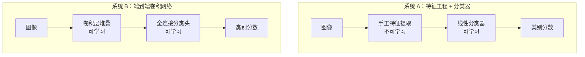
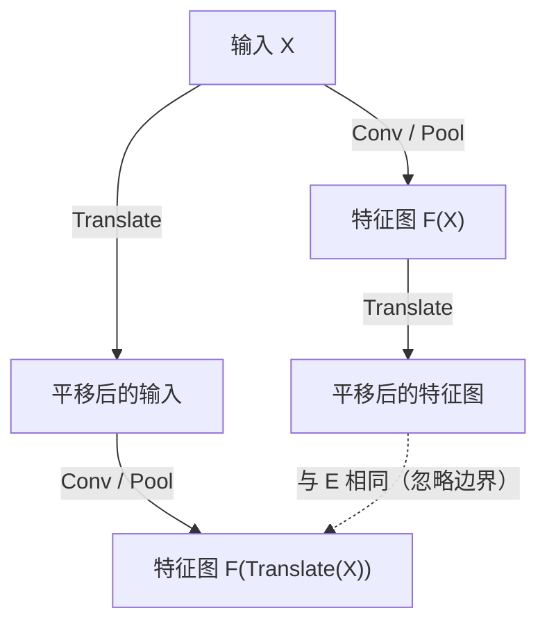

> **课程信息**
>
> - **课程名称**：Stanford CS231n: Deep Learning for Computer Vision（Spring 2025）
> - **本讲主题**：Lecture 5. Image Classification with CNNs
> - **主讲教师**：Justin Johnson
> - **授课日期**：2025-04-15
> - **课程主页**：[cs231n.stanford.edu/2025](https://cs231n.stanford.edu/2025/schedule.html)
> - **官方课件**：[lecture_5.pdf](</attachments/cs231n-ac0633b77c5626f03bcbb9df.pdf>)（141 页，正文按页链接本地课件）
> - **字幕来源**：[cs231n_sp25_kor_sub · eng](https://github.com/lpaiu-cs/cs231n_sp25_kor_sub/tree/main/eng)（公开英文转写，中文由本书重写）
> - **版权说明**：幻灯片与课程材料版权归 Stanford University 及授课教师所有；本书为非官方学习笔记，仅用于学习与研究。

> **课件索引**：点击下方链接打开本地 PDF 的对应页；全部课件见 [课件索引](/notes/cs231n/slides)。页码按 PDF 文件页序定位，第 1 讲分为 Part 1 / Part 2。

[📄 L5 · 第 1 页｜Lecture 5 标题页：Image Classification with CNNs](</attachments/cs231n-ac0633b77c5626f03bcbb9df.pdf#page=1>)

一张 32×32×3 的图展平成 3072 维向量之后，"相邻"这个关系就消失了：像素 (0,0) 与 (0,1) 在向量里隔了三个下标，而它与 (31,31) 的距离和它与 (0,1) 的距离在数学上没有区别。上一讲把计算图与反向传播磨成了通用工具，这一讲要回答的是：既然节点可以自己设计，那么**为图像设计的节点应该长什么样**。

答案小得有点意外——只需要两个新算子：卷积层与池化层。卷积层把全连接层"每个输出看整张图"改成"每个输出只看 5×5 的一小块，但同一组权重滑遍全图"；池化层提供一个几乎不花算力的降采样手段。这一讲真正的分量不在定义，而在三笔账：**参数从哪来、输出多大、感受野有多宽**。

## 1. 复习不是复述：前四讲留下的一条「张量 → 损失 → 梯度」流水线

*(参考时间: 00:00:05 – 00:11:55｜Lecture 5)*

[📄 L5 · 第 2 页｜行政页之一：Assignment 1 的截止时间与考点](</attachments/cs231n-ac0633b77c5626f03bcbb9df.pdf#page=2>)

开课前挂在首页的两页行政信息值得先记下，因为它们标出了本讲与前面四讲的关系。作业一 4 月 23 日 23:59 截止，考点是 k 近邻（kNN）、线性分类器（SVM 与 Softmax）、两层神经网络，以及**图像特征**——最后这一项正是本讲第 2 章要拆解的对象。

[📄 L5 · 第 3 页｜行政页之二：项目提案的截止时间](</attachments/cs231n-ac0633b77c5626f03bcbb9df.pdf#page=3>)

第二页是项目提案，4 月 25 日截止，助教的研究方向挂在课程网页的 office hours 页面上。这两页在录像里没有被展开，但它们提示了一件事：本讲之后，课程从"深度学习基础"转到"感知与理解视觉世界"，作业也会从"实现算子"变成"设计系统"。

[📄 L5 · 第 4 页｜讲师的履历时间轴：2015 年起在 Stanford 讲授 CS231n](</attachments/cs231n-ac0633b77c5626f03bcbb9df.pdf#page=4>)

自我介绍不到一分钟，信息量不小：讲师在 Stanford 读博期间参与了 CS231n 的发起，2015 到 2018 年在这里授课，之后去 Facebook AI Research，又在 Michigan 做过教职，最近在做 World Labs。幻灯片下方那条 2010 / 2015 / 2020 / 2025 的时间轴，加上全篇页脚的"Stanford CS231n 10th Anniversary"，说明这是这门课的第十年——本讲后面会反复用"2012 到 2020 卷积网络统治视觉"这条时间线，来解释今天为什么还要学它。

[📄 L5 · 第 5 页｜课程的四段结构：本讲正踩在第一段与第二段的接缝上](</attachments/cs231n-ac0633b77c5626f03bcbb9df.pdf#page=5>)

课程被切成四段：深度学习基础（第 2–4 讲）、感知与理解视觉世界（第 5–12 讲）、生成与交互式视觉智能（第 13–16 讲）、以人为本的应用与影响（第 17–18 讲）。这个位置很特殊：前四讲已经把"什么是张量、什么是损失、梯度怎么算"讲完，接下来七讲要把这套通用机器塞进具体的视觉任务。所以这一讲前半段在复习，后半段在换零件。

### 1.1 三件套：模型、目标、搜索

复习被压缩成三页，对应三个可替换的零件：模型（评分函数）、目标（损失函数）、搜索（优化器）。三者耦合很松——评分函数决定输出张量的形状，损失把它压成一个标量，优化器只关心"标量怎么变小"。换模型时只要输出形状不变，损失与优化器可以原封不动，这就是为什么同一套训练代码能训练线性分类器、多层感知机与卷积网络。

[📄 L5 · 第 6 页｜复习之一：线性分类器的评分函数](</attachments/cs231n-ac0633b77c5626f03bcbb9df.pdf#page=6>)

评分函数还是 $f(x,W)=Wx+b$：把图像拉成 3072 维列向量，乘一个 $10\times3072$ 的权重矩阵，得到 10 个类别的分数。复习的价值不在公式本身，而在于它把"图像分类"**编码成了输入张量到输出张量的映射**——这是所有深度学习问题的第一步，也是判断"卷积层改变了什么"的基准线。3072 这个数值得记住：$32\times32\times3=3072$，它会反复出现，因为全连接层只认这个数，而卷积层认的是 $(3,32,32)$。

[📄 L5 · 第 7 页｜复习之二：数据、评分函数与损失函数的三件套](</attachments/cs231n-ac0633b77c5626f03bcbb9df.pdf#page=7>)

第二步是损失。给定数据集 $(x,y)$ 与评分函数，需要一个标量衡量"当前这组权重在这个数据集上有多差"。分类问题常用 Softmax 损失（幻灯片上也列了 SVM 损失），完整损失通常是数据损失加正则项：前者要求拟合训练数据，后者约束权重不要长成奇怪的样子。接口约定是——**损失永远是一个标量**，这一条在后面推导梯度形状时反复用到。

| 损失 | 形式 | 已经分对且余量足够时 |
| --- | --- | --- |
| SVM / hinge | $\sum_{j\ne y}\max(0,s_j-s_y+1)$ | 梯度为 0，不再施力 |
| Softmax / 交叉熵 | $-\log\dfrac{e^{s_y}}{\sum_j e^{s_j}}$ | 梯度仍非 0，继续把概率推向 1 |

两者的差别只在"如何看待分数差"：hinge 一旦余量足够就停止施力，Softmax 则永远想要更自信。损失的选择会改变梯度的形状，但不会改变"它必须是标量"这个前提。

[📄 L5 · 第 8 页｜复习之三：优化器家族](</attachments/cs231n-ac0633b77c5626f03bcbb9df.pdf#page=8>)

第三步是搜索。幻灯片刻意把 SGD、SGD+Momentum、RMSProp、Adam 排成一行，讲师在这里插了一段现场逸事：就在前一天，ICLR 2025 把"时间检验奖"（Test of Time Award）颁给了 2015 年提出 Adam 的那篇论文——也就是这门课第三讲讲过的优化器。这个细节说明课程里这些"标准件"不是教学玩具，而是十年后仍在被引用的工作；经典方法能活十年，往往不是因为最优，而是因为它们抓住了问题里不变的那部分。

[📄 L5 · 第 9 页｜线性分类器的两个缺陷视角：模板视角与几何视角](</attachments/cs231n-ac0633b77c5626f03bcbb9df.pdf#page=9>)

然后问题出现：线性分类器不够强。幻灯片给出两个互补视角。**视觉视角**：权重矩阵的每一行可以还原成一张与输入同尺寸的图，也就是"每个类别一个模板"，于是判断一只猫靠的是"这张图与猫模板的内积大不大"。讲师举的例子很扎人——学出来的"车"模板是一团红色，可车不必是红的。**几何视角**：每个样本是高维空间里的一个点，线性分类器只能用超平面切空间；只有当各类恰好落在被超平面分开的区域里时才有效，而没有理由相信图像数据会这么配合。

[📄 L5 · 第 10 页｜两层神经网络：3072 → 100 → 10](</attachments/cs231n-ac0633b77c5626f03bcbb9df.pdf#page=10>)

补救办法是不再只用一个权重矩阵。两层网络在中间插一个 100 维隐层：$x\in\mathbb{R}^{3072}$ 先乘 $W_1$ 变成 100 维，过 ReLU，再乘 $W_2$ 得到 10 个分数。代数上只多了一步，表达能力却完全不同——它不再要求每个类别只有一张模板，而是可以先组合出一批中间"部件"，再用部件投票。函数形式换了，但输入输出接口一模一样，所以损失与优化流程一个字都不用改。

[📄 L5 · 第 11 页｜计算图：从 x、W 到 hinge 损失，中间还要加正则项](</attachments/cs231n-ac0633b77c5626f03bcbb9df.pdf#page=11>)

麻烦在于优化。参数变多、层数变深之后，手推每个参数的偏导已经不现实，于是引入计算图：每个节点是一个小的函数原语，数据从左往右前向流动算出损失，再反向流动算出梯度。幻灯片上的图里，$x$ 与 $W$ 汇进评分节点，评分与标签进 hinge 节点得到数据损失，同时 $W$ 还分出一支进正则项 $R$，两支相加才是最终损失。这也说明了正则项是图的一部分——它不是训练循环里额外加的一行判断，而是一个挂在权重上的节点，因此它的梯度同样由反向传播算出，只是这条路径不经过数据。

### 1.2 计算图：把全局问题拆成局部问题

"计算图"听起来抽象，其实只是一份记账约定：把一次前向计算拆成一串初等节点，每个节点只负责一种简单函数。拆开之后，求导这件全局的事就变成了每个节点各算各的局部导数、再沿边相乘——这是链式法则的工程化，而不是新数学。

[📄 L5 · 第 12 页｜反向传播的三个梯度：上游、局部、下游](</attachments/cs231n-ac0633b77c5626f03bcbb9df.pdf#page=12>)

反向传播的关键在于它是**局部的**。每个节点只做两件事：前向时由输入算输出，反向时接收"上游梯度"（损失对本节点输出的偏导），乘以自己的"局部梯度"，吐出"下游梯度"（损失对本节点输入的偏导）。节点不必知道自己在整张图的哪个位置，也不必知道上游梯度怎么来的。正是这种"无知"让框架成为可能：只要所有节点遵守同一个接口，任意复杂的网络都能拼出来，梯度会自动到位。

[📄 L5 · 第 13 页｜向量版反向传播：局部雅可比是一个矩阵](</attachments/cs231n-ac0633b77c5626f03bcbb9df.pdf#page=13>)

把标量换成向量，局部梯度就变成雅可比矩阵。若节点 $f:\mathbb{R}^{D_z}\to\mathbb{R}^{D_y}$，它的局部雅可比是 $D_y\times D_z$ 的矩阵，第 $(i,j)$ 项回答"$z$ 的第 $j$ 个元素动一下，$y$ 的第 $i$ 个元素动多少"。幻灯片反复强调：损失仍然是标量，所以**上游梯度的形状永远等于输出的形状，下游梯度的形状永远等于输入的形状**——形状对上了，实现基本不会错。

[📄 L5 · 第 14 页｜矩阵/张量版反向传播：dL/dx 永远与 x 同形](</attachments/cs231n-ac0633b77c5626f03bcbb9df.pdf#page=14>)

再往上一层就到张量。若 $x$ 是 $D_x\times M_x$、$y$ 是 $D_y\times M_y$，理论上的局部雅可比尺寸是 $(D_xM_x)\times(D_yM_y)$——一个随张量大小平方增长的怪物，幻灯片把它画出来，是为了让人看清"为什么不能真的去构造它"。

> **编者说明**：实际实现里从不显式构造这个矩阵，而是算"向量–雅可比乘积"（vector-Jacobian product）：给定上游梯度，输出一个与输入同形的张量。以 $1000\times1000$ 的矩阵乘为例，完整的局部雅可比需要 $10^{12}$ 个元素，而实际计算只需要"上游梯度乘权重的转置"，代价是 $10^6$ 次乘加。这就是矩阵乘、卷积、池化的反向传播都只与前向激活同阶的原因。

这一整套东西合起来就是一条流水线：把问题编码成输入输出张量 → 写一张计算图 → 收集 $(x,y)$ 数据集 → 定义标量损失 → 用反向传播求梯度、用梯度下降更新参数。讲师说这个配方"基本上支撑了所有深度学习应用"，区别只是计算图里放了哪些节点。这也正好解释了本讲的定位：**卷积网络不是新框架，只是往这张图里多插了两种节点。**

## 2. 卷积网络不是新框架，只是往计算图里插两个节点

*(参考时间: 00:12:11 – 00:22:59｜Lecture 5)*

[📄 L5 · 第 15 页｜分段页第一帧：箭头指向刚讲完的「深度学习基础」](</attachments/cs231n-ac0633b77c5626f03bcbb9df.pdf#page=15>)

课程在这里正式换段。幻灯片用一支橙色箭头标出当前位置：第 2–4 讲"深度学习基础"已经讲完，后面三段依次变灰。这个看似多余的动画提示听众做一次心态切换——前面的内容是通用机器，从这里开始要讨论"图像这种数据有什么特殊性"。

[📄 L5 · 第 16 页｜分段页第二帧：箭头移到「感知与理解视觉世界」](</attachments/cs231n-ac0633b77c5626f03bcbb9df.pdf#page=16>)

第二帧里箭头右移一行，落到第 5–12 讲"感知与理解视觉世界"上，后两段继续变灰。这七讲会依次处理分类、架构、序列模型、检测分割、视频、大规模训练，而本讲是入口：先把"图像专用的算子"讲透，后面才有东西可堆。

[📄 L5 · 第 17 页｜今天要加的两种节点：卷积层与池化层](</attachments/cs231n-ac0633b77c5626f03bcbb9df.pdf#page=17>)

幻灯片的画法很直白：上半部分是已经见过的全连接层（$x\to h\to s$）与激活函数，旁边写着"We have already seen these"；下半部分暂时空白，写着"Today: Image-specific operators"。也就是说，今天不引入新的训练算法、不引入新的损失，只引入两个新的**算子**。

[📄 L5 · 第 18 页｜四块拼齐：卷积层与池化层归位](</attachments/cs231n-ac0633b77c5626f03bcbb9df.pdf#page=18>)

第二帧把下半部分补上：卷积层画成"局部窗口连到一个神经元"，池化层画成 $224\times224\times64$ 的体积缩到 $112\times112\times64$。四块积木齐全——全连接层、激活函数、卷积层、池化层。讲师强调卷积网络"其实只是在已有框架上加了一点点东西"，真正的工作量在于理解这两个算子的形状与代价。

[📄 L5 · 第 19 页｜图像分类：输入一张图，输出 K 个类别中的一个](</attachments/cs231n-ac0633b77c5626f03bcbb9df.pdf#page=19>)

镜头拉回任务本身。图像分类要解决的问题是：给定一张图，假定类别集合 $\{dog, cat, truck, plane,\dots\}$ 已确定，输出其中一个类别。幻灯片上是一只猫，下面列着狗、鸟、鹿、卡车几个选项。这类问题看似简单，却是几乎所有视觉任务的原型：检测是在图上加框，分割是把类别落到像素，本质上都建立在"从像素判类别"上。

[📄 L5 · 第 20 页｜像素空间：直接把像素当输入](</attachments/cs231n-ac0633b77c5626f03bcbb9df.pdf#page=20>)

前面几讲的做法是让 $f(x)=Wx$ 直接吃像素：$x$ 是像素值的字面量，$W$ 的每一行是一个整图模板。这条路能走通，但假设很强——它默认"猫"这个概念可以用一张固定位置的像素模板概括，而现实里猫可以出现在任何位置、任何姿态、任何光照下。

### 2.1 手工特征的时代：人类先猜，网络后判

在端到端之前，视觉系统是两段式的：人负责把图像变成向量，模型负责把向量变成类别。关键在**特征提取器不可学习**——它是一段固定代码，不会因为分类错了而调整自己，所以整个系统的上限在写那段代码时就定死了。幻灯片上的三个例子代表三条思路：只统计"什么颜色出现多少"、只统计"边缘朝哪个方向"、只统计"局部小块出现了哪些类型"，差别只在于丢掉的是哪一部分信息。

[📄 L5 · 第 21 页｜特征表示：先设计 f，再在特征上做分类](</attachments/cs231n-ac0633b77c5626f03bcbb9df.pdf#page=21>)

这条路的做法是：不让网络看像素，而是由人先设计特征提取器 $f$，把图像变成"更有意义"的表示，再喂给分类器。这是 2000 年代到 2010 年前后计算机视觉的主流，核心假设是"人知道什么特征有用，网络只需要学会在特征上画边界"。

[📄 L5 · 第 22 页｜颜色直方图：只保留颜色分布，丢掉全部空间结构](</attachments/cs231n-ac0633b77c5626f03bcbb9df.pdf#page=22>)

第一个例子是颜色直方图。把颜色空间离散成一堆桶，统计落入每个桶的像素数量，就得到一个特征向量。它有用是因为有些问题确实只看颜色——判断苹果熟没熟，红色像素的比例就是强信号。但它也暴露了这类特征的代价：**空间结构被彻底销毁**，红色在左上角还是右下角，直方图完全一样。它的维度只取决于"分成几个桶"，与分辨率无关：RGB 各切 8 档是 $8^3=512$ 维，切 16 档是 4096 维；一张 4000×3000 的照片和一张 32×32 的缩略图，特征长度完全相同。

[📄 L5 · 第 23 页｜方向梯度直方图：只保留结构，丢掉颜色](</attachments/cs231n-ac0633b77c5626f03bcbb9df.pdf#page=23>)

第二个例子是方向梯度直方图（Histogram of Oriented Gradients, HoG），可以看作颜色直方图的对偶：基本不看颜色，只看局部边缘的方向。做法是把图切成 8×8 的区域，在每个区域内把边缘方向量化到 9 个 bin。幻灯片给了一个具体的账：320×240 的图切成 40×30 个 bin，每 bin 9 个数，特征共 $30\times40\times9=10{,}800$ 维。如果后面接 10 类线性分类器，光权重就要 108,010 个，而图像本身只有 320×240——手工特征时代的通病就在这里：为了不漏掉分辨力，特征做得又长又密，分类器的参数量很快超过数据能支撑的规模。

[📄 L5 · 第 24 页｜词袋模型：先聚类出「视觉词」，再统计出现次数](</attachments/cs231n-ac0633b77c5626f03bcbb9df.pdf#page=24>)

第三个例子是词袋（Bag of Words）。第一步从训练图里随机抽大量小图块做聚类，得到一本"视觉词典"；第二步把每张图编码成"每个词出现多少次"的直方图。它把图像变成无序的词频向量——同样丢掉位置，但保留了局部模式统计。词典大小是纯粹的设计选择：太小则区分度不够，太大则维度失控。

[📄 L5 · 第 25 页｜把所有特征拼接起来，就是 2010 年前后的标准做法](</attachments/cs231n-ac0633b77c5626f03bcbb9df.pdf#page=25>)

那个年代的常见套路是"全都拼上"：颜色直方图、HoG、词袋各算一遍，首尾相接成一个超长向量，再在上面训练线性分类器。讲师对此评价克制——这些特征今天基本不用了，但值得闻一闻味道，因为后面要对比的正是"由人设计特征"与"由梯度下降设计特征"这两种世界观。

这三类特征也暴露了两个通病：维度爆炸（HoG 一项就是 10,800 维），以及信息选择靠猜——哪些该留、哪些该丢全凭设计者判断，判断错了训练时也无法纠正。

### 2.2 端到端：人类设计函数族，数据决定函数

替代方案是把特征提取器也变成可学习参数。这时人做的事变了：不再写"怎么算 HoG"，而是写"先卷积、再 ReLU、再池化"这样的算子序列，以及每层的张量尺寸。你定义的是一个**函数族**，具体取哪个函数由训练数据决定。

[📄 L5 · 第 26 页｜特征提取 + 分类器 vs 端到端卷积网络](</attachments/cs231n-ac0633b77c5626f03bcbb9df.pdf#page=26>)

这张对比图是全讲的转折点。上半部分是老系统：图像 → 特征提取（一堆手工 C 或 MATLAB 代码）→ 线性分类器 → 10 个分数，蓝色箭头表示只有分类器是通过训练学出来的。下半部分是卷积网络：同样从图像到 10 个分数，但蓝色箭头覆盖了从像素到分数的**整条链路**。接口完全一样，差别只在蓝色箭头覆盖的范围——上面的系统里梯度止步于分类器，特征提取器收不到任何信号，永远不会为了"把猫和狗分开"而调整；下面的系统里梯度一路传回第一层，特征会针对任务自动变形。



这就是端到端在数据充足时几乎总能赢的结构性原因：不是"更聪明的特征"，而是"特征可以被任务纠正"。梯度能到达哪里，哪里的表示就能被任务改写；梯度到不了的地方，只能靠人的判断。这条规律不只适用于卷积——今天的大模型强调端到端预训练，本质上也是把可学习范围推到最大。

### 2.3 展平到底损失了什么

[📄 L5 · 第 27 页｜两层网络把 3072 维压到 100 维，但空间结构已经没了](</attachments/cs231n-ac0633b77c5626f03bcbb9df.pdf#page=27>)

那么问题出在哪？回到我们唯一会搭的那种网络：把 32×32×3 拉成 3072 维，乘 $W_1$ 到 100 维，ReLU，再乘 $W_2$ 到 10 维。它在数学上没有任何毛病，问题在第一步——展平。

[📄 L5 · 第 28 页｜展平的代价：图像不是一维对象](</attachments/cs231n-ac0633b77c5626f03bcbb9df.pdf#page=28>)

具体算一下：$32\times32\times3$ 的图展平后，像素 $(0,0)$ 与 $(0,1)$ 隔 3 个下标，与 $(1,0)$ 隔 96 个下标，与 $(31,31)$ 隔 3071 个。全连接层看到的只是这些下标，它必须从数据里学会"下标 0 和 3 是邻居"，而这个知识在权重矩阵里没有任何结构可用——每一对相邻像素都要单独占用参数。幻灯片在这里打出红字："Problem: The spatial structure of images is destroyed!"。

卷积层换了一种做法：它不学"谁和谁相邻"，而是**规定**只连接相邻的 5×5 窗口。这个规定就是先验，它把"图像是二维的"从数据搬进了结构里。先验对了，需要学的参数就少了；先验错了，模型就得付出额外容量去抵消它——这是理解所有架构设计的通用框架。讲师由此给出本讲的中心论点：在"人工特征 + 分类器"里，人类设计的是**具体函数**；在端到端网络里，人类设计的是**函数族**。他顺带说了一句很重的话：梯度下降大概是比你更好的程序员，而大量数据大概比你更懂这个问题。

## 3. 从 LeNet 到 Transformer：2025 年为什么还要学卷积

*(参考时间: 00:23:17 – 00:30:25｜Lecture 5)*

[📄 L5 · 第 29 页｜LeNet 式卷积网络示意图：卷积、池化、全连接依次排开](</attachments/cs231n-ac0633b77c5626f03bcbb9df.pdf#page=29>)

在讲算子之前，先用一张 1998 年的图把整体形状定下来。这张图来自 LeCun 等人的工作，画法很朴素：左边是输入图像，中间一串"薄片"代表卷积与池化产生的特征图，越往右空间尺寸越小、通道越多，最后接到几个全连接层上。先记住这个轮廓——**空间逐层变小，通道逐层变多**——后面所有的算术都在解释它为什么必然如此。

[📄 L5 · 第 30 页｜示意图第二帧：标出卷积与池化尊重二维结构](</attachments/cs231n-ac0633b77c5626f03bcbb9df.pdf#page=30>)

第二帧加上一句关键注释：卷积与池化算子提取特征时**保留了图像的二维结构**。这正是它们与全连接层的分水岭。全连接层要求先把图拍平，卷积层则要求保持 $H\times W$ 的排布——输入是三维体积，输出也是三维体积，只是高宽与深度变了。

[📄 L5 · 第 31 页｜示意图第三帧：末端接一个全连接 MLP 输出分数](</attachments/cs231n-ac0633b77c5626f03bcbb9df.pdf#page=31>)

第三帧补上末端：卷积部分之后接全连接层，组成一个多层感知机来预测类别分数。这把网络分成了两个职责不同的部分——前半段是"特征提取器"，把像素变成一组紧凑的响应；后半段是"分类器"，把响应变成 10 个分数。这个划分只是理解上的划分，训练时并没有分阶段。

[📄 L5 · 第 32 页｜示意图第四帧：整条链路端到端训练](</attachments/cs231n-ac0633b77c5626f03bcbb9df.pdf#page=32>)

最后一帧加上"用反向传播与梯度下降端到端训练"。这句话把前三帧串成一个整体：卷积、池化、全连接、损失，全在同一张计算图里，梯度从损失一路回传到最底层的滤波器。**端到端**是重点——没有任何一层是固定不变的。

### 3.1 1998 与 2012：同一个骨架，两次不同的命运

回头把这四帧连起来看，它把"什么是卷积网络"拆成四个可以单独成立的主张：算子保持二维结构、末端接全连接分类头、整条链路端到端训练。四条拆开看都不新鲜，合起来才是完整架构——而这四条在 1998 年就已经齐了。

[📄 L5 · 第 33 页｜LeNet：1998 年的文档识别网络](</attachments/cs231n-ac0633b77c5626f03bcbb9df.pdf#page=33>)

这张图对应 1998 年的论文《Gradient-based learning applied to document recognition》，作者是 LeCun、Bottou、Bengio、Haffner，任务是识别文档里的手写数字。讲师强调两件事：它当年就工作得不错；它非常贵——没有 GPU、没有 TPU。更值得注意的是它的结构与 2010 年代主流网络"基本长一个样"：卷积、池化、全连接、反向传播，一样都不缺。把成本估一下就明白为什么它等了十四年：LeNet 的输入只有 32×32、通道数是个位数；放大到 224×224、64 通道，仅像素数就多 49 倍，再乘上通道与层数的增长，总算力需求高两三个数量级——这不是算法问题，是硬件问题。

[📄 L5 · 第 34 页｜AlexNet：2012 年的 ImageNet 冠军网络](</attachments/cs231n-ac0633b77c5626f03bcbb9df.pdf#page=34>)

从 1998 跳到 2012，就是 AlexNet（Krizhevsky、Sutskever、Hinton）。结构上没有革命：还是卷积层加全连接层，只是更深、更宽、参数更多。真正变了的是外部条件——GPU 能算了，互联网与 ImageNet 提供了足够的数据。讲师把这讲得很清楚：算法早就到位，是算力与数据把门推开的。这也解释了为什么"卷积统治"能维持八年：它的归纳偏置恰好匹配那个阶段的算力与数据规模，参数量可控、可以用小图训练。

### 3.2 被卷积网络吃掉的任务

接下来三页展示同一件事的三张面孔：卷积网络不只是分类器，而是"从图像里提取可判别特征"的通用底座。任务越复杂，输出的结构越复杂，但底座不变。

[📄 L5 · 第 35 页｜卷积网络统治视觉任务的那几年：检测与分割](</attachments/cs231n-ac0633b77c5626f03bcbb9df.pdf#page=35>)

2012 到 2020 年这段，卷积网络几乎横扫了所有视觉任务。幻灯片左边是检测：不仅要判类别，还要在图上画出框并给框贴标签（Faster R-CNN，Ren、He、Girshick、Sun，2015）；右边那一半标题同样写着 Detection，但图里做的是分割——把标签落到每一个像素上（Farabet 等人，2012）。三个任务的输出空间值得对照：分类输出一个长度为 $K$ 的向量；检测输出 $N$ 个框，每个框带 4 个坐标与 $K$ 个类别分数；分割输出一张与输入同尺寸的类别图。输出越复杂，网络需要的空间分辨率越高——这是分割网络必须把浅层高分辨率特征接回深层的原因。底座仍然是同一套卷积算子，说明卷积的价值不在某个具体任务，而在它是一种足够通用的图像算子。

[📄 L5 · 第 36 页｜卷积网络做图像描述：图到文](</attachments/cs231n-ac0633b77c5626f03bcbb9df.pdf#page=36>)

语言方向也没被放过。图像描述（image captioning）要输入一张图、输出一句话，早期最成功的方案之一就是"卷积网络提特征 + 循环网络生成句子"（Vinyals 等人 2015；Karpathy 与 Fei-Fei 2015）。幻灯片上的六句生成字幕——"一只白色泰迪熊坐在草地上"、"一个穿棒球服的男子在投球"、"一个女人手里抱着一只猫"——是讲师用 Neuraltalk2 生成的例子。

[📄 L5 · 第 37 页｜卷积网络做文生图：Stable Diffusion](</attachments/cs231n-ac0633b77c5626f03bcbb9df.pdf#page=37>)

反过来也行。文生图要输入一句话、生成一张图，早期真正开始好用的版本同样建立在卷积网络上；幻灯片这张图出自 Stable Diffusion 的论文（Rombach 等人，CVPR 2022），例子里有水彩风格的"半鼠半松鼠吃汉堡"、毕加索风格的僵尸、印着"I love generative models!" 的 T 恤。讲师顺带提了一句：这项技术最近两年进步极快，后面的讲次会专门讲。

[📄 L5 · 第 38 页｜十年前，这门课的名字里就写着卷积网络](</attachments/cs231n-ac0633b77c5626f03bcbb9df.pdf#page=38>)

所以 2015 年这门课创办时，名字叫"Convolutional Neural Networks for Visual Recognition"——卷积网络与计算机视觉在当时几乎是同义词，而视觉又是深度学习受益最大的领域。幻灯片上那句"This class used to be focused on ConvNets!" 是自嘲：课名后来改了，因为领域变了——2025 年卷积网络只是工具箱里的一件，而不再是全部。

### 3.3 2021 之后：注意力接棒，但卷积没有退场

[📄 L5 · 第 39 页｜2017 年：Transformer 先在语言任务上出现](</attachments/cs231n-ac0633b77c5626f03bcbb9df.pdf#page=39>)

变化发生在 2017 年。Vaswani 等人的《Attention is all you need》提出了 Transformer，一开始只处理文本序列。它和卷积的根本差别在"看哪里"：卷积的视野由核大小与层数决定，注意力则可以一次看到整个序列，并按内容动态分配权重。换个说法：卷积的权重是**固定的**，同一个滤波器在任何图像上都做同样的匹配；注意力的权重是**算出来的**，每一对位置之间的权重取决于这两个位置的内容。

[📄 L5 · 第 40 页｜2021 年：同样的架构被搬到图像上](</attachments/cs231n-ac0633b77c5626f03bcbb9df.pdf#page=40>)

2021 年，Dosovitskiy 等人的《An Image is Worth 16x16 Words》把几乎一模一样的 Transformer 用在图像上：把图切成 16×16 的 patch，每个 patch 当成一个"词"。结果是在许多原本由卷积网络解决的问题上，把 CNN 换成 Transformer、其余保持不变，性能反而更好，而且更吃数据与算力——这恰好是这些年最不缺的两样东西。

[📄 L5 · 第 41 页｜这一页留了个钩子：Transformer 细节在第八讲](</attachments/cs231n-ac0633b77c5626f03bcbb9df.pdf#page=41>)

幻灯片在这里加了一行"Wait until Lecture 8!"，把细节推到后面。讲师的处理很坦诚：他不想在卷积网络明显不再是唯一答案的年份里，还把卷积讲成唯一真理。但他给出四条继续学的理由——历史意义、工程上仍在大量使用、能建立对图像算子的直觉、以及今天的系统常常是卷积与注意力的混合体。工程上更常见的做法确实是混用：浅层用卷积提取局部特征，深层用注意力做全局交互。所以真正要掌握的不是"哪个更好"，而是"各自的归纳偏置是什么、什么时候有用"。

[📄 L5 · 第 42 页｜进入正题的分段页](</attachments/cs231n-ac0633b77c5626f03bcbb9df.pdf#page=42>)

历史讲完，画面切回一张纯标题页："Convolutional Neural Networks"。接下来半个多小时只做一件事：把卷积层拆到维度级别。

## 4. 卷积层：把「一张图一个模板」拆成「一个小模板滑遍全图」

*(参考时间: 00:30:28 – 00:49:43｜Lecture 5)*

[📄 L5 · 第 43 页｜今天要讲的两块：先补齐已有积木](</attachments/cs231n-ac0633b77c5626f03bcbb9df.pdf#page=43>)

画面回到那张四宫格，但这次只有上半部分亮着：全连接层与激活函数，旁边写着"We have already seen these"，下半部分还是空的。这种"先摆出已知、再补未知"的排布对应接下来的讲述顺序：先把全连接层重新解读一遍，再从它的局限里长出卷积层。

[📄 L5 · 第 44 页｜四块齐全：卷积层与池化层就位](</attachments/cs231n-ac0633b77c5626f03bcbb9df.pdf#page=44>)

第二帧把卷积层与池化层补上，标注"Today: Image-specific operators"。所谓"图像专用"，指的是这两个算子的连接模式是为二维网格设计的——参数共享方式、输出形状、乃至反向传播的写法，都依赖"输入是一张有空间结构的图"这个前提。

[📄 L5 · 第 45 页｜第三帧：池化被压暗，高亮回到卷积](</attachments/cs231n-ac0633b77c5626f03bcbb9df.pdf#page=45>)

第三帧里池化层变灰，卷积层保持高亮。这是一个视觉提示：先讲卷积，池化留到后面。整讲的节奏也确实是"卷积占七成、池化占两成、剩下是等变性与总结"。

[📄 L5 · 第 46 页｜全连接层复习：32×32×3 拉成 3072 维](</attachments/cs231n-ac0633b77c5626f03bcbb9df.pdf#page=46>)

全连接层的做法前面见过：$32\times32\times3$ 的图像拉成 $3072\times1$ 的列向量，乘一个 $10\times3072$ 的权重矩阵，得到 10 个分数。幻灯片特意把"input activation"与"weights"分开标注，因为接下来要动的正是这两者的形状关系。

[📄 L5 · 第 47 页｜全连接层的每个输出：一行权重与整个输入的点积](</attachments/cs231n-ac0633b77c5626f03bcbb9df.pdf#page=47>)

把视角落到单个输出上：10 个分数里的每一个，都是 $W$ 的某一行与整个 3072 维输入的点积。而点积可以读作**模板匹配**——两个向量方向越一致值越大，正交时为 0，方向相反时为负。所以全连接层等价于"准备了 10 张与输入同样大小的模板，逐个与整图比对"。这个解读是通向卷积层的钥匙。

### 4.1 从「整图模板」到「滑动模板」

两种视角可以接起来：全连接层学的是"整图模板"，卷积层学的是"局部模板"，然后用滑动把局部响应铺满整张图。这一步转换带来三个直接后果——参数量与图像尺寸解耦、同一模板可以在任意位置被复用、输出保留二维索引。第三个后果最容易被忽略：全连接层的输出是一个 10 维向量，位置信息只存在于"它与哪一行权重对应"这件事里；卷积层的输出是 $6\times28\times28$ 的体积，第 $(c,i,j)$ 个元素明确表示"第 $c$ 个模板在第 $(i,j)$ 个位置的响应"。后面做检测时能直接在这张平面上回归框的偏移，靠的就是这个索引还在。

[📄 L5 · 第 48 页｜卷积层第一步：不展平，保持 32×32×3 的空间结构](</attachments/cs231n-ac0633b77c5626f03bcbb9df.pdf#page=48>)

卷积层的第一件事是拒绝展平。输入仍然是 $32\times32\times3$ 的体积，三个维度各有名字：高 32、宽 32、深 3（深度也叫通道）。保留这三个维度，等于保留了"谁挨着谁"这条信息，而这正是全连接层丢掉的东西。

[📄 L5 · 第 49 页｜卷积层第二步：引入一个 5×5×3 的小滤波器](</attachments/cs231n-ac0633b77c5626f03bcbb9df.pdf#page=49>)

接着引入滤波器：一个 $5\times5\times3$ 的小体积，空间上只有 5×5，深度上却与输入相同。幻灯片的措辞是"把滤波器在图像上滑动，逐点做点积"。注意角色转换——模板不再与整图同尺寸，而是一小块"局部图案"。

[📄 L5 · 第 50 页｜滤波器必须覆盖输入的整个深度](</attachments/cs231n-ac0633b77c5626f03bcbb9df.pdf#page=50>)

幻灯片补了一条容易忽略的约束：**滤波器的深度永远等于输入的深度**。这不是约定俗成，而是点积的要求——要算内积，两个张量的元素个数必须相同。所以 3 通道的图只能配 3 通道的滤波器，$5\times5\times3$ 的滤波器和 $5\times5\times3$ 的图像块正好 75 个元素一一对应。

[📄 L5 · 第 51 页｜一个输出数字的含义：滤波器与 5×5×3 图像块的点积](</attachments/cs231n-ac0633b77c5626f03bcbb9df.pdf#page=51>)

一次落点算出一个标量：$\sum_{c=1}^{3}\sum_{i=1}^{5}\sum_{j=1}^{5} W[c,i,j]\,X[c,i,j] + b$，也就是 75 维点积再加偏置。这个数回答的问题是："当前这个位置上，图像长得有多像这个滤波器？"值越大，说明这块图像与模板越对齐。一个数显然不足以描述一块图像——把 75 个数压成一个点积，只保留了"与这个模板对齐的程度"这一个自由度；要描述更多方面，就得用多个滤波器。

[📄 L5 · 第 52 页｜第一个落点：窗口压在图像的一角，算出一个数](</attachments/cs231n-ac0633b77c5626f03bcbb9df.pdf#page=52>)

把窗口放到第一个位置，得到一个数，画成右侧一个小圆点。这一帧只有"一个输入块、一个输出"，是为了让"一个输出只依赖一个局部窗口"变得直观——对比全连接层里"一个输出依赖全部 3072 个像素"，差别一目了然。

[📄 L5 · 第 53 页｜滑动一格：窗口右移，算出第二个数](</attachments/cs231n-ac0633b77c5626f03bcbb9df.pdf#page=53>)

第二帧把窗口向右挪一格，权重完全不变，再算一次点积。这里出现了卷积最核心的两个性质：**参数共享**（同一个滤波器在所有位置复用同一组权重）与**局部连接**（每个输出只连一小块输入）。前者把参数量从"图像大小 × 类别数"压到"滤波器大小"，后者让输出天然带有位置信息。

[📄 L5 · 第 54 页｜继续滑动：同一组权重在第三个位置复用](</attachments/cs231n-ac0633b77c5626f03bcbb9df.pdf#page=54>)

第三帧继续平移。值得注意的是，每次计算都是独立的：位置之间不共享中间结果，也不互相影响。这种"逐位置独立"让卷积在 GPU 上极易并行——本质上它是一批小矩阵乘，可以摊成一个大矩阵乘来实现。

[📄 L5 · 第 55 页｜滑完最后一批位置：激活图上已经填出大片数值](</attachments/cs231n-ac0633b77c5626f03bcbb9df.pdf#page=55>)

到第四帧，窗口已经扫过大半张图，右侧的响应逐渐连成一片。讲师没有在这里逐格数，而是直接跳到下一步：与其关心单个格子，不如关心"滑完所有位置之后得到什么"。

[📄 L5 · 第 56 页｜滑遍所有位置：得到一张 28×28 的激活图](</attachments/cs231n-ac0633b77c5626f03bcbb9df.pdf#page=56>)

答案是激活图（activation map）。$32\times32$ 的输入配 $5\times5$ 的滤波器，水平和垂直方向各能放 $32-5+1=28$ 次，所以输出是一张 $28\times28$ 的平面——每个格子记录"原图对应位置有多像这个模板"。空间尺寸从 32 缩到 28，原因很简单：滤波器不能悬空，靠边的位置放不下完整的 5×5 窗口。这也预告了后面为什么要有填充：若希望输出与输入同尺寸，就得在边缘补零，让滤波器"有地方站"。

[📄 L5 · 第 57 页｜换一个滤波器：得到第二张激活图](</attachments/cs231n-ac0633b77c5626f03bcbb9df.pdf#page=57>)

接下来加第二个滤波器（幻灯片上画成绿色），尺寸仍是 $5\times5\times3$，但权重是另一组。它同样滑遍全图，得到第二张 $28\times28$ 的激活图。两张图回答两个不同的问题：第一张可能在看"有没有某种边缘"，第二张可能在看"有没有某种颜色对比"。为什么需要多个滤波器？因为一个滤波器只能回答一个问题——把 75 维空间投影到一个方向上；要覆盖"边缘、颜色、纹理、角点"，就得把 75 维空间投影到多个方向上。通道数本质上就是**投影方向的个数**。

[📄 L5 · 第 58 页｜六个滤波器叠成 6×28×28 的输出体积](</attachments/cs231n-ac0633b77c5626f03bcbb9df.pdf#page=58>)

把 6 个滤波器的结果摞起来，输出就是 $6\times28\times28$：两个空间维度来自滑动，第三个维度来自滤波器个数。与此同时，6 个滤波器本身也组成一个四维张量 $6\times3\times5\times5$——第一维是"第几个滤波器"，后三维是单个滤波器的形状。这就是卷积层的完整输入输出契约：输入三维体积，输出三维体积，权重四维张量。

### 4.2 四维张量的记账方式

卷积层的所有形状都可以用四个符号写清楚，这张表是全讲最该背下来的一页：

| 对象 | 形状 | 本例 |
| --- | --- | --- |
| 输入（单张） | $C_{in}\times H\times W$ | 3×32×32 |
| 滤波器组 | $C_{out}\times C_{in}\times K\times K$ | 6×3×5×5 |
| 偏置 | $C_{out}$ | 6 |
| 输出（单张） | $C_{out}\times H'\times W'$ | 6×28×28 |

四个超参数——$C_{out}$、$K$、$S$、$P$——决定了除输入之外的所有形状。注意滤波器组的第二维必须是 $C_{in}$：这不是设计选择，而是"每个滤波器都要看全部输入通道"的直接结果；这一维对不上，点积就无法进行。

[📄 L5 · 第 59 页｜偏置：每个滤波器一个标量，广播到整张激活图](</attachments/cs231n-ac0633b77c5626f03bcbb9df.pdf#page=59>)

和线性层一样，卷积层也有偏置。区别在粒度：线性层是每个输出神经元一个 bias，卷积层是**每个滤波器一个 bias**，这里是 6 维向量。加的时候，第 $k$ 个 bias 被广播到第 $k$ 张激活图的全部 784 个位置——在参数表里它只占 6 个数，在计算里却参与了 4704 次加法。这也解释了参数量的计算为什么常被写错：公式 $C_{out}(C_{in}K^2+1)$ 里的 $+1$ 只加一次，而不是加 $H'W'$ 次；广播是计算层面的事，不是参数层面的事。

[📄 L5 · 第 60 页｜换个读法：输出是 28×28 个位置，每处一个 6 维向量](</attachments/cs231n-ac0633b77c5626f03bcbb9df.pdf#page=60>)

把输出体积换个方向读，会得到另一种很有用的直觉：$28\times28$ 个空间位置，每个位置上挂着 6 维向量，存着 6 个滤波器在该位置的响应。也就是说，卷积层把每个位置从一个"像素小块"变换成了一个"特征向量"——这正是后面所有"特征图"说法的来源。两种读法对应两种实现：按"位置"读，卷积是一堆互不依赖的小点积，适合理解；按"通道"读，每个位置是一个特征向量，适合接后续的全连接层。

[📄 L5 · 第 61 页｜批处理：一次推进 2 张图，输出也变成四维](</attachments/cs231n-ac0633b77c5626f03bcbb9df.pdf#page=61>)

实际训练不会一张一张算。把 2 张图摞成 $2\times3\times32\times32$，卷积层一次算完，输出 $2\times6\times28\times28$。批维度只是把同一组滤波器在更多样本上复用，不引入任何新参数——这也是为什么卷积网络的显存开销主要来自激活而不是权重：一张 $3\times32\times32$ 的图只有 3072 个数，经过两层卷积后变成 $10\times24\times24=5760$ 个激活；批大小为 64 时，仅最后一层激活就要存 368,640 个数，反向传播时这些值全得留着。

[📄 L5 · 第 62 页｜一般形式：N×Cin×H×W 进，N×Cout×H'×W' 出](</attachments/cs231n-ac0633b77c5626f03bcbb9df.pdf#page=62>)

于是有了通用写法：输入 $N\times C_{in}\times H\times W$，权重 $C_{out}\times C_{in}\times K_w\times K_h$，偏置 $C_{out}$，输出 $N\times C_{out}\times H'\times W'$。四个超参数决定了所有权重的形状，而 $H'$ 与 $W'$ 由输入尺寸和 $K,S,P$ 共同决定。这张图值得记住，因为后面算参数量、算 FLOPs、算显存，都是在这五个符号上做代数：


$$
H'=\left\lfloor\frac{H-K+2P}{S}\right\rfloor+1,\qquad W'=\left\lfloor\frac{W-K+2P}{S}\right\rfloor+1
$$


参数量是 $C_{out}\times(C_{in}\times K\times K+1)$——括号里的 $+1$ 是每个滤波器一个偏置。用第 5 章那道例题验算：$10\times(3\times5\times5+1)=760$，与幻灯片上的数字一致。

[📄 L5 · 第 63 页｜最简单的卷积网络：一个卷积层](</attachments/cs231n-ac0633b77c5626f03bcbb9df.pdf#page=63>)

有了卷积层，网络就可以堆了。最朴素的版本只有一层：$3\times32\times32$ 进，6 个 $5\times5\times3$ 的滤波器，出 $6\times28\times28$。它已经比全连接层省参数得多——这一层只有 $6\times(3\times5\times5+1)=456$ 个参数；若换成把 3072 维输入直接接到 6 个输出上的全连接层，需要 $6\times3072+6=18{,}438$ 个，差四十倍，而卷积层还额外保住了空间结构。

[📄 L5 · 第 64 页｜再堆一层：10 个 5×5×6 的滤波器，输出 10×24×24](</attachments/cs231n-ac0633b77c5626f03bcbb9df.pdf#page=64>)

第二层卷积接在后面，用 10 个 $5\times5\times6$ 的滤波器。注意这里的 6：它必须等于上一层的输出通道数，因为这一层的输入就是上一层的 6 张激活图。空间尺寸继续缩水，$28\to24$；通道数则从 6 涨到 10。这条"空间变小、通道变多"的规律，在后面每一讲都会重复出现。

### 4.3 为什么必须插一个非线性

[📄 L5 · 第 65 页｜加激活函数：没有它，两层卷积等于一层](</attachments/cs231n-ac0633b77c5626f03bcbb9df.pdf#page=65>)

这样堆是有 bug 的，而且很严重。讲师在课上把问题抛给学生："这个架构哪里不对？"有人答尺寸、有人答感受野、有人答显存，最后落到正解上——**全是线性的**。卷积是点积，点积是线性算子；两个线性算子的复合仍然是线性算子。也就是说，两层卷积直接相连，表达能力等价于一层卷积，中间那层白加了。

补救办法与多层感知机一模一样：在两次卷积之间插入逐元素的非线性激活函数（这里是 ReLU）。加完之后，$10\times24\times24$ 的每个元素都是"局部窗口 → 线性 → 非线性"的结果，堆叠才真正增加表达能力。顺序也不是随便排的：先卷积再 ReLU，意味着非线性作用在"匹配分数"上——先算这块图像与模板有多像，再把负的相似度压成 0；反过来先 ReLU 再卷积，等于先把输入截断，再去做匹配。两种都能训练，但前者语义清楚，也是幻灯片与后面所有架构图采用的约定。


这张图把本讲的核心链路压成一行：卷积负责"局部模板匹配 + 参数共享"，ReLU 负责"非线性"，堆叠负责"从边缘组合成部件、再组合成物体"。少了任何一环，网络要么退化成线性模型，要么根本堆不深。

[📄 L5 · 第 66 页｜线性分类器的模板：一个类别一张整图](</attachments/cs231n-ac0633b77c5626f03bcbb9df.pdf#page=66>)

回到最初的问题：卷积滤波器到底在学什么？先用线性分类器做类比。线性分类器的每一行权重可以还原成一张与输入同尺寸的图，那就是这个类别的"整图模板"——学到的是"猫平均长什么样"。它的局限前面说过：一张模板概括不了所有姿态与配色。

[📄 L5 · 第 67 页｜多层感知机的模板：一整排整图模板](</attachments/cs231n-ac0633b77c5626f03bcbb9df.pdf#page=67>)

多层感知机好一些，因为它有一整排模板（隐层单元），可以把整图拆成若干"整图级别的模式"再组合。但每个模板仍然是全图尺寸，仍然要求模式出现在固定位置。这两页放在一起，是为了说明：**模板匹配本身没错，错的是模板太大、太死**。

### 4.4 滤波器从哪来

[📄 L5 · 第 68 页｜第一层卷积滤波器：AlexNet 学到的 64 个 3×11×11 小模板](</attachments/cs231n-ac0633b77c5626f03bcbb9df.pdf#page=68>)

卷积的答案是"小模板 + 滑动"。这张图是 AlexNet 第一层的 64 个滤波器，每个 $3\times11\times11$，直接当成小图渲染出来就能看懂：有的在找方向边缘（竖直、水平、斜向），有的在找对立色（绿与红、蓝与黄），还有的是彩色斑块。讲师强调，这不是 AlexNet 或 ImageNet 的特例——只要任务合理，几乎所有卷积网络的第一层都会学到类似的东西。

课堂上有人问："这些滤波器是从哪来的？"讲师的原话是"梯度下降与反向传播的奇迹"。流程很朴素：初始化时给每个滤波器一组随机数，之后它们和全连接层的权重一样，靠损失的反向传播一点点被改写。这里要分清两个概念：**参数**是训练中会被梯度改写的量（滤波器的每一个数、每个偏置），**超参数**是训练开始前就定死、训练中不变的量（滤波器个数、核大小、步长、填充）。前者决定"这个算子最后变成什么"，后者决定"这个算子有多大"。把两者混在一起谈，调参时会浪费大量时间——滤波器的数值不能手工调，只能靠数据；而滤波器个数只能靠试验，梯度不会告诉你该加几个。还有一个容易被忽略的细节：随机初始化必须让**每个滤波器不同**。如果 6 个滤波器的初值完全一样，前向时它们算出相同的激活，反向时收到相同的梯度，于是永远保持相同——6 个滤波器实际上退化成 1 个。解决办法就是给每个滤波器独立的随机初值，这就是对称性破缺。

[📄 L5 · 第 69 页｜深层滤波器：响应的是更大、更具体的结构](</attachments/cs231n-ac0633b77c5626f03bcbb9df.pdf#page=69>)

越往深处越难直接可视化，因为一个深层滤波器的输入不再是像素，而是上一层的激活图。幻灯片的做法是反过来：拿一堆输入图像去刺激网络，把让某个滤波器响应最强的图块挑出来排成一行（可视化来自 Springenberg 等人，ICLR 2015，取自一个 ImageNet 模型的第 6 层）。于是能看到有的滤波器专挑眼睛，有的专挑文字，有的专挑轮子或圆弧。讲师没有解释这张图的技术细节，只留下一句判断：**深层学到的是更大、更抽象的结构**，而这件事和下一节的"感受野"直接相关。

课堂最后还有一个问题："如果知道所有滤波器的响应，能不能反推出原图？"讲师的回答是可以，而且用的还是梯度下降——把图像本身当成待优化的变量，让它的响应去逼近观测到的响应。这里只需要记住结论：**卷积的信息损失是可逆到"能重建"的程度，但重建需要一次优化，而不是解析求逆**。

## 5. 维度、感受野与算力：卷积的三本账

*(参考时间: 00:49:47 – 00:59:29｜Lecture 5)*

[📄 L5 · 第 70 页｜从「滤波器学到什么」转到「卷积的空间维度」](</attachments/cs231n-ac0633b77c5626f03bcbb9df.pdf#page=70>)

讲完滤波器长什么样，画面切到算术。幻灯片左边还是那条 $3\times32\times32\to6\times28\times28$ 的链路，右边标出这一层的两个参数张量：$W_1$ 是 $6\times3\times5\times5$，$b_1$ 是 6 维。接下来的十几页只做一件事——把这几个数字之间的关系写成公式，再在公式上做加减乘除。顺序是刻意安排的：先解决"输出多大"，再解决"能看多远"，最后才解决"要花多少计算"，这正好对应工程上的三个约束——显存、精度、速度。

### 5.1 输出尺寸：从 7×7 数到公式

[📄 L5 · 第 71 页｜把三维卷积压成二维来看：7×7 输入、3×3 滤波器](</attachments/cs231n-ac0633b77c5626f03bcbb9df.pdf#page=71>)

为了不被通道维干扰，幻灯片把卷积"旋转 90 度、丢掉深度"，只留下一个 $7\times7$ 的平面和一个 $3\times3$ 的核。这个简化是安全的：卷积在通道方向上是求和，不影响空间尺寸。

[📄 L5 · 第 72 页｜第一个位置：左上角的 3×3 窗口](</attachments/cs231n-ac0633b77c5626f03bcbb9df.pdf#page=72>)

$3\times3$ 的窗口压在左上角，覆盖第 1–3 行、第 1–3 列。这个位置合法，因为窗口完整落在图内。

[📄 L5 · 第 73 页｜窗口右移一格：第二个合法位置](</attachments/cs231n-ac0633b77c5626f03bcbb9df.pdf#page=73>)

窗口右移一格，覆盖第 1–3 行、第 2–4 列，仍然合法。沿着这一行继续右移，直到窗口右边缘贴住图的右边界。

[📄 L5 · 第 74 页｜贴着右边界：这一行的最后一个位置](</attachments/cs231n-ac0633b77c5626f03bcbb9df.pdf#page=74>)

当窗口的左边缘落在第 5 列时，它覆盖第 5–7 列，右边缘正好贴住边界；再往右就有一列悬空。所以水平方向一共有 5 个位置——这正是 $7-3+1=5$。

[📄 L5 · 第 75 页｜滑完所有行：输出是 5×5](</attachments/cs231n-ac0633b77c5626f03bcbb9df.pdf#page=75>)

垂直方向同理也是 5 个位置，组合起来就是 $5\times5=25$ 个输出。幻灯片刻意让听众自己数一遍，因为"能放几次"这个直觉比公式本身更重要：**输出尺寸 = 合法落点的个数**。

[📄 L5 · 第 76 页｜一般式：输入 W、核 K，输出 W−K+1](</attachments/cs231n-ac0633b77c5626f03bcbb9df.pdf#page=76>)

写成公式就是 $W-K+1$。可以这样读：滤波器左边缘能取的位置从 1 到 $W-K+1$，一共 $W-K+1$ 个。核越大，能放的位置越少；输入越大，位置越多。

[📄 L5 · 第 77 页｜问题：每过一层，特征图就缩一圈](</attachments/cs231n-ac0633b77c5626f03bcbb9df.pdf#page=77>)

公式带来一个副作用：每做一次卷积，特征图就缩小 $K-1$。3×3 的核每层吃掉 2 像素，5×5 的核每层吃掉 4 像素。堆十层 3×3 之后，$32\times32$ 的图只剩 $12\times12$；堆二十层就没了。这不是理论问题，而是设计网络时必须处理的现实约束。

[📄 L5 · 第 78 页｜解法：在输入周围补零](</attachments/cs231n-ac0633b77c5626f03bcbb9df.pdf#page=78>)

解法叫填充（padding）：在输入四周补 $P$ 圈零，把图"撑大"再卷积。补零之后输出变成 $W-K+1+2P$。幻灯片上的例子是 $7\times7$ 补一圈变成 $9\times9$，$3\times3$ 的核滑完正好得到 $7\times7$——尺寸不变。讲师在这里留了一句警告：从信号处理的角度看，补零会在边界引入人为的不连续，"会在边界上造成一些问题"。补零相当于宣称"图像外面全是黑的"，而真实图像的边界之外通常延续着某种内容，所以靠近边界的输出看到的输入分布与中心位置并不相同。但绝大多数实践选择忽略它，因为补零带来的工程便利（尺寸可预测、实现简单）远大于边界效应。

[📄 L5 · 第 79 页｜常用设置：P = (K−1)/2，输出与输入同尺寸](</attachments/cs231n-ac0633b77c5626f03bcbb9df.pdf#page=79>)

于是有了最常用的一组搭配：$K$ 取奇数，$P=(K-1)/2$。$K=3$ 配 $P=1$，$K=5$ 配 $P=2$，都能让"same padding"成立——输出高宽与输入相同，只有通道数变化。这条约定后面每一讲都会出现，因为它让"第几层的特征图多大"变成一个只需看降采样次数的简单问题。

### 5.2 感受野：一个输出到底「看见」多大

[📄 L5 · 第 80 页｜感受野：输出里的每个元素依赖输入的一块 K×K 区域](</attachments/cs231n-ac0633b77c5626f03bcbb9df.pdf#page=80>)

单层卷积里，输出每个元素只依赖输入的一块 $K\times K$ 区域，这块区域就叫**感受野**（receptive field）。$3\times3$ 的核意味着每个输出"看见"9 个输入像素，其余像素对它没有任何影响。

[📄 L5 · 第 81 页｜逐层叠加：每加一层卷积，感受野增加 K−1](</attachments/cs231n-ac0633b77c5626f03bcbb9df.pdf#page=81>)

但网络是叠起来的。第二层的每个元素依赖第一层的一块 $K\times K$，而第一层的每个元素又依赖输入的一块 $K\times K$，展开之后，第二层对原始输入的感受野是 $K+(K-1)$。每加一层，感受野增加 $K-1$；$L$ 层之后是 $1+L(K-1)$。幻灯片在这里提了一句容易混淆的地方："输入里的感受野"与"上一层里的感受野"是两个不同的量，算的时候要盯住参照系。


$$
R_L = 1 + L\,(K-1)
$$


它说明感受野是**深度**的函数，而不是参数量的函数。一个 $3\times3$ 的核只有 9 个权重，但堆 112 层就能覆盖 224 像素；反过来，一个 $11\times11$ 的大核只有一层，感受野也只有 11。这就解释了为什么现代网络偏爱小核深堆——同样的感受野，小核的参数量少得多，非线性也更多。

[📄 L5 · 第 82 页｜问题：大图需要很多层才能「看全」](</attachments/cs231n-ac0633b77c5626f03bcbb9df.pdf#page=82>)

这条线性增长带来了麻烦。假设输入是 $224\times224$，全用 $3\times3$ 卷积，要覆盖整幅图需要 $1+2L\ge224$，也就是 $L\ge112$ 层。112 层的线性堆叠在残差连接成熟之前是难以训练的数量级——不是算不动，而是梯度传不回去。感受野是"全局决策"的前提，而线性增长让这个前提太贵。

[📄 L5 · 第 83 页｜解法：在网络内部做降采样](</attachments/cs231n-ac0633b77c5626f03bcbb9df.pdf#page=83>)

解法是**在网络内部降采样**：先把空间尺寸压小，再在小图上做卷积，这样同样多的层数就能覆盖更大的原始区域。降采样有两种做法——带步长的卷积，或者池化；前者是这一节的主题，后者是下一章的主题。

### 5.3 步长：用降采样换感受野

[📄 L5 · 第 84 页｜带步长的卷积：窗口每次跳过一格](</attachments/cs231n-ac0633b77c5626f03bcbb9df.pdf#page=84>)

步长（stride）的改动只有一句话：窗口不再每次移一格，而是移 $S$ 格。$S=2$ 时，窗口位置从 1、2、3、4、5 变成 1、3、5，中间那些位置直接被跳过。

[📄 L5 · 第 85 页｜第二步：窗口落在第 3 列](</attachments/cs231n-ac0633b77c5626f03bcbb9df.pdf#page=85>)

第二帧里窗口落在第 3 列，覆盖第 3–5 列；再下一步落在第 5 列，覆盖第 5–7 列。到这里已经能看出：合法的落点数从 5 个变成了 3 个。

[📄 L5 · 第 86 页｜输出变成 3×3](</attachments/cs231n-ac0633b77c5626f03bcbb9df.pdf#page=86>)

滑完得到 $3\times3$ 的输出——空间尺寸从 7 降到 3，缩小了一半多。这不是"顺带"的效果，而是步长的**目的**：用一次卷积同时完成"特征提取"与"降采样"两件事。

[📄 L5 · 第 87 页｜通用公式：加上填充与步长](</attachments/cs231n-ac0633b77c5626f03bcbb9df.pdf#page=87>)

把填充与步长合起来，就得到那个被讲师称为"有点丑"的公式：三项各司其职——$K$ 扣掉被核吃掉的部分，$2P$ 把填充补回来，$S$ 做除法，最后的 $+1$ 是"栅栏柱"式的位置计数。记住这个结构比记住符号更重要：**先算可用范围，再按步长数格子**。


$$
H'=\left\lfloor\frac{H-K+2P}{S}\right\rfloor+1,\qquad W'=\left\lfloor\frac{W-K+2P}{S}\right\rfloor+1
$$


代一组数校验：$H=7,K=3,P=0,S=2$ 时得 $(7-3)/2+1=3$，与幻灯片上的 $3\times3$ 一致；把 $S$ 改回 1 得 5；再加 $P=1$ 得 7。三个超参数各自的作用一目了然。堆叠带步长的卷积会带来一个质变：感受野从线性增长变成指数增长。以 $3\times3$、$S=2$ 为例，第 1 层感受野 3，第 2 层 $3+2\times2=7$，第 3 层 $7+2\times4=15$，通项约为 $2^{L+1}-1$。也就是说，七层就能覆盖 $224$ 像素——与前面 112 层的线性方案差了十六倍。

| 层数 $L$（3×3 卷积） | 步长 1 的感受野 | 步长 2 的感受野 |
| --- | --- | --- |
| 1 | 3 | 3 |
| 2 | 5 | 7 |
| 3 | 7 | 15 |
| 4 | 9 | 31 |
| 5 | 11 | 63 |
| 6 | 13 | 127 |

这张表是整讲的算术核心之一：同样的层数，只改一个步长超参数，感受野就从"只能看局部"变成"几乎能看全图"。代价是空间分辨率下降——每降一次采样，位置信息的精度就损失一半，这也是后面检测与分割任务必须把浅层特征"接回去"的原因。

### 5.4 一道完整的账：输出、参数、乘加

[📄 L5 · 第 88 页｜例题：3×32×32 输入，10 个 5×5 滤波器，步长 1、填充 2](</attachments/cs231n-ac0633b77c5626f03bcbb9df.pdf#page=88>)

幻灯片给了一道完整的例题：输入 $3\times32\times32$，10 个 $5\times5$ 的滤波器，步长 1、填充 2。要求回答三个问题——输出多大、有多少可学习参数、要做多少次乘加。这三个问题恰好对应工程上的三个约束：显存、模型大小、算力。

[📄 L5 · 第 89 页｜第一步：输出是 10×32×32](</attachments/cs231n-ac0633b77c5626f03bcbb9df.pdf#page=89>)

输出通道数等于滤波器个数，所以是 10；空间尺寸套公式：$(32+2\times2-5)/1+1=32$。注意这里的 32 与输入的 32 数值相同但含义不同——前者是"输出高宽"，后者是"输入高宽"，幻灯片用两种蓝色区分，正是怕人把这笔账记混。

[📄 L5 · 第 90 页｜第二步：参数量的问号](</attachments/cs231n-ac0633b77c5626f03bcbb9df.pdf#page=90>)

第二个问题：这一层有多少可学习参数？关键是把"每个滤波器有多少参数"与"一共有几个滤波器"分开算，别把空间位置也算进去——参数共享意味着无论滑到哪里，用的都是同一组权重。

[📄 L5 · 第 91 页｜参数量 760：每个滤波器 76 个参数](</attachments/cs231n-ac0633b77c5626f03bcbb9df.pdf#page=91>)

单个滤波器是 $3\times5\times5=75$ 个权重，加 1 个偏置，共 76 个；10 个滤波器就是 760 个。对比把同一张图接到 10 个输出上的全连接层：$10\times3072+10=30{,}730$ 个参数。**输出个数对齐到 10 时，卷积层只有全连接层的 2.5%**，这就是参数共享的直接收益。

[📄 L5 · 第 92 页｜第三步：乘加次数的问号](</attachments/cs231n-ac0633b77c5626f03bcbb9df.pdf#page=92>)

第三个问题最容易被低估：算力。参数量小不等于计算量小——卷积的参数是共享的，但每个位置都要重新算一次点积。

[📄 L5 · 第 93 页｜乘加 768,000 次：10,240 个输出 × 75 维点积](</attachments/cs231n-ac0633b77c5626f03bcbb9df.pdf#page=93>)

账是这么算的：输出体积 $10\times32\times32=10{,}240$ 个元素，每个元素是一次 75 维点积（$3\times5\times5$），合计 $75\times10{,}240=768{,}000$ 次乘加。这个数字与参数量 760 差了三个数量级——**参数共享省的是存储，不是计算**。这也是为什么卷积网络训练慢、推理贵：FLOPs 主要由"输出体积 × 单点计算量"决定。

| 配置 | 输出 | 参数量 | 乘加次数 |
| --- | --- | --- | --- |
| 3×32×32 → 6 个 5×5 | 6×28×28 | 456 | 352,800 |
| 3×32×32 → 10 个 5×5，P=2 | 10×32×32 | 760 | 768,000 |
| 64×56×56 → 64 个 3×3，P=1 | 64×56×56 | 36,928 | 115,605,504 |
| 128×28×28 → 256 个 3×3，P=1 | 256×28×28 | 295,168 | 231,211,008 |

后两行才是现代网络的常态：一层的乘加就上亿次，参数量却只有几十万。于是推理的瓶颈在算力，训练的瓶颈在显存（前向的激活必须留着给反向传播用）——两个瓶颈都不由参数量决定。这也解释了为什么"模型多大"和"跑得多慢"经常对不上。

### 5.5 一页速查表，以及框架里没讲的两个参数

[📄 L5 · 第 94 页｜卷积层速查：超参数、权重形状、输出公式](</attachments/cs231n-ac0633b77c5626f03bcbb9df.pdf#page=94>)

这一页把前面所有符号收进一张表：输入 $C_{in}\times H\times W$；超参数是核大小 $K$、滤波器个数 $C_{out}$、填充 $P$、步长 $S$；权重是 $C_{out}\times C_{in}\times K\times K$，偏置是 $C_{out}$；输出是 $C_{out}\times H'\times W'$。右边还列了四组常见搭配：$K=3,P=1,S=1$；$K=5,P=2,S=1$；$K=1,P=0,S=1$；$K=3,P=1,S=2$（降采样两倍）。这四组基本覆盖了经典架构里 90% 的卷积层，其中 $K=3,P=1,S=1$ 是绝对主力：小核参数少、非线性多、堆叠之后感受野够用；$5\times5$、$7\times7$ 的大核通常只出现在第一层或降采样之后；$K=1$ 是另一个极端，不做任何空间混合，只做通道变换。

[📄 L5 · 第 95 页｜PyTorch 的 Conv2d：还有 groups 与 dilation](</attachments/cs231n-ac0633b77c5626f03bcbb9df.pdf#page=95>)

对应到 PyTorch，`nn.Conv2d` 的参数表里除了上面四个，还有两个讲师没展开的：`groups` 与 `dilation`。他的判断很直接——空洞卷积（dilation）现在用得不多，分组卷积（groups）偶尔还会遇到，细节留到后面的讲次。它们不改变"局部点积 + 滑动"这个本质，只是改变了"哪些输入通道连到哪些输出通道"以及"核里元素之间的间距"。

```python
import torch.nn as nn

conv = nn.Conv2d(
    in_channels=3,      # C_in
    out_channels=6,     # C_out，等于滤波器个数
    kernel_size=5,      # K
    stride=1,           # S
    padding=2,          # P
)
print(conv.weight.shape)  # torch.Size([6, 3, 5, 5])
print(conv.bias.shape)    # torch.Size([6])
```

这五行参数正好对应 4.2 节那张形状表：权重是 $6\times3\times5\times5$，偏置是 6。幻灯片上画的每一个数字，在框架里都能用 `shape` 直接打印出来——检查实现有没有写对，最快的办法就是打印形状。

### 5.6 卷积不只属于二维图像

[📄 L5 · 第 96 页｜二维卷积：输入 Cin×H×W，权重 Cout×Cin×K×K](</attachments/cs231n-ac0633b77c5626f03bcbb9df.pdf#page=96>)

到目前为止讲的都是二维卷积：在两个空间维度上滑动，通道维做求和。它的权重形状 $C_{out}\times C_{in}\times K\times K$ 里，前两维是"通道映射"，后两维是"空间范围"。

[📄 L5 · 第 97 页｜一维卷积：输入 Cin×W，权重 Cout×Cin×K](</attachments/cs231n-ac0633b77c5626f03bcbb9df.pdf#page=97>)

去掉一个空间维度就得到一维卷积：输入 $C_{in}\times W$，权重 $C_{out}\times C_{in}\times K$，滑动的只有一个方向。它在语音、文本、时序信号上都很常见——"局部模式在序列上重复出现"与"局部模式在图像上重复出现"是同一个假设。今天的地位反而上升了：大语言模型里的因果卷积、语音合成里的波形建模，用的都是"沿一个方向滑动"的同一套算术。

[📄 L5 · 第 98 页｜三维卷积：输入 Cin×H×W×D，权重 Cout×Cin×K×K×K](</attachments/cs231n-ac0633b77c5626f03bcbb9df.pdf#page=98>)

再加一个维度就是三维卷积：输入 $C_{in}\times H\times W\times D$，权重 $C_{out}\times C_{in}\times K\times K\times K$，每个输出位置对应体积里的一个 $C_{out}$ 维向量。视频、医学影像、点云体素化都会用到它。维度越高，参数与算力涨得越快：同样取 $K=3$、$C_{in}=C_{out}=64$，2D 卷积一层约 36,928 个参数，3D 卷积一层约 110,656 个，而乘加次数还要再乘上体素个数——这就是三维卷积在实践中总是"小核、少通道、低频使用"的原因。三层意思合起来：卷积不是"图像专用"的算子，而是"局部连接 + 参数共享 + 平移滑动"这套假设的载体；只要数据具备网格结构，这套假设就可以搬过去用。

### 5.7 把公式串起来：三层网络的尺寸与感受野核算

最后把前面所有公式用在一条具体链路上：输入 $3\times224\times224$，三层 $3\times3$ 卷积，第一层保持尺寸，第二层用步长 2 降采样，第三层再保持。

| 层 | 超参数 | 输出尺寸 | 该层对上一层的窗口 | 对原始输入的累计感受野 |
| --- | --- | --- | --- | --- |
| 1 | $K=3,P=1,S=1$ | 64×224×224 | 3×3 | 3 |
| 2 | $K=3,P=1,S=2$ | 128×112×112 | 3×3 | 5 |
| 3 | $K=3,P=1,S=1$ | 128×112×112 | 3×3 | 9 |

累计感受野的算法是 $R_i=R_{i-1}+(K_i-1)\prod_{j<i}S_j$：第一层 3，第二层 $3+2\times1=5$，第三层 $5+2\times2=9$。注意最后那一项用的是"前面所有步长的乘积"，这正是降采样能把感受野推快的数学原因。结果是：三层卷积之后，每个输出只看得到原始图像里 9 像素宽的窗口，不到 224 的 5%。要让最终决策看到全图，只有两条路——继续加深，或者在网络里插入更多带步长的层。

从这条核算里能抽出四条经验，后面看任何架构图都用得上：

- 输出尺寸只由 $H,W,K,P,S$ 决定，与通道数无关——先算空间，再算通道。
- 参数量只由 $C_{in},C_{out},K$ 决定，与空间尺寸无关——大图不等于大模型。
- 算力由"输出体积 × $C_{in}K^2$"决定，与参数量无关——小模型也可能很慢。
- 感受野由"层数 × 步长累积"决定，与通道数无关——想看全局，要么加深，要么降采样。

## 6. 池化与平移等变性：降采样为什么不会改变结论

*(参考时间: 00:59:33 – 01:07:37｜Lecture 5)*

[📄 L5 · 第 99 页｜回到四宫格：这次高亮的是池化层](</attachments/cs231n-ac0633b77c5626f03bcbb9df.pdf#page=99>)

标题从"Today: Convolutional Networks"变成"Convolutional Networks"，卷积层仍是亮的，池化层还灰着。这张图出现在"卷积讲完、池化将讲"的位置，作用是把注意力从"怎么提特征"转到"怎么降采样"。

[📄 L5 · 第 100 页｜第二帧：卷积变灰，池化亮起](</attachments/cs231n-ac0633b77c5626f03bcbb9df.pdf#page=100>)

下一帧把高亮对调：卷积层变灰，池化层亮起。讲师对池化的态度很轻松——"谢天谢地，池化很简单"。它确实简单：没有可学习参数，只有两个超参数和一个聚合函数。

### 6.1 池化：用几乎为零的算力换降采样

[📄 L5 · 第 101 页｜池化层：对每个通道平面独立降采样](</attachments/cs231n-ac0633b77c5626f03bcbb9df.pdf#page=101>)

池化的输入是一个 $C\times H\times W$ 的体积，做法是**逐平面独立处理**：把 64 个 $224\times224$ 的平面一张张抽出来，各自降采样，再按原顺序摞回去。所以池化从不改变通道数，只改变空间尺寸——这一点与卷积正好相反（卷积改通道数，也可以改空间尺寸）。三个超参数是核大小、步长、聚合函数。与卷积相比，池化少了一条约束：它不改变通道数，所以不存在"$C_{in}$ 必须等于上一层输出通道"的对齐问题；代价是它也无法做跨通道的信息融合。

[📄 L5 · 第 102 页｜最大池化：2×2 窗口、步长 2，取每个窗口的最大值](</attachments/cs231n-ac0633b77c5626f03bcbb9df.pdf#page=102>)

最常用的是最大池化。把单个深度平面切成互不重叠的 $2\times2$ 小块，每块取最大值：左上块 $\{1,1,5,6\}$ 取 6，右上块 $\{2,4,7,8\}$ 取 8，左下块 $\{3,2,1,0\}$ 取 3，右下块 $\{1,2,3,4\}$ 取 4，输出 $2\times2$。整个过程没有一次乘法，也没有一个参数。

"取最大"这个动作带来一个副作用：**对小幅平移不敏感**。如果整幅图平移一个像素，最大池化的输出很可能一个数都不变——因为窗口内的最大值往往还是那个值。幻灯片把这写成"gives invariance to small spatial shifts"，这就是池化在分类任务里好用的原因：类别不该因为猫往右挪了两像素就改变。它的反向传播也很朴素：梯度只回传给窗口里取到最大值的那一个位置，其余位置收到 0，所以池化层不需要存储权重，只需要记住"每个窗口的最大值在哪"。

[📄 L5 · 第 103 页｜池化速查：两个超参数，零参数](</attachments/cs231n-ac0633b77c5626f03bcbb9df.pdf#page=103>)

公式比卷积简单：$H'=(H-K)/S+1$，没有填充项（实践中几乎不用 padding），参数量为 0。常见设置是 $K=2,S=2$，正好把每个空间维度缩小一半。讲师提到偶尔也会用 $4\times4$、步长 2 这种"重叠池化"，但绝大多数情况就是"降两倍"。

聚合函数不止"取最大"一种。幻灯片列了三类：最大池化、平均池化、以及带抗锯齿的降采样。取舍很直白——最大池化保留最强响应，对边缘与纹理更敏感；平均池化保留整体能量，输出更平滑，但会把孤立的强响应稀释掉；抗锯齿版本在降采样前先做一次低通，减少混叠。

关于池化的三个常见疑问，课上都有明确回答。**要不要填充？** 通常不要；对最大池化而言，补零等价于在边界做了一次 ReLU，如果网络里已经有 ReLU，这个操作就是冗余的。**要不要再加非线性？** 看聚合函数：最大池化本身是非线性的，可以省掉一个 ReLU；平均池化是线性的，后面通常还要接 ReLU。**放在哪里？** 与卷积交替摆放，典型模式是 `[CONV CONV POOL] × N → FC`，让空间尺寸阶梯式下降。还有一个工程细节值得记下：池化（以及卷积）要求同一批里的图尺寸一致。如果数据里长宽比不一，常见做法是统一缩放、补零到同一尺寸，或者做**长宽比分桶**（aspect ratio bucketing）——把样本按长宽比分组，每次迭代只取同一桶的图组成一个 batch。

### 6.2 平移等变性：卷积与池化到底「承诺」了什么

[📄 L5 · 第 104 页｜平移等变性的两条路径：先卷积再平移，或先平移再卷积](</attachments/cs231n-ac0633b77c5626f03bcbb9df.pdf#page=104>)

最后这个概念听起来很吓人，其实只是一张交换图。上面一条路径：输入 $H\times W\times C$ 先过卷积或池化得到 $H'\times W'\times C'$，再把结果整体平移。下面一条路径：先把输入平移，再过同样的算子。问题是：这两条路径的结果一样吗？

[📄 L5 · 第 105 页｜两条路径可以交换顺序](</attachments/cs231n-ac0633b77c5626f03bcbb9df.pdf#page=105>)

答案是"在忽略边界条件的前提下"一样，写成公式就是 $\mathrm{Conv}(\mathrm{Translate}(X))=\mathrm{Translate}(\mathrm{Conv}(X))$。这个性质叫**平移等变性**（translation equivariance）：输入平移多少，输出就平移多少，其他一概不变。注意它与"平移不变性"不同——不变性要求输出完全不变，等变性只要求输出跟着一起挪。这两个词经常被混用，但差别在工程上很实在：分类任务最终要的是不变性，所以要靠池化或全局平均把位置信息抹掉；检测与分割要的则是等变性，框和掩码必须跟着物体一起挪。



这张图就是"交换图"的字面意思：两条路径从左上到右下，只要终点相同，就说明算子与平移可以交换次序。它看起来是数学家的玩具，实际上是一个很强的工程声明——同一个滤波器不需要"认识"自己处在图像的哪个位置。

[📄 L5 · 第 106 页｜直觉：特征不该依赖它在图里的绝对位置](</attachments/cs231n-ac0633b77c5626f03bcbb9df.pdf#page=106>)

为什么会这样？因为卷积的权重是共享的：同一个滤波器在图像的任何位置都做同一件事，所以"猫在左上角"与"猫在右下角"产生的响应，除了位置之外完全一样。讲师用了一个很朴素的例子——同一群人坐在长椅上，从左看和从右看都是"人和长椅"，位置变了，内容没变。等变性就是把这条直觉写进了算子。

这也解释了本讲开头那句话的含义：**尊重二维结构**不只是"别展平"，而是"把'位置无关'这个先验编码进算子"——全连接层要花大量参数从数据里学这件事，卷积层则一开始就把它写死了。讲师最后特意泼了一盆冷水：这个交换图是个数学趣事，**不要真的在代码里去平移特征图**。它的价值在于解释"为什么卷积适合图像"，而不是提供一个可以调用的操作。数学家管这种图叫交换图（commutative diagram），课堂上给出的评价是"数学家很喜欢这种东西"。这条性质也有边界：补零会破坏严格的等变性，带步长的采样只在步长的整数倍上成立，所以幻灯片才加上"在忽略边界条件的前提下"这个限定——它是**近似成立的结构性先验**，不是恒等式。

## 小结

*(参考时间: 01:07:40 – 01:07:56｜Lecture 5)*

[📄 L5 · 第 107 页｜整讲的结构图：四类算子拼成一个卷积网络](</attachments/cs231n-ac0633b77c5626f03bcbb9df.pdf#page=107>)

最后这张图把全讲收束成一张拼图：全连接层、激活函数、卷积层、池化层，四块积木按顺序拼接就得到卷积网络。讲师没有逐块复述，只留下一句判断——今天新增的只有两块，剩下的工作是把它们按正确的顺序和尺寸拼起来。

[📄 L5 · 第 108 页｜下一讲：CNN 架构](</attachments/cs231n-ac0633b77c5626f03bcbb9df.pdf#page=108>)

幻灯片以"Next time: CNN Architectures"收尾。这不是客套：本讲解决的是"单个算子怎么算"，下一讲解决"算子怎么排"，两讲合起来才是完整的卷积网络。把三种算子放在一起对照，全讲的账就清楚了：

| 算子 | 可学习参数 | 改变通道数 | 改变空间尺寸 | 改变表达能力的方式 |
| --- | --- | --- | --- | --- |
| 全连接层 | $N_{in}N_{out}+N_{out}$ | 是 | 抹平为无 | 换模板 |
| 卷积层 | $C_{out}(C_{in}K^2+1)$ | 是 | 可以（由 $S,P$ 决定） | 换局部模板 + 堆叠 |
| 池化层 | 0 | 否 | 是 | 只改变表示精度 |

- 卷积层替换的不是"线性"，而是"连接模式"：权重从"每个输出连全部输入"变成"每个输出连一个 $K\times K$ 窗口，且所有位置共享同一组权重"。
- 参数量的决定因素是滤波器，不是图像：$3\times32\times32$ 的输入配 10 个 $5\times5$ 滤波器只有 760 个参数，而对应的全连接层要 30,730 个。
- 算力的决定因素是输出体积，不是参数量：同一层要做 768,000 次乘加，比参数量多三个数量级——省显存不等于省时间。
- 感受野是"深度"的真正度量：$L$ 层 $K\times K$ 卷积只能看到 $1+L(K-1)$ 个像素，不用步长或池化，覆盖整图要上百层。
- 步长与池化是同一件事的两种实现：一个顺带做特征提取，一个几乎不花算力；两者都把感受野从线性增长推向指数增长，代价是空间精度。
- 没有非线性，堆叠就白堆：两个线性算子的复合仍是线性算子，ReLU 不是可选项而是必要条件。
- 平移等变是卷积的先验，不是训练出来的性质：它把"位置无关"写进了算子结构，这正是它比全连接层样本效率高的原因。
- 参数量、算力、感受野是三套独立的账，调超参数时要知道自己在动哪一本——降采样同时动后两本，而改通道数只动第一本。

## 附录：课堂未展示的幻灯片

以下 33 页来自课件末尾的"Appendix (Slides from Previous Years)"，是往年的备份页与历史素材，2025 年的课堂上没有逐页讲解。它们仍按原始顺序列出，因为其中不少内容——尤其是卷积层的参数速查、1×1 卷积、池化总结与那组深度学习史——正好补上了正文省略的细节。

[📄 L5 · 第 109 页｜附录分隔页](</attachments/cs231n-ac0633b77c5626f03bcbb9df.pdf#page=109>)

### 卷积层的另一套记法

[📄 L5 · 第 110 页｜旧版速查第一帧：四个超参数与参数量公式](</attachments/cs231n-ac0633b77c5626f03bcbb9df.pdf#page=110>)

这一帧是旧版的"Today: Convolutional Networks"四宫格，与正文第 4 章开头那张同源，用来把听众带回算子层面。

[📄 L5 · 第 111 页｜旧版速查：W1×H1×C 输入，四个超参数](</attachments/cs231n-ac0633b77c5626f03bcbb9df.pdf#page=111>)

写法与正文略有不同：假设输入是 $W_1\times H_1\times C$，卷积层需要四个超参数——滤波器个数 $K$、滤波器尺寸 $F$、步长 $S$、零填充 $P$；输出 $W_2\times H_2\times K$，其中 $W_2=(W_1-F+2P)/S+1$；参数量 $F^2CK$ 加 $K$ 个偏置。这套符号与正文的 $C_{out},C_{in},K$ 一一对应，只是把"核大小"记作 $F$。

[📄 L5 · 第 112 页｜旧版速查第二帧：常见设置](</attachments/cs231n-ac0633b77c5626f03bcbb9df.pdf#page=112>)

第二帧补上常见设置：$K$ 取 2 的幂（32、64、128、512）；$(F,S,P)=(3,1,1)$、$(5,1,2)$、$(5,2,\text{可整除值})$、$(1,1,0)$。第三个是"降采样两倍"的经典写法，第四个正是下面要说的 1×1 卷积。

[📄 L5 · 第 113 页｜1×1 卷积：56×56×64 变成 56×56×32](</attachments/cs231n-ac0633b77c5626f03bcbb9df.pdf#page=113>)

1×1 卷积看起来像个玩笑：核只有一个像素，怎么提取空间特征？答案是它根本不提取空间特征——它在每个位置上做一个 64 维点积，把 64 个通道线性组合成 32 个通道。空间尺寸不变，通道数改变。

[📄 L5 · 第 114 页｜同一个 1×1 卷积的第二种读法](</attachments/cs231n-ac0633b77c5626f03bcbb9df.pdf#page=114>)

换个说法：1×1 卷积等价于"在每个空间位置上独立地跑一个全连接层"，权重在所有位置共享。它的主要用途是升降维与跨通道信息融合，在 GoogLeNet 与 ResNet 的瓶颈结构里都是关键零件。

### 神经元视角与参数速查

[📄 L5 · 第 115 页｜PyTorch 里定义一个卷积层](</attachments/cs231n-ac0633b77c5626f03bcbb9df.pdf#page=115>)

这一页给出 `nn.Conv2d` 的典型调用形式，把四个超参数落到具体参数名上。幻灯片下方的注释说明 PyTorch 以 BSD 3-clause 许可发布——这类许可信息在课件里出现，是为了标明代码截图的来源。

[📄 L5 · 第 116 页｜神经元视角：一个输出就是一个「只看局部」的神经元](</attachments/cs231n-ac0633b77c5626f03bcbb9df.pdf#page=116>)

把卷积层拆成神经元来看：每个输出是一个神经元，它的输入是 $5\times5\times3=75$ 个数，权重是 75 维，做一次点积加偏置。与全连接神经元的唯一区别是"它只看图的一小块"。

[📄 L5 · 第 117 页｜局部连接：卷积神经元与普通神经元的关系](</attachments/cs231n-ac0633b77c5626f03bcbb9df.pdf#page=117>)

所以可以给出一句精确的类比：卷积层就是"带局部连接与权重共享的全连接层"。局部连接决定了每个神经元看多大，权重共享决定了同一组权重被多少个神经元复用。

[📄 L5 · 第 118 页｜三维网格：28×28×5 个神经元，5 个共享同一块输入](</attachments/cs231n-ac0633b77c5626f03bcbb9df.pdf#page=118>)

若有 5 个滤波器，卷积层就是 $28\times28\times5$ 个神经元排成的三维网格；同一空间位置上的 5 个神经元看着输入里同一块区域，只是权重不同。这句话把"通道"这个抽象维度解释清楚了：通道 = 同一位置上并行计算的多个不同模板。

[📄 L5 · 第 119 页｜对照：全连接层的每个神经元看整个输入](</attachments/cs231n-ac0633b77c5626f03bcbb9df.pdf#page=119>)

对照页把全连接层再摆一次：3072 维输入，10 个神经元，每个都连全部 3072 个像素。两相对照，"局部 vs 全局"与"共享 vs 独立"这两组差别一目了然。

[📄 L5 · 第 120 页｜无文字页：一张图走完整个卷积网络](</attachments/cs231n-ac0633b77c5626f03bcbb9df.pdf#page=120>)

这一页没有任何文字，只有一张流程图：一张汽车图片依次经过 CONV、RELU、POOL，特征图从清晰的边缘逐渐变成抽象的斑块，最后接 FC 输出"car / truck / airplane / ship / horse"的分数条。它把前面所有公式的可视化结果压成一条水平线——**浅层看边缘，中层看部件，深层看语义**。

### 池化的旧版页面

[📄 L5 · 第 121 页｜池化的两个卖点](</attachments/cs231n-ac0633b77c5626f03bcbb9df.pdf#page=121>)

旧版的说法更简短：池化让表示更小、更易管理，并且对每张激活图独立操作。这两句与正文 6.1 完全一致，只是少了公式。

[📄 L5 · 第 122 页｜最大池化：2×2 滤波器、步长 2](</attachments/cs231n-ac0633b77c5626f03bcbb9df.pdf#page=122>)

同一张 4×4 的数值例子上再做一次最大池化，输出 $2\times2$。

[📄 L5 · 第 123 页｜最大池化的两条性质](</attachments/cs231n-ac0633b77c5626f03bcbb9df.pdf#page=123>)

第二帧补上两条性质：没有可学习参数，引入空间不变性。这两条合起来解释了池化为什么"便宜且有用"——它不增加模型容量，只改变表示的空间精度。

[📄 L5 · 第 124 页｜池化总结：两个超参数，零参数](</attachments/cs231n-ac0633b77c5626f03bcbb9df.pdf#page=124>)

旧版总结用的是 $F$ 与 $S$ 两个符号，输出 $W_2=(W_1-F)/S+1$，参数量为 0，与正文的池化速查页等价。

### 架构范式与深度学习流程

[📄 L5 · 第 125 页｜旧版总结：ConvNet 的堆叠范式](</attachments/cs231n-ac0633b77c5626f03bcbb9df.pdf#page=125>)

这一页给出 2015 年前后的标准范式：`[(CONV-RELU)*N - POOL?]*M - (FC-RELU)*K - SOFTMAX`，其中 $N$ 通常不超过 5、$M$ 很大、$K$ 在 0 到 2 之间；并指出 ResNet/GoogLeNet 已经在挑战这个范式（更深的卷积堆叠、更少的池化与全连接）。

[📄 L5 · 第 126 页｜全连接层：神经元连接整个输入体积](</attachments/cs231n-ac0633b77c5626f03bcbb9df.pdf#page=126>)

全连接层的定义页：每个神经元与整个输入体积相连，与普通神经网络没有区别。

[📄 L5 · 第 127 页｜ConvNetJS 演示：在 CIFAR-10 上现场训练](</attachments/cs231n-ac0633b77c5626f03bcbb9df.pdf#page=127>)

这一页是一个浏览器演示的链接（ConvNetJS 的 CIFAR-10 训练可视化），可以实时看到损失下降与卷积核演化。课堂上没有演示，但它是理解"训练是一个循环"的最直观材料。

[📄 L5 · 第 128 页｜深度学习五步之一：把问题编码成 y = f(x)](</attachments/cs231n-ac0633b77c5626f03bcbb9df.pdf#page=128>)

旧版把整套方法论拆成五步。第一步是把问题写成 $y=f(x)$，其中 $x$、$y$ 都是数字网格——图像分类里 $x$ 是 $32\times32\times3$，$y$ 是 10 个类别的分数。

[📄 L5 · 第 129 页｜五步之二：定义损失函数](</attachments/cs231n-ac0633b77c5626f03bcbb9df.pdf#page=129>)

第二步是定义损失，幻灯片上写的是 Softmax 损失：$L(s,y)=-\log\frac{e^{s_y}}{\sum_i e^{s_i}}$，其中 $s$ 是 $n$ 个分数组成的向量、$y$ 是 $[0,n)$ 里的整数标签。理想情况下正确类别的分数趋于 $+\infty$，其余趋于 $-\infty$。

[📄 L5 · 第 130 页｜五步之三：定义计算图](</attachments/cs231n-ac0633b77c5626f03bcbb9df.pdf#page=130>)

第三步是用可学习权重搭出从 $x$ 到 $y$ 的计算图，幻灯片给的例子是线性分类器 $f(x,W,b)=Wx+b$。

[📄 L5 · 第 131 页｜五步之三（续）：同一张图](</attachments/cs231n-ac0633b77c5626f03bcbb9df.pdf#page=131>)

这一帧与上一帧内容相同，属于动画的停留帧，用来说明"计算图"这个概念在整页幻灯片里的位置。

[📄 L5 · 第 132 页｜五步之四、之五：反向传播与优化](</attachments/cs231n-ac0633b77c5626f03bcbb9df.pdf#page=132>)

第四步用反向传播算 $\mathrm{d}L/\mathrm{d}w$，第五步用优化算法找使损失最小的 $w$。这五步就是正文第 1 章那条流水线的另一种排版。

### 一组深度学习简史

这一组九页按时间顺序排开，从 1957 年的感知机一路排到 1980 年的 Neocognitron，中间插入了神经科学的证据。它们不在 2025 年的讲授范围内，但把"卷积网络为什么长这样"的因果链补全了。

[📄 L5 · 第 133 页｜1957：感知机与 Mark I 硬件](</attachments/cs231n-ac0633b77c5626f03bcbb9df.pdf#page=133>)

Rosenblatt 的感知机（约 1957）是第一个可训练的分类器；Mark I 机器接了一台用 $20\times20$ 硫化镉光敏元件组成的相机，输入是 400 像素的图像，任务是识别字母。它的更新规则就是今天梯度下降的雏形。

[📄 L5 · 第 134 页｜1960：Adaline 与 Madaline](</attachments/cs231n-ac0633b77c5626f03bcbb9df.pdf#page=134>)

Widrow 与 Hoff 的 Adaline/Madaline（约 1960）把线性单元堆成多层，是早期神经网络硬件的代表。

[📄 L5 · 第 135 页｜1986：反向传播让多层网络可训练](</attachments/cs231n-ac0633b77c5626f03bcbb9df.pdf#page=135>)

Rumelhart 等人的工作（1986）让反向传播真正流行起来，多层网络的训练从此有了通用算法。

[📄 L5 · 第 136 页｜2006：深度信念网络重新点燃兴趣](</attachments/cs231n-ac0633b77c5626f03bcbb9df.pdf#page=136>)

Hinton 与 Salakhutdinov（2006）的深度信念网络证明深层网络可以被逐层预训练，重新激发了学界对"深度"的兴趣。

[📄 L5 · 第 137 页｜第一批强结果：语音与 ImageNet](</attachments/cs231n-ac0633b77c5626f03bcbb9df.pdf#page=137>)

2010 到 2012 年间，深度网络在语音识别（Mohamed、Dahl、Hinton 2010；Dahl 等人 2012）与 ImageNet 分类（Krizhevsky、Sutskever、Hinton 2012）上同时取得突破——这是"深度学习复兴"真正落地的时刻。

[📄 L5 · 第 138 页｜1959–1968：Hubel 与 Wiesel 的猫视觉皮层实验](</attachments/cs231n-ac0633b77c5626f03bcbb9df.pdf#page=138>)

这一页把源头追到神经科学：Hubel 与 Wiesel 在 1959、1962、1968 年的一系列论文里记录了猫视觉皮层单个神经元的感受野，发现有些细胞只对特定方向的边缘响应。卷积滤波器的"方向选择性"正是从这里来的。

[📄 L5 · 第 139 页｜视网膜拓扑：皮层里相邻的细胞对应视野里相邻的位置](</attachments/cs231n-ac0633b77c5626f03bcbb9df.pdf#page=139>)

另一条证据是视网膜拓扑映射：视觉皮层里相邻的细胞，对应视野里相邻的区域。这种"保留空间邻接"的组织方式，正是卷积层用权重共享去模拟的东西。

[📄 L5 · 第 140 页｜早期视觉通路的分层组织](</attachments/cs231n-ac0633b77c5626f03bcbb9df.pdf#page=140>)

幻灯片用一张示意图说明早期视觉通路是分层的：视网膜 → LGN → V1 → V2……每层提取越来越复杂的特征。深层卷积网络的结构直觉，很大程度上来自这张图。

[📄 L5 · 第 141 页｜1980：Neocognitron 的「三明治」结构](</attachments/cs231n-ac0633b77c5626f03bcbb9df.pdf#page=141>)

Fukushima 的 Neocognitron（1980）把上述发现工程化：S 层（simple cells）有可修改的参数，负责响应局部模式；C 层（complex cells）做池化，负责容忍位置变化；两者交替堆叠成"S C S C S C…"的三明治结构。这几乎就是现代卷积网络的直接祖先——卷积 + 池化 + 堆叠，四十年没有变过骨架。
