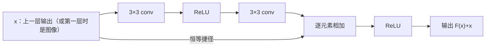
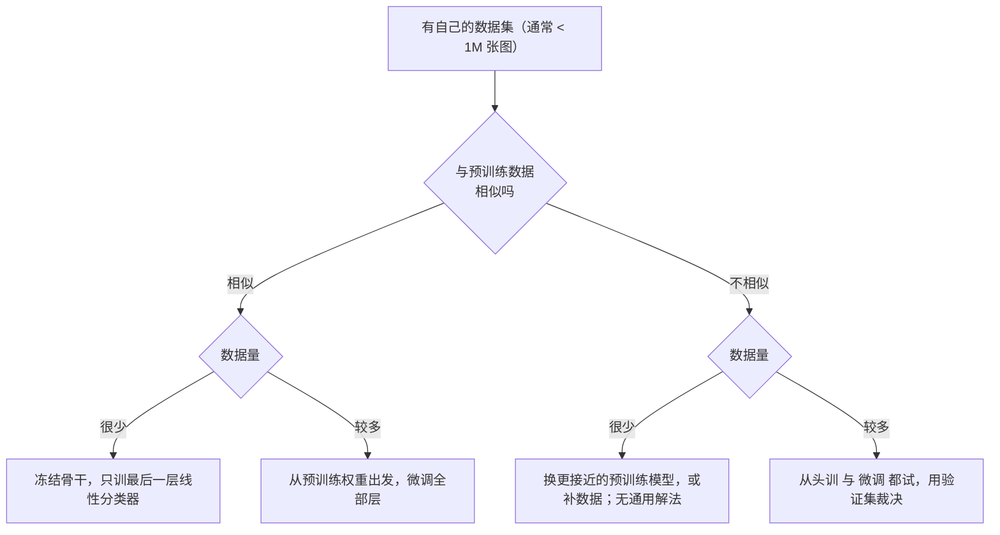

> **课程信息**
>
> - **课程名称**：Stanford CS231n: Deep Learning for Computer Vision（Spring 2025）
> - **本讲主题**：Lecture 6. CNN Architectures（CNN 架构，兼讲 CNN 的训练流程）
> - **主讲教师**：Zane Durante
> - **授课日期**：2025-04-17
> - **课程主页**：[cs231n.stanford.edu/2025](https://cs231n.stanford.edu/2025/schedule.html)
> - **官方课件**：[lecture_6.pdf](</attachments/cs231n-db08ba91551d99531198bb6b.pdf>)（97 页，正文按页链接本地课件）
> - **字幕来源**：[cs231n_sp25_kor_sub · eng](https://github.com/lpaiu-cs/cs231n_sp25_kor_sub/tree/main/eng)（公开英文转写，中文由本书重写）
> - **版权说明**：幻灯片与课程材料版权归 Stanford University 及授课教师所有；本书为非官方学习笔记，仅用于学习与研究。

> **课件索引**：点击下方链接打开本地 PDF 的对应页；全部课件见 [课件索引](/notes/cs231n/slides)。页码按 PDF 文件页序定位，第 1 讲分为 Part 1 / Part 2。

[📄 L6 · 第 1 页｜第 6 讲标题页：Training CNNs and CNN Architectures](</attachments/cs231n-db08ba91551d99531198bb6b.pdf#page=1>)

第 5 讲结束时，手里是一把零件：卷积、池化、填充、步长、感受野。但零件摆在一起不等于网络，更不等于一个能训得出来的网络。本讲前半场回答"这些零件怎么装配成架构"，后半场回答"装配好的东西怎么训"——讲师 Zane Durante 把这条分界线直接写进了总览页：How to build CNNs? 与 How to train CNNs?，各四行。

一条主线贯穿全场：**容量和可优化性不是同一件事**。VGG 证明把 3×3 卷积一层层堆深，能在同等感受野下用更少的参数换来更多非线性；ResNet 却发现"更深"本身会让优化变难，于是用一条恒等捷径把"学映射"改成"学残差"。后半场那四件事——权重初始化、输入归一化、数据增强、迁移学习——都不增加模型的表达能力，它们只做一件事：让已有容量真的能被梯度下降用上。

## 1. 六格组件板：卷积和池化给出空间结构，归一化与 Dropout 负责数值与泛化

*(参考时间: 00:00:05 – 00:16:11｜Lecture 6)*

[📄 L6 · 第 2 页｜课程事务页：作业一与项目提案的两个截止日期](</attachments/cs231n-db08ba91551d99531198bb6b.pdf#page=2>)

幻灯片的第二页是课程事务：Assignment 1 下周三（4/23）23:59 截止，项目提案下周五（4/25）截止。讲师没有在这一页停留，但它出现的位置说明了本讲的定位——作业一收尾、项目开工，正好是把"能搭一个 CNN"变成"能训一个 CNN"的那个节点。后面所有关于初始化、增强、迁移学习的建议，都是为这件事服务的。

[📄 L6 · 第 3 页｜总览页第一帧：上半场 How to build CNNs? 被标红](</attachments/cs231n-db08ba91551d99531198bb6b.pdf#page=3>)

这张总览页把全讲切成两半。上半场"如何搭建 CNN"下挂四行：网络里的层、激活函数、CNN 架构、权重初始化；下半场"如何训练 CNN"下挂四行：数据预处理、数据增强、迁移学习、超参选择。第一帧里上半场标红、下半场整支是灰的。

[📄 L6 · 第 4 页｜总览页第二帧：强调翻到下半场 How to train CNNs?](</attachments/cs231n-db08ba91551d99531198bb6b.pdf#page=4>)

下一帧把强调翻了过来：红色落在"How to train CNNs?"上。讲师自己的评价是下半场"密度低得多"，主要是能在项目里直接照做的操作建议；真正需要动脑的推导集中在上半场。

[📄 L6 · 第 5 页｜总览页第三帧：回到上半场，并点亮 Layers in CNNs 这一行](</attachments/cs231n-db08ba91551d99531198bb6b.pdf#page=5>)

第三帧又切回上半场，并把四行里的第一行 Layers in CNNs 单独点亮。这张页在本讲里前后出现十次（第 3–5 页的引导，加上每讲完一块就回来一次），每次回来红色就往下挪一格——它其实是全讲的进度条，而不是一张目录。

### 1.1 从 3×32×32 到 6×28×28：卷积层的三个数字

[📄 L6 · 第 6 页｜卷积层复习：6 个 5×5 滤波器扫出 6 张 28×28 激活图](</attachments/cs231n-db08ba91551d99531198bb6b.pdf#page=6>)

复习用一页讲完：一张 3×32×32 的 RGB 图像，配 6 个 5×5 的滤波器，每个滤波器在上面滑一遍，在每一个位置做"逐元素相乘再求和，加 bias"，扫出一张 28×28 的激活图，六张叠起来就是 6×28×28 的输出体，最后接一个 ReLU。三个数字各有分工：**滤波器的深度必须等于输入的深度**（这里是 3，因为图像有三个通道），**滤波器的个数决定输出的深度**（这里是 6），而空间尺寸由 32、5、步长 1、零填充 0 一起决定，$32-5+1=28$。

讲师特意追问了一句：如果后面再接一层卷积，它的深度该是多少？答案是 6——下一层的每个滤波器必须横跨全部六张激活图。这条"深度对齐"规则是后面所有架构图能读懂的前提：VGG 的 block 从 64 个滤波器涨到 512 个，涨的是滤波器个数，而每一层的输入深度恰好等于上一层的输出深度，所以整张网络在深度方向上是一条严丝合缝的链。

### 1.2 池化只做一件事：把 H 和 W 折起来

[📄 L6 · 第 7 页｜池化层复习：2×2 窗口、步长 2 的 max 与 average 两种算法](</attachments/cs231n-db08ba91551d99531198bb6b.pdf#page=7>)

池化层比卷积简单得多：还是滑窗，但窗口 2×2、步长 2，窗口之间不重叠，所以高和宽各减半，深度原封不动。取窗口里的最大值叫最大池化（max pooling），取平均值叫平均池化（average pooling）。讲师的态度很务实：这两种都常用，新建架构时两种都试一遍、看哪个指标好，属于"没有先验、只能实验"的选择。池化的作用是把空间上的信息做一次合并（consolidate），让后面的层在更小的平面上看更大的范围。

### 1.3 归一化的两步公式，和四种"跟谁算统计量"

[📄 L6 · 第 8 页｜CNN 的六格组件板：卷积、池化、全连接在上排，归一化、Dropout、激活函数在下排](</attachments/cs231n-db08ba91551d99531198bb6b.pdf#page=8>)

这张板子值得记住，因为整讲的结构就是它。上排三个（卷积层、池化层、全连接层）在第 5 讲已经拆过；下排三个（归一化层、Dropout、激活函数）是本讲要补的。全连接层的图注很直白：$x \to h \to s$，一次矩阵乘法加一个激活函数，就这么多。讲师的原话是：这些经典模型里其实只有三种层，却打败了在此之前人们试过的一切方法。

[📄 L6 · 第 9 页｜组件板第二帧：归一化层被红框框住](</attachments/cs231n-db08ba91551d99531198bb6b.pdf#page=9>)

红框挪到"归一化层"上，公式一并给出：

$$
\hat{x}_{i,j}=\frac{x_{i,j}-\mu_j}{\sqrt{\sigma_j^2+\varepsilon}}
$$

这就是所有归一化层共用的第一步：减均值、除标准差，把数据搬成零均值、单位方差的高斯分布，$\varepsilon$ 只是防止除零的小常数。整讲后面反复出现的差别，全在 $\mu_j$ 和 $\sigma_j$ 这两个统计量"用哪些数算出来"。

[📄 L6 · 第 10 页｜LayerNorm 第一步：把每个样本归一化到零均值、单位方差](</attachments/cs231n-db08ba91551d99531198bb6b.pdf#page=10>)

第二步才是关键：归一化之后并不停手，而是乘一个可学习的缩放、加一个可学习的平移，让模型自己决定"这一层最舒服的分布是什么"。讲师强调这一步是梯度下降学出来的参数，不是人定的超参。

[📄 L6 · 第 11 页｜LayerNorm 的维度账：x 为 N×D，统计量为 N×1，γ、β 为 1×D](</attachments/cs231n-db08ba91551d99531198bb6b.pdf#page=11>)

维度账写在同一页上。输入 $x$ 是 $N\times D$（N 个样本、每个是 D 维向量），统计量 $\mu,\sigma$ 是 $N\times 1$——每个样本各算一套，所以叫"逐样本"；学到的 $\gamma,\beta$ 是 $1\times D$——每个特征维度一套，所有样本共用。输出就是 $y=\gamma(x-\mu)/\sigma+\beta$。参数量是 $2D$，与样本数无关，这是它能塞进任何一层的原因。

[📄 L6 · 第 12 页｜GroupNorm 论文里的那张图：不同归一化层统计量覆盖的范围不同](</attachments/cs231n-db08ba91551d99531198bb6b.pdf#page=12>)

讲师说这张图"看懂了就等于看懂了所有归一化层"。把输入想成一个 $N\times C\times H\times W$ 的立方体，每种归一化只是选一个不同的子集来算均值和方差：

- **层归一化（LayerNorm）**：每个样本单独处理，统计量覆盖该样本的 $C\times H\times W$ 全部数值，一个样本只有一个均值和一个标准差。
- **批归一化（BatchNorm）**：每个通道一套统计量，覆盖整个 mini-batch 的 $N\times H\times W$，也就是讲师说的"在 batch 内跨样本平均"。
- **实例归一化（InstanceNorm）**：再细一层，每个样本的每个通道各算一套，范围只有 $H\times W$。
- **组归一化（GroupNorm）**：把通道分成若干组，每个样本、每组通道算一套，粒度介于 LayerNorm 与 InstanceNorm 之间。

四者的公式骨架完全一样，差别只在"立方体上涂蓝的那一块是哪几维"。课堂上有同学连着追问三次，讲师的回答可以概括成两句话：LayerNorm 是每个样本一套统计量，BatchNorm 用的是 mini-batch 里跨样本的通道统计量；这里的"通道"就是深度，也就是每个空间位置上有多少个数值。

> 编者说明：BatchNorm 训练时用当前 batch 的统计量，推理时改用训练中累积的滑动平均，这是它与 LayerNorm/InstanceNorm 在工程上的另一处分野；课堂没有展开这一层。

[📄 L6 · 第 13 页｜组件板第三帧：讨论完四种子类后回到板上，归一化这一格仍被红框框着](</attachments/cs231n-db08ba91551d99531198bb6b.pdf#page=13>)

讨论结束，画面切回组件板，红框还留在归一化那一格。这张板子在本讲里像一页活页笔记：红框走到哪一格，哪一格就从"待学"移到"已学"。它同时也是复习工具——如果四种归一化你分不清，先别看公式，回到那张立方体图上问一句"阴影涂的是哪几维"，答案立刻就出来了。

### 1.4 Dropout：训练时随机挖洞，测试时把洞补上

[📄 L6 · 第 14 页｜组件板第四帧：Dropout 被红框框住](</attachments/cs231n-db08ba91551d99531198bb6b.pdf#page=14>)

从归一化走到 Dropout，讲师的过渡只有一句：这是最后一个需要学的层，学完就可以开始看别人搭的架构了。红框落在 Dropout 上，它旁边还挂着一个"(sometimes)"——不是每个架构都有它。

[📄 L6 · 第 15 页｜Dropout 的定义：每次前向传播随机把一部分神经元置零](</attachments/cs231n-db08ba91551d99531198bb6b.pdf#page=15>)

机制本身一句话：每次前向传播，以概率 $p$ 把这一层的部分激活值随机置零。$p$ 是固定超参，0.5 最常见，0.25 也常用。置零之后这些单元对下一层的贡献是 0，所以工程上可以用掩码（mask）直接跳过计算——0 乘任何数都是 0。讲师给的目标函数很直白：**让模型更难拟合训练数据，从而泛化得更好**。

[📄 L6 · 第 16 页｜Dropout 为什么有用：强迫网络学冗余表示、阻止特征共适应](</attachments/cs231n-db08ba91551d99531198bb6b.pdf#page=16>)

为什么这算好主意？讲师的回答是"更多是经验，不是理论"。最直观的解释在猫的那张特征表上：耳朵、尾巴、毛、爪子、狡黠的眼神，每一项投票给"猫"。如果某两个特征在你的数据集里总是同时出现，"有耳朵且毛茸茸"就几乎等价于猫，模型会死死抓住这对组合。Dropout 把其中一半随机挖掉，这对组合就不再总是一起出现，模型被迫学一组更宽泛的对应关系——术语叫阻止特征共适应（co-adaptation）。

课堂上有同学追问：如果是"树"这个类别，你怎么决定丢哪些特征？答案是这个问题不成立——丢弃完全是随机的，人不做任何选择，也正因为不做选择，模型无法预判哪些特征会缺席。代价是训练时模型只看到一部分特征，训练集上的表现会变差；而测试时不再丢弃，全部特征归位，表现反而更好。

[📄 L6 · 第 17 页｜Dropout 的第二种解读：每个二值掩码都是一个共享参数的子模型](</attachments/cs231n-db08ba91551d99531198bb6b.pdf#page=17>)

第二种解读更像算账：每个二值掩码对应一个子网络，Dropout 相当于同时训练一个指数级大的集成，而这些子网络共享同一套参数。页面上给的数字很有冲击力——一个 4096 个单元的全连接层有 $2^{4096}\approx 10^{1233}$ 种掩码，而宇宙里的原子"只有"约 $10^{82}$ 个。这也解释了为什么它只能算"近似"集成：不可能真的对 $10^{1233}$ 个模型做平均。

[📄 L6 · 第 18 页｜测试时的规则：所有神经元都活着，因此必须按概率缩放激活](</attachments/cs231n-db08ba91551d99531198bb6b.pdf#page=18>)

测试时的规则是这条思路的必然结果：不再丢弃任何单元，但要让每个神经元的输出等于它在训练时的期望输出。因为训练时只有一半单元在工作，测试时突然全开，进入下一层的数值会整体偏大，所以必须乘上保留概率把量级拉回去。

[📄 L6 · 第 19 页｜Dropout 总结页：训练时丢，测试时缩放](</attachments/cs231n-db08ba91551d99531198bb6b.pdf#page=19>)

总结页把整节内容压成两行：训练时 drop，测试时 scale。讲师在这里说"具体代码我不讲了"，因为代码只是把这两件事翻译成几行，真正的坑不在写法，而在**别忘了第二件**：只做了 drop、没做 scale 的实现，指标会在推理时莫名其妙地掉一截，而且很难查。

反向传播的问题也有同学问：被置零的单元怎么办？答案和 ReLU 的负半轴一样——那一路的梯度是 0，计算图上的这条路径不用再走，与之相连的权重在这一步不会被更新。不是"更新得少"，是这一步完全不更新。

## 2. 激活函数：Sigmoid 死于饱和，ReLU 用半边定义域换效率，GELU 再把拐角磨圆

*(参考时间: 00:16:13 – 00:21:45｜Lecture 6)*

[📄 L6 · 第 20 页｜总览页第四次出现：这次落到 Activation Functions](</attachments/cs231n-db08ba91551d99531198bb6b.pdf#page=20>)

总览页回来一次，红色标到 Activation Functions 这一行。到此为止 CNN 的层已经讲完，剩下的问题是：这些线性算子叠在一起仍然是线性的，非线性从哪来。

[📄 L6 · 第 21 页｜组件板第五帧：激活函数被红框框住](</attachments/cs231n-db08ba91551d99531198bb6b.pdf#page=21>)

红框移到右下角的激活函数上。卷积是乘加，全连接是矩阵乘，池化是取最大或取平均——前两者是线性的，池化是分段线性且一个参数都没有。这意味着：不插激活函数的话，整条链路在数学上仍然只是一个大的线性映射，深度完全白给。

[📄 L6 · 第 22 页｜组件板第六帧：多出一行字——目标是给模型引入非线性](</attachments/cs231n-db08ba91551d99531198bb6b.pdf#page=22>)

这一帧比上一帧只多了一行字：Goal: Introduce non-linearities to our model。整节激活函数的动机就是这一句。

[📄 L6 · 第 23 页｜Sigmoid 的第一帧：把数值压到 \[0,1\]，并在两端饱和](</attachments/cs231n-db08ba91551d99531198bb6b.pdf#page=23>)

Sigmoid 的历史地位来自一个漂亮的解释：它像神经元的"放电率"，把任意实数压进 $[0,1]$。但讲师把它作为反面教材：多层 sigmoid 叠起来，反向传播时梯度会一层比一层小。

[📄 L6 · 第 24 页｜Sigmoid 的第二帧：问题被点破——两端梯度趋近于零](</attachments/cs231n-db08ba91551d99531198bb6b.pdf#page=24>)

讲师把这个问题抛给全班：sigmoid 在哪些区域梯度很小？答案是很负和很正的两端。从图上看得更清楚：只有在 0 附近那一段导数才明显非零，越往两端越平，很快就接近 0。这意味着只要进入 sigmoid 的数值偏大或偏小，回传的梯度就接近于零，深层的网络还没开始学就先"哑"了。

[📄 L6 · 第 25 页｜ReLU：f(x)=max(0,x)，正区间不饱和、计算极便宜](</attachments/cs231n-db08ba91551d99531198bb6b.pdf#page=25>)

ReLU 的第一条优点是正区间根本不饱和——导数是常数 1，回传多少就是多少。第二条优点是便宜：一次 max 比一次 exp 便宜得多。幻灯片上给的实测结论是收敛速度比 sigmoid 快约 6 倍。这两条加起来，就是 2012 年之后它迅速接管的原因。

[📄 L6 · 第 26 页｜ReLU 的补丁：负区间梯度为零，会杀死一部分神经元](</attachments/cs231n-db08ba91551d99531198bb6b.pdf#page=26>)

ReLU 的毛病也在同一页上：输出不是零中心的，而且负区间的梯度恒为 0，这些神经元一旦掉进去就再也收不到梯度，术语叫死 ReLU（dead ReLU）。讲师做了一个很准的对比：sigmoid 是"除了中间一小段，几乎整个定义域梯度都接近 0"；ReLU 是"一半定义域梯度为 1，一半为 0"。后者显然更好，但仍然是半个定义域的死角。

[📄 L6 · 第 27 页｜GELU：f(x)=x·Φ(x)，用高斯的累积分布函数把拐角磨平](</attachments/cs231n-db08ba91551d99531198bb6b.pdf#page=27>)

GELU 就是来补这个死角的。它算的是 $f(x)=x\cdot\Phi(x)$，其中 $\Phi$ 是标准正态的累积分布函数——讲师用"高斯曲线下的面积"来解释：$x$ 很负时面积为 0，输出趋近 0；$x$ 很正时面积趋近 1，输出趋近 $x$。所以它在两端都收敛到 ReLU，但在 0 附近是光滑的、处处有非零梯度，训练时不会出现"拐点处梯度突然断掉"的情况。代价是比 ReLU 贵。幻灯片的结论是：它现在是 Transformer 里的主力激活函数。

[📄 L6 · 第 28 页｜激活函数动物园：ReLU、Leaky ReLU、ELU、GELU、SiLU 五张曲线并排](</attachments/cs231n-db08ba91551d99531198bb6b.pdf#page=28>)

这一页把五个候选并排画出来：ReLU 是 $\max(0,x)$，Leaky ReLU 是 $\max(0.1x,x)$，ELU 在负半轴用 $\alpha(e^x-1)$ 换一段平缓的斜坡，GELU 是 $x\cdot\Phi(x)$，SiLU 是 $x\cdot\sigma(x)$。讲师的说法是"眯起眼睛看，它们长得都差不多"：左边一段平的，右边逐渐变成 $y=x$ 的直线，区别只在拐角怎么处理、负半轴怎么救。他还提了一个口误级别的细节——课堂上把这个 $x\cdot\sigma(x)$ 念成了 SELU，页面上写的其实是 SiLU；两个函数的形状极像（$\sigma$ 与 $\Phi$ 本来就近似），但名字要以页面为准。

[📄 L6 · 第 29 页｜动物园加一问：这些激活函数到底插在 CNN 的哪里](</attachments/cs231n-db08ba91551d99531198bb6b.pdf#page=29>)

问题被写在页面上：CNN 里激活函数插在哪？

[📄 L6 · 第 30 页｜动物园加一答：一律跟在线性算子之后](</attachments/cs231n-db08ba91551d99531198bb6b.pdf#page=30>)

答案是"跟在一切线性算子后面"：全连接层之后、卷积层之后。讲师顺手澄清了术语——前馈层、线性层、全连接层是同一个东西，都是矩阵乘加激活。这个位置约定后面会反复用到：说"一个 3×3 卷积块"，默认就是 conv → ReLU。

## 3. 深度的两次胜利：VGG 把大卷积拆成小卷积，ResNet 给每两层装一条捷径

*(参考时间: 00:21:45 – 00:41:37｜Lecture 6)*

[📄 L6 · 第 31 页｜总览页第五次出现：红色落到 CNN Architectures](</attachments/cs231n-db08ba91551d99531198bb6b.pdf#page=31>)

总览页再回来一次，这次红色标到 CNN Architectures。上半场已经走完一半：层讲完了，激活函数讲完了，接下来是别人已经搭好的网络长什么样。

### 3.1 一张图读完 ILSVRC 六年：误差在掉，层数在跳

[📄 L6 · 第 32 页｜ILSVRC 历年冠军：蓝柱是 top-5 错误率，橙色三角是层数](</attachments/cs231n-db08ba91551d99531198bb6b.pdf#page=32>)

这一页把两件事画在同一张图上：蓝柱是各年冠军在 ImageNet 上的 top-5 错误率，橙色三角是模型的层数。2010 年 Lin et al. 28.2%、2011 年 Sanchez & Perronnin 25.8%，都还是"浅层"方法；2012 年 AlexNet 把错误率压到 16.4%，只用了 8 层；2013 年 ZFNet 11.7%，还是 8 层；2014 年 VGG 19 层做到 7.3%、GoogLeNet 22 层做到 6.7%；2015 年 ResNet 152 层做到 3.6%，第一次越过人类的 5.1%；之后 SENet 一路压到 2.3%。

[📄 L6 · 第 33 页｜ILSVRC 图的第二帧：红框圈出 2012 年的 AlexNet](</attachments/cs231n-db08ba91551d99531198bb6b.pdf#page=33>)

红框先圈住 2012 年那一根柱子。AlexNet 的历史意义不是"更深"，而是"第一个在 ImageNet 上真正跑的 CNN，而且是靠 GPU 训出来的"——讲师明确说这段历史第 3 讲已经讲过，这里只做一个对照物。

[📄 L6 · 第 34 页｜ILSVRC 图的第三帧：红框移到 2014 年的 VGG 与 GoogLeNet](</attachments/cs231n-db08ba91551d99531198bb6b.pdf#page=34>)

红框挪到 2014 年那两根柱子上：VGG（19 层，7.3%）与 GoogLeNet（22 层，6.7%）。同一年两个模型并列上榜，这本身就是信息——堆深度不是唯一的路，只是这一讲选来细讲的那条路是 VGG，因为它把"深度"这个变量单独拎了出来，其余一切（滤波器大小、层数）都尽量规整。

### 3.2 VGG：把 7×7 拆成三个 3×3

[📄 L6 · 第 35 页｜AlexNet、VGG16、VGG19 的块状图并排：橙色方块是一层层堆起来的 3×3 卷积](</attachments/cs231n-db08ba91551d99531198bb6b.pdf#page=35>)

用块状图（block diagram）读架构是这门课的基本功：一个方块代表一层或一组层。橙色块是 3×3 卷积、步长 1、填充 1——步长 1 意味着它访问每个位置而不跳过，填充 1 意味着卷积之后空间尺寸不变。池化统一是 2×2、步长 2。最后接三段全连接：4096、4096、1000，其中 1000 是 ImageNet 的类别数，**分类网络的最后一层永远等于你的类别数**。

VGG16 与 AlexNet 的差别，用讲师的话说就是"AlexNet 的放大版"：卷积全部换成 3×3，而且一次连做两到三层再池化，而不是一层一池化。整张网只有三种层在重复，却把 top-5 错误率从 11.7% 打到 7.3%。

[📄 L6 · 第 36 页｜VGG 页加一问：为什么非要用 3×3 的小滤波器](</attachments/cs231n-db08ba91551d99531198bb6b.pdf#page=36>)

问题被写在架构图旁边：为什么是 3×3？讲师承认他不知道作者是先有直觉还是事后找理由，但他确定另一件事——ResNet 那篇是"先有一个思想实验，再去做实验"。这一句区分很重要：架构论文里的解释，有时是设计动机，有时是事后合理化。

### 3.3 感受野的算术：每加一层 3×3，感受野加 2

[📄 L6 · 第 37 页｜VGG 页加一问：三个 3×3 卷积的有效感受野有多大](</attachments/cs231n-db08ba91551d99531198bb6b.pdf#page=37>)

要回答"为什么用 3×3"，得先会算感受野（receptive field）：激活图上的一个数值，究竟看到了输入图像的多大一块。页面把三个 3×3 卷积串成 Input → A1 → A2 → A3，问题是 A3 上的一个值对应输入上的多大方块。

[📄 L6 · 第 38 页｜第一帧推演：A1 上一个值由输入上的 3×3 区域算得](</attachments/cs231n-db08ba91551d99531198bb6b.pdf#page=38>)

第一层最好数：A1 的每个值来自输入上一个 3×3 的窗口，所以 A1 的感受野是 3×3。

[📄 L6 · 第 39 页｜第二帧推演：A2 的一个值要 3×3 个 A1 值，映射回输入就是 5×5](</attachments/cs231n-db08ba91551d99531198bb6b.pdf#page=39>)

A2 的每个值由 A1 上 3×3 个值算得，而这 9 个值各自又覆盖输入的 3×3，拼起来是 5×5——比 3×3 多出的那一圈，正是相邻窗口重叠的部分。

[📄 L6 · 第 40 页｜第三帧推演：A3 的一个值映射回输入是 7×7](</attachments/cs231n-db08ba91551d99531198bb6b.pdf#page=40>)

再退一层：A3 的一个值 → A2 的 3×3 → A1 的 5×5 → 输入的 7×7。

[📄 L6 · 第 41 页｜第四帧：整块 7×7 覆盖区被填满](</attachments/cs231n-db08ba91551d99531198bb6b.pdf#page=41>)

最后一帧把整块覆盖区填满，答案是 7×7。规律也很干净：**步长 1 的 3×3 卷积，每叠一层感受野加 2**（每往左、右、上、下各扩一格），三层就是 $3+2+2=7$。

[📄 L6 · 第 42 页｜VGG 页给出结论：三个 3×3 堆叠 ≡ 一个 7×7，但更深、参数更少](</attachments/cs231n-db08ba91551d99531198bb6b.pdf#page=42>)

结论叠在同一张图的下方：三个 3×3 卷积（步长 1）的堆叠，与一个 7×7 卷积有相同的有效感受野。

[📄 L6 · 第 43 页｜算账页：3×(3²C²) 对 7²C²，前者只有后者的 55%](</attachments/cs231n-db08ba91551d99531198bb6b.pdf#page=43>)

真正的理由在参数账上。设每层通道数都是 $C$，一个 3×3 卷积的滤波器有 $3\times3\times C$ 个权重，一共 $C$ 个滤波器，就是 $9C^2$；三层是 $27C^2$。而一个 7×7 卷积是 $49C^2$。也就是说，**同样的感受野，小卷积只要 55% 的参数**，而且中间多了两次 ReLU——非线性更多，能表示的关系更复杂。这一条"更少的参数 + 更多的非线性"是 VGG 留给后世的全部遗产。

课堂上有同学追问：这种解释有多少是设计时的直觉，多少是事后追认？讲师说他无法替作者回答 VGG，但 ResNet 那篇他有把握——那是先有假设、再设计实验的典型。这个问题本身值得记住：读架构论文时，"为什么这么设计"和"为什么这么设计有效"是两件事。

### 3.4 ResNet 的起点：56 层输给 20 层，而且不是过拟合

[📄 L6 · 第 44 页｜ILSVRC 图的第四帧：红框圈住 2015–2017 的 152 层，"Revolution of Depth"](</attachments/cs231n-db08ba91551d99531198bb6b.pdf#page=44>)

红框最后一次移动，圈住 2015 年之后的三根柱子，旁边标了一句"Revolution of Depth"（深度革命）。从这里开始，本讲的主角和 VGG 换了个位置：不再是"怎么堆得更深更省"，而是"为什么堆深了反而更差"。

[📄 L6 · 第 45 页｜ResNet 的开场问题：在 plain 网络上继续堆层会发生什么](</attachments/cs231n-db08ba91551d99531198bb6b.pdf#page=45>)

问题被原样写在页面上：在一个"plain"（没有任何花招）的卷积网络上继续堆层，会发生什么？

[📄 L6 · 第 46 页｜实验曲线：56 层的训练误差与测试误差都高于 20 层](</attachments/cs231n-db08ba91551d99531198bb6b.pdf#page=46>)

答案是一张反直觉的曲线：20 层和 56 层的两个模型，无论看训练误差还是测试误差，56 层都比 20 层更差。

[📄 L6 · 第 47 页｜结论页：更深反而更差，而且不是过拟合](</attachments/cs231n-db08ba91551d99531198bb6b.pdf#page=47>)

如果只看测试误差，第一反应是过拟合。但训练误差也一样高，这就把过拟合排除掉了——过拟合的定义是训练集上很好、测试集上变差，而这里两边都差。讲师强调这一句是整讲的转折点：**模型不是记不住，是学不动**。

[📄 L6 · 第 48 页｜假设页：深层模型的表达能力更强，问题出在优化](</attachments/cs231n-db08ba91551d99531198bb6b.pdf#page=48>)

于是有了那条后来被反复引用的推理：深层模型的可表示函数集合是浅层模型的超集（把多出来的层设成恒等映射，就退化成浅层模型），所以表达能力只增不减；既然表达能力没问题，那问题一定在优化——深层模型更难训。

[📄 L6 · 第 49 页｜思想实验：让深层模型至少和浅层一样好，需要它学会恒等映射](</attachments/cs231n-db08ba91551d99531198bb6b.pdf#page=49>)

接下来的思想实验很漂亮：怎样让一个深层模型"至少不差于"浅层模型？按构造法，把浅层模型学到的层原样复制过来，再把多出来的层设成恒等映射（identity mapping），输出就等于输入。问题在于——**让一堆卷积层学会"什么都不做"，对梯度下降来说并不容易**。

[📄 L6 · 第 50 页｜解法第一帧：不去拟合目标映射 H(x)，改为拟合残差](</attachments/cs231n-db08ba91551d99531198bb6b.pdf#page=50>)

ResNet 的解法是换一个拟合对象：不让这些层直接去拟合想要的 $H(x)$，而是让它们拟合残差。

[📄 L6 · 第 51 页｜残差块：H(x)=F(x)+x，F(x)=0 时整块退化为恒等](</attachments/cs231n-db08ba91551d99531198bb6b.pdf#page=51>)

具体做法是把输入 $x$ 原样拷过这两层卷积，在出口处相加：$H(x)=F(x)+x$。于是"学恒等"变成"把 $F(x)$ 学成 0"——只要卷积核全学成 0（实践中是学成很小的值），输出就是 $x$。这条拷过去的支路就叫**残差连接（residual connection）**，这一对卷积加一条捷径就叫**残差块（residual block）**。

[📄 L6 · 第 52 页｜解法第二帧：用层去拟合 F(x)=H(x)-x，而不是 H(x) 本身](</attachments/cs231n-db08ba91551d99531198bb6b.pdf#page=52>)

讲师用一句话总结了这件事的物理含义：**块里学的不再是特征本身，而是特征相对于输入的增量**（delta）。原来要一路把 $x$ 变成 $H(x)$，现在只要学这段差值；差值通常小得多，优化起来也容易得多。抽象层级的直觉并没有丢——每一块仍然在往更高层的表示走，只是它输出的是"上一层再加一点"。

课堂上有两个技术追问值得记下来。第一，相加要求两个张量形状完全一致，这正是所有卷积都用 3×3、步长 1、填充 1 的原因：形状不变才好相加；一旦经过池化，尺寸变了，朴素相加就不成立，所以残差块都放在池化之前。第二，既然只是"加一条线"，能不能靠多训一会儿达到同样效果？讲师的回答是不能——plain 网络不是收敛慢，而是卡在很差的解上，训多久都追不上浅层模型；残差连接改变的是能不能走到好解，不是走多快。

### 3.5 整条 ResNet 的形状：周期性翻倍通道、减半空间

[📄 L6 · 第 53 页｜完整的 ResNet：一个 stem，四组残差块，最后池化接 FC-1000](</attachments/cs231n-db08ba91551d99531198bb6b.pdf#page=53>)

把残差块摞起来就是 ResNet。图上那条绕过每一对卷积的线，就是 $x$ 被加回去的位置；每个残差块固定两个 3×3 卷积，第一个卷积后接 ReLU，相加之后再接一个 ReLU。

[📄 L6 · 第 54 页｜架构第二帧：每隔一段就把滤波器数翻倍、用步长 2 把空间减半](</attachments/cs231n-db08ba91551d99531198bb6b.pdf#page=54>)

这条设计规则值得单独记：**每经过一组残差块，滤波器数翻倍、空间尺寸减半**，激活体的体积大致保持不变。讲师给的画面感是：输入是一张又薄又大的图，随着层数加深，它变得越来越小、越来越厚，最后压成一个向量去做分类。

[📄 L6 · 第 55 页｜架构第三帧：最前面还有一个较大的 7×7 卷积作为 stem](</attachments/cs231n-db08ba91551d99531198bb6b.pdf#page=55>)

另一处细节是开头那个 7×7、步长 2 的卷积（stem）。讲师说这一层是纯经验产物：加上它，指标更好，没有更深的理论。它负责在进入残差块之前先把 224×224 砍到 112×112，省下后面所有的计算。

[📄 L6 · 第 56 页｜架构第四帧：ImageNet 版一共四档深度 18/34/50/101/152](</attachments/cs231n-db08ba91551d99531198bb6b.pdf#page=56>)

同一套积木能拼出不同深度，ImageNet 上常用的几档是 18、34、50、101、152 层。

[📄 L6 · 第 57 页｜ResNet 结果页：152 层、3.57% top-5，横扫 ILSVRC'15 与 COCO'15](</attachments/cs231n-db08ba91551d99531198bb6b.pdf#page=57>)

结果页给的是三个数字：152 层、ILSVRC'15 分类冠军、3.57% 的 top-5 错误率，并且同一年把 ILSVRC'15 与 COCO'15 的分类、检测任务全部扫了一遍。讲师补了一句当时的氛围：那两年几乎所有视觉任务都默认用 ResNet 当骨干网。

课堂上有同学问 152 这个数字是怎么定的。讲师的回答很诚实：他不知道作者的原始考量，但一般做法是从小往大试——先训 18 层，再加到 34 层看指标，一直加到收益不再明显为止（101 到 152 大约只差 1%），同时还要受显存限制：参数越多，能塞进一张卡的模型就越小。他还补了一句工程细节：这些不同深度的模型是各自独立训练的，不是从一个模型里"切"出来的。

## 4. 初始化与输入归一化：让 152 层的激活分布不塌也不炸

*(参考时间: 00:42:02 – 00:50:23｜Lecture 6)*

[📄 L6 · 第 58 页｜总览页第六次出现：红色落到 Weight Initialization](</attachments/cs231n-db08ba91551d99531198bb6b.pdf#page=58>)

总览页回来，红色落在上半场的最后一行 Weight Initialization。讲师在这里插了一句实话：架构已经会搭了，但同样的架构，权重初值选错就完全训不起来。

[📄 L6 · 第 59 页｜初始化问题页：网络层的权重到底该取什么值](</attachments/cs231n-db08ba91551d99531198bb6b.pdf#page=59>)

问题被原样抛出：一个网络层的权重该初始化成什么？答案不是"随便随机"，因为随机也有量级。

### 4.1 初值太小：每过一层，激活就往 0 塌一截

[📄 L6 · 第 60 页｜实验设置：6 层全连接网络，隐层 4096 维，权重取 0.01 倍标准正态](</attachments/cs231n-db08ba91551d99531198bb6b.pdf#page=60>)

实验设置很干净：6 层全连接网络，每层 4096 维，权重取标准正态再乘 0.01，每层后接 ReLU，然后画出前向传播时每一层激活的均值和标准差。

[📄 L6 · 第 61 页｜结果页：标准差逐层缩水，越深的层激活越接近 0](</attachments/cs231n-db08ba91551d99531198bb6b.pdf#page=61>)

结果是一条单调下滑的曲线：第一层还有像样的均值与方差，越往后越小，到最后几乎全部塌到 0 附近。讲师补了一句理想状态：**我们希望每一层的激活分布都差不多**，因为分布稳定，优化问题才好解。0.01 之所以"看起来很小很安全"，恰恰是因为它把每一层都按比例缩小了一点，乘六次就没了。

### 4.2 初值太大：同一个乘法关系反过来咬人

[📄 L6 · 第 62 页｜对照实验：把初始化标准差从 0.01 调到 0.05](</attachments/cs231n-db08ba91551d99531198bb6b.pdf#page=62>)

把标准差从 0.01 调到 0.05，只改了一个数字。

[📄 L6 · 第 63 页｜结果页：激活迅速爆炸，均值和标准差一层比一层大](</attachments/cs231n-db08ba91551d99531198bb6b.pdf#page=63>)

曲线立刻翻了个面：每一层都在放大，到后面均值和标准差都变成巨大的数。讲师的原话是"想象你在训一个 152 层的 ResNet"，这个放大过程重复 152 次，数值早就溢出了。0.01 会塌、0.05 会炸，中间那个"刚刚好"的值大概是 0.022——但这只是一个特定设置下的幸运数字，换一层维度就失效。

课堂上有同学追问爆炸的机理，讲师用一个递推关系解释：每一层都是"随机矩阵乘向量再 ReLU"，如果这个乘法的平均增益大于 1，就会一层层放大；ReLU 又把负的一半砍掉，剩下的全为正，均值还会继续往正方向漂。反过来，增益小于 1 就一层层衰减。理想的初值，就是让这个增益恰好等于 1。

### 4.3 Kaiming 初始化：把"刚刚好"写成一个和维度有关的公式

[📄 L6 · 第 64 页｜修法页：正确的尺度取决于这一层的输入维度](</attachments/cs231n-db08ba91551d99531198bb6b.pdf#page=64>)

所以初始化不能是一个常数，它必须是这一层维度的函数：4096 维的全连接层和 2048 维的，需要的标准差不同。

[📄 L6 · 第 65 页｜Kaiming/MSRA 初始化：std = sqrt(2/Din)，六层统计量几乎不变](</attachments/cs231n-db08ba91551d99531198bb6b.pdf#page=65>)

答案就是 Kaiming 初始化（也叫 MSRA 初始化）：标准差取 $\sqrt{2/D_{\text{in}}}$，其中 $D_{\text{in}}$ 是该层的输入维度，系数 2 是专门为 ReLU 做的修正——ReLU 砍掉一半，方差就少一半，所以要先把方差补一倍回去。代码只有一行：`W = np.random.randn(Din, Dout) * np.sqrt(2/Din)`。效果页上写着六层的统计量：均值 0.57、0.57、0.56、0.55、0.55、0.55，标准差 0.83、0.83、0.83、0.81、0.81、0.81——几乎是一条水平线。

讲师对推导的态度很坦率：过程不展开，"你们可以把它当成一个魔法公式，插进去就得到想要的性质"，想追根就去读 He et al. 2015 那篇。他还给了两条边界：卷积层用同一套公式，只是 $D_{\text{in}}$ 要按 $3\times3\times C_{\text{in}}$ 来算（卷积核尺寸乘输入通道数）；如果哪天你发明了一种没人做过的新层，公式就不保证有效，只能拿几组初始化去试。

课堂最后有人问：既然归一化层能把激活拉回标准分布，是不是就不用操心初始化了？讲师承认归一化确实能挡住"爆炸"这个具体症状，但优化仍然可能更难——初始化解决的是起点，归一化解决的是沿途，两者不能互相替代。

### 4.4 输入归一化：整件事只有三个数字

[📄 L6 · 第 66 页｜总览页第七次出现：进入下半场，红色落到 Data Preprocessing](</attachments/cs231n-db08ba91551d99531198bb6b.pdf#page=66>)

总览页切到下半场，红色落到 Data Preprocessing。上半场（怎么搭）到此结束，剩下的四块都是"怎么训"。

[📄 L6 · 第 67 页｜图像归一化的 TLDR：逐通道减均值、除标准差，统计量只有三个数](</attachments/cs231n-db08ba91551d99531198bb6b.pdf#page=67>)

图像上的预处理简单到可以一句话说完：对每个通道算一个均值和一个标准差（RGB 三个通道，一共六个数字，页面上说的"3 numbers"指三个通道的均值），然后每个像素减去本通道均值、除以本通道标准差。它要求你在训练前把整个数据集的统计量算出来，且**统计量是数据集相关的**。工程上的通行做法是直接用 ImageNet 的均值和标准差，哪怕你训的不是 ImageNet——讲师承认这不严谨，但它是事实标准，只有当你的数据分布离自然图像很远时才值得重算。

## 5. 数据增强与迁移学习：先改数据的分布，再借别人的权重

*(参考时间: 00:50:25 – 01:07:14｜Lecture 6)*

[📄 L6 · 第 68 页｜总览页第八次出现：红色落到 Data augmentation](</attachments/cs231n-db08ba91551d99531198bb6b.pdf#page=68>)

总览页回来，这一次下半场的四行全部亮起，红色停在 Data augmentation 上。从这里到全讲结束，内容都是能直接抄进项目的操作。

### 5.1 正则化的统一句式：训练时加随机，测试时把随机平均掉

[📄 L6 · 第 69 页｜正则化的通用模式：训练加随机性，测试把随机性平均掉](</attachments/cs231n-db08ba91551d99531198bb6b.pdf#page=69>)

讲师先给了一个句式，后面所有技巧都能套进去：训练时注入某种随机性，测试时把这份随机性平均掉（有时只能近似）。

[📄 L6 · 第 70 页｜同一页的例证：Dropout 就是"训练随机丢、测试全用再按 p 缩放"](</attachments/cs231n-db08ba91551d99531198bb6b.pdf#page=70>)

Dropout 是这个句式的标准例证：训练时随机丢掉一半激活，测试时全部启用、再按保留概率缩放。同一套逻辑搬到输入上，就是数据增强。

### 5.2 数据增强：让同一张图每次看起来都不一样

[📄 L6 · 第 71 页｜数据增强的流水线：从数据集取图和标签，变换之后再算损失](</attachments/cs231n-db08ba91551d99531198bb6b.pdf#page=71>)

流程图很短：从数据集里取一张图和它的标签（猫），在送进网络之前做一次变换，再算损失。讲师说这在现代深度学习里几乎是无条件启用的——"基本总是"。收益有两层：一是**等效扩大了数据集**，同一张图每次看到的都是不同版本；二是模型没法靠背题过关，训练损失会更高，但泛化更好。

[📄 L6 · 第 72 页｜水平翻转：对称类物体几乎免费，读文字的模型绝对不能用](</attachments/cs231n-db08ba91551d99531198bb6b.pdf#page=72>)

最简单的增强是水平翻转。它对日常物体几乎免费，因为大多数物体左右对称；但对"要读文字"的任务是灾难——翻转之后就像照镜子，字全反了。竖直翻转则是另一回事：日常物体几乎不会倒过来出现，所以一般不用；但显微镜图像、俯拍图像里它完全合理。这条判断标准适用于所有增强：**这个变换之后，人类还认得出类别吗？**

[📄 L6 · 第 73 页｜随机裁剪与缩放：ResNet 的训练配方与测试时增强](</attachments/cs231n-db08ba91551d99531198bb6b.pdf#page=73>)

最常用的一种叫随机缩放裁剪（random resized crop），页面上给了 ResNet 的完整参数。训练时：先在 $[256,480]$ 里随机取一个 $L$，把图像短边缩放到 $L$（保持长宽比），再从里面随机裁一块 224×224。测试时则做测试时增强（test time augmentation, TTA）：把图缩放到 $\{224,256,384,480,640\}$ 五个尺度，每个尺度取 10 个 224×224 的裁剪（四角 + 中心，再各自翻转），把所有预测平均。

讲师对 TTA 的评价很实在：**1% 到 2% 的稳定提升**，代价是推理要跑 50 次前向（5 个尺度 × 10 个裁剪），只在"真的在乎最后零点几个点"的场合值得用。他还解释了随机缩放裁剪为什么好用：它同时改变了尺度、位置和有效分辨率，而人类看这些变体仍然认得出是猫。

[📄 L6 · 第 74 页｜颜色抖动：随机改对比度和亮度](</attachments/cs231n-db08ba91551d99531198bb6b.pdf#page=74>)

颜色抖动（color jitter）走的是另一条路：随机调对比度和亮度，让画面偏灰或偏亮。这类变换都是传统图像处理，参数怎么定？讲师给了同一个判据——调到"看起来仍然像同一个分布、人还认得出"为止，就是合适的强度。

[📄 L6 · 第 75 页｜Cutout：训练时随机挖掉一块，测试时用整图](</attachments/cs231n-db08ba91551d99531198bb6b.pdf#page=75>)

最后一种是 Cutout：训练时把图像的随机矩形区域置零（黑块或灰块），测试时用完整图像。讲师说它不算主流，但很能说明"增强可以按场景定制"——如果你的相机经常被遮挡、物体经常只露出一部分，这种增强就是在为部署环境做预习。幻灯片上还点出了三者的血缘：Dropout、数据增强、Cutout/随机裁剪，本质都是同一件事在不同位置上做。

### 5.3 迁移学习：把 ImageNet 训出来的特征当免费的特征提取器

[📄 L6 · 第 76 页｜总览页第九次出现：红色落到 Transfer Learning](</attachments/cs231n-db08ba91551d99531198bb6b.pdf#page=76>)

总览页回来，红色落到 Transfer Learning。这是本讲最"能用"的一块：绝大多数人的数据集都没有一百万张图。

[📄 L6 · 第 77 页｜问题页：数据不多，还能训 CNN 吗](</attachments/cs231n-db08ba91551d99531198bb6b.pdf#page=77>)

问题问得很直接：如果数据不多，还能训卷积网络吗？讲师说答案是能，但得聪明一点。

[📄 L6 · 第 78 页｜层级特征的证据：AlexNet 第一层 64 个 3×11×11 的滤波器](</attachments/cs231n-db08ba91551d99531198bb6b.pdf#page=78>)

依据来自第 5 讲讲过的层级特征：第一层的滤波器（AlexNet 是 64 个 3×11×11）学到的还是边缘、色块、小图案，越往上越抽象。这意味着**底层的特征几乎是通用的**，和你的具体任务关系不大。

[📄 L6 · 第 79 页｜特征空间的近邻：用倒数第二层的向量做 L2 最近邻，同类图像自动聚在一起](</attachments/cs231n-db08ba91551d99531198bb6b.pdf#page=79>)

更强的证据在下一页：把图像送进网络，取分类层之前那个向量（4096 维或 2048 维），在特征空间里算 L2 距离找最近邻，同一类别的图像会紧紧聚在一起。也就是说，这个向量本身就是一个很好的特征表示——在它上面套一个线性分类器或 kNN，效果就已经不错。这相当于把 CNN 当成一个**预定义的特征提取器**，和旧范式里那些手工设计的特征（颜色直方图之类）占同一个位置，只是它强得多。

[📄 L6 · 第 80 页｜迁移学习第一步：在 ImageNet（或互联网级数据）上训一个大模型](</attachments/cs231n-db08ba91551d99531198bb6b.pdf#page=80>)

标准流程分三步。第一步：在一个超大数据集（ImageNet 或者互联网级数据）上训一个大模型，或者直接下载别人训好的。

[📄 L6 · 第 81 页｜迁移学习第二步：冻结所有卷积层，把最后一层换成 C 类并只训它](</attachments/cs231n-db08ba91551d99531198bb6b.pdf#page=81>)

第二步（小数据集）：把除最后一层之外的所有层冻结——参数原样保留，梯度不回传——然后把 FC-1000 换成 FC-C（C 是你的类别数）并用 Kaiming 初始化，只训这一层。讲师说这一步在数学上等价于：先用整个网络把每张图变成一个 4096 维向量，再在这个向量上训一个线性分类器。这就是"把预训练模型当特征提取器"的字面意思。

[📄 L6 · 第 82 页｜迁移学习第三步：数据更多时，从预训练权重出发微调整个网络](</attachments/cs231n-db08ba91551d99531198bb6b.pdf#page=82>)

第三步（较大的数据集）：解冻全部层，从预训练权重出发微调（fine-tune）整个网络。讲师说他自己几乎所有项目都走这一步：手里有一百万到一千万张图，先从一个在几十亿张图上训出来的模型出发，再在小数据集上微调，效果稳定好于从头训——因为那个模型见过的数据多，特征提取器更好，而微调又能让它适配你的具体问题。

[📄 L6 · 第 83 页｜迁移学习决策矩阵：横轴是数据集相似度，纵轴是数据量，四格先空着](</attachments/cs231n-db08ba91551d99531198bb6b.pdf#page=83>)

讲师把选择摊成一张 2×2 的矩阵：横轴是"你的数据集与预训练数据有多像"，纵轴是"你有多少数据"，四个格子先空着。

[📄 L6 · 第 84 页｜决策矩阵第二帧：相似数据集的两格被填上](</attachments/cs231n-db08ba91551d99531198bb6b.pdf#page=84>)

相似 + 数据少：用线性分类器打在最后一层上（第二步）。相似 + 数据多：微调全部层（第三步）。

[📄 L6 · 第 85 页｜决策矩阵第三帧：不相似数据集的两格被填上](</attachments/cs231n-db08ba91551d99531198bb6b.pdf#page=85>)

不相似 + 数据少：最难受的格子，只能换一个更接近的预训练模型，或者去收集数据。不相似 + 数据多：从头训和"预训练 + 微调"都值得试，哪个好没有定论，只能实验。

讲师对这张矩阵的边界说得很清楚：只有"不相似 + 数据少"这一格没有可靠答案，其余三格在实践中都很稳。他还提到介于"只训最后一层"和"全训"之间的第三条路——只训一部分层，或者用 LoRA 这类方法只学低秩的增量（这与他前面讲残差时的"学差值而不是学值"是同一个思想），但具体细节留给 Transformer 那一讲。

[📄 L6 · 第 86 页｜结论页：数据不足一百万张时的两条建议与两个模型库](</attachments/cs231n-db08ba91551d99531198bb6b.pdf#page=86>)

页面的收尾是两条建议：找一个类似的大数据集训大模型，然后迁移到你的数据上；以及别自己从头训——PyTorch 的 `torchvision` 和 Hugging Face 的 `pytorch-image-models`（timm）里有现成的模型动物园（model zoo）。

## 6. 超参搜索：先过拟合一个样本，再在随机点上采样

*(参考时间: 01:07:14 – 01:10:34｜Lecture 6)*

[📄 L6 · 第 87 页｜总览页第十次出现：红色落到最后一行 Hyperparameter Selection](</attachments/cs231n-db08ba91551d99531198bb6b.pdf#page=87>)

总览页最后一次回来，红色落到 Hyperparameter Selection。

[📄 L6 · 第 88 页｜调参流程前三步：查初始损失、过拟合小样本、找能让损失下降的学习率](</attachments/cs231n-db08ba91551d99531198bb6b.pdf#page=88>)

流程的前三步是排查而不是搜索。第一步，看初始损失：刚初始化、还没训练时，损失应该落在理论值附近（随机猜的损失），差很远说明初始化或损失函数写错了。第二步，**过拟合一个小样本**：拿一两个样本甚至一张图，训练损失应该能掉到接近 0；如果掉不下去，代码里有 bug，或者这个模型根本表达不了你的问题。讲师说这一步还能顺带告诉你学习率的量级。第三步，用全部数据、打开一点点权重衰减，在约 100 次迭代内找一个能让损失明显下降的学习率，常用档位是 `1e-1`、`1e-2`、`1e-3`、`1e-4`、`1e-5`。

[📄 L6 · 第 89 页｜调参流程六步版：粗网格跑 1–5 个 epoch，再细化网格跑更久](</attachments/cs231n-db08ba91551d99531198bb6b.pdf#page=89>)

第四步是在学习率附近铺一张粗网格，每个配置只跑 1–5 个 epoch；第五步把网格收细、训练更久；第六步开始看曲线——下一组幻灯片就是四种典型形状。

[📄 L6 · 第 90 页｜训练/验证曲线第一帧：两条曲线都还在上升，说明还没训够](</attachments/cs231n-db08ba91551d99531198bb6b.pdf#page=90>)

第一种形状：训练和验证准确率都还在往上走。这时不用调参，接着训就行。

[📄 L6 · 第 91 页｜训练/验证曲线第二帧：验证曲线冲高回落，训练曲线继续上行](</attachments/cs231n-db08ba91551d99531198bb6b.pdf#page=91>)

第二种形状是本讲的提问页：训练准确率一路向上，验证准确率冲到一个峰值之后开始下滑——中间那道口子就是过拟合。

[📄 L6 · 第 92 页｜训练/验证曲线第三帧：巨大的训练/验证间隙，需要加正则或加数据](</attachments/cs231n-db08ba91551d99531198bb6b.pdf#page=92>)

讲师给的处方是二选一：加大正则化（Dropout、权重衰减、数据增强），或者去拿更多数据。两条都做不到，就只能在峰值处早停。他还提醒一个容易搞反的说法：看的是**准确率**曲线的形状；如果看损失，是训练损失下降、验证损失回升。

[📄 L6 · 第 93 页｜训练/验证曲线第四帧：两条曲线贴合，属于欠拟合](</attachments/cs231n-db08ba91551d99531198bb6b.pdf#page=93>)

第三种形状：两条曲线几乎贴在一起，而且都不高。这不是过拟合，是欠拟合——模型容量不够或训练不够，可以训更久，也可以换更大的模型。

[📄 L6 · 第 94 页｜流程第七步：GOTO 第五步，把这张循环一直转下去](</attachments/cs231n-db08ba91551d99531198bb6b.pdf#page=94>)

第七步只有一行字：GOTO 第五步。调参不是一个一次性流程，而是一个"粗调—细化—看曲线—再细化"的循环，直到验证指标不再改善。

[📄 L6 · 第 95 页｜随机搜索 vs 网格搜索：不重要参数上撒点，重要参数才能被采得更密](</attachments/cs231n-db08ba91551d99531198bb6b.pdf#page=95>)

最后一个问题：多个超参一起调，该不该穷举所有组合？讲师的答案是不该，**随机搜索优于网格搜索**。理由是那张示意图：纵横两个轴，一个是重要超参、一个是不重要超参。网格搜索每次只在重要参数上取几个离散值，其余的点全浪费在不重要参数的重复取值上；随机撒点则让重要参数被采得更密、更细。所以正确做法是给每个超参定一个区间，然后从区间里随机采样，一直采到指标不再提升。

## 7. 小结

*(参考时间: 01:10:38 – 01:10:59｜Lecture 6)*

[📄 L6 · 第 96 页｜总结页上半：层、激活函数、架构、初始化四个主题](</attachments/cs231n-db08ba91551d99531198bb6b.pdf#page=96>)

上半页列的是"怎么搭"的四件事：层（Conv、FC、Norm、Dropout）、激活函数（ReLU、GELU 等）、架构（VGG、ResNet）、权重初始化——最后一条被概括成一句话，"维持激活分布"。这四个词就是上半场的全部考点。

[📄 L6 · 第 97 页｜总结页下半：预处理、增强、迁移学习、超参四个主题](</attachments/cs231n-db08ba91551d99531198bb6b.pdf#page=97>)

最后两页把全讲收成八个主题，前四个属于"怎么搭"，后四个属于"怎么训"。把这两页拆成可带走的判断：

- CNN 的层清单只有六格，经典架构里真正被反复使用的只有三格：卷积、池化、全连接；归一化与 Dropout 是后加的数值与泛化补丁。
- 归一化层共用同一个两步公式，四种子类的差别只在"统计量覆盖哪一维"，而不是公式本身。
- Dropout 的收益来自破坏特征共适应，代价是训练集上更差；测试时必须按保留概率缩放，否则数值量级会漂。
- 激活函数的演化只有一条主线：别让梯度在定义域的绝大部分上等于零——ReLU 砍掉半个定义域，GELU 再把拐角磨圆。
- 三个 3×3 卷积 ≡ 一个 7×7 卷积的感受野，但参数只有后者的 55%，还多两次非线性；这是"小卷积堆深"的全部理由。
- 深层网络训不动不是过拟合而是优化问题，残差连接把"学映射"换成"学差值"，让"至少不差于浅层"变成一件容易的事。
- 初始化的目标是让每层激活分布保持不变，$\sqrt{2/D_{\text{in}}}$ 是这件事的解析解；输入归一化是同一件事在数据侧的做法。
- 数据不够时的正确顺序是：先增强（改数据分布），再迁移（借别人权重），最后才调超参——超参只能在模型已经能学的前提下起作用。
