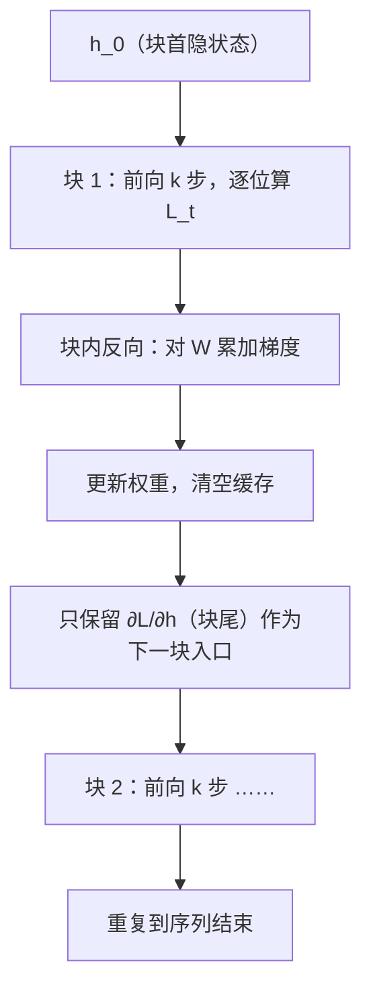
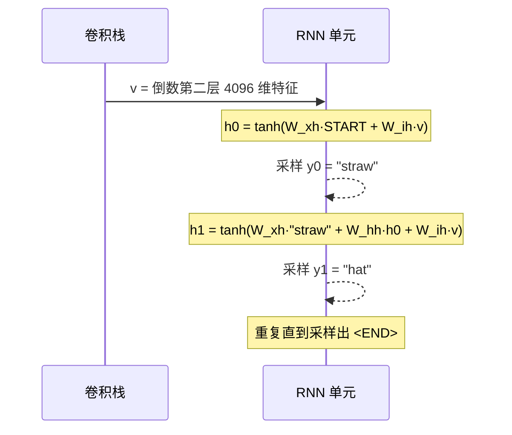

> **课程信息**
>
> - **课程名称**：Stanford CS231n: Deep Learning for Computer Vision（Spring 2025）
> - **本讲主题**：Lecture 7. Recurrent Neural Networks
> - **主讲教师**：Zane Durante
> - **授课日期**：2025-04-22
> - **课程主页**：[cs231n.stanford.edu/2025](https://cs231n.stanford.edu/2025/schedule.html)
> - **官方课件**：[lecture_7.pdf](</attachments/cs231n-373a16005af3cef343c7596b.pdf>)（124 页，正文按页链接本地课件）
> - **字幕来源**：[cs231n_sp25_kor_sub · eng](https://github.com/lpaiu-cs/cs231n_sp25_kor_sub/tree/main/eng)（公开英文转写，中文由本书重写）
> - **版权说明**：幻灯片与课程材料版权归 Stanford University 及授课教师所有；本书为非官方学习笔记，仅用于学习与研究。

> **课件索引**：点击下方链接打开本地 PDF 的对应页；全部课件见 [课件索引](/notes/cs231n/slides)。页码按 PDF 文件页序定位，第 1 讲分为 Part 1 / Part 2。

[📄 L7 · 第 1 页｜本讲标题页：Lecture 7 循环神经网络](</attachments/cs231n-373a16005af3cef343c7596b.pdf#page=1>)

前六讲的所有网络都建立在一个假设上：输入是一个固定尺寸的张量，输出是一个固定尺寸的向量。$224\times224\times3$ 的图像进去，1000 维的分数出来，中间无论堆多少层卷积、多少条残差，形状从头到尾是定死的。这一讲要把这个假设拆掉。图像描述要让一张图吐出一句长短不定的句子，视频分类要让一叠帧吐出一个标签，语言模型要在一个个字符上反复做同一件事——输入和输出的长度都不固定，甚至可以彼此不相等。

Zane Durante 的解法是把"时间"变成网络的一个维度：同一个函数、同一组权重，在每一个时间步被反复调用，全部历史被压进一个定长向量。这个设计的所有好处（参数量不随序列变长、没有上下文窗口上限）和所有麻烦（必须串行、梯度要沿时间连乘 $T$ 次）都来自同一个事实。所以本讲后半段的重心不是介绍更多结构，而是算一笔账：$\tanh$ 的导数最大是 1，$W_{hh}$ 的奇异值被一次一次乘上去，$T$ 步之后梯度不是消失就是爆炸；LSTM 的全部贡献，说到底是在这条连乘链上开了一条只做逐元素乘法的旁路。

## 1. 先把上次的两个坑填上：Dropout 的缩放与归一化的天花板

*(参考时间: 00:00:05 – 00:05:39｜Lecture 7)*

课上唯一的事务性信息只有两条，且都卡在本周：作业一 4 月 23 日（明天）23:59 截止，项目提案 4 月 25 日（周五）截止。

[📄 L7 · 第 2 页｜课程事务：作业一与项目提案两个截止日期](</attachments/cs231n-373a16005af3cef343c7596b.pdf#page=2>)

上一讲留了两个问题在 Ed 讨论区上，讲师开场先把它们讲清楚，因为两个都涉及"幻灯片上的写法"和"库里的实现"不一致这种最容易被抄错的地方。

[📄 L7 · 第 3 页｜上次课留下的两个澄清：Dropout 的测试期缩放，以及归一化与初始化的关系](</attachments/cs231n-373a16005af3cef343c7596b.pdf#page=3>)

第一个是 Dropout 在测试时怎么缩放。训练时每次前向传播随机把一部分神经元置零，置零比例是超参数，0.5 最常见（Srivastava et al., "Dropout: A simple way to prevent neural networks from overfitting", JMLR 2014）。麻烦出在这个超参数的语义上：**多数库把 $p$ 定义为丢弃概率，而上一讲那张幻灯片的实现把它当成保留概率**，于是同一个符号在两套约定下指向的是相反的操作。

[📄 L7 · 第 4 页｜Dropout：每次前向传播随机把一部分神经元置零，丢弃比例是超参数](</attachments/cs231n-373a16005af3cef343c7596b.pdf#page=4>)

判断标准只有一条：测试时所有神经元都活着，所以必须把激活缩放到"测试期输出 = 训练期输出的期望"。若训练时丢掉了 25%，测试时就乘 0.75——训练期这个神经元的输出有 25% 的概率被置零、75% 的概率是它自己，期望是 $0.75a$；测试期人人都在、输出是 $a$，乘上 $0.75$ 两头的期望才对得上。

[📄 L7 · 第 5 页｜Dropout 的测试期：所有神经元都参与，激活要缩放到与训练期期望一致](</attachments/cs231n-373a16005af3cef343c7596b.pdf#page=5>)

这条规则可以缩成六个字：训练丢，测试缩。这是"测试期缩放"那一版实现；今天多数框架默认反过来，在训练期就把保留的激活除以 keep 概率，测试期什么都不用做——两种写法等价，只差那个常数因子放在哪一侧。

[📄 L7 · 第 6 页｜Dropout 小结：训练时丢弃，测试时缩放](</attachments/cs231n-373a16005af3cef343c7596b.pdf#page=6>)

第二个问题是"归一化能不能救糟糕的初始化"。讲师用一个可以画在纸上的玩具设定来回答：输入是 2 维点，网络是两层 ReLU，目标是按象限输出 1、2、3、4（右上 1、左上 2、左下 3、右下 4）。四种组合各跑一遍——好的 Kaiming 初始化与标准差过大的坏初始化，各自配与不配 LayerNorm。

[📄 L7 · 第 7 页｜归一化的玩具实验：2 维输入、两层 ReLU 网络学习象限函数](</attachments/cs231n-373a16005af3cef343c7596b.pdf#page=7>)

第一帧的结论是显著改善：坏初始化加上 LayerNorm 之后，两条误差曲线都明显掉了下来，从"贴着天花板"变成"能往下走"。

[📄 L7 · 第 8 页｜加上 LayerNorm 后误差显著下降](</attachments/cs231n-373a16005af3cef343c7596b.pdf#page=8>)

但第二帧把话说全了：差距仍然存在。图上蓝色（坏初始化、无归一化）一路挂在 $10^{-1}$ 量级，绿色（坏初始化 + LayerNorm）落到 $2\times10^{-2}$ 附近，红色（好初始化 + LayerNorm）压到 $10^{-2}$，橙色（好初始化、无归一化）与红色几乎重合。也就是说，**归一化能救回一大半，但救不回最后那一截**；想要最好性能，仍然得把初始化做对。

[📄 L7 · 第 9 页｜性能差距依然存在：归一化缓解但不消除初始化问题](</attachments/cs231n-373a16005af3cef343c7596b.pdf#page=9>)

更值得记住的是第三帧的反例：归一化不一定讲得通。象限任务只要求知道"点大概在哪个方向"，减均值、除标准差不会改变象限归属，所以它有用；但如果任务要求精确坐标，标准化恰好把位置信息删掉了，LayerNorm 反而更差。**归一化是在扔信息，扔对了是正则，扔错了是破坏。**

[📄 L7 · 第 10 页｜归一化未必总是合理：LayerNorm 不改变输入的象限，但也抹掉了精确坐标](</attachments/cs231n-373a16005af3cef343c7596b.pdf#page=10>)

澄清结束，讲师回头把"非循环网络"的整套流程收成一张清单：一次性设置（激活函数、预处理、权重初始化、归一化、迁移学习）、训练动力学（盯训练过程、参数更新、超参数优化）、评估（验证集性能、测试时增强）。这张单子是前六讲的全部内容，也是这一讲要绕开的东西。

[📄 L7 · 第 11 页｜训练非循环网络的三段清单：一次性设置、训练动力学、评估](</attachments/cs231n-373a16005af3cef343c7596b.pdf#page=11>)

清单里第二、三项他推荐了一个工具：Weights & Biases。幻灯片上是它的平行坐标图，一列一个超参数，颜色编码验证集精度，这里展示的是 dropout 那一列——低 dropout 的 run 整体精度更高。讲师的原话是他几乎每个项目都用它，TensorBoard 是同类替代。

[📄 L7 · 第 12 页｜用 Weights & Biases 的平行坐标图对比多组超参数的验证集表现](</attachments/cs231n-373a16005af3cef343c7596b.pdf#page=12>)

最后是今天的路线：讨论序列建模；讲 Transformer 之前人们用的简单模型，也就是 RNN 及其变体；再用一页说明 RNN 和今天的**状态空间模型**（state space model，如 Mamba）是什么关系。他的判断很明确：RNN 的关键概念没有过时，只是在很长一段时间里被 Transformer 盖住了。

[📄 L7 · 第 13 页｜今日路线：序列建模、RNN 及其变体、与现代状态空间模型的关系](</attachments/cs231n-373a16005af3cef343c7596b.pdf#page=13>)

对照物先摆出来。香草神经网络（vanilla neural network）是一个定长输入映射到一个定长输出，这也是前六讲唯一处理过的形状。接下来所有新东西，都是在这个形状上动刀。

[📄 L7 · 第 14 页｜香草神经网络：一个固定尺寸输入，一个固定尺寸输出](</attachments/cs231n-373a16005af3cef343c7596b.pdf#page=14>)

## 2. 序列的四种形状：一个隐状态要装下整段历史

*(参考时间: 00:05:51 – 00:13:53｜Lecture 7)*

把"定长"这个约束松开，会得到四种基本形状，幻灯片用四个视觉任务把它们逐一画出来。

| 形状 | 输入 | 输出 | 课堂例子 |
| :--- | :--- | :--- | :--- |
| 一对多（one to many） | 一个定长张量 | 变长序列 | 图像描述：一张图 → 一句单词 |
| 多对一（many to one） | 变长序列 | 一个标签 | 动作识别：一叠视频帧 → 一个类别 |
| 多对多（不对齐） | 变长序列 | 变长序列 | 视频描述：一叠帧 → 一句描述 |
| 多对多（对齐） | 变长序列 | 等长序列 | 逐帧视频分类：每帧一个标签 |

第一种是图像描述：输入一张图，输出一串单词或字符，长度由模型自己决定。

[📄 L7 · 第 15 页｜一对多：图像描述，一张图生成一串单词](</attachments/cs231n-373a16005af3cef343c7596b.pdf#page=15>)

第二种是动作预测：输入是一段视频帧序列，输出是一个动作类别——和图像分类同样的输出形式，只是输入从一张图变成了一叠图。

[📄 L7 · 第 16 页｜多对一：动作预测，一段视频帧映射到一个类别](</attachments/cs231n-373a16005af3cef343c7596b.pdf#page=16>)

第三种是视频描述：输入一叠帧，输出一句描述。输入输出都是序列，长度可以不等，也不必一一对应。

[📄 L7 · 第 17 页｜多对多（不对齐）：视频描述，帧序列生成描述序列](</attachments/cs231n-373a16005af3cef343c7596b.pdf#page=17>)

第四种是逐帧视频分类：每一帧都有标签，输入输出等长。这是本讲前半段的主战场，因为**每个时间步都有输入、都有输出、都有损失**，最适合把 RNN 的机制拆开看。

[📄 L7 · 第 18 页｜多对多（对齐）：逐帧视频分类，每个时间步一个输出](</attachments/cs231n-373a16005af3cef343c7596b.pdf#page=18>)

形状摆完，进入 RNN 本身。最省事的画法是一个标着 RNN 的方块，$x$ 从下面进、$y$ 从上面出，侧面一根箭头绕回自己——**看到这根回指的箭头，就知道这一层是循环层**。

[📄 L7 · 第 19 页｜RNN 的方块画法：输入 x、输出 y，一根箭头回指自己](</attachments/cs231n-373a16005af3cef343c7596b.pdf#page=19>)

这根箭头代表的东西只有一个：RNN 有一个随序列处理而不断更新的**内部状态**，通常叫隐状态（hidden state）。每来一个新输入，就用它和上一个隐状态算出新的隐状态。

[📄 L7 · 第 20 页｜回指箭头的含义：RNN 有一个随序列更新的内部状态](</attachments/cs231n-373a16005af3cef343c7596b.pdf#page=20>)

方块画法在算梯度时很容易看晕，所以标准做法是把它按时间**展开**（unroll）：第 $t$ 个方块的输出喂给第 $t+1$ 个方块，每个方块各自吃一个输入 $x_t$、吐一个输出 $y_t$。展开之后，"当前隐状态依赖当前输入和上一个隐状态"这件事就变成了一张普通的链式计算图。

[📄 L7 · 第 21 页｜展开后的 RNN：每个时间步一个方块，隐状态沿时间传递](</attachments/cs231n-373a16005af3cef343c7596b.pdf#page=21>)

写成公式只有两行。隐状态更新是


$$
h_t = f_W(h_{t-1}, x_t)
$$


其中 $h_{t-1}$ 是旧状态、$x_t$ 是当前时间步的输入向量，$f_W$ 是带参数 $W$ 的函数——和前面几讲的层没有本质区别，仍然是"权重矩阵乘一下、再过个激活函数"，只不过现在它是一个递归式。

[📄 L7 · 第 22 页｜隐状态更新：新状态 = 带参数的函数(旧状态, 当前输入)](</attachments/cs231n-373a16005af3cef343c7596b.pdf#page=22>)

输出由另一个函数给出：


$$
y_t = f_{W_{hy}}(h_t)
$$


$W_{hy}$ 干两件事：把隐状态的维度变成输出的维度（两者本来就可以不一样），并对隐状态做一次可学习的线性变换。所以**算隐状态**和**算输出**是两套参数、两个函数，只是各自在时间上共享。

[📄 L7 · 第 23 页｜输出生成：另一个带参数的函数把隐状态映射到输出维度](</attachments/cs231n-373a16005af3cef343c7596b.pdf#page=23>)

展开图还需要一个起点。隐状态要初始化成某个 $h_0$，原则上它可以是一个学出来的向量，这个例子里则直接给定。

[📄 L7 · 第 24 页｜展开图的起点：隐状态需要初始化 h₀](</attachments/cs231n-373a16005af3cef343c7596b.pdf#page=24>)

到这里可以点出 RNN 最要紧的一条性质：**同一个函数、同一组参数，在每一个时间步被使用**。参数量因此与序列长度无关，代价是第 $t$ 步的信息必须挤进同一个定长向量里。

[📄 L7 · 第 25 页｜注意：每个时间步用的是同一个函数和同一组参数](</attachments/cs231n-373a16005af3cef343c7596b.pdf#page=25>)

最简形式就是所谓香草 RNN（vanilla RNN），也叫 Elman RNN（以 Jeffrey Elman 命名）：隐状态用 $\tanh$，


$$
h_t = \tanh\left(W_{hh}h_{t-1} + W_{xh}x_t\right), \qquad y_t = W_{hy}h_t
$$


选 $\tanh$ 的理由很实际：它把值压在 $-1$ 到 $1$ 之间，反复迭代也不会飞出量级；它零中心、正负都能表示。输出侧最简单的情形就是一次矩阵乘法，不再套激活函数。

[📄 L7 · 第 26 页｜香草 RNN：用 tanh 的隐状态更新，输出可以只是一次矩阵乘法](</attachments/cs231n-373a16005af3cef343c7596b.pdf#page=26>)

课堂上有两个提问值得记下来。其一，旧的 $y$ 能不能影响新的 $h$？在某些写法里可以，最常见的做法是把上一步的输出当成这一步的输入，也就是自回归（autoregressive）建模——这也是后面字符级语言模型的做法。其二，$h_0$ 和 $x_1$ 有什么区别？答案是它们乘的是不同的权重：$h_0$ 走的是隐状态到隐状态的那组参数，$x_1$ 走的是输入到隐状态的那组参数。

## 3. 从一个手搓的 RNN 走到 BPTT：同一个 W 的梯度要相加

*(参考时间: 00:13:57 – 00:36:30｜Lecture 7)*

先给一个能手算到底的例子：输入是 0/1 序列，要求"当前位和上一位都是 1 时输出 1，否则输出 0"。序列 0,1,0,1,1,1,0,1,1 对应的输出是 0,0,0,0,1,1,0,0,1。这是逐位对齐的多对多任务，也是本讲唯一一次把矩阵乘法全部写出来的地方。

[📄 L7 · 第 27 页｜检测连续两个 1：输入序列、逐位输出，以及多对多任务的形式化](</attachments/cs231n-373a16005af3cef343c7596b.pdf#page=27>)

问题被压成一句：隐状态里该装什么？答案由信息瓶颈倒推——输出只看隐状态，而判定需要两样东西，所以隐状态至少要装下"上一位输入"和"当前输入"。

[📄 L7 · 第 28 页｜答案：隐状态里要保留上一位输入与当前输入](</attachments/cs231n-373a16005af3cef343c7596b.pdf#page=28>)

具体做法是把隐状态取成 3 维，第三个分量恒为 1，作用相当于给 ReLU 配一个常数偏置；两个函数 $f_W$ 与 $f_y$ 都取 ReLU，让算术可以口算。$h_0$ 初始化为 $(0,0,1)$，含义是"在此之前已经看到两个 0，所以不该触发"。

[📄 L7 · 第 29 页｜设定：3 维隐状态、两个 ReLU、$h_0=(0,0,1)$](</attachments/cs231n-373a16005af3cef343c7596b.pdf#page=29>)

权重是手写死的，全部逻辑就是一个循环：

```python
w_xh = np.array([[1], [0], [0]])
w_hh = np.array([[0, 0, 0],
                 [1, 0, 0],
                 [0, 0, 1]])
w_yh = np.array([1, 1, -1])

h_t_prev = np.array([[0], [0], [1]])
for t, x in enumerate([0, 1, 0, 1, 1, 1, 0, 1, 1]):
    h_t = relu(w_hh @ h_t_prev + (w_xh @ x))
    y_t = relu(w_yh @ h_t)
    h_t_prev = h_t
```

三个矩阵一共 9 + 3 + 3 = 15 个数，这就是整个模型的全部参数——**参数量与序列长度无关**这件事，在这一页上是字面意义上的。

[📄 L7 · 第 30 页｜手写权重与循环体：三组矩阵乘、两次 ReLU，逐位扫描](</attachments/cs231n-373a16005af3cef343c7596b.pdf#page=30>)

第一个矩阵 $W_{xh}$ 是 $3\times1$ 的列向量 $(1,0,0)^\top$，它的唯一职责是把当前输入写进隐状态的第 1 格：$x=0$ 时贡献零向量，$x=1$ 时贡献 $(1,0,0)$。

[📄 L7 · 第 31 页｜右项的作用：把当前输入写进第 1 格，x=0 得零向量，x=1 得 (1,0,0)](</attachments/cs231n-373a16005af3cef343c7596b.pdf#page=31>)

$W_{hh}$ 的第一行全是 0，所以第 1 格永远不会被历史污染——它每一次都只等于当前输入。

[📄 L7 · 第 32 页｜左项第一行取零：第 1 格只接收当前输入，不被历史改写](</attachments/cs231n-373a16005af3cef343c7596b.pdf#page=32>)

第二行是 $(1,0,0)$，它把上一时刻的第 1 格（也就是"当时的当前位"）搬到第 2 格，于是"当前"变成了这一时刻的"上一位"。

[📄 L7 · 第 33 页｜第二行把当前位下移一位：上一时刻的当前输入成为这一时刻的"上一位"](</attachments/cs231n-373a16005af3cef343c7596b.pdf#page=33>)

第三行是 $(0,0,1)$，把常数 1 原样传下去，输出层要靠它做减法。

[📄 L7 · 第 34 页｜第三行保住常数 1，输出层后面要用它做减法](</attachments/cs231n-373a16005af3cef343c7596b.pdf#page=34>)

输出权重 $W_{hy}=(1,1,-1)$，一次点积就是 `ReLU(当前 + 上一位 − 1)`：两个都是 1 时得到 1，只要有一个是 0 就落到 0 或负数，被 ReLU 截掉。

[📄 L7 · 第 35 页｜输出权重 $(1,1,-1)$：一次点积就是 ReLU(当前 + 上一位 − 1)](</attachments/cs231n-373a16005af3cef343c7596b.pdf#page=35>)

这套权重确实跑得通。但它是人手凑出来的，换成真实任务就无从下手——**问题于是变成：这些 W 在实践中怎么找？** 答案是梯度下降，而 RNN 的梯度必须沿时间走，所以先把展开图写成计算图。顺带一句：把这套权重当初值去训别的任务属于迁移学习，但 3 维隐状态实在太小，实际不会好用。

[📄 L7 · 第 36 页｜权重跑得通，但真实任务里 W 从哪来？](</attachments/cs231n-373a16005af3cef343c7596b.pdf#page=36>)

计算图从一步开始：$h_0$ 和 $x_1$ 进同一个函数 $f_W$，出来 $h_1$。

[📄 L7 · 第 37 页｜计算图第一步：$h_0$ 与 $x_1$ 经过 $f_W$ 得到 $h_1$](</attachments/cs231n-373a16005af3cef343c7596b.pdf#page=37>)

第二步只是把同一个方块再接一次：$h_1$ 与 $x_2$ 给出 $h_2$。

[📄 L7 · 第 38 页｜接上第二步：$h_1$ 与 $x_2$ 经过同一个 $f_W$ 得到 $h_2$](</attachments/cs231n-373a16005af3cef343c7596b.pdf#page=38>)

一直接到第 $T$ 步。整条链就是同一个函数被调用了 $T$ 次。

[📄 L7 · 第 39 页｜展开到第 $T$ 步：同一条链上重复同一个函数](</attachments/cs231n-373a16005af3cef343c7596b.pdf#page=39>)

图上因此可以只标一个 $W$：**每一个时间步复用的是同一个权重矩阵**。这句话是后面所有梯度推导的根源——它意味着 $W$ 在计算图里出现了 $T$ 次，梯度必须把 $T$ 处的贡献全部加起来。

[📄 L7 · 第 40 页｜关键标注：每个时间步复用同一个权重矩阵](</attachments/cs231n-373a16005af3cef343c7596b.pdf#page=40>)

把输出接上就是多对多：每个 $h_t$ 各自经过 $W_{hy}$ 得到 $y_t$。

[📄 L7 · 第 41 页｜多对多：每个隐状态各自产生一个输出](</attachments/cs231n-373a16005af3cef343c7596b.pdf#page=41>)

每个 $y_t$ 都有对应的损失 $L_t$。

[📄 L7 · 第 42 页｜每个时间步各有一个损失](</attachments/cs231n-373a16005af3cef343c7596b.pdf#page=42>)

总损失是逐项相加：$L=\sum_{t=1}^{T}L_t$。反向传播时可以先各自算 $\partial L_t/\partial W$ 再求和，也可以整体一次算完——因为 $W$ 是同一个，两种写法等价。

[📄 L7 · 第 43 页｜总损失是各时间步损失之和，梯度也在同一个 W 上累加](</attachments/cs231n-373a16005af3cef343c7596b.pdf#page=43>)

形状换一下就是多对一：只在最后一步取一个 $y$，损失也只有一项。

[📄 L7 · 第 44 页｜多对一：只保留最后一步的输出](</attachments/cs231n-373a16005af3cef343c7596b.pdf#page=44>)

但对视频分类这类任务，只在最后一帧取输出是浪费的：整段视频都有信息。更常见的做法是对每个时间步的隐状态做平均池化或最大池化，再算出 $y$——什么该保留交给池化，而不是全压在最后一个向量里。

[📄 L7 · 第 45 页｜多对一的实用版本：对所有时间步的隐状态做池化再分类](</attachments/cs231n-373a16005af3cef343c7596b.pdf#page=45>)

反方向是一对多：只有第一步有输入，后面每步都吐一个 $y$。

[📄 L7 · 第 46 页｜一对多：输入只给第一步，之后每一步产生一个输出](</attachments/cs231n-373a16005af3cef343c7596b.pdf#page=46>)

问题是后面那些步骤的 $x$ 从哪来。图上的问号就是这个空缺：$f_W$ 有两个入口，一个期待输入向量，一个期待上一个隐状态，第二个入口不能空着。

[📄 L7 · 第 47 页｜后面那些时间步的输入是空的？](</attachments/cs231n-373a16005af3cef343c7596b.pdf#page=47>)

最省事的填法是填零。

[📄 L7 · 第 48 页｜填零：把后续输入全部置零](</attachments/cs231n-373a16005af3cef343c7596b.pdf#page=48>)

更有用的填法是把上一步的输出接回去，也就是自回归——图像描述正是这么做的：模型看到的"输入"是它自己刚写出的那个词。

[📄 L7 · 第 49 页｜把上一步的输出接回去：自回归式的输入](</attachments/cs231n-373a16005af3cef343c7596b.pdf#page=49>)

有了图就可以谈反向传播。名字叫**沿时间反向传播**（backpropagation through time，BPTT）：先前向走完整个序列算出损失，再反向走完整个序列算梯度。

[📄 L7 · 第 50 页｜BPTT：前向跑完整段序列算损失，反向跑完整段序列算梯度](</attachments/cs231n-373a16005af3cef343c7596b.pdf#page=50>)

它的代价直接写在显存上：每个时间步的激活和梯度都要留着，等反向时用。序列一长，这部分就爆了——讲师的说法是，训练神经网络时几乎所有麻烦最终都归结为显存不够和损失出 NaN。

[📄 L7 · 第 51 页｜代价：整段序列的激活都要留在显存里](</attachments/cs231n-373a16005af3cef343c7596b.pdf#page=51>)

实用的解法是**截断 BPTT**（truncated BPTT）：把序列切成固定长度的块，每次只在块内前向加反向。隐状态照常沿时间传下去，但梯度只往回传 $k$ 步。

[📄 L7 · 第 52 页｜截断 BPTT：隐状态一直往前传，梯度只回传固定的 k 步](</attachments/cs231n-373a16005af3cef343c7596b.pdf#page=52>)

实现上就是滑动这个窗口：块与块之间只传递一个量——块首隐状态对损失的梯度，其余全部丢掉、更新完权重、清空缓存、换下一块。

[📄 L7 · 第 53 页｜滑动窗口：块与块之间只搬一个隐状态，梯度在边界处截断](</attachments/cs231n-373a16005af3cef343c7596b.pdf#page=53>)

如果任务只在最后有一个输出，截断照样成立：每个时间步仍然算梯度，只是不再有"该步自己的损失"，全部靠上游传下来的梯度驱动。

[📄 L7 · 第 54 页｜单输出情形：没有逐步损失，梯度全靠上游传下来](</attachments/cs231n-373a16005af3cef343c7596b.pdf#page=54>)

三个追问值得记下来。**为什么不用每个时间步一套独立的 $W$？** 那就不是递归了，等价于给每个位置训一个独立模型：参数量随长度线性增长、必须预先知道长度、变长序列直接失效，性能通常更差。**截断丢掉了什么？** 丢掉的是跨块的长程梯度，所以它是近似——一次训练变成若干次独立更新，算出来的方向和大 batch 的精确梯度不是一回事。**这在哪见过？** 分布式训练里每张卡各自算梯度、再统一应用到同一份权重上，结构完全一样；区别只是那里切的是设备，这里切的是时间。



截断把显存从 $O(T)$ 降到 $O(k)$，代价是梯度不再精确。讲师的态度很直接：能全部放进显存当然更好，截断是没办法时的办法。

## 4. 112 行 Python 的字符级语言模型：从乱码到莎士比亚

*(参考时间: 00:36:34 – 00:47:58｜Lecture 7)*

下一个例子是真正能跑出结果的那种：字符级语言模型。词表只有四个字符 `[h,e,l,o]`，训练序列是 `"hello"`，模型的任务是**看着当前字符，猜下一个字符**。输入用 one-hot 编码，输出经过 softmax 得到每个候选字符的分数，标签就是序列里右移一位的那个字符——不需要人工标注，文本本身就是标签。

[📄 L7 · 第 55 页｜字符级语言模型：词表 \[h,e,l,o\]、训练序列 "hello"、one-hot 输入](</attachments/cs231n-373a16005af3cef343c7596b.pdf#page=55>)

把隐状态公式叠上去，能看到整条链：每个 one-hot 向量经 $W_{xh}$ 进入当前隐状态，上一个隐状态经 $W_{hh}$ 进来，两者相加过 $\tanh$。

[📄 L7 · 第 56 页｜叠上隐状态公式：$h_t=\tanh(W_{hh}h_{t-1}+W_{xh}x_t)$，两组权重各自标注](</attachments/cs231n-373a16005af3cef343c7596b.pdf#page=56>)

最后一帧接上输出层：每个隐状态经 $W_{hy}$ 得到 4 维分数，行首标出目标字符（e、l、l、o）。第一列分数是 $(1.0, 2.2, -3.0, 4.1)$，而目标是 `e`——**模型在这一步把最高的分数给错了字符**，所以这一步的损失会很大。

[📄 L7 · 第 57 页｜接上输出层与目标字符：每个隐状态给出一组 4 维分数](</attachments/cs231n-373a16005af3cef343c7596b.pdf#page=57>)

测试时的流程反过来：从某个字符起步，一步一步采样并把采样结果喂回去。第一步输入 `h`（one-hot 为 `1,0,0,0`），隐状态 $(0.3,-0.1,0.9)$，输出分数 $(1.0,2.2,-3.0,4.1)$，softmax 之后得到 $(.03,.84,.00,.13)$，采样得到 `e`。

[📄 L7 · 第 58 页｜测试期采样第一步：输入 h，softmax 给出 .84 的 e 并采样得到 e](</attachments/cs231n-373a16005af3cef343c7596b.pdf#page=58>)

这里有个值得记的细节：讲师当场指出这页的 softmax 列和 logits 对不上——分数最大的是 4.1 那一项，而 .84 落在第二项上。他和学生确认了"这页放了好几年没人发现"，然后照旧用它讲采样，因为要讲的机制不受影响。采到 `e` 之后，把它接回输入端，就长出第二列。

[📄 L7 · 第 59 页｜同一页的第二步：把刚采到的 e 作为输入](</attachments/cs231n-373a16005af3cef343c7596b.pdf#page=59>)

第二步把 `e` 喂回去，隐状态变成 $(1.0,0.3,0.1)$，分数 $(0.5,0.3,-1.0,1.2)$，softmax 给出 $(.25,.20,.50,.05)$，采样得到 `l`。**生成过程就是这样一位一位接出来的**。

[📄 L7 · 第 60 页｜第二步的结果：喂回 e 之后采样得到 l（概率 .50）](</attachments/cs231n-373a16005af3cef343c7596b.pdf#page=60>)

第三步同理，`l` 继续喂回去。所谓"用 RNN 生成文本"，展开看就是这张图重复很多次。

[📄 L7 · 第 61 页｜第三步：把 l 再喂回去，继续采样](</attachments/cs231n-373a16005af3cef343c7596b.pdf#page=61>)

输入侧还有一个工程细节：实际实现不会真把 one-hot 向量送进模型，而是用**嵌入层**（embedding layer）。用 one-hot 做矩阵乘法，效果等于"从权重矩阵里抽出某一列"；既然如此，不如直接维护一个 $D\times D$ 的嵌入矩阵（$D$ 是词表大小），按索引取一行。省掉的是乘法，得到的是可学习的稠密向量——初始化用 Kaiming 这类小值，训练时只更新被取到的那一行，比 one-hot 的稀疏梯度更好优化。

[📄 L7 · 第 62 页｜嵌入层：矩阵乘 one-hot 等于取一列，所以直接查表更划算](</attachments/cs231n-373a16005af3cef343c7596b.pdf#page=62>)

这样一套东西有多长？**112 行 Python**。Karpathy 的 gist 就是全部实现，能训练多种任务。

[📄 L7 · 第 63 页｜min-char-rnn.py：112 行 Python 的完整实现](</attachments/cs231n-373a16005af3cef343c7596b.pdf#page=63>)

配套的博客写于 2015 年，作者是这门课的前任讲师 Andrej Karpathy；幻灯片左边是莎士比亚十四行诗的原文本，右边还是那个 RNN 方块——模型的全部输入就是这样一叠纯文本，不需要任何标注。他的结论是 RNN 在生成文本这件事上"好得不讲道理"（unreasonably effective）。

[📄 L7 · 第 64 页｜Karpathy 2015 年的博客：RNN 的效果好得不讲道理](</attachments/cs231n-373a16005af3cef343c7596b.pdf#page=64>)

训练过程的对照最有说服力。刚开始是纯乱码，因为 $W$ 还是随机的；训练一段时间后开始出现像英文的词；再往后能写出合乎语法的句子，甚至会自己造角色名、模仿莎士比亚的分行与对话格式。

[📄 L7 · 第 65 页｜训练四个阶段：从乱码，到像英文，到能读的句子](</attachments/cs231n-373a16005af3cef343c7596b.pdf#page=65>)

收敛之后的采样长这样：角色名（PANDARUS、VIOLA、KING LEAR）、分行、对话轮转都对，句子内部有时通顺、有时跑偏——**格式学得很像，语义只对了一半**。

[📄 L7 · 第 66 页｜收敛后的采样：角色名、分行、对话结构都学到了](</attachments/cs231n-373a16005af3cef343c7596b.pdf#page=66>)

再训下去，段落会越写越长：局部越来越像，整体越来越跑题。讲师把这条"越训越像"的曲线称为对后来 AI 时代的一次预演——他给这张图的评价是，这在当时就已经很像今天大模型的行为，只是规模小了几个数量级。

[📄 L7 · 第 67 页｜继续训练后的另一段采样：局部通顺，整体开始跑题](</attachments/cs231n-373a16005af3cef343c7596b.pdf#page=67>)

换成代码语料（Linux 源码）训练同一个模型，它开始生成 C 代码：缩进、括号、注释都像模像样。讲师的判断是"不知道能不能编译，但看着挺合理"。

[📄 L7 · 第 68 页｜用 Linux 源码训练的字符级 RNN 生成的 C 代码](</attachments/cs231n-373a16005af3cef343c7596b.pdf#page=68>)

这条路后来变成了今天的样子：Codex、GitHub Copilot、Cursor 用的是同一个任务，只是把"预测下一个字符"换成"预测下一个 token"——token 是一组字符，怎么切取决于模型。任务没变，规模变了。

[📄 L7 · 第 69 页｜从字符到 token：Codex、Copilot、Cursor 做的是同一个任务](</attachments/cs231n-373a16005af3cef343c7596b.pdf#page=69>)

字符级 RNN 还有一处别的模型少有的好处：**隐状态可以直接看**。把 tanh 的激活值按字符对齐画出来，$-1$ 涂红、$+1$ 涂蓝，每个格子就是某个神经元在某个字符处的取值。

[📄 L7 · 第 70 页｜把隐状态画出来：tanh 激活按字符对齐，红为 -1、蓝为 +1](</attachments/cs231n-373a16005af3cef343c7596b.pdf#page=70>)

大部分格子看起来是噪声，但少数格子有明显结构。论文（Karpathy, Johnson, Fei-Fei, "Visualizing and Understanding Recurrent Networks", ICLR Workshop 2016）就是从这些格子里挑出了几个可解释的。

[📄 L7 · 第 71 页｜逐格扫描隐状态：大多数无结构，少数有明显模式](</attachments/cs231n-373a16005af3cef343c7596b.pdf#page=71>)

第一个是引号检测：引号一开就点亮，引号闭合就熄灭。模型必须知道"还有个引号没关"，因为什么时候该补上闭引号是它要预测的东西。

[📄 L7 · 第 72 页｜引号检测单元：引号开始处点亮，结束处熄灭](</attachments/cs231n-373a16005af3cef343c7596b.pdf#page=72>)

第二个跟踪行宽：一行开始时值很高，接近换行处逐渐压低——它在数这一行还有多长。

[📄 L7 · 第 73 页｜行宽跟踪单元：行首高、临近换行处压低](</attachments/cs231n-373a16005af3cef343c7596b.pdf#page=73>)

第三个对应 if 语句：进入 if 块后持续点亮，块结束才回落。

[📄 L7 · 第 74 页｜if 语句单元：进入 if 块后保持激活](</attachments/cs231n-373a16005af3cef343c7596b.pdf#page=74>)

第四个区分引号与注释——两者都要等一个结束符，但结束符不同。

[📄 L7 · 第 75 页｜引号与注释单元：区分两种需要等待结束符的上下文](</attachments/cs231n-373a16005af3cef343c7596b.pdf#page=75>)

第五个是代码缩进深度：每进一层嵌套，激活就抬高一档。

[📄 L7 · 第 76 页｜缩进深度单元：每进入一层嵌套，激活抬高一档](</attachments/cs231n-373a16005af3cef343c7596b.pdf#page=76>)

这五个格子的意义不在"RNN 学会了语法"这种大话，而在于**第 3 章里我们手写 $W$ 让隐状态去记"上一位输入"，这里模型自己长出了等价的东西**——同样是几个可解释的状态位，只是一个由人设计，一个由梯度下降找出来。

## 5. CNN 看、RNN 说：图像描述的流水线，与它的幻觉

*(参考时间: 00:48:19 – 00:58:22｜Lecture 7)*

先把 RNN 的账算清楚，再谈它在视觉里的用法。四条优点、两条缺点，全部来自"权重在时间上共享"这一个设计。

| RNN 的优点 | 为什么成立 |
| :--- | :--- |
| 能处理任意长度的输入，没有上下文窗口 | 状态是递推出来的，长度不受结构限制 |
| 第 $t$ 步在理论上可以用到很多步之前的信息 | 历史被压进隐状态 |
| 输入变长，模型尺寸不变 | 参数量与 $T$ 无关 |
| 每个时间步用同一组权重，处理方式对称 | 同一个函数反复调用 |

缺点同样直接：递推计算慢——第 $t$ 步必须等第 $t-1$ 步算完，训练时没法把时间维并行起来，这一点在数据量变大时会变成瓶颈；实践中很难真的取到很多步之前的信息——隐状态是定长的，序列越长，早期信息被挤掉得越多。

[📄 L7 · 第 77 页｜RNN 的四条优点与两条缺点：一切来自时间上的权重共享](</attachments/cs231n-373a16005af3cef343c7596b.pdf#page=77>)

视觉侧最经典的应用是图像描述。这条线上有一串工作：Mao et al. 的 "Explain Images with Multimodal Recurrent Neural Networks"、Karpathy & Fei-Fei 的 "Deep Visual-Semantic Alignments for Generating Image Descriptions"（CVPR 2015）、Vinyals et al. 的 "Show and Tell"、Donahue et al. 的 LRCN、Chen & Zitnick 的循环视觉表示——幻灯片上的示意图来自 Karpathy 那篇。

[📄 L7 · 第 78 页｜图像描述这条线上的主要工作](</attachments/cs231n-373a16005af3cef343c7596b.pdf#page=78>)

架构上就是两段拼接：一个卷积网络把图像编码成一个向量，一个 RNN 把这个向量和已经生成的词一起变成下一个词。

[📄 L7 · 第 79 页｜CNN 编码 + RNN 解码：图像描述的两段式结构](</attachments/cs231n-373a16005af3cef343c7596b.pdf#page=79>)

用一个具体例子走一遍。测试图是一顶草帽（CC0 公有领域）。

[📄 L7 · 第 80 页｜测试图：戴草帽的人](</attachments/cs231n-373a16005af3cef343c7596b.pdf#page=80>)

图像从顶部进入卷积栈，一路向下：conv-64 两组、池化，conv-128 两组、池化，conv-256 两组、池化，conv-512 六组、池化，最后是两个 4096 维全连接层。

[📄 L7 · 第 81 页｜卷积栈：conv-64/128/256/512 逐级下采样，末端两个 4096 维全连接](</attachments/cs231n-373a16005af3cef343c7596b.pdf#page=81>)

关键的一步是**不取分类层**：扔掉最后的 1000 维分数，取倒数第二层的 4096 维激活作为图像向量 $v$。这与前几讲讲的迁移学习是同一个套路——分类标签是 ImageNet 的，而这一层保留了通用的视觉特征。

[📄 L7 · 第 82 页｜取倒数第二层：不用分类分数，用 4096 维的视觉特征](</attachments/cs231n-373a16005af3cef343c7596b.pdf#page=82>)

RNN 的第一个输入是起始符 `<START>`，模型据此产出第一个词。

[📄 L7 · 第 83 页｜第一个时间步的输入是起始符 <START>](</attachments/cs231n-373a16005af3cef343c7596b.pdf#page=83>)

隐状态公式因此多了一项：原来只有"输入 × 权重"和"隐状态 × 权重"，现在还要把图像向量 $v$ 经 $W_{ih}$ 加进来，即 $h=\tanh(W_{xh}x+W_{hh}h+W_{ih}v)$。**图像只在这一项里出现，之后每个时间步都靠这个隐状态把视觉信息带下去。**

[📄 L7 · 第 84 页｜隐状态公式多了图像项：$h=\tanh(W_{xh}x+W_{hh}h+W_{ih}v)$](</attachments/cs231n-373a16005af3cef343c7596b.pdf#page=84>)

第一个词采样出来是 `straw`。

[📄 L7 · 第 85 页｜第一个词采样得到 straw](</attachments/cs231n-373a16005af3cef343c7596b.pdf#page=85>)

第二个时间步：$y_0$ 记下 `straw`，同时把 `straw` 作为新的输入 $x_1$ 送回去，隐状态从 $h_0$ 变成 $h_1$。

[📄 L7 · 第 86 页｜第二个时间步：把 straw 作为输入喂回去，隐状态从 h0 推到 h1](</attachments/cs231n-373a16005af3cef343c7596b.pdf#page=86>)

第二个词是 `hat`，拼起来 `straw hat`。

[📄 L7 · 第 87 页｜第二个词采样得到 hat，拼成 straw hat](</attachments/cs231n-373a16005af3cef343c7596b.pdf#page=87>)

第三个时间步继续，隐状态推到 $h_2$。

[📄 L7 · 第 88 页｜第三个时间步：隐状态推到 h2](</attachments/cs231n-373a16005af3cef343c7596b.pdf#page=88>)

直到模型采样出 `<END>`，生成过程结束。**长度不受限，终止条件由模型自己给出**——这是它与定长分类器最不一样的地方。

[📄 L7 · 第 89 页｜采样到 <END> 即结束：终止条件由模型自己决定](</attachments/cs231n-373a16005af3cef343c7596b.pdf#page=89>)

把整条回路画成时序图，视觉信息只在开头注入一次，之后全靠隐状态携带：



在当年的标准测试图上，这套模型给出的描述相当合理：猫坐在行李箱上、狗在草地上跑、网球选手在球场上、长颈鹿站在草地、冲浪者扛着板走在沙滩上——八张图基本都对。

[📄 L7 · 第 90 页｜图像描述的成功案例（neuraltalk2 生成）](</attachments/cs231n-373a16005af3cef343c7596b.pdf#page=90>)

失败案例更有信息量，而且失败的方式高度一致：**把训练集里的共现关系当成了因果**。手捧成杯状 → 猜成鼠标；毛领外套 → 猜成抱着猫；沙滩 → 猜成抱着冲浪板；棒球手套接球 → 猜成投球。讲师的说法是这类幻觉在今天的视觉语言模型里依然极常见：物体在场景里常见，不代表这张图里有。

[📄 L7 · 第 91 页｜失败案例：毛领被读成猫、沙滩被读成冲浪板、接球被读成投球](</attachments/cs231n-373a16005af3cef343c7596b.pdf#page=91>)

第二个应用是视觉问答（visual question answering，VQA），当时有两条典型写法。一条是把描述模型改成"给问题、生成答案"，把答案每个 token 的概率乘起来得到整句答案的概率；另一条更常见：把图像、问题、若干候选答案一起送进模型，输出每个候选的概率，**做成一个四选一的分类器**（答案 1/2/3/4）。

[📄 L7 · 第 92 页｜视觉问答的两条写法：给答案打分，或做候选答案的四分类](</attachments/cs231n-373a16005af3cef343c7596b.pdf#page=92>)

第三个是视觉对话（visual dialog）：围绕一张图来回多轮。当时这叫独立任务，今天一个模型就能做；讲师顺带提了一句，这类能力在过去两年进步极大。

[📄 L7 · 第 93 页｜视觉对话：围绕一张图的多轮问答](</attachments/cs231n-373a16005af3cef343c7596b.pdf#page=93>)

第四个是视觉语言导航（visual language navigation）：给一句"去客厅"的指令，智能体把指令编码，用 RNN 一步步生成移动动作，而每走一步视觉输入就变一次——**输出又变成下一次的输入**，这正是第 3 章讲的自回归结构在三维空间里的版本。

[📄 L7 · 第 94 页｜视觉语言导航：指令编码后用 RNN 逐步生成动作，视觉输入随移动变化](</attachments/cs231n-373a16005af3cef343c7596b.pdf#page=94>)

还有一个容易被忽略的事实：前面展示的 RNN 基本都是多层的。多层 RNN 的组织方式和多层 CNN 一样，但时间维带来一条额外规则——**每一层只在自己的时间轴上递归**，第 1 层的 $h_t$ 只依赖第 1 层的 $h_{t-1}$，层与层之间只靠"下层的输出作为上层的输入"相连，于是整个计算图变成一个深度 × 时间的网格。要算右上角那个值，得先把整张网格算完。

[📄 L7 · 第 95 页｜多层 RNN：深度 × 时间的网格，每层只在自己的时间轴上递归](</attachments/cs231n-373a16005af3cef343c7596b.pdf#page=95>)

这也解释了为什么 RNN 训练起来慢：网格的每一列都依赖前一列，时间维没法并行；参数量倒是很省——每一层在时间上共享同一组权重，只有层与层之间换参数。

## 6. 梯度为什么消失：tanh 的导数、W 的奇异值，与 LSTM 的传送带

*(参考时间: 00:58:22 – 01:09:04｜Lecture 7)*

LSTM 出现之前，先要给香草 RNN 判个"病因"。幻灯片把两个模型并排放：左边是香草 RNN，右边是 LSTM（Hochreiter & Schmidhuber, "Long Short Term Memory", Neural Computation 1997）。右边明显复杂得多——它要解决的问题也就藏在这份复杂度里。

[📄 L7 · 第 96 页｜香草 RNN 与 LSTM 并排：后者复杂得多，复杂度是为问题付的账](</attachments/cs231n-373a16005af3cef343c7596b.pdf#page=96>)

病因从一张图开始：每个时间步做的是"把 $h_{t-1}$ 和 $x_t$ 拼起来、乘 $W$、过 $\tanh$"。反向传播时，从 $h_t$ 回传到 $h_{t-1}$ 要穿过的正是这个方块。

[📄 L7 · 第 97 页｜香草 RNN 的梯度流：每步都是拼接、乘 W、过 tanh](</attachments/cs231n-373a16005af3cef343c7596b.pdf#page=97>)

穿过它的代价是乘一次 $W_{hh}$（严格说是 $W_{hh}^\top$）。一步还好，$T$ 步就是 $T$ 次。

[📄 L7 · 第 98 页｜从 $h_t$ 回传到 $h_{t-1}$，要乘一次 $W_{hh}$（实际是 $W_{hh}^\top$）](</attachments/cs231n-373a16005af3cef343c7596b.pdf#page=98>)

把 $T$ 步连起来看，问题就变成了乘积的形状：**梯度是 $T$ 个因子的连乘**，每个因子是 $\tanh$ 的导数乘上 $W_{hh}$。

[📄 L7 · 第 99 页｜同一页的完整版：连乘的形状已经能看出来](</attachments/cs231n-373a16005af3cef343c7596b.pdf#page=99>)

取四步展开成一个具体例子，$x_1..x_4$ 依次进入，$h_0..h_4$ 依次产生，每个 $h_t$ 各自产生 $y_t$。

[📄 L7 · 第 100 页｜四步展开：每步一个隐状态、一个输出](</attachments/cs231n-373a16005af3cef343c7596b.pdf#page=100>)

反向时，第 4 步的损失要一路传回第 1 步。总梯度是各步贡献之和 $\partial L/\partial W=\sum_t \partial L_t/\partial W$，而每一项都是雅可比矩阵的连乘：$\partial L_T/\partial W=(\partial L_T/\partial h_T)(\partial h_T/\partial h_{T-1})\cdots(\partial h_1/\partial W)$。

[📄 L7 · 第 101 页｜沿时间反向：总梯度是各步之和，每项都是雅可比连乘](</attachments/cs231n-373a16005af3cef343c7596b.pdf#page=101>)

连乘链上每一个因子的结构都一样：$\tanh$ 的导数乘 $W_{hh}$。所以整条链的命运由这两样东西共同决定。

[📄 L7 · 第 102 页｜每个因子都是 tanh 导数乘 W，链条的命运由这两项决定](</attachments/cs231n-373a16005af3cef343c7596b.pdf#page=102>)

先看 $\tanh$ 的导数。它的最大值在 0 处，等于 1；其余位置全部小于 1，$|x|$ 稍大就迅速趋近 0。**把一堆小于 1 的数乘起来，$T$ 一大就归零**——这就是梯度消失（vanishing gradient）。

[📄 L7 · 第 103 页｜tanh 的导数最大只有 1，绝大多数位置远小于 1](</attachments/cs231n-373a16005af3cef343c7596b.pdf#page=103>)

于是幻灯片给出结论：这些因子几乎总是小于 1，梯度消失。

[📄 L7 · 第 104 页｜几乎所有因子都小于 1：梯度消失](</attachments/cs231n-373a16005af3cef343c7596b.pdf#page=104>)

那如果把非线性拿掉呢？假设 $\tanh$ 换成恒等映射，因子就只剩 $W_{hh}$，梯度变成 $W_{hh}$ 的 $T$ 次幂。

[📄 L7 · 第 105 页｜假设没有非线性：梯度退化成 W 的 T 次幂](</attachments/cs231n-373a16005af3cef343c7596b.pdf#page=105>)

矩阵幂的行为由奇异值决定：最大奇异值大于 1，向量被反复拉伸，梯度爆炸（exploding gradient）；小于 1，被反复压缩，梯度消失。**换句话说，想让梯度稳定，$W_{hh}$ 的谱就得精确地停在 1 附近——这几乎不可能靠学习维持。**

[📄 L7 · 第 106 页｜最大奇异值 > 1 则爆炸，< 1 则消失](</attachments/cs231n-373a16005af3cef343c7596b.pdf#page=106>)

两个方向的处方不一样。爆炸好办：**梯度裁剪**（gradient clipping）——梯度范数超过阈值就整体缩放回去，方向不变、长度受限。

[📄 L7 · 第 107 页｜爆炸的解法：梯度裁剪，范数过大就整体缩放](</attachments/cs231n-373a16005af3cef343c7596b.pdf#page=107>)

消失不好办，只能改架构。

[📄 L7 · 第 108 页｜消失的解法：换一个 RNN 架构](</attachments/cs231n-373a16005af3cef343c7596b.pdf#page=108>)

这就是 LSTM 的由来。它在 1997 年就提出来了，一直用到 Transformer 崛起为止。讲师明确说了课上的要求：**不需要会推 LSTM 的细节**，但要理解它想缓解什么，因为今天的状态空间模型在缓解同一批问题。

[📄 L7 · 第 109 页｜LSTM 的历史位置：1997 年提出，长期是默认选择](</attachments/cs231n-373a16005af3cef343c7596b.pdf#page=109>)

思路是把"一个隐状态"变成"一个隐状态 + 一个细胞状态"（cell state），并用四个门控制信息的进出：输入门、遗忘门、输出门，再加一个候选门。

[📄 L7 · 第 110 页｜LSTM 的基本结构：四个门、一条细胞状态、一条隐状态](</attachments/cs231n-373a16005af3cef343c7596b.pdf#page=110>)

具体算的时候，把 $h_{t-1}$ 和 $x_t$ 拼起来乘一个大矩阵 $W$（$4h\times 2h$，$h$ 是隐状态维度），一次得到 $4h$ 维向量，再切成四份：前三份过 sigmoid 得到 $i,f,o\in(0,1)$，第四份过 $\tanh$ 得到候选值 $g$。同样的隐状态宽度下，这个 $W$ 是香草 RNN 的 4 倍大——门控的好处不是白拿的。

[📄 L7 · 第 111 页｜一次矩阵乘得到四组门：$W$ 是 $4h\times 2h$，输出 $4h$ 维再切四份](</attachments/cs231n-373a16005af3cef343c7596b.pdf#page=111>)

四个门各管一件事：$i$ 决定往细胞里写多少，$f$ 决定旧内容擦掉多少，$o$ 决定细胞里有多少暴露给隐状态，$g$ 是"要写进去的内容"本身。

[📄 L7 · 第 112 页｜四个门的分工：写多少、擦多少、露多少、写什么](</attachments/cs231n-373a16005af3cef343c7596b.pdf#page=112>)

输入门 $i$ 出现在两个地方：它乘候选值 $g$，决定这一时刻写进细胞多少。

[📄 L7 · 第 113 页｜输入门 i：乘在候选值 g 上，决定写入量](</attachments/cs231n-373a16005af3cef343c7596b.pdf#page=113>)

遗忘门 $f$ 直接乘在旧细胞状态 $c_{t-1}$ 上，决定保留多少历史。

[📄 L7 · 第 114 页｜遗忘门 f：直接乘在旧细胞状态上，决定保留多少历史](</attachments/cs231n-373a16005af3cef343c7596b.pdf#page=114>)

输出门 $o$ 乘在 $\tanh(c_t)$ 上，决定这一时刻的隐状态暴露多少。

[📄 L7 · 第 115 页｜输出门 o：乘在 tanh(c_t) 上，决定隐状态暴露多少](</attachments/cs231n-373a16005af3cef343c7596b.pdf#page=115>)

合起来就是 LSTM 的三行公式：


$$
\begin{pmatrix}i\\f\\o\\g\end{pmatrix}=\begin{pmatrix}\sigma\\\sigma\\\sigma\\\tanh\end{pmatrix}W\begin{pmatrix}h_{t-1}\\x_t\end{pmatrix},\qquad c_t=f\odot c_{t-1}+i\odot g,\qquad h_t=o\odot\tanh(c_t)
$$


[📄 L7 · 第 116 页｜LSTM 的完整前向：门、细胞状态更新、隐状态输出](</attachments/cs231n-373a16005af3cef343c7596b.pdf#page=116>)

关键的一步在细胞状态的更新式上：$c_t=f\odot c_{t-1}+i\odot g$。反向传播从 $c_t$ 回到 $c_{t-1}$，只需要逐元素乘一个 $f$，**没有矩阵、没有 tanh**。

[📄 L7 · 第 117 页｜从 $c_t$ 回传到 $c_{t-1}$ 只有逐元素乘 f，没有矩阵乘法](</attachments/cs231n-373a16005af3cef343c7596b.pdf#page=117>)

于是沿时间回传时，梯度走的是上面那条"传送带"：一路只做逐元素乘法，只要 $f$ 不接近 0，信息就能一直传下去。

[📄 L7 · 第 118 页｜梯度沿细胞状态一路直传，不被激活函数截断](</attachments/cs231n-373a16005af3cef343c7596b.pdf#page=118>)

这解决了消失问题吗？答案是有保留的：**它让"保留信息"变得容易学**——若 $f=1$、$i=0$，这个细胞的内容可以原样保留任意多步；而香草 RNN 要学出一个能长期保持信息的 $W_{hh}$，难度完全不是一个量级。但它不保证梯度不消失、不爆炸，只是提供了一条更容易走的路。

[📄 L7 · 第 119 页｜LSTM 让长期依赖更容易学，但不保证梯度不消失](</attachments/cs231n-373a16005af3cef343c7596b.pdf#page=119>)

这条传送带和前几讲的 ResNet 是同一个思想：ResNet 用跳连接让梯度绕过卷积块，LSTM 用细胞状态让梯度绕过激活函数。区别只在维度——一个跳的是层数（深度），一个跳的是时间步（长度）。

[📄 L7 · 第 120 页｜和 ResNet 同构：一个绕过多层卷积，一个绕过多个时间步](</attachments/cs231n-373a16005af3cef343c7596b.pdf#page=120>)

中间还有一站：Highway Networks（Srivastava et al., ICML DL Workshop 2015），用门控的跳连接把这条思路先做了一遍，比 ResNet 早一点。

[📄 L7 · 第 121 页｜Highway Networks：门控跳连接，站在 LSTM 与 ResNet 之间](</attachments/cs231n-373a16005af3cef343c7596b.pdf#page=121>)

## 7. 小结：线性时间的账，为什么又把 RNN 请了回来

*(参考时间: 01:09:12 – 01:11:39｜Lecture 7)*

最后一张内容幻灯片把话题拉回今天。RNN 这两年以**状态空间模型**（state space model）的名字回来了：结构上仍然是"用一个隐状态总结历史"，但计算量被压到与序列长度成正比，上下文长度不设上限。RWKV 和 Mamba 是这条线上的代表。

[📄 L7 · 第 122 页｜现代 RNN / 状态空间模型：无限上下文与线性计算量](</attachments/cs231n-373a16005af3cef343c7596b.pdf#page=122>)

这条线为什么突然值钱，答案是 Transformer 的账：注意力的计算量随序列长度平方增长，上下文窗口成了硬约束，业界用 RoPE 之类的技巧去延长它，但平方项始终在那里。线性时间加无限上下文，恰好补上了这个缺口——当然代价也真实：递推无法并行，长序列训练时吞吐上不去。

[📄 L7 · 第 123 页｜本讲总结：灵活性、香草 RNN 的局限、变体、梯度问题与开放问题](</attachments/cs231n-373a16005af3cef343c7596b.pdf#page=123>)

讲师用五条收尾：RNN 的架构空间很大；香草 RNN 简单但不好用；复杂变体（LSTM、Mamba）的价值在于"有选择地传递信息"；梯度会爆炸或消失，爆炸靠裁剪、消失靠换架构，而梯度计算离不开 BPTT；更好的架构仍然是当下最热的研究方向。

[📄 L7 · 第 124 页｜下一讲：注意力与 Transformer](</attachments/cs231n-373a16005af3cef343c7596b.pdf#page=124>)

下一讲就是这条线的对手：注意力与 Transformer。

六条可以带走的判断：

- **序列建模的核心约束是带宽**：不管结构多复杂，历史都得挤进一个定长状态，长度一长就必然丢信息。
- **权重在时间上共享，换来的是参数量与长度解耦**，代价是时间维无法并行——这条权衡至今没有被绕开，只是被并行硬件摊薄了。
- **BPTT 的显存是 $O(T)$，截断把它降到 $O(k)$**，代价是梯度变成近似：能全放显存就别截断。
- **梯度消失的主因是连乘**：$\tanh'$ 小于 1 与 $W$ 的奇异值偏离 1，两者乘 $T$ 次，指数项注定失衡；裁剪只治爆炸。
- **LSTM 的贡献是给梯度修了一条旁路**（逐元素乘 $f$，无矩阵、无激活），这与 ResNet 的跳连接是同一件事，只是发生在时间维而不是深度维。
- **架构的胜负取决于账怎么算**：Transformer 用平方级算力换并行，RNN 用串行换线性算力与无限上下文，谁赢取决于序列长度、批量大小和硬件。
