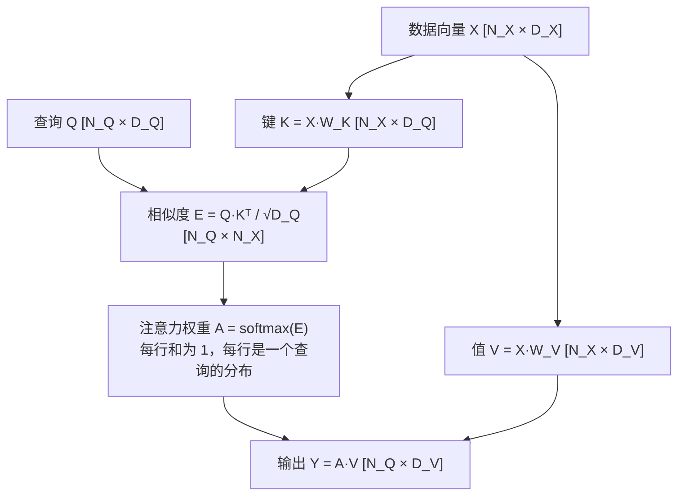
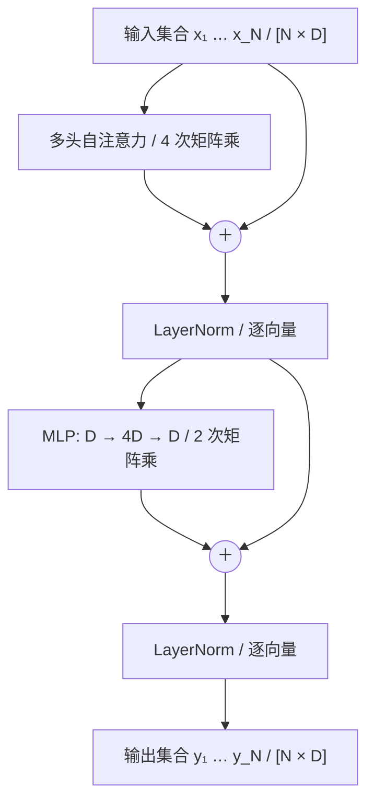

> **课程信息**
>
> - **课程名称**：Stanford CS231n: Deep Learning for Computer Vision（Spring 2025）
> - **本讲主题**：Lecture 8. Attention and Transformers
> - **主讲教师**：Justin Johnson
> - **授课日期**：2025-04-24
> - **课程主页**：[cs231n.stanford.edu/2025](https://cs231n.stanford.edu/2025/schedule.html)
> - **官方课件**：[lecture_8.pdf](</attachments/cs231n-09a099532dd251043fb23132.pdf>)（122 页，正文按页链接本地课件）
> - **字幕来源**：[cs231n_sp25_kor_sub · eng](https://github.com/lpaiu-cs/cs231n_sp25_kor_sub/tree/main/eng)（公开英文转写，中文由本书重写）
> - **版权说明**：幻灯片与课程材料版权归 Stanford University 及授课教师所有；本书为非官方学习笔记，仅用于学习与研究。

> **课件索引**：点击下方链接打开本地 PDF 的对应页；全部课件见 [课件索引](/notes/cs231n/slides)。页码按 PDF 文件页序定位，第 1 讲分为 Part 1 / Part 2。

[📄 L8 · 第 1 页｜第 8 讲标题页：Attention and Transformers](</attachments/cs231n-09a099532dd251043fb23132.pdf#page=1>)

第 7 讲把"神经网络可以处理序列"这件事讲完了，代价是隐藏状态一步依赖一步：长度为 N 的序列必须走 N 个串行时间步。本讲要拆的就是这个代价。Justin Johnson 走的是一条历史线——先回到 2014 年的编码器–解码器翻译模型，找到"整句话必须压进一个定长向量"这个窄口；再把注意力装进 RNN 补上窄口；然后把 RNN 整个拿掉，只留下注意力这个算子；最后用残差、LayerNorm、MLP 把它包成一个块，堆成 Transformer。

贯穿全场的主张只有一句：**序列建模的瓶颈从来不是表达能力，而是并行度**。RNN 的表达力够用，但序列维不可并行；卷积能并行，感受野却要靠叠层数换；自注意力一次矩阵乘就让每个向量看到所有向量，代价是 $O(N^2)$ 的算力与显存——而这笔账在 GPU 时代反而不算坏事。

## 1. 序列转换的第一个答案，卡在一个定长向量上

*(参考时间: 00:00:04 – 00:09:03｜Lecture 8)*

[📄 L8 · 第 2 页｜课程事务页：Assignment 2 与项目提案的两个截止日期](</attachments/cs231n-09a099532dd251043fb23132.pdf#page=2>)

第二页是事务通告：Assignment 2 在前一天（4/23）发布，项目提案在次日（4/25）截止。它和本讲内容无关，但标出了时间坐标——作业二对应循环网络，项目提案要求学生自己挑一个视觉任务。后面所有关于"用现成架构还是自己设计"的判断，都落在这个语境里。

[📄 L8 · 第 3 页｜复习页：Last Time: Recurrent Neural Networks](</attachments/cs231n-09a099532dd251043fb23132.pdf#page=3>)

这一页只有标题，内容全部由口头复习补上。讲师把上一讲收束成一张问题谱系：一对一（一张图进、一个类别出）、一对多（一张图进、一句话出，即图像描述）、多对一（一串帧进、一个类别出，即视频分类），以及多对多。RNN 的意义不在于它比 CNN 更深，而在于它把"输入必须是一个张量"放宽成"输入可以是一个变长序列"，于是上面这些任务第一次能共用一套参数。

[📄 L8 · 第 4 页｜今日路线第一帧：注意力是原语，Transformer 是架构](</attachments/cs231n-09a099532dd251043fb23132.pdf#page=4>)

今天的两个关键词在这一页被并列定义。**注意力（attention）** 是一个新的神经网络原语，作用在向量的集合上；**Transformer** 是一个把注意力用到处处的网络架构。这个层次差别很重要：原语是可以插进任何网络的零件，架构是零件的组装方案。本讲前四分之三在造零件，最后四分之一才把它装成机器。

[📄 L8 · 第 5 页｜今日路线第二帧：补上三行说明——今天到处是 Transformer，但它出自 RNN](</attachments/cs231n-09a099532dd251043fb23132.pdf#page=5>)

第二帧在定义下面补了三行字，最关键的是后两行：Transformer 今天到处都在用，但它其实是 RNN 的一个旁支，所以要从 RNN 讲起。讲师在这里插了一段领域史：Transformer 诞生那一刻并不像一场"海啸"，因为在 2017 年之前，对齐、软对齐、注意力这些想法已经在机器翻译圈发酵了好几年。**新架构常常是把旧机制从旧宿主里剥出来的结果**，而不是凭空出现的发明。

### 1.1 编码器–解码器：整句话压成一个向量

[📄 L8 · 第 6 页｜编码器–解码器第一帧：四个词进 RNN，吐出四个隐状态](</attachments/cs231n-09a099532dd251043fb23132.pdf#page=6>)

动机问题是机器翻译：输入 $x_1,\dots,x_T$（英文），输出 $y_1,\dots,y_{T'}$（意大利文），两个序列的长度和词序都不必对应。编码器就是一个 RNN，$h_t=f_W(x_t,h_{t-1})$，把 "we see the sky" 逐词喂进去，吐出四个隐状态。四个词对应四次函数调用，参数 $W$ 全程共享——这是 RNN 相对全连接层唯一的结构性优势。

[📄 L8 · 第 7 页｜第二帧：末位隐状态被取出来，成为上下文向量 c](</attachments/cs231n-09a099532dd251043fb23132.pdf#page=7>)

第二帧只加了一条线和两个方块：把最后一个隐状态 $h_4$ 取出来记作上下文向量 $c$（通常就取 $c=h_T$），再添一个解码器的起点 $s_0$。取 $h_T$ 的理由来自递归本身：它已经"看过"前面所有词，所以天然是整个输入的摘要。$s_0$ 怎么设是另一个话题，2.6 节会专门算这笔账。

[📄 L8 · 第 8 页｜第三帧：解码器吐出第一个词 vediamo](</attachments/cs231n-09a099532dd251043fb23132.pdf#page=8>)

解码器是另一个 RNN，$s_t=g_U(y_{t-1},s_{t-1},c)$，参数 $U$ 与编码器不共享。它在每个时间步吃三样东西：上一步的输出词、上一步的隐状态、以及那个固定的 $c$。第一次解码给出 $y_1=$"vediamo"，输入是 $y_0=$[START]。

[📄 L8 · 第 9 页｜第四帧：第二个词 il，解码步数往上叠一格](</attachments/cs231n-09a099532dd251043fb23132.pdf#page=9>)

第二帧把 $s_1$ 接到 $s_2$，吐出"il"。相比上一帧，新增的只有 $s_2$ 与 $y_2$ 两个方块；那根从 $c$ 引出的线**没有任何变化**——同一个 $c$ 被反复使用，这正是问题所在。

[📄 L8 · 第 10 页｜第五帧：cielo 与 \[STOP\]，一句话译完](</attachments/cs231n-09a099532dd251043fb23132.pdf#page=10>)

最后一帧补齐 "cielo" 与终止符 [STOP]，解码器四步走完。四步里喂给解码器的上下文始终是同一个 $c$，形状是 $[D]$，与输入有 4 个词还是 400 个词完全无关。

### 1.2 窄口：$c$ 的长度是架构常数，不是数据的函数

[📄 L8 · 第 11 页｜问题帧：输入序列被固定长度的 c 卡住，如果 T=1000 呢](</attachments/cs231n-09a099532dd251043fb23132.pdf#page=11>)

这一帧在全图上压了一行红字：输入序列必须通过定长的 $c$ 才能到达输出，如果 $T=1000$ 呢？讲师给的量级是 $c$ 可能是一个 128 维或 1024 维的浮点向量——**这个数字在建模时就被定死了，不会随输入变长而变长**。四个词压进 1024 维还算合理；一整段、一整本书、一整个语料库也压进 1024 维，就等于要求编码器对所有输入做同一种有损压缩。

做一个可推导的估算来感受量级：若 $D=512$，1000 个词的编码器隐状态是 $1000\times512$ 个数（fp32 下约 2 MB），而 $c$ 只有 512 个数（约 2 KB）。压缩比 1000:1，而网络没有任何"这段可以丢、那段必须留"的选择机制。窄口的要害不是容量不够，是**信息无法选择性地通过**。

[📄 L8 · 第 12 页｜解决帧：每一步解码都回看整个输入序列](</attachments/cs231n-09a099532dd251043fb23132.pdf#page=12>)

解法一句话：不要用定长向量做窄口，让解码器在每一个输出步都回头看一眼整个输入序列。此刻它还是直觉，落成可实现的机制就是下一章的四步。

## 2. 把注意力装进 RNN：对齐分数、Softmax、上下文向量

*(参考时间: 00:09:23 – 00:28:45｜Lecture 8)*

### 2.1 打分、归一化、加权求和、喂回解码器

[📄 L8 · 第 13 页｜注意力版第一帧：编码器不动，红框标出待用的 s0](</attachments/cs231n-09a099532dd251043fb23132.pdf#page=13>)

改造从零开始：编码器一行不动，仍然要给出一个初始解码状态 $s_0$。红框圈住的正是这个 $s_0$——它马上要被拿去和四个编码器隐状态逐一比对。注意图上的箭头方向：信息从 $s_0$ 流向输入序列，而不是从输入序列流向 $c$ 再流向输出，整个瓶颈的结构在这里被调转了。

[📄 L8 · 第 14 页｜第二帧：四个对齐分数 e 悬在隐状态上方](</attachments/cs231n-09a099532dd251043fb23132.pdf#page=14>)

新增的是四个小方块 $e_{t,i}=f_{att}(s_{t-1},h_i)$，每个都是一个标量。实现上 $f_{att}$ 只是一个线性层：把解码器状态 $s$ 与某个编码器状态 $h$ 拼接成一个向量，再线性变换压成一个数。**它没有任何特殊结构，就是一组普通的可学习参数**，因此可以直接塞进计算图，和别的参数一起用梯度下降学。

[📄 L8 · 第 15 页｜第三帧：softmax 下来，四个标量变成和为 1 的权重](</attachments/cs231n-09a099532dd251043fb23132.pdf#page=15>)

$e$ 的取值是 $(-\infty,+\infty)$ 上的任意实数，直接拿来加权会让数值失去控制。所以在上面加一层 softmax：$a_{t,i}=\exp(e_{t,i})/\sum_j\exp(e_{t,j})$，得到 $0<a_{t,i}<1$ 且 $\sum_i a_{t,i}=1$。这四个数从此可以读成"给定当前解码器状态，输入序列各个位置的相对重要性"，也就是一个离散分布。

[📄 L8 · 第 16 页｜第四帧：权重乘上隐状态求和，得到 c1](</attachments/cs231n-09a099532dd251043fb23132.pdf#page=16>)

第四步是加权求和：$c_t=\sum_i a_{t,i}h_i$。它仍然是 $[D]$ 的向量，但**这个向量是为当前这一步现算的**，不是从编码器末尾抄来的。图上 $c_1$ 从右侧的求和块里出来，与 $s_0$ 汇合。

[📄 L8 · 第 17 页｜第五帧：上下文向量进入解码器单元，吐出 s1 与第一个词](</attachments/cs231n-09a099532dd251043fb23132.pdf#page=17>)

最后把 $c_t$ 接进解码器：$s_t=g_U(y_{t-1},s_{t-1},c_t)$，其中 $g_U$ 可以是 LSTM 或 GRU。到这里解码器的结构其实没变——变得只是"$c$ 从哪里来"。原来它是编码器的最后一个隐状态，现在它是每个时间步现算的一次加权平均。

### 2.2 这些权重是谁教的？没人教

[📄 L8 · 第 18 页｜直觉帧：vediamo 对应 we see，前两个权重给到 0.45](</attachments/cs231n-09a099532dd251043fb23132.pdf#page=18>)

图上给了一组具体数字：要生成 "vediamo"（等于英文的 "we see"）时，$a_{1,1}=a_{1,2}=0.45$，$a_{1,3}=a_{1,4}=0.05$。四个数之和恰好是 1。这个分布的意思是：解码器把 90% 的注意力放在 "we" 和 "see" 上，几乎不看 "the" 和 "sky"。**这不是人写死的规则，而是模型自己长出来的**偏好。

[📄 L8 · 第 19 页｜可微帧：整条链路没有一处需要对齐标注](</attachments/cs231n-09a099532dd251043fb23132.pdf#page=19>)

这一帧补的是训练侧的关键事实：从 $s_{t-1}$ 到 $e$、到 $a$、到 $c_t$、再到 $s_t$，全是可微运算。所以不需要任何"第 3 个英文词对应第 2 个意大利词"的标注，损失函数仍然是输出端的 softmax 加交叉熵，梯度顺着 $c_t$ 一路回传到 $f_{att}$。讲师强调，如果真要做对齐标注，这种数据根本没法大规模获得——**可微是这套机制能成立的前提，不是实现细节**。

[📄 L8 · 第 20 页｜第二步：用 s1 重新打分，得到 c2](</attachments/cs231n-09a099532dd251043fb23132.pdf#page=20>)

第二帧把整个流程再走一遍：拿 $s_1$ 与四个 $h_i$ 重新算对齐分数、重新 softmax、重新加权，得到 $c_2$。注意它复用的是同一个 $f_{att}$——一套参数，被所有解码时间步共享。

[📄 L8 · 第 21 页｜第二步续：新上下文喂进解码器，吐出第二个词](</attachments/cs231n-09a099532dd251043fb23132.pdf#page=21>)

$c_2$ 与 $y_1$ 一起进入解码器单元，得到 $s_2$ 与 "il"。图上还标出了上一章漏画的那根从 $s_0$ 到 $s_1$ 的箭头——讲师自嘲"我大概是把这根线掉了"，这处口误本身说明图在表达"解码器内部是递归的"。

[📄 L8 · 第 22 页｜第二步的直觉：il 对应 the，一个 0.8 压住其余三个](</attachments/cs231n-09a099532dd251043fb23132.pdf#page=22>)

同样的读法：生成 "il"（"the"）时，$a_{2,1}=a_{2,2}=0.05$，$a_{2,3}=0.8$，$a_{2,4}=0.1$——质量从"两个 0.45 的平摊"变成"一个 0.8 的尖峰"，因为 "il" 在英文里对应的是单个词 "the"（$h_3$），而 "sky"（$h_4$）只留下 0.1 的余量。四个数之和仍然是 1。两帧对照着看，就看懂了注意力的全部表达力：**它是一个随解码状态变化的、可微的软指针**。

### 2.3 从"一个向量"到"每步一个向量"

[📄 L8 · 第 23 页｜整句视图：每一步解码都配一个自己的上下文向量](</attachments/cs231n-09a099532dd251043fb23132.pdf#page=23>)

这一页把四个时间步并排画出来：$c_1,c_2,c_3,c_4$ 各自对应一个解码步，每个都是四个隐状态的一次不同加权。对比第 1 章那张只有单个 $c$ 的图，瓶颈消失了：输入序列不再需要先被压缩，而是被保留在四个隐状态里，由每个解码步按需取用。

代价也写在同一页上，只是当时没人明说：**每一步解码都要对整条输入序列做一次打分**。输入长度 $T$ 越大，这部分的计算量线性增长；如果把它推广成自注意力，就变成第 5 章那笔 $O(N^2)$ 的账。

### 2.4 把注意力权重画成矩阵：对角线在说什么

[📄 L8 · 第 24 页｜可视化页第一帧：把 a(t,i) 铺成一张二维网格](</attachments/cs231n-09a099532dd251043fb23132.pdf#page=24>)

注意力有一个副产品：权重本身就是数据。既然每一步解码都会产出一个"对输入序列的分布"，把所有步的分布按行摞起来，就得到一张 $T'\times T$ 的矩阵，可以当作热力图直接看。讲师的说法是，这是少数能让人**直接观察网络内部在做什么**的机制之一，因为从来没人告诉它该怎么对齐。

[📄 L8 · 第 25 页｜示例页：一句英法对照的长句](</attachments/cs231n-09a099532dd251043fb23132.pdf#page=25>)

例子换成英译法（讲师特别声明自己不会念法语）。输入是 "The agreement on the European Economic Area was signed in August 1992."，输出是 "L'accord sur la zone économique européenne a été signé en août 1992."。选这个句子是有意的：它包含一个三词的名词短语（European Economic Area），在法语里被重排成 zone économique européenne，还包含介词、日期这些语序差异。

[📄 L8 · 第 26 页｜对角线帧：前四个词一一对应](</attachments/cs231n-09a099532dd251043fb23132.pdf#page=26>)

图上出现一条从左上到右下的对角线：预测 "le" 时质量全压在 "the" 上，预测 "accord" 时全压在 "agreement" 上。对角线意味着**两个序列在同一位置上的词一一对应**，也就是最省事的直译情形。讲师的说法很克制：网络自己决定了这件事，而人类只提供了一个"可以回看"的机制。

[📄 L8 · 第 27 页｜非对角线帧：中部出现逆对角与 2×2 小块](</attachments/cs231n-09a099532dd251043fb23132.pdf#page=27>)

真正有意思的是中间：European Economic Area 在法语里的语序不同，热力图上就出现一段反向的对角线；而法语里两个词对应英语一个词（或反之）的地方，会出现一个 2×2 的小方块，表示注意力无法把它们干净地拆开。**矩阵的形状把语法差异直接暴露了出来**，这比任何准确率数字都直观。

### 2.5 通用算子露头

[📄 L8 · 第 28 页｜转折帧：这套机制里藏着一个更一般的算子](</attachments/cs231n-09a099532dd251043fb23132.pdf#page=28>)

到这里讲师换了口气：这套东西是为了修 RNN 才发明的，但它其实是一个通用、独立、本身就很强的算子。下一步要做的是把注意力从 RNN 里**切出来**，让它单独成为一个层。

[📄 L8 · 第 29 页｜抽离帧：查询向量、数据向量、输出向量三分](</attachments/cs231n-09a099532dd251043fb23132.pdf#page=29>)

重命名是抽离的第一步。解码器的隐状态改叫**查询向量（query）**："我想要产出这一段输出，因此我要去找点东西"；编码器的隐状态改叫**数据向量（data）**："这些是可能用得上的素材"；而输出的 $c_t$ 改叫**输出向量**。规则也随之变得干净：每个查询对全部数据向量打分，得到**一个**输出向量。至于下一个查询从哪来，注意力层不关心——这一句是它脱离 RNN 的许可证。

### 2.6 边界：初始状态怎么设，以及"它到底学没学会语法"

课堂上有人问解码器怎么"初始化"。讲师指出这个词被重载了两次，值得分开记：

- **权重初始化**：解码器本身是一个带参数的神经网络，训练开始时这些权重随机初始化，之后由梯度下降优化，和任何网络没有区别。
- **隐状态初始化**：在权重已经给定的情况下，每处理一个新的输出序列，都要给 $s_0$ 一个值。常见做法有三种——直接取编码器最后一个隐状态、用一个学出来的线性投影把 $h_T$ 映射成 $s_0$、或者干脆置零。讲师的说法是三种都能用，**只要训练时让网络一直见到同一种约定**。

第二个问题是"网络怎么自己搞懂了语法"。讲师先答"这是深度学习的谜"，随后给出机制层面的解释：没有人给它语法标注，只给了大量输入输出对和一个可以对齐的机制；如果这个机制恰好让"减少翻译损失"变得更容易，梯度就会把它推向"学出对齐"这个解。所以注意力权重是人设计的**先验形状**与数据共同作用的结果——先验只提供可能性，具体对齐方式是学出来的。

最后是一个关于否定的追问（否定词与异或这类难以对齐的结构会不会出问题）。讲师的回答很实在：也许会有问题，这是难点，但只能靠更多数据和更多算力去让网络自己解开，没有额外的结构性保证。

## 3. 抽掉 RNN：注意力成为一个独立的层

*(参考时间: 00:28:53 – 00:45:44｜Lecture 8)*

### 3.1 一个查询、一堆数据：四行定义

[📄 L8 · 第 30 页｜Attention Layer 第一帧：左侧只列了一个查询向量](</attachments/cs231n-09a099532dd251043fb23132.pdf#page=30>)

新的一页从零开始定义这个层。第一帧只写了 `Inputs: Query vector q [D_Q]`，右侧仍是那张 RNN 图，$s_0$ 被红框标出——它在提醒读者这个抽象的出处。接下来几帧会把左侧的清单一行行补满，而右侧的图始终不动，这个对比本身就说明了抽离的含义：**图的拓扑属于 RNN，公式属于注意力**。

[📄 L8 · 第 31 页｜第二帧：补上数据向量 X，形状 N×D_X](</attachments/cs231n-09a099532dd251043fb23132.pdf#page=31>)

第二行是 `Data vectors: X [N_X x D_X]`——$N_X$ 个数据向量，每个 $D_X$ 维。此刻查询与数据的维度可以不同（$D_Q$ 对 $D_X$），因为第一版的相似度函数 $f_{att}$ 是任意的，不要求两边同维。

[📄 L8 · 第 32 页｜第三帧：补上相似度 e，长度 N_X 的向量](</attachments/cs231n-09a099532dd251043fb23132.pdf#page=32>)

第三行是 `Similarities: e [N_X]`，$e_i=f_{att}(q,X_i)$。注意输出的形状：一个查询对 $N_X$ 个数据打分，得到长度为 $N_X$ 的向量——**打分是"一对多"，这一条决定了后面所有的形状**。

[📄 L8 · 第 33 页｜第四帧：补上注意力权重，softmax 后的长度 N_X 分布](</attachments/cs231n-09a099532dd251043fb23132.pdf#page=33>)

第四行 `Attention weights: a = softmax(e) [N_X]`。到这里，一个查询已经变成一组权重，这组权重之和为 1，可以读成"这个查询在各数据向量上的分配比例"。

[📄 L8 · 第 34 页｜第五帧：补上输出向量，加权和落回 D_X 维](</attachments/cs231n-09a099532dd251043fb23132.pdf#page=34>)

最后一行 `Output vector: y = Σ_i a_i X_i [D_X]`。输出维度等于数据维度 $D_X$ 而不是查询维度 $D_Q$——因为输出是数据向量的线性组合，它只能落在数据张成的空间里。这条规则在后面每一版注意力里都不变。

[📄 L8 · 第 35 页｜同一页的转折：Let's generalize this](</attachments/cs231n-09a099532dd251043fb23132.pdf#page=35>)

五条定义补齐后，页面上多了一行 "Let's generalize this!"。下面三节做三次推广：把 $f_{att}$ 换成点积、加缩放、再把单查询扩成多查询。

### 3.2 相似度退化成点积，然后除以 $\sqrt{D}$

[📄 L8 · 第 36 页｜推广一：相似度改成点积，查询维度随之变成 D_X](</attachments/cs231n-09a099532dd251043fb23132.pdf#page=36>)

第一个改动是让 $f_{att}$ 变简单：既然任何"两向量进、标量出"的函数都行，那就用最简单的——点积 $e_i=q\cdot X_i$。代价是维度约束：点积要求两边同维，于是 $q$ 的形状从 $D_Q$ 改成 $D_X$。讲师的说法是"一边简化、一边推广"，因为点积同时带来了一个可批量化的形式。

[📄 L8 · 第 37 页｜推广二：除以 $\sqrt{D_X}$，把尺度拉回来](</attachments/cs231n-09a099532dd251043fb23132.pdf#page=37>)

第二个改动是缩放：$e_i=q\cdot X_i/\sqrt{D_X}$。这一步看着像小技巧，理由却在下一帧。

[📄 L8 · 第 38 页｜为什么缩放：点积的尺度随维度增长，softmax 会被推到饱和区](</attachments/cs231n-09a099532dd251043fb23132.pdf#page=38>)

页面上给的是常向量论证：由 $a\cdot b=|a||b|\cos\theta$，若 $a,b$ 都是常向量，则 $|a|=(\sum_i a_i^2)^{1/2}=a\sqrt{D}$，所以两个常向量的点积随 $D$ 线性增长。分数越大，softmax 越接近 one-hot，输出对分数的导数越小，**梯度消失**。除以 $\sqrt{D_X}$ 之后增长被压到 $\sqrt{D}$ 量级，softmax 落回有梯度的区间。

> 编者说明：更常见的等价说法是从随机性出发——若两个向量的各分量独立同分布、方差为 1，则点积的方差是 $D$，除以 $\sqrt{D}$ 之后方差回到 1，与维度无关。幻灯片用的是常向量版本，结论相同。

这个改动为什么重要，讲师给的理由是"规模"：网络会越做越大，向量维度会往上走，如果相似度的尺度随维度漂移，同一套超参在 128 维能训、在 1024 维就训不动。所以**架构的每一处都要问一句"维度变大十倍时会怎样"**，这是本讲反复出现的检查姿势。

### 3.3 多查询：一次矩阵乘算完所有配对

[📄 L8 · 第 39 页｜推广三：查询变成矩阵，全部配对一次算完](</attachments/cs231n-09a099532dd251043fb23132.pdf#page=39>)

在 RNN 里我们从来不止一个查询——解码器每步都有一个。所以把 $Q$ 写成 $[N_Q\times D_Q]$ 的矩阵，一次处理一整批：

$$
E=QK^\top/\sqrt{D_X}\in\mathbb{R}^{N_Q\times N_X},\qquad A=\mathrm{softmax}(E),\qquad Y=AX\in\mathbb{R}^{N_Q\times D_X}
$$

三个操作各自有明确的矩阵解释。打分是"两个向量集合之间所有配对的内积"，正好是一次矩阵乘；归一化要沿"数据"这一维做，使每个查询各自成为一个分布；加权求和是"用 $A$ 的每一行去线性组合 $X$ 的行"，也是一次矩阵乘。

关于 softmax 沿哪一维做，页面上有一个容易读错的地方：公式写的是 `softmax(E, dim=1)` 且标注形状 $[N_Q\times N_X]$，配图却把**键排在行、查询排在列**，于是讲师口头说的是"对每一列归一化"。两种说法指的是同一件事——沿数据/键那一维归一化，让每个查询拿到一个分布。记住这个约定就够了：**行是查询，列是键，每一行和为 1**。

### 3.4 键与值：把"比对什么"和"取回什么"分开

[📄 L8 · 第 40 页｜推广四：数据向量被投影成键和值两套表示](</attachments/cs231n-09a099532dd251043fb23132.pdf#page=40>)

到此为止 $X$ 在一次前向里被用了两次：一次用来和查询算相似度，一次用来做加权求和的被加项。讲师认为这有点别扭——**"用什么去匹配"和"匹配上之后取回什么"理应是两件事**。于是引入两个可学习投影：

$$
K=XW_K\in\mathbb{R}^{N_X\times D_Q},\qquad V=XW_V\in\mathbb{R}^{N_X\times D_V}
$$

$W_K$ 把数据投影到查询所在的维度（因为要算点积），$W_V$ 投影到输出维度 $D_V$（可以与 $D_Q$ 不同）。之后的流程不变：$E=QK^\top/\sqrt{D_Q}$，$A=\mathrm{softmax}(E)$，$Y=AV\in\mathbb{R}^{N_Q\times D_V}$。

讲师用的类比是搜索引擎。你在框里敲 "what is the best school in the world"，这是**查询**；这条查询要和后端记录的**键**去匹配；而你想拿回来的**值**是 "Stanford"——它和你敲进去的那句话完全不同。三者的内容本来就不该相同，所以拆开是自然的。

至于"怎么把数据向量拆成键和值"，答案和前面一样：不告诉它怎么拆，只给它两个投影矩阵，让梯度下降自己决定。讲师把这理解为**对同一个向量做两种不同的过滤**：查询只和其中一部分特征匹配，取回的是另一部分特征。

### 3.5 组装：五帧动画

[📄 L8 · 第 41 页｜帧一：四个查询并排进入，数据侧只有 X](</attachments/cs231n-09a099532dd251043fb23132.pdf#page=41>)

从这一页起，RNN 的图彻底消失，只剩下算子本身。第一帧摆出四个查询 $Q_1..Q_4$ 和三个数据向量 $X_1..X_3$，右侧标了 1、2、3 三个序号，对应接下来三步。

[📄 L8 · 第 42 页｜帧二：数据侧先投影出 V1..V3](</attachments/cs231n-09a099532dd251043fb23132.pdf#page=42>)

第二帧在数据侧加了三个紫色方块 $V_1,V_2,V_3$——值是数据经 $W_V$ 投影的结果。此时查询还没有和任何东西发生关系，只是站在那里。

[📄 L8 · 第 43 页｜帧三：再投影出 K1..K3，并算出整张 E 网格](</attachments/cs231n-09a099532dd251043fb23132.pdf#page=43>)

第三帧补上键 $K_1..K_3$，并在右侧展开一张 $3\times4$ 的 $E$ 网格：行是键（$K_1..K_3$），列是查询（$Q_1..Q_4$），格子里的 $E_{i,j}$ 是第 $j$ 个查询与第 $i$ 个键的缩放点积。这张网格就是 $QK^\top$ 的全部内容。

[📄 L8 · 第 44 页｜帧四：softmax 沿列下来，E 变成 A](</attachments/cs231n-09a099532dd251043fb23132.pdf#page=44>)

第四帧把每个格子过一遍 softmax，并明确写出"softmax 归一化的是每一列：每个查询据此预测一个在键上的分布"。三行四列的网格变成 $A$，每一列和为 1。到这一步，"注意力"这个名字才名副其实：**每一列都是一次分配决策**。

[📄 L8 · 第 45 页｜帧五：Product 与 Sum 两步，得到四个输出](</attachments/cs231n-09a099532dd251043fb23132.pdf#page=45>)

第五帧在右侧加了 `Product(→), Sum(↑)`：把 $A$ 的每一列乘上对应的值再加起来，得到 $Y_1..Y_4$。每个输出都是所有值向量的线性组合，权重由那一列决定。讲师在这里给了一句总结：**一个输出里混合了所有值的信息，混合比例由查询决定**。

[📄 L8 · 第 46 页｜有了名字的层：Cross-Attention Layer](</attachments/cs231n-09a099532dd251043fb23132.pdf#page=46>)

同一张图的标题换成了 Cross-Attention Layer（交叉注意力层）。这个层有两个输入（查询与数据）、两个可学习参数（$W_K,W_V$），输入两串向量、输出一串向量，可以像卷积层一样插进任何网络。之所以叫"交叉"，是因为查询和数据来自两个不同的来源；下一章会看另一种更常见的版本——只有一份输入，让每个向量与同一组里的其他向量比对。

一张图看完整条数据流：查询只参与打分，数据分两路——一路变键去打分，一路变值被加权。**输出永远在值的空间里，不在查询的空间里**，这是后面算维度时最常被忽略的一条。

## 4. 自注意力：一份输入、三份投影，以及对"顺序"的两次补救

*(参考时间: 00:45:44 – 00:56:42｜Lecture 8)*

### 4.1 一份输入，投影三次

[📄 L8 · 第 47 页｜Self-Attention 第一帧：只有一组输入 X，三个投影矩阵](</attachments/cs231n-09a099532dd251043fb23132.pdf#page=47>)

自注意力（self-attention）把交叉注意力的两套输入合并成一套：只有一个 $X\in\mathbb{R}^{N\times D_{in}}$，但它同时被投影成查询、键、值三份——$Q=XW_Q$、$K=XW_K$、$V=XW_V$，三个权重都是 $[D_{in}\times D_{out}]$。页面上一句话点明了形状上的简化：**几乎总是 $D_Q=D_V=D_{out}$**。讲师也承认自己"在记号上写得比实际更一般"，从业这么久几乎没见过 $D_{in}\neq D_{out}$ 的自注意力层。

[📄 L8 · 第 48 页｜第二帧：三个投影被融成一次矩阵乘](</attachments/cs231n-09a099532dd251043fb23132.pdf#page=48>)

第二帧加了一个实践技巧：把三个权重矩阵沿输出维拼起来，一次算完

$$
[Q\ K\ V]=X\,[W_Q\ W_K\ W_V],\qquad [N\times 3D_{out}]=[N\times D_{in}]\,[D_{in}\times 3D_{out}]
$$

理由纯粹是硬件效率——**少数几次大矩阵乘比多次小矩阵乘更划算**，GPU 在大矩阵上才能吃满。这条"把能拼的矩阵拼起来"的习惯，在后面数矩阵乘次数时会一直用到。

### 4.2 四步动画：打分、归一化、加权

[📄 L8 · 第 49 页｜第三帧：每个查询与每个键算相似度](</attachments/cs231n-09a099532dd251043fb23132.pdf#page=49>)

第三帧在图上画出 $E$ 网格，$E_{i,j}=Q_i\cdot K_j/\sqrt{D_Q}$。形状是 $[N\times N]$——自注意力里查询数和键数都是 $N$，这是它与交叉注意力最实质的差别，也是 $O(N^2)$ 的来源。

[📄 L8 · 第 50 页｜第四帧：沿每一列归一化，每个查询得到键上的分布](</attachments/cs231n-09a099532dd251043fb23132.pdf#page=50>)

第四帧把 $E$ 归一化成 $A$，同样是每列一个分布。注意此时"列"和"行"都长 $N$，矩阵是方的，所以更容易看错轴——判据始终是"哪一个方向的和为 1"：**每个查询所在的那一条线和为 1**。

[📄 L8 · 第 51 页｜第五帧：输出是值向量的线性组合](</attachments/cs231n-09a099532dd251043fb23132.pdf#page=51>)

第五帧用 `Product(→), Sum(↑)` 得到 $Y_1..Y_3$。到这里，四步已经全部走完，剩下的两节都在讨论这套机制的"副作用"。

### 4.3 置换等变：它其实作用在集合上

[📄 L8 · 第 52 页｜置换帧一：输入顺序被换成 X3、X1、X2](</attachments/cs231n-09a099532dd251043fb23132.pdf#page=52>)

讲师在这里问了一个看似无害的问题：如果把输入向量的顺序打乱会怎样？幻灯片把 $X_1,X_2,X_3$ 换成 $X_3,X_1,X_2$。

[📄 L8 · 第 53 页｜置换帧二：Q、K、V 还是原来那三个，只是跟着换了位置](</attachments/cs231n-09a099532dd251043fb23132.pdf#page=53>)

第二帧给出第一个结论：因为 $Q,K,V$ 都是逐向量的线性投影，所以打乱输入只会让它们以同样方式被打乱，**内容一个不差**。

[📄 L8 · 第 54 页｜置换帧三：相似度矩阵被同样的置换重排](</attachments/cs231n-09a099532dd251043fb23132.pdf#page=54>)

第三帧：相似度是点积，点积不看位置，所以 $E$ 里每个数都还在，只是行列跟着换位。页面上 $E$ 网格的行标签从 $K_1,K_2,K_3$ 变成 $K_3,K_1,K_2$，列标签从 $Q_1,Q_2,Q_3$ 变成 $Q_3,Q_1,Q_2$，格子里的数跟着搬家。

[📄 L8 · 第 55 页｜置换帧四：softmax 逐列进行，权重矩阵同样只是换位](</attachments/cs231n-09a099532dd251043fb23132.pdf#page=55>)

第四帧：softmax 是逐列做的，打乱行列之后每一列还是原来那一列，只是换了列号。**归一化不引入任何跨向量的耦合**，所以它不会破坏这个性质。

[📄 L8 · 第 56 页｜置换帧五：输出也原样跟着换位](</attachments/cs231n-09a099532dd251043fb23132.pdf#page=56>)

第五帧收口：线性组合的结果自然也还是原来那几个输出，只是顺序变了。

[📄 L8 · 第 57 页｜结论帧：置换等变，F(σ(X)) = σ(F(X))](</attachments/cs231n-09a099532dd251043fb23132.pdf#page=57>)

四帧合起来是一个精确的代数性质：$F(\sigma(X))=\sigma(F(X))$，称为**置换等变（permutation equivariance）**。讲师特意把它和第 5 讲的平移等变性并列——卷积对平移等变，自注意力对置换等变。含义是：自注意力并不真的在"序列"上工作，**它在集合上工作**，只是这个集合恰好被装进了一个有顺序的矩阵里。这也解释了它为什么能同时处理语言、图像 patch、点云这些结构完全不同的数据。

### 4.4 两次补救：位置编码与掩码

[📄 L8 · 第 58 页｜问题帧：置换等变同时意味着它不知道顺序](</attachments/cs231n-09a099532dd251043fb23132.pdf#page=58>)

等变是一把双刃剑。"cat eats fish" 和 "fish eats cat" 在自注意力眼里是同一个集合，输出只差一个置换。对语言来说这是致命的，所以必须有东西把顺序注入进去。

[📄 L8 · 第 59 页｜解决帧：给每个输入加一个只与下标有关的向量](</attachments/cs231n-09a099532dd251043fb23132.pdf#page=59>)

解法是**位置编码（positional encoding）**：对第 $i$ 个输入加一个向量 $E(i)$，它是下标的固定函数，不含可学习参数（也可以学，但本质一样）。图上标出了 $E(1),E(2),E(3)$ 三个附加项。加法之后，同一个词在不同位置就变成不同的输入向量，置换等变被打破——**注入顺序的成本，仅仅是每个向量多存 $D$ 个数**。

[📄 L8 · 第 60 页｜掩码帧：把不该看的相似度改成负无穷](</attachments/cs231n-09a099532dd251043fb23132.pdf#page=60>)

第二个补救是**掩码自注意力（masked self-attention）**。做法很直接：算出 $E$ 之后，把不允许看的位置直接覆写成 $-\infty$；softmax 之后 $e^{-\infty}=0$，那些位置的权重就精确为零，输出 $Y$ 也就不再依赖对应位置的值向量。页面右侧的 $A$ 矩阵里，被屏蔽的格子全是 0——图上按"键在行、查询在列"排布，零落在左下角；换成"行是查询"的写法，被抹掉的就是右上三角。**不管怎么画，含义都一样：信息只能从过去流向未来。**

[📄 L8 · 第 61 页｜掩码的用途：语言建模里不许偷看下一个词](</attachments/cs231n-09a099532dd251043fb23132.pdf#page=61>)

为什么需要这个？因为一旦把 RNN 拿掉，自注意力就可以直接干语言建模的活：输入 "attention is very"，预测下一个词 "cool"。但训练时整句话是同时喂进去的，如果第 2 个位置能看见第 3 个位置，"预测下一个词"就变成了抄答案。掩码保证第 $t$ 个输出只依赖前 $t$ 个输入。讲师对这一页的评价写在标题上——"这非常酷"，因为它用一个 $- \infty$ 的覆写，就把训练时的并行和推理时的因果性同时满足了。

### 4.5 多头：并行 H 份，然后拼回来

[📄 L8 · 第 62 页｜多头第一帧：跑 H 份独立的自注意力](</attachments/cs231n-09a099532dd251043fb23132.pdf#page=62>)

下一个问题是"为什么不再多来几份"。既然深度学习的经验是"更大更强"，那就把同一套自注意力复制 $H$ 份并行跑，每份叫一个**头（head）**。

[📄 L8 · 第 63 页｜第二帧：H=3 个头各自持有一套独立的权重](</attachments/cs231n-09a099532dd251043fb23132.pdf#page=63>)

关键细节在于：三个头**架构完全一样、计算完全一样，唯一不同的是权重**，而且初始化时就被随机成不同的值，所以训练后它们会分化成三种不同的相似度度量。讲师对"输入 $X_1,X_2,X_3$ 是不是同一份"的追问回答得很干脆：是同一份，喂给三份不同参数的副本。

[📄 L8 · 第 64 页｜第三帧：每个输入在每个头下各得一个输出，竖着摞起来](</attachments/cs231n-09a099532dd251043fb23132.pdf#page=64>)

第三帧把输出按 $Y_{i,h}$（第 $i$ 个输入、第 $h$ 个头）摞成矩阵。到这里还没有跨头的信息交换——三个头各说各话。

[📄 L8 · 第 65 页｜第四帧：输出投影把各头的数据融合](</attachments/cs231n-09a099532dd251043fb23132.pdf#page=65>)

第四帧加了 $W_O$：把摞起来的 $H$ 个输出过一个线性层，融合成一份。**这是多头里唯一让不同头互相看见的地方**，也是它比"跑三遍再平均"更强的原因——融合权重是可学的。

[📄 L8 · 第 66 页｜第五帧：维度账，头维度通常取 D/H](</attachments/cs231n-09a099532dd251043fb23132.pdf#page=66>)

这一帧把整套形状写清楚，也是最值得抄下来的一页：

| 张量 | 形状 | 说明 |
| :--- | :--- | :--- |
| $X$ | $[N\times D]$ | 输入集合 |
| $W_Q,W_K,W_V$ | $[D\times HD_H]$ | 三个投影，输出维是"头数 × 头维度" |
| $W_O$ | $[HD_H\times D]$ | 输出投影，把 $H$ 个头压回 $D$ |
| $Q,K,V$ | $[H\times N\times D_H]$ | 拆成 $H$ 份，每份独立 |
| $E,A$ | $[H\times N\times N]$ | softmax 沿 `dim=2`，即键那一维 |
| $Y$ | $[H\times N\times D_H]\to[N\times HD_H]$ | 各头输出拼接 |
| $O$ | $[N\times D]$ | 输出，与输入同形 |

页面上还有一句关键的约定：**通常 $D_H=D/H$**，这样输入输出维度相同，块才能一层层叠上去。顺带算一下参数量：三个投影共 $3D\cdot HD_H=3D^2$，输出投影 $D^2$，合计 $4D^2$，与头数无关。所以多头并不增加参数预算，它做的是**把同一份预算切成 $H$ 份，让模型同时学 $H$ 种不同的相似度度量**。

[📄 L8 · 第 67 页｜第六帧：用批量矩阵乘一次算完所有头](</attachments/cs231n-09a099532dd251043fb23132.pdf#page=67>)

最后一帧是工程结论：不需要写 `for h in range(H)`，把所有头并进一个批量矩阵乘的批维，一次算完。讲师说这是"实践中到处都在用"的写法——**多头不是循环，是批维**。

## 5. 算力的两本账：四次矩阵乘的代价，与三种序列原语的取舍

*(参考时间: 00:56:42 – 01:02:36｜Lecture 8)*

### 5.1 把整个层数成四次矩阵乘

[📄 L8 · 第 68 页｜总览帧：同一页换了标题，inputs 与 computation 原样保留](</attachments/cs231n-09a099532dd251043fb23132.pdf#page=68>)

这一页的标题改成 "Self-Attention is Four Matrix Multiplies!"，左侧的输入清单和右侧的公式一个字没动——**换的只是视角**：不再问"它是什么"，而问"它要花几次矩阵乘"。答案分四帧给出。

[📄 L8 · 第 69 页｜步骤一：QKV 投影，一次矩阵乘变出三份](</attachments/cs231n-09a099532dd251043fb23132.pdf#page=69>)

第一次：$[N\times D]\,[D\times 3HD_H]\Rightarrow[N\times 3HD_H]$，然后 split + reshape 成三个 $[H\times N\times D_H]$。这一次的花费是 $2N\cdot D\cdot 3HD_H=6ND^2$（取 $HD_H=D$）。

[📄 L8 · 第 70 页｜步骤二：QK 相似度，批量的矩阵乘](</attachments/cs231n-09a099532dd251043fb23132.pdf#page=70>)

第二次：$[H\times N\times D_H]\,[H\times D_H\times N]\Rightarrow[H\times N\times N]$。这一次的花费是 $2N^2D$——它是四步里第一个平方项，也是唯一一个必须真正把 $H\times N\times N$ 的相似度矩阵算出来的步骤，下一节要算的显存账全压在它身上。

[📄 L8 · 第 71 页｜步骤三：V 加权，把权重乘回值](</attachments/cs231n-09a099532dd251043fb23132.pdf#page=71>)

第三次：$[H\times N\times N]\,[H\times N\times D_H]\Rightarrow[H\times N\times D_H]$，再 reshape 回 $[N\times HD_H]$。花费同样是 $2N^2D$。

[📄 L8 · 第 72 页｜步骤四：输出投影，把多头压回 D 维](</attachments/cs231n-09a099532dd251043fb23132.pdf#page=72>)

第四次：$[N\times HD_H]\,[HD_H\times D]\Rightarrow[N\times D]$，花费 $2ND^2$。四步加起来：$8ND^2+4N^2D$。**前一项线性于 $N$，后一项平方于 $N$**，两者相等的分界点在 $N\approx 2D$；$D=1024$ 时大约是 $N\approx 2048$。这条分界线解释了为什么短序列时 Transformer 的瓶颈在参数、长序列时在注意力矩阵。

### 5.2 算力与显存的账

[📄 L8 · 第 73 页｜提问帧：N 变大时算力怎么涨](</attachments/cs231n-09a099532dd251043fb23132.pdf#page=73>)

讲师把问题写成一行字挂在页面右下角："随着向量个数 $N$ 增加，这要花多少算力？"注意他没问"贵不贵"，而是先问"怎么涨"——**复杂度是架构的属性，绝对耗时是硬件的属性**。

[📄 L8 · 第 74 页｜回答帧：O(N²)](</attachments/cs231n-09a099532dd251043fb23132.pdf#page=74>)

答案 $O(N^2)$，来自第 2、3 次矩阵乘里的 $N\times N$ 配对。$N=1000$ 时是一百万个分数，还算便宜；$N=10^6$ 时是一万亿个分数，任何硬件都吃不下。

[📄 L8 · 第 75 页｜提问帧：内存怎么涨](</attachments/cs231n-09a099532dd251043fb23132.pdf#page=75>)

第二个问题换成内存。这一步比算力更致命，因为算力可以慢慢等，显存不够就直接跑不起来。

[📄 L8 · 第 76 页｜回答帧：同样是 O(N²)](</attachments/cs231n-09a099532dd251043fb23132.pdf#page=76>)

答案还是 $O(N^2)$：$E$ 和 $A$ 两张 $[H\times N\times N]$ 的矩阵都要落地。

[📄 L8 · 第 77 页｜把数字代进去：N=100K、H=64 时需要 1.192 TB](</attachments/cs231n-09a099532dd251043fb23132.pdf#page=77>)

代进具体数字：$H\times N\times N=64\times10^5\times10^5=6.4\times10^{11}$ 个元素。按 fp16 每元素 2 字节算，是 $1.28\times10^{12}$ 字节，约 1.2 TB——与页面上印的 1.192 TB 量级一致（差别来自 TB 与 TiB 的换算口径）。作为对比，一块主流数据中心 GPU 的显存是 80 GB 量级，**差了一个数量级以上**。这就是"注意力很贵"这句话的真实含义。

[📄 L8 · 第 78 页｜Flash Attention 帧：不落地完整注意力矩阵](</attachments/cs231n-09a099532dd251043fb23132.pdf#page=78>)

最后一帧给出解法：FlashAttention 把第 2、3 步（打分与加权）合在一起做，**算完立即用掉、不把整张 $A$ 写回显存**，于是显存从 $O(N^2)$ 降到 $O(N)$，大 $N$ 才变得可行。讲师没有展开这个算法的分块细节，只留下结论；对本书读者来说，记住"贵的是中间矩阵，不是计算本身"就够了。

### 5.3 三种处理序列的方式

[📄 L8 · 第 79 页｜分隔页：Three Ways of Processing Sequences](</attachments/cs231n-09a099532dd251043fb23132.pdf#page=79>)

这一页只有标题，作用是把前面所有内容收进一个横向对比。从第 5 讲的卷积、第 7 讲的 RNN 到这一讲的自注意力，我们已经见过三种处理序列的原语，接下来的三帧把它们并排放在一起。

[📄 L8 · 第 80 页｜第一栏：RNN，1D 有序序列](</attachments/cs231n-09a099532dd251043fb23132.pdf#page=80>)

RNN 一栏的账很清楚：它工作在 1 维有序序列上，理论上的优点是**对长序列仍然是 $O(N)$ 的计算和内存**——序列多长，就走多少步，每步的代价固定。缺点是致命的那一条：隐藏状态一步依赖一步，**无法并行**，序列维上没有任何可以同时开工的活。

[📄 L8 · 第 81 页｜第二栏：卷积，N 维网格](</attachments/cs231n-09a099532dd251043fb23132.pdf#page=81>)

加上卷积一栏。卷积工作在 $N$ 维网格上（图像是 2 维，语音是 1 维，视频是 3 维），它的优点是**可并行**：卷积核滑到每个位置的计算彼此独立。缺点是感受野——想让一个输出看见整张图，要么用很大的核，要么叠很多层，而"叠层"本身又引入了串行深度。

[📄 L8 · 第 82 页｜第三栏：自注意力，向量的集合](</attachments/cs231n-09a099532dd251043fb23132.pdf#page=82>)

第三栏补上自注意力：工作在向量的集合上，优点是**长序列上每个输出直接依赖所有输入**（一层就够，不用叠），并且高度并行（四次矩阵乘）。缺点正是上一节算过的账：$O(N^2)$ 算力、$O(N)$ 显存（这里指的是配 FlashAttention 之后的内存）。

[📄 L8 · 第 83 页｜同一页换了页脚：Vaswani et al, NeurIPS 2017](</attachments/cs231n-09a099532dd251043fb23132.pdf#page=83>)

最后一帧只是把页脚换成 "Vaswani et al, NeurIPS 2017"——那篇论文的标题就是 "Attention is All You Need"，也是这一页的答案。讲师的原话是：三者之中，**只用注意力也能走很远**。

课堂上有两个追问值得记下来。第一个是"并行到底有什么用"。讲师给的理由是硬件史：单核主频在 2000 年代中期之后基本停滞，算力的增长来自核数。所以真正能扩张的算法，是那种"给一万个处理器就能快一万倍"的算法，而不是"必须在一个很聪明的处理器上按顺序跑"的算法。第二个追问是"$N^2$ 是不是致命缺陷"。讲师的态度相反：$N^2$ 意味着更多计算，而更多计算意味着网络在输入上有更多"思考"的余地，所以它贵，但不一定是坏事——**真正要担心的是显存，而显存可以用 FlashAttention 和更多 GPU 换**。

## 6. Transformer：唯一让向量互相说话的部分只占一个格子

*(参考时间: 01:02:40 – 01:04:36｜Lecture 8)*

### 6.1 一个块的五个部件

[📄 L8 · 第 84 页｜Transformer Block 第一帧：输入是一组向量](</attachments/cs231n-09a099532dd251043fb23132.pdf#page=84>)

有了原语，接下来是组装。输入仍然是一组向量 $x_1..x_4$，输出要求同形——这样才能一层层叠。这一帧只画了输入，整个块还是空的。

[📄 L8 · 第 85 页｜第二帧：多头自注意力被放进块里](</attachments/cs231n-09a099532dd251043fb23132.pdf#page=85>)

第二帧填入第一个部件：多头自注意力，页面上写的是"所有向量通过它互相作用"。这是整个块里**唯一**发生跨向量信息交换的地方，后面每一个部件都只看单个向量。

[📄 L8 · 第 86 页｜第三帧：加一条残差连接](</attachments/cs231n-09a099532dd251043fb23132.pdf#page=86>)

第三帧加残差：$x+\mathrm{SA}(x)$。理由与 ResNet 完全一样——给梯度一条恒等通路，深堆叠时不会退化。讲师特意强调这不是"Transformer 的发明"，而是从 CNN 借来的成熟做法。

[📄 L8 · 第 87 页｜第四帧：残差之后接 LayerNorm](</attachments/cs231n-09a099532dd251043fb23132.pdf#page=87>)

第四帧接 LayerNorm，并把公式完整写出（对每个向量独立做）：

$$
\mu_i=\frac{1}{D}\sum_j h_{i,j},\qquad \sigma_i=\Big(\frac{1}{D}\sum_j (h_{i,j}-\mu_i)^2\Big)^{1/2},\qquad y_i=\gamma\cdot\frac{h_i-\mu_i}{\sigma_i}+\beta
$$

注意统计量的范围：$\mu_i,\sigma_i$ 是**每个向量一个标量**（在 $D$ 维内部求），$\gamma,\beta$ 是 $[D]$ 的可学习缩放与平移，所有向量共享。这与第 6 讲的 BatchNorm 恰好相反——不跨样本、不跨 batch，所以训练和推理的行为一致。

[📄 L8 · 第 88 页｜第五帧：MLP 逐向量作用](</attachments/cs231n-09a099532dd251043fb23132.pdf#page=88>)

第五帧加 MLP：对每个向量**独立**跑一个两层网络，经典配置是 $D\to4D\to D$，也叫 FFN（feed-forward network）。它与自注意力分工明确——自注意力负责"向量之间"，MLP 负责"向量之内"。

[📄 L8 · 第 89 页｜第六帧：MLP 外面也套残差](</attachments/cs231n-09a099532dd251043fb23132.pdf#page=89>)

第六帧给 MLP 也加残差。至此块里有两个残差、两个归一化位置，结构开始对称。

[📄 L8 · 第 90 页｜第七帧：输出端再加一个 LayerNorm](</attachments/cs231n-09a099532dd251043fb23132.pdf#page=90>)

第七帧在块的出口加第二个 LayerNorm，输出 $y_1..y_4$ 与输入同形。**同形是块能堆叠的前提**，这一点在所有后续变体里都没有被破坏。

[📄 L8 · 第 91 页｜总结帧：6 次矩阵乘，4 次来自注意力、2 次来自 MLP](</attachments/cs231n-09a099532dd251043fb23132.pdf#page=91>)

这一帧是全讲的账本：自注意力是唯一的跨向量交互，LayerNorm 与 MLP 都是逐向量的；整个块的主要计算是 **6 次矩阵乘——4 次来自自注意力（QKV 投影、QK、AV、输出投影），2 次来自 MLP（$D\to4D$ 与 $4D\to D$）**。这句话解释了 Transformer 为什么对硬件友好：它的计算图几乎就是六个 GEMM，没有分支、没有循环、没有数据依赖。

把七帧合成一张图，块的结构就是一条直线：

两条竖着的边是两个残差：它们绕过的分别是块里唯一的一次跨向量交互（自注意力）和唯一的一次特征扩张（MLP）。**只要输入输出保持同形，这个盒子就能原地复制 $L$ 次**——下一节要看的正是 $L$ 和 $D$ 一起变大的过程。

### 6.2 堆叠：从 12 块到 96 块

[📄 L8 · 第 92 页｜堆叠帧：Transformer 就是一堆相同的块](</attachments/cs231n-09a099532dd251043fb23132.pdf#page=92>)

页面右侧画出三层堆叠。讲师的说法是：结构从 2017 年到现在**基本没变，变的是规模**。

[📄 L8 · 第 93 页｜规模第一帧：原版 12 块、D=1024、H=16、213M 参数](</attachments/cs231n-09a099532dd251043fb23132.pdf#page=93>)

原版 Transformer（Vaswani et al, 2017）：12 块、$D=1024$、$H=16$、训练序列长度 $N=512$、2.13 亿参数。

[📄 L8 · 第 94 页｜规模第二帧：GPT-2，48 块、D=1600、H=25、1.5B 参数](</attachments/cs231n-09a099532dd251043fb23132.pdf#page=94>)

GPT-2（Radford et al, 2019）：48 块、$D=1600$、$H=25$、$N=1024$、15 亿参数。参数量涨了 7 倍，块数涨了 4 倍。

[📄 L8 · 第 95 页｜规模第三帧：GPT-3，96 块、D=12288、H=96、175B 参数](</attachments/cs231n-09a099532dd251043fb23132.pdf#page=95>)

GPT-3（Brown et al, 2020）：96 块、$D=12288$、$H=96$、$N=2048$、1750 亿参数。八年里同一个架构跨了三个数量级。

这里可以自己核一遍参数量，方法是每块 $4D^2$（注意力）+ $8D^2$（MLP，$D\to4D\to D$ 两次投影）= $12D^2$：

| 模型 | 块数 $L$ | $D$ | $12LD^2$ | 加上词表嵌入后 | 页面数字 |
| :--- | ---: | ---: | ---: | ---: | ---: |
| 原版 | 12 | 1024 | $1.5\times10^8$ | $\approx2.1\times10^8$ | 213M |
| GPT-2 | 48 | 1600 | $1.5\times10^9$ | $\approx1.6\times10^9$ | 1.5B |
| GPT-3 | 96 | 12288 | $1.7\times10^{11}$ | $\approx1.8\times10^{11}$ | 175B |

三行都对得上，说明**参数量的主项就是 $12LD^2$，与 $N$ 无关**。这带来一个反直觉的结论：把 $N$ 从 512 调到 2048，这个公式一分钱也不会涨——变长上下文买到的是"每次前向能看多少 token"，不是"模型有多大"。GPT-3 比原版大 800 倍，靠的是 $L$ 从 12 涨到 96、$D$ 从 1024 涨到 12288，而不是序列长度。顺带还能算出头维度：$1024/16=64$、$1600/25=64$、$12288/96=128$——头数在变，头维度基本守在 64 到 128 之间。

## 7. 同一个块，两种接线：语言建模与 ViT

*(参考时间: 01:04:36 – 01:05:20｜Lecture 8)*

### 7.1 语言建模：两头各加一个矩阵

[📄 L8 · 第 96 页｜第一帧：词表嵌入矩阵，把词变成向量](</attachments/cs231n-09a099532dd251043fb23132.pdf#page=96>)

Transformer 本身只接受向量集合，所以要有一个把离散符号变成向量的入口：学一个 $[V\times D]$ 的嵌入矩阵，$V$ 是词表大小。它的作用就是一次查表——第 $i$ 个词的向量就是矩阵的第 $i$ 行。**这一步没有非线性，也没有位置信息**，纯查表。

[📄 L8 · 第 97 页｜第二帧：每个块里都用掩码注意力](</attachments/cs231n-09a099532dd251043fb23132.pdf#page=97>)

第二帧补上因果性：块内用掩码自注意力，保证第 $t$ 个 token 只能看见前 $t$ 个。这一条与 4.4 节的掩码是同一件事，只是从"技巧"变成了"架构的必需件"——没有它，语言模型在训练时就是在抄答案。

[📄 L8 · 第 98 页｜第三帧：出口加一个 \[D×V\] 投影，得到每个词的分数](</attachments/cs231n-09a099532dd251043fb23132.pdf#page=98>)

第三帧在出口加一个 $[D\times V]$ 的投影矩阵，把每个 $D$ 维向量打成 $V$ 维分数，每个分量对应词表里的一个词。它与入口的嵌入矩阵形状正好互为转置，但通常是两个独立的参数。

[📄 L8 · 第 99 页｜第四帧：用 softmax + 交叉熵训练下一个词](</attachments/cs231n-09a099532dd251043fb23132.pdf#page=99>)

最后一帧是损失：对每个位置做 softmax，与真实的下一个 token 算交叉熵。页面上那句 "Attention is all you need" 横贯全图，正好演示了掩码的含义——预测 "is" 时只能看见 "Attention"，预测 "all" 时只能看见前三个词。**整个语言模型就是"查表 → $L$ 个块 → 投影 → 交叉熵"这四步**，没有别的机关。

### 7.2 ViT：把图像切成 196 个词

[📄 L8 · 第 100 页｜ViT 第一帧：一张 224×224×3 的图像](</attachments/cs231n-09a099532dd251043fb23132.pdf#page=100>)

换到图像，问题变成"怎么把一张图变成一组向量"。ViT 的答案极其朴素：把图切成小块，每块当一个 token。

[📄 L8 · 第 101 页｜第二帧：切成 16×16×3 的 patch](</attachments/cs231n-09a099532dd251043fb23132.pdf#page=101>)

第二帧把猫脸切成 $16\times16\times3$ 的小块。按 $224/16=14$ 算，一张图正好切成 $14\times14=196$ 个 patch——**这 196 就是 ViT 的序列长度 $N$**。

[📄 L8 · 第 102 页｜第三帧：展平每个 patch，过线性层变成 D 维](</attachments/cs231n-09a099532dd251043fb23132.pdf#page=102>)

第三帧把每块 $16\times16\times3$ 展平成 768 维（$16\times16\times3=768$，正好），再乘一个 $[768\times D]$ 的线性层。这一步把像素变成和词嵌入同构的东西——**从这一刻起，图像和文本对 Transformer 没有区别**。

[📄 L8 · 第 103 页｜提问帧：这个操作还有别的描述方式吗](</attachments/cs231n-09a099532dd251043fb23132.pdf#page=103>)

讲师在这里停了一下，把问题抛给课堂：切块 + 展平 + 线性，还能怎么描述？

[📄 L8 · 第 104 页｜回答帧：它就是一个 16×16、步长 16 的卷积](</attachments/cs231n-09a099532dd251043fb23132.pdf#page=104>)

答案是：**这就是一个 $16\times16$、步长 16、3 个输入通道、$D$ 个输出通道的卷积**。卷积核大小等于步长时，窗口互不重叠，每个输出位置正好对应一个 patch，输出通道数就是 $D$。所以 ViT 的"patch embedding"不是新算子，只是把第 5 讲的卷积用成了一个不重叠的切块器。

[📄 L8 · 第 105 页｜第四帧：每个 patch 一个 D 维向量，作为 Transformer 的输入](</attachments/cs231n-09a099532dd251043fb23132.pdf#page=105>)

第四帧明确了这个对应关系：$N=196$ 个 $D$ 维向量，就是自注意力层的输入集合。

[📄 L8 · 第 106 页｜第五帧：加位置编码，告诉它每个 patch 的二维位置](</attachments/cs231n-09a099532dd251043fb23132.pdf#page=106>)

第五帧补位置编码。注意这里编码的是**二维位置**（行、列），而不是一维下标——把 196 个 patch 拉成一条线之后，一维下标就不再直接告诉你"谁在谁上面、谁在谁左边"，而图像的空间结构恰恰由这两件事决定。

[📄 L8 · 第 107 页｜第六帧：不用掩码，每个 patch 可以看所有 patch](</attachments/cs231n-09a099532dd251043fb23132.pdf#page=107>)

第六帧说明掩码的有无：图像分类没有因果性要求，所以用完整的自注意力，每个 patch 都能看见其余 195 个。**"用不用掩码"取决于任务有没有时间方向，与架构无关**。

[📄 L8 · 第 108 页｜第七帧：每个 patch 出一个输出向量](</attachments/cs231n-09a099532dd251043fb23132.pdf#page=108>)

第七帧：块堆完之后，每个 patch 位置都有一个 $D$ 维输出。

[📄 L8 · 第 109 页｜第八帧：平均池化成 1×D，再线性到类别数](</attachments/cs231n-09a099532dd251043fb23132.pdf#page=109>)

最后一帧是分类头：把 196 个 $D$ 维向量平均池化成 1 个，再过一个 $D\to C$ 的线性层得到 $C$ 个类别分数。这里可以顺手对比一下规模：ViT 的注意力矩阵是 $196\times196\approx3.8\times10^{4}$ 个分数，而语言模型 $N=2048$ 时是 $2048^2\approx4.2\times10^{6}$——**图像 patch 的序列短两个数量级，所以 $O(N^2)$ 在视觉里长期不是瓶颈**，这也是 ViT 能用较小序列长度起步的原因。

## 8. 课后阅读：课堂跳过的十一页现代改动

*(参考时间: 01:05:20 – 01:05:28｜Lecture 8)*

讲到这里，讲师的原话是"近年来 Transformer 有一些小改动，但时间不够了，我把它们留作课后阅读"，随后直接进入总结。因此第 110–120 页在课堂上只被翻过、没有被讲解；本书按 deck 原始顺序把它们保留在这里，每页说明取自幻灯片本身，不再冒充课堂内容。

[📄 L8 · 第 110 页｜改动总览：2017 年的块，与今天常见的四项修改](</attachments/cs231n-09a099532dd251043fb23132.pdf#page=110>)

这一页给出基线：残差连接 + LayerNorm + MLP，也就是第 6 章那个块。下面四组页面分别对应四项在现代实现里已经很常见的改动。

### 8.1 Pre-Norm：把归一化挪进残差

[📄 L8 · 第 111 页｜诊断帧：LayerNorm 在残差之外，模型学不到恒等映射](</attachments/cs231n-09a099532dd251043fb23132.pdf#page=111>)

原版的排布是"子层 → 相加 → 归一化"，归一化位于残差**之外**。幻灯片给的批评很直接：这样一来残差路径也要穿过归一化，模型实际上学不到恒等映射（identity），深堆叠时优化会变脆。

[📄 L8 · 第 112 页｜解决帧：归一化前置，训练更稳](</attachments/cs231n-09a099532dd251043fb23132.pdf#page=112>)

改动只有一句：把 LayerNorm 挪到自注意力与 MLP **之前**，放进残差内部，于是残差路径上是一条干净的加法链。代价是输出端要多一个归一化，收益是训练稳定得多（Baevski & Auli, 2018）。这也是今天开源实现里最常见的排布。

### 8.2 RMSNorm：去掉减均值那一步

[📄 L8 · 第 113 页｜RMSNorm：只除以均方根，保留缩放、去掉平移](</attachments/cs231n-09a099532dd251043fb23132.pdf#page=113>)

RMSNorm 把 LayerNorm 的"减均值"整段删掉，只保留除以均方根：

$$
y_i=\frac{x_i}{\mathrm{RMS}(x)}\cdot\gamma_i,\qquad \mathrm{RMS}(x)=\sqrt{\varepsilon+\frac{1}{N}\sum_{i=1}^{N}x_i^2}
$$

参数只剩缩放 $\gamma$，平移 $\beta$ 没了。少了"求均值"和"减均值"这两步归约，在大模型上是实打实的带宽节省；页面的评价是"训练稍微更稳一点"（Zhang & Sennrich, 2019）。

### 8.3 SwiGLU：给 MLP 加一道门

[📄 L8 · 第 114 页｜SwiGLU 第一帧：经典 MLP 的两层权重](</attachments/cs231n-09a099532dd251043fb23132.pdf#page=114>)

先摆出经典 MLP：$W_1\in[D\times4D]$、$W_2\in[4D\times D]$，$Y=\sigma(XW_1)W_2$，参数量 $8D^2$。

[📄 L8 · 第 115 页｜第二帧：门控版 MLP，两个分支逐元素相乘](</attachments/cs231n-09a099532dd251043fb23132.pdf#page=115>)

SwiGLU 把中间层拆成两条并行分支，一条过激活、一条不过，然后逐元素相乘再做输出投影：

$$
Y=\big(\sigma(XW_1)\odot XW_2\big)W_3,\qquad W_1,W_2\in[D\times H],\ W_3\in[H\times D]
$$

参数量是 $3DH$。令 $H=8D/3$，正好等于 $8D^2$——**"参数不变、表达力更强"是这页唯一的算术**。

[📄 L8 · 第 116 页｜第三帧：作者自己也不解释为什么有效](</attachments/cs231n-09a099532dd251043fb23132.pdf#page=116>)

第三帧引了 Shazeer 论文里那句著名的自嘲："We offer no explanation as to why these architectures seem to work; we attribute their success, as all else, to divine benevolence."（我们无法解释这些架构为什么有效，只能把成功归因于神的恩典。）这句话值得记住，因为它标出了这一类改动的性质：**先有实验收益，后有解释**。

### 8.4 MoE：只激活一部分专家

[📄 L8 · 第 117 页｜MoE 第一帧：每个块学 E 套 MLP 权重](</attachments/cs231n-09a099532dd251043fb23132.pdf#page=117>)

Mixture of Experts 把每个块的 MLP 复制 $E$ 份，每份叫一个**专家**，权重形状从 $[D\times4D]$ 扩成 $[E\times D\times4D]$。

[📄 L8 · 第 118 页｜第二帧：每个 token 只路由到 A<E 个专家](</attachments/cs231n-09a099532dd251043fb23132.pdf#page=118>)

每个 token 只被送去 $A<E$ 个专家，其余不参与计算。于是**参数涨 $E$ 倍、计算只涨 $A$ 倍**——这一条把"模型容量"和"推理成本"解耦开，也是 MoE 能撑起万亿参数的原因。

[📄 L8 · 第 119 页｜第三帧：今天的旗舰模型几乎都走这条路](</attachments/cs231n-09a099532dd251043fb23132.pdf#page=119>)

页面点名了 GPT-4o、GPT-4.5、Claude 3.7、Gemini 2.5 Pro 这一代模型，判断它们"几乎肯定"用了 MoE 且参数超过 1T，同时指出厂商已不再公布细节。这句话的方法论意义大于结论：**当架构趋同时，可公开的信息会从"结构"退化成"规模"**。

[📄 L8 · 第 120 页｜汇总帧：四项改动的清单](</attachments/cs231n-09a099532dd251043fb23132.pdf#page=120>)

最后一页把四项改动列成清单：Pre-Norm（把归一化挪进残差）、RMSNorm（换一个归一化层）、SwiGLU（换一个 MLP 形状）、MoE（学 $E$ 个 MLP、每个 token 用 $A$ 个）。四项都只改局部，不动"自注意力是唯一跨向量交互"这条主干——这正是 6.2 节那句话的证据：九年过去，骨架没变。

## 9. 小结

*(参考时间: 01:05:28 – 01:06:16｜Lecture 8)*

[📄 L8 · 第 121 页｜总结页：注意力是原语，Transformer 是今天所有大模型的骨架](</attachments/cs231n-09a099532dd251043fb23132.pdf#page=121>)

讲师的收尾回到开头那两张定义：注意力是作用在向量集合上的原语，Transformer 是以注意力为核心的架构；今天几乎所有大规模 AI 模型——语言、视觉、语音——都是它的后代。

[📄 L8 · 第 122 页｜下讲预告页：检测、分割、可视化](</attachments/cs231n-09a099532dd251043fb23132.pdf#page=122>)

下一讲换任务但不换骨架：目标检测、语义分割、可视化与可解释性，看这套架构还能被接到哪些问题上。

把这一讲压缩成可以带走的几条判断：

1. **瓶颈是结构造成的，不是数据造成的。** 编码器–解码器的问题不在 RNN 记不住，而在于"必须经过一个定长向量"这条拓扑；注意力改的是拓扑，不是容量。
2. **注意力是一次可微的软查表。** 查询决定看哪儿，键决定拿什么去比，值决定取回什么；三者由三个投影矩阵分开学，人只提供"可以对齐"这个形状。
3. **缩放因子 $\sqrt{D}$ 是给规模留的余量。** 不缩放时点积的尺度随维度增长，softmax 会被推到饱和区，梯度消失——这是"维度变大十倍会怎样"这类检查的第一个实例。
4. **自注意力作用在集合上，不作用在序列上。** 置换等变是它的定义性质；想要顺序，就必须额外注入（位置编码），想要因果，就必须额外屏蔽（掩码）。
5. **整个层只有四次矩阵乘，一层的代价是 $8ND^2+4N^2D$。** $N\approx2D$ 是线性项与平方项的分界点；显存的 $O(N^2)$ 才是真正的硬约束，FlashAttention 绕开的正是中间矩阵。
6. **Transformer 的可堆叠性来自同形与分工。** 自注意力管"向量之间"，MLP 与 LayerNorm 管"向量之内"，残差保证梯度有路可走；六次矩阵乘、无分支、无循环，这是它对硬件友好的根本原因。
7. **九年里变的是规模，不是骨架。** 从 12 块 213M 到 96 块 175B，参数量主项始终是 $12LD^2$；Pre-Norm、RMSNorm、SwiGLU、MoE 四项改动都只换零件，不动主干。
