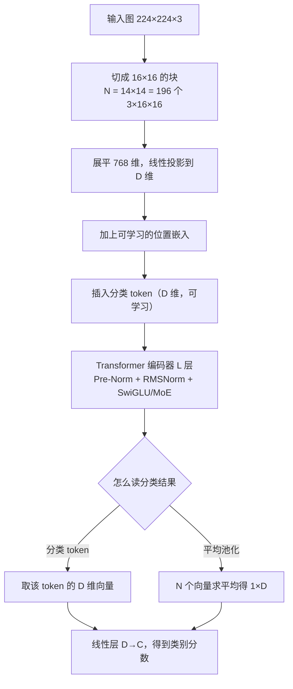
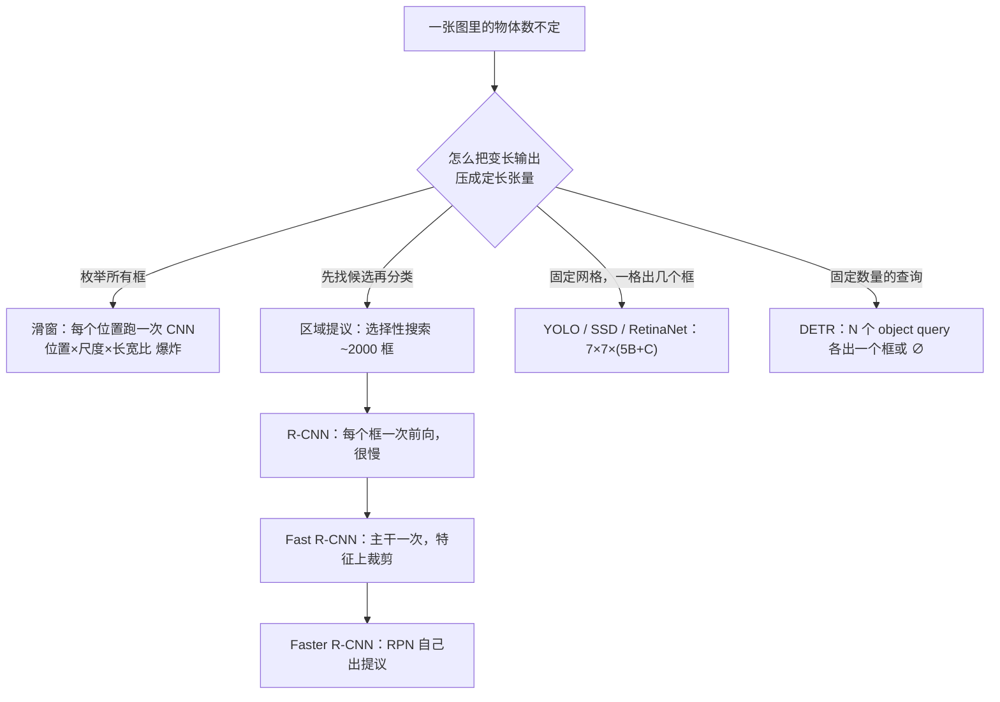

> **课程信息**
>
> - **课程名称**：Stanford CS231n: Deep Learning for Computer Vision（Spring 2025）
> - **本讲主题**：Lecture 9. Object Detection, Image Segmentation, Visualizing and Understanding
> - **主讲教师**：Ehsan Adeli
> - **授课日期**：2025-04-29
> - **课程主页**：[cs231n.stanford.edu/2025](https://cs231n.stanford.edu/2025/schedule.html)
> - **官方课件**：[lecture_9.pdf](https://cs231n.stanford.edu/slides/2025/lecture_9.pdf)（178 页，书中逐页插图）
> - **字幕来源**：[cs231n_sp25_kor_sub · eng](https://github.com/lpaiu-cs/cs231n_sp25_kor_sub/tree/main/eng)（公开英文转写，中文由本书重写）
> - **版权说明**：幻灯片与课程材料版权归 Stanford University 及授课教师所有；本书为非官方学习笔记，仅用于学习与研究。

前六讲一直在做同一件事的变体：给一张图一个标签，中间两讲则拐去处理序列。这一讲回到图像，把输出的形状拆开看——标签可以是一个词，可以是 H×W 个词（每个像素一个），可以是若干个「类别 + 框」，也可以是若干张像素级的掩码。任务一换，输出的长度就从定长变成变长，而神经网络的输出层偏偏只能吐定长张量。本讲前半场那条从滑窗到 R-CNN、YOLO、DETR 的演进线，每一站换的都只是「怎么把变长输出压成定长张量」这一招。

后半场换一个方向：不问网络输出什么，而问网络凭什么这么输出。把分类分数对像素求一次梯度，就得到一张显著性图；把最后的全连接权重乘回特征图，就得到 CAM；把梯度当作权重再乘回去，就得到 Grad-CAM。讲师 Ehsan Adeli 给出的动机很实际——在医疗影像里，「有没有肿瘤」这句话本身没人关心，关心的是肿瘤在哪。

## 1. 先把 Transformer 收尾：ViT 把图像切成词，四个改动把它调稳

*(参考时间: 00:00:05 – 00:15:53｜Lecture 9)*

开场两页没有技术内容。第二页提醒 Assignment 2 是三份作业里最长的一份，而期中与项目里程碑的截止日期都紧跟在它后面；另一条是 Colab 实践帖。讲师在这一页没有停留，只在 00:03:21 交代了一句：把 ViT 复习完就停下来答疑，作业相关的问题那时一起问。

上一讲的骨架被压缩成一页：编码器是若干层「多头自注意力 + LayerNorm + MLP」，它的产物是一串被编码过的 token；解码器结构相同，只是多了一层对编码器输出的交叉注意力，用来一个词一个词地生成目标序列。这张图之所以要重放，是因为本讲后半段所有检测模型都在复用这两个部件——DETR 的编码器-解码器就是这张图直接搬过去的。

三种方式并排的意义在于把「贵」和「好」分开算账。循环网络对长度 N 的序列要 O(N) 的显存来存隐状态，而且必须逐时刻算，不可并行；卷积可以并行，但单个输出的感受野有限，要靠堆很多层才能看到远处；自注意力让每个输出直接与全部输入相连，代价是 O(N²) 的计算与 O(N) 的显存，好处是只要四次矩阵乘法就能并行算完。讲师的判断很干脆：自注意力更贵，但建模能力明显更好，所以现在的应用默认选它——这条取舍在后面 DETR 里会再出现一次。

ViT 的起点是一张再普通不过的 RGB 图，224×224×3。整页只有这一张图和一行「Input image: e.g. 224x224x3」，因为接下来七页都在它身上做同一件事：把它变成一串向量。

切块是这一招的全部秘密：一张图被切成互不重叠的 16×16 小块，每块保留三个颜色通道，于是一个二维的像素网格变成了一串三维张量。讲师特意强调这里丢掉了什么——丢掉的是位置。序列模型只看见「第几个 token」，看不见「这个 token 原本在图的左上还是右下」。

这一帧把块数记成 N。对 224×224 的输入、16×16 的块，每边切出 14 块，N = 14×14 = 196——这个数字幻灯片没有写，但由 224/16 直接得到，后面所有关于计算量的估算都以它为准。

每个 3×16×16 的块展平就是 3×16×16 = 768 个数，再乘一个 768×D 的线性层压成 D 维向量。768 这个数字不是超参，它是「3 通道 × 16 × 16」的直接结果；真正的超参只有 D，也就是整个 Transformer 的宽度。

因为切块丢了位置，所以要补回来：每个位置配一个 D 维的可学习向量，直接加到对应的 token 上。讲师补了一句实现上的自由——位置编码不必是学出来的，也可以人为指定，比如按 1、2、3 顺序编号，或者用 (x, y) 两个坐标各编一套再相加，效果差别不大。这一点和文本 Transformer 里的位置编码是同一件事。

到这一帧，输入的形状已经和一句自然语言的词向量序列完全同构，所以后面接的就是标准 Transformer，一行都不用改。要注意的是这里没有掩码：语言模型必须遮住未来，图像没有「未来」，每个 patch 可以看所有 patch。

分类怎么读出来？最常用的办法是硬塞一个额外的 token，维度也是 D，值是一个可学习参数——它不对应图上任何一块，只负责在层层自注意力里「收集」全局信息。讲师回答过一个很自然的追问：它不是 bias，而是一个独立的可训练向量，最后会被一个前馈层或线性层映射成 C 类概率。

输出端只取这一个 token 的向量，接一个 D→C 的线性层，得到 C 个类别的分数。那些 patch 自己的输出向量在这一步被丢掉了——它们并没有浪费，信息已经通过自注意力汇进了分类 token，这正是这张架构图想表达的「一个 token 代表整张图」。

从这一页开始，幻灯片把整条流水线重画了一遍，只为换掉最后的分类头。第一帧仍是输入图与切块，标注回到了 16×16×3。

这一帧补的是展平与线性变换，和前面那一步（3×16×16 展平成 768，再压到 D）完全相同，只是这次它要作为「池化头」版本的第一步被重新记账。

串好的 D 维向量在这一帧被明确标成 Transformer 的输入。到这里为止，两条路线完全一样，分歧只发生在输出端。

位置编码在这一帧补上，措辞比前面更明确：目的是告诉 Transformer 每个 patch 在二维平面上的位置，而不是只告诉它序号。

第五帧专门标出「不使用掩码」。这一条在语言模型里是禁忌，在图像里是默认，原因很简单：图像的像素之间没有因果顺序，遮住一部分不会让任务变得更有意义，只会白白丢掉信息。

输出的形状在这一帧定下来：N 个 D 维向量，一个 patch 一个。注意这里没有分类 token，N 个向量就是全部产物。

替代方案落在最后一帧：对 N 个输出向量做平均池化，得到 1×D，再接一个 D→C 的线性层打分。讲师把两条路线的差别说得很少，但工程含义很清楚——分类 token 让网络自己学着把信息汇总到一个位置，平均池化则强行假设每个 patch 的贡献等权，前者表达力更强，后者参数更少、更不容易过拟合。

复习到此结束，接下来是「同样的架构，八年里被改了哪四处」。总览页的话说得很重：Transformer 的架构自 2017 年以来没有太大变化，真正被业界固定下来的改动只有四条——把归一化挪到残差里面、换一种归一化、换一种 MLP、把 MLP 复制成多个专家。

第一处改动来自一个很细的观察。原版把 LayerNorm 放在残差相加之后，也就是残差分支外面；这意味着无论子层学出什么，输出都会被重新归一化一次，网络因此学不出严格的恒等映射——而恒等映射恰恰是深网络能训起来的前提：某一层实在没用，至少可以什么都不做。

解法是把两个 LayerNorm 分别挪到自注意力和 MLP 的入口，也就是残差分支内部。这样残差主干上是一条干净的通路，梯度可以原样穿过；代价是主干上的数值不再被归一化约束，所以训练要靠别的手段稳住——这正是后面 RMSNorm 与 warmup 存在的理由。幻灯片给的结论只有一句：训练更稳定。

第二处改动更省：既然归一化的目的是控制尺度，减均值那一步是不是可以省掉？RMSNorm 只保留除以均方根，$y_i = x_i/\mathrm{RMS}(x)\cdot\gamma_i$，其中 $\mathrm{RMS}(x)=\sqrt{\varepsilon+\frac{1}{N}\sum_{i=1}^{N}x_i^2}$。少一次求均值、少一次减法，在大模型上是实打实的算力节省。讲师的态度很诚实：这类改动大多是经验上更稳，理论解释只是事后补的。

第三处改动动的是 MLP 内部。经典结构是 $Y=\sigma(XW_1)W_2$，$W_1$ 是 D×4D，$W_2$ 是 4D×D，中间那层宽度是输入的四倍——这个 4 倍是 Transformer 里最占参数的地方。

SwiGLU 把两个矩阵变成三个：$Y=\sigma(XW_1)\odot(XW_2)W_3$，其中 $W_1,W_2$ 是 D×H，$W_3$ 是 H×D，$\odot$ 是逐元素相乘。多出来的这一路是个门：一条支路算激活，另一条支路当开关，逐元素相乘决定放行多少。讲师点出了那个关键的数字——把 H 取成 8D/3，总参数量与经典 MLP 的 4D 版本持平，但非线性更强。

第四处改动是把「一个 MLP」变成「一组 MLP」。每个 block 里学 E 套独立的 MLP 权重，每一套叫一个专家，权重张量从 D×4D 直接扩成 E×D×4D。

路由是这招的核心：每个 token 只被送到 E 个专家中的 A 个（A < E），这 A 个叫活跃专家。于是参数量按 E 增长，计算量只按 A 增长——这是目前把「模型很大」和「推理不太贵」同时做到的主要手段。

第三帧把话挑明：GPT-4o、GPT-4.5、Claude 3.7、Gemini 2.5 Pro 这一档模型几乎必然使用 MoE，参数量在 1T 以上，但已经不再公布细节。讲师在答疑里补了两条经验：专家是并行训练、各自随机初始化，所以它们自然会分化去学不同侧面，有时也用来分离多峰的数据分布；专家数 E 与活跃数 A 都是超参，通常预先定死，不会精调。

汇总页把四条并列，措辞值得抄下来：Pre-Norm 是把归一化挪进残差；RMSNorm 是换一种归一化层；SwiGLU 是换一种 MLP；MoE 是学 E 个 MLP、每个 token 只用 A 个，参数暴涨而算力小涨。这四条加起来，就是「2017 年的架构」与「2025 年的模型」之间的全部结构差异。

## 2. 语义分割：把分类器按到每个像素上，再想办法把分辨率还回来

*(参考时间: 00:15:57 – 00:33:07｜Lecture 9)*

议程页把全讲切成两块：Computer Vision Tasks（语义分割、目标检测、实例分割）与 Visualization & Understanding（层可视化、显著性图、CAM 与 Grad-CAM）。第一块占四分之三的时长，第二块只有十分钟，讲师自己说这是「把最重要的几个过一遍」。

这一页是全场的地图。分类的输出是「一个词」，没有空间范围；语义分割的输出是「每个像素一个词」，但它不分个体，两只狗都标成 dog；目标检测给出若干「类别 + 框」，个体分开了但形状没给；实例分割两者都要，既分个体又给像素级掩码。四行字里最关键的是 semantic segmentation 下方那句「No objects, just pixels」——它解释了后面为什么还需要实例分割。

讲师把镜头倒回第一讲：给定 {dog, cat, truck, plane, ...} 这样的标签集合，为一张猫图输出一个词。这张图在此处的作用不是复习分类，而是当靶子——接下来所有任务都是在这句话上加减条件得到的。

同一张四格图，高亮挪到第二格。语义分割要的输出不是「图里有草、猫、树、天空」，而是每个像素属于哪一个类别。讲师的说法是「把每个像素变成一个标签」，这等于把分类问题复制 H×W 份。

形式化只有两行：测试时，对新图像的每个像素分类；训练时，每张训练图都要有逐像素的语义标注。讲师顺带提了历史成本——早年这类数据集是靠人坐下来一格一格标出来的，非常贵；现在有工具辅助，但标注仍然是这条路线的主要开销。

最朴素的想法是只看这一个像素。第一帧只有一张图和问号，问题还没暴露。

答案是否定的：脱离上下文，单看一个像素值判断不出它是什么。一片绿色可能是草，也可能是树冠上的一块。所以要引入上下文，也就是看它周围的一块区域。

问号在这一帧变成「怎么建模这块上下文」——取以目标像素为中心的一个 patch，把它当作一张小图送进分类器。

具体做法在第四帧：patch 过 CNN，输出中心像素的类别。幻灯片引的是 Farabet 等人 2013 年的场景标注工作与 Pinheiro 和 Collobert 2014 年的循环卷积版本。讲师强调这里的网络可以任选——CNN、ResNet、ViT 都行，因为它做的就是一件早就熟悉的事：给一张小图分类。

代价在第五帧写明：一张 H×W 的图要跑 H×W 次前向，而且相邻 patch 大幅重叠，重叠区域被反复计算了无数遍。这不是精度问题，是纯粹的浪费——后面所有分割架构的动机都从这里出发。

第一步改进是把「每个像素跑一次网络」换成「整张图跑一次网络」。但页面同时点出了障碍：分类架构为了变深，通常会在中途把特征图的空间尺寸降下来，而语义分割要求输出和输入一样大。

于是有了全卷积网络（FCN）：整张网里只有卷积，没有池化也没有跨步卷积，输入 3×H×W，中间保持 D×H×W，输出 C×H×W 的分数，最后一个 argmax 得到 H×W 的预测。

代价补在同一页的第二帧：在原始分辨率上维持 D 个通道做卷积，显存与算力都按 H×W 线性膨胀。讲师回顾说，早年 GPU 显存小，这一条几乎直接判了 FCN 的死刑——这也解释了为什么分割架构最终都走向「先降分辨率再升回来」。

这张图是本讲的分割主骨架。左边一半是已经会做的：池化、跨步卷积，把 D×H×W 逐步降到 D2×H/4×W/4，通道数变厚、空间变薄，感受野随之变大；右边一半要把尺寸升回去，而页面上那一栏写着三个问号——下采样有现成算子，上采样没有。

左边补齐了，右边照旧空着。讲师在这一页停下来提问：这个网络从一张图开始、到一张图结束，损失函数该怎么写？课堂上的回答是逐像素分类损失，讲师确认：对图上每个像素都算一次 softmax 损失，再对所有像素求和，$L=\sum_{i}\ell_{\text{softmax}}(s_i, y_i)$，然后照常反向传播。这也是为什么这类任务必须有逐像素的真值标签图。

上采样的第一个答案是「不学参数，只做几何重排」。最近邻（nearest neighbor）把 2×2 输入的每个元素复制成输出里的一块 2×2；「钉床」（bed of nails）只在每块的左上角放原值，其余填零。后者看起来更浪费，但配合后面的卷积层，这些零会被邻域的有效值逐渐「填满」，等于让网络自己学怎么插值。

如果编码器用的是最大池化，解码器就可以做得更准：池化时记下每个窗口里最大值的位置（switch），反池化时把值放回那个位置，其余置零。幻灯片把这一对操作画在同一页上，用「Remember which element was max!」标注——这是编码器与解码器之间唯一需要传递的额外信息。

第二条路线是让上采样也有参数。复习从最普通的卷积开始：3×3 滤波器、步长 1、填充 1，输入 4×4，输出还是 4×4。这一帧只是把「什么是卷积」摆回桌面上。

第二帧把「点积」两个字标在滤波器与输入重叠的位置上。卷积的每一格输出，都是滤波器与输入某个 3×3 窗口的逐元素乘积之和。

窗口滑动一次，输出就长出一格。步长 1 意味着输入每动一格、输出也动一格，所以输入输出尺寸相同——这就是「无下采样卷积」的字面含义。

把步长改成 2，同样的滤波器就变成了下采样器：输入 4×4，输出只有 2×2。

跳格的位置在这一帧被标出来。步长 2 的效果是：输出里的相邻两格，对应输入里相隔两格的位置。

第三帧给出这句关键的解读：步长是输入移动量与输出移动量的比值，所以跨步卷积可以读作「可学习的下采样」——它把 4×4 压成 2×2，压的方式由那 9 个权重决定，而不是由固定的池化规则决定。

把这层关系反过来，就得到转置卷积：输入 2×2，输出 4×4。讲师在课堂上把这一组页面快进过去了，理由是时间不够，只留下一句「它是常规卷积的逆操作，把卷积作用在输入的转置版本上，所以输出更大」；逐帧的构建过程留在幻灯片里自己看。

角色互换了：普通卷积里是滤波器扫过输入、每个输出取一个加权和；转置卷积里是输入的每个值乘上整个滤波器，把一整块「印」到输出上。这一帧的标注是「Input gives weight for filter」，说的就是这件事。

步长的方向在这一帧被翻过来：滤波器在输出上每次移动 2 格，对应输入前进 1 格。于是步长从「压缩比」变成了「放大比」，2×2 就被放大成 4×4。

放大之后必然有重叠：相邻两次「印」的区域会撞在一起，处理办法是相加。这一帧标出重叠区，下一页把它算完。

叠加完成就是最终的 4×4 输出。这五帧连起来看，转置卷积并不神秘——它是「把每个输入值乘以滤波器、按步长铺到输出上、重叠处求和」，与普通卷积共用同一套权重，只是遍历顺序反了。

一维例子把这件事算干净：输入只有 a 和 b，滤波器是 (x, y, z)。a 的三个副本占据输出第 1–3 格，得 (ax, ay, az)；b 的三个副本按步长 2 挪到第 3–5 格，得 (bx, by, bz)，其中第 3 格与 a 的第三格撞上，所以最终输出是 (ax, ay, az+bx, by, bz)。输入 2 个数、输出 5 个数，正好是「核大小 3、步长 2」的放大比：$(2-1)\times 2+3=5$。讲师用这个例子收尾，是因为它把「重叠相加」这四个字变成了可以手算的东西。

回到骨架图，两栏都填满了：下采样是池化或跨步卷积，上采样是反池化或转置卷积。到这里 FCN 的账算完——它用一个网络、一次前向，输出整张分割图，比滑窗快了几个数量级。

U-Net 是这条路线最有名的实例。整张图呈 U 形：左半边是下采样路径，通道数从 64 涨到 1024，分辨率从 572×572 一路降到 32×32；右半边对称地升回去，最后输出与输入同尺寸的分割图。

左半边在这一帧被定性：下采样让感受野变大，模型能看到更大的结构；代价是空间信息被丢弃，边界位置变得模糊。

右半边的任务因此很明确：从低分辨率、语义强的特征里重建高分辨率的映射。但信息已经丢了，光靠上采样补不回来，边界会糊。

U-Net 的解法是那条横向的灰色箭头：把左侧同分辨率的高分辨率特征图复制过来，与右侧上采样的结果拼接（concatenate），再一起过卷积。这就是跳跃连接（skip connection）在分割里的形态——它不改变网络的深度，只是把「被丢掉的空间细节」原样递到对面。讲师强调这一条在医学影像里尤其关键，因为器官边界就是诊断依据。

汇总页把整章压成一句：分割网络就是一组卷积层，中间夹着下采样与上采样。讲师在这里又回答了一个问题——转置卷积的滤波器是训练出来的吗？是，它和其他卷积层没有区别，梯度照常回传。

最后一页点出这条路线做不到的事：输出只有像素类别，图上如果有两只狗，模型会说这两块都是 dog，但不知道它们是两只。要回答「这是同一只还是两只」，就必须先有「物体」这个概念——于是话题转到目标检测。

## 3. 检测的第一性问题是输出长度：单目标回归、滑窗与 R-CNN 的两次前向

*(参考时间: 00:33:29 – 00:40:34｜Lecture 9)*

同一张四格图第三次出现。前两列已经讲完、被压成了灰色；第三、四列的画面还暗着，只有下方那个「Multiple Object」的括号先亮起来——它在提示这两列的共同点：输出数量不再固定。

第三列的画面在这一帧亮起来：同一张客厅照片里，两只狗与一只猫被三个不同颜色的框圈出来，下方标签是 DOG、DOG、CAT。分类只输出一个词，检测要输出三个（类别，框）对，而三个这个数字是这张图特有的。

先假设图里只有一个物体，问题立刻退化成「分类 + 定位」。主干之后接两个并行头：全连接 4096→1000 给类别分数，全连接 4096→4 给框的 (x, y, w, h)。讲师说这一步的关键认知是——定位可以当成回归问题，框的四个数就是四个连续变量。

损失也顺理成章地分成两路：类别用 Softmax 交叉熵，框用 L2 距离，因为框坐标本身就是实数，直接算预测框与真值框的欧氏距离即可。页面上那句「Treat localization as a regression problem!」是这一节唯一需要记住的话。

两路损失相加得到多任务损失，$L=L_{\text{cls}}+\lambda L_{\text{box}}$，一个标量、一次反传。讲师没有展开 $\lambda$ 怎么定，只说了这个结构在今天的检测器里几乎原样保留——分类头与回归头共享主干，各自出损失。

一旦图里不止一个物体，输出就变成了 CAT: (x,y,w,h)、DOG: (x,y,w,h)、DUCK: (x,y,w,h) 这样的列表。列表长度不固定，而网络的输出层是定长的矩阵乘法——这就是整章要解决的核心矛盾。

幻灯片把这个矛盾画成三行：单个物体 4 个数，三个物体 12 个数，再多就是「很多个数」。每张图需要的输出数量都不同，所以「把输出维度定成 4N」这条路走不通——N 取多少都不对。

第一个补救办法是把检测变成很多次分类：在图上取各种裁剪，让 CNN 判断这块是物体还是背景。第一帧是一个空框，三个问题依次回答 NO、NO、YES。

框滑到狗身上，答案翻过来：Dog? YES，Background? NO。检测就此被拆成「枚举所有框 + 逐框分类」。

第三帧只把框挪了一点，答案仍然是 Dog? YES。这个细节说明了滑窗的一个隐含代价：相邻位置高度冗余，同一个物体被反复确认为 YES。

框落在猫身上时 Cat? YES。页面右下角抛出问题：这个办法的问题在哪？答案在下一页。

问题被写成一句话：需要在巨量的位置、尺度与长宽比上跑 CNN，计算上完全不可接受。这和语义分割的滑窗是同一个病——把「一次前向」拆成了「几万次前向」。

于是有了区域提议（region proposal）：先用一种不需要神经网络的方法，找出图上「成块、像物体」的区域。幻灯片给的是选择性搜索（selective search）——在 CPU 上几秒钟给出约 2000 个提议框。这一步不判断类别，只判断「这里可能有东西」，所以可以做得又快又糙。讲师说这是 2014 年前后的主流思路：把「在哪」和「是什么」拆成两个问题。

R-CNN 的第一帧只有输入图像。这张图出自 Girshick 等人 2014 年的论文，后面的七帧都在它上面加部件。

感兴趣区域（RoI）在这一帧加进来，数量约 2k。注意这些框大小不一，而 CNN 要求固定输入尺寸，所以下一步必须变形。

第三帧把每个框里的像素强行拉伸成 224×224。这个 warp 会破坏长宽比，是 R-CNN 后来被诟病的细节之一，但当时它让「任意框」能喂进标准分类网络。

最贵的一步出现在第四帧：每个 warp 后的区域都要完整地过一次卷积网络。讲师在这里埋了伏笔——2000 个框就是 2000 次前向，而它们中有大量像素是重复的。

第五帧给每个区域接一个 SVM 分类器，输出类别。R-CNN 用的不是 Softmax 而是每类一个 SVM，这是那个年代的惯例。

第六帧补上框修正：不直接预测绝对坐标，而是预测相对提议框的四个修正量 (dx, dy, dw, dh)，把框「挪一点、缩一点」。用相对量而不是绝对量，是因为同一个物体在不同位置上都要被正确回归，绝对坐标会让网络被迫记住位置。

第七帧把代价写出来：每张图需要约 2k 次独立的 forward pass。这就是 R-CNN 在工程上被判死刑的原因，也是下一节全部改进的出发点。

破局的想法只有一句：卷积保留空间信息，特征图上的位置与像素位置有明确的对应关系，那为什么不等整张图过完卷积再裁剪？这一页用红字标出「Idea: Pass the image through convnet before cropping! Crop the conv feature instead!」——2000 次前向就此变成 1 次。

Fast R-CNN 的六帧是同一张架构图的逐层搭建，第一帧先把旧架构摆在左边作对照。

第二帧加上主干：整张图过一次 ConvNet，得到 conv5 特征图。主干可以是 AlexNet、VGG、ResNet 中任意一个，幻灯片把它们并列写在「Backbone network」下面——检测器的精度与速度很大程度上由这个选择决定。

RoI 在这一帧被投到特征图上。因为卷积是平移等变的，像素坐标除以总步长就得到特征图坐标，一个框在两张图上的相对位置一致。

第四帧做「裁剪 + 缩放特征」。这一步是 RoI Pool 的雏形，具体怎么把任意大小的特征区域压成固定尺寸，幻灯片留到附录里讲（第 153–164 页）。

第五帧是「Per-Region Network」：每个 RoI 的特征接一个很小的头，一路线性 + Softmax 出类别，一路线性出框偏移。至此每张图只过一次主干，代价从 2000 次前向降到 1 次。

第六帧把整条流水线拼齐。讲师对这条线的评价是：它把检测从「不可能实时」推进到「可以谈速度」，但还剩一个瓶颈没解决——那 2000 个提议仍然来自一个与网络无关的算法。

## 4. 把提议交给网络自己：RPN 的锚框、YOLO 的网格、DETR 的查询

*(参考时间: 00:40:46 – 00:57:38｜Lecture 9)*

第三个瓶颈是提议本身。既然主干已经把图变成了 512×20×15 的特征图，为什么不在这张图上直接预测「哪里可能有物体」？RPN 就是这么来的：输入 3×640×480，输出 512×20×15，每个空间位置对应原图上一个 32 像素见方的格子。

锚框（anchor）在这一帧引入：特征图上每个点放一个固定尺寸的框，它的作用是把「预测框」变成「预测相对锚框的偏移」。这一步和 R-CNN 的 (dx, dy, dw, dh) 是同一个思想，只是这次锚框是预先铺好的。

第三帧加上第一个头：对每个位置做二分类，判断对应的锚框里有没有物体，输出 1×20×15 的 objectness 图。注意这里不分具体类别，只分「物体 / 背景」。

第四帧加上第二个头：对判为正的框，回归它到真值框的四个修正量，输出 4×20×15。讲师说这一步的细节（怎么参数化、怎么采样正负样本）他跳过，留在附录的 Faster R-CNN 那几页里。

锚框从一个变成 K 个，覆盖不同尺度与长宽比。于是两张输出图的通道数分别乘 K：objectness 是 K×20×15，框变换是 4K×20×15。

第六帧是收尾：把 K×20×15 个框按 objectness 排序，取前约 300 个当提议。以 K=9、20×15=300 个位置算，一共 2700 个候选框，其中只有约 300 个进入第二阶段——RPN 在这里把「稠密预测」压成了「稀疏提议」。

把 RPN 的思路再往前推一步就是单阶段检测器：不再分「提议」与「分类」两段，而是每个格子上直接同时出框和类别。幻灯片给的账很清楚：图像切成 7×7 网格，每格 B 个基准框，每个框 5 个数 (dx, dy, dh, dw, confidence)，再加 C 个类别的分数，输出张量就是 7×7×(5B+C)。以 B=3、C=20 计，一共 7×7×35 = 1715 个数——一个固定尺寸的张量，变长问题被彻底消掉了。页面最后一句点评很到位：它很像 RPN，但是类别相关的。

YOLO（You Only Look Once）是这条路线最有名的名字，标题就写着 real-time object detection。讲师说即便在今天，工业应用里仍然大量拿它当基线，因为快且够准。

秘密全在这一帧：把图划成 S×S 的网格（这一版是 7×7）。每个格子只对自己覆盖的那一小块负责，「哪个框归哪个物体」这个分配问题由网格位置直接裁决——不需要提议，也不需要匹配。

第三帧列出每个格子的三项输出：框里有物体的概率 P(object)、B 个边界框的 (x, y, h, w)、以及属于各类的概率 P(class)。这两项是分开出的：前者回答「这里有没有东西」，后者回答「那是什么东西」。

B 在这一帧被定成 2。这个数很小，含义是每个格子最多负责两个物体——对 7×7 的网格来说够用，因为物体中心通常落在不同格子里。

第五帧展示同一格子里两个框各自的概率。注意它们是并行输出的，网络并不需要在两个框之间做选择，选择留给后处理。

所有格子的框被叠回原图，线的粗细就是概率。到这一步，一张图会产生 7×7×2 = 98 个框，绝大多数是背景或重复。

第七帧是后处理的结果：先按概率阈值筛，再用非极大值抑制（NMS）去掉互相重叠的重复框，剩下的就是最终检测。讲师没有展开 NMS 的细节，只说它是这类检测器的标准收尾。

第三条路线把「锚框」整个删掉。DETR 的流水线是：CNN 提特征 → Transformer 编码器-解码器 → 直接输出一组框；训练时用二分匹配（bipartite matching）把预测框与真值框配对，再回归坐标。页面上那句「No anchors, no regression of box transforms」是本页的重点——它连「相对锚框的偏移」这个概念都不需要了。

从这一帧开始，幻灯片把流水线的三个部件逐个放大。先放大主干：CNN 输出的特征图要与位置编码相加，否则 Transformer 无法区分空间位置——这和 ViT 里的位置嵌入是同一个问题。

主干内部在第三帧补完：特征图与位置编码在加号处合并。到这里，一张图已经被变成了一串带位置的 token，和 ViT 的输入形式一致。

镜头再推近一层，落在编码器上：多层自注意力加 MLP，输入输出都是同一串 token。图像里的 token 数量远小于像素数（前面 RPN 那页的特征图是 20×15），所以 O(N²) 的自注意力在这里是可以承受的。

第五帧补上解码器：它以编码器的输出为键值，输入端则是一小组可学习的查询向量（object queries）。讲师反复强调过这一点——这些查询不是图像块，也不是预先铺好的框，就是一堆可训练参数，网络自己学出「每个查询该盯住什么」。

最后一帧补上预测头：每个查询的输出过一个 FFN，得到一个类别加一个框，或者被判成 no object (∅)。右边那张图就是最终结果——两只海鸥被两个查询各自认领。讲师解释了这个设计的容量含义：查询数就是你允许模型一张图最多检出多少个物体，超过这个数的物体只能被丢掉，所以要按数据集调整。

## 5. 实例分割：在检测头上再加一条 28×28 的掩码支路

*(参考时间: 00:58:01 – 01:01:31｜Lecture 9)*

检测解决了「有几个、分别是什么」，但没解决「每个物体的精确形状」。四格图的第四列要求两者兼得：既分个体，又给像素级掩码。

这一页只有一行标题，作用是把上一章的终点当作本章的起点。讲师的口径是：实例分割不需要新架构，只需要在检测器上多接一个输出。

于是有了 Mask R-CNN：在原来的分类头、框回归头之外，给每个 RoI 再加一条小分支，用一个小的全卷积网络预测 28×28 的二值掩码。讲师强调这个掩码是「每个 RoI 一张」，与输入图像里的物体大小无关——28×28 是固定分辨率。

第二帧把输入端的账写清楚：主干加 RPN 给出 RoI，RoI Align 把每个 RoI 的特征对齐采样成 256×14×14。用 Align 而不是 Pool，是因为池化要把框「吸附」到整数格子上，会带来几个像素的错位，而对掩码来说错位就是边界糊。

第三帧补上掩码支路：256×14×14 的特征过两层卷积，输出 C×28×28——每个类别一张掩码，而不是所有类别共用一张。这样掩码分支与分类分支解耦，分类错了不会连带把掩码也画错。

掩码的真值不是语义标签图，而是「这个 RoI 内部，哪些像素属于这个物体」的二值图。第一组示例把来源摆清楚：左图红框圈住床与柜子之间的一把椅子，右图是这只椅子在 28×28 网格上的二值形状，边缘带着锯齿——这正是固定低分辨率带来的量化。

第二帧在下方又叠了一组：同一个房间、框稍微挪了一点，掩码的边缘也跟着变。讲师用这一点说明掩码分支的学习目标——它学的是「框内这块像素属于谁」，而不是把整类物体的形状背下来。

第三帧补上第三组，页面从竖排变成网格排布。三组放在一起，同一个场景里不同框对应不同掩码，这件事变得一目了然：掩码与框是一对一的，而不是与图像一对一的。

四组齐了：右上那组框放得松，掩码也跟着变宽；下面两组换成了床上的人和床本身。这四对样本把「每类一张 28×28」这个设计讲透了——同一个框里，不同类别本来就该有不同的掩码，所以掩码头必须按类输出 C 张，而不能只出一张。

结果页是这一章的说服力所在：同一张图里的人和物被分别框出、分别给出掩码，遮挡关系也处理得住。讲师的原话是「results have been very, very good」，但他随即补了一句现实评价——这类两阶段模型今天已经很少用了，因为计算太重。

同一个框架还能做姿态估计：把掩码分支换成关键点热图，一人一张，就得到人体骨架。这说明「每个 RoI 一条小全卷积支路」是一种通用接口，输出什么取决于你把支路接成什么样。

工程落地有现成的：TensorFlow Detection API 里有 Faster R-CNN、SSD、RFCN、Mask R-CNN；Detectron2（PyTorch）里有 Mask R-CNN、RetinaNet、Faster R-CNN、RPN、Fast R-CNN、R-FCN。两处都可以拿预训练模型在自己的数据上微调。

复盘页把四类任务并排放回同一张图上。讲师在这里给了一个很实际的落点：这些任务的组合仍然出现在工业流水线上，比如分拣烂番茄——先检测出每一个番茄，再分类好坏，两个任务串起来才是一条可用的产线。

## 6. 可视化：把梯度指向像素，把权重指向特征图

*(参考时间: 01:01:37 – 01:13:11｜Lecture 9)*

议程页第二次出现，剩下的十分钟归第二块。讲师给的理由不是学术趣味，而是应用需求：在医疗影像里判断「有没有肿瘤」这件事本身价值有限，有价值的是「肿瘤在哪」，而后一个问题只能靠可视化回答。

回到第一讲的线性分类器：权重矩阵的每一行可以重塑成一张图，就是这一类的模板。车那一类的模板看起来像一张正面朝向的车，因为这类样本在训练集里大多是这个姿态。这张页的作用是给出一个类比——如果线性模型的权重能看，卷积核的权重也应该能看。

这一层的卷积核是 64 个 3×11×11 的滤波器：64 是滤波器个数，决定输出通道数；3 恰好等于输入通道数，所以每个滤波器都能直接当成一张 11×11 的彩色小图显示出来。看到的是边缘、条纹、颜色斑块——最基础的方向与频率检测器。

换成 ResNet 与 DenseNet，第一层的核变成 64 个 3×7×7，画出来仍然是一堆条纹与色块。三个深度相差一个数量级的网络，第一层却长得很像——这符合直觉：第一层直接吃像素，能学的东西受输入统计量限制，与后面的深度无关。

从这一页开始问一个不同的问题：图上哪些像素对这个分数有贡献？第一帧只做前向，把图变成「Dog」这个类别的概率。

关键的一步是把求导的对象换掉。训练时求的是损失对权重的梯度，这里求的是类别分数对像素的梯度——「这个像素动一点，狗的分数会变多少」。得到的张量和输入同形（3×H×W），取绝对值再对三个通道取最大，压成一张 H×W 的灰度图，就是显著性图。右下角那张图里，狗的轮廓隐约可见。

换几张图看，显著性图大体能把主体勾出来，但边缘很碎、背景也有响应。讲师对它的评价是「在很多情况下非常有效」，但没有说它可靠——这正是后面 CAM 系列要解决的问题：梯度告诉你哪些像素敏感，却不告诉你网络在哪块区域上建立了类别概念。

CAM 换了一个角度：不改网络，只改读法。它要求网络在最后用全局平均池化（GAP）把 H×W×K 的特征图压成 K 维，再过一个全连接层得到 C 个分数。这个结构约束既是 CAM 能成立的原因，也是它只能用在最后一层的原因。

第一步是 GAP 的定义：$F_k=\frac{1}{HW}\sum_{h,w} f_{h,w,k}$。K 张特征图变成 K 个数，空间信息在这里被平均掉了——但也正因为是平均，每个空间位置对 $F_k$ 的贡献是等权的，这给后面的反推留了门。

第二步把分数写成池化特征的加权和：$S_c=\sum_k w_{k,c}F_k$。到这一步，C 个类别分数已经是 K 个池化数的加权和，空间信息暂时还看不见。

第二帧把 $F_k$ 的定义代进去：$S_c=\frac{1}{HW}\sum_k w_{k,c}\sum_{h,w}f_{h,w,k}$。此时外层仍是通道求和，空间求和还包在里面。

第三帧只做一件事——交换求和次序，写成 $\frac{1}{HW}\sum_{h,w}\sum_k w_{k,c}f_{h,w,k}$。这一步是整个 CAM 的关键：一旦空间索引在外层，括号里那一项对每个 $(h,w)$ 都能单独算，算完就是一像素一个分数。讲师在这里解释了「为什么能一路追回图像空间」的底气：卷积是空间一致的，特征图上的位置与输入图上的感受野中心有固定对应。

第四帧把 $w_{k,c}f_{h,w,k}$ 单独框出来：第 k 张特征图在位置 (h, w) 的激活，乘以它对第 c 类的重要性权重。这一步之后，「类别分数」与「空间位置」之间只剩一个求和的距离。

最后一帧给出定义：$M_{c,h,w}=\sum_k w_{k,c}f_{h,w,k}$，$M\in\mathbb{R}^{C\times H\times W}$。整个 CAM 就这一行公式——把全连接层里属于第 c 类的 K 个权重，当成 K 张特征图的加权系数，加完再上采样回原图尺寸。

结果页最有说服力：同一张建筑照片，问「宫殿」时热图落在屋顶与立面，问「圆顶」时落在穹顶，问「祭坛」时落到内部。同一张特征图，换一组权重就换一种解释，这正好说明权重里编码的是「哪类特征对哪类重要」。

问题也写在同一页上：这个推导要求分类器紧跟在 GAP 之后，所以只能套在最后一层卷积上。而现代 CNN 的最后一层之后往往还有好几层全连接或其他算子，CAM 在那里根本无从下手。另外，最后一层的特征图分辨率本来就低，热图天然很粗。

Grad-CAM 的第一招是把「最后一层」这个限制去掉：任意挑一层，记它的激活为 $A\in\mathbb{R}^{H\times W\times K}$。层选得越靠后，语义越强、分辨率越低；选得越靠前，分辨率越高、语义越弱，这是一个可以调的旋钮。

第二步：算 $\partial S_c/\partial A$。梯度的形状与激活相同，含义是「这个位置的这张特征图，对第 c 类的分数有多敏感」。

第三步：把梯度在空间上平均，得到 K 个标量 $\alpha_k=\frac{1}{HW}\sum_{h,w}\frac{\partial S_c}{\partial A_{h,w,k}}$。这一步的形状与 CAM 的 GAP 完全对应——只不过 CAM 用的是全连接权重 $w_{k,c}$，Grad-CAM 用梯度现算一个。

第四步：$M^c_{h,w}=\mathrm{ReLU}\left(\sum_k \alpha_k A_{h,w,k}\right)$。ReLU 不是装饰——它把「反对这一类」的证据全部压掉，只留下正贡献，所以热图看起来更干净。

结果与 CAM 同源但适用面大得多：任意层都能出图，任意网络结构都能用，因为只需要一次反向传播。讲师的原话是这类方法是理解 CNN 最常用、也最值得先学的工具之一。

对 Transformer 这类模型，这件事反而简单：自注意力矩阵里本来就存着「每个输出看哪些输入」的权重，把它按 patch 位置摊回图像就行，不需要梯度也不需要改结构。左边一列是不同物体的注意力图，右边四张是带置信度的例子（basketball 95.13%、beacon 99.81%、American_black_bear 92.99%、basketball 87.74%）。讲师对这个对比的总结是：Transformer 自带解释接口，CNN 才需要 Grad-CAM 这类外挂。

## 7. 小结

*(参考时间: 01:13:19 – 01:13:36｜Lecture 9)*

议程页最后一次出现，两个大块都划掉了。讲师说他原本以为这些内容讲不完。

最后一页指向第 10 讲：视频理解。它其实是本讲所有任务在时间轴上的延伸——分类、检测、分割都要在帧与帧之间保持一致，而「一致」正是下一讲的主题。

把全讲压成几条可以带走的判断：

- 语义分割的损失是逐像素 softmax 之和，网络结构上唯一的新问题是怎么把分辨率升回去；反池化、转置卷积、跳跃连接是三种不同层次的答案。
- 转置卷积不是新算子，它就是「输入给权重、滤波器铺到输出、重叠处相加」，与普通卷积共用同一套参数。
- 检测的根本矛盾是输出长度不固定；滑窗、区域提议、固定网格、固定查询，本质上都是把变长输出压成定长张量的四种编码方式，代价分别是算力、延迟、精度与容量上限。
- 两阶段检测器的速度瓶颈从来不在分类，而在提议；RPN 的价值是把提议也变成一次前向里的卷积运算。
- 单阶段检测器用「每格 B 个框」换速度，输出张量固定为 $S\times S\times(5B+C)$，NMS 是它不可或缺的收尾。
- CAM 的公式说明「类别分数是特征图的加权和」，因此权重可以当作空间重要性；Grad-CAM 用梯度替换权重，把这个结论推广到任意层。
- 可视化的价值取决于任务：分类任务里它是调试工具，医疗与自动驾驶里它是产品的一部分——「在哪」往往比「是什么」更贵。

## 附录：课堂未展示的幻灯片

讲师在 00:31:42 与 00:42:42 两次说明：坐标、维度与 RoI 的细节被他从正文里删掉了，全部放在 deck 末尾，让大家课后自己看。下面 29 页就是这批备份页，按 deck 原始顺序逐页说明。

这页是延伸阅读的入口，正文没有展开，页面上只留下标题。

把卷积写成矩阵乘法之后，「下采样」就对应一个稀疏矩阵乘输入向量：行数比列数少，每行只有与核重叠的那几项非零。

这是「transposed」三个字的代数解释：同一个矩阵的转置乘回去，维度自然变大，重叠处自然相加。

Fast R-CNN 的裁剪细节从这里开始，先摆出输入与特征图的尺寸关系。

投影靠的是总步长：像素坐标除以步长就是特征图坐标。

「吸附」是为了让框与特征图的格子对齐，代价是对齐误差最多半个格子。

固定尺寸是必须的，因为后面的全连接层要求输入维度固定。

切分不要求整除，子区域边界可以落在格子之间，这也是误差的来源之一。

最大池化保证无论输入区域多大，输出尺寸都一样——这是 RoI Pool 的全部本事。

两级量化（先吸附框、再切分）叠加起来，会让特征与真实物体错开几个像素，对检测影响不大，对掩码就是灾难。

Mask R-CNN 的修法很简单：去掉吸附这一步。

采样点的坐标可以是小数，值由周围四个格点插值得到，于是不再有量化误差。

这一帧给出双线性的定义，权重由采样点到四个格点的距离决定。

四个角点各是一个 512 维向量，插值对每个通道独立进行。

流程与 RoI Pool 完全一致，唯一的区别是采样点不再被量化——这也是 Mask R-CNN 掩码边界更干净的直接原因。

左图是训练时间：R-CNN 84 小时，SPP-Net 25.5 小时，Fast R-CNN 8.75 小时。右图是测试时间：R-CNN 49 秒，SPP-Net 4.3 秒，Fast R-CNN 2.3 秒；把区域提议的时间排除后，Fast R-CNN 只要 0.32 秒。

这两组柱子放在一起就读出了下一个瓶颈：去掉提议后 Fast R-CNN 只需 0.32 秒，剩下的 2 秒几乎全花在提议上。

把提议网络做进主干之后，剩下的流程与 Fast R-CNN 完全一样：裁特征、逐区域分类。

四个损失分别是 RPN 的物体/非物体分类、RPN 的框回归、最终分类、最终框回归。

同一张测试时间柱状图补上最后一根：Faster R-CNN 0.2 秒，比 Fast R-CNN 又快了一个数量级。

NMS 怎么去重、锚框怎么定、正负样本怎么采、框回归怎么参数化——这四件事决定实现成败，但都是工程量而非新思想。

第一阶段每张图跑一次（主干加 RPN），第二阶段每个区域跑一次（裁特征、分类、回归偏移）。

这个问题就是单阶段检测器的起点——第 4 章的 YOLO 与 SSD 正是把它答成「不要」。

三条结论写得很直白：Faster R-CNN 更慢但更准，SSD 更快但没那么准，主干越大越深通常越好。

补上的这篇综述把 2019 年之前的检测路线串成一条线，适合当延伸阅读。

做法与显著性图同源，只是求导的对象从类别分数换成了某个中间神经元的值。

这就是 guided 的含义：负梯度一律截断，出来的图更干净，代价是不再是真正的梯度。

左边是让该神经元响应最强的真实图像块，右边是反推出来的合成图案，两者对照能看出这个神经元在找什么。

每一行对应一个神经元，行与行之间的差异就是不同通道分工的证据。
