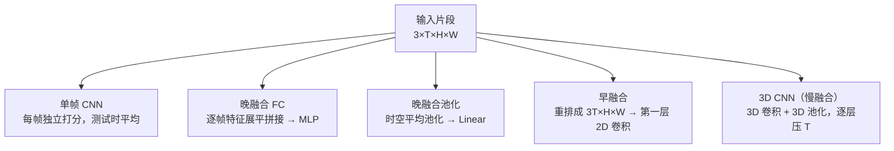

> **课程信息**
>
> - **课程名称**：Stanford CS231n: Deep Learning for Computer Vision（Spring 2025）
> - **本讲主题**：Lecture 10. Video Understanding
> - **主讲教师**：Ruohan Gao
> - **授课日期**：2025-05-01
> - **课程主页**：[cs231n.stanford.edu/2025](https://cs231n.stanford.edu/2025/schedule.html)
> - **官方课件**：[lecture_10.pdf](https://cs231n.stanford.edu/slides/2025/lecture_10.pdf)（103 页，书中逐页插图）
> - **字幕来源**：[cs231n_sp25_kor_sub · eng](https://github.com/lpaiu-cs/cs231n_sp25_kor_sub/tree/main/eng)（公开英文转写，中文由本书重写）
> - **版权说明**：幻灯片与课程材料版权归 Stanford University 及授课教师所有；本书为非官方学习笔记，仅用于学习与研究。

上一讲把 2D 视觉的输出从「一个标签」推到「一组框加一张掩码」：分类、语义分割、目标检测、实例分割，四种任务共用同一个主干，区别只在头部的输出形状。这一讲换的是输入端——输入不再是一张 3×H×W 的图，而是一卷 T 帧，形状变成 T×3×H×W。多出来的这一维远不止「多存几张图」：它让一分钟的高清原片占掉 10 GB，让 3D 卷积的算力涨到 VGG-16 的 2.9 倍，也让「动作」这种只在时间上才成立的概念第一次成为分类目标。

授课的是客座讲师 Ruohan Gao（马里兰大学学院公园分校），研究方向是多模态——视觉之外还要用声音。这条线索在最后二十分钟会收回来：画面里两个人同时说话时，光看像素分不出谁在说什么，但把口型和声音对上就能分开。所以整讲可以概括成一条链：**先问时间信息该在哪一层融合，再问这种融合要付多少算力，最后问除了像素还有没有别的模态可用**。

## 1. 视频不是「很多张图」：多出来的 T 维改了哪些形状

*(参考时间: 00:00:05 – 00:03:10｜Lecture 10)*

### 1.1 一位做客的讲师，和这门课的第一个十年

标题页把三件事并排写着：Lecture 10、Video Understanding，以及页脚那行 Stanford CS231n 10th Anniversary。这一讲是 2025 春季学期第一位客座讲师——课程在学期初就预告过，会请几位以前教过这门课的人回来，各讲一次自己最熟的方向。

幻灯片上的履历可以按时间读：UT Austin 博士，2021 到 2023 年在 Stanford 做博士后（合作者是 Fei-Fei Li、Jiajun Wu 与 Silvio Savarese），期间在 2022–2023 学年担任 CS231n 的讲师，也在 Meta 待过一段时间，现在是马里兰大学学院公园分校的助理教授，主持 Multisensory Machine Intelligence Lab。他的关键词是「多模态」：视觉之外还要用声音、触觉这些通道。这个背景解释了为什么本讲最后二十分钟会突然从画面切到音频——在他眼里，视频从来不是「会动的图像」，而是一段带声音的事件。

### 1.2 2D 视觉能回答什么，不能回答什么

图像分类的设定被压缩成一行：给定一个候选标签集合 {dog, cat, truck, plane, ...}，输出其中哪一个。这一页放在视频课的开头，是因为它定义了后面所有任务的比较基准——输入是一张三维张量，输出是一个 C 维分数向量，中间既没有「位置」也没有「顺序」。

上一讲把这套接口往前推了三步，四格图分别标注了它们放弃了什么：分类「没有空间范围」（no spatial extent），语义分割「没有物体，只有像素」，检测开始处理「多个物体」，实例分割再要求同类的两只狗各有一张掩码。四者的共同点是**输入永远是一帧**——它们都能回答「这张图里有什么、在哪里」，却没有一个位置能存放「什么时候」。

把工具箱搬到真实场景，这个缺口更明显：客厅里有狗、有婴儿，检测框和掩码都画得出来，可这段视频真正的信息是狗扑过来、婴儿笑出声这样的**事件**。单帧分不出「扑」和「趴」，因为两者的姿态可以几乎相同；区别只在相邻帧之间的位移。

### 1.3 分隔页与 4D 张量

中间这页没有任何内容，只有十周年的标题条。它在本讲出现两次（后面 088 页还有一次），作用是把「2D 视觉回顾」与「视频本身」切成两段——这类分隔页在本书里照录，因为它们标记的是讲者的换气点。

真正的定义在这一页：视频是一串图像，形状是四维张量 T×3×H×W，也可以写成 3×T×H×W。这两种写法不是排版偏好。前者把一帧的三个通道放在一起（帧优先），后者把同一通道的所有帧堆在一起（通道优先）。PyTorch 的 `Conv3d` 要求 `(N, C, D, H, W)`，即 3×T×H×W；而后面讲早融合时，幻灯片要从 T×3 直接展平成 3T 个通道，用的正是帧优先的排布。**同一个视频换一种轴顺序，第一层卷积核看到的东西完全不同**，这一点在第 3 章会变成具体的参数账。

代价不止存储。二维网络里 batch 是唯一「多出来」的轴，三维网络里多了 T 这一轴，激活值随 T 线性增长，而感受野、池化、归一化全都要重新定义一次「邻域」。所以这一讲后面每一个架构，实质上都在回答同一个问题：T 这一轴，在哪一层被压掉、以什么方式压掉。

## 2. 一分钟 10 GB：先把视频变小，再在片段上训练

*(参考时间: 00:03:37 – 00:08:16｜Lecture 10)*

### 2.1 标签从名词换成动词

视频分类的接口和图像分类一模一样，只有标签集合换了：swimming、running、jumping、eating、standing。输入仍然是一个张量进、一个分数向量出，所以前几讲的交叉熵损失、反向传播、SGD 可以原封不动搬过来。讲师把困难说得更直白：视频理解的第一层难处不在损失函数，而在「怎么把像素变成一个能喂给损失函数的特征」。

这一页把差别摊开：图像这边是 dog、cat、fish、truck，全是**名词**；视频这边是 swimming、running、jumping、eating、standing，全是**动词**。名词可以由单帧的纹理和形状决定，动词不行——「跑」的定义里天然含着一个时间跨度。这也解释了为什么视频模型的输入必须是「一段」而不是「一张」，以及为什么接下来所有架构的争论都围绕「这一段怎么压成一个向量」。

### 2.2 先算清楚一分钟有多少字节

账是这么算的：30 帧每秒、每像素 3 字节，SD（640×480）一分钟约 1.5 GB，HD（1920×1080）一分钟约 10 GB。这两个数字值得记住，因为它们不是「有点大」——一分钟 HD 原片就有 10 GB，已经逼近一张 24 GB 显卡的显存，而训练一个 batch 远不止一分钟。讲师还补了一句常被忽略的成本：要存的不只是输入，还有权重和卷积网络的激活值。

解法在这一页：训练时只看短片段，并且同时降两样东西——帧率和空间分辨率。幻灯片给的例子是 T=16、H=W=112，也就是 5 fps 下 3.2 秒、588 KB。这个数可以自己验：$16\times112\times112\times3=602{,}112$ 字节，正好 588 KiB。

| 表示 | 帧数与形状 | 未压缩大小 | 相对同长度的 HD 原片 |
| --- | --- | --- | --- |
| HD 一分钟 | 1800 帧 × 1920×1080×3 | 约 11.2 GB（页面标 ~10 GB） | 1× |
| SD 一分钟 | 1800 帧 × 640×480×3 | 约 1.66 GB（页面标 ~1.5 GB） | 约 1/7 |
| 训练片段 | 16 帧 × 112×112×3 | 602 KB（588 KiB） | 约 1/990 |

降采样不是免费的：5 fps 会把挥拍、起跳这类快速动作抹成模糊的一片，112×112 会让远处的小物体消失。幻灯片的口径是「如果你有算力，当然可以用更大分辨率」——这句话在本讲后面会反复出现，第 4 章那笔 39.5 GFLOP 的账，正是从「能不能负担更高分辨率」开始的。

### 2.3 训练在片段上，测试在片段上平均

页面上只有一条时间轴，标注「长、高 FPS」。它想说明的是：完整视频根本不是一个可以送进网络的样本，长度从几十秒到几小时不等。

训练时用滑动窗口采样：把长视频切成许多 T 帧的片段，每个片段继承整段视频的标签，当成一个独立分类样本来训。这一步把「变长输入」这个麻烦，转换成了「定长输入 + 更多样本」。

测试时反过来：在长视频上采样若干片段（课上提到大约 10 个），每个片段单独打分，再把概率平均，作为整段视频的预测。

这个「训练在片段、测试平均」的协议是后面所有模型共同的前提，它有两个隐含假设。其一是**片段标签等于视频标签**——对 Sports-1M 这种整段只含一种运动的视频成立，对未剪辑的视频（第 7 章的时序动作定位）就不成立。其二是**片段之间可平均**——如果动作只发生在十秒里，随机采样的十个片段大部分是空的，平均值会被稀释。第二个假设在第 7 章「高效视频理解」里会变成一个明确的研究问题：与其均匀采样，不如学一个「哪些片段值得算」的策略。

## 3. 融合发生在哪一层：单帧、晚融合、早融合、3D 卷积

*(参考时间: 00:08:29 – 00:26:06｜Lecture 10)*

有了「片段」这个统一输入，剩下的问题只有一个：T 帧的信息在哪一层合并？四个答案按融合位置排列——完全不合并（单帧）、最后合并（晚融合）、最前合并（早融合）、逐层合并（3D 卷积）。讲师按这个顺序讲，每一页都在上一页的图上加一个「问题」标注，所以读这一章要盯住那行红字：它标记的正是该方案失效的地方。

### 3.1 单帧 CNN：先跑这个基线

最省事的做法是把视频当图像：每帧过一个 2D CNN，测试时把各帧的概率平均。幻灯片上七个小人各过一个 CNN，全部输出 "Running"。讲师给它的评价很重——**这往往是非常强的基线**，因为像跑步这样的片段帧间变化不大，静态外观已经足够判别；设计任何视频模型之前都应该先跑它，别一上来就写 3D 卷积。

真正的问题被推到采样上。讲师在这里停了一下，说「怎么采帧，本身是关键问题，也是一个活跃的研究方向」：最笨的办法是均匀采样（一小时的视频每分钟取一帧），好一点的办法是用第一次判断的结果决定下一步看哪里。这条伏笔在第 7 章回收——SCSampler 那类工作就是学一个「先看哪里」的策略。

### 3.2 晚融合之一：把 T 张特征图拼成一根巨型向量

晚融合（late fusion）的第一步仍然是逐帧过 2D CNN，但不再直接输出类别，而是取中间那层特征图，形状 T×D×H'×W'。然后展平、拼接，得到一根 TDH'W' 维的「片段特征」，再送进 MLP 映射到 C 个类别分数。它叫「晚」，是因为每一帧都被独立处理到很靠后的阶段，时间信息直到最后才被拼起来。

参数账不难算。取 D=512、H'=W'=7、T=16，每帧特征 25,088 维，拼起来是 401,408 维；若第一层全连接宽 4096，这一层就是 $401{,}408\times4096\approx1.64\times10^{9}$ 个参数——ResNet-50 约 2,560 万个参数，这一个分类头就是它的六十多倍。而且这个数字随 T 线性增长：片段从 16 帧拉到 32 帧，分类头参数直接翻倍。

| 做法 | 每帧特征 | 送进分类器的向量 | 分类头第一层参数量 |
| --- | --- | --- | --- |
| 晚融合 + FC | 512×7×7 = 25,088 | 401,408（T=16） | 约 1.64×10⁹ |
| 晚融合 + 池化 | 512×7×7 = 25,088 | 512 | 512×C |

### 3.3 晚融合之二：池化省了参数，也省掉了脚的动作

改法很直接：不拼接，改在空间和时间上做平均池化，把 T×D×H'×W' 压成一根 D 维的片段向量，再过一个线性层得到 C 个分数。参数量从十亿级掉到 $512\times C$，而且不再随 T 增长。

代价写在下一页的红字上：**帧间的低层运动变得难以比较**。讲师用画面里那个跑者的脚做例子——每帧红圈标出的落脚位置都不一样，这是判断「跑」最直接的线索；但逐帧 2D CNN 一路卷积池化到深层，特征图里早就没有「脚在哪一帧抬起」这种位置级别的信息了，剩下的只有语义级的外观。平均池化再把时间轴压掉，连顺序都不剩。

这就是「晚」的真正含义：融合得越晚，被融合的东西越抽象。深层特征擅长回答「画面里像不像跑步」，不擅长回答「两帧之间脚动了多少」。讲师补了一句直觉：抽取越靠前层的特征，越接近原始帧，越可能保留低层运动；越靠后，越是语义。晚融合把这个选择固定在了「靠后」。

### 3.4 早融合：把 3T 个通道一次性压掉

早融合（early fusion）走到另一个极端：把 T 帧的三个通道直接摞成 3T 个通道，重排成 3T×H×W，让**第一层** 2D 卷积就把通道维度从 3T 映到 D。此后整个网络就是标准 2D CNN，只是时间信息已经在第一层被压成了一个 D×H×W 的特征图——幻灯片上把这句写得很难听：collapses all temporal information。

它的好处是时间感受野一步到位：第一层卷积核在时间上就看满了全部 T 帧。参数代价也不小：第一层是 $D\times3T\times3\times3$，T=16 时输入通道 48，若 D=12 则是 5,184 个参数；同样的 D 与卷积核，晚融合那一层只有 $12\times3\times9=324$ 个，差 16 倍。

红字指出了它的毛病：**只靠一层做时间处理，可能远远不够**。第一层卷积是线性加权加非线性，它能表达「哪些帧的哪些位置同时亮」，却难以表达「先 A 后 B」这种顺序关系——而动作恰恰由顺序定义。讲师的说法是「我们太贪心了，想在一层里抓住所有东西」。

### 3.5 3D 卷积：让感受野在时间和空间里一起长大

第三条路是 3D 卷积：卷积核和池化核都多一个时间维度，输入是 3×T×H×W，网络里每一层的特征都是四维张量 D×T×H×W，时间维被逐层、缓慢地压小。Karpathy 等人把它叫「慢融合」（slow fusion）——不在最前也不在最后，而是分散到每一层。

先用一页复习 2D 卷积，好让「多一维」这件事有对照。

2D 卷积核只在 H、W 两个方向上滑，第三个维度（通道）一次看满：$5\times5\times3$ 的核滑过 $32\times32\times3$ 的输入，每个位置出一个标量，得到 $28\times28\times1$ 的激活图。通道在这里不是「空间」，而是「每个位置上的特征向量长度」。

3D 卷积把核变成 $k_t\times k_h\times k_w$ 的立方体：不只滑过画面的 x、y，还滑过时间轴。幻灯片上标的三组数字（6×6×6、5×5×5、4×4×4）是三层卷积的核尺寸，方块本身画的是特征体逐层缩小。要注意图上只画了三个轴，通道维 C 被省掉了——真实张量是 C×T×H×W，每个格点上是一整条 C 维向量。讲师特意提醒这一点，因为「四维物体没法画在纸上」，所有 3D 卷积的示意图都缺一维。

### 3.6 三份玩具账本：同一份输入，三种感受野

接下来八页是同一张表的逐帧搭建。输入统一为 3×20×64×64（20 帧、64×64），层宽故意做得很小，幻灯片右下角也注明「实际模型大得多」。看这八页的正确方式是盯住「这一帧比上一帧多了什么」：表格每次多一行，下面的节点图每次多一层，红色圆点标出的正是「一个输出值到底看到了多少输入」。

第一帧只有两行数据：Input 是 3×20×64×64，Conv2D(3×3, 3→12) 输出 12×20×64×64，感受野 1×3×3。注意 T 仍然是 20——这一层只在 H、W 上滑。

第二帧在表格下方补了一张节点图：Input 一行是蓝色圆点，Conv(3×3) 一行也是圆点，中间三个红点汇到一个红点。这就是 1×3×3 的来历——一个输出只连三个相邻输入；时间维上没有跨帧的连线，所以第一个数字是 1。

第三帧加一行 Pool2D(4×4)：尺寸变成 12×20×16×16，感受野 1×6×6。节点图相应多出 Pool(4×4) 一层，红点从 3 个扩到 6 个——池化把「一个输出看几个输入」放大了。

第四帧补上 Conv2D(3×3, 12→24)：24×20×16×16，感受野 1×14×14，节点图长到四层。右侧同时出现第一句结论「Build slowly in space」。

第五帧补完晚融合：GlobalAvgPool 把 24×20×16×16 压成 24×1×1×1，感受野一栏跳到 20×64×64，整条节点链全部变红。右侧句子补全为「Build slowly in space, All-at-once in time at end」——时间感受野不是长出来的，是在做全局平均的那一刻一次性覆盖全部 20 帧。

第六帧追加早融合：Input 之后第一层就是 Conv2D(3×3, 3*20→12)，输出尺寸里 T 直接消失（12×64×64），感受野第一行就是 20×3×3；后面的 Pool2D 与 Conv2D 只继续长空间，时间恒为 20。右侧标注换成「All-at-once in time at start」。

第七帧追加 3D CNN：Conv3D(3×3×3, 3→12) 后感受野 3×3×3，Pool3D(4×4×4) 后 6×6×6 且 T 从 20 掉到 5，再一个 Conv3D 到 14×14×14。右侧两行「Build slowly in space, Build slowly in time」旁边打了引号 "Slow Fusion"——这一次时间是逐层被压小的。

最后一帧什么也没加，只在表中央浮出一行字：What is the difference? 三份账摆在一起，差别只剩一句：**时间感受野是在最后一层、第一层，还是每一层长出来的**。

四条分支的分岔点就是「融合层」的位置：B 根本不融合，C、D 在最后融合，E 在第一层融合，F 在每一层融合。参数量、感受野、能否表达顺序，全部由这个位置决定。

**晚融合把时间留到最后，早融合把时间压在最前，3D 卷积把时间摊到每一层——三条路线，三种代价。**

## 4. 时间平移不变性，以及为它付的 39.5 GFLOP

*(参考时间: 00:26:12 – 00:39:10｜Lecture 10)*

上一章的玩具表把早融合与 3D 卷积放在一起，两者的时间感受野最终都能覆盖整段，差别被压缩成一句「第一层长出来还是每层长出来」。这一章把那句话展开成两个问题：2D 卷积在时间上到底做了什么？3D 卷积多付的钱花在哪一层？

### 4.1 2D 卷积在时间方向上是「全连接」的

这张图把 2D 卷积用在「时间已经拼进通道」的张量上：输入 C_in×T×H×W，权重是 C_out×C_in×3×3——核里没有 t 这一维。它在 x、y 上滑动，在通道上一次看满（也就是把 3T 个通道全连上），输出仍是 C_out×T×H×W，T=16 一点没少。所以早融合的「2D 卷积」看起来是卷积，在时间方向上其实是**全连接**：每个输出格点都连到全部 16 帧。

结论随之而来：**没有时间平移不变性**。同一个「蓝变橙」的过渡，如果发生在第 4 帧和第 15 帧，卷积核在这两个时刻用的是权重里不同的切片（第 4 片和第 15 片），必须分别学会。空间上完全不是这样——同一条边缘出现在左上角还是右下角，用的是同一组 3×3 权重，这正是卷积在图像上有效的原因。

幻灯片把问题写成一句追问：如何在空间和时间的**任意位置**识别蓝到橙的过渡？答案不在 2D 卷积里，因为它的时间权重是逐时刻绑定的。

### 4.2 3D 卷积买到的是「同一个核滑过所有时刻」

换成 3D 卷积，权重是 C_out×C_in×3×3×3，多出来的一维让核在时间上也只覆盖 3 帧（图上标的 T=3 是核的时间宽度，输入仍是 16 帧）。于是输出里每个位置都只依赖一个 3 帧的局部窗口，而不是全部 16 帧。

这就买到了**时间平移不变性**：同一个核在 t=1 到 t=14 上共用，蓝变橙无论在哪个时刻发生，都由同一组权重响应。讲师把这句归成「表征效率」——不必为每个时刻各学一个核。

回报在这一页直接可见。第一层滤波器因此是一个 3×4×5×5 的小视频，可以像 GIF 一样逐个播放：有的核只对颜色斑块响应（几乎退化成 2D 滤波器），有的对某个方向的运动响应，有的对边缘的时序变化响应。讲师提醒，这不只是可视化技巧，它说明 3D 卷积确实在学「运动」这一类的模式，而不只是把帧叠起来。

### 4.3 Sports-1M：单帧 77.7，3D 卷积 80.2

数据集这一页给的是规模与难度：100 万个 YouTube 视频，标注到 487 种运动类别，细到 marathon 与 ultra marathon 这种外行分不清的区别（讲师的原话是「我也不知道这两个差在哪」）。图上蓝框是标注框，绿字是正确预测，红字是错误预测——它同时也是模型输出的可视化。

讲师补了一段数据集特有的麻烦：视频太大，没法像 ImageNet 那样打包分发，Sports-1M 最初只发布一份 YouTube URL 列表；十年过去，用户删视频、改视频，当年的一百万条链接大约有一半已经失效。**这意味着 2014 年那批数字今天很难原样复现**，读旧论文时要把这一点算进去。

结果页是本讲第一个「反直觉」：单帧模型 77.7，早融合 76.8（反而更低），晚融合 78.7，3D CNN 80.2。融合时间信息并不自动带来提升——早融合那一层线性投影吃不下顺序，晚融合的池化把低层运动抹平，只有逐层融合的 3D 卷积拿到 2.5 分。幻灯片右侧两句批注就是讲师的结论：单帧模型很强，永远先试它；3D 卷积自 2014 年以来进步很大。

### 4.4 C3D：把 VGG 整体搬到三维，代价是 39.5 GFLOP

C3D 的思路是「VGG 的 3D 版」：输入 3×16×112×112（正好是第 2 章那个 588 KB 的片段），所有卷积都是 3×3×3，所有池化都是 2×2×2，只有 Pool1 例外，用 1×2×2——时间上先不降采样，先把空间减半。八个卷积之后接 FC6、FC7 各 4096 维，FC8 输出 C 类。它在 Sports-1M 上预训练后公开了权重，很多人拿它当视频特征提取器：抽完特征再接一个线性分类器，就省掉了自己训 3D 网络的钱。

这一页加了最要命的一列：逐层 FLOPs。把这些数加起来正好 39.5，与页面左侧标注的 C3D 39.5 GFLOP 对上；作为对照，AlexNet 0.7 GFLOP，VGG-16 13.6 GFLOP，C3D 是 VGG 的 2.9 倍。可以挑一层验算：Conv3b 是 256→256 的 3×3×3 卷积，输出 8×28×28，$256\times256\times27\times8\times28\times28\approx1.11\times10^{10}$，正好对上表里的 11.10。这一层单独就占全网的 28%。

钱花在哪很清楚：同一个 3×3 核在时间上多乘一次 3，特征图又多出一维 T=8，两项相乘就是二十几倍的膨胀。3D 卷积的算力不是「稍贵」，而是贵一个量级。

补上 C3D 之后，柱状图变成 77.7 / 76.8 / 78.7 / 80.2 / 84.4。C3D 比单帧高 6.7 分，比 2014 年那个 3D CNN 高 4.2 分。这一页也标出了本讲前半段的基准线：**在 39.5 GFLOP 的预算下，Sports-1M 的前五准确率大约 84%**。后半段的所有架构——双流、RNN、非局部块、I3D——都可以理解成「想用更少的算力超过这条线，或者用同样的算力超过更多」。

## 5. 外观与运动该不该分开算：光流、双流，以及把时间交给 RNN 与自注意力

*(参考时间: 00:39:59 – 00:54:18｜Lecture 10)*

3D 卷积把空间和时间塞进同一个核，代价是每个核在时间上多乘 $k_t$、输出又多出一维 T，两项叠起来就是一个数量级的膨胀。这一章换一个问法：空间和时间是两种性质不同的信号，能不能用两条独立的通路分别处理，再在分数层合并？讲师先给出一个人类实验作为动机，再依次给出三种「分开处理时间」的方案：光流 + 双流网络、CNN 特征 + RNN、3D 特征 + 自注意力。

### 5.1 只有运动，也足够认出动作

幻灯片引的是 Johansson 1973 年的经典实验（点光源显示，point-light display）：人身上只保留若干关节点作为亮点、其余全部涂黑，观察者依然能认出「走」「跑」「坐」。这一页的定格画面几乎是全黑，只有两个亮点——讲师现场放的是一小段，让听众猜动作：没有外观、没有背景、没有颜色，只有点的运动轨迹。这一页的作用是确立一个前提：**运动本身就是强判别信号**，不必依赖纹理和物体。既然这样，就没有理由强迫一个卷积核同时学外观和运动。

### 5.2 光流：把「像素往哪走」写成两个通道

显式测量运动的工具是光流（optical flow）：取相邻两帧，估计每个像素从这一帧到下一帧移动了多少。页面上只放了两帧原图，还没有任何箭头——先让人看清输入是什么。

第二帧补上定义：光流是一个位移场 $F$，把第 t 帧的每个像素映射到第 t+1 帧的位置，$F(x,y)=(dx,dy)$，满足 $I_{t+1}(x+dx,\,y+dy)=I_t(x,y)$。讲师提到，具体算法有很多种假设（最常用的一条是「亮度恒定」：同一个点移动后亮度不变），但无论用哪种，输出都是一张两通道的图。

第三帧把它拆开看：水平分量 dx 与垂直分量 dy 各是一张灰度图，前者亮的地方在横向移动，后者亮的地方在纵向移动。这一步很重要，因为接下来双流网络的输入正是「把 (dx, dy) 当成两个通道堆起来」。

### 5.3 双流网络：一条看外观，一条只看运动

结构在这一页：上面一条**空间流**（spatial stream）吃单帧 3×H×W，就是普通的图像分类网络；下面一条**时间流**（temporal stream）吃堆叠的光流，输入通道数是 $2(T-1)$——T 帧产生 T−1 个光流场，每个场两个通道。两条流的结构完全对称（conv1 7×7×96 步长 2，conv2 5×5×256，conv3–5 都是 3×3×512，fc6 4096、fc7 2048），最后在 class score 层融合。幻灯片特别标注：时间流的第一层 2D 卷积一次性处理所有光流图，也就是在时间流内部用了早融合。

结果在 UCF-101（101 类动作）上：3D CNN 65.4，仅空间流 73.0，仅时间流 83.7，双流平均 86.9，双流 + SVM 融合 88.0。最值得停一下的是第二、三根柱子——**只看运动的时间流，比只看外观的空间流高 10.7 分**。讲师的解释是一个假设：外观流容易过拟合背景（UCF-101 里不少视频的背景和类别强相关），而运动流里几乎只剩动作本身，反而更难作弊。

两条流的分工在图上很清楚：**外观走一条，运动走一条，融合只发生在分数层**。这也意味着两条流之间没有梯度共享，训练成本翻倍，但每一路都可以独立换 backbone——后面 I3D 正是把这两路各自膨胀成 3D。

### 5.4 视频比五秒长：CNN 提特征，RNN 串时间

讲到这儿，所有模型都只处理 2 到 5 秒的片段。幻灯片把限制写在标题上：此前的时间卷积网络只建模「很短片段内、帧与帧之间的局部运动」，那么长时间结构怎么办？页面下方画了一条 CNN 覆盖约 5 秒的时间轴。

第二帧把答案指向已经学过的工具：序列建模有循环神经网络（RNN）。这不是新知识，而是把第 7、8 讲的工具搬过来用。

具体做法分两步。第一步是特征提取：沿时间轴以固定间隔取片段，每个片段过一个 CNN（2D 或 3D），得到一串特征向量。CNN 在这里的角色从「分类器」退化成「定长的局部编码器」。

第二步把这串特征喂给 LSTM。此时时间跨度不再受 CNN 的感受野限制——只要 LSTM 的隐状态一直传下去，第一秒的信息可以影响第十秒的输出。

输出形式有两种。**多对一**（many-to-one）只在最后一个时间步取输出，得到一个视频级标签，对应第 2 章「整段视频一个类别」的设定。

**多对多**（many-to-many）则每个时间步都输出，适合逐帧标注的任务（例如第 7 章的时序定位）。同一套网络换一个读出方式，就能服务两种任务。

幻灯片给了一条很实用的工程建议：为了省显存，可以**不把梯度反传回 CNN**，而是把 CNN 预训练好、冻结，只训后面的循环部分。否则一个「卷积 + 循环」的巨型网络端到端训练非常难。这条建议在 2011 年的 Baccouche 等工作里就出现了，2015 年被 Donahue 等人的 LRCN 普及。

这一页把两者的性质并排放：CNN 内部每个值是**固定时间窗口**的函数（局部时间结构），RNN 内部每个向量是**此前所有向量**的函数（全局时间结构）。问题自然变成：能不能把两者合到一个网络里？

### 5.5 循环卷积网络：把 RNN 的矩阵乘换成卷积

先复习多层 RNN 的形状：横轴是时间，纵轴是深度，每个格点 $h_t^l$ 同时接收同一层上一时刻的 $h_{t-1}^l$ 和下面一层同一时刻的 $h_t^{l-1}$。讲师说，同样的网格可以用来处理视频，只是每个格点从向量变成一个特征图。

循环卷积网络（recurrent convolutional network）就是这张网格的卷积版：所有状态都是 C×H×W 的特征图，每个格点依赖两个输入——同层上一时刻的特征图、上一层同一时刻的特征图；每层有自己的一组权重，权重在时间上共享。

对照页先摆出普通 2D 卷积：一个输入特征图 C×H×W，一个输出特征图 C×H×W。

再把循环单元画出来：新状态是「旧状态」与「当前输入」经过某个带参数 $W$ 的函数的结果。这一步和标准 RNN 没有区别。

关键的一行在这一页：把 vanilla RNN 的 $h_t=\tanh(W_h h_{t-1}+W_x x_t)$ 里所有矩阵乘法换成 2D 卷积，$W_h$、$W_x$ 从矩阵变成卷积核，两个卷积的结果相加再过 tanh，就得到当前时刻的隐特征图。参数量因此从「状态维度平方」变成「核大小 × 通道数」，和时间长度无关。

这一页把三种时间跨度并排：普通 CNN 的感受野是**有限**的，只能看到固定窗口；全连接 RNN 的记忆是**无限**的，能回看整段历史；循环卷积网络同样是**无限**的，只不过它的状态更新用卷积实现——局部连接、权重在时间上共享，而记忆仍然靠隐状态一路传下去。讲师在这里没有继续往下推，因为对比已经足够说明这类模型的位置。

代价也跟着来了。循环卷积网络把卷积的局部性与循环的无限记忆合到了一起，但继承了 RNN 的致命缺点：**时间步必须串行计算**，一段一千帧的视频就要走一千次前向，GPU 的并行度几乎用不上。讲师说这正是这类模型「没有被用起来」的原因——不是效果不好，是太慢。

### 5.6 自注意力：把「看哪里」变成一次可并行的矩阵乘

出路是换掉循环。自注意力里每个位置同时发出 query、key、value 三个向量（$q=xW_q$、$k=xW_k$、$v=xW_v$），任意两个位置的对齐分数是 $e_{ij}=q_j\cdot k_i/\sqrt{D}$，softmax 之后得到权重 $a_{ij}$，输出是 $y_i=\sum_j a_{ij}v_j$。关键在于：**所有位置的对齐可以同时算**，没有时间步依赖。

把自注意力搬到视频上，就是非局部块（nonlocal block，Wang 等，CVPR 2018）。第一帧先摆出承接结构：输入片段先过 3D CNN 得到 C×T×H×W 的特征，再进这个块。

第二帧加上三路 1×1×1 卷积：它们把 C 维特征各自映到 C' 维，得到 queries、keys、values 三张 C'×T×H×W 的特征图。用 1×1×1 而不是 3×3×3，是为了让这个块只管「全局关系」，局部结构交给外面的 3D 卷积。

第三帧是核心：把 queries 的空间时间维展平、转置，与 keys 相乘，得到一个 (THW)×(THW) 的注意力矩阵，再按行 softmax。这里的「非局部」就是字面意思——每个位置都在和**所有**时空位置比较，而不是只看邻域。

第四帧用这个矩阵去加权 values，得到一张 C'×T×H×W 的新特征图。至此，每个位置的新特征都是全体位置特征的加权和。

第五帧补一个 1×1×1 卷积，把 C' 映回 C，好与原始输入对齐。

第六帧加上残差连接（+），块的输出 = 原特征 + 注意力结果。这一笔是它能塞进任意网络的前提：最坏情况下学成恒等映射，不会把已有特征破坏掉。

最后一帧把块串起来：3D CNN → 非局部块 → 3D CNN → 非局部块 → Running。幻灯片同时抛出问题：非局部块可以插进任何 3D CNN，但**最好的 3D CNN 架构是什么**？这就把话题推到了下一章的 I3D。

这里有一笔必须算的账。注意力矩阵是 (THW)×(THW)，若在 T=16、H=W=56 的特征上做，THW = 50,176，矩阵有 $2.5\times10^{9}$ 个元素，半精度也要 5 GB——单层就爆显存。所以非局部块实际上只能放在分辨率已经被降过几轮的层上（例如 T=8、28×28，THW=6,272，矩阵约 $3.9\times10^{7}$ 个元素）。**「全局」是有价格的，价格随特征图面积平方增长**，这也是后面视频 Transformer 要 factorize attention 的直接原因。

## 6. 复用 2D 的架构与权重：I3D、视频 Transformer，以及模型在看什么

*(参考时间: 00:54:23 – 01:01:16｜Lecture 10)*

非局部块把一个新问题顶到了前面：块本身是通用的，但外面那圈 3D CNN 该长什么样？从零设计一个 3D 架构要大量数据和算力；而图像那边已经有十年积累的成熟架构与预训练权重。这一章讲的就是「能不能直接拿来用」——先膨胀架构，再膨胀权重，最后看结果与可视化。

### 6.1 膨胀：把每个 K_h×K_w 换成 K_t×K_h×K_w

I3D（Carreira 与 Zisserman，CVPR 2017）的想法只有一句：取一个成熟的 2D CNN，把每个 $K_h\times K_w$ 的卷积或池化层替换成 $K_t\times K_h\times K_w$ 的 3D 版本。这样网络的拓扑、通道数、深度全都不变，只是核多了一维。

要膨胀的具体对象是 Inception 块：四条并行分支（5×5 卷积、3×3 卷积、1×1 卷积、3×3 最大池化），每条分支前再套一个 1×1 卷积降维，最后沿通道拼接。

膨胀之后，5×5 变 5×5×5，3×3 变 3×3×3，1×1 变 1×1×1，连最大池化也变成 3×3×3。拓扑一模一样，参数量的膨胀倍数由 $K_t$ 决定。

### 6.2 权重也能膨胀：复制 K_t 份，再除以 K_t

架构能膨胀，权重也能。做法是：把 2D 卷积核沿时间轴复制 $K_t$ 份，再整体除以 $K_t$，用它初始化对应的 3D 卷积。理由是一行代数——若输入视频的 $K_t$ 帧完全相同（常数视频），3D 卷积的输出是

$$
\frac{1}{K_t}\sum_{t=1}^{K_t}\sum_{c,k_h,k_w} w_{c,k_h,k_w}\,x_{c,k_h,k_w}=\sum_{c,k_h,k_w} w_{c,k_h,k_w}\,x_{c,k_h,k_w},
$$

正好等于 2D 卷积在单帧上的结果。**这保证了膨胀后的网络在「静止视频」上不退化**，ImageNet 上学到的边缘、纹理 detector 原样保留，剩下的时间维再从视频数据里微调。

### 6.3 ImageNet 预训练值多少分：Kinetics-400 上的对照

结果页把「架构」与「预训练」两个因素拆开：Per-frame CNN 57.9→62.2，CNN+LSTM 53.9→63.3，Two-stream 62.8→65.6，Inflated CNN（I3D）68.4→71.1，Two-stream inflated 71.6→74.2。三件事值得记：从零训练的 CNN+LSTM 只有 53.9，比单帧还差，说明循环部分很难训；预训练对这一档的补偿最大（+9.4）；膨胀本身（68.4 对 62.8）就已经带来 5.6 分，不需要任何新数据。

Transformer 进入视频后分成三条路线，幻灯片只列了论文没展开讲（讲师说「感兴趣可以去看论文」）：**分解注意力**（在空间与时间上分别做注意力，代表是 ViViT 与 TimeSformer，后者即 "Is Space-Time Attention All You Need for Video Understanding?"）；**池化模块**（逐层减少 token 数，代表是 MViT 与 MViTv2）；**视频掩码自编码**（把 MAE 搬到视频，代表是 VideoMAE、VideoMAE V2 与 "Masked autoencoders as spatiotemporal learners"）。三条路线分别在解决注意力的三个成本项：$\text{token}^2$、token 数量、标注数据。

把数字连起来看：Per-frame CNN 62.2、CNN+LSTM 63.3、Two-stream 65.6、I3D 71.1、Inflated I3D 74.2、SlowFast 16x8+NL 79.8、MViTv2-L 86.1、VideoMAE V2-g 90。从 62.2 到 90 是 27.8 分，其中膨胀与双流贡献约 9 分，SlowFast 与非局部块贡献约 5.6 分，Transformer 与大规模预训练贡献约 10 分。

### 6.4 视频模型在看什么：梯度上升造出的「三类证据」

分类做好之后，自然要问模型到底在看什么。方法沿用第 9 讲那套：随机初始化一张外观图和一张光流图，前向算出某个类别的分数，反向对**输入**求梯度，沿梯度上升修改输入，让分数变大。视频这边多了一步：给光流加一个空间平滑项，并调节惩罚系数，就能分别逼出「慢运动」和「快运动」两种证据。

幻灯片先不放答案，只给三个面板：appearance、slow motion、fast motion，让听众猜这是什么动作。这一页右下角署了 Slide credit: Christoph Feichtenhofer，素材出自他那两篇分析动作表征的工作。

答案揭晓：weightlifting。更有意思的是两个运动面板的内容——慢运动那一栏被优化成杠铃的抖动（Bar Shaking），快运动那一栏被优化成向上推举（Push overhead）。**同一个动作被拆成两个时间尺度上的证据**，说明网络确实分别利用了慢速与快速的运动信息，而不是只记住了一个静态姿势。

再换一个：同样的三面板、同样先猜。

答案是 Apply Eye Makeup。这类可视化不能证明模型「理解」了动作，但它能说明模型依赖的是哪一类线索——对调试数据集偏置很有用（例如背景里出现了杠铃，模型可能只是在认器械）。

## 7. 片段之外：定位、检测、声音与效率

*(参考时间: 01:01:16 – 01:08:27｜Lecture 10)*

到第 6 章为止，任务一直是「给一个剪辑好的片段，说它是什么动作」。真实视频不是这样：它是未剪辑的、长的、带声音的，而且大部分帧没有信息量。这一章把前面所有模型当成零件，看它们能拼出哪些新任务，以及讲师自己的研究方向在哪里。

### 7.1 从「这段是什么」到「动作在哪几秒」

页面回到第 2 章那张标签图：swimming、running、jumping……不同的是这次它被当作「已完成的部分」放在这里。

时序动作定位（temporal action localization）的任务定义很清楚：给定一段长而未剪辑的视频，找出各个动作对应的帧区间。幻灯片上的例子是一段走廊监控，蓝框标 Running、红框标 Jumping，中间夹着没有动作的帧。做法借自检测：**先生成时序提议，再对提议分类**，与 Faster R-CNN 的两阶段结构一一对应，只不过把二维的锚框换成一维的时间窗。

再进一步是时空检测（spatio-temporal detection）：不只问「哪几秒」，还问「哪个人、在画面哪里」。幻灯片给的是 AVA 数据集的例子——每个演员在每一秒都有一个框和一个动作标签。到这里，第 9 讲的检测框与本章的时间窗合成了一个三维的定位问题。

这一页把讲过的三类工具并排：3D CNN、双流网络、时空自注意力。它是本讲前半段的目录，也是后半段的起点——接下来要加的不是新架构，而是新模态。

### 7.2 声音不是配角

分隔页第二次出现，标志着话题从「像素」转到「声音」。

课堂在这里放了一段演示：同一段人脸视频，先标成「Ba Ba Ba…」。

再标成「Fa Fa Fa…」。两页的画面相同、标注不同，指向的正是「听到什么会被看到什么改写」这件事。

第三页只留一行出处：McGurk & McDonald (1976)，视频来源 BBC。

> **编者说明**：McGurk 效应指听觉与视觉言语信息冲突时，人听到的音节会被看到的口型改变——例如配音是 /ba/、口型是 /ga/，被试常报告听到 /da/。幻灯片用两页「Ba」与「Fa」的对照来演示这一点，本讲借此说明视频理解不能只看像素。

讲师由此展开：视频里还有声音这一维，少了它，「情绪」和「互动」这两类信息就丢了——婴儿的笑声、狗的叫声、谁在说话、语气是凶还是软，全在音轨里。这也是他本人的研究方向：**用视觉去帮助听觉**。

### 7.3 用眼睛分离声音

这一页列了十几篇文献（Gao 等 ECCV 2018、Afouras 等 Interspeech 2018、Owens 与 Efros ECCV 2018、Ephrat 等 SIGGRAPH 2018、Gao 与 Grauman ICCV 2019、Gao 等 CVPR 2021……），本身就是一条时间线：视觉引导的音频分离（visually-guided audio source separation）在 2018 年前后成为一个独立方向。

任务设定用一页波形讲清楚：输入是一段混合语音（speech mixture），两个人同时说话，波形叠在一起。

输出是分离后的单路语音——左侧说话人的声音。注意这里用到的视觉信息是**谁在什么时候动嘴**：口型开合与声音包络对齐的那一路，就是要留下的那一路。

另一路是右侧说话人的声音。两页合起来说明：同一段混合音频，配上画面就能拆成两条独立的音轨，而纯音频的盲分离在两人同时说话时很难做到。

同样的思路可以推广到音乐：幻灯片给的是乐器分离（Gao 与 Grauman，ICCV 2019），训练集是 10 万段**无标注**的多声源视频片段，模型自己学会把「哪个物体在动」与「哪条音轨在响」对应起来，再迁移到新视频上做分离。这里的监督信号不是人工标注，而是「视觉事件与声音事件同时发生」这一事实。

一旦承认音频是输入，视频分类本身也变了：把音频的频谱图切成 patch，与视频 patch 一起送进 Transformer（Attention Bottlenecks，Nagrani 等，NeurIPS 2021），或者用掩码自编码器同时预测图像 patch 与频谱 patch（Audio-Visual MAE）。这些工作与第 6 章的 VideoMAE 是同一个套路，只是模态从一种变成了两种。

### 7.4 效率：不是每个片段都值得算

最后一个工程问题是效率。长视频里真正有动作的片段只占很小一部分，而第 2 章的协议是对所有采样片段都跑一遍模型——算力大部分花在空镜头上。

幻灯片列了四条互补的路线：**MoViNets**（把 3D 网络做得更省，Kondratyuk 等，CVPR 2021）、**X3D**（沿多个轴扩展一个小网络，Feichtenhofer，CVPR 2020）、**SCSampler**（学一个「哪些片段显著」的采样器，Korbar 等，ICCV 2019）、**AdaMML**（自适应地选模态，Pandal 等，ICCV 2021）。前两个降低单片段成本，后两个减少片段数量与模态数量。

讲师自己的方案在最后一页：**用音频当预览**（Listen to Look，Gao 等，CVPR 2020）。一个 LSTM 沿时间走，每一步根据当前隐状态发出两个 query，分别从图像特征序列与音频特征序列里挑出最相关的一段（图中的 Index I 与 Index A），融合后进入下一步。音频比视频便宜得多，先用它定位「值得看的地方」，再只对那几帧做昂贵的视觉计算——这就是「先听后看」。

### 7.5 第一人称与视频 LLM

最后一个方向是第一人称（egocentric）视频。幻灯片画的是智能眼镜：镜框上是一圈麦克风阵列，旁边一个相机，录下的是佩戴者视角的画面与多通道音频。任务是**对话图预测**（Ego-Exo Conversational Graph，Jia 等，CVPR 2024）——判断画面里谁在对谁说话、谁在听谁，输出是一张有向图。这类任务单靠视觉很难：背对镜头的人嘴没动，但声音的方向能告诉你他在说话。

最后一页是当下最热的一条线：视频理解 + 大语言模型。代表工作有 Video-LLaVA（Lin 等，EMNLP 2024）、Video-ChatGPT（Maaz 等，ACL 2024）、VideoLLaMA 3（Zhang 等，2025）。做法是把视频切成 token、映射到 LLM 的嵌入空间，然后用自然语言提问——「这个人在做什么」——模型输出一段文字描述。讲师把它概括为「把视频理解接进 LLM」，并说明这是正在进行中的工作，不是已经解决的问题。

课程在这里收尾：下一讲回到训练系统本身——大规模分布式训练。

## 小结

*(参考时间: 01:08:27 – 01:08:41｜Lecture 10)*

- 视频的额外维度不是「多几张图」，而是把张量变成 T×3×H×W；激活值、采样策略、感受野与池化都要重算一遍。
- 单帧 CNN 是必须先跑的基线：Sports-1M 上它就有 77.7，早融合反而掉到 76.8——融合时间信息不自动等于涨点。
- 融合位置决定代价：晚融合的分类头参数随 T 线性增长，早融合第一层参数乘 T 且在时间上全连接，3D 卷积逐层融合但算力贵一个量级。
- 3D 卷积真正买到的是时间平移不变性：同一个核滑过所有时刻，不必为每个时刻各学一个「蓝变橙」的检测器。
- C3D 的 39.5 GFLOP 是 VGG-16 的 2.9 倍，其中 Conv3b 一层就占 28%——3D 卷积的开销集中在通道多、时间维还没降下来的那几层。
- 外观与运动分开算是有回报的：UCF-101 上仅时间流 83.7，高于仅空间流 73.0，双流融合到 88.0。
- 循环方案败给并行度而非表达力；非局部块用 (THW)² 的注意力矩阵换来全局感受野，代价随特征图面积平方增长。
- 2D 架构与权重都可以「膨胀」复用：I3D 把 Kinetics-400 上双流的 65.6 推到 74.2，而整条曲线十年间从 62.2 走到 90。
