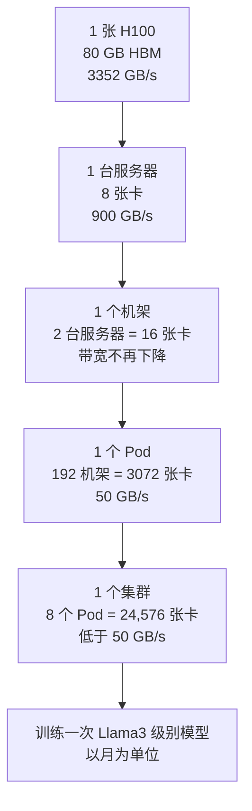

> **课程信息**
>
> - **课程名称**：Stanford CS231n: Deep Learning for Computer Vision（Spring 2025）
> - **本讲主题**：Lecture 11. Large Scale Distributed Training
> - **主讲教师**：Justin Johnson
> - **授课日期**：2025-05-06
> - **课程主页**：[cs231n.stanford.edu/2025](https://cs231n.stanford.edu/2025/schedule.html)
> - **官方课件**：[lecture_11.pdf](</attachments/cs231n-ec89aa8c20b5a0a94a7ac9b8.pdf>)（148 页，正文按页链接本地课件）
> - **字幕来源**：[cs231n_sp25_kor_sub · eng](https://github.com/lpaiu-cs/cs231n_sp25_kor_sub/tree/main/eng)（公开英文转写，中文由本书重写）
> - **版权说明**：幻灯片与课程材料版权归 Stanford University 及授课教师所有；本书为非官方学习笔记，仅用于学习与研究。

> **课件索引**：点击下方链接打开本地 PDF 的对应页；全部课件见 [课件索引](/notes/cs231n/slides)。页码按 PDF 文件页序定位，第 1 讲分为 Part 1 / Part 2。

[📄 L11 · 第 1 页｜第 11 讲标题页：Large-Scale Distributed Training](</attachments/cs231n-ec89aa8c20b5a0a94a7ac9b8.pdf#page=1>)

十多年前，训练一个模型的标准配置是一张显卡；今天，前沿模型的默认配置是几千到几万张。这不是"同样的代码多跑几遍"——它把"一次梯度更新"的含义整个改掉了：一次更新要在几千个设备之间同步，一次前向要跨过四层带宽依次递减的网络，而显存里除了权重和梯度，还得塞下几十 GB 的中间激活。本讲要回答的正是这两件事背后的物理与算法：卡里到底有什么，以及怎么把一个网络的训练切成几万份还保持数学等价。

课程在这里已经走到第十年（幻灯片页脚印着 Stanford CS231n 10th Anniversary），讲师的判断很直接：大规模已经是深度学习的常态，而不是少数实验室的特权。全书前几讲关心"模型能做什么"——上一讲处理的是带时间维度的视频输入；这一讲退到更底层，关心"这些模型是被怎么算出来的"。贯穿全场的参照物是 Llama3-405B：不是因为它最强，而是因为它公开了训练集群、并行配方和吞吐数字，是少数能被逐条核对的工业级案例。

## 1. 一块 H100 的账本：算力长在 Tensor Core，瓶颈长在显存

*(参考时间: 00:00:05 – 00:14:39｜Lecture 11)*

[📄 L11 · 第 2 页｜课程事务页：5 月 9 日期中复习、5 月 13 日课堂期中](</attachments/cs231n-ec89aa8c20b5a0a94a7ac9b8.pdf#page=2>)

第二页只有两条日程：5 月 9 日周五的期中复习、5 月 13 日周二的课堂期中。讲师没有在这一页停留。这个位置本身就说明了本讲的定位——它排在期中之前，而它要求的东西更接近判断力而不是推导：面对一个训练任务，你能否说出该用哪种并行、代价在哪。

[📄 L11 · 第 3 页｜今日议程：左半边硬件，右半边"如何在上万张卡上训练"](</attachments/cs231n-ec89aa8c20b5a0a94a7ac9b8.pdf#page=3>)

议程只有两半：A bit about GPU hardware 与 How to train on lots of GPUs。这个二分不是排版装饰，后面每一次"为什么先讲显存层次再讲并行策略"的答案都在这两行里：每一种并行策略都对应一种通信量，而通信的贵贱由硬件拓扑决定。先看硬件，是为了让后面每个"这里要通信"的判断有价格标签。

[📄 L11 · 第 4 页｜running example 页：GPT-4 拒绝披露细节的那段话，与 Llama3 的开放性](</attachments/cs231n-ec89aa8c20b5a0a94a7ac9b8.pdf#page=4>)

页面上并置了两段材料。一段是 GPT-4 技术报告里那句著名的话：考虑到竞争格局与大模型的安全影响，报告不再披露架构（含模型规模）、硬件、训练算力、数据构造与训练方法等任何细节。另一段是 Llama3——Meta 于 2024 年 4 月开源的模型，论文公开了大量模型与训练细节，尤其是系统基础设施部分。讲师用它当 running example 的理由很实在：想知道今天的大模型是怎么训出来的，Llama3 是少数能查到账本的样本；至于 2025 年 4 月放出的 Llama4，初始模型有了，论文还没有。

[📄 L11 · 第 5 页｜章节分隔页第一帧：两块面板同时点亮，左"GPU 硬件"右"如何训练"](</attachments/cs231n-ec89aa8c20b5a0a94a7ac9b8.pdf#page=5>)

这张分隔页会在全讲出现四次，是一个进度条式的设计：左边一张 GPU 板卡照片代表硬件半场，右边一张机柜照片代表算法半场。第一帧两块都在，标题是 GPUs and How to Train On Them，意思是"这两件事本讲都要讲"。

[📄 L11 · 第 6 页｜章节分隔页第二帧：左半边点亮、右半边压暗，进入硬件半场](</attachments/cs231n-ec89aa8c20b5a0a94a7ac9b8.pdf#page=6>)

第二帧只把左半边留亮：右侧机房照片褪成灰底，左侧板卡照片保持对比度。这是一次纯粹的强调切换，页面上没有任何新文字——它在说"接下来这段时间只看卡本身"。下面六页就是这张板卡的逐层放大。

[📄 L11 · 第 7 页｜H100 板卡全景：中央是计算核心，四周是 HBM 显存颗粒](</attachments/cs231n-ec89aa8c20b5a0a94a7ac9b8.pdf#page=7>)

GPU 是 Graphics Processing Unit，最初为图形而生，如今是通用并行处理器。这张照片里能直接看出 H100 的物理布局：中间一块方形是计算核心，周围一圈深色小方块是显存颗粒。图形时代留下的遗产是"同一套指令要作用在大量像素上"，这正是它能被改造成通用并行处理器的原因——本讲后面所有的并行，本质都是在利用这种"同一操作铺满整个阵列"的结构。

[📄 L11 · 第 8 页｜H100 板卡标注第一层：计算核心区域被框出](</attachments/cs231n-ec89aa8c20b5a0a94a7ac9b8.pdf#page=8>)

这一帧在照片上多了一个标注框，把中央的计算核心圈了出来。之所以要单独框它，是因为接下来所有关于算力的数字都只发生在这个方框里，而显存只负责供料。把"算"和"存"在物理上分开看，是理解后面所有瓶颈的前提。

[📄 L11 · 第 9 页｜H100 板卡标注第二层：80 GB HBM，3352 GB/s 带宽](</attachments/cs231n-ec89aa8c20b5a0a94a7ac9b8.pdf#page=9>)

再往前一帧，标注补上了显存：80 GB 的 HBM（高带宽内存），以及核心与显存之间的带宽 3352 GB/s。这两个数字要一起读——容量决定"模型能不能放进去"，带宽决定"算得再快也喂不饱"。讲师的原话是它能以每秒约 3 TB 的速度搬运数据，这个速度听起来很大，但它要和下一节那个 4096 FLOP/cycle 的数字对着看才有意义。

[📄 L11 · 第 10 页｜计算核心区域放大：密密麻麻的小方块是 SM](</attachments/cs231n-ec89aa8c20b5a0a94a7ac9b8.pdf#page=10>)

镜头推进到计算核心内部，画面变成一整片规则排列的小方块。这张图在视觉上很像 CPU 的核布局，但数量级完全不同：一颗 CPU 有几个到几十个核，这里是一片。值得注意的是方块之间还夹着更细的结构，那些是缓存与互连，它们决定了数据在核与核之间怎么走。

[📄 L11 · 第 11 页｜核心区标注：50 MB 的 L2 缓存横贯中央](</attachments/cs231n-ec89aa8c20b5a0a94a7ac9b8.pdf#page=11>)

这一帧标出 50 MB 的 L2 缓存。它比 80 GB 的显存小三个数量级，但物理上紧贴计算单元，访问延迟低得多。把它和 80 GB 放在一起，就得到 H100 的存储层次：显存大而远，L2 小而近。讲师在这里插了一句自嘲——"你以为在学深度学习，其实在学计算机体系结构"——而这条层次结构正是后面所有性能优化的战场。

[📄 L11 · 第 12 页｜核心区标注：132 个 SM，页脚注明物理上有 144 个](</attachments/cs231n-ec89aa8c20b5a0a94a7ac9b8.pdf#page=12>)

最后一层标注给出主角：132 个 Streaming Multiprocessor（SM），它们是彼此独立的并行核心。页面上还有一行小字很关键——图上其实画了 144 个，只有 132 个是启用的，原因是良率（yield）。芯片制造里这叫 binning：一整片 144 个单元不可能全部完好，厂商按"至少 132 个能用"来分级出货，从而把大部分晶圆卖出去。这个细节平时不影响写代码，但它解释了为什么纸面规格总要打一点折。

[📄 L11 · 第 13 页｜单个 SM 的特写：介于 CPU 核与向量机之间的东西](</attachments/cs231n-ec89aa8c20b5a0a94a7ac9b8.pdf#page=13>)

再放大一层，进到单个 SM 内部。幻灯片给的类比是"有点像带向量指令的 CPU 核"。这个类比要两头都记住：它比 CPU 核能同时处理更多数据（向量/矩阵），但时钟更慢、分支预测能力弱得多，所以拿它和 CPU 核做一比一的比较没有意义；把它当成"一个愿意做大量重复算术的小车间"更准确。

[📄 L11 · 第 14 页｜SM 内部第一层：256 KB L1 缓存与 256 KB 寄存器](</attachments/cs231n-ec89aa8c20b5a0a94a7ac9b8.pdf#page=14>)

这一帧补上 SM 内部的存储：256 KB 的 L1 缓存和 256 KB 的寄存器堆。到这里三层存储就齐了——256 KB 的 L1、50 MB 的 L2、80 GB 的 HBM。越靠近算力越小越快，这条规律在 GPU 里和在 CPU 里是同一个规律。写高性能 kernel 的人大量时间都花在"把数据在三级之间搬运的时机"上，而不是花在算术本身上。

[📄 L11 · 第 15 页｜SM 内部第二层：128 个 FP32 核，每周期 256 FLOP](</attachments/cs231n-ec89aa8c20b5a0a94a7ac9b8.pdf#page=15>)

接着是算术单元：128 个 FP32 核，每个每时钟周期能做一次 $a\cdot x+b$，也就是一乘一加，算 2 次浮点运算。于是整个 SM 在 FP32 上每周期产出 $128\times2=256$ FLOP。这个数字要记住，它是下一帧的参照物。

[📄 L11 · 第 16 页｜SM 内部第三层：4 个 Tensor Core，每周期 4096 FLOP](</attachments/cs231n-ec89aa8c20b5a0a94a7ac9b8.pdf#page=16>)

最后一帧是红色标注的 4 个 Tensor Core。讲师认为这个名字有点误导，它们其实是"矩阵核"：只做一件事，就是固定尺寸的矩阵乘加。H100 上每个 Tensor Core 每周期算一次 $[16\times4]\cdot[4\times8]+[16\times8]$，按每个乘法、每个加法各算一次浮点运算，就是 $16\times4\times8\times2=1024$ FLOP；四个 Tensor Core 合起来是 4096 FLOP/cycle，正好是 FP32 路径的 16 倍。**整块芯片的吞吐几乎全部来自这 16 倍**，所以想让 GPU 跑满，就必须让计算落成矩阵乘，并且落到 Tensor Core 上。

这里还有一条工程上极易踩的坑：Tensor Core 做的是混合精度——输入 16 位、累加 32 位。如果在 PyTorch 里忘了把模型转成 16 位，计算会退回 FP32 核，实测能慢到二十分之一。讲师把这个称为"最容易被当成细节、又最容易在真实项目里翻车"的一条。

### 1.1 三级存储与一个比值：每搬 1 字节要做多少次乘法

把上面的数字排在一起，可以算出一个贯穿全讲的比值。H100 的 Tensor Core 峰值是 989.4 TFLOP/s（16 位），显存带宽是 3352 GB/s，两者相除约 **295 FLOP/byte**。也就是说，每从显存搬 1 字节数据到计算单元，必须做将近 300 次浮点运算，Tensor Core 才不算空转。

这个比值解释了后面几乎所有设计：矩阵乘的算术密度高（$N\times N$ 乘 $N\times N$ 的乘法是 $O(N^3)$ 运算搬 $O(N^2)$ 数据），所以能喂饱；而逐元素操作（激活、残差、LayerNorm）算术密度是常数级，注定跑在 FP32 核上、并且是带宽受限的。同一个道理放到集群尺度，就变成"通信能不能被计算盖住"的问题——那正是第 3 章之后反复出现的主题。

顺带做一个可核对的反推：132 个 SM 各 4096 FLOP/cycle，合计 540,672 FLOP/cycle；用 989.4 TFLOP/s 去除，得到约 1.83 GHz 的有效时钟。本书按幻灯片数字反推，假设所有 SM 满载、时钟恒定——这个量级与公开的 H100 规格一致，说明页面上那几个数彼此是自洽的。

### 1.2 十五年 1000 倍：这条曲线才是深度学习起飞的燃料

[📄 L11 · 第 17 页｜GPU 吞吐曲线：2013 年 K40 的 5 TFLOP/s 到 2025 年 B200 的 5000 TFLOP/s](</attachments/cs231n-ec89aa8c20b5a0a94a7ac9b8.pdf#page=17>)

这张图的横轴是时间（2012 到 2025），纵轴是单设备峰值吞吐。蓝线是 FP32，绿线是 Tensor Core。几个点值得逐一看：2013 年的 K40 只有 5 TFLOP/s FP32；2016 年前后的 P100 是 10.6；V100 是 15.7 FP32 加上 125 的 Tensor Core——**V100 是第一块引入 Tensor Core 的卡，绿线从这里才出现**；A100 是 19.5 与 312；H100 是 67 与 989；2025 年的 B200 是 83.3 与 5000。

读法比数字更重要：蓝线十二年只涨了约 16 倍，绿线涨了 40 倍，而绿线才是真正的吞吐。讲师在博士期间用的就是 K40，他的说法是：这两块卡拿在手里的重量、大小、手感几乎一样，速度差 1000 倍。

[📄 L11 · 第 18 页｜同一张曲线加注：Since 2013 已有 1000 倍提升](</attachments/cs231n-ec89aa8c20b5a0a94a7ac9b8.pdf#page=18>)

这一帧在图上加了一行注：相比 2013 年有 1000 倍加速。讲师给了一句判断标准——任何东西在十年里变化 1000 倍，都值得停下来认真对待，因为它一定会改变技术能力的边界。他把这称为过去十年深度学习进步的主因：不是算法突然变聪明，而是有一份突然变大三个数量级的算力可以被吃下去。

[📄 L11 · 第 19 页｜同一张曲线再加一行：我们还可以用超过一张 GPU 来训练](</attachments/cs231n-ec89aa8c20b5a0a94a7ac9b8.pdf#page=19>)

第二帧又加了一句：我们还可以用不止一张 GPU。这句话把单卡曲线的故事接上了集群——如果单卡 1000 倍已经足以解释过去十年，那么把几千张这样的卡叠起来，才是今天这些模型真正的规模来源。下一章就从"一张卡"走到"一个数据中心"。

## 2. 从 8 卡服务器到 24,576 卡集群：每一层带宽掉一个数量级

*(参考时间: 00:15:08 – 00:26:10｜Lecture 11)*

[📄 L11 · 第 20 页｜单张 H100：芯片内部 3352 GB/s 的带宽](</attachments/cs231n-ec89aa8c20b5a0a94a7ac9b8.pdf#page=20>)

从这张图开始往上搭。第一层是一张 H100：显存到计算单元 3352 GB/s，这是整个系统里最快的一段连接，也是唯一一段"带宽足够喂饱 Tensor Core"的连接。后面每往上一级，这个数字都会掉，而掉多少直接决定了哪种并行策略能放在哪一级。

[📄 L11 · 第 21 页｜一台服务器：8 张 H100，卡间 900 GB/s](</attachments/cs231n-ec89aa8c20b5a0a94a7ac9b8.pdf#page=21>)

第二层是一台 GPU 服务器：几乎所有的 GPU 服务器都是 8 卡一箱，任意两张卡之间约 900 GB/s。相比卡内的 3352 GB/s，掉了约 3.7 倍。这个"只掉 3.7 倍"很关键——它意味着在 8 卡之内做需要频繁交换权重的并行（比如后面要讲的 FSDP、张量并行）是划算的。

[📄 L11 · 第 22 页｜一个机架：2 台服务器、16 张卡，卡间带宽不变](</attachments/cs231n-ec89aa8c20b5a0a94a7ac9b8.pdf#page=22>)

第三层是机架：Llama3 集群把两台 8 卡服务器塞进一个机架，共 16 张卡。机架内的连接仍然走服务器内的那条高速链路，带宽没有再次下降。页面上没有给机架内的新数字，只把"16 张卡"这个事实标了出来——真正的断崖在下一级。

[📄 L11 · 第 23 页｜一个 Pod：192 个机架、3072 张卡，任意两卡 50 GB/s](</attachments/cs231n-ec89aa8c20b5a0a94a7ac9b8.pdf#page=23>)

第四层是 Pod：192 个机架连起来，3072 张卡，靠高带宽连接器互连，任意两张卡之间约 50 GB/s。相比服务器内的 900 GB/s，又掉了 18 倍。物理上这是一个能走进去的房间，机架之间要留人走的通道；这也是为什么"Pod"是一个真实的建筑单元，而不是逻辑概念。

[📄 L11 · 第 24 页｜一个集群：8 个 Pod、24,576 张卡，跨 Pod 低于 50 GB/s](</attachments/cs231n-ec89aa8c20b5a0a94a7ac9b8.pdf#page=24>)

第五层是完整集群：8 个 Pod 拼成 24,576 张卡，跨 Pod 的带宽"低于 50 GB/s"——讲师没能从论文里找到确切数字，只能确定它比 Pod 内更慢。这个含糊恰恰是重点：到了这一层，连接已经不是一条能算清的线，而是一张需要路由的网络。而 Llama3 这个集群还不是世界上最大的，5 万卡、10 万卡的集群已经存在，只是没有公开到能逐条引用的程度。

这张图的读法是自上而下每走一步问一次"掉了几倍"：3352 到 900 是 3.7 倍，900 到 50 是 18 倍，再往上不可考。**并行策略的选择，本质上就是把通信最密集的那部分计算，安排在带宽最高的那一层。** 这句话后面会以 FSDP、HSDP、ND 并行的形式反复出现。

### 2.1 24,576 张卡合起来是一台什么机器

[📄 L11 · 第 25 页｜集群总账：1.875 PB 显存、4.15 亿 FP32 核、1300 万 Tensor Core、24.3 EFLOP/s](</attachments/cs231n-ec89aa8c20b5a0a94a7ac9b8.pdf#page=25>)

把 24,576 张卡当成一台机器来记账，得到这组数：1.875 PB 的 GPU 显存、4.15 亿个 FP32 核、1300 万个 Tensor Core、24.3 EFLOP/s（即 $24.3\times10^{18}$）。这里有一个值得做的校验：$1.875\ \text{PB} \div 24576 \approx 76\ \text{GB}$，比单卡的 80 GB 略低，差额是每张卡要留给系统与运行时的那部分。

讲师的态度是"把它当成一台计算机"：不要去想在跟 24,576 张卡打交道，而是在跟一台有 24,576 个核、1.875 PB 内存、24.3 EFLOP/s 的机器打交道。这个心智模型直接决定了后面所有算法的写法——你要做的是给这台机器排一份"所有核都有活干"的日程表。

顺着这个数字可以做一次算账：若这台机器连续满载两个月（约 $5.2\times10^{6}$ 秒），可交付约 $24.3\times10^{18}\times5.2\times10^{6}\approx1.3\times10^{26}$ FLOP。这个量级是本书按幻灯片数字与"满载"假设推导的估值，真实训练还要乘上一个 30%–40% 的利用率折扣（见第 6 章的 MFU）。它给出的直觉是：今天一次前沿训练消耗的浮点运算量在 $10^{25}$–$10^{26}$ 这个区间。

至于"训练要跑多久"，讲师给的经验是十年来最长的那批训练都以月计，而且限制主要不在技术上——排期、协作、人员都要跟上，一次跑一年多的训练在组织上极难维持。

[📄 L11 · 第 26 页｜TPU v5p：459 TFLOP/s BF16、95 GB 显存、单 Pod 最多 8960 颗](</attachments/cs231n-ec89aa8c20b5a0a94a7ac9b8.pdf#page=26>)

GPU 之外最大的对手是 Google 的 TPU（Tensor Processing Unit），已经迭代到第六代。页面给的是 v5p 的规格：每颗 459 TFLOP/s（BF16）、95 GB 显存，可以组成最多 8960 颗的 Pod。它和 H100 是同一量级的东西，差别在获取方式——TPU 买不到，只能在 Google 内部用或在 Google Cloud 上租。讲师顺带判断：Gemini 系列几乎肯定跑在 TPU 上，只是官方不说。

[📄 L11 · 第 27 页｜另外两块训练芯片：AMD MI325X 与 AWS Trainium2](</attachments/cs231n-ec89aa8c20b5a0a94a7ac9b8.pdf#page=27>)

页面还列了两家：AMD 的 MI325X，1300 TFLOP/s（BF16）、256 GB 显存；AWS 的 Trainium2，667 TFLOP/s（BF16）、96 GB 显存，装在 64 颗一组的 UltraServer 里。纸面参数都不弱，讲师的判断是生态与可用性上 NVIDIA 与 TPU 仍领先一大截，其余在追赶。这段的分量不在参数表，而在提醒：并行算法的抽象层（all-reduce、broadcast、分片）必须设计得跟具体芯片无关，否则换一代硬件就要重写。

[📄 L11 · 第 28 页｜章节分隔页：右半边机房照片点亮，转入算法半场](</attachments/cs231n-ec89aa8c20b5a0a94a7ac9b8.pdf#page=28>)

硬件半场到此结束，分隔页回到"两块面板"的形态。这一帧两边的明暗关系开始反转，提示接下来的内容不再看芯片，而是看机房。

[📄 L11 · 第 29 页｜章节分隔页终帧：标题变成 Today，右侧机房成为主体](</attachments/cs231n-ec89aa8c20b5a0a94a7ac9b8.pdf#page=29>)

最后一帧的标题变成 Today: GPUs and How to Train On Them，右侧机柜照片成为清晰的主体、左侧板卡压暗。到此为止，"卡"这件事讲完了：算力集中在那 16 倍的 Tensor Core 上，带宽按服务器、机架、Pod、集群四级递减。剩下五章只用一句话就能概括——**怎么让这几千张卡同时有活干，而且干的是同一件事。**

## 3. 数据并行：把 batch 切开，只多付一次 all-reduce

*(参考时间: 00:26:12 – 00:40:53｜Lecture 11)*

[📄 L11 · 第 30 页｜四轴总览页：DP 切 Batch、CP 切 Sequence、PP 切层、TP 切 Dim](</attachments/cs231n-ec89aa8c20b5a0a94a7ac9b8.pdf#page=30>)

整讲的算法地图就是这一页。一个 $L$ 层的模型作用在形状为 (Batch, Sequence, Dim) 的三维张量上，于是正好有四个可切的方向：数据并行（Data Parallelism, DP）切 batch，上下文并行（Context Parallelism, CP）切序列，流水线并行（Pipeline Parallelism, PP）切层，张量并行（Tensor Parallelism, TP）切特征维度。四者的名字听起来各行其是，但摆在这张图上就一句话：**都是在切同一个三维张量加一条层轴。**

[📄 L11 · 第 31 页｜同一张四轴总览页的第二帧：版式与文字未变](</attachments/cs231n-ec89aa8c20b5a0a94a7ac9b8.pdf#page=31>)

这一帧和上一帧在文字上完全一致，是动画的第二次定格。它的作用不是提供新信息，而是让这四个缩写先在场：后面的 114、126、134、144 会反复回到这张总览页，每讲完一种并行就回来点亮一格——它是全讲的进度条。

### 3.1 数学上它是等价变换，不是近似

[📄 L11 · 第 32 页｜数据并行的出发点：损失是对 N 个样本的平均](</attachments/cs231n-ec89aa8c20b5a0a94a7ac9b8.pdf#page=32>)

起点是大家都熟的事实：mini-batch 的损失通常是对 $N$ 个样本取平均。这句话在单卡上是"实现细节"，在分布式里却成了切分的依据——因为平均和求和都是线性的。

[📄 L11 · 第 33 页｜数据并行的想法：用 MN 个样本的大 batch，切成 M 份分给 M 张卡](</attachments/cs231n-ec89aa8c20b5a0a94a7ac9b8.pdf#page=33>)

想法很直接：如果能在一张卡上放下 $N$ 个样本，手上有 $M$ 张卡，那就用 $M\times N$ 的大 batch，每张卡分到 $N$ 个。问题只剩一个：这样算出来的梯度，和一张卡上跑 $MN$ 个样本的梯度是不是同一个东西？

[📄 L11 · 第 34 页｜梯度公式：外层对 M 张卡求和，内层是每张卡自己的 backward](</attachments/cs231n-ec89aa8c20b5a0a94a7ac9b8.pdf#page=34>)

答案是同一个。把大 batch 的损失写成

$$
L=\frac{1}{MN}\sum_{i=1}^{M}\sum_{j=1}^{N}\ell\left(x_{i,j},W\right)
$$

对 $W$ 求导并把求和次序换一下，就得到

$$
\frac{\partial L}{\partial W}=\frac{1}{M}\sum_{i=1}^{M}\left(\frac{1}{N}\sum_{j=1}^{N}\frac{\partial \ell\left(x_{i,j},W\right)}{\partial W}\right)
$$

括号里那一项，恰好就是"在某一张卡的 $N$ 个样本上做一次普通 backward"。**因为梯度是线性的，求和与求平均的次序可以随便换**，所以这不是近似，是同一个数——讲师强调这一点时用了"我们只是耍了个代数的小聪明"。

[📄 L11 · 第 35 页｜内层由每张卡独立完成：它在自己的 N 个样本上算梯度](</attachments/cs231n-ec89aa8c20b5a0a94a7ac9b8.pdf#page=35>)

于是内层不需要任何通信：每张卡在自己的 $N$ 个样本上前向、反向，得到一份局部梯度。这部分是"真并行"，各卡之间互不相干，也不需要同步。

[📄 L11 · 第 36 页｜外层是一次跨卡平均：把 M 份局部梯度合成全局梯度](</attachments/cs231n-ec89aa8c20b5a0a94a7ac9b8.pdf#page=36>)

剩下的就是外层那个 $\frac{1}{M}\sum$：把所有卡的局部梯度平均起来。这一次通信就是数据平行的全部代价——一次 all-reduce。**除此之外，DP 不改变任何数学。**

### 3.2 六步执行，以及那次 all-reduce

[📄 L11 · 第 37 页｜DP 第 1 步：每张卡各有一份完整的模型与优化器状态](</attachments/cs231n-ec89aa8c20b5a0a94a7ac9b8.pdf#page=37>)

落到设备上，第一步是每张卡都保存一份完整的模型权重、优化器状态和梯度缓冲。讲师在这里特意说"图里只画 3 张卡是因为版面放得下，真实数量远大于 3"。这一步也决定了 DP 的天花板：显存里必须容得下整套参数、梯度和优化器状态。

[📄 L11 · 第 38 页｜DP 第 2 步：每张卡加载自己那一份 mini-batch](</attachments/cs231n-ec89aa8c20b5a0a94a7ac9b8.pdf#page=38>)

第二步是各自加载数据：GPU 1 拿 $x_{1,\cdot}$，GPU 2 拿 $x_{2,\cdot}$，GPU 3 拿 $x_{3,\cdot}$。讲师在这里插了一个真实的 bug 故事：他和学生的代码都曾不小心让所有卡加载了同一批数据——那样训练不会报错，只是白跑，而且极难从 loss 曲线上看出来。**"每张卡的数据必须不同"是 DP 的第一条正确性条件。**

[📄 L11 · 第 39 页｜DP 第 3 步：各卡独立前向，得到各自的局部损失](</attachments/cs231n-ec89aa8c20b5a0a94a7ac9b8.pdf#page=39>)

第三步是各自前向，得到局部损失 $L_1,L_2,L_3$。这一步零通信，也零依赖——三张卡可以完全异步地跑完自己的前向。

[📄 L11 · 第 40 页｜DP 第 4 步：各卡独立反向，得到各自的局部梯度](</attachments/cs231n-ec89aa8c20b5a0a94a7ac9b8.pdf#page=40>)

第四步是各自反向，得到对四个权重矩阵的局部梯度 $\partial L_i/\partial W_1 \dots \partial L_i/\partial W_4$。同样零通信：每张卡手里有完整的权重副本，所以它能在本地把整条链路的梯度都算出来。

[📄 L11 · 第 41 页｜DP 第 5 步：跨卡 all-reduce，红色箭头是把梯度汇总到全局](</attachments/cs231n-ec89aa8c20b5a0a94a7ac9b8.pdf#page=41>)

第五步才是通信：all-reduce。它同时做两件事——每张卡把自己的梯度广播出去，同时收集所有卡的梯度。实现上它通常在 $O(\log M)$ 轮内完成，而不是 $M$ 轮点对点；这一步结束后，每张卡手里都是一份完全相同的、对整个 macro-batch 的平均梯度。

[📄 L11 · 第 42 页｜DP 第 6 步：每张卡用同一份梯度各自更新自己的权重](</attachments/cs231n-ec89aa8c20b5a0a94a7ac9b8.pdf#page=42>)

第六步：每张卡用这份相同的梯度更新自己那份权重。因为起点相同、梯度相同，更新后的权重也相同（前提是算术确定）。这一步又是零通信——代价已经在第五步付过了。

[📄 L11 · 第 43 页｜DP 的关键优化：第 4 步与第 5 步可以重叠进行](</attachments/cs231n-ec89aa8c20b5a0a94a7ac9b8.pdf#page=43>)

真正的工程要点在这一帧：第 4 步（反向）和第 5 步（通信）可以并行。反向传播是从最后一层往前推的，一旦最后一层的梯度算完，就可以一边对最后一层做 all-reduce、一边继续算倒数第二层的反向。层数越深，"通信藏在计算后面"的空间越大，理想情况下反向算完时梯度也已经汇总完毕，权重更新不用等。

但这不是免费的：讲师被问到"到底是第 4 步还是第 5 步会成为瓶颈"时的回答是"看情况"——取决于设备多快、模型多大、mini-batch 多大、卡间互连多快。**在大规模训练里，几乎所有问题的答案都是"要针对你的集群实测"**，这句话值得当成一条方法论记住。

顺带一个实现层面的不对称：在单张卡内部，CUDA 的异步拷贝很多是由硬件自动调度的；而到了集群层面，没有硬件会替你排这样的日程，通信与计算的重叠必须由软件显式编排。PyTorch 的 `DistributedDataParallel` 就是把这套编排封装好的那一层，让普通写法的模型代码几乎透明地获得重叠能力。

### 3.3 为什么不干脆各跑各的：异步 SGD 的老路

课堂上有人提了一个很自然的反问：既然通信这么贵，为什么不干脆让每张卡各走几步，偶尔同步一次？讲师说这条路真的有人走过，叫异步 SGD（asynchronous SGD）：维护多份模型副本，各自独立更新，隔一段时间平均一次。Google 在自研 TPU Pod 之前就用过这套，2010 年代初的一些网络就是这么训出来的。

它的问题不在理论上，而在工程上：训练更不稳定，调试和复现都极难，最终效果通常还差一点。所以只要同步方案跑得动，大家还是选同步——**因为同步让整件事可以被推理、被复现**。讲师也留了一个开放判断：随着集群继续变大，"没有一台机器能对全局有上帝视角"这件事会越来越突出，异步方法可能会以新的形式回来。

还有一个容易被忽略的概念区分：反向传播时，每张卡只需要自己那份"局部上游梯度"就能算下去，但要得到"全局上游梯度"就必须通信。这两者在代码里长得一样，在分布式里是两件事——**所有 all-reduce 都是在把"局部"变成"全局"，而每次转换都要付带宽。**

### 3.4 这条路的天花板：每个权重 8 字节

[📄 L11 · 第 44 页｜数据并行的问题：模型大小被单卡显存锁死](</attachments/cs231n-ec89aa8c20b5a0a94a7ac9b8.pdf#page=44>)

DP 把数据切得很干净，但权重是复制而不是切分的，于是模型大小被单卡显存锁死。页面把账算得很细：每个权重需要四个数——权重本身、它的梯度、Adam 的两个二阶矩 $\beta_1,\beta_2$；若用 16 位精度，每个数 2 字节，合计 8 字节/参数。于是 10 亿参数要 8 GB，100 亿参数就要 80 GB——正好是一张 H100 的全部显存。也就是说，纯 DP 的上限大约在 100 亿参数，而目标模型比这大一到两个数量级。

[📄 L11 · 第 45 页｜数据并行的解法预告：把模型权重也切到不同的卡上](</attachments/cs231n-ec89aa8c20b5a0a94a7ac9b8.pdf#page=45>)

页面上给出的解法只有一行字：把模型权重切到多张卡上。这一行就是下一章的全部内容——它把"复制"改成"分片"，代价是从"一次 all-reduce"变成"每层两次广播加一次梯度汇总"。

## 4. FSDP 与 HSDP：在数据并行之上再切权重

*(参考时间: 00:41:03 – 00:53:22｜Lecture 11)*

先说明一个命名：课件的小节标题把这套机制写作 FSPD，而正文页、总结页与 ZeRO 论文都写作 FSDP（Fully Sharded Data Parallelism）。本书统一用 FSDP。

[📄 L11 · 第 46 页｜FSDP 的静态布局：每个权重 W_i 由一张卡拥有，并连带管它的梯度与优化器状态](</attachments/cs231n-ec89aa8c20b5a0a94a7ac9b8.pdf#page=46>)

FSDP 的出发点是把每个权重矩阵 $W_i$ 指派给一张"所有者"卡，由它负责这个权重的全局梯度与优化器状态。切分的粒度是层而不是单个标量——你管理的是"某一层的权重矩阵"，不是一个个数。图里画的是 2 张卡、4 层网络：GPU 1 拥有 $W_1,W_2$，GPU 2 拥有 $W_3,W_4$。这一步之后，每张卡常驻的显存从"整套权重"降到"$1/M$ 套权重加它的梯度与优化器状态"。

[📄 L11 · 第 47 页｜FSDP 第 1 步：前向某层之前，所有者把该层权重广播给所有卡](</attachments/cs231n-ec89aa8c20b5a0a94a7ac9b8.pdf#page=47>)

但权重被切开后，前向就没法直接算了：第 1 层的计算需要完整的 $W_1$，而只有 GPU 1 手里有。所以第 1 步是广播——在算第 $i$ 层之前，$W_i$ 的所有者把它发给所有卡。这一步是纯通信，没有任何计算。

[📄 L11 · 第 48 页｜FSDP 第 2 步：所有卡用这份权重算完前向，然后删掉本地副本](</attachments/cs231n-ec89aa8c20b5a0a94a7ac9b8.pdf#page=48>)

第 2 步：所有卡拿到 $W_i$ 后各自前向，算完立刻删掉本地副本，把显存还给下一层。于是"权重分片"这个性质在每一层结束时都被恢复：任何时刻，每张卡上只有当前层（和预取中的下一层）的完整权重，其余层只有自己拥有的那一片。

[📄 L11 · 第 49 页｜FSDP 的流水化：算第 i 层前向的同时，预取第 i+1 层的权重](</attachments/cs231n-ec89aa8c20b5a0a94a7ac9b8.pdf#page=49>)

这一帧加入整个方案的关键优化：预取。既然第 2 步结束就要删，那在算第 $i$ 层的同时就可以把 $W_{i+1}$ 拉过来——绿色的 "Fetch $W_{i+1}$ while computing forward with $W_i$" 就是这件事。没有这一步，每一层都要停下来等一次广播，网络越深浪费越大；有了它，通信被塞进了上一层的计算时间里。

[📄 L11 · 第 50 页｜FSDP 动画推进到第 3 层：W3 正从 GPU 2 流向 GPU 1，W4 仍是灰色](</attachments/cs231n-ec89aa8c20b5a0a94a7ac9b8.pdf#page=50>)

这一帧能看到预取正在进行：GPU 1 手里的 $W_1,W_2$ 已经是实心（算过了），$W_3$ 是浅色方块、正被红色箭头从 GPU 2 拉过来，$W_4$ 还是灰的（尚未取）。左侧清单仍停在第 1、2 条，说明它展示的是"同一个两步流程在逐层重复"，而不是新机制。

[📄 L11 · 第 51 页｜FSDP 动画续帧：清单仍是第 1、2 条，右侧示意图继续逐层推进](</attachments/cs231n-ec89aa8c20b5a0a94a7ac9b8.pdf#page=51>)

051 是这段动画的下一帧，文字没有任何增补，右侧示意图继续往前推进。它要传达的东西其实已经写在列表里：第 1、2 步会在每一层上原样重复一遍，所以**前向的通信量等于"整套权重被完整广播一次"**——每一层的权重都要经历一次从所有者到所有人的搬运。

[📄 L11 · 第 52 页｜FSDP 动画末帧：同一页的最后一次定格](</attachments/cs231n-ec89aa8c20b5a0a94a7ac9b8.pdf#page=52>)

052 是同一段动画的最后一次定格，同样没有新文字。三帧连起来看，它讲的不是新机制而是节奏：只要权重是分片的，每算一层就得先取全、算完再扔掉，层数越多这条流水线越长，预取能掩盖的通信也就越多。

[📄 L11 · 第 53 页｜FSDP 第 3 步：反向某层之前，所有者再广播一次该层权重](</attachments/cs231n-ec89aa8c20b5a0a94a7ac9b8.pdf#page=53>)

反向开始后，同样的流程要重来一遍：算第 $i$ 层的反向之前，$W_i$ 的所有者再广播一次。这一次广播复用的是同一份权重，但它在正向结束时已经被删掉了，所以必须重新传。

[📄 L11 · 第 54 页｜FSDP 的一个小优化：最后一层的权重在前向结束时不要删](</attachments/cs231n-ec89aa8c20b5a0a94a7ac9b8.pdf#page=54>)

页面右上角给了第一个优化：正向结束时不要删最后一层的权重。因为所有卡刚刚才收到它，马上反向又要用，删了再传纯属浪费。这条优化只省下"一层"的通信量，但它是零成本的，实践中都会做。

[📄 L11 · 第 55 页｜FSDP 第 4 步：各卡用广播来的权重算反向，得到局部 dL/dW_i，然后删除权重](</attachments/cs231n-ec89aa8c20b5a0a94a7ac9b8.pdf#page=55>)

第 4 步：每张卡用这份权重算第 $i$ 层的反向，得到自己那份局部 $\mathrm{d}L/\mathrm{d}W_i$，然后删掉权重。注意这里产生的梯度是"局部的"——它只反映这张卡那 $N$ 个样本。

[📄 L11 · 第 56 页｜FSDP 第 5 步：各卡把局部梯度发回所有者，并删掉本地梯度](</attachments/cs231n-ec89aa8c20b5a0a94a7ac9b8.pdf#page=56>)

第 5 步：各卡把局部梯度发给所有者，本地删掉。这和 DP 的 all-reduce 不一样：DP 是"人人都要一份全局梯度"，FSDP 是"只有所有者需要全局梯度"——按讲师的描述，各卡只要把梯度发回所有者，不需要广播给所有人。**通信的方向变了，流量也就跟着变。**

[📄 L11 · 第 57 页｜FSDP 第 6 步：所有者累加出完整梯度，并就地更新自己那片权重](</attachments/cs231n-ec89aa8c20b5a0a94a7ac9b8.pdf#page=57>)

第 6 步：所有者把收到的局部梯度累加成完整梯度，就地更新 $W_i$。更新完不需要再广播一次——下一次前向自然会用到它，那时才需要把它发出去。

[📄 L11 · 第 58 页｜FSDP 的稳态：取权重、算反向、汇总并更新，三件事同时在飞](</attachments/cs231n-ec89aa8c20b5a0a94a7ac9b8.pdf#page=58>)

从这一帧开始，页面演示的是"反向阶段的稳态"。绿色注释标出三件事的重叠方式：算 $W_{i-1}$ 的反向时，同时发 $W_{i+1}$ 的权重、汇总并更新 $W_i$。于是任意时刻，流水线上同时有三层在动。

[📄 L11 · 第 59 页｜FSDP 稳态续一：GPU 2 已经攒到 dL/dW4](</attachments/cs231n-ec89aa8c20b5a0a94a7ac9b8.pdf#page=59>)

这一帧右侧多了红色标注 $\partial L_1/\partial W_4$ 与 $\partial L_2/\partial W_4$：最后一层的两份局部梯度都已经到达所有者 GPU 2，正在被合成全局梯度。可以看到梯度是按"层"逐步积累的，从最后一层往前。

[📄 L11 · 第 60 页｜FSDP 稳态续二：dL/dW3 也开始汇总](</attachments/cs231n-ec89aa8c20b5a0a94a7ac9b8.pdf#page=60>)

再往前一帧，$\partial L/\partial W_3$ 也进来了。到这里能看出一条规律：反向每推进一层，就有一层的梯度完成汇总并触发一次权重更新，而与此同时下一层的权重正在预取——三件事严格错开一层。

[📄 L11 · 第 61 页｜FSDP 的三件事同框：更新 W3、反传 W2、预取 W1](</attachments/cs231n-ec89aa8c20b5a0a94a7ac9b8.pdf#page=61>)

这一帧把稳态写成了三行字，也是全页的总结：All at the same time——发送 $W_3$ 的梯度并更新 $W_3$、用 $W_2$ 跑反向、预取 $W_1$。讲师对这段的描述是"在很深的网络里，稳态下这三件事永远同时在发生"。

[📄 L11 · 第 62 页｜FSDP 稳态终帧：GPU 1 上的四份梯度已齐](</attachments/cs231n-ec89aa8c20b5a0a94a7ac9b8.pdf#page=62>)

062 与 063 分别把两台设备上的梯度面板补全：GPU 1 与 GPU 2 各自收齐了四层的局部梯度。到这一步，一个完整的 FSDP 迭代就闭环了。

[📄 L11 · 第 63 页｜FSDP 稳态的另一侧：GPU 2 视角的同一组箭头](</attachments/cs231n-ec89aa8c20b5a0a94a7ac9b8.pdf#page=63>)

两张图对照着看，才能看出 FSDP 与 DP 的结构差异：DP 里每张卡都有完整的四份梯度，FSDP 里每张卡只有自己那一份是"完整"的，其余都是别人送来的零件。

[📄 L11 · 第 64 页｜FSDP 收尾：换下一批数据重来，数据加载在前后向期间已被预取](</attachments/cs231n-ec89aa8c20b5a0a94a7ac9b8.pdf#page=64>)

最后一帧补上数据侧：换下一批数据，重复整个流程；而数据加载在这轮的前向与反向期间就已经异步完成（通常跑在服务器 CPU 上）。讲师把这类系统称为"并行化机器"——GPU 内部要重叠、GPU 之间要重叠、数据加载也要重叠，目标只有一个：**让 Tensor Core 尽可能没有空闲周期。**

### 4.1 HSDP：把通信量按拓扑分层

[📄 L11 · 第 65 页｜HSDP 的布局：N = M×K 张卡分成 M 组，每组 K 张做 FSDP](</attachments/cs231n-ec89aa8c20b5a0a94a7ac9b8.pdf#page=65>)

FSDP 已经能训大模型了，但它的通信量和卡数成正比，扩到几百张卡之后通信开始压过计算。HSDP（Hybrid Sharded Data Parallelism）的办法是把卡分成 $M$ 组、每组 $K$ 张：组内做 FSDP（把权重切成 $K$ 份），组间做普通 DP（每组保存一份完整权重）。页面给的例子是 $M=2$、$K=4$，并注明 $K$ 可以到 $O(100)$ 这个量级。

[📄 L11 · 第 66 页｜HSDP 的第二帧：把这张图读成一个二维网格](</attachments/cs231n-ec89aa8c20b5a0a94a7ac9b8.pdf#page=66>)

这一帧加了一句关键的话：这是多维并行（multidimensional parallelism）——**同时使用两种不同的并行策略**，把 GPU 排成一个二维网格。每个 GPU 在网格里的坐标 $(m,k)$ 同时决定了它在两个策略里的角色：$k$ 是它在 FSDP 组内的序号，$m$ 是它在 DP 维度上的组号。

[📄 L11 · 第 67 页｜HSDP 的通信账：组内 3 倍权重流量，组间 1 倍](</attachments/cs231n-ec89aa8c20b5a0a94a7ac9b8.pdf#page=67>)

这页是 HSDP 存在的理由，也是全讲最实用的一张账：组内 FSDP 需要 3 次权重级别的通信（前向一次、反向一次，反向还要再传一次梯度），组间 DP 只需要 1 次（梯度 all-reduce）。既然组内要付 3 倍的量，就应该把它放在最快的那一层——同一台服务器或同一个 Pod 内；组间那条线路慢一些可以接受，因为它只发生一次。

这条推理把第 2 章的带宽阶梯和这里的算法直接接上了：**不是"哪种并行更快"，而是"哪种通信该放在哪一级线路上"。** 服务器内 900 GB/s 承接 3 倍流量，跨 Pod 的 <50 GB/s 只承接 1 倍流量，账就平了。

[📄 L11 · 第 68 页｜DP 家族总账：100B 参数 800 GB，切到 80 张卡后每卡 10 GB](</attachments/cs231n-ec89aa8c20b5a0a94a7ac9b8.pdf#page=68>)

把 DP、FSDP、HSDP 放在一起看，收益是量级上的：10 亿参数的账刚才算过（8 GB），这里换成 1000 亿参数——按 8 字节/参数需要 800 GB，一张卡装不下，但切到 80 张卡上就是每卡 10 GB。**"模型放不进一张卡"这个约束，从这一页起不再成立。**

[📄 L11 · 第 69 页｜新的瓶颈：激活值。Llama3-405B 仅 FFN 隐藏层激活就要 63 GB](</attachments/cs231n-ec89aa8c20b5a0a94a7ac9b8.pdf#page=69>)

但权重解决之后，第二个瓶颈立刻顶上来：激活值。页面用 Llama3-405B 算了一笔账：126 层、模型维度 $D=16384$、序列长度 4096，仅 FFN 隐藏层的激活就是 $2\times126\times(4\times16384)\times4096$ 字节 ≈ 63 GB。拆开看这个式子：2 是 16 位的字节数，$4D=65536$ 是 FFN 的中间宽度，4096 是序列长度，126 是层数——**这是一条样本、一次前向就要占的量**，还没算注意力和其他中间结果。

[📄 L11 · 第 70 页｜解法预告：不保存全部激活，反向时按需重算](</attachments/cs231n-ec89aa8c20b5a0a94a7ac9b8.pdf#page=70>)

页面的解法又是一行字：不要把所有激活都存在显存里，需要的时候重算。这句话听起来像"用时间换空间"的老套，但它换出来的曲线非常漂亮——下一章把它算清楚。

## 5. Activation Checkpointing：用算力换显存，换到 O(N√N)

*(参考时间: 00:53:27 – 00:55:53｜Lecture 11)*

[📄 L11 · 第 71 页｜激活检查点的形式化起点：每一层是"前向函数"与"反向函数"两件事](</attachments/cs231n-ec89aa8c20b5a0a94a7ac9b8.pdf#page=71>)

要算清这笔账，先换一个视角看网络：每一层其实是两个函数。前向把第 $i$ 层的激活变成第 $i+1$ 层的激活，$A_{i+1}=F_i^{\rightarrow}(A_i)$；反向拿上游梯度与本层激活，算出本层梯度，$G_i=F_i^{\leftarrow}(A_i,G_{i+1})$。**关键在反向的输入里同时有 $A_i$ 和 $G_{i+1}$**——这就是为什么普通训练必须把每一层的激活都留着。

[📄 L11 · 第 72 页｜同一页加一问：假设每个前向/反向都是 O(1) 计算与 O(1) 显存，总共要多少](</attachments/cs231n-ec89aa8c20b5a0a94a7ac9b8.pdf#page=72>)

页面提出一个可以手算的问题：如果每个 $F^{\rightarrow}$ 与 $F^{\leftarrow}$ 都是 $O(1)$ 的计算和 $O(1)$ 的显存，一次完整的前向加反向要花多少？为了能数清楚，用 4 层网络做例子，页面右上角给出两个计数器：当前显存（Current Memory）与峰值显存（Peak Memory）。

[📄 L11 · 第 73 页｜计账第 1 帧：完成第 1 层前向，当前 1、峰值 1](</attachments/cs231n-ec89aa8c20b5a0a94a7ac9b8.pdf#page=73>)

第一次前向结束，$A_1$ 落地，当前显存 1，峰值也是 1。计数器开始走。

[📄 L11 · 第 74 页｜计账第 2 帧：第 2 层前向完成，当前 2、峰值 2](</attachments/cs231n-ec89aa8c20b5a0a94a7ac9b8.pdf#page=74>)

第二层算完，$A_2$ 也要留着，当前显存变成 2，峰值跟着升到 2。可以看出来，朴素做法下"当前"和"峰值"是同一个数——因为它只增不减。

[📄 L11 · 第 75 页｜计账第 3 帧：第 3 层前向完成，当前 3、峰值 3](</attachments/cs231n-ec89aa8c20b5a0a94a7ac9b8.pdf#page=75>)

第三层算完，当前 3、峰值 3。到这里规律已经很清楚：朴素做法的峰值就等于层数。

[📄 L11 · 第 76 页｜计账第 4 帧：四层前向全部完成，当前 4、峰值 4](</attachments/cs231n-ec89aa8c20b5a0a94a7ac9b8.pdf#page=76>)

四层全部前向完成，$A_1$ 到 $A_4$ 全在显存里，当前 4、峰值 4。对 $N$ 层网络，这就是 $O(N)$ 显存——也是第 4 章末尾那 63 GB 的来源。

[📄 L11 · 第 77 页｜计账第 5 帧：前向结束、反向尚未开始，显存停在峰值 4](</attachments/cs231n-ec89aa8c20b5a0a94a7ac9b8.pdf#page=77>)

反向开始前的这一帧什么都没变：当前仍 4、峰值仍 4。这一帧的作用是把"峰值"这个概念钉住——后面所有优化都只压峰值，不压平均。

[📄 L11 · 第 78 页｜计账第 6 帧：算完第 4 层反向，激活 A4 可以释放，当前 3、峰值 4](</attachments/cs231n-ec89aa8c20b5a0a94a7ac9b8.pdf#page=78>)

反向从最后一层开始。算完 $G_4$ 之后 $A_4$ 就没用了，删掉，当前显存回落到 3；但峰值已经记在 4 上，不会降。

[📄 L11 · 第 79 页｜计账第 7 帧：第 3 层反向完成，当前 2、峰值 4](</attachments/cs231n-ec89aa8c20b5a0a94a7ac9b8.pdf#page=79>)

继续往前，当前 2、峰值 4。曲线开始单调下降，但峰值不动。

[📄 L11 · 第 80 页｜计账第 8 帧：反向走完，当前 1、峰值 4](</attachments/cs231n-ec89aa8c20b5a0a94a7ac9b8.pdf#page=80>)

反向结束，当前只剩 1，峰值仍是 4。这四帧的结论可以一句话概括：**朴素训练的时间是 $O(N)$、显存峰值也是 $O(N)$，而且峰值出现在前向刚结束的那一刻。**

[📄 L11 · 第 81 页｜结论帧：前向加反向 = O(N) 计算、O(N) 显存](</attachments/cs231n-ec89aa8c20b5a0a94a7ac9b8.pdf#page=81>)

页面把结论写在右侧：Forward+backward 是 $O(N)$ 计算、$O(N)$ 显存。到这里没有新机制，只是把"显存为什么不够"从感觉变成了公式。

[📄 L11 · 第 82 页｜提出方案：反向时重算激活，而不是存下来](</attachments/cs231n-ec89aa8c20b5a0a94a7ac9b8.pdf#page=82>)

真正的主意在最后一行：Idea——在反向过程中重算激活。既然 $A_i$ 可以从 $A_{i-1}$ 再算一遍，那就别存，用的时候再算。代价很清楚：计算变多。

[📄 L11 · 第 83 页｜重算第 1 帧：只前向第 1 层，立刻丢掉 A1，当前 1、峰值 1](</attachments/cs231n-ec89aa8c20b5a0a94a7ac9b8.pdf#page=83>)

第二轮演示换了策略：前向第 1 层，拿到 $A_1$ 后立刻丢掉，只保留一个"起点"状态的计数。当前 1、峰值 1。

[📄 L11 · 第 84 页｜重算第 2 帧：同样地走完第 2 层，峰值仍为 1](</attachments/cs231n-ec89aa8c20b5a0a94a7ac9b8.pdf#page=84>)

第 2 层同样处理，显存不涨。这就是"不存激活"的字面意思：显存曲线被压在 1。

[📄 L11 · 第 85 页｜重算第 3 帧：继续压平，当前 1、峰值 1](</attachments/cs231n-ec89aa8c20b5a0a94a7ac9b8.pdf#page=85>)

第 3 帧，计数仍是 1。这一轮已经暴露出代价的形状：每次要用激活，都得从最近的起点重新往前算，越靠近网络前端，单次要走的层数越多——$N^2$ 就是从这里长出来的。

[📄 L11 · 第 86 页｜重算第 4 帧：整条前向走完，显存始终是 1](</attachments/cs231n-ec89aa8c20b5a0a94a7ac9b8.pdf#page=86>)

整条前向走完，峰值还是 1。对比第一轮的峰值 4，**显存从 $O(N)$ 掉到了 $O(1)$**。

[📄 L11 · 第 87 页｜重算第 5 帧：前向结束，手里只有最后一层的激活](</attachments/cs231n-ec89aa8c20b5a0a94a7ac9b8.pdf#page=87>)

但代价马上显现：现在手里只有最后一层的激活，要算第 3 层的反向，得先把 $A_3$ 重新算出来。

[📄 L11 · 第 88 页｜重算第 6 帧：为了算最后一层反向，先重算 A4 之前的激活，当前 2、峰值 2](</attachments/cs231n-ec89aa8c20b5a0a94a7ac9b8.pdf#page=88>)

重算开始，计数器从 1 涨到 2。注意峰值也从 1 变成 2 了——重算本身也要占一点显存。

[📄 L11 · 第 89 页｜重算第 7 帧：重算与反向交替，当前 2、峰值 2](</attachments/cs231n-ec89aa8c20b5a0a94a7ac9b8.pdf#page=89>)

这一帧进入交替节奏：重算一层、反传一层。当前 2、峰值 2。

[📄 L11 · 第 90 页｜重算第 8 帧：继续交替，显存不涨](</attachments/cs231n-ec89aa8c20b5a0a94a7ac9b8.pdf#page=90>)

继续交替，显存稳定在 2，不再增长。这正是想要的效果：**无论网络多深，峰值都不随层数增长。**

[📄 L11 · 第 91 页｜重算第 9 帧：一次重算完成、一次释放，当前 1、峰值 2](</attachments/cs231n-ec89aa8c20b5a0a94a7ac9b8.pdf#page=91>)

这一帧的当前值回落到 1：刚刚重算出来的那份激活在反传后被释放了。峰值仍是 2。

[📄 L11 · 第 92 页｜重算第 10 帧：进入下一轮重算，当前 2、峰值 2](</attachments/cs231n-ec89aa8c20b5a0a94a7ac9b8.pdf#page=92>)

再进来一轮，当前回到 2：这次的起点更靠前，要连续算过好几层才拿得到需要的那份激活。

[📄 L11 · 第 93 页｜重算第 11 帧：交替继续，峰值稳定](</attachments/cs231n-ec89aa8c20b5a0a94a7ac9b8.pdf#page=93>)

第 11 帧，节奏没变：重算一层、反传一层、释放一层，峰值被钉在 2 上不动。

[📄 L11 · 第 94 页｜重算第 12 帧：又一次释放，当前 1、峰值 2](</attachments/cs231n-ec89aa8c20b5a0a94a7ac9b8.pdf#page=94>)

当前回落到 1，又一份临时激活在反传后被释放。

[📄 L11 · 第 95 页｜重算第 13 帧：还剩两层要处理，当前 2、峰值 2](</attachments/cs231n-ec89aa8c20b5a0a94a7ac9b8.pdf#page=95>)

当前 2，下一段重算开始。越往前端走，单次重算的层数越多，但峰值不变——变的是时间。

[📄 L11 · 第 96 页｜重算第 14 帧：到达网络最前端，当前 1、峰值 2](</attachments/cs231n-ec89aa8c20b5a0a94a7ac9b8.pdf#page=96>)

最后一次释放，当前 1、峰值 2。整个反向结束时，峰值被锁在 2 而不是 4。

[📄 L11 · 第 97 页｜总账第一行：全量重算是 O(N²) 计算、O(1) 显存](</attachments/cs231n-ec89aa8c20b5a0a94a7ac9b8.pdf#page=97>)

页面把三条曲线并排放在一起。第一条：全量重算。显存是 $O(1)$，计算是 $O(N^2)$——因为第 $N$ 层的反向要重算 $N-1$ 层，第 $N-1$ 层要重算 $N-2$ 层，加起来是 $N+(N-1)+\dots+1$。

[📄 L11 · 第 98 页｜总账第二行：N² 的计算量太贵了](</attachments/cs231n-ec89aa8c20b5a0a94a7ac9b8.pdf#page=98>)

紧跟着一句评价：$N^2$ 的计算不可接受。对 126 层的 Llama3，这意味着把前向重做上百遍——省下的显存是白省的，因为算力变成了新的瓶颈。

[📄 L11 · 第 99 页｜总账第三行：不要全量重算，每 C 层存一个检查点](</attachments/cs231n-ec89aa8c20b5a0a94a7ac9b8.pdf#page=99>)

折中方案：每 $C$ 层存一个检查点，只在这一段内部重算。检查点之间的层数变少，重算的代价从"整条网络"降到"一段网络"。

[📄 L11 · 第 100 页｜总账第四行：C 个检查点 = O(N²/C) 计算、O(C) 显存](</attachments/cs231n-ec89aa8c20b5a0a94a7ac9b8.pdf#page=100>)

写成公式：$C$ 个检查点对应 $O(N^2/C)$ 的计算和 $O(C)$ 的显存。直观理解——每段长度约 $N/C$，段内重算的代价是 $(N/C)^2$，共 $C$ 段，合计 $N^2/C$；而常驻显存只要存 $C$ 份检查点。

[📄 L11 · 第 101 页｜总账第五行：取 C = √N，得到 O(N√N) 计算与 O(√N) 显存](</attachments/cs231n-ec89aa8c20b5a0a94a7ac9b8.pdf#page=101>)

把两个指数配平，取 $C=\sqrt{N}$，得到 $O(N\sqrt{N})$ 的计算和 $O(\sqrt{N})$ 的显存。这个结果值得停一下：**显存从 $O(N)$ 降到 $O(\sqrt N)$，计算只从 $O(N)$ 涨到 $O(N\sqrt N)$**。对 126 层，$\sqrt{126}\approx11$，显存降到约 1/11，计算涨约 11 倍——这正是讲师说的"activation checkpointing 很烦，因为它让一切变慢，但它确实能让你训大得多的模型"。

## 6. 从配方到指南针：HFU 与 MFU

*(参考时间: 00:56:01 – 01:03:03｜Lecture 11)*

[📄 L11 · 第 102 页｜缩放配方：从 DP 到 FSDP、检查点、HSDP，再到 CP/PP/TP](</attachments/cs231n-ec89aa8c20b5a0a94a7ac9b8.pdf#page=102>)

到这里手上已经有四件工具，可以给出一条能直接照做的配方：

- **第一阶段**：模型约 10 亿参数、卡数约 128 以内，用普通数据并行即可，它工作得很好。
- **第二阶段**：每卡 batch 永远开到显存能承受的最大值，这一条几乎总是对的。
- **第三阶段**：模型超过 10 亿参数，考虑 FSDP；再往上会遇到激活显存瓶颈，打开激活检查点——它会拖慢训练，但能让你继续变大。
- **第四阶段**：卡数到了几百张（页面上写 >256），FSDP 的通信变得不划算，换成 HSDP。
- **第五阶段**：卡数过千、模型过 500 亿参数、序列长度超过 16K，才需要动用 CP、PP、TP 这些更复杂的手段。

配方底下还有一行小字，是全讲的转折点：问题是有太多旋钮要调——全局 batch、每卡 batch、HSDP 的维数、FSDP 的维数、重算多少层——该怎么设？答案是优化一个指标：Model FLOPs Utilization（MFU）。

### 6.1 HFU：硬件到底能跑到多满

[📄 L11 · 第 103 页｜HFU 的提问：H100 理论 989.4 TFLOP/s，实践能拿到多少](</attachments/cs231n-ec89aa8c20b5a0a94a7ac9b8.pdf#page=103>)

H100 在 16 位矩阵乘上的理论峰值是 989.4 TFLOP/s。这个数字是"如果一切完美"的上界，于是自然有一个问题：实际能拿到多少？度量这个的指标叫 Hardware FLOPs Utilization（HFU）——理论上能做的矩阵乘性能，你实际兑现了百分之几。

[📄 L11 · 第 104 页｜HFU 的定义：实际达成的矩阵乘吞吐占理论值的比例](</attachments/cs231n-ec89aa8c20b5a0a94a7ac9b8.pdf#page=104>)

定义本身很朴素，难的是测得准。讲师强调这不是什么复杂的事：写几行 PyTorch，跑一个循环，计时，除法。

[📄 L11 · 第 105 页｜HFU 的测法：只跑矩阵乘，且必须开 CUDA_LAUNCH_BLOCKING=1](</attachments/cs231n-ec89aa8c20b5a0a94a7ac9b8.pdf#page=105>)

页面给的基准测试刻意做得"最理想"：只跑稠密矩阵乘，别的什么都不干。还有一个非常实际的坑——必须设 `CUDA_LAUNCH_BLOCKING=1`，否则 GPU kernel 是异步启动的，你在 Python 侧测到的时间根本不是 kernel 的真实耗时，数字会完全错掉。这是性能测量里最常见的一类错误：**测的不是你以为在测的东西。**

[📄 L11 · 第 106 页｜HFU 的结果：矩阵够大时，H100 上约 80%](</attachments/cs231n-ec89aa8c20b5a0a94a7ac9b8.pdf#page=106>)

横轴是矩阵尺寸（从 512 到 32000），纵轴是 HFU。曲线在大矩阵处收敛到约 80%：说明写得很朴素的 PyTorch 矩阵乘，只要规模够大，就能吃到理论峰值的八成。这也解释了为什么"小 batch 训练"效率差——矩阵太小，80% 会掉到很低。

[📄 L11 · 第 107 页｜HFU 的问题：它不包含激活检查点、数据增强、优化器等"周边"计算](</attachments/cs231n-ec89aa8c20b5a0a94a7ac9b8.pdf#page=107>)

但 HFU 有个致命缺陷：它只统计矩阵乘。真实训练里还有激活函数、归一化、残差、数据加载与增强、优化器更新、以及激活检查点带来的重算——这些都不在 HFU 里。于是需要一个把"整个训练循环"都算进去的指标。

### 6.2 MFU：模型真正拿到多少

[📄 L11 · 第 108 页｜MFU 的五步算法：算理论 FLOP、查峰值、算理论时间、测实际时间、相除](</attachments/cs231n-ec89aa8c20b5a0a94a7ac9b8.pdf#page=108>)

Model FLOPs Utilization 的定义是：GPU 的理论峰值里，有多大比例被用在了"模型的"前向与反向上。算法分五步：

1. 按模型结构算出一次前向加反向的矩阵乘 FLOP，反向可近似为前向的 2 倍；忽略非线性、归一化、残差这类逐元素操作，因为它们跑在 FP32 核上。
2. 查器件的理论峰值，H100 是 989 TFLOP/s。
3. 算理论时间 $t_{\text{theoretical}}=\text{FLOP}_{\text{theoretical}}/\text{FLOP/s}_{\text{peak}}$。
4. 实测一次完整迭代的时间，包含数据加载、前向、反向、优化器更新。
5. 两者相除，$\text{MFU}=t_{\text{theoretical}}/t_{\text{actual}}$。

[📄 L11 · 第 109 页｜MFU 的样例：宽 MLP 加大 batch，在单张 H100 上约 49%](</attachments/cs231n-ec89aa8c20b5a0a94a7ac9b8.pdf#page=109>)

页面给了一个实测例子：一个只有 ReLU 的宽 MLP、极大的 batch、单张 H100，MFU 约 49%。这个数比 HFU 的 80% 低不少，差额正是那些"不被计入矩阵乘"的开销——这恰恰是 MFU 想暴露的东西。

[📄 L11 · 第 110 页｜MFU 的用法：调所有旋钮，把 MFU 调到最大](</attachments/cs231n-ec89aa8c20b5a0a94a7ac9b8.pdf#page=110>)

所以调参的目标函数就只有一条：把所有能调的旋钮调到 MFU 最大。讲师的说法是"当你在 GPU 并行的海洋里迷路时，MFU 就是你的指路明灯"。

[📄 L11 · 第 111 页｜经验阈值：MFU 高于 30% 算好，高于 40% 算优秀](</attachments/cs231n-ec89aa8c20b5a0a94a7ac9b8.pdf#page=111>)

经验阈值很干脆：高于 30% 算不错，明显低于 30% 说明系统里有个巨大的瓶颈，高于 40% 已经是很好的水平。

[📄 L11 · 第 112 页｜工业参照：Llama3-405B 在 8000 到 16000 张 H100 上，MFU 在 30% 高位到 40% 出头](</attachments/cs231n-ec89aa8c20b5a0a94a7ac9b8.pdf#page=112>)

拿真实数字对照：Llama3-405B 在最后阶段用了 8000 到 16000 张 H100，MFU 大致在 30% 多到 40% 出头。讲师说这已经很好——在 H100 上基本不可能再高出太多。

[📄 L11 · 第 113 页｜反直觉的一页：越新的器件，MFU 有时反而越低](</attachments/cs231n-ec89aa8c20b5a0a94a7ac9b8.pdf#page=113>)

最后一页是全讲最反直觉的结论：新一代器件的 MFU 常常比上一代更低。原因是算力涨得比带宽快——从 A100 到 H100，理论算力约 3.1 倍，显存带宽只有约 2.1 倍。**分子涨得快、分母跟不上，利用率这个比值自然下滑。** 这也解释了为什么上一代卡上有时能跑到 50% 以上。

## 7. 剩下三个轴：CP、PP、TP 与 ND 并行

*(参考时间: 01:03:09 – 01:12:07｜Lecture 11)*

讲师在这里坦白了一件事：前面那些（DP、FSDP、HSDP、检查点、MFU）是绝大多数人真的会用到的，因为很少有人能碰到一万张卡的集群；接下来的三个轴更多是"知道它存在、知道它解决什么问题"。但它们并不抽象——每一个都对应一个具体的通信模式和一条具体的性能曲线。

[📄 L11 · 第 114 页｜四轴总览页再次出现：这一轮要讲右边的 CP 与下面的 PP、TP](</attachments/cs231n-ec89aa8c20b5a0a94a7ac9b8.pdf#page=114>)

进度条回到起点。这一轮的重点是剩下的三个格子；讲师先打了预防针——它们出现的频率远低于前面那套组合拳，但每一个都对应一种具体的通信模式，理解成本很低，属于"知道它存在、知道它解决什么问题"就够了的知识。

[📄 L11 · 第 115 页｜四轴总览页的第二帧：同样的版式，用于切换下一节](</attachments/cs231n-ec89aa8c20b5a0a94a7ac9b8.pdf#page=115>)

这一帧与上一帧文字相同，作用是让画面重新对齐到"从零开始讲 CP"。

### 7.1 Context Parallelism：切序列

[📄 L11 · 第 116 页｜CP 的想法：一条长序列拆给多张卡，每张卡处理其中一段](</attachments/cs231n-ec89aa8c20b5a0a94a7ac9b8.pdf#page=116>)

上下文并行（Context Parallelism, CP）切的是序列维度：一条 $L$ 长的序列，不再由一张卡独吞，而是把不同位置分给不同 GPU。页面上特意标注了 Usually for Transformers——因为它的全部讨论都建立在"模型有一条可以拉得很长的序列轴"这个前提上。

[📄 L11 · 第 117 页｜CP 的容易部分：LayerNorm 与残差没有权重，天然可按位置切分](</attachments/cs231n-ec89aa8c20b5a0a94a7ac9b8.pdf#page=117>)

好消息是 Transformer 里大部分结构对序列是逐位置独立的：LayerNorm 和残差连接没有权重，切开就完事，连通信都不需要。

[📄 L11 · 第 118 页｜CP 的中等部分：MLP 可以切，但有权重，梯度要像 DP 那样同步](</attachments/cs231n-ec89aa8c20b5a0a94a7ac9b8.pdf#page=118>)

MLP 也能切——每个 token 独立过同一个 MLP——但 MLP 里有权重。于是每张卡都保留一份完整权重，反向时把梯度同步一次，和第 3 章的 DP 完全一样。**所以 CP 在 MLP 上的代价，等于在该层上做了一次小号 DP。**

[📄 L11 · 第 119 页｜CP 的难点：注意力需要所有位置两两交互](</attachments/cs231n-ec89aa8c20b5a0a94a7ac9b8.pdf#page=119>)

真正麻烦的是注意力。这也是 CP 与 DP 的分水岭：DP 里每张卡的数据互不相干，而注意力要求序列里任意两个位置都发生交互。

[📄 L11 · 第 120 页｜注意力矩阵的结构：Q、K、V 各切三段，得分矩阵是 3×3 的全对全块](</attachments/cs231n-ec89aa8c20b5a0a94a7ac9b8.pdf#page=120>)

这张图把难点画得很清楚：序列切成 3 段后，$Q_1,Q_2,Q_3$ 与 $K_1,K_2,K_3$ 要两两相乘，得到一个 $3\times3$ 的得分块矩阵 $A_{i,j}$，再做 softmax、乘 $V$ 得到 $Y$。**只要序列被切开，这个矩阵就必然跨越设备边界。**

[📄 L11 · 第 121 页｜CP 的第一种解法：QKV 投影和 MLP 一样处理](</attachments/cs231n-ec89aa8c20b5a0a94a7ac9b8.pdf#page=121>)

第一步先把简单的部分处理掉：QKV 投影只是逐位置的线性变换，按序列切分即可，梯度同步方式与 DP 一致。

[📄 L11 · 第 122 页｜CP 的岔路口：注意力算子是最难并行的一块](</attachments/cs231n-ec89aa8c20b5a0a94a7ac9b8.pdf#page=122>)

剩下的就是核心注意力算子。页面给了两条路线。

[📄 L11 · 第 123 页｜路线一 Ring Attention：把注意力分块，内层循环 K/V、外层循环 Q](</attachments/cs231n-ec89aa8c20b5a0a94a7ac9b8.pdf#page=123>)

Ring Attention 把完整注意力矩阵切成块，分给各 GPU，让它们在正确的顺序上轮流处理：外层循环 query 块、内层循环 key/value 块，块与块沿环形传递。实现复杂，但能扩展到极长序列。

[📄 L11 · 第 124 页｜路线二 Ulysses：不切注意力矩阵，改按多头注意力的头切分](</attachments/cs231n-ec89aa8c20b5a0a94a7ac9b8.pdf#page=124>)

Ulysses 的思路更讨巧：既然 Transformer 用的是多头注意力，那就按"头"来分——每张卡负责一部分头，注意力矩阵本身不切。实现简单得多，但并行度上限就是头数。

[📄 L11 · 第 125 页｜工业用法：Llama3 第一阶段 8192 不切，第二阶段 131072 用 16 路 CP](</attachments/cs231n-ec89aa8c20b5a0a94a7ac9b8.pdf#page=125>)

真实用法是分阶段的：Llama3 训练第一阶段序列长度 8192，完全不用 CP；第二阶段把序列拉到 131,072，才开 16 路上下文并行，于是每条序列由 16 张卡协同处理，每张卡负责 8192 个位置。讲师补了一句很直观的换算：这相当于 batch size 变成 1/16——每张卡连一个完整样本都分不到。

### 7.2 Pipeline Parallelism：切层，以及气泡

[📄 L11 · 第 126 页｜四轴总览页：CP 讲完，回到那张地图](</attachments/cs231n-ec89aa8c20b5a0a94a7ac9b8.pdf#page=126>)

上下文并行到此结束，画面回到四轴总览页。接下来要看的是左下角的格子——把层切开。

[📄 L11 · 第 127 页｜四轴总览页第二帧：同样的四格，给下一节一个干净的起点](</attachments/cs231n-ec89aa8c20b5a0a94a7ac9b8.pdf#page=127>)

这一帧与上一帧在文字上完全一致，是进入流水线并行前的重新对位。

[📄 L11 · 第 128 页｜PP 的想法：把层分给不同 GPU，在边界处搬运激活](</attachments/cs231n-ec89aa8c20b5a0a94a7ac9b8.pdf#page=128>)

流水线并行（Pipeline Parallelism, PP）切的是层轴：4 张卡，每张负责一段连续的层，层与层之间传激活值。

[📄 L11 · 第 129 页｜PP 的问题：层间有顺序依赖，GPU 大部分时间在等](</attachments/cs231n-ec89aa8c20b5a0a94a7ac9b8.pdf#page=129>)

问题是顺序依赖：GPU 2 必须等 GPU 1 算完才能开始，反向又要等下游的梯度。把时间轴画出来，四个 GPU 的忙碌区间是错开的阶梯。

[📄 L11 · 第 130 页｜PP 的理论上限：N 路流水线，MFU 最高只有 1/N](</attachments/cs231n-ec89aa8c20b5a0a94a7ac9b8.pdf#page=130>)

这张时序图给出残酷的结论：$N$ 路 PP 的 MFU 上限是 $1/N$。8 路 PP 就是 12.5%，4 路是 25%——这个数字对训练来说是不可接受的。

[📄 L11 · 第 131 页｜PP 的空白有个名字：气泡（bubble）](</attachments/cs231n-ec89aa8c20b5a0a94a7ac9b8.pdf#page=131>)

图上那块空白被标成了 Bubble。**气泡就是 GPU 在等上游数据的那段时间**，它是 PP 的核心矛盾：切得越细，单卡显存压力越小，但气泡占比越高。

[📄 L11 · 第 132 页｜PP 的解法：同时跑多个 microbatch，把它们流水线化](</attachments/cs231n-ec89aa8c20b5a0a94a7ac9b8.pdf#page=132>)

解法是把一个 batch 切成若干 microbatch，让它们在同一条流水线上错峰流动：GPU 1 算 microbatch 2 的前向时，GPU 2 正在算 microbatch 1 的前向。这样气泡被其他 microbatch 的计算填满。

[📄 L11 · 第 133 页｜4 路 PP、4 个 microbatch：MFU 从 25% 提升到 16/28 ≈ 57.1%](</attachments/cs231n-ec89aa8c20b5a0a94a7ac9b8.pdf#page=133>)

量化的结果在这一页：4 路 PP 配 4 个 microbatch，理想 MFU 从 $1/4=25\%$ 提升到 $16/28\approx57.1\%$。分母 28 是总时间格数，分子 16 是有活的格数。这解释了为什么 PP 在实践里总是和 microbatch 一起出现——**单独用 PP 几乎没有意义**。

但 microbatch 不是免费的：每个在飞的 microbatch 都要保留自己的激活，于是显存又涨回来，得配合第 5 章的激活检查点。讲师在这里说出了全讲最诚实的一句话：那到底该多切流水线、少用 microbatch、还是更激进地重算？——还是那句，把 MFU 调到最大。

[📄 L11 · 第 134 页｜四轴总览页：PP 讲完，只剩 TP](</attachments/cs231n-ec89aa8c20b5a0a94a7ac9b8.pdf#page=134>)

进度条再次回到总览页，四个格子里只剩右下角没讲。把它留到最后是有道理的：前三种切的是"不同的数据、不同的层、不同的位置"，只有 TP 切的是同一个乘法里的不同列——所以它的通信模式也和前三种都不一样。

### 7.3 Tensor Parallelism：切维度，以及两层的把戏

[📄 L11 · 第 135 页｜TP 的起点：一层线性层就是 XW = Y](</attachments/cs231n-ec89aa8c20b5a0a94a7ac9b8.pdf#page=135>)

张量并行（Tensor Parallelism, TP）切的是特征维度。Transformer 里绝大多数计算都是 $XW=Y$：$X$ 是 $[N\times D]$，$W$ 是 $[D\times D]$，$Y$ 是 $[N\times D]$。

[📄 L11 · 第 136 页｜TP 的切法：把 W 按列切成 4 份，每张卡只算一部分 Y](</attachments/cs231n-ec89aa8c20b5a0a94a7ac9b8.pdf#page=136>)

做法是把 $W$ 按列切成 $W_1\dots W_4$，每张卡用自己的 $W_i$ 乘完整的 $X$，得到 $Y$ 的一片。这是块矩阵乘法：块形状是 $[1\times1]$、$[1\times4]$、$[1\times4]$。注意它和 FSDP 的区别——**FSDP 切的是"不同的层"，TP 切的是"同一层里的同一个矩阵"**。

[📄 L11 · 第 137 页｜TP 的问题：前向之后要把 Y 的各片拼起来，而这次通信盖不住](</attachments/cs231n-ec89aa8c20b5a0a94a7ac9b8.pdf#page=137>)

问题在于：下一层需要完整的 $Y$，所以每层之后都要把各片聚合一次。更糟的是这次通信无法用计算掩盖——它卡在两层之间，是个硬同步点。每层一次，层数一多就不可接受。

[📄 L11 · 第 138 页｜TP 的技巧：连续两层，一层按列切、一层按行切，中间的通信就消失了](</attachments/cs231n-ec89aa8c20b5a0a94a7ac9b8.pdf#page=138>)

页面上给出解法：如果连续两层都用 TP，就让第一层按列切、第二层按行切。这样中间结果不需要拼成完整矩阵，各卡可以在本地继续算。

[📄 L11 · 第 139 页｜两层 TP 的布局：第一层 XW=Y，第二层 YU=Z](</attachments/cs231n-ec89aa8c20b5a0a94a7ac9b8.pdf#page=139>)

把两层摊开看：第一层 $XW=Y$，第二层 $YU=Z$。四个 $Y_i$ 分居四张卡，四个 $U_i$ 也分居四张卡。

[📄 L11 · 第 140 页｜两层 TP 的块形状：W 是 \[1×4\]，U 是 \[4×1\]](</attachments/cs231n-ec89aa8c20b5a0a94a7ac9b8.pdf#page=140>)

对应的块形状是 $W$：$[1\times1]\,[1\times4]\,[1\times4]$，$U$：$[4\times1]\,[1\times1]$。**第一层切列、第二层切行，维度正好对得上。**

[📄 L11 · 第 141 页｜两层 TP 的代数：Z 是四个局部乘积之和](</attachments/cs231n-ec89aa8c20b5a0a94a7ac9b8.pdf#page=141>)

代数上，$Z=Y_1U_1+Y_2U_2+Y_3U_3+Y_4U_4$。每一项都只用到一张卡本地已有的东西——$Y_i$ 是它刚算出来的，$U_i$ 是它持有的。

[📄 L11 · 第 142 页｜两层 TP 的执行：每张卡算一个局部乘积项](</attachments/cs231n-ec89aa8c20b5a0a94a7ac9b8.pdf#page=142>)

于是每张卡先算 $XW_i=Y_i$，再算 $Y_iU_i$，得到 $Z$ 的一个加数。整个过程中间没有任何通信。

[📄 L11 · 第 143 页｜两层 TP 的收尾：四张卡各算一项 Z，再广播求和](</attachments/cs231n-ec89aa8c20b5a0a94a7ac9b8.pdf#page=143>)

最后只剩一次通信：把四个加数加起来。页面写的是"每张卡算 $Z$ 的一项，然后广播给其他卡"——一次 all-reduce 取代了原本每层一次的聚合。**这个技巧之所以在 Transformer 里特别好用，是因为 FFN 天然是两层 MLP**，正好可以成对地套用。

### 7.4 ND 并行：四个轴同时开

[📄 L11 · 第 144 页｜四轴总览页：四个格子都已讲完](</attachments/cs231n-ec89aa8c20b5a0a94a7ac9b8.pdf#page=144>)

四个轴都讲完了，画面回到那张总览页。到这里讲的手上是四把独立的刀，而真实训练要做的第一件事，是决定这四把刀怎么叠——这就引出最后一张图。

[📄 L11 · 第 145 页｜四轴总览页的最后一帧：最大的模型用哪种？全都用](</attachments/cs231n-ec89aa8c20b5a0a94a7ac9b8.pdf#page=145>)

页面加了一问一答：最大的模型该用哪一种？答案是 All of them。这不是抖机灵——第 4 章的 HSDP 已经是二维，工业界的现状是四维。

[📄 L11 · 第 146 页｜ND 并行：把 GPU 排成四维网格，每个坐标决定它在四个轴上的 rank](</attachments/cs231n-ec89aa8c20b5a0a94a7ac9b8.pdf#page=146>)

ND 并行的做法是把 TP、CP、PP、DP 同时打开，GPU 排成一个四维网格，每个 GPU 的坐标就是它在四个并行维度上的 rank。页面右下角的表是 Llama3-405B 的真实配置：

| GPU 数 | TP | CP | PP | DP | 序列长度 | 每 DP batch | 全局 token 数 | TFLOPs/GPU | BF16 MFU |
| --- | --- | --- | --- | --- | --- | --- | --- | --- | --- |
| 8,192 | 8 | 1 | 16 | 64 | 8,192 | 32 | 16M | 430 | 43% |
| 16,384 | 8 | 1 | 16 | 128 | 8,192 | 16 | 16M | 400 | 41% |
| 16,384 | 8 | 16 | 16 | 8 | 131,072 | 16 | 16M | 380 | 38% |

这张表值得逐行读：第一行和第二行只改了 DP 维度（64→128），卡数翻倍、MFU 从 43% 掉到 41%，说明并行度不是越多越好；第三行为了把序列拉到 131,072，把 CP 开到 16、DP 降到 8，MFU 进一步掉到 38%。**同一个模型、同一批卡，配方不同，吞吐差 5 个百分点**——这就是为什么第 6 章要把 MFU 当成指南针。

讲师最后补了一句方法论：不同并行机制的通信需求不同，如果把各个轴沿着集群的不同层级摆好（把通信最密的轴放在最快的线上），就能吃到第 2 章那条带宽阶梯的红利。这句话把整讲的两半缝在了一起——**硬件的拓扑决定通信的价格，通信的价格决定并行的配方，而 MFU 是唯一的验收标准。**

## 小结

*(参考时间: 01:12:10 – 01:12:44｜Lecture 11)*

[📄 L11 · 第 147 页｜总结页：GPU 是并行处理器，集群是一台大机器，四个轴加一个检查点技巧](</attachments/cs231n-ec89aa8c20b5a0a94a7ac9b8.pdf#page=147>)

总结页把全讲压成两栏：左边是"一张 GPU 是几百个核的并行处理器，一个集群是上万张卡的大机器"；右边是"沿四个轴切分 (Batch, Seq, Dim)，用激活检查点省显存，用 MFU 验收配方"。

[📄 L11 · 第 148 页｜下一讲预告：Self-Supervised Learning](</attachments/cs231n-ec89aa8c20b5a0a94a7ac9b8.pdf#page=148>)

最后一页只写了下一讲的主题：Self-Supervised Learning。本讲讨论的并行与调度全都建立在一个前提上——训练数据有人工标签；下一讲换到没有标签的那条路上，模型要靠数据自身构造监督信号。

带走的判断：

- 一块 GPU 的吞吐几乎全部来自 Tensor Core，而它的算术密度要求约 295 FLOP/byte；喂不饱带宽的算子注定跑在 FP32 核上。
- 集群的性能不是一个数字，而是四级带宽阶梯（3352 / 900 / 50 / <50 GB/s）；并行策略的好坏，取决于它把通信放在了哪一级。
- 数据并行的代价只有一次 all-reduce，且数学上完全等价；但权重是复制的，每个权重 8 字节的账把模型封在约 100 亿参数。
- FSDP 把权重也切开，代价是每层三次权重级通信；HSDP 的价值不在算法更新，而在把 3 倍流量放到快线、1 倍流量放到慢线。
- 激活检查点把显存从 $O(N)$ 压到 $O(\sqrt N)$，代价是计算从 $O(N)$ 涨到 $O(N\sqrt N)$；它是"能不能训"和"训得多快"之间的旋钮。
- MFU 是唯一能横向比较所有配方的指标：低于 30% 说明有硬瓶颈，高于 40% 已经是 H100 上的优秀水平；而新卡 MFU 更低是结构性的，因为算力涨得比带宽快。
- CP 的难点只在注意力，PP 的难点只在气泡，TP 的难点只在层间聚合——三个轴各有各的一处硬骨头，其余部分都是"逐位置独立"的白送。
- 最大的模型不是选一种并行，而是把四个轴叠成四维网格；Llama3-405B 的三行配置说明，配方不同能让同一批卡的吞吐差出 5 个百分点。
